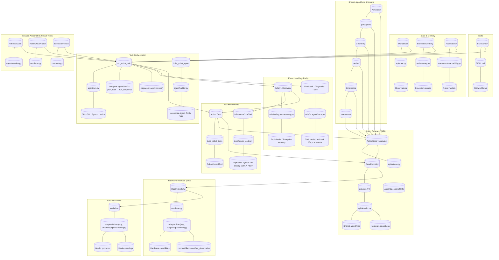

<!-- source: DeepWiki mcp.deepwiki.com · repo openJiuwen-ai/jiuwensymbiosis · page 1.2 Layered Architecture · fetched 2026-11-02 -->

# 1.2. Layered Architecture

<details>
<summary>Relevant source files</summary>

The following files were used as context for generating this wiki page:

- [AGENTS.md](AGENTS.md)
- [docs/en/explanation/architecture.md](docs/en/explanation/architecture.md)
- [docs/en/reference/cli.md](docs/en/reference/cli.md)
- [docs/images/architecture-modules.en.svg](docs/images/architecture-modules.en.svg)
- [docs/images/architecture-modules.zh.svg](docs/images/architecture-modules.zh.svg)
- [docs/images/architecture-perception.en.svg](docs/images/architecture-perception.en.svg)
- [docs/images/architecture-perception.zh.svg](docs/images/architecture-perception.zh.svg)
- [docs/images/architecture-planning.en.svg](docs/images/architecture-planning.en.svg)
- [docs/zh/explanation/architecture.md](docs/zh/explanation/architecture.md)
- [docs/zh/reference/cli.md](docs/zh/reference/cli.md)
- [scripts/cruzr/dual_arm_grasp_bringup.py](scripts/cruzr/dual_arm_grasp_bringup.py)
- [scripts/new_adapter/render.py](scripts/new_adapter/render.py)
- [scripts/validate_adapter.py](scripts/validate_adapter.py)
- [templates/xxx_adapter/calibration.py](templates/xxx_adapter/calibration.py)
- [templates/xxx_adapter/env.py](templates/xxx_adapter/env.py)
- [tests/unit_tests/test_layering.py](tests/unit_tests/test_layering.py)

</details>


This page details the layered architecture of the `jiuwensymbiosis` framework, focusing on the Agent → Rails → Tools → Skill/API → Env → Hardware layering. It explains how capability gating is enforced and how the architecture is tested. Architecture diagrams are included to illustrate the relationships between components.

The `jiuwensymbiosis` framework is designed with a layered architecture to promote modularity, reusability, and maintainability. This structure separates concerns, allowing different parts of the system to evolve independently while adhering to well-defined interfaces. The core design principle is a shared action vocabulary (`ActionSpec`) coupled with capability gating, enabling a single codebase to adapt to various robot form factors through a consistent contract per action and per-body `@implements` bindings [AGENTS.md:12-14]().

## Architecture Overview

The framework is organized into seven conceptual layers, with data and commands typically flowing top-down, and observations flowing bottom-up [AGENTS.md:93-95]().

```mermaid
graph TD
    subgraph "Top-Down Flow (Commands)"
        AgentLayer[("Agent Layer: RobotSession + build_robot_agent() + RobotAgentConfig")]
        SafetyRails[("Safety Rails: SafetyRail / RecoveryRail / VisualFeedbackRail / SkillUseRail")]
        ToolLayer[("Tool Layer: build_robot_tools(api) | RobotControlTool(api) | InProcessCodeTool")]
        SkillLayer[("Skill Layer: SKILL.md docs (visual_pick, visual_place, transport)")]
        APILayer[("API Layer: ActionSpec vocabulary (api/actions.py) + mixins implementing it (@implements)")]
        EnvLayer[("Env Layer: BaseRobotEnv — the SINGLE hardware contract (connect/disconnect/observe)")]
        HardwareLayer[("Hardware Layer: XxxDriver — adapter author's main work (serial/CAN/socket)")]
    end

    subgraph "Bottom-Up Flow (Observations)"
        HardwareLayer --> EnvLayer
        EnvLayer --> APILayer
        APILayer --> SkillLayer
        SkillLayer --> ToolLayer
        ToolLayer --> SafetyRails
        SafetyRails --> AgentLayer
    end

    AgentLayer --> SafetyRails
    SafetyRails --> ToolLayer
    ToolLayer --> SkillLayer
    SkillLayer --> APILayer
    APILayer --> EnvLayer
    EnvLayer --> HardwareLayer
```


**Title: Conceptual Layered Architecture**
Sources: [AGENTS.md:93-105]()

### Layer Responsibilities

Each layer has distinct responsibilities:

*   **Agent Layer**: Orchestrates tasks, manages the robot session, and configures the agent [docs/en/explanation/architecture.md:13-13](). Key components include `RobotSession`, `build_robot_agent()`, and `RobotAgentConfig` [AGENTS.md:98]().
*   **Safety Rails**: Intercepts actions and events to enforce safety policies, perform recovery, and collect diagnostic information. These are not a strict serial layer but hooks that trigger on specific events [docs/en/explanation/architecture.md:20-22](). Examples include `SafetyRail`, `RecoveryRail`, `VisualFeedbackRail`, `SkillUseRail`, and `TraceRail` [AGENTS.md:99]().
*   **Tool Layer**: Exposes robot capabilities as tools to the agent. This layer includes `build_robot_tools`, `RobotControlTool`, and `InProcessCodeTool` [docs/en/explanation/architecture.md:15-15]().
*   **Skill Layer**: Defines high-level robot skills, often described in `SKILL.md`, which are composed of sequences of actions [AGENTS.md:101]().
*   **API Layer**: Defines the shared action vocabulary (`ActionSpec`) and provides the interface for implementing these actions. It uses `@implements` decorators to bind actions to specific robot capabilities [AGENTS.md:102]().
*   **Env Layer**: Provides a single, hardware-agnostic contract (`BaseRobotEnv`) for interacting with the robot's environment, handling connection, disconnection, and observation [AGENTS.md:103]().
*   **Hardware Layer**: Contains the low-level drivers (`XxxDriver`) that interface directly with the physical robot hardware [AGENTS.md:104]().

Sources: [AGENTS.md:98-104](), [docs/en/explanation/architecture.md:13-22]()

### Module Ownership and Cross-Layer Relations

The following diagram illustrates how these conceptual layers map to specific code modules and their relationships.


**Title: Module Ownership and Cross-Layer Relations**
Sources: [docs/en/explanation/architecture.md:26-32](), [docs/images/architecture-modules.en.svg](), [docs/images/architecture-modules.zh.svg]()

## Capability Gating

Capability gating is a fundamental mechanism that allows the framework to adapt to different robot hardware while maintaining a unified action vocabulary. It ensures that only actions supported by the specific robot's hardware are exposed and executable.

### `BaseRobotEnv` and Capabilities

The `BaseRobotEnv` class, defined in `jiuwensymbiosis/env/base.py`, is the single hardware contract [docs/en/explanation/architecture.md:59](). Each concrete environment implementation (e.g., `XxxEnv`) declares its supported capabilities as a `frozenset` of strings [templates/xxx_adapter/env.py:29-31](). These capabilities describe various aspects of the robot, such as motion types, grasping mechanisms, and vision features.

For example, a mock arm environment might declare:
```python
capabilities = frozenset({
    "motion.cartesian", "motion.servo", "grasp.parallel",
    "vision.camera", "vision.detection",
})
```
Sources: [docs/en/explanation/architecture.md:60-67](), [templates/xxx_adapter/env.py:29-51]()

The full list of known capabilities is defined in `jiuwensymbiosis.env.base.KNOWN_CAPABILITIES` [scripts/validate_adapter.py:46](). These capabilities are categorized as follows:

| Capability String | Meaning |
|---|---|
| `motion.cartesian` | End-effector pose motion in the base coordinate system |
| `motion.joint` | Joint-space motion |
| `motion.servo` | Non-blocking streaming pose commands |
| `motion.base` | Relative motion of a planar mobile base; currently supports differential drive, not strafing |
| `motion.base_servo` | Non-blocking continuous base drive |
| `motion.lift` | Vertical torso/lifter position control |
| `motion.waist` | Torso yaw rotation |
| `motion.goal` | Drive to a target area via navigation interface |
| `motion.dual_arm` | Coordinated motion of two arms; end-effector type declared separately by `grasp.*` |
| `grasp.suction` | Suction cup control |
| `grasp.parallel` | Parallel gripper control |
| `grasp.paddle` | Clamping with two flat plates |
| `vision.camera` | Image acquisition |
| `vision.depth` | Depth acquisition |
| `vision.detection` | Object detection |
| `vision.eye_to_hand` | Hand-eye geometry using a fixed camera |
| `vision.search` | Target search; whether the robot moves is determined by the specific action |
| `planning.reachability` | Reachability check based on robot model; derived from implementation and model |
| `sorting.command` | Device-specific sorting protocol |
| `speech.tts` | Text-to-speech |

Sources: [docs/zh/explanation/architecture.md:82-107]()

### `ActionSpec` and `@implements`

The API layer defines action contracts using `ActionSpec` (defined in `api/decorators.py`) and instances in `api/actions.py` [docs/zh/explanation/architecture.md:115-116](). The `@implements(SPEC)` decorator is used to bind a method in a robot's API implementation to a shared `ActionSpec` [docs/zh/explanation/architecture.md:117-118](). This decorator attaches `ToolMeta` metadata, which includes the action's name, capability requirements, parameters, result type, preconditions, and effects.

For example, a `CruzrApi` might implement `search_target` by forwarding to a shared default implementation:
```python
class CruzrApi(BaseRobotApi):
    @implements(SEARCH_TARGET)
    def search_target(self, object_name: str = "box", reference: str | None = None,
                      relation: str = "on") -> dict:
        return defaults.search_target(self, object_name, reference, relation)
```
Sources: [docs/zh/explanation/architecture.md:120-127](), [scripts/cruzr/dual_arm_grasp_bringup.py:58-61]()

The `build_robot_tools` function then uses this metadata to create a set of available tools for the agent, filtering them based on the robot's declared capabilities [docs/en/explanation/architecture.md:15-15](). This ensures that the agent only attempts to use actions that the current robot hardware can perform.

### `validate_adapter.py`

The `scripts/validate_adapter.py` tool is crucial for enforcing capability gating and architectural compliance. It checks if an adapter's declared capabilities align with its implemented actions and driver methods [scripts/validate_adapter.py:21-22]().

The script performs various checks:
*   **Config/Env/Api Structure**: Ensures the adapter's configuration, environment, and API classes conform to framework conventions (ERROR severity) [scripts/validate_adapter.py:21]().
*   **Capability Declaration vs. Implementation**: Warns if capability declarations do not match action implementations (WARN severity) [scripts/validate_adapter.py:22]().
*   **Marked Capabilities/Optional Features**: Provides informational messages about declared capabilities and optional features (INFO severity) [scripts/validate_adapter.py:23]().

The tool imports `CAPABILITY_ACTIONS`, `CAPABILITY_DRIVER_MEMBERS`, and `KNOWN_CAPABILITIES` directly from the `jiuwensymbiosis` package to ensure consistency between the validator and the adapter generator (`scripts/new_adapter`) [scripts/validate_adapter.py:39-46]().

Sources: [scripts/validate_adapter.py:1-24](), [scripts/validate_adapter.py:39-46]()

## Layering Enforcement Tests

To prevent architectural violations, specific unit tests are in place to enforce layering rules. A key rule is that algorithm libraries like `perception/` and `motion/` should not import from the `api/` layer. This ensures that these low-level algorithms remain body-agnostic and can be composed by the API layer without creating circular dependencies.

The `tests/unit_tests/test_layering.py` module contains tests that check for these violations.
The `test_no_import_of_the_api_layer` function iterates through all Python files in the `perception/` and `motion/` directories [tests/unit_tests/test_layering.py:21-23](). For each file, it parses the abstract syntax tree (AST) to identify all imported modules [tests/unit_tests/test_layering.py:26-34](). If any imported module starts with `"jiuwensymbiosis.api"`, the test fails, indicating a layering violation [tests/unit_tests/test_layering.py:37-43]().

This test ensures that the `api/` layer composes these algorithm libraries through `api/defaults.py` and action implementations, rather than the algorithm libraries directly depending on the API [tests/unit_tests/test_layering.py:6-9](). Shared data structures needed by both layers are placed in `jiuwensymbiosis/contracts.py` to avoid import loops [tests/unit_tests/test_layering.py:9]().

Sources: [tests/unit_tests/test_layering.py:1-44]()

## Creating a New Adapter

The framework provides scaffolding and validation tools to simplify the creation of new hardware adapters.

### Adapter Scaffolding

The `scripts/new_adapter/render.py` script is used to generate boilerplate code for a new adapter based on a `Spec` [scripts/new_adapter/render.py:4](). This script generates mock adapter files (e.g., `config.py`, `env.py`, `api.py`, `session.py`) that include `SENTINEL` tags. These tags indicate sections where the user needs to replace mock implementations with real hardware-specific code [scripts/new_adapter/render.py:23]().

The generated `env.py` file, for instance, includes a placeholder `XxxEnv` class that extends `BaseRobotEnv` and declares a default set of capabilities [templates/xxx_adapter/env.py:22-51](). It also outlines the `connect()`, `disconnect()`, `get_observation()`, and `home()` methods, delegating to a mock `XxxDriver` [templates/xxx_adapter/env.py:61-67]().

Similarly, the generated `api.py` includes forwarders for generic actions, grouped by capabilities, ensuring that the adapter explicitly lists every action it offers [scripts/new_adapter/render.py:99-111]().

Sources: [scripts/new_adapter/render.py:4-23](), [templates/xxx_adapter/env.py:22-67](), [scripts/new_adapter/render.py:99-111]()

### Adapter Validation

After generating and implementing an adapter, the `scripts/validate_adapter.py` tool can be used to verify its compliance with the framework's architecture and conventions [AGENTS.md:39-41](). This tool checks for correct class structures, capability declarations, and method implementations, providing feedback on errors, warnings, and informational messages [scripts/validate_adapter.py:21-24]().

For calibration integration, a separate wrapper file (e.g., `jiuwensymbiosis/calibration/adapters/xxx.py`) is created. This wrapper exposes a `CALIBRATION_ADAPTER_SPEC` and handles machine-specific semantics like pose conversion and joint order, while generic plumbing is shared [templates/xxx_adapter/calibration.py:4-16](). The `validate_adapter.py` script also includes checks for calibration adapter conformance [templates/xxx_adapter/calibration.py:24]().

Sources: [AGENTS.md:39-41](), [scripts/validate_adapter.py:21-24](), [templates/xxx_adapter/calibration.py:4-24]()

---

