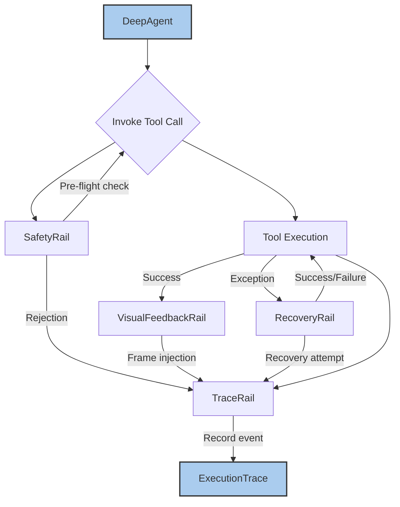

<!-- source: DeepWiki mcp.deepwiki.com · repo openJiuwen-ai/jiuwensymbiosis · page 2 Agent Core · fetched 2026-11-02 -->

# Agent Core

<details>
<summary>Relevant source files</summary>

The following files were used as context for generating this wiki page:

- [jiuwensymbiosis/adapters/_common/builder.py](jiuwensymbiosis/adapters/_common/builder.py)
- [jiuwensymbiosis/agent/builder.py](jiuwensymbiosis/agent/builder.py)
- [jiuwensymbiosis/agent/cancel.py](jiuwensymbiosis/agent/cancel.py)
- [jiuwensymbiosis/agent/fast/realtime/tracking.py](jiuwensymbiosis/agent/fast/realtime/tracking.py)
- [jiuwensymbiosis/agent/run.py](jiuwensymbiosis/agent/run.py)
- [jiuwensymbiosis/agent/session.py](jiuwensymbiosis/agent/session.py)
- [jiuwensymbiosis/agent/trace.py](jiuwensymbiosis/agent/trace.py)
- [jiuwensymbiosis/perception/detector_sidecar.py](jiuwensymbiosis/perception/detector_sidecar.py)
- [tests/unit_tests/agent/test_builder_rails.py](tests/unit_tests/agent/test_builder_rails.py)
- [tests/unit_tests/agent/test_cancel.py](tests/unit_tests/agent/test_cancel.py)
- [tests/unit_tests/fast/test_cancellation.py](tests/unit_tests/fast/test_cancellation.py)

</details>


This page provides a high-level overview of how agents are constructed, their session lifecycle, configuration, and the various rails that govern their behavior. It serves as a parent page, linking to more detailed child pages for in-depth technical explanations.

The agent core is responsible for orchestrating the robot's actions, from interpreting high-level commands to executing low-level movements, while ensuring safety and providing feedback. It bridges the gap between natural language instructions and the robot's physical capabilities.

## Agent Construction & Configuration

The `build_robot_agent` function is the primary entry point for creating a `DeepAgent` instance tailored for robotics tasks [jiuwensymbiosis/agent/builder.py:44-45](). This function takes a `RobotSession` and a `RobotAgentConfig` to assemble the agent. The `RobotAgentConfig` dataclass [jiuwensymbiosis/agent/builder.py:31]() encapsulates various settings, including model selection, execution mode (`"stepagent"` for per-step LLM orchestration or `"fastagent"` for compiled sequences), and the activation of different rails.

The agent's workspace, where persistent data like traces and session information are stored, is resolved with a specific priority: explicit argument, environment variable (`JIUWENSYMBIOSIS_WORKSPACE`), user settings (`~/.jiuwensymbiosis/settings.json`), or a default path [jiuwensymbiosis/agent/builder.py:62-84]().

A central `_RailRegistry` manages the dynamic loading and activation of various rails based on the `RobotAgentConfig` flags and the `RobotSession`'s capabilities [jiuwensymbiosis/agent/builder.py:97-102](). This ensures that only relevant rails are enabled for a given robot setup. For details, see [Agent Builder & Configuration](#2.1).

### Agent Construction Flow
```mermaid
graph TD
    A[build_robot_agent(session, config)] --> B{Resolve Workspace};
    B --> C[RobotAgentConfig];
    C --> D{Build Model};
    C --> E{Get Enabled Rails};
    E --> F[_RailRegistry];
    F --> G{Check Flags & Capabilities};
    G --> H[Instantiate Rails];
    H --> I[Inject Trace Sinks];
    I --> J[Create DeepAgent];
    J --> K[DeepAgent Instance];

    style A fill:#ace,stroke:#333,stroke-width:2px;
    style K fill:#ace,stroke:#333,stroke-width:2px;
```
Sources:
- [jiuwensymbiosis/agent/builder.py:44-45]()
- [jiuwensymbiosis/agent/builder.py:31]()
- [jiuwensymbiosis/agent/builder.py:62-84]()
- [jiuwensymbiosis/agent/builder.py:97-102]()

## RobotSession & Task Run Loop

The `RobotSession` is a critical component that acts as a lifecycle container for a robot's environment, API, and any associated sidecar processes [jiuwensymbiosis/agent/session.py:4-15](). It manages the connection and disconnection of the hardware environment and the startup/shutdown of sidecars like the detector server. The session also holds a `CancelToken` [jiuwensymbiosis/agent/session.py:91-94]() which allows for graceful cancellation of ongoing tasks, particularly important for GUI-driven interactions.

The `run_robot_task` function [jiuwensymbiosis/agent/run.py:89-96]() serves as the unified entry point for executing tasks. It dispatches to either the `"stepagent"` mode (per-step LLM orchestration) or the `"fastagent"` mode (compiled action sequences) based on the `RobotAgentConfig.exec_mode`. The `"fastagent"` path, designed for efficiency, compiles a sequence of actions from a single LLM inference and then executes it without further LLM interaction [jiuwensymbiosis/agent/run.py:11-22](). For details, see [RobotSession & Task Run Loop](#2.2).

### RobotSession Lifecycle
```mermaid
graph TD
    A[RobotSession] --> B{__enter__ / connect()};
    B --> C[begin_run(motion_log_dir)];
    C --> D{Start Sidecars};
    D --> E[env.connect()];
    E --> F{Capability Validation};
    F --> G[RobotSession Connected];
    G --> H[Task Execution];
    H --> I{__exit__ / disconnect()};
    I --> J[env.disconnect()];
    J --> K[Stop Sidecars];
    K --> L[RobotSession Disconnected];

    style A fill:#ace,stroke:#333,stroke-width:2px;
    style G fill:#ace,stroke:#333,stroke-width:2px;
    style L fill:#ace,stroke:#333,stroke-width:2px;
```
Sources:
- [jiuwensymbiosis/agent/session.py:4-15]()
- [jiuwensymbiosis/agent/session.py:91-94]()
- [jiuwensymbiosis/agent/run.py:89-96]()
- [jiuwensymbiosis/agent/run.py:11-22]()

## Safety & Execution Rails

Rails are modular components that intercept and modify the agent's behavior at various points in its execution lifecycle. They are implemented as subclasses of `AgentRail` and are dynamically loaded and enabled by the `_RailRegistry` [jiuwensymbiosis/agent/builder.py:97-102](). Key rails include:

*   **SafetyRail**: Implements pre-flight checks and safety policies to prevent unsafe actions.
*   **RecoveryRail**: Handles error conditions by attempting to recover the robot to a safe state, often by executing a `home()` command.
*   **VisualFeedbackRail**: Integrates visual information into the agent's decision-making process and can inject frames into the trace.
*   **TraceRail**: Records a detailed `ExecutionTrace` of the agent's actions, observations, and rail events for debugging and analysis [jiuwensymbiosis/agent/trace.py:4-11]().

Rails can communicate with each other, for example, other rails can push structured events to the `TraceRail` via the `TraceEventSink` protocol [jiuwensymbiosis/agent/trace.py:62-70](). For details, see [Safety & Execution Rails](#2.3).

### Rail Interaction Diagram

Sources:
- [jiuwensymbiosis/agent/builder.py:97-102]()
- [jiuwensymbiosis/agent/trace.py:4-11]()
- [jiuwensymbiosis/agent/trace.py:62-70]()

## Tracing, Replay & Trace Feedback

The `TraceRail` is responsible for capturing a comprehensive `ExecutionTrace` of an agent's run. This trace includes tool calls, arguments, results, timings, observation snapshots, and events from other rails [jiuwensymbiosis/agent/trace.py:4-11](). The trace is stored as a JSON file in the agent's workspace upon completion of an invocation [jiuwensymbiosis/agent/trace.py:17-19]().

The `ExecutionTrace` can be used for:
*   **Debugging**: Understanding the agent's decision-making process and identifying points of failure.
*   **Replay**: Re-running a task based on a recorded trace, which is useful for development and testing.
*   **Trace Feedback**: Analyzing traces to improve agent performance and robustness.

The `TraceEventSink` protocol [jiuwensymbiosis/agent/trace.py:62-70]() allows other rails to push structured events into the trace, providing a rich context for analysis. For details, see [Tracing, Replay & Trace Feedback](#2.4).

### Trace Data Flow
```mermaid
graph TD
    A[RobotAgentConfig] --> B{enable_tracing=True};
    B --> C[TraceRail];
    C --> D[ExecutionTrace];
    E[SafetyRail] -- "record_rail_event" --> C;
    F[RecoveryRail] -- "record_rail_event" --> C;
    G[VisualFeedbackRail] -- "record_rail_event" --> C;
    H[Tool Calls] -- "before_tool_call / after_tool_call" --> C;
    C --> I[Log Lines (WARNING+)];
    I --> D;
    C --> J[Flush to JSON file];
    J --> K[Workspace/traces/];

    style A fill:#ace,stroke:#333,stroke-width:2px;
    style K fill:#ace,stroke:#333,stroke-width:2px;
```
Sources:
- [jiuwensymbiosis/agent/trace.py:4-11]()
- [jiuwensymbiosis/agent/trace.py:17-19]()
- [jiuwensymbiosis/agent/trace.py:62-70]()

---

