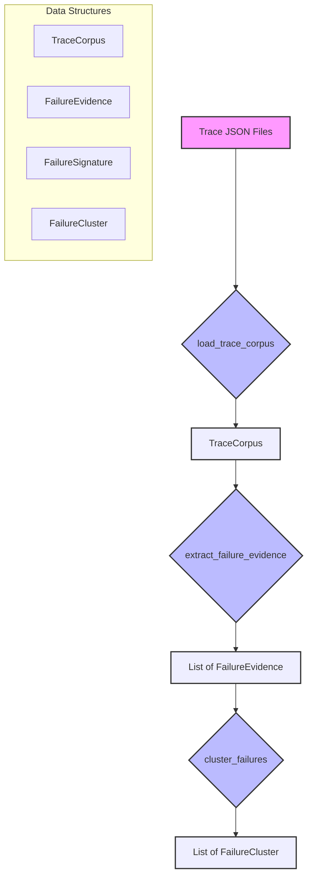

<!-- source: DeepWiki mcp.deepwiki.com · repo openJiuwen-ai/jiuwensymbiosis · page 2.4 Tracing, Replay & Trace Feedback · fetched 2026-11-02 -->

# Tracing, Replay & Trace Feedback

<details>
<summary>Relevant source files</summary>

The following files were used as context for generating this wiki page:

- [docs/en/reference/tracing.md](docs/en/reference/tracing.md)
- [examples/sample_trace/piper-demo-77816242_20260626_113438_033124_1743847.html](examples/sample_trace/piper-demo-77816242_20260626_113438_033124_1743847.html)
- [jiuwensymbiosis/agent/builder.py](jiuwensymbiosis/agent/builder.py)
- [jiuwensymbiosis/agent/mock_model.py](jiuwensymbiosis/agent/mock_model.py)
- [jiuwensymbiosis/agent/trace.py](jiuwensymbiosis/agent/trace.py)
- [jiuwensymbiosis/agent/trace_html.py](jiuwensymbiosis/agent/trace_html.py)
- [jiuwensymbiosis/rails/diagnosis.py](jiuwensymbiosis/rails/diagnosis.py)
- [jiuwensymbiosis/trace_feedback/analysis.py](jiuwensymbiosis/trace_feedback/analysis.py)
- [jiuwensymbiosis/trace_feedback/patches.py](jiuwensymbiosis/trace_feedback/patches.py)
- [tests/unit_tests/agent/test_builder_rails.py](tests/unit_tests/agent/test_builder_rails.py)
- [tests/unit_tests/agent/test_trace_html.py](tests/unit_tests/agent/test_trace_html.py)
- [tests/unit_tests/trace_feedback/test_patches.py](tests/unit_tests/trace_feedback/test_patches.py)

</details>


This page details the tracing, replay, and trace feedback mechanisms within the jiuwensymbiosis codebase. It covers the `TraceRail` for structured execution recording, the `ExecutionTrace` JSON format, the HTML report generation, the command-line interface for replaying traces, and the `trace_feedback` module for analyzing failures and proposing patches.

## TraceRail: Structured Execution Recording

The `TraceRail` is an `AgentRail` that captures detailed information about each tool call during an agent's invocation. When enabled via `RobotAgentConfig.enable_tracing`, it records tool names, arguments, results, timings, observation snapshots, rail events (e.g., `SafetyRail` rejections, `RecoveryRail` actions, `VisualFeedbackRail` frame injections), and `WARNING`+ log lines. This data is then persisted as a single JSON trace file in the workspace `traces/` directory upon invocation completion.

The `TraceRail` operates using several hooks provided by the `AgentRail` abstraction:
- `before_tool_call`: Creates a new `TraceEntry` for the upcoming tool call.
- `after_tool_call`: Completes the `TraceEntry` with results, duration, and observation.
- `on_tool_exception`: Marks the active `TraceEntry` as failed if an exception occurs.
- `before_invoke`: Initializes an `ExecutionTrace` and optionally saves an initial frame.
- `after_invoke`: Serializes and saves the `ExecutionTrace` to disk.

The `TraceRail` has a high `priority` of `100` [jiuwensymbiosis/agent/trace.py:58, jiuwensymbiosis/agent/trace.py:600]() to ensure it runs before other rails that might reject or modify tool calls, thus capturing the full context of the action.

### Data Flow and Key Components

The tracing mechanism involves several components working together:

1.  **`RobotAgentConfig`**: The `enable_tracing` flag in `RobotAgentConfig` [docs/en/reference/tracing.md:12]() controls whether tracing is active. Other configuration options like `trace_max_entries`, `trace_max_frames`, `trace_save_frames`, `trace_console`, and `trace_dir` [docs/en/reference/tracing.md:13-17]() customize the tracing behavior.
2.  **`TraceRail`**: This rail is instantiated and added to the agent's rail stack by `build_robot_agent` [jiuwensymbiosis/agent/builder.py:87-92](). It manages the lifecycle of an `ExecutionTrace` object.
3.  **`ExecutionTrace`**: An in-memory dataclass that accumulates `TraceEntry` objects and trace-level log events during an invocation [jiuwensymbiosis/agent/trace.py:400-410](). It is shared via `ctx.extra` during the agent's run.
4.  **`TraceEntry`**: Represents a single tool call, storing its details, success status, duration, observation, and associated rail and log events [jiuwensymbiosis/agent/trace.py:370-382]().
5.  **`TraceEventSink` and `StepAwareTraceEventSink`**: Protocols implemented by `TraceRail` [jiuwensymbiosis/agent/trace.py:62-109]() that allow other rails (e.g., `SafetyRail`, `RecoveryRail`, `VisualFeedbackRail`) to push structured events into the current `TraceEntry`.
6.  **`TraceLogHandler`**: A custom logging handler [jiuwensymbiosis/agent/trace.py:49]() that captures log messages (defaulting to `WARNING`+ from `jiuwensymbiosis` loggers [jiuwensymbiosis/agent/trace.py:56-57]()) and attaches them to the `ExecutionTrace` or specific `TraceEntry`.
7.  **Frame Capturing**: If `trace_save_frames` is enabled, `TraceRail` captures JPEG frames. An `initial_frame_path` is recorded at the start, and each `TraceEntry` stores an `frame_path` for the observation after the tool call completes [docs/en/reference/tracing.md:74-81]().

```mermaid
graph TD
    subgraph Agent Invocation
        A[RobotAgentConfig] --> B{build_robot_agent};
        B --> C[TraceRail (priority 100)];
        B --> D[Other Rails (Safety, Recovery, VisualFeedback)];
        C -- "before_invoke" --> E[Create ExecutionTrace];
        C -- "before_tool_call" --> F[Create TraceEntry];
        F -- "Unwrap robot_control" --> F1[Effective tool_name, args];
        D -- "record_rail_event" --> F;
        G[Loggers] -- "TraceLogHandler" --> F;
        C -- "after_tool_call" --> H[Complete TraceEntry (result, duration, observation, frame)];
        C -- "on_tool_exception" --> I[Mark TraceEntry failed];
        C -- "after_invoke" --> J[Save ExecutionTrace JSON];
        E -- "initial_frame_path" --> K[Capture initial frame];
        H -- "frame_path" --> L[Capture post-action frame];
    end

    subgraph Data Structures
        E --> M[ExecutionTrace];
        F --> N[TraceEntry];
        H --> N;
        I --> N;
        M -- "contains" --> N;
        M -- "contains" --> O[Trace-level log events];
    end

    subgraph Event Sinks
        D -- "TraceEventSink" --> C;
        D -- "StepAwareTraceEventSink" --> C;
    end

    style A fill:#f9f,stroke:#333,stroke-width:2px
    style B fill:#bbf,stroke:#333,stroke-width:2px
    style C fill:#bbf,stroke:#333,stroke-width:2px
    style D fill:#bbf,stroke:#333,stroke-width:2px
    style E fill:#ccf,stroke:#333,stroke-width:2px
    style F fill:#ccf,stroke:#333,stroke-width:2px
    style F1 fill:#ccf,stroke:#333,stroke-width:2px
    style G fill:#f9f,stroke:#333,stroke-width:2px
    style H fill:#ccf,stroke:#333,stroke-width:2px
    style I fill:#ccf,stroke:#333,stroke-width:2px
    style J fill:#ccf,stroke:#333,stroke-width:2px
    style K fill:#ccf,stroke:#333,stroke-width:2px
    style L fill:#ccf,stroke:#333,stroke-width:2px
    style M fill:#eef,stroke:#333,stroke-width:2px
    style N fill:#eef,stroke:#333,stroke-width:2px
    style O fill:#eef,stroke:#333,stroke-width:2px
```
Title: TraceRail Data Flow
Sources:
- [jiuwensymbiosis/agent/trace.py:4-26]()
- [jiuwensymbiosis/agent/trace.py:58]()
- [jiuwensymbiosis/agent/trace.py:62-109]()
- [jiuwensymbiosis/agent/trace.py:370-382]()
- [jiuwensymbiosis/agent/trace.py:400-410]()
- [jiuwensymbiosis/agent/trace.py:49]()
- [jiuwensymbiosis/agent/trace.py:56-57]()
- [jiuwensymbiosis/agent/builder.py:87-92]()
- [docs/en/reference/tracing.md:12-17]()
- [docs/en/reference/tracing.md:74-81]()

### `_unwrap_robot_control`

The `_unwrap_robot_control` function [jiuwensymbiosis/agent/trace.py:112-137]() is crucial for making traces more readable. The `RobotControlTool` in openjiuwen collapses all actions behind a single `robot_control` entry with `{action, params}`. This function unpacks this structure, so a trace entry shows the actual action name (e.g., `goto_xyzr`) instead of the generic `robot_control`. It handles JSON string arguments and falls back to the raw input if parsing fails.

Sources:
- [jiuwensymbiosis/agent/trace.py:112-137]()

### `_json_safe`

The `_json_safe` function [jiuwensymbiosis/agent/trace.py:140-172]() recursively coerces arbitrary Python objects into JSON-serializable primitives. This is necessary because `ExecutionTrace` is saved as JSON. It handles `numpy` arrays and scalars, `bytes` (encoding them as base64), dictionaries, and collections. For unsupported types, it falls back to `repr()`, truncating long outputs to `_MAX_OUTPUT_SUMMARY` (2000 characters) [jiuwensymbiosis/agent/trace.py:59]().

Sources:
- [jiuwensymbiosis/agent/trace.py:140-172]()
- [jiuwensymbiosis/agent/trace.py:59]()

## ExecutionTrace JSON Structure

A typical `ExecutionTrace` JSON file contains metadata about the invocation and a list of `TraceEntry` objects.

```json
{
  "conversation_id": "conv-1",
  "robot_name": "piper",
  "query": "pick the red box",
  "started_at": 1719207351.3,
  "entries": [
    {
      "step": 1,
      "tool_name": "goto_xyzr",
      "input_params": {"x": 150, "y": 0, "z": 80, "r": 0},
      "success": true,
      "error": null,
      "duration_s": 0.82,
      "observation": {"pose": {"x": 150.0, "y": 0.0, "z": 80.0}},
      "frame_path": "/workspace/traces/frames/<run-token>/step_001.jpg",
      "output_summary": "{\"ok\": true}",
      "rail_events": [],
      "log_events": []
    }
  ],
  "trace_log": [],
  "workspace": "/workspace",
  "initial_frame_path": "/workspace/traces/frames/<run-token>/step_000.jpg"
}
```
Each `TraceEntry` within the `entries` list represents a single tool call.
- `step`: The 1-based index of the tool call.
- `tool_name`: The effective name of the tool called (unwrapped from `robot_control`).
- `input_params`: The parameters passed to the tool.
- `success`: Boolean indicating if the tool call succeeded.
- `error`: Error message if the tool call failed.
- `duration_s`: Duration of the tool call in seconds.
- `observation`: Snapshot of the robot's observation after the tool call.
- `frame_path`: Path to the JPEG frame captured after this step.
- `output_summary`: A summary of the tool's output.
- `rail_events`: List of structured events from other rails.
- `log_events`: List of captured log messages.

The `trace_log` field contains log events that are not associated with a specific step. `initial_frame_path` points to the frame captured before the first tool call.

Sources:
- [docs/en/reference/tracing.md:131-155]()
- [docs/en/reference/tracing.md:38-57]()

## HTML Report Generation

The `jiuwensymbiosis.agent.trace_html` module provides the `render_trace_html` function [jiuwensymbiosis/agent/trace_html.py:30]() to convert a raw `ExecutionTrace` JSON into a self-contained HTML page. This HTML page embeds all captured JPEG frames as base64 data URIs, eliminating external dependencies.

Each step in the trace is rendered as a card, integrating the frame with a unified timeline of events (failures, rail events, log events). This chronological list helps in understanding the causal chain of events. The `output_summary` is presented separately to avoid cluttering the event timeline.

### Key Functions

-   **`_resolve_frame`**: Resolves a `frame_path` from the JSON to an actual file on disk, handling absolute, JSON-dir relative, and workspace/cwd relative paths [jiuwensymbiosis/agent/trace_html.py:48-79]().
-   **`_inline_frame`**: Reads the resolved frame file and converts it into a `data:image/jpeg;base64,...` URI for embedding in the HTML [jiuwensymbiosis/agent/trace_html.py:82-99]().
-   **`_step_timeline`**: Merges a step's failure, rail, and log events into a single chronological list, each with a consistent structure for rendering [jiuwensymbiosis/agent/trace_html.py:102-148]().

The HTML report includes a header with robot and conversation details, a sticky toolbar for filtering and collapsing steps, and a progress bar visualizing the success/failure of each step.

Sources:
- [jiuwensymbiosis/agent/trace_html.py:4-20]()
- [jiuwensymbiosis/agent/trace_html.py:30]()
- [jiuwensymbiosis/agent/trace_html.py:48-79]()
- [jiuwensymbiosis/agent/trace_html.py:82-99]()
- [jiuwensymbiosis/agent/trace_html.py:102-148]()
- [examples/sample_trace/piper-demo-77816242_20260626_113438_033124_1743847.html:19-87]()

## Replay CLI

The `jiuwensymbiosis-replay` CLI tool allows users to view and interact with recorded execution traces. It takes a trace JSON file as input and generates the HTML report, which can then be opened in a web browser.

```bash
jiuwensymbiosis-replay <path/to/trace.json>
```

This command leverages `render_trace_html` to create the visual representation of the trace.

Sources:
- [jiuwensymbiosis/agent/trace_html.py:4-20]()

## Trace Feedback Loop

The trace feedback loop aims to automatically analyze recurring failures in execution traces and propose patches to improve skill definitions. It consists of an offline analysis component and an online diagnosis component.

### Offline Analysis (`jiuwensymbiosis.trace_feedback.analysis`)

The `analysis.py` module [jiuwensymbiosis/trace_feedback/analysis.py:4-10]() loads trace JSON files, extracts failed steps, and clusters them based on their "failure signature".

1.  **`TraceCorpus`**: Represents a collection of loaded trace files [jiuwensymbiosis/trace_feedback/analysis.py:50-60]().
2.  **`FailureEvidence`**: Captures a failed step along with its neighboring context (previous and subsequent steps) [jiuwensymbiosis/trace_feedback/analysis.py:80-95](). This provides crucial context for understanding why a step failed.
3.  **`FailureSignature`**: A hashable dataclass that uniquely identifies a type of failure. It includes the `tool_name`, `rail_name` (if a rail caused the failure), `kind` of rail event, a normalized `reason_norm`, and `param_bucket` for parameter values [jiuwensymbiosis/trace_feedback/analysis.py:62-77](). This signature is used as the key for clustering.
4.  **`FailureCluster`**: Groups multiple `FailureEvidence` instances that share the same `FailureSignature` [jiuwensymbiosis/trace_feedback/analysis.py:98-105]().

The `load_trace_corpus` function [jiuwensymbiosis/trace_feedback/analysis.py:108-129]() loads trace JSONs, gracefully handling unreadable files. `extract_failure_evidence` [jiuwensymbiosis/trace_feedback/analysis.py:133-155]() iterates through traces to find failed steps and gather their context.


Title: Offline Trace Analysis Data Flow
Sources:
- [jiuwensymbiosis/trace_feedback/analysis.py:4-10]()
- [jiuwensymbiosis/trace_feedback/analysis.py:50-60]()
- [jiuwensymbiosis/trace_feedback/analysis.py:80-95]()
- [jiuwensymbiosis/trace_feedback/analysis.py:62-77]()
- [jiuwensymbiosis/trace_feedback/analysis.py:98-105]()
- [jiuwensymbiosis/trace_feedback/analysis.py:108-129]()
- [jiuwensymbiosis/trace_feedback/analysis.py:133-155]()

### Patch Proposals (`jiuwensymbiosis.trace_feedback.patches`)

The `patches.py` module [jiuwensymbiosis/trace_feedback/patches.py:4-10]() takes `FailureCluster` objects and generates `SkillPatchProposal` instances. These proposals are human-reviewable suggestions for modifying `SKILL.md` files to address recurring failures.

-   **`SkillPatchProposal`**: A dataclass representing a proposed patch, including a summary, evidence signatures, example failures, the proposed diff (as a string), confidence level, risks, and validation suggestions [jiuwensymbiosis/trace_feedback/patches.py:40-50]().
-   **`propose_skill_patches`**: The main function that generates proposals, currently deterministic and without LLM involvement [jiuwensymbiosis/trace_feedback/patches.py:53]().
-   **`_main_template`**: Generates the core patch suggestion based on the `FailureSignature`, providing specific advice for `SafetyRail` rejections (e.g., `z_min_safe`, `workspace_bounds`, `joint_limits`) or visual tool failures [jiuwensymbiosis/trace_feedback/patches.py:73-98]().
-   **`_append_recovery_advice`**: Appends advice related to `RecoveryRail` actions if recovery events are present in the failure examples [jiuwensymbiosis/trace_feedback/patches.py:101-112](). This is a post-processing step because recovery events typically indicate success (the rail *fixed* the issue), so they don't directly form part of the initial failure signature.

Sources:
- [jiuwensymbiosis/trace_feedback/patches.py:4-10]()
- [jiuwensymbiosis/trace_feedback/patches.py:40-50]()
- [jiuwensymbiosis/trace_feedback/patches.py:53]()
- [jiuwensymbiosis/trace_feedback/patches.py:73-98]()
- [jiuwensymbiosis/trace_feedback/patches.py:101-112]()

### Online Diagnosis (`jiuwensymbiosis.rails.diagnosis`)

The `DiagnosisRail` [jiuwensymbiosis/rails/diagnosis.py:4-10]() is the online component of the trace feedback loop. It injects a compact failure diagnosis into the next LLM turn when a step fails. This provides immediate feedback to the LLM, allowing it to potentially self-correct.

-   **Two-phase injection**: Diagnosis messages are *staged* in `on_tool_exception` or `after_tool_call` and then *flushed* in `before_model_call` [jiuwensymbiosis/rails/diagnosis.py:15-20](). This ensures the diagnosis message appears in the correct order relative to openjiuwen's `ToolMessage`.
-   **Priority**: `DiagnosisRail` has a `priority` of `5` [jiuwensymbiosis/rails/diagnosis.py:55](), lower than `TraceRail` (100) but higher than default rails, ensuring `TraceRail` has already created/updated the active entry.
-   **Message Content**: The diagnosis message includes details about the current failed step, a causal chain of relevant historical events (e.g., `SafetyRail` rejections, `RecoveryRail` actions), and system state (e.g., robot pose after recovery) [jiuwensymbiosis/rails/diagnosis.py:147-157]().

Sources:
- [jiuwensymbiosis/rails/diagnosis.py:4-10]()
- [jiuwensymbiosis/rails/diagnosis.py:15-20]()
- [jiuwensymbiosis/rails/diagnosis.py:55]()
- [jiuwensymbiosis/rails/diagnosis.py:147-157]()

---

