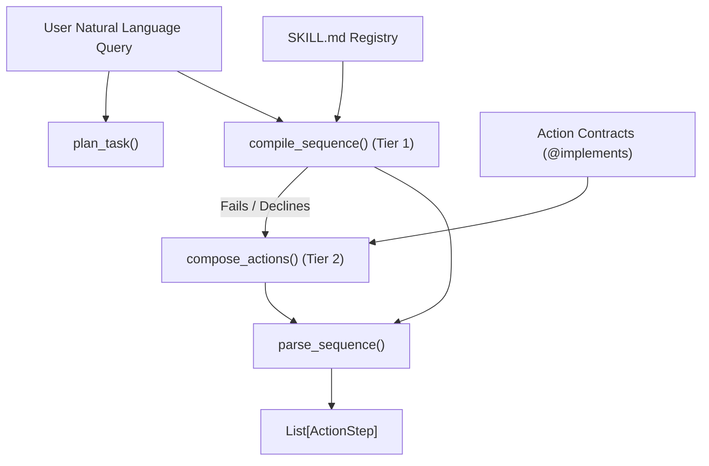
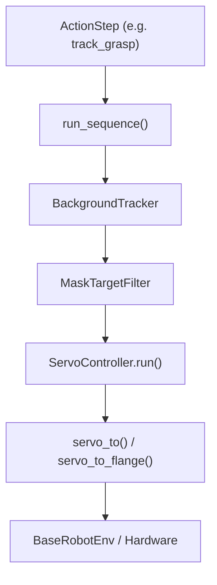

<!-- source: DeepWiki mcp.deepwiki.com · repo openJiuwen-ai/jiuwensymbiosis · page 3 Fast-Path Planning & Execution · fetched 2026-11-02 -->

# Fast-Path Planning & Execution

Relevant source files

The following files were used as context for generating this wiki page:

- [jiuwensymbiosis/agent/fast/__init__.py](jiuwensymbiosis/agent/fast/__init__.py)
- [jiuwensymbiosis/agent/fast/planner.py](jiuwensymbiosis/agent/fast/planner.py)
- [jiuwensymbiosis/agent/fast/realtime/servo.py](jiuwensymbiosis/agent/fast/realtime/servo.py)
- [jiuwensymbiosis/agent/fast/runner.py](jiuwensymbiosis/agent/fast/runner.py)
- [jiuwensymbiosis/agent/fast/sequence.py](jiuwensymbiosis/agent/fast/sequence.py)
- [tests/unit_tests/fast/test_compiler.py](tests/unit_tests/fast/test_compiler.py)
- [tests/unit_tests/fast/test_runner.py](tests/unit_tests/fast/test_runner.py)
- [tests/unit_tests/fast/test_sequence.py](tests/unit_tests/fast/test_sequence.py)
- [tests/unit_tests/fast/test_tracking.py](tests/unit_tests/fast/test_tracking.py)

## Purpose and Scope

The C1 fast-path architecture in `jiuwensymbiosis` bypasses traditional per-step LLM inference loops during execution. Instead of querying a language model at every state transition, the agent translates a user query and a library of task-specific Markdown specifications (`SKILL.md`) into a single, compiled, and validated sequence of primitive actions (`ActionStep`). A task-agnostic runtime then executes this sequence deterministically while high-frequency background trackers and servo loops handle closed-loop visual adjustments.

For deep technical specifications, refer to the child pages:
- [Planner & Sequence Validation](#3.1)
- [Sequence Runner](#3.2)
- [Real-Time Servo & Tracking](#3.3)
- [Skill Library (SKILL.md)](#3.4)

Sources: `[jiuwensymbiosis/agent/fast/__init__.py:4-16](), [jiuwensymbiosis/agent/fast/sequence.py:8-19]()`

---

### Diagram: Planning Pipeline (Natural Language to Code Entities)

Sources: `[jiuwensymbiosis/agent/fast/planner.py:4-24](), [jiuwensymbiosis/agent/fast/sequence.py:15-36]()`

---

## 3.1 Planner & Sequence Validation

Task planning uses a two-tier strategy orchestrated by `plan_task`. Tier 1 (`compile_sequence`) simultaneously selects and expands matching skills from the `SKILL.md` library in a single LLM round trip. If Tier 1 declines or produces invalid output, Tier 2 (`compose_actions`) generates a sequence directly from raw action contracts without skill wrappers. 

Both tiers output a standard list of steps that `parse_sequence` subjects to strict syntax, vocabulary matching, and safety constraints. Parameter evaluation relies on a whitelisted AST evaluator (`evaluate_expr` and `resolve_params`) that resolves symbolic variables (such as detection bindings like `pick.x`) against runtime state without executing arbitrary code. Control flow constructs like `LoopStep` allow repetitive sub-tasks to be parsed and validated safely.

For complete details on schema checking, expression safety, and tier fallback behavior, see [Planner & Sequence Validation](#3.1).

Sources: `[jiuwensymbiosis/agent/fast/planner.py:4-36](), [jiuwensymbiosis/agent/fast/sequence.py:4-36]()`

---

## 3.2 Sequence Runner

Once a sequence is validated, `run_sequence` executes the instructions against a live robot session. The runner is entirely task-agnostic: it has no hardcoded knowledge of picking, placing, or carrying. Instead, it relies on an action index built from `@implements` annotations to dispatch arbitrary operations by name.

Execution begins with a pre-scan (`_prescan`) to initialize spatial contexts and record initial body states. Throughout execution, steps can store perception outputs into named bindings. The runner also monitors location drift, executes safe retreat maneuvers upon failures, confirms successful grasps via hardware hooks, and bridges execution steps to the capability-filtered tool layer.

For detailed mechanics on session lifecycles, execution configuration (`SkillExecConfig`), and recovery behaviors, see [Sequence Runner](#3.2).

Sources: `[jiuwensymbiosis/agent/fast/runner.py:4-20](), [jiuwensymbiosis/agent/fast/runner.py:69-118]()`

---

### Diagram: Execution & Servo Loop (Natural Language Bindings to Code Entities)

Sources: `[jiuwensymbiosis/agent/fast/runner.py:6-17](), [jiuwensymbiosis/agent/fast/realtime/servo.py:6-26]()`

---

## 3.3 Real-Time Servo & Tracking

High-frequency closed-loop motion is managed by the realtime subsystem. `ServoController` operates at a configurable control rate (`ServoConfig.control_hz`), continuously reading tool poses, querying target providers, applying slew-rate limits (`max_lin_step_mm`, `max_ang_step_deg`), and issuing non-blocking pose commands until convergence tolerances are satisfied.

To prevent jitter and handle visual occlusions, the `BackgroundTracker` runs alongside `MaskTargetFilter`, classifying tracking states into categories such as visible stable, static occlusion, or blind last-target fallback. Compound bindings like `track_detect` and `track_grasp` integrate these filters directly into the fast-path execution loop.

For complete coverage of control loop configurations, filtering states, and servo bindings, see [Real-Time Servo & Tracking](#3.3).

Sources: `[jiuwensymbiosis/agent/fast/realtime/servo.py:6-26](), [jiuwensymbiosis/agent/fast/realtime/mask_tracking.py:1-40]()`

---

## 3.4 Skill Library (SKILL.md)

Skill specifications define reusable operational workflows without requiring procedural Python scripts. Placed within the skill registry path, each `SKILL.md` file documents a specific capability (such as `visual_pick`, `visual_place`, or `transport`) complete with pre-conditions, effects, and capability-conditioned branching rules.

The planning compiler reads these Markdown definitions to synthesize correct execution traces at runtime, ensuring that skills remain body-agnostic and fully transferable across different robot configurations.

For authoring conventions, directory layouts, and capability conditioning rules, see [Skill Library (SKILL.md)](#3.4).

Sources: `[jiuwensymbiosis/agent/fast/__init__.py:14-16](), [jiuwensymbiosis/agent/fast/registry.py:25-31]()`

---

