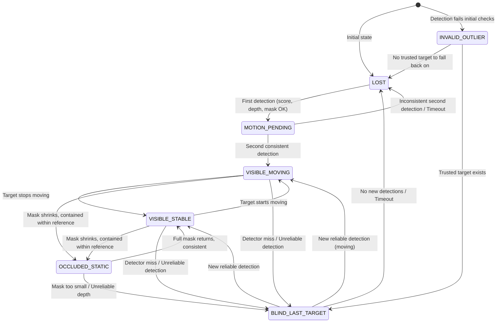

<!-- source: DeepWiki mcp.deepwiki.com · repo openJiuwen-ai/jiuwensymbiosis · page 3.3 Real-Time Servo & Tracking · fetched 2026-11-02 -->

# Real-Time Servo & Tracking

<details>
<summary>Relevant source files</summary>

The following files were used as context for generating this wiki page:

- [jiuwensymbiosis/adapters/so101/lowlevel.py](jiuwensymbiosis/adapters/so101/lowlevel.py)
- [jiuwensymbiosis/agent/fast/__init__.py](jiuwensymbiosis/agent/fast/__init__.py)
- [jiuwensymbiosis/agent/fast/realtime/__init__.py](jiuwensymbiosis/agent/fast/realtime/__init__.py)
- [jiuwensymbiosis/agent/fast/realtime/binding.py](jiuwensymbiosis/agent/fast/realtime/binding.py)
- [jiuwensymbiosis/agent/fast/realtime/mask_tracking.py](jiuwensymbiosis/agent/fast/realtime/mask_tracking.py)
- [jiuwensymbiosis/agent/fast/realtime/servo.py](jiuwensymbiosis/agent/fast/realtime/servo.py)
- [jiuwensymbiosis/agent/fast/runner.py](jiuwensymbiosis/agent/fast/runner.py)
- [jiuwensymbiosis/rails/safety.py](jiuwensymbiosis/rails/safety.py)
- [tests/unit_tests/adapters/so101/test_lowlevel.py](tests/unit_tests/adapters/so101/test_lowlevel.py)
- [tests/unit_tests/adapters/so101/test_safety_integration.py](tests/unit_tests/adapters/so101/test_safety_integration.py)
- [tests/unit_tests/fast/test_run_fast_task.py](tests/unit_tests/fast/test_run_fast_task.py)
- [tests/unit_tests/fast/test_runner.py](tests/unit_tests/fast/test_runner.py)
- [tests/unit_tests/fast/test_tracking.py](tests/unit_tests/fast/test_tracking.py)
- [tests/unit_tests/rails/test_safety.py](tests/unit_tests/rails/test_safety.py)

</details>


This page details the real-time servo and tracking mechanisms within the `jiuwensymbiosis` framework, which are crucial for the fast-path execution of robot actions. It covers the `ServoController` loop, slewing logic, the `BackgroundTracker` for continuous perception, the states and behavior of the `MaskTargetFilter`, and the specific bindings for `track_detect` and `track_grasp` operations. These components enable precise and responsive robot movements, especially for tasks requiring visual feedback and object manipulation.

## ServoController Loop

The `ServoController` [jiuwensymbiosis/agent/fast/realtime/servo.py:1-156]() is the core of the high-frequency servo control loop. It operates at a configurable `control_hz` [jiuwensymbiosis/agent/fast/realtime/servo.py:56]() and, on each tick, performs the following steps:

1.  **Reads Current Pose**: It obtains the robot's current end-effector pose using a `read_pose` callable [jiuwensymbiosis/agent/fast/realtime/servo.py:88]().
2.  **Requests Target Pose**: It queries a `target_provider` for the latest goal pose. This provider is typically fed by a background perception tracker. If no target is available, the robot holds its current position.
3.  **Slew-Limits Movement**: It calculates a step towards the goal, applying slew limits (`max_lin_step_mm` and `max_ang_step_deg`) [jiuwensymbiosis/agent/fast/realtime/servo.py:57-58]() to prevent abrupt movements. The slew can optionally chain from the previous commanded step instead of re-anchoring to the live pose.
4.  **Issues Non-Blocking Command**: It sends a non-blocking pose command to the robot using a `servo_to` callable [jiuwensymbiosis/agent/fast/realtime/servo.py:92]().

The `ServoController` [jiuwensymbiosis/agent/fast/realtime/servo.py:33]() terminates when the robot's end-effector settles within a specified tolerance (`pos_tol_mm`, `ang_tol_deg`) [jiuwensymbiosis/agent/fast/realtime/servo.py:59-60]() for `settle_ticks` [jiuwensymbiosis/agent/fast/realtime/servo.py:61]() consecutive ticks, when progress towards the target stalls, when an absolute safety deadline (`absolute_timeout_s`) [jiuwensymbiosis/agent/fast/realtime/servo.py:68]() expires, or if the target is lost for too long (`lost_target_grace_s`) [jiuwensymbiosis/agent/fast/realtime/servo.py:72]().

The `ServoConfig` [jiuwensymbiosis/agent/fast/realtime/servo.py:53]() dataclass holds the tuning parameters for the servo loop. These parameters can be derived from the session's motion profile configuration using `servo_config_from_session` [jiuwensymbiosis/agent/fast/realtime/servo.py:111](), allowing for adapter-specific defaults.

### Slewing

Slewing is the process of limiting the maximum linear and angular movement per control tick. This prevents jerky motions and ensures smooth transitions, especially when the target pose changes rapidly or is far from the current pose. The `_slew` function [tests/unit_tests/fast/test_tracking.py:27]() (though not shown in full, its existence is implied by the test) is responsible for calculating the intermediate pose that respects these limits. The `ServoBinding` [jiuwensymbiosis/agent/fast/realtime/binding.py:38]() can be configured to `slew_from_last_command` [jiuwensymbiosis/agent/fast/realtime/binding.py:54](), meaning the slew origin is the previously commanded step rather than the live pose, which can be beneficial for certain robot kinematics like the SO-101 [jiuwensymbiosis/adapters/so101/lowlevel.py:1-20]().

```mermaid
graph TD
    A[ServoController.run()] --> B{Read Current Pose};
    B --> C{Get Latest Target Pose};
    C -- "Target available" --> D{Calculate Slew-Limited Step};
    C -- "No target / Target lost" --> E[Hold Position / Abort];
    D --> F{Issue Non-Blocking Pose Command};
    F --> G{Check Convergence / Timeout};
    G -- "Not converged" --> B;
    G -- "Converged / Timeout / Lost" --> H[Return ServoResult];

    subgraph ServoConfig
        SC1[control_hz]
        SC2[max_lin_step_mm]
        SC3[max_ang_step_deg]
        SC4[pos_tol_mm]
        SC5[ang_tol_deg]
        SC6[settle_ticks]
        SC7[timeout_s]
        SC8[absolute_timeout_s]
        SC9[lost_target_grace_s]
    end

    style SC1 fill:#fff,stroke:#333,stroke-width:2px
    style SC2 fill:#fff,stroke:#333,stroke-width:2px
    style SC3 fill:#fff,stroke:#333,stroke-width:2px
    style SC4 fill:#fff,stroke:#333,stroke-width:2px
    style SC5 fill:#fff,stroke:#333,stroke-width:2px
    style SC6 fill:#fff,stroke:#333,stroke-width:2px
    style SC7 fill:#fff,stroke:#333,stroke-width:2px
    style SC8 fill:#fff,stroke:#333,stroke-width:2px
    style SC9 fill:#fff,stroke:#333,stroke-width:2px
```
**Diagram: ServoController Loop**

Sources:
- [jiuwensymbiosis/agent/fast/realtime/servo.py:1-156]()
- [jiuwensymbiosis/agent/fast/realtime/binding.py:54]()
- [jiuwensymbiosis/adapters/so101/lowlevel.py:1-20]()
- [tests/unit_tests/fast/test_tracking.py:27]()

## BackgroundTracker

The `BackgroundTracker` [jiuwensymbiosis/agent/fast/realtime/tracking.py:28]() is responsible for continuously providing updated target poses to the `ServoController`. It operates in a separate thread, asynchronously processing frames from a `StreamingFrameSource` [jiuwensymbiosis/agent/fast/realtime/binding.py:64]() and updating the latest detected target.

Key aspects of the `BackgroundTracker`:

*   **Staleness Policy**: It has a `staleness_s` parameter [tests/unit_tests/fast/test_tracking.py:6]() to ensure that motion is not driven by arbitrarily old frames.
*   **Frame Source**: It consumes frames from a `StreamingFrameSource` [jiuwensymbiosis/agent/fast/realtime/binding.py:64]() which, in turn, pulls `(rgb, depth)` observations from `session.env.get_observation()` [jiuwensymbiosis/agent/fast/realtime/binding.py:119]().
*   **Target Filtering**: The raw detections from the frame source are passed through a `MaskTargetFilter` [jiuwensymbiosis/agent/fast/realtime/mask_tracking.py:164]() (if enabled) to refine and stabilize the target pose.
*   **Waiting Mechanisms**: It provides methods like `wait_first`, `wait_for_next`, and `wait_for_capture_after` [tests/unit_tests/fast/test_tracking.py:8]() to allow the main execution thread to synchronize with the tracker's perception updates.

```mermaid
graph TD
    A[RobotSession] --> B[ServoBinding];
    B --> C[StreamingFrameSource];
    C -- "start_frames()" --> D[BackgroundTracker];
    D -- "get_latest_target()" --> E[ServoController];
    C -- "grab_frame()" --> F[session.env.get_observation()];
    F --> C;
    D -- "update(detection)" --> G[MaskTargetFilter];
    G -- "filtered_target" --> D;
```
**Diagram: BackgroundTracker Data Flow**

Sources:
- [jiuwensymbiosis/agent/fast/realtime/tracking.py:28]()
- [jiuwensymbiosis/agent/fast/realtime/binding.py:64]()
- [jiuwensymbiosis/agent/fast/realtime/binding.py:119]()
- [jiuwensymbiosis/agent/fast/realtime/mask_tracking.py:164]()
- [tests/unit_tests/fast/test_tracking.py:6]()
- [tests/unit_tests/fast/test_tracking.py:8]()

## MaskTargetFilter States

The `MaskTargetFilter` [jiuwensymbiosis/agent/fast/realtime/mask_tracking.py:164]() is an opt-in component that refines tracking targets, especially for fixed-camera grasp tracking. It uses mask and depth information to maintain a "trusted" target, even in the presence of partial occlusion or noisy detections.

The `MaskTrackingState` [jiuwensymbiosis/agent/fast/realtime/mask_tracking.py:24]() enum defines the possible states of the filter:

*   `VISIBLE_STABLE`: The target is visible and its mask and position are consistent across frames [tests/unit_tests/fast/test_tracking.py:67]().
*   `VISIBLE_MOVING`: The target is visible and its position is consistently changing, indicating actual motion [tests/unit_tests/fast/test_tracking.py:143]().
*   `MOTION_PENDING`: An initial frame of motion has been detected, but not yet confirmed by a second consistent frame [tests/unit_tests/fast/test_tracking.py:138]().
*   `OCCLUDED_STATIC`: The target is partially occluded, but its mask remains mostly contained within a dilation of the trusted reference mask. The filter freezes the last known good position [tests/unit_tests/fast/test_tracking.py:83]().
*   `BLIND_LAST_TARGET`: The detector has missed the target, or the current detection is unreliable (e.g., low score, high depth span). The filter returns the last trusted target [tests/unit_tests/fast/test_tracking.py:161]().
*   `INVALID_OUTLIER`: The current detection is considered an outlier and is rejected.
*   `LOST`: The target has been lost, and there is no trusted reference to fall back on [tests/unit_tests/fast/test_tracking.py:182]().

The `MaskTrackingConfig` [jiuwensymbiosis/agent/fast/realtime/mask_tracking.py:37]() dataclass provides various thresholds and parameters to tune the filter's behavior, such as `min_score`, `dilation_px`, `static_containment`, `min_visible_ratio`, `occlusion_area_ratio`, and `motion_confirm_frames` [jiuwensymbiosis/agent/fast/realtime/mask_tracking.py:49-60]().


**Diagram: MaskTargetFilter State Transitions**

Sources:
- [jiuwensymbiosis/agent/fast/realtime/mask_tracking.py:24]()
- [jiuwensymbiosis/agent/fast/realtime/mask_tracking.py:37]()
- [jiuwensymbiosis/agent/fast/realtime/mask_tracking.py:49-60]()
- [jiuwensymbiosis/agent/fast/realtime/mask_tracking.py:164]()
- [tests/unit_tests/fast/test_tracking.py:67]()
- [tests/unit_tests/fast/test_tracking.py:83]()
- [tests/unit_tests/fast/test_tracking.py:138]()
- [tests/unit_tests/fast/test_tracking.py:143]()
- [tests/unit_tests/fast/test_tracking.py:161]()
- [tests/unit_tests/fast/test_tracking.py:182]()

## `track_detect` and `track_grasp` Bindings

The fast-path sequence runner [jiuwensymbiosis/agent/fast/runner.py:1-20]() uses special operations `TRACK_DETECT` [jiuwensymbiosis/agent/fast/sequence.py:38]() and `TRACK_GRASP` [jiuwensymbiosis/agent/fast/sequence.py:39]() to leverage the real-time servo and tracking capabilities. These operations are not standard API calls but rather internal directives for the runner.

### `TRACK_DETECT`

`TRACK_DETECT` [jiuwensymbiosis/agent/fast/sequence.py:38]() is used for eye-in-hand relative tracking. When this operation is encountered in a sequence, the runner initiates a `BackgroundTracker` [jiuwensymbiosis/agent/fast/realtime/tracking.py:28]() to continuously detect and provide target poses. The `ServoController` [jiuwensymbiosis/agent/fast/realtime/servo.py:33]() then uses these targets to servo the end-effector. If the wrist camera is occluded (e.g., by a gripped object), the system falls back to a home pre-scan [jiuwensymbiosis/agent/fast/runner.py:13-15]().

### `TRACK_GRASP`

`TRACK_GRASP` [jiuwensymbiosis/agent/fast/sequence.py:39]() is used for eye-to-hand absolute two-stage approach/descend tracking. This operation also utilizes the `BackgroundTracker` [jiuwensymbiosis/agent/fast/realtime/tracking.py:28()] and `ServoController` [jiuwensymbiosis/agent/fast/realtime/servo.py:33()] but focuses on precise alignment for grasping. It uses absolute grasp targets for both the approach and descend phases [tests/unit_tests/fast/test_runner.py:182](). The runner includes logic for re-alignment passes (`max_re_align_iters`) [jiuwensymbiosis/agent/fast/runner.py:84]() and retries (`max_grasp_retries`) [jiuwensymbiosis/agent/fast/runner.py:87]() if the grasp is not confirmed.

### `ServoBinding`

The `ServoBinding` class [jiuwensymbiosis/agent/fast/realtime/binding.py:38]() acts as an adapter between the generic servo IO required by the real-time loop and the specific `RobotSession` implementation. It provides the necessary callables for `read_pose`, `servo_to`, `grip`, and `frames` by mapping them to the `session.api` and `session.env` methods [jiuwensymbiosis/agent/fast/realtime/binding.py:88-113](). This abstraction allows the `ServoController` and `BackgroundTracker` to remain hardware-agnostic.

The `ServoBinding` [jiuwensymbiosis/agent/fast/realtime/binding.py:38]() also integrates with the `SafetyRail` [jiuwensymbiosis/rails/safety.py:95]() to validate pose commands before they are sent to the hardware [jiuwensymbiosis/agent/fast/realtime/binding.py:94](). This ensures that real-time servo commands adhere to defined safety limits, such as `z_floor_mm` and `xy_bounds_mm` [tests/unit_tests/rails/test_safety.py:27-78]().

```mermaid
graph TD
    A[ActionStep: TRACK_DETECT] --> B{Runner initiates BackgroundTracker};
    A[ActionStep: TRACK_GRASP] --> B;
    B --> C[BackgroundTracker];
    C -- "Provides target poses" --> D[ServoController];
    D -- "Commands robot" --> E[ServoBinding];
    E -- "read_pose()" --> F[session.api.get_pose()];
    E -- "servo_to(pose)" --> G[session.api.servo_to_tip() / session.env.servo_to_flange()];
    E -- "grip(closed)" --> H[session.api.close_gripper() / session.env.set_end_effector()];
    E -- "frames" --> I[StreamingFrameSource];
    I -- "grab_frame()" --> J[session.env.get_observation()];
    G --> K[SafetyRail.validate_pose()];
    K -- "Rejects unsafe motion" --> L[Error];

    subgraph Fast-Path Runner
        A
    end

    subgraph Real-Time Components
        C
        D
        E
        I
    end

    subgraph RobotSession
        F
        G
        H
        J
    end

    subgraph Safety
        K
        L
    end
```
**Diagram: `track_detect` / `track_grasp` Execution Flow**

Sources:
- [jiuwensymbiosis/agent/fast/runner.py:1-20]()
- [jiuwensymbiosis/agent/fast/sequence.py:38]()
- [jiuwensymbiosis/agent/fast/sequence.py:39]()
- [jiuwensymbiosis/agent/fast/realtime/tracking.py:28]()
- [jiuwensymbiosis/agent/fast/realtime/servo.py:33]()
- [jiuwensymbiosis/agent/fast/realtime/binding.py:38]()
- [jiuwensymbiosis/agent/fast/realtime/binding.py:88-113]()
- [jiuwensymbiosis/agent/fast/realtime/binding.py:94]()
- [jiuwensymbiosis/agent/fast/runner.py:13-15]()
- [jiuwensymbiosis/agent/fast/runner.py:84]()
- [jiuwensymbiosis/agent/fast/runner.py:87]()
- [jiuwensymbiosis/rails/safety.py:95]()
- [tests/unit_tests/fast/test_runner.py:182]()
- [tests/unit_tests/rails/test_safety.py:27-78]()

---

