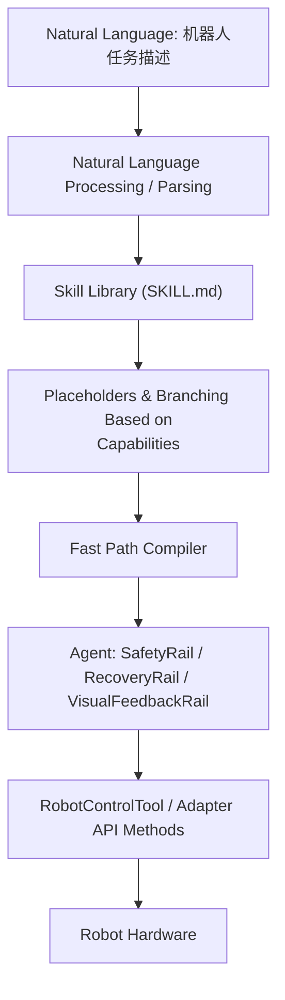
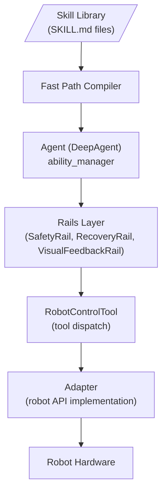

<!-- source: DeepWiki mcp.deepwiki.com · repo openJiuwen-ai/jiuwensymbiosis · page 3.4 Skill Library (SKILL.md) · fetched 2026-11-02 -->

# Skill Library (SKILL.md)

Relevant source files

The following files were used as context for generating this wiki page:

- [jiuwensymbiosis/agent/config.py](jiuwensymbiosis/agent/config.py)
- [jiuwensymbiosis/agent/fast/ability_exec.py](jiuwensymbiosis/agent/fast/ability_exec.py)
- [jiuwensymbiosis/rails/__init__.py](jiuwensymbiosis/rails/__init__.py)
- [jiuwensymbiosis/rails/recovery.py](jiuwensymbiosis/rails/recovery.py)
- [jiuwensymbiosis/skills/visual_pick/SKILL.md](jiuwensymbiosis/skills/visual_pick/SKILL.md)
- [jiuwensymbiosis/skills/visual_place/SKILL.md](jiuwensymbiosis/skills/visual_place/SKILL.md)
- [tests/unit_tests/rails/test_diagnosis.py](tests/unit_tests/rails/test_diagnosis.py)
- [tests/unit_tests/rails/test_recovery.py](tests/unit_tests/rails/test_recovery.py)

The Skill Library in `SKILL.md` files within the jiuwensymbiosis repository defines high-level robot skills such as `visual_pick`, `visual_place`, and `transport`. These skill specifications encapsulate detailed structured instructions, relevant predicates (capabilities), and authoring conventions that govern how skills are authored, interpreted, and executed within the framework. This page describes the implementation details, data flow, and conventions for these skills, highlighting capability-conditioned branching and the cooperative interactions with the agent's Rails (middleware layers).

---

## 1. Purpose and Scope

The `SKILL.md` files specify the robot's discrete skills that interpret natural language goals into sequences of primitive actions. These skills encapsulate:

- When and how a skill activates based on natural language intent and robot capabilities.
- The expected preconditions (`requires`), effects (`provides`), and resource invalidations.
- Structured action sequencing with placeholders dynamically mapped to available robot capabilities.
- Capability-conditioned branching to select the correct primitive actions based on robot hardware features.
- Coordination with the layered safety, recovery, and feedback Rails to ensure robust execution.

The primary skills illustrated in the codebase are:

- `visual_pick`: Vision-guided object grasping.
- `visual_place`: Vision or coordinate guided object placement.
- `transport`: Higher-level composition skill chaining pick and place.

The Skill Library is a foundational contract between natural language task inputs and the precise robotic hardware API commands to be dispatched by capability-aware runners.

---

## 2. Skill Specification Structure

Each `SKILL.md` file is a structured document with frontmatter metadata and Markdown documentation describing operation details. The key metadata fields include:

| Field               | Description                                                       |
|---------------------|-------------------------------------------------------------------|
| `name`              | Skill identifier string (e.g. `"visual_pick"`).                   |
| `description`       | Short natural language explanation of the skill purpose.         |
| `requires`          | List of boolean predicates or capability flags required before use (e.g. `"payload.clear"`). |
| `provides`          | List of predicates guaranteed after success (e.g. `"payload.held"`). |
| `invalidates`       | List of predicates that become invalid post skill, e.g. `"body.home"`. |
| `invalidates_locations` | Boolean indicating whether known object locations are invalidated. |

The body of the file extensively documents:

- When to enable the skill (including natural language triggers and capability gating).
- How to extract task intent and object references from natural language commands.
- Detailed action mapping tables linking placeholders (e.g., `<检测目标>` meaning `<detect target>`) to robot control action names conditioned on robot capabilities axes.
- Signal conventions for spatial relations (`reference` and `relation`) to disambiguate objects in natural language.
- Step sequences with parameters, including optional "fast" primitives for real-time visual servoing.
- Failure handling protocols informed by load state (`holding_payload`).
- Interactions with SafetyRail, RecoveryRail, VisualFeedbackRail for robust execution.
- Anti-patterns to avoid during skill authoring to prevent unsafe or incorrect behaviors.

---

## 3. Capability-Conditioned Action Mapping & Branching

The skills implement branching logic based on capability axes to adapt to the diverse robot hardware supported by the system. Two main orthogonal axes control the choice of primitive actions:

- `motion.*`: What parts of the robot can move, e.g., `motion.cartesian` (single-arm), `motion.dual_arm`, or `motion.base` (mobile base).
- `grasp.*`: What the robot's end effector can do, e.g., `grasp.parallel` (parallel jaw gripper), `grasp.suction` (vacuum end effector), `grasp.paddle` (dual-arm paddles).

This results in tables mapping abstract placeholders to concrete primitive actions for each capability combination.

### Example: visual_pick action mapping excerpt

| Your capability           | `<检测目标>`            | `<抓取>`          | `<释放>`         |
|--------------------------|------------------------|-------------------|------------------|
| `grasp.parallel`          | `get_grasp_info_simple` | `close_gripper`   | `open_gripper`   |
| `grasp.suction`           | `get_grasp_info_simple` | `activate_suction`| `deactivate_suction` |
| `motion.dual_arm`         | `locate_for_grasp`      | `dual_arm_grasp`  | `dual_arm_place` |

In run-time, the skill author only uses these placeholders and the fast runner compiles these into concrete actions on the adapter side per the robot's actual capabilities.

### Visual servoing special primitives

Optional special fast-path primitives like `track_grasp` and `track_detect` enable continuous visual feedback loops tightly integrated with the robot control motions for more robust grasp positioning. These appear in the fast execution path only if permitted by the robot's capabilities and the skill's configuration.

---

## 4. Natural Language to Code Entity Bridging

The skill definitions serve as the bridge between natural language task instructions and fine-grained code entities (actions, tools, rails). This is achieved by:

- Mapping natural language parse results on the user task (e.g., references to objects and spatial relations) into JSON action parameters (`object_name`, `reference`, `relation`).
- Using placeholders in skill steps that the fast-path compiler converts into action invocations with exact binding to robot API method names matching the adapter capabilities.
- Collaborating tightly with Rails (SafetyRail, RecoveryRail, VisualFeedbackRail) which monitor or augment skill executions.

### Mermaid Diagram: From Natural Language Task to Robot Actions flow

This shows that the natural language input is parsed, matched to a skill specification that uses placeholders resolved to robot API primitives conditioned on the available capabilities, then executed through the agent's Rails and adapter layer.

---

## 5. Skill Workflow and Interaction with Rails

The Skill Library cooperates closely with Middleware Rails to ensure safety, recovery, and feedback:

- **SafetyRail** performs pre-execution checks — e.g., blocking moves below safe floors (`z_min_safe`).
- **VisualFeedbackRail** injects perception feedback after motion executions where appropriate to improve consistency.
- **RecoveryRail** triggers upon exceptions in motion or grasp tools to perform payload-aware recovery:
  - If the robot holds an object (`payload.held`), the recovery avoids releasing it.
  - If empty or unknown, the recovery attempts to release end effectors safely before homing.
- Skills explicitly avoid redundant calls to actions already handled by Rails (e.g., release or home after failure).
  
### Failure Handling in Skills

Skills carefully handle failure by:

- Reading the `holding_payload` state from `session.env` to decide whether to release or maintain payload during error recovery.
- Reporting failure reasons succinctly without exposing full stack traces.
- Avoiding repeated or conflicting recovery actions through clear coordination rules (e.g., visual_pick forbids releasing after failure if already holding).

---

## 6. Key Functions and Classes in Support

The Skill Library uses generic robot control actions that are dispatched through the agent's rails.

- `RecoveryRail` (defined in `jiuwensymbiosis/rails/recovery.py`) detects tool exceptions tagged `"motion"` or `"grasp"`, then calls best-effort `home()` and release functions depending on payload state. It supports adapter-specific overrides like `release_effector()` and `recovery_home()`.
- `build_ability_executor` (in `jiuwensymbiosis/agent/fast/ability_exec.py`) builds a fast-path executor function that wraps robot control action dispatch through the agent's ability manager, firing rails on each step but avoiding per-step LLM inference.
  
This layering ensures that skill-defined high-level commands are safely executed on hardware while respecting recovery and feedback policies.

---

## 7. Authoring Conventions

Skill authors must adhere to strict rules to ensure safe and consistent execution:

- Use only the placeholders indicated for your robot's capabilities; do not invent new action names or reuse placeholders with unsupported capabilities.
- Never emit primitive actions not listed in your allowed capability/action mapping.
- Do not release payloads at the end of `visual_pick`; releasing is delegated to `visual_place`.
- Avoid issuing `home` commands at inappropriate times inside skills; always let Rails coordinate end-effector safe poses.
- For tasks involving spatial references, use exactly the allowed spatial relations: `on`, `under`, `beside`, `near`.
- Gracefully handle failure by consulting `holding_payload` and obeying the rules to prevent accidental releasing or repeated recovery actions.
- Use "chain calls" to separate concerns, e.g., `visual_pick` only grasps and lifts, and `visual_place` separately places and releases.

---

## 8. Example Skill: visual_pick

The `visual_pick` skill demonstrates these conventions and capability-conditioned branching [jiuwensymbiosis/skills/visual_pick/SKILL.md:1-169]().

- Requires `payload.clear` (empty gripper) and provides `payload.held` (object held).
- Detects objects via vision and user instructions indicating grasp intent (`"把X抓起来"`).
- Selects grasp method and motion style based on capabilities (`grasp.parallel`, `grasp.suction`, `motion.dual_arm`).
- Implements fast closed-loop visual servo actions via `track_grasp` or `track_detect` when available.
- Handles object references involving relative spatial relations (`reference` + `relation`).
- Controls payload state during failure and recovery to avoid dropping objects prematurely.
- Explicitly avoids anti-patterns such as releasing payload at skill end or skipping initial calibration (`home`).

---

## 9. Example Skill: visual_place

Similarly, `visual_place` specifies vision or coordinate guided stable placement of held objects ([jiuwensymbiosis/skills/visual_place/SKILL.md:1-132]()):

- Requires `payload.held` and provides `payload.clear` and `body.home`.
- Uses placeholders like `<感知放置面>` and `<放置>` mapped by capability.
- For mobile bases (`motion.base`), includes full approach and search sequences.
- Coordinates with Rails to avoid placing below safety floors.
- Follows careful failure handling to prevent dropping the object on failure points.

---

## 10. Mermaid Diagram: Mapping Skill Library to Agent Rails and Robot Control Tool

This diagram clarifies how skills written in `SKILL.md` are compiled by the fast-path compiler into action sequences dispatched through the agent's ability manager, passing through layered rails for safety, recovery, and visual feedback before reaching the concrete adapter for hardware actuation.

---

# Summary

The Skill Library (`SKILL.md` files):

- Encodes high-level robot skills triggered by natural language using structured metadata.
- Employs capability-conditioned branching for modular hardware and grasp method support.
- Uses placeholders mapped to primitive robot actions, resolved dynamically per robot capability.
- Collaborates tightly with Rails to ensure safety, recovery, and observation-based feedback.
- Offers authoring conventions and failure handling rules to maintain safe, robust task execution.

This modular skill approach enables body-agnostic robot control by separating declarative skill plans from hardware-specific implementations and layered runtime validations.

---

## Sources

- `jiuwensymbiosis/skills/visual_pick/SKILL.md:1-170`  
- `jiuwensymbiosis/skills/visual_place/SKILL.md:1-133`  
- `jiuwensymbiosis/rails/recovery.py:1-162`  
- `jiuwensymbiosis/agent/fast/ability_exec.py:1-114`  
- `jiuwensymbiosis/agent/config.py:1-170`  
- `jiuwensymbiosis/rails/__init__.py:1-10`

---

