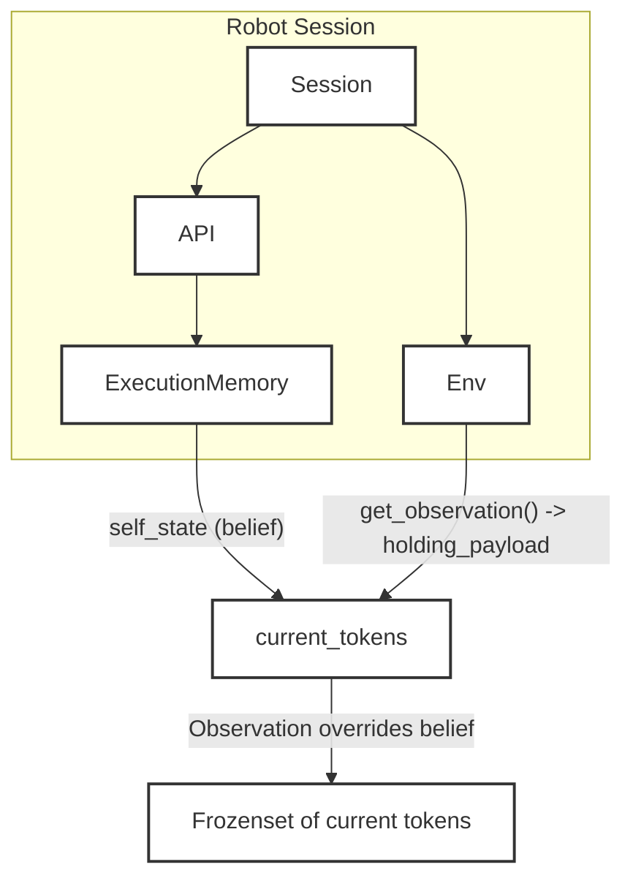

<!-- source: DeepWiki mcp.deepwiki.com · repo openJiuwen-ai/jiuwensymbiosis · page 4.2 World State, Memory & Reachability · fetched 2026-11-02 -->

# World State, Memory & Reachability

<details>
<summary>Relevant source files</summary>

The following files were used as context for generating this wiki page:

- [docs/zh/reference/framework-api.md](docs/zh/reference/framework-api.md)
- [jiuwensymbiosis/api/state.py](jiuwensymbiosis/api/state.py)
- [jiuwensymbiosis/api/world_state.py](jiuwensymbiosis/api/world_state.py)
- [jiuwensymbiosis/perception/scene3d.py](jiuwensymbiosis/perception/scene3d.py)
- [tests/unit_tests/adapters/cruzr/test_grasp_hygiene.py](tests/unit_tests/adapters/cruzr/test_grasp_hygiene.py)
- [tests/unit_tests/api/test_world_state.py](tests/unit_tests/api/test_world_state.py)

</details>


This page details the mechanisms by which the `jiuwensymbiosis` framework maintains a consistent understanding of the robot's environment and its own internal state. This includes the `WorldState` representation, the `ExecutionMemory` for tracking past actions and their effects, and the integration of reachability reasoning, often leveraging `scene3d` perception. These components are crucial for the planner to make informed decisions, avoid redundant actions, and prevent unsafe operations.

## World State

The `WorldState` class [jiuwensymbiosis/api/world_state.py:119-142]() provides a snapshot of the robot and its surroundings at a given moment, serving as the primary input for the planner. It aggregates information from three main sources, ordered by authority:

1.  **Observation**: Direct measurements from the environment (`env`), such as `holding_payload`, current pose, and joint states. This is the most authoritative source and overrides beliefs.
2.  **Belief**: Tokens established by previously executed actions, stored in `ExecutionMemory.self_state`. This covers aspects not directly measurable by sensors, like whether a carried payload has been stowed for travel.
3.  **Proprioception + Scene**: Robot's pose, joint states, and extra information from the environment observation, along with sensed locations from `ExecutionMemory`.

The `WorldState` is designed to be best-effort; if a body cannot report a specific piece of information, it is simply omitted, implying "unknown" rather than "false". This distinction is important for the planner, which can adapt its behavior when information is unknown.

### `WorldState` Structure

The `WorldState` is a dataclass [jiuwensymbiosis/api/world_state.py:119-142]() with the following key attributes:

*   `tokens`: A `frozenset` of strings representing the robot's self-state (e.g., `"payload.held"`, `"body.home"`).
*   `locations`: A list of dictionaries, each describing a sensed object's location and properties. These can be augmented with reachability information.
*   `pose`: The robot's current pose.
*   `joints`: The robot's current joint angles.
*   `joint_units`: Units for joint angles (e.g., "deg", "rad").
*   `default_orientation_policy`: The default orientation policy for `goto_xyzr` actions.
*   `workspace_bounds`: Cartesian bounds of the robot's workspace.
*   `z_min_safe`: A safe minimum Z-coordinate.
*   `reach_prior`: A dictionary describing the robot's reach model, typically derived from its URDF.
*   `extra`: A dictionary for any additional, unstructured information.
*   `capabilities`: A tuple of capabilities supported by the robot.

### `snapshot` Method

The `WorldState.snapshot(session)` class method [jiuwensymbiosis/api/world_state.py:144-157]() is responsible for creating a `WorldState` instance from a live `session`. It orchestrates the collection of information from the `env`, `api`, and `memory` objects within the session.

### Self-State Tokens

The `jiuwensymbiosis/api/state.py` module defines a closed vocabulary of robot self-state tokens [jiuwensymbiosis/api/state.py:64-70](). These tokens describe properties of the robot itself, independent of the specific task.

*   `payload.held`: The end effector is holding something.
*   `payload.clear`: The end effector is empty.
*   `payload.stowed`: A held payload is in a pose safe for travel.
*   `body.home`: The robot body is at its safe home posture.

The `PAYLOAD_TOKENS` [jiuwensymbiosis/api/state.py:77]() specifically identify tokens related to the end effector's payload state, which are critical for access checks.

The `EXCLUDES` dictionary [jiuwensymbiosis/api/state.py:92-96]() defines mutually exclusive tokens, ensuring that the `WorldState` remains logically consistent (e.g., `payload.held` excludes `payload.clear`).

The `validate_tokens` function [jiuwensymbiosis/api/state.py:103-120]() ensures that any tokens used in action annotations (`requires`, `provides`, `invalidates`) are part of the `KNOWN_STATE_TOKENS` vocabulary, preventing typos from leading to unresolvable planning states.

The `apply_effects` function [jiuwensymbiosis/api/state.py:123-139]() updates a set of state tokens based on the `provides` and `invalidates` effects of an action, respecting the `EXCLUDES` rules.

### `current_tokens` Function

The `current_tokens(session)` function [jiuwensymbiosis/api/world_state.py:48-62]() determines the currently true self-state tokens by combining belief from `ExecutionMemory` with observations from the environment. Observation takes precedence: if the environment reports a state that contradicts a belief, the observation wins. For example, if the robot believes it is holding a payload but the environment reports `holding_payload = False`, the `payload.clear` token will be present, and `payload.held` will be absent [tests/unit_tests/api/test_world_state.py:143-148]().


**Diagram: `current_tokens` Data Flow**

Sources:
- [jiuwensymbiosis/api/state.py:64-70]()
- [jiuwensymbiosis/api/state.py:77]()
- [jiuwensymbiosis/api/state.py:92-96]()
- [jiuwensymbiosis/api/state.py:103-120]()
- [jiuwensymbiosis/api/state.py:123-139]()
- [jiuwensymbiosis/api/world_state.py:48-62]()
- [jiuwensymbiosis/api/world_state.py:119-142]()
- [jiuwensymbiosis/api/world_state.py:144-157]()
- [tests/unit_tests/api/test_world_state.py:143-148]()

## Execution Memory

The `ExecutionMemory` class [jiuwensymbiosis/api/memory.py:29-30]() (imported by `WorldState` [jiuwensymbiosis/api/world_state.py:30]()) is responsible for tracking the effects of executed actions. It maintains:

*   `self_state`: A `frozenset` of tokens representing the robot's current internal state, based on the `provides` and `invalidates` effects of actions.
*   `locations`: A dictionary mapping referent names (e.g., "crate") to their last known location records.
*   `latest_location_record`: The most recently produced location record.

### `observe` Method

The `ExecutionMemory.observe(tool_meta, args, result)` method [jiuwensymbiosis/api/memory.py:60-100]() is the core of memory management. It processes the outcome of an executed tool call (`tool_meta`, `args`, `result`) and updates the `self_state` and `locations` accordingly.

Key behaviors of `observe`:

*   **Self-State Update**: It applies the `provides` and `invalidates` effects declared in the `ActionSpec` associated with `tool_meta` to update `self_state` [jiuwensymbiosis/api/memory.py:61-63]().
*   **Location Tracking**:
    *   If an action `produces_location=True` and its result indicates success (`ok=True`), the location is stored in `locations` under the `object_name` argument [jiuwensymbiosis/api/memory.py:65-74]().
    *   If an action `produces_location=True` but fails (`ok=False`), no location is recorded, ensuring that failed sensing attempts do not leave stale data [tests/unit_tests/api/test_world_state.py:107-113]().
    *   If an action `invalidates_locations=True` (e.g., a `drive` action), all stored locations are cleared, as they are no longer valid after the robot moves [jiuwensymbiosis/api/memory.py:76-77](), [tests/unit_tests/api/test_world_state.py:118-122]().
*   **Cache Hygiene**: The memory system actively clears stale data. For instance, a failed `locate_for_grasp` or `locate_for_place` call will clear any previously cached detection or surface information [tests/unit_tests/adapters/cruzr/test_grasp_hygiene.py:21-29](), [tests/unit_tests/adapters/cruzr/test_grasp_hygiene.py:37-42](). Similarly, `dual_arm_grasp` clears stale grasp data if no fresh detection is available [tests/unit_tests/adapters/cruzr/test_grasp_hygiene.py:61-66]().

```mermaid
graph TD
    A[Action Execution] --> B{Tool Call Result (ok=True/False)}
    B -- "tool_meta (ActionSpec)" --> EM[ExecutionMemory.observe]
    B -- "args" --> EM
    B -- "result" --> EM

    subgraph "ExecutionMemory"
        EM --> UpdateSelfState[Update self_state]
        EM --> UpdateLocations[Update locations]
        UpdateSelfState -- "uses ActionSpec.provides/invalidates" --> EM_SelfState[self_state: frozenset[str]]
        UpdateLocations -- "uses ActionSpec.produces_location" --> EM_Locations[locations: dict[str, LocationRecord]]
        UpdateLocations -- "uses ActionSpec.invalidates_locations" --> ClearLocations[Clear all locations]
        UpdateLocations -- "if ok=False" --> NoLocationRecord[Do not record location]
    end

    style A fill:#fff,stroke:#333,stroke-width:2px
    style B fill:#fff,stroke:#333,stroke-width:2px
    style EM fill:#fff,stroke:#333,stroke-width:2px
    style UpdateSelfState fill:#fff,stroke:#333,stroke-width:2px
    style UpdateLocations fill:#fff,stroke:#333,stroke-width:2px
    style EM_SelfState fill:#fff,stroke:#333,stroke-width:2px
    style EM_Locations fill:#fff,stroke:#333,stroke-width:2px
    style ClearLocations fill:#fff,stroke:#333,stroke-width:2px
    style NoLocationRecord fill:#fff,stroke:#333,stroke-width:2px
```
**Diagram: `ExecutionMemory.observe` Data Flow**

Sources:
- [jiuwensymbiosis/api/memory.py:29-30]()
- [jiuwensymbiosis/api/memory.py:60-100]()
- [jiuwensymbiosis/api/memory.py:61-63]()
- [jiuwensymbiosis/api/memory.py:65-74]()
- [jiuwensymbiosis/api/memory.py:76-77]()
- [jiuwensymbiosis/api/world_state.py:30]()
- [tests/unit_tests/adapters/cruzr/test_grasp_hygiene.py:21-29]()
- [tests/unit_tests/adapters/cruzr/test_grasp_hygiene.py:37-42]()
- [tests/unit_tests/adapters/cruzr/test_grasp_hygiene.py:61-66]()
- [tests/unit_tests/api/test_world_state.py:107-113]()
- [tests/unit_tests/api/test_world_state.py:118-122]()

## Reachability Reasoning

Reachability reasoning is a critical aspect of planning, ensuring that the robot attempts actions only on objects it can physically access. This is integrated into the `WorldState` through the `_with_reachability` function [jiuwensymbiosis/api/world_state.py:65-87]().

### Integration with `WorldState`

When `WorldState.snapshot` is called, it invokes `_with_reachability` to annotate sensed locations with a `reachable` flag [jiuwensymbiosis/api/world_state.py:65-87]().

*   This function checks if the `planning.reachability` capability is present in the API [jiuwensymbiosis/api/world_state.py:73-74]().
*   For each location with a `position_mm`, it calls `api.check_reachable({"position": position})` [jiuwensymbiosis/api/world_state.py:77-78]().
*   The result (`True`, `False`, or `None` if the check cannot be performed) is added to the location dictionary under the key `"reachable"` [jiuwensymbiosis/api/world_state.py:85-86](). A `None` verdict means the key is omitted, indicating "unknown" rather than "out of reach".

This ensures that the planner receives up-to-date reachability information for all known objects, allowing it to avoid planning actions to unreachable targets.

### `describe_reach`

The `_reach_prior` function [jiuwensymbiosis/api/world_state.py:98-107]() retrieves the robot's URDF-derived reach model via `api.describe_reach()`, if the `planning.reachability` capability is available. This model provides the planner with the robot's reach envelope, enabling it to build plans that stay within the robot's physical limits.

Sources:
- [jiuwensymbiosis/api/world_state.py:65-87]()
- [jiuwensymbiosis/api/world_state.py:73-74]()
- [jiuwensymbiosis/api/world_state.py:77-78]()
- [jiuwensymbiosis/api/world_state.py:85-86]()
- [jiuwensymbiosis/api/world_state.py:98-107]()

## Scene3D Perception Integration

The `jiuwensymbiosis.perception.scene3d` module [jiuwensymbiosis/perception/scene3d.py:1-23]() provides robot-agnostic 3D scene sensing capabilities. It processes `(rgb, depth, intrinsics, base←camera)` data along with a segmentation callable to extract geometric information about objects and surfaces.

While `scene3d` itself is stateless and does not directly integrate with `WorldState` or `ExecutionMemory`, its outputs are consumed by the API layer (e.g., `CruzrApi`) to populate the `locations` in `ExecutionMemory`.

### Key Concepts in `scene3d`

*   **Pure Functions**: All functions in `scene3d` are pure, meaning they depend only on their inputs and produce no side effects. This makes them highly testable and reusable across different robot bodies.
*   **Object and Surface Answers**: `scene3d` provides two main types of geometric answers:
    *   **Object answers**: Center, extents, face normal (used by grasp planners).
    *   **Surface answers**: Footprint, near-edge line (used by place planners).
*   **Grounded Variants**: Both object and surface answers come in "grounded" variants, which resolve spatial relations (e.g., "box **on** table") by sensing multiple objects from the same frame and filtering based on the relation.
*   **`Extent` NamedTuple**: Represents the axis-aligned bounding box of an object or surface, used for spatial relation calculations [jiuwensymbiosis/perception/scene3d.py:67-75]().
*   **Spatial Relations**: The module defines geometric predicates for spatial relations like `on_surface` [jiuwensymbiosis/perception/scene3d.py:41-52](), `_rests_on` [jiuwensymbiosis/perception/scene3d.py:130-135](), `_one_over_the_other` [jiuwensymbiosis/perception/scene3d.py:138-148](), and `_inside` [jiuwensymbiosis/perception/scene3d.py:151-159](). These are used to determine if a given spatial relationship holds between two `Extent` objects. The `CONTAINMENT_RELATIONS` [jiuwensymbiosis/api/state.py:80-87]() in `api/state.py` define which spatial relations imply containment and thus require access checks.

```mermaid
graph TD
    subgraph "Perception Pipeline"
        RGB[RGB Image]
        Depth[Depth Image]
        Intrinsics[Camera Intrinsics]
        BaseCamera[Base-to-Camera Transform]
        Segmentation[Segmentation Callable]
    end

    RGB & Depth & Intrinsics & BaseCamera & Segmentation --> Scene3D[jiuwensymbiosis.perception.scene3d]

    Scene3D -- "ObjectGeometry3D" --> ObjectAnswer[Object Answer (center, extents, normal)]
    Scene3D -- "SurfaceGeometry3D" --> SurfaceAnswer[Surface Answer (footprint, near-edge)]

    ObjectAnswer & SurfaceAnswer --> GroundedSensing[Grounded Sensing (e.g., "box on table")]

    GroundedSensing --> API[API Layer (e.g., CruzrApi)]
    API --> EM[ExecutionMemory.observe]
    EM --> WorldState[WorldState.locations]

    style RGB fill:#fff,stroke:#333,stroke-width:2px
    style Depth fill:#fff,stroke:#333,stroke-width:2px
    style Intrinsics fill:#fff,stroke:#333,stroke-width:2px
    style BaseCamera fill:#fff,stroke:#333,stroke-width:2px
    style Segmentation fill:#fff,stroke:#333,stroke-width:2px
    style Scene3D fill:#fff,stroke:#333,stroke-width:2px
    style ObjectAnswer fill:#fff,stroke:#333,stroke-width:2px
    style SurfaceAnswer fill:#fff,stroke:#333,stroke-width:2px
    style GroundedSensing fill:#fff,stroke:#333,stroke-width:2px
    style API fill:#fff,stroke:#333,stroke-width:2px
    style EM fill:#fff,stroke:#333,stroke-width:2px
    style WorldState fill:#fff,stroke:#333,stroke-width:2px
```
**Diagram: Scene3D Integration with World State**

Sources:
- [jiuwensymbiosis/api/state.py:80-87]()
- [jiuwensymbiosis/perception/scene3d.py:1-23]()
- [jiuwensymbiosis/perception/scene3d.py:41-52]()
- [jiuwensymbiosis/perception/scene3d.py:67-75]()
- [jiuwensymbiosis/perception/scene3d.py:130-135]()
- [jiuwensymbiosis/perception/scene3d.py:138-148]()
- [jiuwensymbiosis/perception/scene3d.py:151-159]()

---

