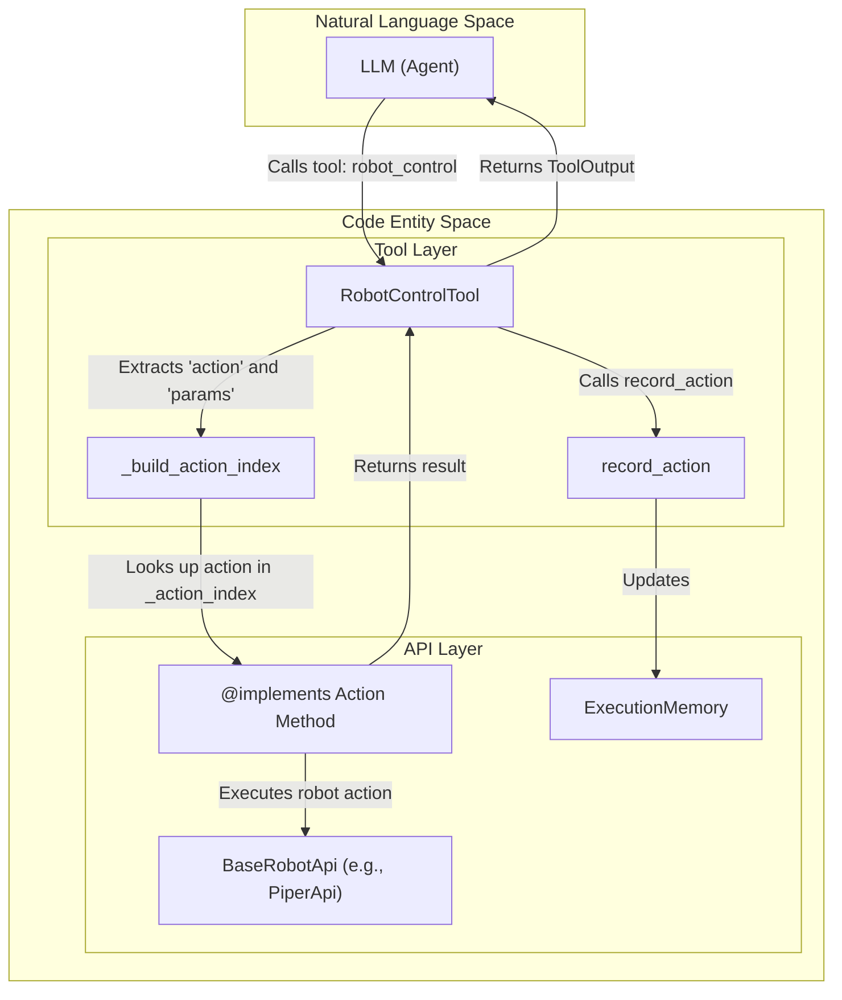

<!-- source: DeepWiki mcp.deepwiki.com · repo openJiuwen-ai/jiuwensymbiosis · page 4.3 Tool Layer · fetched 2026-11-02 -->

# 4.3. Tool Layer

Relevant source files

The following files were used as context for generating this wiki page:

- [.claude/rules/code-style.md](.claude/rules/code-style.md)
- [.claude/rules/security.md](.claude/rules/security.md)
- [.claude/rules/testing.md](.claude/rules/testing.md)
- [CLAUDE.md](CLAUDE.md)
- [jiuwensymbiosis/tools/builder.py](jiuwensymbiosis/tools/builder.py)
- [jiuwensymbiosis/tools/robot_control_tool.py](jiuwensymbiosis/tools/robot_control_tool.py)
- [tests/mocks/mock_session.py](tests/mocks/mock_session.py)
- [tests/unit_tests/adapters/common/test_geometry.py](tests/unit_tests/adapters/common/test_geometry.py)
- [tests/unit_tests/adapters/piper/test_api.py](tests/unit_tests/adapters/piper/test_api.py)
- [tests/unit_tests/api/test_decorators.py](tests/unit_tests/api/test_decorators.py)
- [tests/unit_tests/tools/test_robot_control.py](tests/unit_tests/tools/test_robot_control.py)

The Tool Layer is responsible for exposing the robot's capabilities to the agent (specifically, the LLM) in a structured and controlled manner. It bridges the "Natural Language Space" of the LLM's planning with the "Code Entity Space" of the robot's API. This involves building tool definitions, filtering them based on the robot's capabilities, and handling the execution of these tools, including considerations for in-process code execution.

## `robot_control_tool`

The `RobotControlTool` [jiuwensymbiosis/tools/robot_control_tool.py:154-155]() is a specialized `openjiuwen.Tool` subclass that acts as a single entry point for dispatching actions to the robot's API. Instead of exposing every individual action as a separate tool to the LLM, `RobotControlTool` provides a unified interface where the LLM specifies an `action` name and its `params` as arguments to this single tool.

This approach is complementary to `build_robot_tools` [jiuwensymbiosis/tools/builder.py:67-68](), which creates individual `LocalFunction` tools for each `@implements` decorated method.

*   **`build_robot_tools`**: Exposes each action with its full schema directly to the LLM. This is suitable when the number of tools is small, or the prompt capacity is ample, allowing the LLM to see detailed action schemas.
*   **`RobotControlTool`**: Provides a single entry point, dispatching based on an `action` field. This is beneficial for workflow-based control (e.g., using `SKILL.md` [CLAUDE.md:39]()), when multiple robots share a prompt entry, or when a shorter tool list is desired.

Both strategies can coexist; `build_robot_agent(..., enable_skill=True)` [jiuwensymbiosis/tools/robot_control_tool.py:15]() will enable both.

The `RobotControlTool`'s `__init__` method [jiuwensymbiosis/tools/robot_control_tool.py:156-175]() initializes `self._api` and `self._action_index` before calling `super().__init__(card)`. This order is crucial to avoid issues with `openjiuwen`'s `_ToolMeta` metaclass, which immediately accesses `instance.card` during its `__call__` method [jiuwensymbiosis/tools/robot_control_tool.py:18-22]().

The `invoke` method [jiuwensymbiosis/tools/robot_control_tool.py:181-230]() of `RobotControlTool` takes a dictionary with `action` and `params` keys. It looks up the action in `self._action_index` and calls the corresponding bound method on the API. It handles missing actions, invalid parameters, and records the action's outcome in the `ExecutionMemory` [jiuwensymbiosis/tools/robot_control_tool.py:40-57]().

**Diagram: `RobotControlTool` Data Flow**
Sources: [jiuwensymbiosis/tools/robot_control_tool.py:1-230](), [jiuwensymbiosis/agent/abstractions.py](), [jiuwensymbiosis/api/memory.py]()

## Tool Builder

The `build_robot_tools` function [jiuwensymbiosis/tools/builder.py:67-68]() is responsible for scanning a `BaseRobotApi` instance, identifying methods decorated with `@implements` [jiuwensymbiosis/api/actions.py:13](), and converting them into `openjiuwen.LocalFunction` tools. These tools are then exposed to the LLM.

The builder performs several key operations:
1.  **Capability Gating**: Tools are only emitted if their required `capability` (defined in `ToolMeta.capability` [jiuwensymbiosis/api/decorators.py:103-104]()) is present in the effective capabilities of the robot. The effective capabilities are determined by the intersection of the API's capabilities (`api.capabilities`) and the environment's capabilities (`env.capabilities`) if an `env` is provided [jiuwensymbiosis/tools/builder.py:54-62](). This ensures that the LLM only sees tools that the current robot hardware can actually perform.
2.  **MRO Traversal**: It walks the Method Resolution Order (MRO) of the API type [jiuwensymbiosis/tools/builder.py:101](), ensuring that subclass overrides of methods are preferred while still picking up decorators from base classes.
3.  **`ToolMeta` Extraction**: For each callable method, it checks for the presence of `__tool_meta__` [jiuwensymbiosis/tools/builder.py:108](), which is attached by the `@implements` decorator and contains the `ActionSpec` [jiuwensymbiosis/api/decorators.py:103-104]() and other metadata.
4.  **Filtering**: Tools can be filtered by `allow` and `deny` lists of tool names [jiuwensymbiosis/tools/builder.py:112-115](), and by `planner_only` [jiuwensymbiosis/tools/builder.py:116-117]() flag, which restricts tools to those marked as `planner_visible` in their `ActionSpec`.
5.  **Action Recording**: Each bound method is wrapped by `_recording` [jiuwensymbiosis/tools/builder.py:25-51]() to ensure that its execution outcome is recorded in the `ExecutionMemory` [jiuwensymbiosis/tools/builder.py:25-51](). This is crucial for maintaining world state and enabling features like trace feedback.

The `list_tool_meta` function [jiuwensymbiosis/tools/builder.py:132-159]() provides a diagnostic utility to enumerate the tools that `build_robot_tools` would emit, without actually instantiating `openjiuwen` objects. This is useful for testing and logging.

```mermaid
graph TD
    subgraph "Code Entity Space"
        RobotApiInstance["api: BaseRobotApi Instance"]
        RobotEnvInstance["env: BaseRobotEnv Instance (Optional)"]
        ActionMethod1["Method 1 (@implements)"]
        ActionMethod2["Method 2 (@implements)"]
        ActionMethod3["Method 3 (@implements)"]
        ActionMethodN["Method N (@implements)"]
        ToolMeta1["ToolMeta 1"]
        ToolMeta2["ToolMeta 2"]
        ToolMeta3["ToolMeta 3"]
        ToolMetaN["ToolMeta N"]
        EffectiveCaps["effective_capabilities"]
        LocalFunction1["openjiuwen.LocalFunction 1"]
        LocalFunction2["openjiuwen.LocalFunction 2"]
        LocalFunctionN["openjiuwen.LocalFunction N"]
        ExecutionMemory["ExecutionMemory"]

        RobotApiInstance -- "has methods" --> ActionMethod1
        RobotApiInstance -- "has methods" --> ActionMethod2
        RobotApiInstance -- "has methods" --> ActionMethod3
        RobotApiInstance -- "has methods" --> ActionMethodN

        ActionMethod1 -- "decorated with" --> ToolMeta1
        ActionMethod2 -- "decorated with" --> ToolMeta2
        ActionMethod3 -- "decorated with" --> ToolMeta3
        ActionMethodN -- "decorated with" --> ToolMetaN

        subgraph "jiuwensymbiosis/tools/builder.py"
            build_robot_tools["build_robot_tools(api, env, ...)"]
            _effective_capabilities["_effective_capabilities(api, env)"]
            _recording["_recording(api, bound_method)"]
        end

        build_robot_tools -- "calls" --> _effective_capabilities
        RobotApiInstance -- "api.capabilities" --> _effective_capabilities
        RobotEnvInstance -- "env.capabilities" --> _effective_capabilities
        _effective_capabilities -- "returns" --> EffectiveCaps

        build_robot_tools -- "iterates MRO of api" --> ActionMethod1
        build_robot_tools -- "checks ToolMeta.capability against" --> EffectiveCaps
        build_robot_tools -- "applies allow/deny/planner_only filters" --> ActionMethod1
        build_robot_tools -- "wraps bound method with" --> _recording
        _recording -- "creates" --> LocalFunction1
        LocalFunction1 -- "on execution, updates" --> ExecutionMemory
        build_robot_tools -- "collects" --> LocalFunction1
        build_robot_tools -- "collects" --> LocalFunction2
        build_robot_tools -- "collects" --> LocalFunctionN

        build_robot_tools -- "returns list of" --> ToolList["List[openjiuwen.LocalFunction]"]
    end

    subgraph "Natural Language Space"
        LLM["LLM (Agent)"]
    end

    ToolList -- "Provided to" --> LLM
```

**Diagram: Tool Builder Process**
Sources: [jiuwensymbiosis/tools/builder.py:1-159](), [jiuwensymbiosis/api/decorators.py:103-104](), [jiuwensymbiosis/api/actions.py:13]()

## In-Process Code Execution Risks

The `jiuwensymbiosis/tools/inproc_code.py` module (not fully shown in provided snippets, but referenced in security rules) is designed to execute Python code directly within the agent process. This capability, while powerful for dynamic task execution, carries significant security implications.

As highlighted in the security rules:
*   `jiuwensymbiosis/tools/inproc_code.py` executes Python in the agent process with live objects and no sandbox [security.md:38-39]().
*   Changes to its inputs, globals, and reachability must be treated as trust-boundary changes [security.md:39-40]().
*   It's crucial not to assume that outer tool callbacks inspect or gate every motion performed inside generated code [security.md:40-41]().

This means that any code executed via `inproc_code.py` has full access to the agent's environment, including the robot API and its underlying hardware drivers. This capability is intended for advanced use cases where the benefits of dynamic code execution outweigh the risks, and where the source of the code is trusted. Developers must exercise extreme caution and rigorous validation when modifying or extending this functionality.

Sources: [security.md:38-41]()

## Capability-Filtered Tool Sets

Both `RobotControlTool` and `build_robot_tools` implement capability filtering to ensure that the LLM is only presented with actions that the current robot configuration can actually perform.

The `_build_action_index` function [jiuwensymbiosis/tools/robot_control_tool.py:81-119]() (used by `RobotControlTool`) and `build_robot_tools` [jiuwensymbiosis/tools/builder.py:67-68]() both calculate `effective_caps` [jiuwensymbiosis/tools/robot_control_tool.py:97-101](), [jiuwensymbiosis/tools/builder.py:54-62]() by taking the intersection of the `api.capabilities` and `env.capabilities`.

*   `api.capabilities`: These are the capabilities declared by the `BaseRobotApi` implementation (e.g., `PiperApi` [tests/unit_tests/adapters/piper/test_api.py:40-57]()). These represent what the API *can* theoretically do.
*   `env.capabilities` (or `env.effective_capabilities`): These are the capabilities provided by the `BaseRobotEnv` implementation, representing what the *physical hardware* or environment can actually support. For example, a robot might have a `motion.cartesian` capability in its API, but if the environment (e.g., a mock environment or a specific hardware setup) doesn't support it, that capability will be filtered out.

A tool (or action) is only included in the final set if its `ToolMeta.capability` [jiuwensymbiosis/api/decorators.py:103-104]() is present in this `effective_caps` set [jiuwensymbiosis/tools/robot_control_tool.py:116-117](), [jiuwensymbiosis/tools/builder.py:118-119](). This mechanism prevents the LLM from attempting to use non-existent or unsupported robot functionalities, leading to more robust and reliable agent behavior.

For example, `test_env_capabilities_gate_actions` [tests/unit_tests/tools/test_robot_control.py:28-34]() demonstrates how `_build_action_index` filters actions: if the environment only provides `motion.cartesian`, then `goto_xyzr` is available, but `close_gripper` and `get_image` are not.

Sources: [jiuwensymbiosis/tools/robot_control_tool.py:81-119](), [jiuwensymbiosis/tools/builder.py:54-62](), [jiuwensymbiosis/tools/builder.py:67-68](), [jiuwensymbiosis/api/decorators.py:103-104](), [tests/unit_tests/tools/test_robot_control.py:28-34](), [tests/unit_tests/adapters/piper/test_api.py:40-57]()

---

