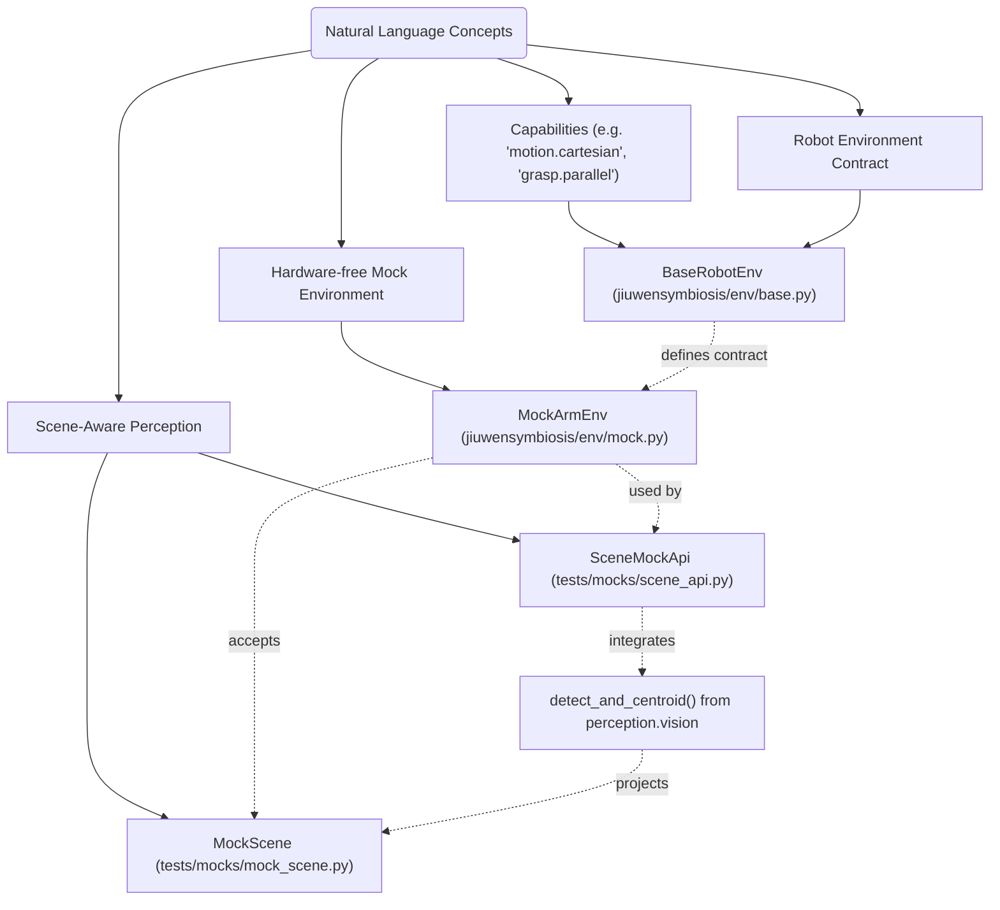
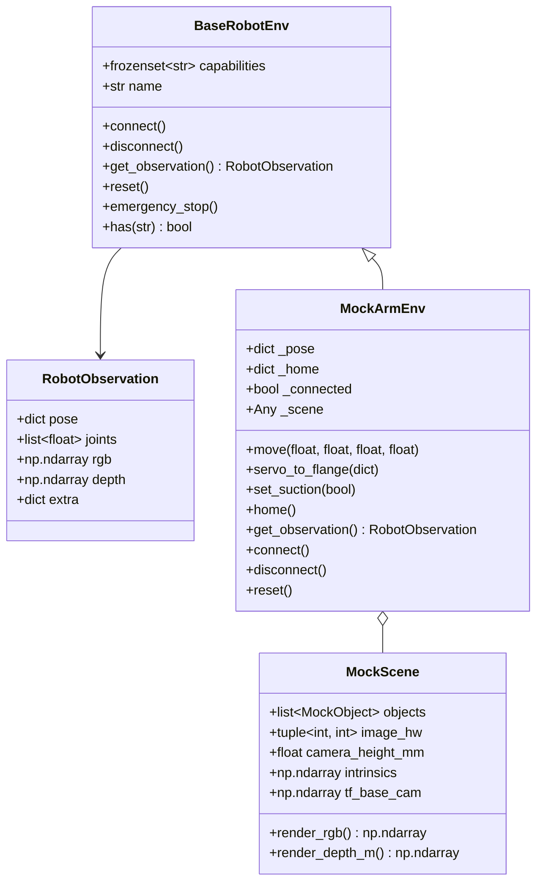

<!-- source: DeepWiki mcp.deepwiki.com · repo openJiuwen-ai/jiuwensymbiosis · page 5.1 Environment Contract & Mock Env · fetched 2026-11-02 -->

# Environment Contract & Mock Env

<details>
<summary>Relevant source files</summary>

The following files were used as context for generating this wiki page:

- [jiuwensymbiosis/env/base.py](jiuwensymbiosis/env/base.py)
- [jiuwensymbiosis/env/mock.py](jiuwensymbiosis/env/mock.py)
- [tests/mocks/mock_scene.py](tests/mocks/mock_scene.py)
- [tests/mocks/scene_api.py](tests/mocks/scene_api.py)
- [tests/unit_tests/env/test_base.py](tests/unit_tests/env/test_base.py)
- [tests/unit_tests/skills/test_visual_pick_flow.py](tests/unit_tests/skills/test_visual_pick_flow.py)
- [tests/unit_tests/skills/test_visual_pick_ground_truth.py](tests/unit_tests/skills/test_visual_pick_ground_truth.py)

</details>


## Purpose and Scope

This page documents the **environment hardware abstraction contract** within the `jiuwensymbiosis` framework and explains the mock environment implementation supporting hardware-free runs. It focuses on the `BaseRobotEnv` abstract base class that defines the minimal interface for all robot hardware adapters, the design pattern of capability slices for gating features, and the `MockArmEnv` for simulation and testing without physical hardware. The mock env's integration with synthetic scenes and tight coupling with the real perception pipeline enable end-to-end development and CI tests.

---

## 1. BaseRobotEnv: The Environment Contract

### 1.1. Overview

`BaseRobotEnv` is a **minimal common hardware interface** that every robot environment implementation must satisfy in this framework. It abstracts the robot hardware to a uniform protocol layer (Layer 2), enabling the rest of the system to depend on a stable contract regardless of the underlying body or simulator.

Key framework expectations embedded in `BaseRobotEnv`:

- A **closed set of `capabilities`** describing supported robot/environment features.
- Lifecycle management with `connect()` and `disconnect()` methods.
- Consistent state reporting via `get_observation()`.
- Optional safety and reset controls (`emergency_stop()`, `reset()`).
- Capability gating to check feature presence.

Importantly, **hardware emergency stop** remains a physical concern, not taken over by software rails.

### 1.2. Capabilities Vocabulary

Capabilities are precise strings representing supported robot features, which drive gating in rails and tool builders. This closed vocabulary is defined as a **frozen set** `KNOWN_CAPABILITIES` within `jiuwensymbiosis.env.base` and currently includes items such as:

- Motion commands (e.g., `"motion.cartesian"`, `"motion.servo"`, `"motion.base"`, `"motion.dual_arm"`)
- Gripper types (e.g., `"grasp.parallel"`, `"grasp.suction"`, `"grasp.paddle"`)
- Vision features (e.g., `"vision.camera"`, `"vision.depth"`, `"vision.detection"`, `"vision.eye_to_hand"`, `"vision.search"`)
- Other features: speech TTS, sorting command, planning reachability, etc.

Derived capabilities like `"planning.reachability"` are derived by intersection between API and Env sets for consistency.

Adding new capabilities requires extending this set and optionally API mixins and rails.

### 1.3. Lifecycle Methods and Context Manager

- `connect()`: Open hardware connection, idempotent.
- `disconnect()`: Close connection and safe release, idempotent.
- `get_observation()`: Best-effort robot+env state snapshot, returns a `RobotObservation` dataclass instance.
- `reset()`: Optional reset to safe pose (default no-op).
- `emergency_stop()`: Optional software halt (default no-op; hardware E-stop mandatory).
  
`BaseRobotEnv` also implements context manager protocol to automatically `connect()` on enter and `disconnect()` on exit, facilitating safe resource management.

### 1.4. RobotObservation

The `RobotObservation` dataclass captures a snapshot at an instant with optional fields:

- `pose`: Dict representing Cartesian pose (keys like `"x"`, `"y"`, `"z"`, `"r"` or Euler angles).
- `joints`: List of joint angles (rad or deg).
- `rgb`: HxWx3 ndarray RGB image from onboard or wrist camera.
- `depth`: HxW ndarray depth in meters aligned to RGB if present.
- `extra`: Arbitrary extra info such as gripper width, force/torque, status flags.

This flexible return type enables extensions without breaking backward compatibility.

### 1.5. Capability Query

`BaseRobotEnv` exposes:

```python
def has(self, capability: str) -> bool
```

This returns `True` if the environment supports the requested capability string.

### 1.6. Capability Validation on Subclasses

Subclasses must declare `capabilities` as a frozenset of known strings. Validation logic in `__init_subclass__` raises on unknown capability declarations, enforcing contract integrity at class definition time.

---

## 2. Capability Slices and Protocol Design

The contract design enforces **capability slices**, subsets of the contract modularized by capability strings. The system gates access to rails and tools based on declared environment capabilities.

For example:

- Environments with `"motion.cartesian"` must implement Cartesian move commands.
- Those declaring `"vision.camera"` expose RGB image streams.
- `"grasp.parallel"` environments provide parallel gripper controls.

These capability slices provide a declarative interface boundary. API implementations and rails dynamically adapt based on capabilities, enhancing extensibility and safety.

---

## 3. Mock Environment: MockArmEnv

### 3.1. Purpose

`MockArmEnv` is a **stand-in 4-DoF robotic arm environment** designed for **testing** and **dry runs** without requiring physical hardware. It fulfills the `BaseRobotEnv` contract and simulates motion and perception.

### 3.2. Features

- Tracks Cartesian pose in memory (x, y, z, r).
- Supports capabilities:

  ```python
  {"motion.cartesian", "motion.servo", "grasp.parallel", "vision.camera", "vision.detection"}
  ```

- Can accept an optional **scene object** to enable **scene-aware rendering** of RGB/depth frames:
  - The `scene` must implement `render_rgb()` and `render_depth_m()` methods.
  - When present, `get_observation()` returns scene-rendered RGB + depth frames with the exact pose.
  - Otherwise, returns a basic simulated RGB frame (gray background with center marker).

### 3.3. Internal State and Initialization

- `home_pose`: Default or user-supplied Cartesian pose.
- `z_min_safe`: Minimum Z height safety threshold.
- `image_hw`: Image dimensions (default 480x640).
- `workspace_bounds`: Optional bounding box limiting workspace.
- `_pose`: Current Cartesian pose.
- `_suction`: Simulated gripper suction flag.
- `_move_log`: History of pose commands executed (for testing).
- `_connected`: Connection state flag.
- `_scene`: Renderable mock scene instance.

### 3.4. Lifecycle

- `connect()`: Sets internal `_connected` flag `True`.
- `disconnect()`: Sets `_connected` flag `False`.
- `reset()`: Resets pose to `home_pose`, clears suction and move log.

### 3.5. Observations Retrieval

`get_observation()` aggregates current pose and image data:

- If a scene is set, calls its `render_rgb()` and `render_depth_m()` for consistent frames.
- Otherwise, returns a gray static frame with a bright center marker simulating a visual cue.

Returns a `RobotObservation` containing pose, RGB, depth (optional), and `extra` info including suction state and `z_min_safe`.

### 3.6. Motion and Control Interface

- `move(x, y, z, r=None)`: Blocks until reaching absolute Cartesian pose; enforces `z_min_safe` floor.
- `servo_to_flange(pose)`: Non-blocking pose command simulating real-time pose streaming (instantaneous in mock).
- `home()`: Returns instantly to home pose.
- `set_suction(on)`: Sets simulated suction binary state.

#### Safety Checks

`move()` raises an exception if commanded z falls below `z_min_safe`, enforcing workspace safety in simulation.

### 3.7. Read-Only Home Pose

`home_pose` is exposed as a read-only property returning a copy of the internal home pose dictionary.

### 3.8. Usage and Integration

`MockArmEnv` can run *hardware-free* with the perception pipeline wired to a mock scene, enabling synthetic validation and CI coverage of full perception → projection → motion workflows.

---

## 4. Mock Scene and Scene-Aware Perception Integration

### 4.1. MockScene

The `MockScene` represents a synthetic 3D tabletop environment for rendering ground-truth RGB + depth images:

- Maintains a list of `MockObject` with names, sizes, colors, and positions on the table.
- Uses a fixed top-down pinhole camera at a known height.
- Provides accurate projection geometry to generate pixel-aligned synthetic sensor data.
- Methods:
  - `render_rgb()`: Returns an RGB image with object colors rendered at projected bounding boxes.
  - `render_depth_m()`: Returns a depth image with synthetic depth in meters.
  
This provides a synthetic but physically meaningful backdrop for perception testing.

### 4.2. SceneMockApi

For perception testing, `SceneMockApi` wraps a real perception pipeline and operates on camera frames rendered by `MockScene` via `MockArmEnv`. Key features:

- Runs `detect_and_centroid` from the real perception module on synthetic RGB + depth.
- Uses scene-backed segmentation to generate realistic masks.
- Applies real camera geometry transformations to back-project detection pixels to base-frame coordinates.
- Provides API methods like `get_grasp_info_simple()` returning real-like grasp positions and confidence scores.
- Enables validating perception → planning → execution closed loops without hardware.

---

## 5. Data Flow Summary

This diagram shows the flow from **system concepts and natural language space** to **concrete code entities** relevant to the environment contract and mock environment:



---

## 6. Class Diagram: Key Classes and Relationships



---

# Summary

- `BaseRobotEnv` defines the contractual interface for all robot hardware environments with capability-based protocol slices.
- The capability set is a closed vocabulary, with enforcement to prevent unknown declarations.
- `MockArmEnv` provides a simulated robot environment that satisfies the contract, enabling reliable dry-run and testing without physical hardware.
- `MockArmEnv` integrates optionally with `MockScene` for synthetic RGB + depth rendering.
- `SceneMockApi` runs the real perception pipeline on synthetic scene frames, enabling closed-loop perception → planning → execution tests.
- This layered abstraction decouples agent code from hardware specifics while promoting testability and simulation fidelity.

---

## Sources

- `jiuwensymbiosis/env/base.py:1-166`  
- `jiuwensymbiosis/env/mock.py:1-158`  
- `tests/mocks/mock_scene.py:1-176`  
- `tests/mocks/scene_api.py:1-130`  
- `tests/unit_tests/env/test_base.py:1-217`

---

