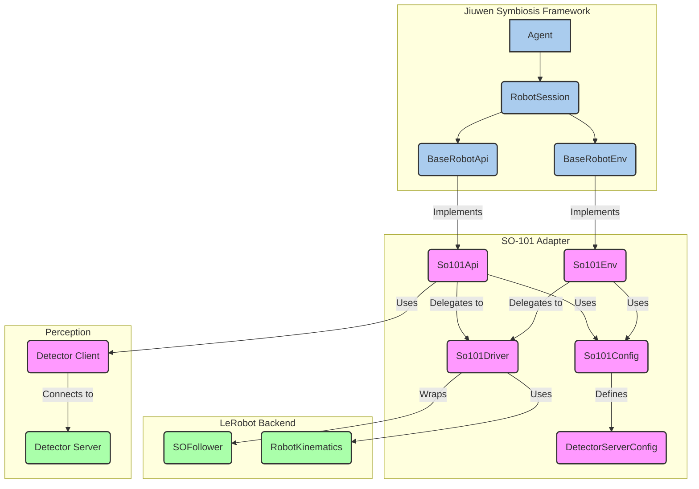
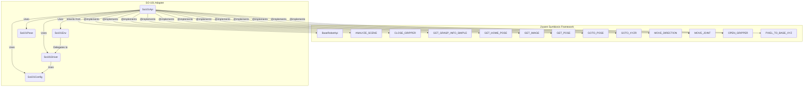

<!-- source: DeepWiki mcp.deepwiki.com · repo openJiuwen-ai/jiuwensymbiosis · page 5.2 SO-101 Adapter · fetched 2026-11-02 -->

# SO-101 Adapter

Relevant source files

The following files were used as context for generating this wiki page:

- [jiuwensymbiosis/adapters/so101/__init__.py](jiuwensymbiosis/adapters/so101/__init__.py)
- [jiuwensymbiosis/adapters/so101/api.py](jiuwensymbiosis/adapters/so101/api.py)
- [jiuwensymbiosis/adapters/so101/config.py](jiuwensymbiosis/adapters/so101/config.py)
- [jiuwensymbiosis/adapters/so101/env.py](jiuwensymbiosis/adapters/so101/env.py)
- [tests/unit_tests/adapters/so101/test_config.py](tests/unit_tests/adapters/so101/test_config.py)
- [tests/unit_tests/adapters/so101/test_env_api.py](tests/unit_tests/adapters/so101/test_env_api.py)
- [tests/unit_tests/adapters/so101/test_lerobot_kinematics.py](tests/unit_tests/adapters/so101/test_lerobot_kinematics.py)

The SO-101 Adapter provides the necessary components to integrate the SO-101 5-DoF underactuated arm, backed by LeRobot's `SOFollower`, into the `jiuwensymbiosis` framework. This page offers a high-level overview of the adapter's structure, its configuration, and how it exposes the robot's capabilities through the `BaseRobotEnv` and `BaseRobotApi` contracts.

The SO-101 is a 5-DoF arm with Feetech STS3215 servos. Its integration involves defining its configuration, environment, API, and low-level control mechanisms. The adapter handles aspects like joint limits, home positions, gripper control, and vision integration.

## Adapter Architecture

The SO-101 adapter follows the standard `jiuwensymbiosis` adapter pattern, providing distinct layers for configuration, environment abstraction, API exposure, and low-level hardware control.

Sources: [jiuwensymbiosis/adapters/so101/__init__.py](), [jiuwensymbiosis/adapters/so101/config.py](), [jiuwensymbiosis/adapters/so101/env.py](), [jiuwensymbiosis/adapters/so101/api.py]()

### SO-101 Configuration & Session

The `So101Config` dataclass defines all the configurable parameters for the SO-101 robot, including serial port, home joint positions, joint limits, IK weights, and gripper percentages [jiuwensymbiosis/adapters/so101/config.py:4-10](). It also includes `DetectorServerConfig` for managing the GroundingDINO/SAM2 sidecar [jiuwensymbiosis/adapters/so101/config.py:35-103](). Configuration validation ensures that all parameters are correctly specified and within acceptable ranges. YAML templates are used to define specific robot configurations.

The `build_so101_session` factory function is responsible for creating a `RobotSession` instance tailored for the SO-101, incorporating the validated configuration and setting up the necessary environment and API components. This session factory also handles the loading of URDF and geometry definitions for kinematics.

For details, see [SO-101 Configuration & Session](#5.2.1).
Sources: [jiuwensymbiosis/adapters/so101/config.py](), [jiuwensymbiosis/adapters/so101/__init__.py:14-16]()

### So101Env: Environment Abstraction

The `So101Env` class implements the `BaseRobotEnv` contract, providing an abstraction layer over the low-level `So101Driver` [jiuwensymbiosis/adapters/so101/env.py:36-36](). It exposes the robot's capabilities, such as `motion.cartesian`, `motion.joint`, `grasp.parallel`, and `motion.servo` [jiuwensymbiosis/adapters/so101/env.py:43-52](). Vision capabilities (`vision.camera`, `vision.depth`, `vision.detection`, `vision.eye_to_hand`) are dynamically added based on whether a camera is configured and successfully initialized [jiuwensymbiosis/adapters/so101/env.py:77-87](). The environment also provides read-only properties for safety parameters like `z_min_safe` and `workspace_bounds` [jiuwensymbiosis/adapters/so101/env.py:131-149](), which are crucial for the `SafetyRail`.

Sources: [jiuwensymbiosis/adapters/so101/env.py]()

### So101Api: Action Contracts

The `So101Api` class defines the actions the SO-101 robot can perform, adhering to the shared action vocabulary through the `@implements` decorator [jiuwensymbiosis/adapters/so101/api.py:49-50](). It extends `BaseRobotApi` and provides implementations for actions like `open_gripper`, `close_gripper`, `goto_pose`, `move_joint`, and vision-related actions [jiuwensymbiosis/adapters/so101/api.py:104-123](). Notably, the SO-101's gripper is two-state (percentage-based) rather than width/force-based, and its vision system uses a desktop-fixed eye-to-hand camera, which simplifies coordinate transformations compared to eye-in-hand systems [jiuwensymbiosis/adapters/so101/api.py:8-11](). The API also declares specific capabilities like `motion.servo` and `vision.eye_to_hand` [jiuwensymbiosis/adapters/so101/api.py:84-94]().

Sources: [jiuwensymbiosis/adapters/so101/api.py](), [jiuwensymbiosis/adapters/so101/env.py]()

### So101Driver: Low-Level Control

The `So101Driver` (not directly shown in the provided files but implied by `So101Env` and `So101Api` delegating to `_inner`) is the core component for low-level hardware interaction. It wraps the LeRobot `SOFollower` and handles direct commands to the robot's servos. This includes implementing policies like "reachability-or-reject" for motion commands, executing `servo_to_pose` for real-time control, and managing gripper states. The driver also incorporates mechanisms for settling over-compensation, a z-floor escape hatch for safety, and hand guiding capabilities. Exceptions like `So101PreDispatchError` are raised for issues before motion execution [jiuwensymbiosis/adapters/so101/lowlevel.py:32-32]().

For details, see [So101Driver Low-Level Control](#5.2.2).
Sources: [jiuwensymbiosis/adapters/so101/lowlevel.py](), [jiuwensymbiosis/adapters/so101/api.py:34-34]()

---

