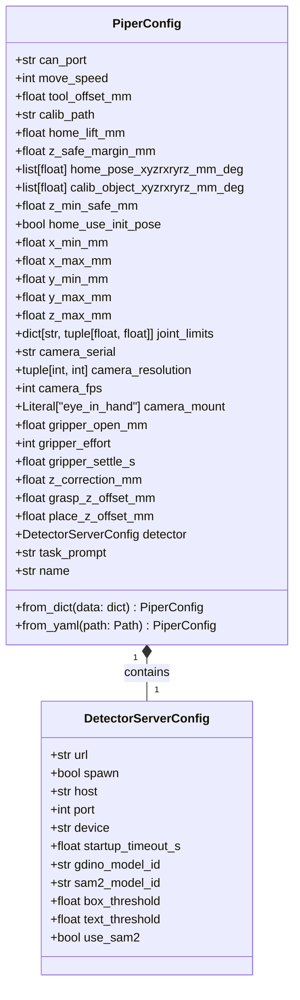
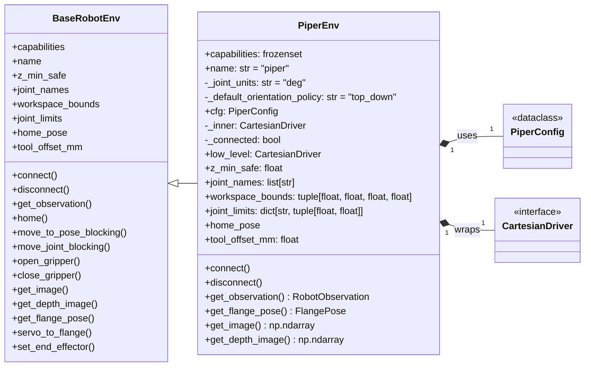
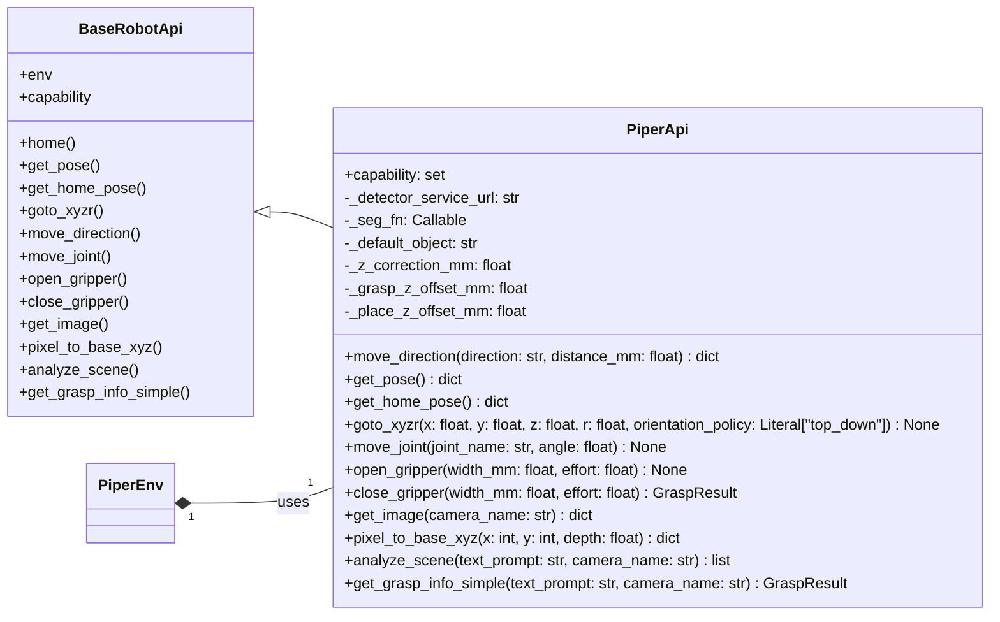
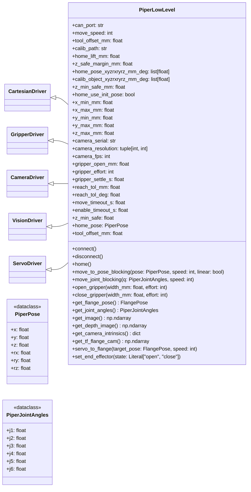
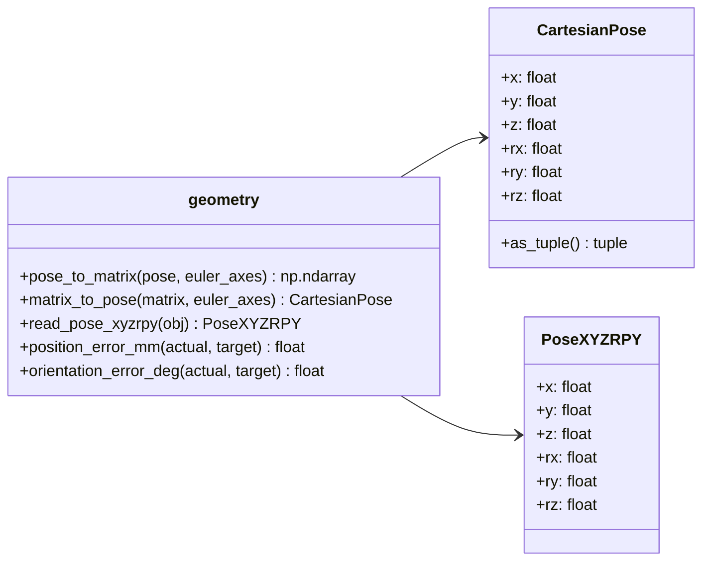
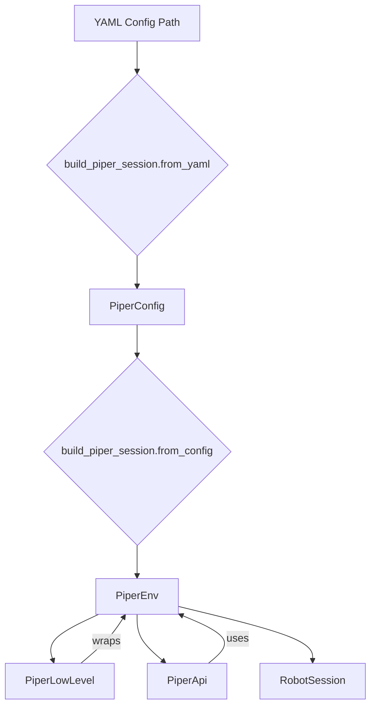

<!-- source: DeepWiki mcp.deepwiki.com · repo openJiuwen-ai/jiuwensymbiosis · page 5.3 Piper Adapter · fetched 2026-11-02 -->

# Piper Adapter

<details>
<summary>Relevant source files</summary>

The following files were used as context for generating this wiki page:

- [configs/piper/piper.yaml](configs/piper/piper.yaml)
- [jiuwensymbiosis/adapters/_common/__init__.py](jiuwensymbiosis/adapters/_common/__init__.py)
- [jiuwensymbiosis/adapters/_common/geometry.py](jiuwensymbiosis/adapters/_common/geometry.py)
- [jiuwensymbiosis/adapters/_common/joint_transport.py](jiuwensymbiosis/adapters/_common/joint_transport.py)
- [jiuwensymbiosis/adapters/_common/kinematic_driver.py](jiuwensymbiosis/adapters/_common/kinematic_driver.py)
- [jiuwensymbiosis/adapters/piper/__init__.py](jiuwensymbiosis/adapters/piper/__init__.py)
- [jiuwensymbiosis/adapters/piper/_calibration.py](jiuwensymbiosis/adapters/piper/_calibration.py)
- [jiuwensymbiosis/adapters/piper/api.py](jiuwensymbiosis/adapters/piper/api.py)
- [jiuwensymbiosis/adapters/piper/config.py](jiuwensymbiosis/adapters/piper/config.py)
- [jiuwensymbiosis/adapters/piper/env.py](jiuwensymbiosis/adapters/piper/env.py)
- [jiuwensymbiosis/adapters/piper/geometry.py](jiuwensymbiosis/adapters/piper/geometry.py)
- [jiuwensymbiosis/adapters/piper/lowlevel.py](jiuwensymbiosis/adapters/piper/lowlevel.py)
- [jiuwensymbiosis/adapters/piper/session.py](jiuwensymbiosis/adapters/piper/session.py)
- [jiuwensymbiosis/serving/grounding_dino_sam2_server.py](jiuwensymbiosis/serving/grounding_dino_sam2_server.py)
- [jiuwensymbiosis/tools/__init__.py](jiuwensymbiosis/tools/__init__.py)
- [templates/xxx_adapter/config.py](templates/xxx_adapter/config.py)
- [templates/xxx_adapter/config_template.yaml](templates/xxx_adapter/config_template.yaml)
- [tests/unit_tests/adapters/piper/test_config.py](tests/unit_tests/adapters/piper/test_config.py)

</details>


The Piper Adapter integrates the AgileX Piper 6-DoF robotic arm with a RealSense camera into the `jiuwensymbiosis` framework. This page details its configuration, environment setup, API, low-level control, calibration, and geometry.

## Purpose and Scope

The Piper Adapter provides the necessary components to operate the Piper robot within the `jiuwensymbiosis` ecosystem. It defines how the robot's hardware capabilities are exposed to the agent, including motion control (6-DoF Cartesian and joint space), gripper operations, and wrist-mounted vision. The adapter handles the translation between the framework's abstract commands and the Piper SDK's specific interfaces, manages safety boundaries, and integrates with the open-vocabulary detection server for perception tasks.

## Configuration

The `PiperConfig` dataclass [jiuwensymbiosis/adapters/piper/config.py:41-117]() defines all configurable parameters for the Piper adapter. This includes arm-specific settings, workspace boundaries, camera parameters, gripper settings, and vision-related offsets.


**PiperConfig Data Structure**
Sources:
- [jiuwensymbiosis/adapters/piper/config.py:41-117]()

Key configuration parameters include:
*   `can_port`: The CAN interface name for arm communication [jiuwensymbiosis/adapters/piper/config.py:43]().
*   `move_speed`: Percentage of maximum speed for arm movements [jiuwensymbiosis/adapters/piper/config.py:45]().
*   `tool_offset_mm`: Offset from the flange to the tool tip along the base -Z axis [jiuwensymbiosis/adapters/piper/config.py:47]().
*   `calib_path`: Path to the hand-eye calibration JSON file [jiuwensymbiosis/adapters/piper/config.py:50]().
*   `home_pose_xyzrxryrz_mm_deg`: Default 6-DoF home pose in flange frame (mm/deg) [jiuwensymbiosis/adapters/piper/config.py:54]().
*   `z_min_safe_mm`: Minimum safe Z-height for the tool tip [jiuwensymbiosis/adapters/piper/config.py:57]().
*   `x_min_mm`, `x_max_mm`, `y_min_mm`, `y_max_mm`, `z_max_mm`: Cartesian workspace boundaries [jiuwensymbiosis/adapters/piper/config.py:63-67]().
*   `joint_limits`: Soft joint limits for each joint (degree) [jiuwensymbiosis/adapters/piper/config.py:70]().
*   `camera_serial`: RealSense camera serial number [jiuwensymbiosis/adapters/piper/config.py:73]().
*   `gripper_open_mm`: Commanded width when the gripper is "open" [jiuwensymbiosis/adapters/piper/config.py:81]().
*   `z_correction_mm`: Z-offset added to detected base-frame Z coordinates, used to correct for initial hand-eye calibration inaccuracies [jiuwensymbiosis/adapters/piper/config.py:93]().
*   `grasp_z_offset_mm`: Offset from the detected top surface to the gripper's closing point for grasping [jiuwensymbiosis/adapters/piper/config.py:98]().
*   `place_z_offset_mm`: Offset for stacking, determining the gripper tip height above a target's top surface during placement [jiuwensymbiosis/adapters/piper/config.py:105]().
*   `detector`: An instance of `DetectorServerConfig` specifying how to reach the open-vocabulary detection server [jiuwensymbiosis/adapters/piper/config.py:114]().

The `PiperConfig.from_dict` method [jiuwensymbiosis/adapters/piper/config.py:120-158]() allows loading configuration from a dictionary, supporting both flat and nested structures (e.g., `env.cfg.low_level`). It also handles the extraction of detector configuration from `api_servers` [jiuwensymbiosis/adapters/piper/config.py:127-128]() and normalizes joint limits to tuples [jiuwensymbiosis/adapters/piper/config.py:141-154]().

### YAML Configuration

The `configs/piper/piper.yaml` file [configs/piper/piper.yaml:1-89]() provides a concrete example of how to configure the Piper adapter. This YAML defines the robot's physical characteristics, calibration paths, workspace, and integration with the detection server.

```yaml
# Example snippet from configs/piper/piper.yaml
adapter: piper
env:
  cfg:
    low_level:
      can_port: "can_left"
      move_speed: 20
      tool_offset_mm: 95.0
      z_correction_mm: -57.0
      grasp_z_offset_mm: -25.0
      place_z_offset_mm: 75.0
      calib_path: "piper_calib.json"
      home_use_init_pose: true
      x_min_mm: 0.0
      x_max_mm: 700.0
      y_min_mm: -500.0
      y_max_mm: 500.0
      z_max_mm: 800.0
      gripper_open_mm: 90.0
      gripper_effort: 1000
      gripper_settle_s: 0.8
      camera_resolution: [640, 480]
      camera_fps: 30
api_servers:
  - _target_: jiuwensymbiosis.serving.grounding_dino_sam2_server.main
    device: cuda
    port: 8114
    host: 127.0.0.1
    gdino_model_id: "IDEA-Research/grounding-dino-base"
    sam2_model_id: "facebook/sam2.1-hiera-large"
    box_threshold: 0.35
    text_threshold: 0.25
    use_sam2: true
```
Sources:
- [configs/piper/piper.yaml:1-89]()

## Environment Layer (`PiperEnv`)

The `PiperEnv` class [jiuwensymbiosis/adapters/piper/env.py:27-253]() acts as the adapter between the `BaseRobotEnv` contract and the `PiperLowLevel` driver. It wraps the low-level driver, exposes environment capabilities, and manages safety parameters.


**PiperEnv Class Diagram**
Sources:
- [jiuwensymbiosis/adapters/piper/env.py:27-253]()
- [jiuwensymbiosis/adapters/piper/env.py:30-39]()

`PiperEnv` declares the following capabilities [jiuwensymbiosis/adapters/piper/env.py:30-39]():
*   `motion.cartesian`
*   `motion.joint`
*   `motion.servo`
*   `grasp.parallel`
*   `vision.camera`
*   `vision.depth`
*   `vision.detection`

The `connect()` method [jiuwensymbiosis/adapters/piper/env.py:151-200]() instantiates and connects the `PiperLowLevel` driver, passing configuration parameters from `PiperConfig`. It also handles the loading of calibration data.

## API Layer (`PiperApi`)

The `PiperApi` class [jiuwensymbiosis/adapters/piper/api.py:67-491]() exposes the robot's functionalities to the agent through a set of `@implements` decorated methods, adhering to the `BaseRobotApi` contract. It translates high-level actions into low-level driver commands, incorporating Piper-specific geometry and vision processing.


**PiperApi Class Diagram**
Sources:
- [jiuwensymbiosis/adapters/piper/api.py:67-491]()

Notable API methods and their Piper-specific implementations:
*   `move_direction`: Delegates to `defaults.move_direction` [jiuwensymbiosis/adapters/piper/api.py:111-112]().
*   `get_pose`: Returns the current tool tip pose by adjusting the flange pose with `tool_offset_mm` [jiuwensymbiosis/adapters/piper/api.py:115-125]().
*   `goto_xyzr`: Moves the tool tip to a specified `(x, y, z, r)` pose. It enforces a `top_down` orientation policy and adjusts the target flange pose based on `_TOOL_DOWN_RY` (30 degrees) to ensure reachability [jiuwensymbiosis/adapters/piper/api.py:140-171]().
*   `open_gripper` / `close_gripper`: Controls the parallel gripper using the configured `gripper_open_mm` and `gripper_effort` [jiuwensymbiosis/adapters/piper/api.py:200-216]().
*   `get_image`: Captures an image from the wrist-mounted RealSense camera [jiuwensymbiosis/adapters/piper/api.py:220-221]().
*   `pixel_to_base_xyz`: Converts a pixel coordinate and depth to a 3D point in the base frame, using the camera's intrinsics and `tf_base_cam` [jiuwensymbiosis/adapters/piper/api.py:224-236]().
*   `analyze_scene`: Uses the `GroundingDINO + SAM2` detector to identify objects based on a text prompt and returns their masks and bounding boxes [jiuwensymbiosis/adapters/piper/api.py:240-260]().
*   `get_grasp_info_simple`: A core perception action that combines detection with Piper-specific geometry to calculate a deterministic grasp point (`grasp_z`) and placement height (`place_z`) [jiuwensymbiosis/adapters/piper/api.py:263-320](). It applies `z_correction_mm` to detected Z values and uses `grasp_z_offset_mm` and `place_z_offset_mm` for precise manipulation.

## Low-Level Control (`PiperLowLevel`)

The `PiperLowLevel` class [jiuwensymbiosis/adapters/piper/lowlevel.py:139-805]() is the direct interface to the AgileX Piper arm via its SDK. It handles CAN communication, joint and Cartesian movements, gripper control, and camera access.


**PiperLowLevel Class Diagram**
Sources:
- [jiuwensymbiosis/adapters/piper/lowlevel.py:139-805]()
- [jiuwensymbiosis/adapters/piper/lowlevel.py:108-116]()
- [jiuwensymbiosis/adapters/piper/lowlevel.py:122-132]()

The driver uses `piper_sdk` for communication. It defines `PiperPose` [jiuwensymbiosis/adapters/piper/lowlevel.py:108-116]() and `PiperJointAngles` [jiuwensymbiosis/adapters/piper/lowlevel.py:122-132]() dataclasses to represent robot states.

Key functionalities:
*   **Connection**: `connect()` establishes the CAN connection and initializes the RealSense camera if configured [jiuwensymbiosis/adapters/piper/lowlevel.py:300-320]().
*   **Motion Control**:
    *   `move_to_pose_blocking`: Moves the flange to a target Cartesian pose (mm/deg) [jiuwensymbiosis/adapters/piper/lowlevel.py:400-440](). It supports both point-to-point (`_MOVE_P`) and linear (`_MOVE_L`) movements [jiuwensymbiosis/adapters/piper/lowlevel.py:34-36]().
    *   `move_joint_blocking`: Moves joints to target angles (degrees) [jiuwensymbiosis/adapters/piper/lowlevel.py:443-468]().
    *   `servo_to_flange`: Streams non-blocking flange targets for real-time tracking [jiuwensymbiosis/adapters/piper/lowlevel.py:600-620]().
*   **Gripper Control**: `open_gripper` and `close_gripper` control the parallel gripper's width and effort [jiuwensymbiosis/adapters/piper/lowlevel.py:500-520]().
*   **Vision**: `get_image` and `get_depth_image` retrieve RGB and depth frames from the RealSense camera [jiuwensymbiosis/adapters/piper/lowlevel.py:560-570]().
*   **Safety**: Implements workspace bounds checking and `z_min_safe` for collision avoidance [jiuwensymbiosis/adapters/piper/lowlevel.py:165-170]().
*   **Command Logging**: A per-run command log (`commands.log`) is maintained to trace all motion commands [jiuwensymbiosis/adapters/piper/lowlevel.py:46-98]().

## Calibration

The Piper adapter supports hand-eye calibration, which is crucial for accurate vision-based manipulation. The `calib_path` in `PiperConfig` [jiuwensymbiosis/adapters/piper/config.py:50]() points to a JSON file containing calibration data.

The `_calibration.py` module handles loading this data, which includes:
*   `tf_flange_cam`: The transformation matrix from the robot's flange frame to the camera frame.
*   Camera intrinsics.
*   `calib_object_pose`: The pose of a calibration anchor object, used when `calib_path` is not provided to define a default workspace.

The `PiperLowLevel` driver uses `load_calibration` [jiuwensymbiosis/adapters/piper/lowlevel.py:24]() to load this data during connection [jiuwensymbiosis/adapters/piper/lowlevel.py:300-320]().

## Geometry

The `jiuwensymbiosis.adapters._common.geometry` module [jiuwensymbiosis/adapters/_common/geometry.py:1-106]() provides utilities for pose conversions between the framework's standard (mm + Euler degrees) and kinematics backends (meters + rotation matrices).


**Geometry Utilities**
Sources:
- [jiuwensymbiosis/adapters/_common/geometry.py:1-106]()

Key functions:
*   `pose_to_matrix`: Converts a tool-frame pose (mm/deg) to a 4x4 SE(3) matrix with translation in meters [jiuwensymbiosis/adapters/_common/geometry.py:72-77]().
*   `matrix_to_pose`: Converts a 4x4 SE(3) matrix (translation in meters) back to a `CartesianPose` (mm/deg) [jiuwensymbiosis/adapters/_common/geometry.py:80-94]().
*   `read_pose_xyzrpy`: Extracts `(x, y, z, rx, ry, rz)` from various pose-like objects [jiuwensymbiosis/adapters/_common/geometry.py:57-69]().

The `jiuwensymbiosis.adapters.piper.geometry` module provides Piper-specific geometry functions, such as `pixel_and_depth_to_base_xyz` [jiuwensymbiosis/adapters/piper/geometry.py:24-40](), which is used by `PiperApi.pixel_to_base_xyz` [jiuwensymbiosis/adapters/piper/api.py:224-236]() for vision-based localization. This function leverages the `tf_base_cam` transformation (derived from `tf_base_flange` and `tf_flange_cam`) to project 2D pixel coordinates with depth into the robot's base frame.

## Session Builder

The `build_piper_session` function [jiuwensymbiosis/adapters/piper/session.py:1-30]() is the public entry point for creating a Piper robot session. It takes a `PiperConfig` object or a path to a YAML configuration file and constructs a `RobotSession` instance.


**Piper Session Construction Flow**
Sources:
- [jiuwensymbiosis/adapters/piper/session.py:1-30]()
- [jiuwensymbiosis/adapters/piper/env.py:151-200]()
- [jiuwensymbiosis/adapters/piper/api.py:95-105]()

The `build_piper_session` function [jiuwensymbiosis/adapters/piper/session.py:1-30]() first loads the `PiperConfig`, then instantiates `PiperEnv` with this config, and finally creates `PiperApi` using the `PiperEnv`. This `PiperApi` instance is then used to build the `RobotSession`.

---

