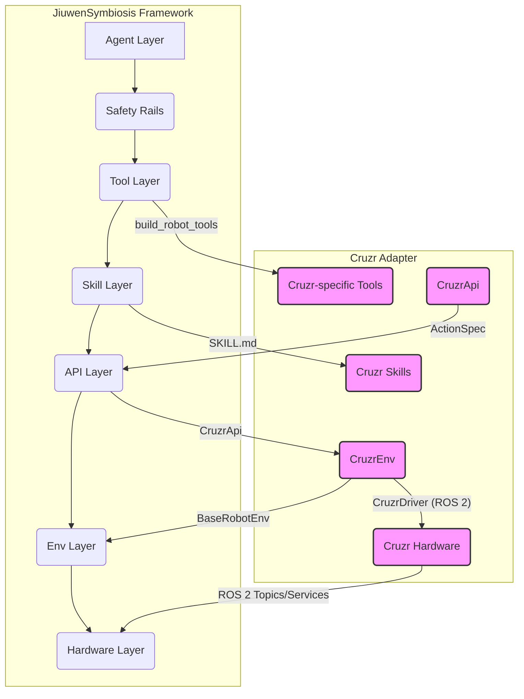

<!-- source: DeepWiki mcp.deepwiki.com · repo openJiuwen-ai/jiuwensymbiosis · page 5.4 Cruzr Mobile Dual-Arm Adapter & ROS 2 · fetched 2026-11-02 -->

# Cruzr Mobile Dual-Arm Adapter & ROS 2

<details>
<summary>Relevant source files</summary>

The following files were used as context for generating this wiki page:

- [AGENTS.md](AGENTS.md)
- [jiuwensymbiosis/api/state.py](jiuwensymbiosis/api/state.py)
- [jiuwensymbiosis/api/world_state.py](jiuwensymbiosis/api/world_state.py)
- [jiuwensymbiosis/perception/scene3d.py](jiuwensymbiosis/perception/scene3d.py)
- [scripts/cruzr/dual_arm_grasp_bringup.py](scripts/cruzr/dual_arm_grasp_bringup.py)
- [scripts/new_adapter/render.py](scripts/new_adapter/render.py)
- [scripts/validate_adapter.py](scripts/validate_adapter.py)
- [templates/xxx_adapter/calibration.py](templates/xxx_adapter/calibration.py)
- [templates/xxx_adapter/env.py](templates/xxx_adapter/env.py)
- [tests/unit_tests/adapters/cruzr/test_grasp_hygiene.py](tests/unit_tests/adapters/cruzr/test_grasp_hygiene.py)
- [tests/unit_tests/api/test_world_state.py](tests/unit_tests/api/test_world_state.py)
- [tests/unit_tests/test_layering.py](tests/unit_tests/test_layering.py)

</details>


This page details the implementation of the Cruzr mobile dual-arm adapter within the `jiuwensymbiosis` framework. It covers the adapter's layered architecture, the ROS 2 bridge modules used for communication, scripts for dual-arm bringup, and the mobile-base approach flows. The goal is to provide a comprehensive understanding of how the Cruzr robot is integrated and controlled.

## Cruzr Adapter Layers

The Cruzr adapter, like other hardware adapters in `jiuwensymbiosis`, adheres to a layered architecture to maintain hardware-agnosticism and modularity [AGENTS.md:93-105](). This structure separates concerns, allowing for easier integration of new hardware and maintenance.

The key layers for the Cruzr adapter are:
*   **Config Layer**: Defines the configuration parameters specific to the Cruzr robot, such as URDF paths, camera calibration paths, and detector service URLs. This is handled by `CruzrConfig` [scripts/cruzr/dual_arm_grasp_bringup.py:43]().
*   **Env Layer**: Provides the `BaseRobotEnv` implementation for the Cruzr, abstracting the low-level hardware interactions. This is `CruzrEnv` [scripts/cruzr/dual_arm_grasp_bringup.py:44](). It delegates to a low-level driver for actual hardware control [templates/xxx_adapter/env.py:66-67]().
*   **API Layer**: Exposes the robot's capabilities through a set of `ActionSpec`-defined actions, implemented by `CruzrApi` [scripts/cruzr/dual_arm_grasp_bringup.py:45](). This layer interacts with the `Env` layer to execute commands and retrieve observations.
*   **Low-Level Driver**: This is the core hardware interface, responsible for direct communication with the Cruzr robot's motors, sensors, and other components. For Cruzr, this typically involves ROS 2 communication.

### Adapter Structure
The `scripts/validate_adapter.py` tool is used to ensure that adapters conform to the framework's conventions, checking for correct `Config`, `Env`, and `Api` structures [scripts/validate_adapter.py:20-21](). The `scripts/new_adapter/render.py` script provides templates for creating new adapters, including placeholders for connection-specific fields like ROS [scripts/new_adapter/render.py:171-173]().

The `CruzrEnv` class declares the capabilities of the Cruzr robot, such as `motion.cartesian`, `motion.joint`, `motion.base`, `motion.dual_arm`, `grasp.parallel`, and various `vision` capabilities [templates/xxx_adapter/env.py:31-50](). These capabilities are crucial for the framework to understand what actions the robot can perform.


**Diagram: Cruzr Adapter within the Layered Architecture**

Sources:
* `AGENTS.md:93-105`
* `scripts/cruzr/dual_arm_grasp_bringup.py:43`
* `scripts/cruzr/dual_arm_grasp_bringup.py:44`
* `scripts/cruzr/dual_arm_grasp_bringup.py:45`
* `scripts/new_adapter/render.py:171-173`
* `scripts/validate_adapter.py:20-21`
* `templates/xxx_adapter/env.py:31-50`
* `templates/xxx_adapter/env.py:66-67`

## ROS 2 Bridge Modules

The Cruzr adapter leverages ROS 2 for communication with the robot's hardware. The `jiuwensymbiosis` framework is designed to lazily load ROS 2 components only when `env.connect()` is called, preventing unnecessary dependencies at module import time [scripts/cruzr/dual_arm_grasp_bringup.py:12-13]().

The ROS 2 integration typically involves:
*   **ROS 2 Client Library**: `rclpy` is the Python client library for ROS 2, used for creating nodes, publishers, subscribers, and clients for services.
*   **Topics and Services**: The Cruzr driver communicates with the robot's various components (e.g., motors, sensors, grippers) via ROS 2 topics for continuous data streams (like joint states or camera feeds) and services for request-response interactions (like moving to a pose or activating a gripper).
*   **URDF**: The Unified Robot Description Format (URDF) is used to describe the robot's kinematic and dynamic properties. For Cruzr, the `urdf_path` is specified in its configuration, and `jiuwensymbiosis.kinematics.urdf_chain.parse_chain` is used to parse these descriptions for kinematic calculations [scripts/cruzr/dual_arm_grasp_bringup.py:93-94]().

The `CruzrApi` and `CruzrEnv` classes encapsulate the ROS 2 interactions. For instance, `CruzrEnv.connect()` would initialize the ROS 2 node and establish connections to relevant topics and services. The `CruzrApi` then uses these connections to implement actions like `move_joint`, `activate_suction`, or `get_image` [scripts/new_adapter/render.py:83-90]().

## Dual-Arm Bringup Scripts

The `scripts/cruzr/dual_arm_grasp_bringup.py` script demonstrates the bringup and operation of the Cruzr's dual-arm system for a box-grasping task. This script showcases the integration of perception, kinematics, and motion control for coordinated dual-arm manipulation.

The script supports different modes of operation:
*   `--dry-run`: Detects an object and solves inverse kinematics (IK) but does not move the physical robot [scripts/cruzr/dual_arm_grasp_bringup.py:32]().
*   `--single-arm`: Executes a low-speed reach with one arm after IK is solved (deferred to manual execution) [scripts/cruzr/dual_arm_grasp_bringup.py:36-37]().
*   `--full`: Runs the complete orchestrated dual-arm grasp pipeline, including detection, IK, clamping, force-torque sensing, and lifting [scripts/cruzr/dual_arm_grasp_bringup.py:40-41]().

The dual-arm grasping process involves several steps:
1.  **Object Detection**: `api.locate_for_grasp(args.object)` is called to detect the 3D geometry of the target object [scripts/cruzr/dual_arm_grasp_bringup.py:58](). This relies on the `vision.detection` capability and a detector service [templates/xxx_adapter/env.py:45](). The detected object's properties are then encapsulated in an `ObjectGeometry3D` object [scripts/cruzr/dual_arm_grasp_bringup.py:80-90]().
2.  **Kinematic Chain Parsing**: The URDF for the left and right arms is parsed to obtain their kinematic chains using `jiuwensymbiosis.kinematics.urdf_chain.parse_chain` [scripts/cruzr/dual_arm_grasp_bringup.py:93-94]().
3.  **Joint State Acquisition**: The current joint positions of the lifter and waist are read from the low-level driver [scripts/cruzr/dual_arm_grasp_bringup.py:97-99]().
4.  **Dual-Arm Grasp IK Solution**: `jiuwensymbiosis.adapters.cruzr.geometry.solve_grasp` calculates the inverse kinematics for both arms to achieve a stable grasp on the detected object [scripts/cruzr/dual_arm_grasp_bringup.py:102]().
5.  **Execution (Optional)**: If not in dry-run mode, the planned joint movements are executed. For the `--full` mode, `api.dual_arm_grasp()` is called, which uses the cached detection to perform the coordinated grasp [scripts/cruzr/dual_arm_grasp_bringup.py:64](). After grasping, `api.dual_arm_place()` can be used to place the object back [scripts/cruzr/dual_arm_grasp_bringup.py:68](), followed by `api.home()` to return the arms to a safe posture [scripts/cruzr/dual_arm_grasp_bringup.py:70]().

```mermaid
graph TD
    A[Start] --> B{Run Mode?};
    B -- "dry-run" --> C[Detect Object (locate_for_grasp)];
    B -- "single-arm" --> C;
    B -- "full" --> C;

    C --> D[Parse URDF Chains (parse_chain)];
    D --> E[Get Fixed Joint Positions (get_joint_positions)];
    E --> F[Solve Dual-Arm Grasp IK (solve_grasp)];

    F -- "plan.ok is False OR dry-run" --> G[Exit];
    F -- "plan.ok is True AND not dry-run" --> H{Mode == single-arm?};

    H -- "Yes" --> I[Move Left Arm Joints (move_joints_blocking)];
    H -- "No (full mode)" --> J[Execute dual_arm_grasp];
    J --> K[Execute dual_arm_place];
    K --> L[Execute home];
    L --> G;
    I --> G;
```
**Diagram: Dual-Arm Grasp Bringup Flow**

Sources:
* `scripts/cruzr/dual_arm_grasp_bringup.py:12-13`
* `scripts/cruzr/dual_arm_grasp_bringup.py:32`
* `scripts/cruzr/dual_arm_grasp_bringup.py:36-37`
* `scripts/cruzr/dual_arm_grasp_bringup.py:40-41`
* `scripts/cruzr/dual_arm_grasp_bringup.py:58`
* `scripts/cruzr/dual_arm_grasp_bringup.py:64`
* `scripts/cruzr/dual_arm_grasp_bringup.py:68`
* `scripts/cruzr/dual_arm_grasp_bringup.py:70`
* `scripts/cruzr/dual_arm_grasp_bringup.py:80-90`
* `scripts/cruzr/dual_arm_grasp_bringup.py:93-94`
* `scripts/cruzr/dual_arm_grasp_bringup.py:97-99`
* `scripts/cruzr/dual_arm_grasp_bringup.py:102`
* `templates/xxx_adapter/env.py:45`

## Mobile-Base Approach Flows

The Cruzr robot, being a mobile platform, includes capabilities for mobile-base navigation. The `motion.base` and `motion.base_servo` capabilities are declared in the `BaseRobotEnv` [templates/xxx_adapter/env.py:35-36]().

The `WorldState` mechanism plays a crucial role in mobile-base operations. When the mobile base moves, all previously sensed object locations become stale. The `test_moving_the_base_drops_every_location` unit test confirms this behavior: after a `drive` action, the `locations` in `ExecutionMemory` are cleared [tests/unit_tests/api/test_world_state.py:119-122](). This ensures that the robot does not attempt to interact with objects at outdated coordinates.

The `WorldState` also tracks the robot's self-state, including whether it is holding a payload (`payload.held`, `payload.clear`, `payload.stowed`) [jiuwensymbiosis/api/state.py:66-68](). This is important for mobile operations, as the robot might need to stow a payload before moving to prevent collisions or maintain stability. The `_observed_payload` function in `jiuwensymbiosis.api.world_state.py` reads the `holding_payload` status from the environment, and this observation overrides any conflicting beliefs in the `ExecutionMemory` [jiuwensymbiosis/api/world_state.py:36-46]().

For tasks involving placing objects, the `locate_for_place` action is used. Similar to `locate_for_grasp`, it clears stale surface detections on failure to prevent the robot from attempting to place an object on an incorrect or non-existent surface [tests/unit_tests/adapters/cruzr/test_grasp_hygiene.py:31-38]().

The `jiuwensymbiosis.perception.scene3d.py` module provides robot-agnostic 3D scene sensing functions, which are critical for mobile navigation and interaction. These functions take `(rgb, depth, intrinsics, base←camera)` and a segmentation callable to identify objects and surfaces in the environment [jiuwensymbiosis/perception/scene3d.py:6-10](). This allows the mobile base to approach targets based on perceived spatial relationships.

Sources:
* `jiuwensymbiosis/api/state.py:66-68`
* `jiuwensymbiosis/api/world_state.py:36-46`
* `jiuwensymbiosis/perception/scene3d.py:6-10`
* `templates/xxx_adapter/env.py:35-36`
* `tests/unit_tests/adapters/cruzr/test_grasp_hygiene.py:31-38`
* `tests/unit_tests/api/test_world_state.py:119-122`

---

