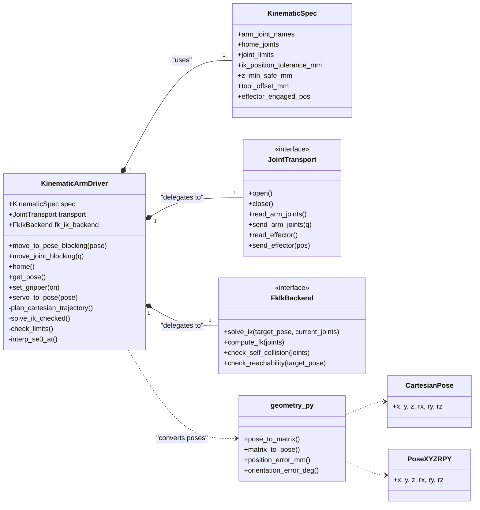

<!-- source: DeepWiki mcp.deepwiki.com · repo openJiuwen-ai/jiuwensymbiosis · page 5.5 Shared Adapter Commons: Kinematics & Motion · fetched 2026-11-02 -->

# Shared Adapter Commons: Kinematics & Motion

<details>
<summary>Relevant source files</summary>

The following files were used as context for generating this wiki page:

- [configs/piper/piper.yaml](configs/piper/piper.yaml)
- [jiuwensymbiosis/adapters/_common/capability_spec.py](jiuwensymbiosis/adapters/_common/capability_spec.py)
- [jiuwensymbiosis/adapters/_common/geometry.py](jiuwensymbiosis/adapters/_common/geometry.py)
- [jiuwensymbiosis/adapters/_common/joint_transport.py](jiuwensymbiosis/adapters/_common/joint_transport.py)
- [jiuwensymbiosis/adapters/_common/kinematic_driver.py](jiuwensymbiosis/adapters/_common/kinematic_driver.py)
- [jiuwensymbiosis/adapters/_common/kinematics.py](jiuwensymbiosis/adapters/_common/kinematics.py)
- [jiuwensymbiosis/adapters/_common/lerobot_backend.py](jiuwensymbiosis/adapters/_common/lerobot_backend.py)
- [jiuwensymbiosis/adapters/piper/session.py](jiuwensymbiosis/adapters/piper/session.py)
- [scripts/new_adapter/README.md](scripts/new_adapter/README.md)
- [scripts/new_adapter/__init__.py](scripts/new_adapter/__init__.py)
- [scripts/new_adapter/checks.py](scripts/new_adapter/checks.py)
- [scripts/new_adapter/main.py](scripts/new_adapter/main.py)
- [scripts/new_adapter/spec.py](scripts/new_adapter/spec.py)
- [tests/unit_tests/scripts/__init__.py](tests/unit_tests/scripts/__init__.py)

</details>


This page details the shared components within the `jiuwensymbiosis.adapters._common` module, focusing on kinematics and motion control. These common utilities provide a standardized way to handle robot geometry, kinematic calculations (forward kinematics, inverse kinematics, reachability, self-collision), and various motion primitives (approach, dual-arm control, differential drive, lift mechanisms) across different robot adapters. The goal is to reduce boilerplate code and ensure consistency in how robots interact with the framework's higher-level planning and execution layers.

Sources:
* [jiuwensymbiosis/adapters/_common/geometry.py]()
* [jiuwensymbiosis/adapters/_common/kinematic_driver.py]()
* [jiuwensymbiosis/adapters/_common/kinematics.py]()
* [jiuwensymbiosis/adapters/_common/lerobot_backend.py]()
* [jiuwensymbiosis/adapters/_common/joint_transport.py]()
* [jiuwensymbiosis/adapters/_common/builder.py]()
* [jiuwensymbiosis/adapters/_common/capability_spec.py]()
* [scripts/new_adapter/spec.py]()
* [scripts/new_adapter/main.py]()
* [scripts/new_adapter/README.md]()
* [configs/piper/piper.yaml]()
* [jiuwensymbiosis/adapters/piper/session.py]()

## Core Components

The `_common` module provides several key abstractions that facilitate the integration of diverse robotic hardware.

### `geometry.py`: Pose and Unit Conversions

The `geometry.py` module handles the fundamental conversions between different representations of robot poses and units. The framework's tool layer operates with **millimetres and Euler degrees**, while kinematic backends (like URDF solvers) typically use **metres and rotation matrices**. This module acts as the bridge, preventing the need for scattered unit conversions throughout the codebase.

Key classes and functions:
*   `CartesianPose`: A `dataclass` representing an end-effector pose in the tool convention (`x, y, z, rx, ry, rz` in mm and Euler degrees). [jiuwensymbiosis/adapters/_common/geometry.py:28-45]()
*   `PoseXYZRPY`: A `NamedTuple` for positional pose reads, also in mm and Euler degrees. [jiuwensymbiosis/adapters/_common/geometry.py:46-55]()
*   `read_pose_xyzrpy(obj: Any) -> PoseXYZRPY`: Extracts pose components from various object types, handling missing rotation fields by defaulting to 0. [jiuwensymbiosis/adapters/_common/geometry.py:57-69]()
*   `pose_to_matrix(pose: Any, *, euler_axes: str = "xyz") -> np.ndarray`: Converts a tool-frame pose (mm/deg) into a 4x4 SE(3) transformation matrix with translation in **metres**. [jiuwensymbiosis/adapters/_common/geometry.py:72-77]()
*   `matrix_to_pose(matrix: np.ndarray, *, euler_axes: str = "xyz") -> CartesianPose`: Converts a 4x4 SE(3) matrix (translation in metres) back to a `CartesianPose` (mm/deg). [jiuwensymbiosis/adapters/_common/geometry.py:80-94]()
*   `position_error_mm(actual: np.ndarray, target: np.ndarray) -> float`: Calculates the Euclidean translation error in mm between two metre-scale SE(3) matrices. [jiuwensymbiosis/adapters/_common/geometry.py:97-100]()
*   `orientation_error_deg(actual: np.ndarray, target: np.ndarray) -> float`: Calculates the geodesic rotation error in degrees between the rotation parts of two SE(3) matrices. [jiuwensymbiosis/adapters/_common/geometry.py:103-106]()

Sources:
* [jiuwensymbiosis/adapters/_common/geometry.py:1-106]()

### `joint_transport.py`: Joint-Level SDK Seam

The `joint_transport.py` module defines the `JointTransport` `Protocol`, which serves as the minimal interface for interacting with a robot's joint-level SDK. This is crucial for arms whose SDKs only provide joint targets and observations, requiring the Cartesian layer (FK/IK, path planning, safety) to be implemented above the SDK.

The `JointTransport` contract includes:
*   `open()` / `close()`: For managing the SDK connection lifecycle. [jiuwensymbiosis/adapters/_common/joint_transport.py:43-48]()
*   `precheck()`: To validate SDK-specific preconditions before connection. [jiuwensymbiosis/adapters/_common/joint_transport.py:50-54]()
*   `read_arm_joints()` / `send_arm_joints()`: For reading and commanding arm joint values in the SDK's native unit. The end-effector joints are explicitly excluded from this vector. [jiuwensymbiosis/adapters/_common/joint_transport.py:56-61]()
*   `read_effector()` / `send_effector()`: For controlling a two-state end-effector (e.g., parallel gripper or suction cup). [jiuwensymbiosis/adapters/_common/joint_transport.py:63-66]()

A `JointTransport` implementation can also optionally expose `grab_frames`, `intrinsics`, `tf_flange_cam`, and `calibration` if it carries a camera or hand-eye calibration, allowing vision capabilities to compose with the kinematic driver. [jiuwensymbiosis/adapters/_common/joint_transport.py:29-32]()

Sources:
* [jiuwensymbiosis/adapters/_common/joint_transport.py:1-66]()

### `kinematics.py`: Kinematics Solver Backend

The `kinematics.py` module provides the `FkIkBackend` `Protocol`, which defines the interface for a URDF-based kinematics solver. This backend is responsible for performing forward kinematics (FK) and inverse kinematics (IK) calculations, as well as checking for self-collision and reachability.

Key functions within this module (though not explicitly shown in the provided `kinematics.py` snippet, their existence is implied by `KinematicArmDriver`'s usage):
*   `solve_ik_checked()`: Solves inverse kinematics for a target pose, considering joint limits and self-collision. [jiuwensymbiosis/adapters/_common/kinematic_driver.py:50]()
*   `plan_cartesian_move()`: Plans a Cartesian path between two poses. [jiuwensymbiosis/adapters/_common/kinematic_driver.py:51]()
*   `plan_joint_move()`: Plans a joint-space path between two joint configurations. [jiuwensymbiosis/adapters/_common/kinematic_driver.py:52]()
*   `interp_se3_at()`: Interpolates SE(3) poses. [jiuwensymbiosis/adapters/_common/kinematic_driver.py:49]()
*   `_check_limits()`: Checks if a joint configuration is within limits. [jiuwensymbiosis/adapters/_common/kinematic_driver.py:49]()

The `lerobot_backend.py` module likely provides a concrete implementation of `FkIkBackend` using the LeRobot library, as suggested by the `SO-101` adapter's description.

Sources:
* [jiuwensymbiosis/adapters/_common/kinematic_driver.py:46-52]()

### `kinematic_driver.py`: Reusable Cartesian Driver

The `kinematic_driver.py` module implements `KinematicArmDriver`, a reusable `CartesianDriver` for arms that primarily operate at the joint level. This driver builds the entire Cartesian motion layer expected by the framework (e.g., `move_to_pose_blocking`, `move_joint_blocking`, `home`, `get_pose`, safety floors) on top of two injected seams:
1.  A `JointTransport` (the vendor SDK glue).
2.  An `FkIkBackend` (a URDF kinematics solver).

This design allows a joint-level arm to fully compose with the framework's existing capability machinery, including `GripperDriver`, `SuctionDriver`, `ServoDriver`, and `CameraDriver`/`VisionDriver` (if the transport provides camera capabilities).

The `KinematicSpec` `dataclass` [jiuwensymbiosis/adapters/_common/kinematic_driver.py:69-149]() encapsulates all generic robot constants required by `KinematicArmDriver`, such as:
*   `arm_joint_names`, `home_joints`, `joint_limits` [jiuwensymbiosis/adapters/_common/kinematic_driver.py:76-79]()
*   IK parameters (`ik_orientation_weight`, `ik_position_tolerance_mm`, `euler_axes`) [jiuwensymbiosis/adapters/_common/kinematic_driver.py:83-87]()
*   Trajectory and arrival parameters (`max_joint_step_deg`, `max_cartesian_step_mm`, `trajectory_hz`, `joint_tolerance_deg`, `settle_samples`) [jiuwensymbiosis/adapters/_common/kinematic_driver.py:90-96]()
*   Safety parameters (`z_min_safe_mm`, `z_max_safe_mm`, `tool_offset_mm`) [jiuwensymbiosis/adapters/_common/kinematic_driver.py:99-101]()
*   End-effector parameters (`effector_engaged_pos`, `effector_released_pos`, `effector_settle_s`, `gripper_contact_min_travel`) [jiuwensymbiosis/adapters/_common/kinematic_driver.py:104-116]()
*   Settle-loop hardening and real-time servo enforcement parameters. [jiuwensymbiosis/adapters/_common/kinematic_driver.py:118-137]()
*   Safety validation flags (`requires_safety_validation`, `safety_validated`) [jiuwensymbiosis/adapters/_common/kinematic_driver.py:145-146]()

The `KinematicArmDriver` handles:
*   **Cartesian Motion**: Translates desired Cartesian poses into joint commands using the `FkIkBackend`.
*   **Joint Motion**: Directly sends joint commands via the `JointTransport`.
*   **Homing**: Moves the arm to a predefined home position.
*   **Pose Retrieval**: Reads the current arm pose using FK from joint readings.
*   **Safety Floors**: Enforces `z_min_safe_mm` and `z_max_safe_mm` limits.
*   **End-Effector Control**: Manages gripper or suction states.
*   **Servo Control**: Provides non-blocking, single-step IK for real-time control, respecting velocity limits.

Sources:
* [jiuwensymbiosis/adapters/_common/kinematic_driver.py:1-158]()

### `builder.py`: Adapter Session Builder

The `builder.py` module provides the `make_builder` function, a factory for creating adapter session builders. This function streamlines the process of constructing a `RobotSession` from a configuration, attaching necessary components like the environment (`Env`), API (`Api`), and sidecars (e.g., detector servers).

The `build_piper_session` function in `jiuwensymbiosis/adapters/piper/session.py` is an example of using `make_builder`:
```python
build_piper_session = make_builder(
    PiperConfig,
    PiperEnv,
    PiperApi,
    api_kwargs_from_cfg=[
        "detector.url:detector_service_url",
        "z_correction_mm",
        "grasp_z_offset_mm",
        "place_z_offset_mm",
    ],
    sidecar_builders=[make_detector_sidecar()],
    decorate=_attach_piper_cfg,
)
```
[jiuwensymbiosis/adapters/piper/session.py:28-43]()

This builder:
*   Takes `PiperConfig`, `PiperEnv`, and `PiperApi` as core components.
*   Maps configuration attributes to API keyword arguments (e.g., `detector.url` to `detector_service_url`).
*   Includes `make_detector_sidecar()` to manage the lifecycle of the GroundingDINO + SAM2 detection server.
*   Uses a `decorate` function (`_attach_piper_cfg`) to expose the configuration to in-process code execution.

Sources:
* [jiuwensymbiosis/adapters/piper/session.py:17-43]()

## Kinematics and Motion Capabilities

The `_common` modules support a range of kinematics and motion capabilities, which are declared by adapters and used by the framework's planning and execution layers.

### Kinematics

*   **Forward Kinematics (FK)**: Calculating the end-effector pose given a set of joint angles. This is handled by the `FkIkBackend` and used by `KinematicArmDriver` to report the current pose.
*   **Inverse Kinematics (IK)**: Calculating the joint angles required to reach a target end-effector pose. This is a core function of the `FkIkBackend` and is invoked by `KinematicArmDriver` for Cartesian movements. The `KinematicSpec` defines parameters like `ik_orientation_weight` and `ik_position_tolerance_mm` to guide the IK solver. [jiuwensymbiosis/adapters/_common/kinematic_driver.py:83-85]()
*   **Reachability**: Determining if a target pose is physically reachable by the robot. This is implicitly handled by the IK solver's ability to find a solution within joint limits and workspace constraints.
*   **Self-Collision**: Checking if a robot's configuration results in parts of the robot colliding with itself. This is a function of the `FkIkBackend`.

### Motion Primitives

The framework supports various motion primitives, some of which are implemented generically in `_common` or rely on the underlying kinematic driver.

*   **Approach**: Moving the end-effector towards a target. This often involves a sequence of Cartesian moves. The `CAPABILITY_ACTIONS` define `approach_for_grasp` and `approach_for_place` actions. [jiuwensymbiosis/adapters/_common/capability_spec.py:39]()
*   **Dual-Arm Control**: For robots with multiple arms, coordinating their movements. The `CAPABILITY_ACTIONS` include `dual_arm_grasp` and `dual_arm_place`. [jiuwensymbiosis/adapters/_common/capability_spec.py:41]()
*   **Differential Drive**: For mobile bases, controlling movement using differential wheels. This falls under `motion.base` capabilities, with actions like `navigate_relative`, `rotate_base`, and `drive_arc`. [jiuwensymbiosis/adapters/_common/capability_spec.py:36]()
*   **Lift**: Controlling a vertical lift mechanism. The `motion.lift` capability includes `set_lift_pose` and `lift_to_clearance`. [jiuwensymbiosis/adapters/_common/capability_spec.py:37]()

## Adapter Generation and Kinematics

The `scripts/new_adapter` wizard plays a crucial role in setting up the kinematic and motion capabilities for a new robot. When generating an adapter, the wizard asks questions that determine which common components are used and how they are configured.

The `Spec` class in `scripts/new_adapter/spec.py` captures these choices:
*   `dof`: Degrees of freedom (4 for SCARA, 6 for 6-axis arms). [scripts/new_adapter/spec.py:118]()
*   `motion_backend`: Crucially determines how Cartesian motion is handled. [scripts/new_adapter/spec.py:127]()
    *   `sdk_cartesian`: The vendor SDK provides Cartesian motion directly. The driver is a thin wrapper.
    *   `joint_ik`: The SDK only takes joint targets. The `KinematicArmDriver` from `_common` is used, building the Cartesian layer from a URDF FK/IK backend. This is the path that leverages `joint_transport.py` and `kinematics.py`.
*   `joint_count`: For `joint_ik` backends, this specifies the number of kinematic joints. [scripts/new_adapter/spec.py:128]()
*   `servo`: Whether to declare `motion.servo` for streaming, non-blocking control. [scripts/new_adapter/spec.py:132]()

The wizard's help messages clarify these choices:
*   `_HELP_DOF`: Explains how to determine the DOF. [scripts/new_adapter/spec.py:45-50]()
*   `_HELP_MOTION_BACKEND`: Details the difference between `sdk_cartesian` and `joint_ik` and how to choose. [scripts/new_adapter/spec.py:87-94]()
*   `_HELP_JOINT_COUNT`: Explains how to count kinematic joints for FK/IK. [scripts/new_adapter/spec.py:96-99]()

The `capabilities` property of `Spec` [scripts/new_adapter/spec.py:163-178]() dynamically generates the list of capabilities the adapter will declare based on these choices, such as `motion.cartesian`, `motion.joint`, `motion.servo`, `grasp.parallel`, etc. These capabilities then dictate which actions are exposed to the LLM and which low-level driver members must be implemented, as defined in `CAPABILITY_ACTIONS` and `CAPABILITY_DRIVER_MEMBERS` in `capability_spec.py`. [jiuwensymbiosis/adapters/_common/capability_spec.py:29-83]()

### Diagram: Kinematics & Motion Data Flow

```mermaid
graph TD
    subgraph "High-Level Planning & API"
        A[LLM Planner] --> B(Action Contracts / API)
        B -- "e.g., goto_pose(x,y,z,rx,ry,rz)" --> C(RobotEnv)
    end

    subgraph "Adapter Layer"
        C --> D{KinematicArmDriver}
        D -- "KinematicSpec" --> D
        D -- "CartesianPose (mm/deg)" --> E(geometry.py)
        E -- "SE(3) Matrix (m)" --> F{FkIkBackend (e.g., LeRobot)}
        F -- "Joint Angles (rad)" --> G{JointTransport}
        G -- "Native Joint Units" --> H(Robot SDK / Hardware)
        H -- "Joint Readings" --> G
        G -- "Native Joint Units" --> F
        F -- "SE(3) Matrix (m)" --> E
        E -- "CartesianPose (mm/deg)" --> D
        D -- "Current Pose" --> C
    end

    subgraph "Adapter Generation"
        I[scripts/new_adapter/main.py] --> J(Spec)
        J -- "motion_backend=joint_ik" --> D
        J -- "joint_count" --> F
        J -- "capabilities" --> B
    end

    style A fill:#f9f,stroke:#333,stroke-width:2px
    style B fill:#bbf,stroke:#333,stroke-width:2px
    style C fill:#bfb,stroke:#333,stroke-width:2px
    style D fill:#ffb,stroke:#333,stroke-width:2px
    style E fill:#fbb,stroke:#333,stroke-width:2px
    style F fill:#ccf,stroke:#333,stroke-width:2px
    style G fill:#fcf,stroke:#333,stroke-width:2px
    style H fill:#cfc,stroke:#333,stroke-width:2px
    style I fill:#eee,stroke:#333,stroke-width:2px
    style J fill:#eef,stroke:#333,stroke-width:2px
```
Title: Kinematics and Motion Data Flow
Sources:
* [jiuwensymbiosis/adapters/_common/geometry.py]()
* [jiuwensymbiosis/adapters/_common/kinematic_driver.py]()
* [jiuwensymbiosis/adapters/_common/kinematics.py]()
* [jiuwensymbiosis/adapters/_common/joint_transport.py]()
* [scripts/new_adapter/spec.py]()
* [scripts/new_adapter/main.py]()

### Diagram: `KinematicArmDriver` Internal Structure


Title: KinematicArmDriver Internal Structure
Sources:
* [jiuwensymbiosis/adapters/_common/geometry.py]()
* [jiuwensymbiosis/adapters/_common/kinematic_driver.py]()
* [jiuwensymbiosis/adapters/_common/kinematics.py]()
* [jiuwensymbiosis/adapters/_common/joint_transport.py]()

---

