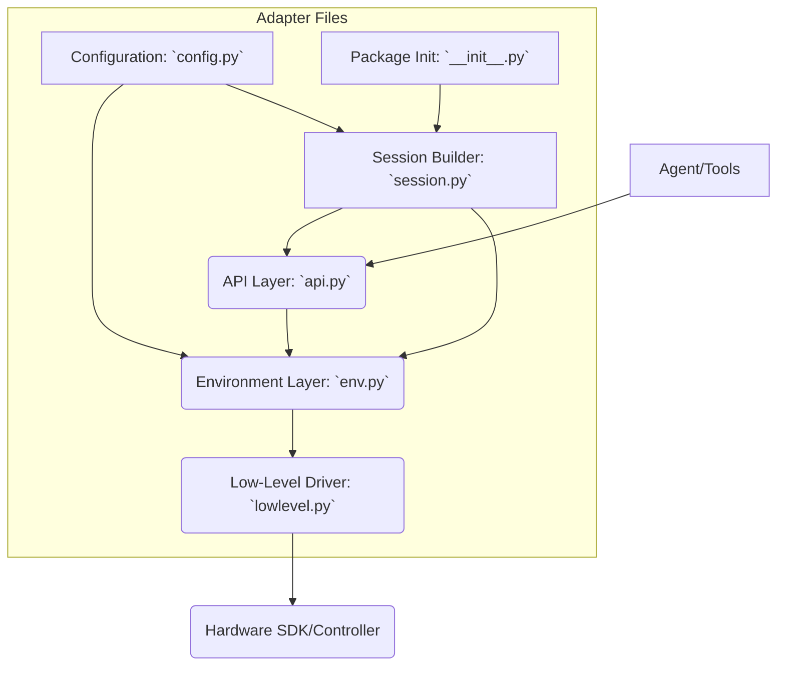

<!-- source: DeepWiki mcp.deepwiki.com · repo openJiuwen-ai/jiuwensymbiosis · page 5.6 Building a New Adapter · fetched 2026-11-02 -->

# Building a New Adapter

<details>
<summary>Relevant source files</summary>

The following files were used as context for generating this wiki page:

- [docs/zh/how-to/port-hardware-adapter.md](docs/zh/how-to/port-hardware-adapter.md)
- [jiuwensymbiosis/adapters/_common/capability_spec.py](jiuwensymbiosis/adapters/_common/capability_spec.py)
- [scripts/new_adapter/README.md](scripts/new_adapter/README.md)
- [scripts/new_adapter/__init__.py](scripts/new_adapter/__init__.py)
- [scripts/new_adapter/checks.py](scripts/new_adapter/checks.py)
- [scripts/new_adapter/main.py](scripts/new_adapter/main.py)
- [scripts/new_adapter/spec.py](scripts/new_adapter/spec.py)
- [scripts/smoke_test_adapter.py](scripts/smoke_test_adapter.py)
- [templates/xxx_adapter/__init__.py](templates/xxx_adapter/__init__.py)
- [templates/xxx_adapter/api.py](templates/xxx_adapter/api.py)
- [templates/xxx_adapter/lowlevel.py](templates/xxx_adapter/lowlevel.py)
- [templates/xxx_adapter/session.py](templates/xxx_adapter/session.py)
- [tests/integration/test_new_adapter.py](tests/integration/test_new_adapter.py)
- [tests/unit_tests/scripts/__init__.py](tests/unit_tests/scripts/__init__.py)

</details>


This page details the process of creating a new hardware adapter for the jiuwensymbiosis framework. It covers the use of the `scripts/new_adapter` tool for scaffolding, the structure of the generated adapter files, and the steps involved in porting a real hardware SDK. The goal is to streamline the integration of new robotic platforms by providing a guided, iterative development workflow.

## Adapter Scaffolding with `scripts/new_adapter`

The `scripts/new_adapter/main.py` script provides an interactive wizard to generate the foundational files for a new adapter. This tool significantly reduces the boilerplate code required, ensuring that the generated structure adheres to the framework's contracts.

### Wizard Interaction

The wizard prompts the user for key hardware characteristics, such as:
*   **Adapter Name**: A unique, lowercase identifier for the robot (e.g., `my_arm`).
*   **Degrees of Freedom (DOF)**: Typically 4 (SCARA) or 6 (6-axis arm).
*   **Joint Motion Support**: Whether the SDK provides joint-space control (e.g., `move_joint(q)`).
*   **End-Effector Type**: `none`, `parallel` (gripper), or `suction`.
*   **Camera Presence**: Whether the robot has an RGB or RGB-D camera.
*   **Object Detection Capability**: Whether the adapter needs to support natural language object detection to 3D grasp points. This implies camera presence and hand-eye calibration.
*   **Tool Geometry**: `straight_down` or `tilted`.
*   **Connection Type**: `can`, `serial`, `tcp`, `usb`, `ros`, or `custom`. The `can` option generates a more complete template, while others start with empty templates.
*   **Motion Backend**: `sdk_cartesian` (vendor SDK handles Cartesian motion) or `joint_ik` (local FK/IK from URDF for joint-only SDKs).
*   **Joint Count**: For `joint_ik` backend, the number of kinematic joints.
*   **Orientation Mode**: `full` or `soft` for Cartesian motion.
*   **Gripper Unit**: `mm`, `percent`, or `none`.
*   **Servo Support**: For `joint_ik` backend, whether to declare `motion.servo` for streaming.

Users can type `?` at any prompt for an explanation of the question [scripts/new_adapter/spec.py:43-99]().

### Generation Process

The `_generate` function [scripts/new_adapter/main.py:171-184]() orchestrates the file creation. It uses the `render_all` function from `scripts/new_adapter/render.py` to populate the template files based on the `Spec` object [scripts/new_adapter/spec.py:114-132]() derived from user input.

The generated files include:
*   `jiuwensymbiosis/adapters/<name>/__init__.py`
*   `jiuwensymbiosis/adapters/<name>/api.py`
*   `jiuwensymbiosis/adapters/<name>/config.py`
*   `jiuwensymbiosis/adapters/<name>/env.py`
*   `jiuwensymbiosis/adapters/<name>/lowlevel.py`
*   `jiuwensymbiosis/adapters/<name>/session.py`
*   `configs/<name>/default.yaml`

After generation, the script attempts to format the Python files using `black` [scripts/new_adapter/checks.py:71-96]().

#### Adapter File Structure

The generated adapter follows a layered architecture:


**Diagram 1: Adapter File Structure and Data Flow**
Sources: [templates/xxx_adapter/__init__.py:18-24](), [templates/xxx_adapter/session.py:29](), [templates/xxx_adapter/api.py:57](), [templates/xxx_adapter/lowlevel.py:26]()

*   **`config.py`**: Defines a `dataclass` for the adapter's configuration, loaded from `default.yaml`. This includes parameters like `can_port`, `can_bitrate`, `move_speed`, `tool_offset_mm`, and `home_pose_xyzrxryrz_mm_deg`. These values are passed down to the `Env` and `Driver` [docs/zh/how-to/port-hardware-adapter.md:140-157]().
*   **`lowlevel.py`**: This is the direct interface to the hardware SDK. It contains a mock `XxxDriver` class [templates/xxx_adapter/lowlevel.py:26-31]() with placeholder methods for `connect`, `disconnect`, `get_pose`, `home`, `move_to_pose_blocking`, `move_joint_blocking`, `set_gripper`, `set_suction`, and `grab_frames`. These methods are marked with `GENERATED-MOCK` comments, indicating where real hardware SDK calls should be integrated [scripts/new_adapter/checks.py:178]().
*   **`env.py`**: Implements the `BaseRobotEnv` contract. It manages the lifecycle of the `XxxDriver`, exposes hardware capabilities, and provides observation data. It delegates core actions to the `lowlevel` driver [docs/zh/how-to/port-hardware-adapter.md:125-159]().
*   **`api.py`**: Defines the `XxxApi` class, which implements the shared action vocabulary using `@implements` decorators [templates/xxx_adapter/api.py:40-53](). It translates high-level agent commands into `Env` verbs. Generic actions often forward to `api.defaults`, while body-specific actions handle geometry conversions (e.g., tip-to-flange) or vision projections [templates/xxx_adapter/api.py:68-104]().
*   **`session.py`**: Provides the `build_xxx_session` function, which is the entry point for creating a `RobotSession` from a YAML configuration. It uses `make_builder` from `adapters._common.builder` to construct the session, optionally allowing for `api_kwargs_from_cfg`, `sidecar_builders`, and `decorate` functions for advanced setup [templates/xxx_adapter/session.py:29-59]().
*   **`__init__.py`**: Handles package exports and provides the `build_xxx_session` entry point [templates/xxx_adapter/__init__.py:18-24]().

### Capability Alignment

The `Spec` object [scripts/new_adapter/spec.py:114-132]() derives the adapter's capabilities based on the user's answers. These capabilities (e.g., `motion.cartesian`, `grasp.parallel`, `vision.detection`) are then declared in `env.py` and used to gate the available actions in `api.py` [scripts/new_adapter/spec.py:161-178](). The `CAPABILITY_ACTIONS` and `CAPABILITY_DRIVER_MEMBERS` dictionaries in `jiuwensymbiosis/adapters/_common/capability_spec.py` define the mapping between capabilities and the actions/driver methods they gate [jiuwensymbiosis/adapters/_common/capability_spec.py:29-83]().

```mermaid
graph TD
    A[User Input (scripts/new_adapter/main.py)] --> B(Spec Object: scripts/new_adapter/spec.py)
    B -- "Derives" --> C(Capabilities: Spec.capabilities)
    C -- "Generates" --> D(Env.capabilities: env.py)
    C -- "Generates" --> E(Api @implements: api.py)
    C -- "Generates" --> F(Driver Methods: lowlevel.py)
    D -- "Checked by" --> G(validate_adapter)
    E -- "Checked by" --> G
    F -- "Checked by" --> G
    subgraph Code Entities
        B
        C
        D
        E
        F
        G
    end
```
**Diagram 2: Capability Derivation and Validation Flow**
Sources: [scripts/new_adapter/main.py:140-159](), [scripts/new_adapter/spec.py:161-178](), [docs/zh/how-to/port-hardware-adapter.md:46-55](), [jiuwensymbiosis/adapters/_common/capability_spec.py:29-83]()

## Validation and Smoke Testing

After generating the adapter, the `new_adapter` script automatically runs two checks:
1.  **`validate_adapter` (Static Structural Validation)**: This check ensures that the generated adapter adheres to the framework's structural contracts. It verifies that the `Env` and `Api` declare capabilities correctly and that the necessary driver methods are present (even if they are mocks). It reports any `ERROR`s [scripts/new_adapter/checks.py:115-121]().
2.  **`smoke_test_adapter` (Runtime Smoke Test)**: This test attempts to connect the mock environment and call every gated tool (action) exposed by the `Api`. It verifies basic runtime functionality and ensures that the mock implementations are runnable. It reports any `FAIL`s [scripts/new_adapter/checks.py:124-140]().

These checks are crucial for providing immediate feedback on the generated adapter's compliance with the framework. The `test_new_adapter.py` integration tests [tests/integration/test_new_adapter.py:29]() further validate the generator by creating, checking, and removing generated adapters for various presets.

## Porting Guide: From Mock to Real Hardware

The generated adapter provides a functional mock implementation. The next step is to replace these mocks with real hardware SDK calls.

### 1. Confirm Hardware Capabilities and Coordinate Conventions

Before writing code, clearly define the robot's actual capabilities and coordinate systems. This includes:
*   **Motion**: Cartesian, joint, or real-time servo; blocking semantics; units (mm/deg).
*   **End-Effector**: Suction or parallel gripper; open/close semantics; state feedback reliability.
*   **Camera**: RGB, depth, frame alignment; eye-in-hand or eye-to-hand.
*   **Coordinates**: Whether the vendor returns TIP or FLANGE pose; orientation order and units.
*   **Safety**: Z-min safe, workspace bounds, joint soft limits, hardware limits.

The `Env.capabilities` should only declare what the hardware truly supports [docs/zh/how-to/port-hardware-adapter.md:46-55](). The `Api` uses `@implements(SPEC)` to bind supported actions from the shared vocabulary [docs/zh/how-to/port-hardware-adapter.md:57-69]().

### 2. Replace Mock Driver with Vendor SDK

The `lowlevel.py` file is where the actual hardware integration happens. It translates framework verbs into vendor SDK calls.

#### Production Driver Requirements
*   **Idempotent `connect()`/`close()`**: `connect()` and `disconnect()` methods must be idempotent and handle error cleanup [docs/zh/how-to/port-hardware-adapter.md:91-92]().
*   **Blocking Motion**: `move_to_pose_blocking()` must wait for completion, not just "received" [docs/zh/how-to/port-hardware-adapter.md:95]().
*   **Coordinate System and Units**: Document all coordinate systems and units in method comments. Depth should be in meters [docs/zh/how-to/port-hardware-adapter.md:96]().
*   **Error Handling**: Throw specific exceptions for timeouts, unreachable states, communication errors [docs/zh/how-to/port-hardware-adapter.md:97]().
*   **Thread Safety**: If the SDK is not thread-safe, serialize motion, camera, and state reads [docs/zh/how-to/port-hardware-adapter.md:98]().
*   **Safety**: The driver or controller should maintain the last line of defense for workspace limits [docs/zh/how-to/port-hardware-adapter.md:99]().
*   **Gradual Integration**: Start with low speeds and ensure physical emergency stops are accessible [docs/zh/how-to/port-hardware-adapter.md:100]().

The `lowlevel.py` file will contain `GENERATED-MOCK` comments [scripts/new_adapter/checks.py:178]() that guide the developer to replace the mock implementations with real SDK calls. For example, the `connect()` method in a CAN-based adapter might look like this:

```python
from robot_sdk import RobotClient
self._client = RobotClient(channel=self.can_port, bitrate=self.can_bitrate)
self._client.connect()
self._client.enable()
self._connected = True
```
This is a reference shape, not directly runnable code, guiding the integration of the vendor's SDK [docs/zh/how-to/port-hardware-adapter.md:177-182]().

### 3. Complete Production Env and Model-Specific Api

The `Env` is the sole hardware contract for the Agent, Tools, and Rails. It manages lifecycle, observations, and safety properties.

#### Env Lifecycle and Observation
The `connect()` method should create and connect the driver, then expose it via `self.low_level`. `disconnect()` should clear the reference and then release resources [docs/zh/how-to/port-hardware-adapter.md:133-149](). The `get_observation()` method should return a `RobotObservation` with the current pose and other relevant data [docs/zh/how-to/port-hardware-adapter.md:151-158]().

Configuration parameters like `z_min_safe`, `workspace_bounds`, `joint_limits` are exposed from `Config`, while `home_pose` and `tool_offset_mm` come from the `Driver` [docs/zh/how-to/port-hardware-adapter.md:161]().

#### Api Geometry and Vision Projection
Most motion, joint, grasp, and image acquisition actions can directly forward to `api.defaults`. Overwrite only parts where the common semantic differs from the robot's specific implementation. For example, `goto_xyzr` might need to convert a TIP target to a FLANGE command if the tool has an offset [templates/xxx_adapter/api.py:94-104](), or if the tool is tilted [docs/zh/how-to/port-hardware-adapter.md:168-174]().

For vision, if `--detection` was selected, `get_grasp_info_simple()` and `pixel_to_base_xyz()` need to be implemented. `pixel_to_base_xyz()` projects a pixel and depth to base coordinates, requiring camera intrinsics and hand-eye calibration [docs/zh/how-to/port-hardware-adapter.md:178-196]().

### 4. Testing and Re-checking

The `scripts/new_adapter/main.py` script facilitates an iterative development process. After modifying the generated files, the user can re-run the script with the same `--name` to enter "Phase B" [scripts/new_adapter/__init__.py:10-12](). This phase scans for remaining `GENERATED-MOCK` markers and re-runs the structural validation and smoke tests.

#### Checking Pending Items
The `scan_pending` function [scripts/new_adapter/checks.py:181-187]() identifies methods in `lowlevel.py` and `api.py` that still contain the `GENERATED-MOCK` sentinel, providing a clear checklist of remaining work.

#### Manual Validation
*   **Static Validation**: `python scripts/validate_adapter.py --module jiuwensymbiosis.adapters.my_arm --errors-only` [docs/zh/how-to/port-hardware-adapter.md:227-230]()
*   **Runtime Smoke Test**: Once the real SDK functions are implemented, use the adapter's own debug scripts or session to perform a real hardware smoke test.

The `test_generated_adapter_passes_checks` function in `test_new_adapter.py` [tests/integration/test_new_adapter.py:130-149]() demonstrates how the `run_validate` and `run_smoke` functions are used to verify the generated adapter.

By following this iterative process, developers can gradually replace mock implementations with real hardware logic, ensuring that the adapter remains compliant with the framework's contracts at each step.

Sources:
*   [docs/zh/how-to/port-hardware-adapter.md:1-314]()
*   [jiuwensymbiosis/adapters/_common/capability_spec.py:29-83]()
*   [scripts/new_adapter/__init__.py:1-14]()
*   [scripts/new_adapter/checks.py:1-201]()
*   [scripts/new_adapter/main.py:1-340]()
*   [scripts/new_adapter/README.md:1-285]()
*   [scripts/new_adapter/spec.py:1-189]()
*   [templates/xxx_adapter/__init__.py:1-24]()
*   [templates/xxx_adapter/api.py:1-151]()
*   [templates/xxx_adapter/lowlevel.py:1-125]()
*   [templates/xxx_adapter/session.py:1-59]()
*   [tests/integration/test_new_adapter.py:1-192]()

---

