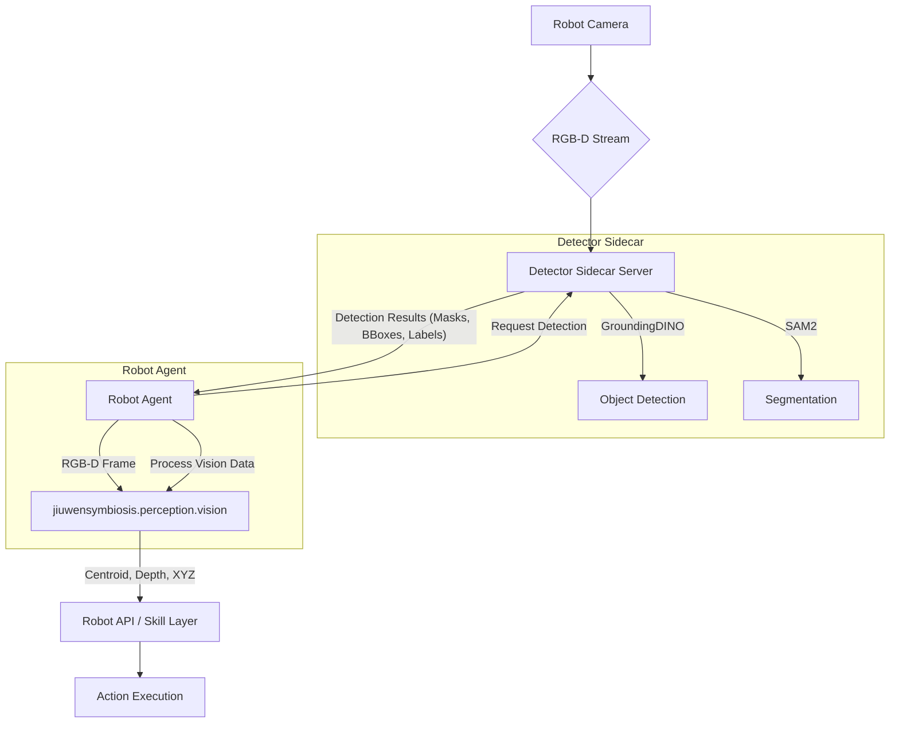

<!-- source: DeepWiki mcp.deepwiki.com · repo openJiuwen-ai/jiuwensymbiosis · page 6 Perception & Calibration · fetched 2026-11-02 -->

# Perception & Calibration

<details>
<summary>Relevant source files</summary>

The following files were used as context for generating this wiki page:

- [jiuwensymbiosis/perception/calibration.py](jiuwensymbiosis/perception/calibration.py)
- [jiuwensymbiosis/perception/vision.py](jiuwensymbiosis/perception/vision.py)
- [scripts/calibrate/calibrate.yaml](scripts/calibrate/calibrate.yaml)
- [scripts/calibrate/calibrate_hand_eye.py](scripts/calibrate/calibrate_hand_eye.py)
- [scripts/calibrate/handeye_board.py](scripts/calibrate/handeye_board.py)
- [tests/unit_tests/perception/test_vision.py](tests/unit_tests/perception/test_vision.py)

</details>


This page provides a high-level overview of the perception and calibration subsystems within `jiuwensymbiosis`. It covers the vision pipeline, the role of detector sidecars, and the hand-eye calibration workflows. Detailed technical information for each topic is provided in linked child pages.

## Vision Pipeline & Detector Sidecars

The vision pipeline in `jiuwensymbiosis` is responsible for processing visual data from robot-mounted cameras to enable object detection, segmentation, and 3D pose estimation. A key component of this pipeline is the detector sidecar, which offloads computationally intensive vision tasks to a separate server. This architecture allows for flexible integration of various vision models, such as GroundingDINO and SAM2, without tightly coupling them to the robot's control loop. The `jiuwensymbiosis.perception.vision` module provides cross-vendor vision helpers for tasks like `detect_and_centroid` and `apply_xy_correction` [jiuwensymbiosis/perception/vision.py:3-19](). These utilities are designed to be hardware-agnostic, focusing on core vision functionalities that can be reused across different robot adapters. The `detect_and_centroid` function, for instance, combines detector output with depth information to estimate 3D object locations [jiuwensymbiosis/perception/vision.py:8-9]().

For details, see [Detection Sidecar & Serving](#6.1).

### Vision Pipeline Overview


Sources:
- [jiuwensymbiosis/perception/vision.py:3-19]()
- [jiuwensymbiosis/perception/vision.py:52-97]()

### Detector Sidecar Integration

The detector sidecar operates as a separate service, communicating with the main robot agent. This separation ensures that the robot's real-time control is not impacted by the latency of complex vision model inference. The `detect_and_centroid` function in `jiuwensymbiosis.perception.vision` is a primary entry point for integrating detector outputs into the robot's perception of the world [jiuwensymbiosis/perception/vision.py:8-9](). It takes an RGB image, depth map, and a segmentation function (`seg_fn`) as input, returning a dictionary containing detection results, including the centroid and depth information [jiuwensymbiosis/perception/vision.py:52-97](). The system also includes mechanisms for handling detection failures and applying corrections to perceived object locations, such as `apply_xy_correction` [jiuwensymbiosis/perception/vision.py:10-12]().

For details, see [Detection Sidecar & Serving](#6.1).

## Hand-Eye Calibration Workflows

Accurate hand-eye calibration is crucial for robots to precisely interact with their environment. This subsystem provides tools and workflows for determining the rigid transformation between a robot's end-effector (flange) and a camera mounted on it (eye-in-hand) or a camera fixed in the environment (eye-to-hand). The `scripts/calibrate/calibrate_hand_eye.py` script is a primary tool for eye-in-hand calibration, guiding users through data collection and solving for the `T_flange_cam` transform [scripts/calibrate/calibrate_hand_eye.py:4-10](). It supports various calibration board types, such as ChArUco and chessboard patterns, and provides quality metrics for the calibration results [scripts/calibrate/calibrate_hand_eye.py:36-43](). Calibration artifacts are stored in JSON files, following a defined schema, which are then loaded by the robot adapters for use in perception and control [jiuwensymbiosis/perception/calibration.py:47-135]().

For details, see [Hand-Eye Calibration Workflows](#6.2).

### Calibration Process Flow

```mermaid
graph TD
    A[User Initiates Calibration CLI] --> B{scripts/calibrate/calibrate_hand_eye.py};
    B -- "Loads CalibrationAdapterSpec" --> C[jiuwensymbiosis.calibration.integration.load_adapter_spec];
    C -- "Connects to RobotSession" --> D[Robot Hardware];
    D -- "Provides CalibrationCaptureSource" --> E[Camera Frame (RGB-D)];
    D -- "Provides CalibrationPoseSource" --> F[Flange Pose (SE(3))];
    E & F --> G[Collect Data Points (Stations)];
    G -- "Detect Board (handeye_board.py)" --> H[ViewDetection];
    H --> I[Solve Eye-in-Hand (solve_eye_in_hand)];
    I -- "T_flange_cam (4x4 matrix)" --> J[Save Calibration JSON];
    J --> K[Robot Adapter (e.g., piper_calib.json)];
```
Sources:
- [scripts/calibrate/calibrate_hand_eye.py:4-10]()
- [scripts/calibrate/calibrate_hand_eye.py:181-186]()
- [scripts/calibrate/handeye_board.py:107-130]()
- [jiuwensymbiosis/calibration/domain/solver.py]() (implied by `solve_eye_in_hand`)
- [jiuwensymbiosis/perception/calibration.py:47-135]()

### Calibration Artifacts and Integration

Calibration results are stored in JSON files, such as `configs/piper/piper_calib.json` [scripts/calibrate/calibrate_hand_eye.py:8](). These files contain the camera intrinsics and the `T_flange_cam` transformation matrix, which defines the camera's pose relative to the robot's flange. The `jiuwensymbiosis.perception.calibration.load_calibration` function is responsible for loading and parsing these JSON files, converting relevant fields into NumPy arrays for use in the codebase [jiuwensymbiosis/perception/calibration.py:47-135](). This function also handles schema versioning and provides mechanisms for backward compatibility with legacy calibration files, ensuring that older calibrations can still be used, albeit with potential warnings about degraded accuracy [jiuwensymbiosis/perception/calibration.py:71-117]().

Sources:
- [scripts/calibrate/calibrate_hand_eye.py:8]()
- [jiuwensymbiosis/perception/calibration.py:47-135]()
- [jiuwensymbiosis/perception/calibration.py:71-117]()

---

