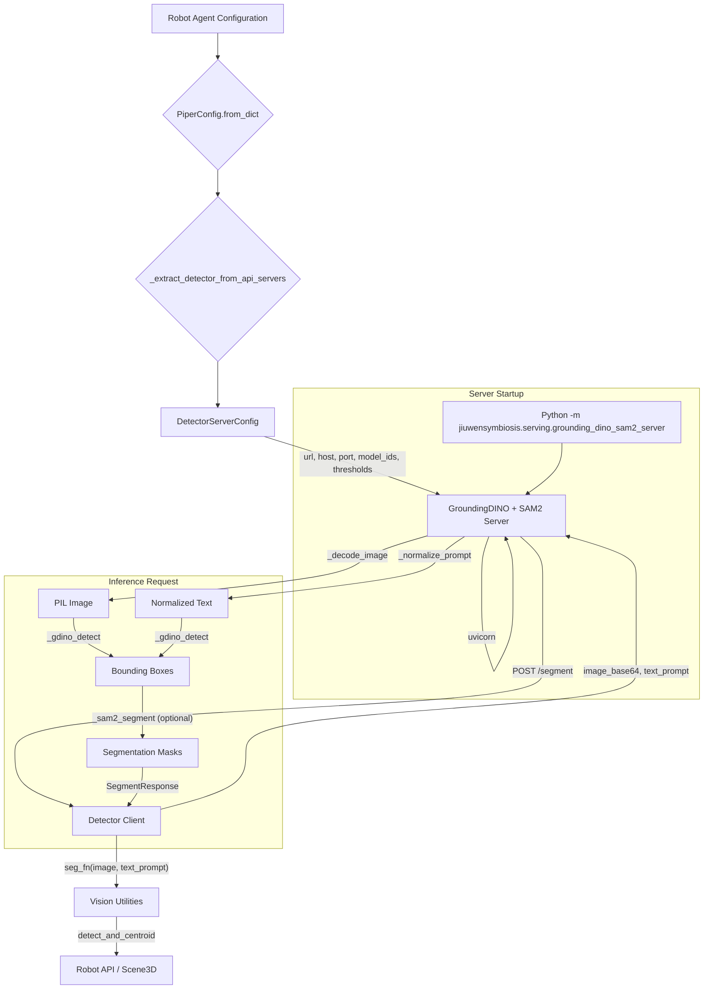

<!-- source: DeepWiki mcp.deepwiki.com · repo openJiuwen-ai/jiuwensymbiosis · page 6.1 Detection Sidecar & Serving · fetched 2026-11-02 -->

# Detection Sidecar & Serving

<details>
<summary>Relevant source files</summary>

The following files were used as context for generating this wiki page:

- [jiuwensymbiosis/adapters/piper/__init__.py](jiuwensymbiosis/adapters/piper/__init__.py)
- [jiuwensymbiosis/adapters/piper/config.py](jiuwensymbiosis/adapters/piper/config.py)
- [jiuwensymbiosis/perception/calibration.py](jiuwensymbiosis/perception/calibration.py)
- [jiuwensymbiosis/perception/vision.py](jiuwensymbiosis/perception/vision.py)
- [jiuwensymbiosis/serving/grounding_dino_sam2_server.py](jiuwensymbiosis/serving/grounding_dino_sam2_server.py)
- [jiuwensymbiosis/tools/__init__.py](jiuwensymbiosis/tools/__init__.py)
- [tests/unit_tests/adapters/piper/test_config.py](tests/unit_tests/adapters/piper/test_config.py)
- [tests/unit_tests/adapters/so101/test_smoke.py](tests/unit_tests/adapters/so101/test_smoke.py)
- [tests/unit_tests/perception/test_detector_client.py](tests/unit_tests/perception/test_detector_client.py)
- [tests/unit_tests/perception/test_detector_sidecar.py](tests/unit_tests/perception/test_detector_sidecar.py)
- [tests/unit_tests/perception/test_vision.py](tests/unit_tests/perception/test_vision.py)

</details>


This page details the perception pipeline, focusing on the open-vocabulary detection server (GroundingDINO + SAM2), its client, and how it integrates with the robot's vision utilities and `scene3d` for object detection and localization.

## GroundingDINO + SAM2 Server

The core of the detection system is a server that provides open-vocabulary object detection and segmentation. It leverages GroundingDINO for text-to-box detection and SAM2 for high-quality mask generation from these boxes. This server exposes a `/segment` HTTP endpoint for clients to request object segmentation.

### Server Implementation

The server is implemented in `jiuwensymbiosis/serving/grounding_dino_sam2_server.py` [jiuwensymbiosis/serving/grounding_dino_sam2_server.py:1-373](). It uses `FastAPI` to serve the API and `uvicorn` as the ASGI server.

**Key Components:**
*   **GroundingDINO (text→box):** `_GDINO_MODEL` and `_GDINO_PROCESSOR` [jiuwensymbiosis/serving/grounding_dino_sam2_server.py:68-69]() are loaded from HuggingFace `transformers`. It performs open-vocabulary object detection based on a text prompt.
*   **SAM2 (box→mask):** `_SAM2_MODEL` and `_SAM2_PROCESSOR` [jiuwensymbiosis/serving/grounding_dino_sam2_server.py:70-71]() are used to refine the bounding box detections from GroundingDINO into precise segmentation masks. This is optional and can be disabled with `--no-sam2` for lighter/faster operation [jiuwensymbiosis/serving/grounding_dino_sam2_server.py:35-36]().
*   **GPU Serialization:** To prevent Out-Of-Memory (OOM) errors on GPUs, especially with concurrent inference requests, a `_GPU_SEMAPHORE` [jiuwensymbiosis/serving/grounding_dino_sam2_server.py:78]() is used to serialize GPU access. The `_run_on_gpu` function [jiuwensymbiosis/serving/grounding_dino_sam2_server.py:85-89]() ensures that GPU-intensive operations are run one at a time.
*   **API Contract:** The server exposes a `POST /segment` endpoint [jiuwensymbiosis/serving/grounding_dino_sam2_server.py:9-10]() that accepts `image_base64` and `text_prompt` and returns a list of `MaskData` objects [jiuwensymbiosis/serving/grounding_dino_sam2_server.py:131-137]().

**Inference Flow:**
1.  An incoming request to `/segment` [jiuwensymbiosis/serving/grounding_dino_sam2_server.py:200]() is received.
2.  The `image_base64` is decoded into a PIL Image using `_decode_image` [jiuwensymbiosis/serving/grounding_dino_sam2_server.py:113-118]().
3.  The `text_prompt` is normalized for GroundingDINO using `_normalize_prompt` [jiuwensymbiosis/serving/grounding_dino_sam2_server.py:144-149]().
4.  `_gdino_detect` [jiuwensymbiosis/serving/grounding_dino_sam2_server.py:152-178]() performs the initial object detection, returning bounding boxes and scores.
5.  If `_USE_SAM2` is true, `_sam2_segment` [jiuwensymbiosis/serving/grounding_dino_sam2_server.py:181-197]() refines these boxes into masks. Otherwise, the bounding box itself is used as the mask.
6.  The results, including `mask_base64`, `shape`, `box`, `score`, and `label`, are returned in a `SegmentResponse` [jiuwensymbiosis/serving/grounding_dino_sam2_server.py:139-141]().

### Configuration

The `DetectorServerConfig` dataclass [jiuwensymbiosis/adapters/piper/config.py:21-38]() defines how to reach (or spawn) the detection server. This configuration includes:
*   `url`, `host`, `port`: Network details for the server.
*   `spawn`: Whether the server should be spawned automatically.
*   `device`: The compute device (e.g., "cuda").
*   `startup_timeout_s`: Timeout for server startup.
*   `gdino_model_id`, `sam2_model_id`: HuggingFace model IDs for GroundingDINO and SAM2.
*   `box_threshold`, `text_threshold`: Confidence thresholds for detection.
*   `use_sam2`: Flag to enable/disable SAM2.

This configuration is typically loaded from the adapter's YAML configuration, for example, within `PiperConfig` [jiuwensymbiosis/adapters/piper/config.py:114](). The `_extract_detector_from_api_servers` function [jiuwensymbiosis/adapters/piper/config.py:128]() parses the `api_servers` section of the configuration to populate `DetectorServerConfig`.


**Diagram: GroundingDINO + SAM2 Server Architecture and Data Flow**
Sources:
- [jiuwensymbiosis/adapters/piper/config.py:21-38]()
- [jiuwensymbiosis/adapters/piper/config.py:114]()
- [jiuwensymbiosis/adapters/piper/config.py:128]()
- [jiuwensymbiosis/serving/grounding_dino_sam2_server.py:1-373]()
- [jiuwensymbiosis/serving/grounding_dino_sam2_server.py:9-10]()
- [jiuwensymbiosis/serving/grounding_dino_sam2_server.py:21-38]()
- [jiuwensymbiosis/serving/grounding_dino_sam2_server.py:35-36]()
- [jiuwensymbiosis/serving/grounding_dino_sam2_server.py:68-69]()
- [jiuwensymbiosis/serving/grounding_dino_sam2_server.py:70-71]()
- [jiuwensymbiosis/serving/grounding_dino_sam2_server.py:78]()
- [jiuwensymbiosis/serving/grounding_dino_sam2_server.py:85-89]()
- [jiuwensymbiosis/serving/grounding_dino_sam2_server.py:113-118]()
- [jiuwensymbiosis/serving/grounding_dino_sam2_server.py:131-137]()
- [jiuwensymbiosis/serving/grounding_dino_sam2_server.py:139-141]()
- [jiuwensymbiosis/serving/grounding_dino_sam2_server.py:144-149]()
- [jiuwensymbiosis/serving/grounding_dino_sam2_server.py:152-178]()
- [jiuwensymbiosis/serving/grounding_dino_sam2_server.py:181-197]()
- [jiuwensymbiosis/serving/grounding_dino_sam2_server.py:200]()

## Detector Client & Sidecar Lifecycle

The robot agent interacts with the detection server via a client. This client handles communication, including spawning the server if configured, and retrying connections.

### Detector Client (`detector_client.py`)

The `init_detector` function [tests/unit_tests/perception/test_detector_client.py:14]() in `jiuwensymbiosis.perception.detector_client` initializes a callable `seg_fn` that acts as the interface to the detection server.

**Key functionalities:**
*   **HTTP Communication:** The `seg_fn` makes `requests.post` calls to the configured server URL [tests/unit_tests/perception/test_detector_client.py:36]().
*   **Image Encoding:** `_encode_image` [tests/unit_tests/perception/test_detector_client.py:70-76]() converts NumPy images to base64 strings for transmission.
*   **Mask Decoding:** Received base64 masks are decoded back into NumPy arrays.
*   **Retry Logic:** If the server is unreachable, the client attempts to reconnect with exponential backoff [tests/unit_tests/perception/test_detector_client.py:55-68]().

### Detector Sidecar (`detector_sidecar.py`)

The `detector_sidecar` module manages the lifecycle of the detection server process. It is responsible for:
*   **Spawning the Server:** If `DetectorServerConfig.spawn` is `True`, the sidecar starts the `grounding_dino_sam2_server.py` as a subprocess.
*   **Health Checks:** It periodically checks if the server port is open using `_port_open` [tests/unit_tests/perception/test_detector_sidecar.py:11-25]() to ensure the server is ready.
*   **Process Management:** It handles the server process, including graceful shutdown.

```mermaid
graph TD
    A[Robot Agent] --> B{init_detector(DetectorServerConfig)};
    B -- "seg_fn callable" --> C[Robot API / Vision Utilities];

    subgraph "Detector Client (jiuwensymbiosis.perception.detector_client)"
        C -- "seg_fn(rgb, text_prompt)" --> D{_encode_image};
        D -- "image_base64" --> E[HTTP POST /segment Request];
        E -- "requests.post" --> F{Server Unreachable?};
        F -- "Yes (retry)" --> G[time.sleep];
        G -- "Retry attempts" --> E;
        F -- "No" --> H[HTTP Response];
        H -- "Decode mask_base64" --> I[Detection Results (NumPy masks)];
        I --> C;
    end

    subgraph "Detector Sidecar (jiuwensymbiosis.perception.detector_sidecar)"
        B -- "DetectorServerConfig.spawn=True" --> J[Spawn Server Process];
        J -- "python -m grounding_dino_sam2_server" --> K[GroundingDINO + SAM2 Server];
        J -- "Check port open (_port_open)" --> K;
        K -- "Server ready" --> B;
    end
```
**Diagram: Detector Client and Sidecar Lifecycle**
Sources:
- [tests/unit_tests/perception/test_detector_client.py:14]()
- [tests/unit_tests/perception/test_detector_client.py:36]()
- [tests/unit_tests/perception/test_detector_client.py:55-68]()
- [tests/unit_tests/perception/test_detector_client.py:70-76]()
- [tests/unit_tests/perception/test_detector_sidecar.py:11-25]()

## Scene3D and Vision Utilities

The detected 2D masks and bounding boxes are integrated into the robot's 3D perception system to enable grasping and manipulation.

### Vision Utilities (`vision.py`)

The `jiuwensymbiosis.perception.vision` module [jiuwensymbiosis/perception/vision.py:1-965]() provides cross-vendor vision helpers.

**Key functions:**
*   `_run_detect_pick_best` [jiuwensymbiosis/perception/vision.py:52-97](): Runs the detector, filters results by `score_threshold`, and returns the highest-scoring detection. It also logs all candidates for debugging.
*   `detect_and_centroid`: This is a crucial function that takes an RGB image, depth image, the `seg_fn` from the detector client, and an object name. It performs the following steps:
    1.  Calls `_run_detect_pick_best` to get the best detection.
    2.  Calculates the 2D centroid of the mask using `_mask_centroid` [tests/unit_tests/perception/test_vision.py:37-50]().
    3.  Estimates the median depth within a window around the centroid using `_median_depth_window` [tests/unit_tests/perception/test_vision.py:53-64]().
    4.  Applies `xy_correction` if configured [tests/unit_tests/perception/test_vision.py:66-102]().
    5.  Returns a `GraspResult` or `GraspFailure` [tests/unit_tests/perception/test_vision.py:20-34]() dictionary containing the 2D pixel coordinates, depth, and other detection metadata.
*   `apply_xy_correction` [jiuwensymbiosis/perception/vision.py:209-250](): Corrects the X/Y coordinates of a detected object in the base frame, either via a simple translation (`xy_correction_mm`) or a more complex affine transformation (`xy_transform`).
*   `extract_color_word` [jiuwensymbiosis/perception/vision.py:104-115]() and `region_color_matches` [jiuwensymbiosis/perception/vision.py:118-162](): These functions provide color-based verification for detections, helping to reject false positives where the detected object's color contradicts the prompt.
*   `dump_grasp_debug` [jiuwensymbiosis/perception/vision.py:8-15](): Saves RGB images, detector overlays, and JSON snapshots for debugging.

### Scene3D Integration

The `detect_and_centroid` function provides the 2D pixel coordinates and depth information. This information is then used by the robot's API (e.g., `PiperApi`) to project the 2D detection into 3D space (base frame).

**Data Flow for 3D Localization:**
1.  The robot's camera captures an RGB image and a depth image.
2.  These images are passed to `detect_and_centroid` along with the `seg_fn` and `object_name`.
3.  `detect_and_centroid` returns the 2D pixel coordinates (u, v) and the estimated depth (Z) of the object.
4.  The robot's API (e.g., `PiperApi.pixel_to_base_xyz`) uses the camera's intrinsic parameters (`intrinsics`) and the camera's pose relative to the robot's base frame (`tf_base_cam` or `tf_flange_cam` from calibration) to back-project the (u, v, Z) into a 3D (X, Y, Z) coordinate in the robot's base frame.
5.  This 3D coordinate is then used by the `scene3d` module (part of `jiuwensymbiosis.api.state`) to update the world model, enabling the robot to plan grasps and movements.

The `calibration.py` module [jiuwensymbiosis/perception/calibration.py:1-135]() is responsible for loading calibration data, which includes the camera's intrinsic parameters and its transformation matrix (`tf_flange_cam` or `tf_base_cam`). This calibration data is crucial for accurate 3D projection.

```mermaid
graph TD
    A[Robot Camera] -- "RGB Image, Depth Image" --> B[Robot API (e.g., PiperApi)];
    B -- "grab_frames()" --> C[Vision Utilities (detect_and_centroid)];
    C -- "seg_fn(rgb, text_prompt)" --> D[Detector Client];
    D -- "Detection Results (mask, score, box)" --> C;
    C -- "Calculate (u,v) centroid, median depth" --> E[2D Pixel (u,v), Depth (Z)];
    E -- "Camera Intrinsics (K), Camera Pose (T_base_cam)" --> B;
    B -- "pixel_to_base_xyz" --> F[3D Object Pose (X,Y,Z) in Base Frame];
    F --> G[Scene3D / World State];
    G -- "Object location" --> H[Robot Planner / Execution];

    subgraph "Calibration Data"
        I[Calibration File (JSON)] --> J[load_calibration];
        J -- "K, T_flange_cam/T_base_cam" --> B;
    end
```
**Diagram: Scene3D and Vision Utilities Data Flow**
Sources:
- [jiuwensymbiosis/perception/calibration.py:1-135]()
- [jiuwensymbiosis/perception/vision.py:1-965]()
- [jiuwensymbiosis/perception/vision.py:8-15]()
- [jiuwensymbiosis/perception/vision.py:52-97]()
- [jiuwensymbiosis/perception/vision.py:104-115]()
- [jiuwensymbiosis/perception/vision.py:118-162]()
- [jiuwensymbiosis/perception/vision.py:209-250]()
- [tests/unit_tests/perception/test_vision.py:20-34]()
- [tests/unit_tests/perception/test_vision.py:37-50]()
- [tests/unit_tests/perception/test_vision.py:53-64]()
- [tests/unit_tests/perception/test_vision.py:66-102]()

---

