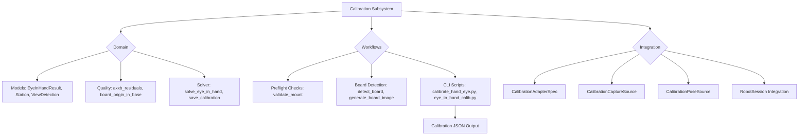

<!-- source: DeepWiki mcp.deepwiki.com · repo openJiuwen-ai/jiuwensymbiosis · page 6.2 Hand-Eye Calibration Workflows · fetched 2026-11-02 -->

# Hand-Eye Calibration Workflows

<details>
<summary>Relevant source files</summary>

The following files were used as context for generating this wiki page:

- [.claude/skills/review-architecture-change/references/calibration-terms.md](.claude/skills/review-architecture-change/references/calibration-terms.md)
- [docs/en/how-to/calibrate-so101-eye-to-hand.md](docs/en/how-to/calibrate-so101-eye-to-hand.md)
- [docs/zh/how-to/calibrate-hand-eye.md](docs/zh/how-to/calibrate-hand-eye.md)
- [scripts/calibrate/__init__.py](scripts/calibrate/__init__.py)
- [scripts/calibrate/calibrate.yaml](scripts/calibrate/calibrate.yaml)
- [scripts/calibrate/calibrate_hand_eye.py](scripts/calibrate/calibrate_hand_eye.py)
- [scripts/calibrate/handeye_board.py](scripts/calibrate/handeye_board.py)
- [scripts/calibrate/so101_calibrate.yaml](scripts/calibrate/so101_calibrate.yaml)

</details>


This page details the hand-eye calibration workflows within the `jiuwensymbiosis` codebase. It covers the calibration domain, the available workflows, the artifacts produced, how adapters integrate with the calibration system, board detection mechanisms, and the command-line interface (CLI) scripts for both eye-in-hand and eye-to-hand calibration, including their JSON outputs. The goal is to provide a comprehensive technical understanding of how hand-eye calibration is performed and integrated.

## Calibration Domain and Architecture

The calibration subsystem is a self-contained domain within `jiuwensymbiosis`, responsible for managing models, solvers, archiving, workflows, and hardware interaction through a defined `CalibrationAdapterSpec` protocol. It operates independently of the `Agent` or `SafetyRail` components, ensuring that calibration processes are controlled and do not interfere with normal robot operation.

The core calibration logic resides in `jiuwensymbiosis/calibration/`, with integration aspects handled by `jiuwensymbiosis.calibration.integration`. This separation allows for a clear boundary between the calibration algorithms and their application within the broader `jiuwensymbiosis` framework.

### Key Concepts

*   **`CalibrationAdapterSpec`**: An explicit contract used by calibration scripts to discover and interact with robot adapters. This ensures that calibration capabilities are accessed through a standardized interface, independent of the specific robot type.
*   **`CalibrationCaptureSource`**: A device calibration protocol that defines methods like `capture_calibration_frame` and `camera_mount` for acquiring camera data during calibration.
*   **`CalibrationPoseSource`**: A device calibration protocol that provides methods like `get_flange_transform_mm` to obtain the robot's flange pose.
*   **`Station`**: A collection of calibration samples, each comprising a robot pose and a corresponding camera observation of the calibration board.
*   **`EyeInHandResult`**: The output of an eye-in-hand calibration, typically `T_flange_cam`, representing the camera's pose relative to the robot's flange.
*   **`VerifyStat`**: Statistics used for quality assessment of the calibration, including reprojection RMS, hand-eye consistency, and board origin consistency.

### Calibration Subsystem Structure

The calibration subsystem is structured to provide clear interfaces for different functionalities:


Sources: [scripts/calibrate/calibrate_hand_eye.py:1-45](), [jiuwensymbiosis/calibration/domain/models.py](), [jiuwensymbiosis/calibration/domain/quality.py](), [jiuwensymbiosis/calibration/domain/solver.py](), [jiuwensymbiosis/calibration/workflows/preflight.py](), [scripts/calibrate/handeye_board.py:1-7]()

## Calibration Workflows

The `jiuwensymbiosis` framework supports two primary hand-eye calibration workflows: eye-in-hand and eye-to-hand. Each workflow has dedicated CLI scripts and follows a structured process for data collection, solving, and validation.

### Eye-in-Hand Calibration

This workflow is used when the camera is mounted on the robot's wrist (flange). The goal is to determine the `T_flange_cam` transform, which describes the camera's pose relative to the robot's flange. This transform is constant and allows the robot to know the camera's position in its own coordinate system.

The primary script for eye-in-hand calibration is `scripts/calibrate/calibrate_hand_eye.py` [scripts/calibrate/calibrate_hand_eye.py:4]().

#### Workflow Steps

1.  **Preparation**:
    *   Install dependencies: `pip install -e ".[calib,piper]"` [docs/zh/how-to/calibrate-hand-eye.md:33]().
    *   Prepare a ChArUco or chessboard calibration board. The script can generate a printable board image using the `--generate-board` argument [scripts/calibrate/calibrate_hand_eye.py:34-36]().
    *   Configure the robot by editing `scripts/calibrate/calibrate.yaml` [docs/zh/how-to/calibrate-hand-eye.md:63]() to specify the camera serial number and other robot-specific settings.

2.  **Self-Check and Confirmation**: The script performs a self-check of the camera and robot readiness and displays a configuration summary [scripts/calibrate/calibrate_hand_eye.py:199-204]().

3.  **Data Collection**:
    *   **Manual Mode**: The user manually moves the robot arm to various poses, ensuring the calibration board is visible to the camera. For each pose, the user presses Enter to capture a frame [docs/zh/how-to/calibrate-hand-eye.md:97-98](). The script provides real-time feedback on the number of frames collected and the rotation spread.
    *   **Automatic Mode**: The `--auto` argument can be used to automatically drive the robot through a series of poses and collect data [docs/zh/how-to/calibrate-hand-eye.md:110](). This mode requires careful safety considerations, as the robot will move autonomously. A dry run can be performed with `--auto-dry-run`.

4.  **Solving and Output**: After sufficient data is collected (typically 10-15 frames with good rotation spread), pressing `s` triggers the solver [docs/zh/how-to/calibrate-hand-eye.md:99](). The script uses OpenCV's `calibrateHandEye` to compute `T_flange_cam` [scripts/calibrate/calibrate_hand_eye.py:6-7](). A quality report is generated, and the calibration result is saved to a JSON file (e.g., `configs/piper/piper_calib.json`) [docs/zh/how-to/calibrate-hand-eye.md:113]().

5.  **Verification**:
    *   **Numerical Verification**: The script prints a detailed quality report with metrics like reprojection RMS, hand-eye consistency (rotation/translation), and board origin consistency [docs/zh/how-to/calibrate-hand-eye.md:119-126]().
    *   **Physical Verification (`--verify-touch`)**: The robot can be commanded to move its end-effector to hover above the detected board center, allowing for visual inspection of accuracy [docs/zh/how-to/calibrate-hand-eye.md:136-137](). This requires specifying the tool offset if a tool is attached.

#### Eye-in-Hand Calibration Flow

```mermaid
graph TD
    A[Start Eye-in-Hand Calibration] --> B{Install Dependencies}
    B --> C{Prepare Calibration Board}
    C --> D{Configure Robot (calibrate.yaml)}
    D --> E[Run calibrate_hand_eye.py]
    E --> F{Self-Check & Confirmation}
    F --> G{Data Collection (Manual/Auto)}
    G -- "Collect Stations" --> H[Solve Eye-in-Hand (OpenCV calibrateHandEye)]
    H --> I[Generate Quality Report]
    I --> J[Save T_flange_cam to JSON]
    J --> K{Verification (Numerical/Physical)}
    K --> L[End Calibration]

    C -- "Generate Board Image" --> C1[--generate-board]
    G -- "Manual Capture" --> G1[Press Enter to capture]
    G -- "Automatic Capture" --> G2[--auto / --auto-dry-run]
    K -- "Physical Verification" --> K1[--verify-touch / --verify-tool-offset-mm]
```
Sources: [scripts/calibrate/calibrate_hand_eye.py:34-36](), [scripts/calibrate/calibrate_hand_eye.py:6-7](), [docs/zh/how-to/calibrate-hand-eye.md:33](), [docs/zh/how-to/calibrate-hand-eye.md:63](), [docs/zh/how-to/calibrate-hand-eye.md:97-99](), [docs/zh/how-to/calibrate-hand-eye.md:110](), [docs/zh/how-to/calibrate-hand-eye.md:113](), [docs/zh/how-to/calibrate-hand-eye.md:119-126](), [docs/zh/how-to/calibrate-hand-eye.md:136-137]()

### Eye-to-Hand Calibration

This workflow is used when the camera is fixed in the environment (e.g., on a table or stand) and does not move with the robot arm. The calibration board is typically attached to the robot's end-effector. The goal is to determine the `T_base_cam` transform, which describes the camera's fixed pose relative to the robot's base frame.

The primary script for eye-to-hand calibration is `scripts/calibrate/eye_to_hand_calib.py` [docs/zh/how-to/calibrate-hand-eye.md:222](). This script is designed to be body-agnostic and supports various robots like SO-101 and Piper through the `CalibrationAdapterSpec` interface.

#### Workflow Stages

The eye-to-hand workflow is typically divided into three stages:

1.  **Collect Waypoints (`--collect-poses`)**:
    *   The user manually guides the robot arm to a series of poses, ensuring the calibration board (attached to the end-effector) is visible to the fixed camera.
    *   For SO-101, this involves using `ManualGuidance` to teach joint-space waypoints [docs/zh/how-to/calibrate-hand-eye.md:240-242]().
    *   These waypoints are saved to a file (e.g., `tmp/so101_wp.npz`) [scripts/calibrate/so101_calibrate.yaml:23]().

2.  **Automatic Collection and Solving (`--auto`)**:
    *   The robot automatically replays the collected waypoints.
    *   At each waypoint, the fixed camera captures an image of the board.
    *   The script then solves for `T_base_cam` and attempts to publish the calibration [scripts/calibrate/so101_calibrate.yaml:27-30]().

3.  **Offline Re-solving (`--replay`)**:
    *   This stage allows for re-solving the calibration using previously collected station archives without requiring hardware [scripts/calibrate/so101_calibrate.yaml:34-36](). This is useful for trying different solver parameters or reviewing results.

#### Eye-to-Hand Calibration Flow

```mermaid
graph TD
    A[Start Eye-to-Hand Calibration] --> B{Install Dependencies}
    B --> C{Prepare Calibration Board (on gripper)}
    C --> D{Configure Robot (so101_calibrate.yaml)}
    D --> E[Stage 1: Collect Waypoints (--collect-poses)]
    E -- "Save Waypoints" --> F[Stage 2: Auto Collect & Solve (--auto)]
    F -- "Save Stations" --> G[Stage 3: Offline Replay (--replay)]
    G --> H[Generate Quality Report]
    H --> I[Save T_base_cam to JSON]
    I --> J[End Calibration]

    D -- "Example Config" --> D1[scripts/calibrate/so101_calibrate.yaml]
    E -- "Manual Guidance" --> E1[ManualGuidance (SO-101)]
    F -- "Requires Hardware" --> F1[Robot moves, Camera captures]
    G -- "No Hardware Needed" --> G1[Re-solve from archive]
```
Sources: [scripts/calibrate/so101_calibrate.yaml:23](), [scripts/calibrate/so101_calibrate.yaml:27-30](), [scripts/calibrate/so101_calibrate.yaml:34-36](), [docs/zh/how-to/calibrate-hand-eye.md:222](), [docs/zh/how-to/calibrate-hand-eye.md:240-242]()

## Calibration Artifacts and Outputs

The primary output of a successful hand-eye calibration is a JSON file containing the computed transformation matrix and other relevant calibration parameters.

### Calibration JSON Output

The calibration scripts produce a JSON file that adheres to a specific schema. For eye-in-hand calibration, this typically includes the `T_flange_cam` 4x4 SE(3) transformation matrix. For eye-to-hand, it's `T_base_cam`.

Example structure (simplified):

```json
{
  "T_flange_cam": [
    [1.0, 0.0, 0.0, 0.0],
    [0.0, 1.0, 0.0, 0.0],
    [0.0, 0.0, 1.0, 0.0],
    [0.0, 0.0, 0.0, 1.0]
  ],
  "camera_intrinsics": {
    "fx": ...,
    "fy": ...,
    "ppx": ...,
    "ppy": ...,
    "width": ...,
    "height": ...
  },
  "camera_distortion": [...],
  "timestamp": "YYYY-MM-DDTHH:MM:SSZ",
  "solver_metrics": {
    "reprojection_rms_px": ...,
    "axxb_rotation_deg": ...,
    "axxb_translation_mm": ...,
    "board_origin_std_mm": ...
  }
}
```
Sources: [scripts/calibrate/calibrate_hand_eye.py:64]()

### Station Archive

During the data collection phase, especially for eye-to-hand calibration with `--auto` or `--replay`, the raw data (robot poses and corresponding camera observations) is often saved as a "station archive" (e.g., `tmp/so101_eye_stations.npz`). This archive contains the `Station` objects, which are crucial for offline re-solving or detailed analysis.

The term "station archive" refers to a dataset of calibration samples, not a physical workstation [references/calibration-terms.md:12]().

### Quality Report

Both eye-in-hand and eye-to-hand calibration workflows generate a quality report. This report provides critical metrics to assess the accuracy and reliability of the calibration. Key metrics include:

*   **Reprojection RMS**: Measures how accurately the detected board points in the image can be reprojected back into the camera frame using the calculated intrinsics and pose. A value `< 1 px` is considered good [docs/zh/how-to/calibrate-hand-eye.md:123]().
*   **Hand-Eye Consistency (Rotation / Translation)**: For eye-in-hand, this assesses the consistency of `T_flange_cam` across different collected stations. For eye-to-hand, it assesses `T_base_cam`. Good values are typically `< 0.5°` for rotation and `< 2-3 mm` for translation [docs/zh/how-to/calibrate-hand-eye.md:124]().
*   **Board Origin Consistency**: Measures the standard deviation of the board's origin in the robot's base frame across all collected stations. A `std < 2-3 mm` is desirable [docs/zh/how-to/calibrate-hand-eye.md:125]().

The `_judge` function [scripts/calibrate/calibrate_hand_eye.py:140-147]() is used to provide a visual indicator (✅/⚠️/❌) for these metrics based on predefined thresholds.

## Adapters and Integration Specification

The calibration system is designed to be body-agnostic, meaning it can work with different robot hardware through a standardized adapter interface. This is achieved through the `CalibrationAdapterSpec` and associated protocols.

### `CalibrationAdapterSpec`

The `CalibrationAdapterSpec` is a key component for integrating new robot adapters with the calibration system. It acts as an explicit contract that the calibration scripts use to discover and interact with adapter-specific calibration capabilities [scripts/calibrate/calibrate_hand_eye.py:16-19]().

When a calibration script starts, it resolves the appropriate `CalibrationAdapterSpec` based on the provided configuration (e.g., `jiuwensymbiosis.adapters.piper` for Piper) [scripts/calibrate/calibrate_hand_eye.py:181-184](). This spec then provides access to the necessary device calibration protocols.

### Calibration Protocols

The `jiuwensymbiosis.calibration.integration.integration` module defines the interfaces that adapters must implement to support calibration. These include:

*   **`CalibrationCaptureSource`**: This protocol defines how the calibration system captures images and depth data from the camera. Key methods include:
    *   `capture_calibration_frame()`: Returns an aligned RGB-D frame.
    *   `camera_mount()`: Specifies whether the camera is `eye_in_hand` or `eye_to_hand`.
*   **`CalibrationPoseSource`**: This protocol defines how the calibration system obtains the robot's pose. Key methods include:
    *   `get_flange_transform_mm()`: Returns the 4x4 SE(3) transform of the robot's flange in millimeters.
*   **`move_to_flange_transform_mm(tf)`**: A Cartesian motion command to move the robot's flange to a specified transform.

These protocols ensure that the calibration logic does not depend on the specific robot type but rather on a common set of capabilities exposed by the adapter.

### Adapter Configuration

Calibration-specific configurations for adapters are typically defined in YAML files, such as `scripts/calibrate/calibrate.yaml` for Piper [scripts/calibrate/calibrate.yaml:1-2]() and `scripts/calibrate/so101_calibrate.yaml` for SO-101 [scripts/calibrate/so101_calibrate.yaml:1-3](). These configurations specify:

*   `camera_serial`: The serial number of the RealSense camera [scripts/calibrate/calibrate.yaml:31]().
*   `camera_mount`: Whether the camera is `eye_in_hand` or `eye_to_hand` [scripts/calibrate/so101_calibrate.yaml:78]().
*   `joint_limits`, `z_min_safe_mm`, `workspace_bounds`: Relaxed safety parameters for calibration to allow for a wider range of motion [scripts/calibrate/so101_calibrate.yaml:56-67]().
*   `home_use_init_pose`: Allows the robot's initial pose to be used as home, which is useful for calibration where starting positions vary [scripts/calibrate/so101_calibrate.yaml:53]().

### Adapter Integration Diagram

```mermaid
graph TD
    A[Calibration CLI (e.g., calibrate_hand_eye.py)] --> B{Load Adapter Spec}
    B -- "Resolves module_name" --> C[CalibrationAdapterSpec]
    C -- "Provides protocols" --> D[Adapter Wrapper]

    D --> D1[CalibrationCaptureSource]
    D1 -- "capture_calibration_frame()" --> E[Camera Hardware]
    D1 -- "camera_mount()" --> F[Mount Type (eye_in_hand/eye_to_hand)]

    D --> D2[CalibrationPoseSource]
    D2 -- "get_flange_transform_mm()" --> G[Robot Kinematics/Encoders]

    D --> D3[Robot Motion Control]
    D3 -- "move_to_flange_transform_mm(tf)" --> H[Robot Low-Level Driver]

    subgraph Adapter Implementation
        E
        G
        H
    end
```
Sources: [scripts/calibrate/calibrate_hand_eye.py:16-19](), [scripts/calibrate/calibrate_hand_eye.py:181-184](), [scripts/calibrate/so101_calibrate.yaml:53](), [scripts/calibrate/so101_calibrate.yaml:56-67](), [scripts/calibrate/so101_calibrate.yaml:78](), [scripts/calibrate/calibrate.yaml:31]()

## Board Detection

Accurate detection of the calibration board is fundamental to hand-eye calibration. The `jiuwensymbiosis` framework supports both ChArUco and chessboard patterns and provides utilities for board generation and detection.

### `handeye_board.py`

The `scripts/calibrate/handeye_board.py` module [scripts/calibrate/handeye_board.py:1-3]() encapsulates all functionalities related to calibration board handling, including:

*   **`BoardSpec`**: A dataclass that defines the specifications of a calibration board, including its kind (`charuco` or `chessboard`), dimensions (`squares_x`, `squares_y`), and physical sizes (`square_size_mm`, `marker_size_mm`) [scripts/calibrate/handeye_board.py:24-34]().
*   **`generate_board_image`**: This function can generate a printable PNG image of a ChArUco or chessboard pattern based on a `BoardSpec` [scripts/calibrate/handeye_board.py:64-78](). This is useful for creating custom calibration boards.
*   **`detect_board`**: This is the core function for detecting board corners in an RGB image. It takes an RGB image, a `BoardSpec`, and optionally camera intrinsics and distortion coefficients. It returns a `ViewDetection` object [scripts/calibrate/handeye_board.py:107-115]().

### `ViewDetection`

The `ViewDetection` object [jiuwensymbiosis/calibration/domain/models.py:10-17]() is a dataclass that stores the results of board detection for a single view:

*   `ok`: A boolean indicating whether the detection was successful.
*   `reason`: A string providing a reason if detection failed.
*   `image_points`: The 2D pixel coordinates of the detected board corners.
*   `object_points`: The 3D coordinates of the board corners in the board's own coordinate system.
*   `T_cam_target`: The 4x4 SE(3) transform from the camera to the target (board) frame, computed using `solvePnP` if intrinsics are provided.
*   `reprojection_error_px`: The reprojection error in pixels if `T_cam_target` is computed.

### Detection Process

1.  **Image Conversion**: The input RGB image is converted to grayscale [scripts/calibrate/handeye_board.py:123]().
2.  **Board-Specific Detection**:
    *   **ChArUco**: `_detect_charuco` uses `cv2.aruco.CharucoDetector` to detect ChArUco corners and IDs. It requires a minimum number of corners (default 6) for a valid detection [scripts/calibrate/handeye_board.py:144-158]().
    *   **Chessboard**: `_detect_chessboard` uses `cv2.findChessboardCorners` to detect chessboard corners and then refines them using `cv2.cornerSubPix` [scripts/calibrate/handeye_board.py:133-141]().
3.  **Pose Estimation (`solvePnP`)**: If camera intrinsics are provided, `_fill_pose` uses `cv2.solvePnP` to estimate the `T_cam_target` transform and calculate the reprojection error [scripts/calibrate/handeye_board.py:161-171]().

The `detect_board` function is designed to be robust; it never raises an exception on a bad frame but instead returns `ok=False` with a descriptive reason [scripts/calibrate/handeye_board.py:6]().

## CLI Scripts and Calibration JSON Outputs

The `jiuwensymbiosis` framework provides dedicated CLI entry points for calibration, simplifying the user experience.

### `jiuwensymbiosis-calibrate-eye-in-hand`

This CLI is the entry point for eye-in-hand calibration, primarily wrapping `scripts/calibrate/calibrate_hand_eye.py`.

**Usage Example**:

```bash
jiuwensymbiosis-calibrate-eye-in-hand --config scripts/calibrate/calibrate.yaml \
    --board charuco --squares-x 5 --squares-y 7 --square-size-mm 30 --marker-size-mm 22
```
Sources: [docs/zh/how-to/calibrate-hand-eye.md:80-82]()

**Key Arguments**:

*   `--generate-board <path>`: Generates a printable calibration board image [scripts/calibrate/calibrate_hand_eye.py:34]().
*   `--config <path>`: Specifies the robot configuration YAML file [docs/zh/how-to/calibrate-hand-eye.md:188]().
*   `--board {charuco,chessboard}`: Type of calibration board [docs/zh/how-to/calibrate-hand-eye.md:189]().
*   `--squares-x`, `--squares-y`: Number of squares in X and Y directions [docs/zh/how-to/calibrate-hand-eye.md:190]().
*   `--square-size-mm`, `--marker-size-mm`: Physical dimensions of the board elements [docs/zh/how-to/calibrate-hand-eye.md:191-192]().
*   `--auto`: Enables automatic data collection by driving the robot [docs/zh/how-to/calibrate-hand-eye.md:193]().
*   `--calibrate-intrinsics`: Performs camera intrinsic calibration during the process [docs/zh/how-to/calibrate-hand-eye.md:194]().
*   `--out <path>`: Specifies the output path for the calibration JSON file [docs/zh/how-to/calibrate-hand-eye.md:195]().
*   `--verify`, `--verify-touch`: Enables verification steps after calibration [docs/zh/how-to/calibrate-hand-eye.md:196]().
*   `--selftest`: Runs an offline self-test with synthetic data, requiring no hardware [scripts/calibrate/calibrate_hand_eye.py:44]().

### `jiuwensymbiosis-calibrate-eye-to-hand`

This CLI is the entry point for eye-to-hand calibration, primarily wrapping `scripts/calibrate/eye_to_hand_calib.py`.

**Usage Examples**:

*   **Collect Waypoints**:
    ```bash
    jiuwensymbiosis-calibrate-eye-to-hand \
        --config scripts/calibrate/so101_calibrate.yaml \
        --board charuco --squares-x 5 --squares-y 7 \
        --square-size-mm 15.28 --marker-size-mm 11 \
        --collect-poses tmp/so101_wp.npz
    ```
    Sources: [scripts/calibrate/so101_calibrate.yaml:21-25]()

*   **Auto Collect & Solve**:
    ```bash
    jiuwensymbiosis-calibrate-eye-to-hand \
        --config scripts/calibrate/so101_calibrate.yaml \
        --board charuco --squares-x 5 --squares-y 7 \
        --square-size-mm 15.28 --marker-size-mm 11 \
        --auto tmp/so101_wp.npz --n-stations 24 --confirm-estop \
        --out tmp/so101_eye_to_hand.json
    ```
    Sources: [scripts/calibrate/so101_calibrate.yaml:28-33]()

*   **Offline Replay**:
    ```bash
    jiuwensymbiosis-calibrate-eye-to-hand \
        --replay tmp/so101_eye_stations.npz \
        --config scripts/calibrate/so101_calibrate.yaml --out tmp/so101_eye_to_hand.json
    ```
    Sources: [scripts/calibrate/so101_calibrate.yaml:34-36]()

**Key Arguments**:

*   `--collect-poses <path>`: Enters manual teaching mode to collect robot poses and save them as waypoints.
*   `--auto <waypoint_path>`: Automatically moves the robot through saved waypoints, captures data, and solves.
*   `--replay <station_archive_path>`: Re-solves calibration from a previously saved station archive.
*   `--out <path>`: Specifies the output path for the calibration JSON file.

### Calibration Output Schema

The output JSON files for both eye-in-hand and eye-to-hand calibrations follow a consistent schema, ensuring interoperability with other parts of the `jiuwensymbiosis` framework. The schema includes the transformation matrix (`T_flange_cam` or `T_base_cam`), camera intrinsics, distortion coefficients, and solver metrics for quality assessment. This standardized output allows the calibrated parameters to be easily loaded and used by the robot's perception and control systems.

Sources: [scripts/calibrate/calibrate_hand_eye.py:64](), [scripts/calibrate/so101_calibrate.yaml:21-36](), [docs/zh/how-to/calibrate-hand-eye.md:80-82](), [docs/zh/how-to/calibrate-hand-eye.md:188-201]()

---

