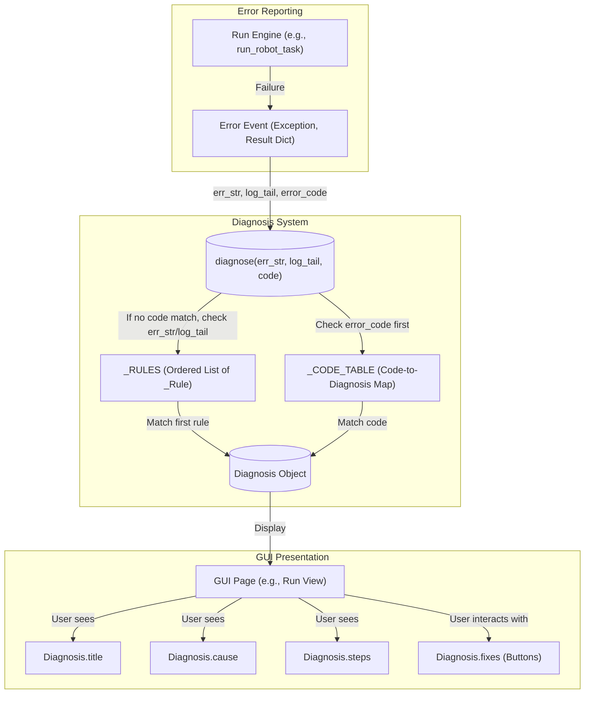

<!-- source: DeepWiki mcp.deepwiki.com · repo openJiuwen-ai/jiuwensymbiosis · page 7 User Interfaces · fetched 2026-11-02 -->

# User Interfaces

<details>
<summary>Relevant source files</summary>

The following files were used as context for generating this wiki page:

- [jiuwensymbiosis/gui/app.py](jiuwensymbiosis/gui/app.py)
- [jiuwensymbiosis/gui/data/bodies.yaml](jiuwensymbiosis/gui/data/bodies.yaml)
- [jiuwensymbiosis/gui/diagnostics.py](jiuwensymbiosis/gui/diagnostics.py)
- [jiuwensymbiosis/voice/__init__.py](jiuwensymbiosis/voice/__init__.py)
- [jiuwensymbiosis/voice/asr.py](jiuwensymbiosis/voice/asr.py)
- [jiuwensymbiosis/voice/audio.py](jiuwensymbiosis/voice/audio.py)
- [jiuwensymbiosis/voice/config.py](jiuwensymbiosis/voice/config.py)
- [jiuwensymbiosis/voice/loop.py](jiuwensymbiosis/voice/loop.py)
- [jiuwensymbiosis/voice/tts.py](jiuwensymbiosis/voice/tts.py)
- [jiuwensymbiosis/voice/wake.py](jiuwensymbiosis/voice/wake.py)
- [tests/unit_tests/gui/test_app.py](tests/unit_tests/gui/test_app.py)
- [tests/unit_tests/gui/test_diagnostics.py](tests/unit_tests/gui/test_diagnostics.py)
- [tests/unit_tests/gui/test_run_status.py](tests/unit_tests/gui/test_run_status.py)
- [tests/unit_tests/voice/test_tts.py](tests/unit_tests/voice/test_tts.py)

</details>


This page provides a high-level overview of the user interfaces available in the jiuwensymbiosis codebase, focusing on the NiceGUI desktop application and the voice interaction stack. Detailed technical information for each component is provided in dedicated child pages.

## GUI Application Shell

The jiuwensymbiosis GUI is built using NiceGUI, running in a browser-based mode. The application's startup sequence, layout, and core functionalities are managed within `app.py` [jiuwensymbiosis/gui/app.py](). This includes handling multiple instances, ensuring port availability, and managing the application's lifecycle. The GUI provides a unified interface for interacting with the robot agent, configuring its behavior, and reviewing past operations.

For details on the application startup, layout, and asset management, see [GUI Application Shell](#7.1).

Sources:
- [jiuwensymbiosis/gui/app.py:1-228]()
- [tests/unit_tests/gui/test_app.py:1-104]()

## GUI State, Bridge & Run Engine

The GUI maintains its operational state through an `AppState` object [jiuwensymbiosis/gui/app.py:194](), which acts as a bridge to the underlying robot agent. This state manages the execution of tasks, monitors the `run_status` [tests/unit_tests/gui/test_run_status.py:8](), and integrates with the perception engine. Helper functions are also provided to humanize various system outputs for better user understanding.

For details on the application state, the bridge to the agent, and the run engine, see [GUI State, Bridge & Run Engine](#7.2).

Sources:
- [jiuwensymbiosis/gui/app.py:194]()
- [tests/unit_tests/gui/test_run_status.py:1-123]()

## GUI Pages & Configuration Editing

The NiceGUI application is structured into several distinct pages, including `home`, `run`, `config`, `tools`, `history`, and `settings` views. These pages allow users to interact with the robot, initiate tasks, and crucially, edit configuration parameters. The configuration editing functionality maps directly to the adapter YAML files, providing a user-friendly way to modify robot and system settings.

For details on the various GUI pages and configuration editing, see [GUI Pages & Configuration Editing](#7.3).

Sources:
- [jiuwensymbiosis/gui/data/bodies.yaml]()

## Voice Interaction

The voice interaction stack provides a natural language interface for controlling the robot. This subsystem encompasses several key components: wake word detection, Automatic Speech Recognition (ASR), Text-to-Speech (TTS), and audio input/output (IO). The `VoiceLoop` [jiuwensymbiosis/voice/loop.py:67]() orchestrates these components, enabling users to issue commands verbally and receive spoken feedback.

### Voice Interaction Stack Diagram
```mermaid
graph TD
    subgraph "User"
        User["User (Speech)"]
    end

    subgraph "Voice Interaction Stack"
        AudioInput[("AudioSource.record_segment()")]
        WakeWord[("split_after_last_wake()")]
        ASR[("ASRBackend.transcribe()")]
        VoiceLoop[("VoiceLoop.run_once()")]
        OnCommandCallback[("VoiceLoop.on_command()")]
        TTS[("TTSBackend.speak()")]
        AudioOutput[("Audio Output")]
    end

    subgraph "Robot Agent"
        RobotAgent["run_robot_task()"]
    end

    User -- "Speech" --> AudioInput
    AudioInput -- "PCM Audio" --> ASR
    ASR -- "Transcript" --> WakeWord
    WakeWord -- "Command Text (if woken)" --> VoiceLoop
    VoiceLoop -- "Command Text" --> OnCommandCallback
    OnCommandCallback -- "Task Execution" --> RobotAgent
    RobotAgent -- "Result/Feedback" --> OnCommandCallback
    OnCommandCallback -- "Speech Text" --> TTS
    TTS -- "Audio" --> AudioOutput
    AudioOutput -- "Spoken Feedback" --> User

    style User fill:#fff,stroke:#333,stroke-width:2px
    style RobotAgent fill:#fff,stroke:#333,stroke-width:2px
```
Title: Voice Interaction Flow
Sources:
- [jiuwensymbiosis/voice/__init__.py:16-45]()
- [jiuwensymbiosis/voice/loop.py:67-182]()
- [jiuwensymbiosis/voice/audio.py:48]()
- [jiuwensymbiosis/voice/asr.py]()
- [jiuwensymbiosis/voice/wake.py:64]()
- [jiuwensymbiosis/voice/tts.py:35]()

### Wake Word Detection

The system continuously monitors audio input for a predefined wake word, such as "九问九问" (`WAKE_WORD`) [jiuwensymbiosis/voice/wake.py:26](). To enhance robustness against variations in pronunciation and transcription, a list of `WAKE_WORD_VARIANTS` [jiuwensymbiosis/voice/wake.py:27]() is used. The `split_after_last_wake` function [jiuwensymbiosis/voice/wake.py:64]() processes the ASR transcript to extract the command following the wake word.

Sources:
- [jiuwensymbiosis/voice/wake.py:1-92]()

### Automatic Speech Recognition (ASR)

Once the wake word is detected, the subsequent speech segment is passed to an ASR backend for transcription. The system supports different ASR implementations, configurable via `asr_backend` in `VoiceConfig` [jiuwensymbiosis/voice/config.py:61](). The `ASRBackend` protocol [jiuwensymbiosis/voice/asr.py]() defines the interface for transcribing audio to text.

Sources:
- [jiuwensymbiosis/voice/asr.py]()
- [jiuwensymbiosis/voice/config.py:61]()

### Text-to-Speech (TTS)

For spoken feedback, the system utilizes a TTS backend. The `TTSBackend` protocol [jiuwensymbiosis/voice/tts.py:35]() defines the contract for speaking text aloud. `NullTTS` [jiuwensymbiosis/voice/tts.py:51]() is a default no-op implementation for environments without audio output, while `ChatTTSBackend` [jiuwensymbiosis/voice/tts.py:72]() provides a more advanced speech synthesis capability. The `build_tts_backend` function [jiuwensymbiosis/voice/tts.py:155]() selects the appropriate backend based on the `VoiceConfig`.

Sources:
- [jiuwensymbiosis/voice/tts.py:1-165]()
- [tests/unit_tests/voice/test_tts.py:1-98]()

### Audio Input/Output

The `AudioSource` protocol [jiuwensymbiosis/voice/audio.py:42]() defines how audio is captured from the microphone. Implementations like `PulseAudioSource` and `SoundDeviceSource` handle real-time audio streams, while `FileAudioSource` [jiuwensymbiosis/voice/audio.py:173]() is used for testing and simulated environments. The `RecordTuning` dataclass [jiuwensymbiosis/voice/audio.py:53]() encapsulates parameters for frame-level segmentation and Voice Activity Detection (VAD).

Sources:
- [jiuwensymbiosis/voice/audio.py:1-190]()

### Voice Loop and Configuration

The `VoiceLoop` [jiuwensymbiosis/voice/loop.py:67]() is the central orchestrator of the voice interaction. It continuously listens for commands, dispatches them to an `on_command` callback, and speaks back the reply. The behavior of the voice loop is governed by `VoiceConfig` [jiuwensymbiosis/voice/config.py:21](), which allows detailed customization of wake word, ASR, TTS, and audio capture parameters.

For details on the voice interaction stack, including wake word, ASR, TTS, audio IO, and configuration, see [Voice Interaction](#7.4).

Sources:
- [jiuwensymbiosis/voice/loop.py:1-193]()
- [jiuwensymbiosis/voice/config.py:1-102]()

### Error Diagnostics

The GUI includes a diagnostic system to translate runtime failures into user-friendly explanations. The `diagnose` function [jiuwensymbiosis/gui/diagnostics.py:30]() analyzes error messages and log tails to provide a `Diagnosis` [jiuwensymbiosis/gui/diagnostics.py:35]() object, which includes a title, cause, suggested steps, and potential fixes. This system prioritizes structured error codes over text-based pattern matching for accuracy.

Sources:
- [jiuwensymbiosis/gui/diagnostics.py:1-207]()
- [tests/unit_tests/gui/test_diagnostics.py:1-183]()

### Error Diagnosis Flow

Title: Error Diagnosis Process
Sources:
- [jiuwensymbiosis/gui/diagnostics.py:30]()
- [jiuwensymbiosis/gui/diagnostics.py:168]()
- [jiuwensymbiosis/gui/diagnostics.py:35]()
- [tests/unit_tests/gui/test_diagnostics.py:111]()

---

