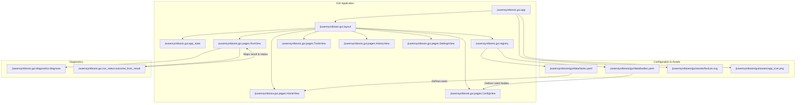

<!-- source: DeepWiki mcp.deepwiki.com · repo openJiuwen-ai/jiuwensymbiosis · page 7.1 GUI Application Shell · fetched 2026-11-02 -->

# GUI Application Shell

<details>
<summary>Relevant source files</summary>

The following files were used as context for generating this wiki page:

- [.gitignore](.gitignore)
- [Open_Source_Software_Notice.txt](Open_Source_Software_Notice.txt)
- [README.md](README.md)
- [jiuwensymbiosis/gui/__init__.py](jiuwensymbiosis/gui/__init__.py)
- [jiuwensymbiosis/gui/__main__.py](jiuwensymbiosis/gui/__main__.py)
- [jiuwensymbiosis/gui/app.py](jiuwensymbiosis/gui/app.py)
- [jiuwensymbiosis/gui/assets/app_icon.png](jiuwensymbiosis/gui/assets/app_icon.png)
- [jiuwensymbiosis/gui/data/bodies.yaml](jiuwensymbiosis/gui/data/bodies.yaml)
- [jiuwensymbiosis/gui/data/tasks.yaml](jiuwensymbiosis/gui/data/tasks.yaml)
- [jiuwensymbiosis/gui/diagnostics.py](jiuwensymbiosis/gui/diagnostics.py)
- [jiuwensymbiosis/gui/layout.py](jiuwensymbiosis/gui/layout.py)
- [jiuwensymbiosis/gui/pages/run_view.py](jiuwensymbiosis/gui/pages/run_view.py)
- [jiuwensymbiosis/gui/registry.py](jiuwensymbiosis/gui/registry.py)
- [jiuwensymbiosis/gui/run_status.py](jiuwensymbiosis/gui/run_status.py)
- [pyproject.toml](pyproject.toml)
- [requirements.txt](requirements.txt)
- [tests/unit_tests/gui/test_app.py](tests/unit_tests/gui/test_app.py)
- [tests/unit_tests/gui/test_diagnostics.py](tests/unit_tests/gui/test_diagnostics.py)
- [tests/unit_tests/gui/test_run_status.py](tests/unit_tests/gui/test_run_status.py)

</details>


This page details the implementation of the Graphical User Interface (GUI) application shell for `jiuwensymbiosis`, focusing on its startup process, main layout, and core components for managing application state, diagnostics, and loading configuration assets. The GUI is built using NiceGUI and runs in a browser-based mode.

## Startup and Main Entry Point

The GUI application is launched via the `jiuwensymbiosis-gui` CLI entry point, which maps to `jiuwensymbiosis.gui.__main__:main` [pyproject.toml:91](). The `main` function in `__main__.py` is responsible for initial setup, including proxy environment cleanup and then calling `jiuwensymbiosis.gui.app.run()` [jiuwensymbiosis/gui/__main__.py:14-15]().

The `app.run()` function [jiuwensymbiosis/gui/app.py:162-211]() handles several critical startup procedures:
1.  **Logging Configuration**: It configures logging to `INFO` level [jiuwensymbiosis/gui/app.py:168]().
2.  **Port Takeover Logic**: It checks if another instance of the GUI is already running on the default port (`8770`) [jiuwensymbiosis/gui/app.py:26](). This is managed by `_port_takeover()` [jiuwensymbiosis/gui/app.py:145-160](), which determines whether to:
    *   `start`: Launch a new instance if the port is free or becomes free after a timeout.
    *   `open`: Open a new browser tab pointing to an already running healthy instance (identified by a lock file [jiuwensymbiosis/gui/app.py:63-65]()).
    *   `abort`: If running in headless mode (`show=False`) and the port remains occupied, the process aborts [jiuwensymbiosis/gui/app.py:159]().
3.  **Instance Marker**: A lock file (`jiuwensymbiosis-gui-{port}.lock`) [jiuwensymbiosis/gui/app.py:63]() is used to mark a healthy running instance. This marker is created by `_mark_instance_healthy()` [jiuwensymbiosis/gui/app.py:67-73]() on startup and cleared by `clear_instance_marker()` [jiuwensymbiosis/gui/app.py:76-81]() on exit or before a replacement spawn. This mechanism prevents multiple GUI instances from conflicting and allows for graceful restarts.
4.  **NiceGUI Application Setup**: If a new instance is to be started, it initializes the NiceGUI application. The root page (`/`) is defined by the `index()` function [jiuwensymbiosis/gui/app.py:191-195](), which creates an `AppState` instance for each client connection and calls `build_layout()` [jiuwensymbiosis/gui/app.py:194-195]() to construct the UI.
5.  **Replay Route**: A `/replay/{stem}` route is registered [jiuwensymbiosis/gui/app.py:197-211]() to serve HTML traces for historical replays. This route uses `_resolve_trace()` [jiuwensymbiosis/gui/app.py:131-142]() to safely locate trace files within the configured workspace, preventing directory traversal attacks.

```mermaid
graph TD
    A[User executes jiuwensymbiosis-gui] --> B{jiuwensymbiosis.gui.__main__:main};
    B --> C[jiuwensymbiosis.gui.app:run()];
    C --> D[Configure Logging];
    C --> E{_port_takeover(host, port, show)};
    E -- "Port free or released" --> F[Start New GUI Instance];
    E -- "Healthy instance running, show=True" --> G[Open Browser to Existing Instance];
    E -- "Port occupied, show=False" --> H[Abort Startup];
    F --> I[Set _active_host, _active_port];
    F --> J[NiceGUI app initialization];
    J --> K[Register "/" route to jiuwensymbiosis.gui.layout:build_layout];
    J --> L[Register "/replay/{stem}" route to _replay];
    K --> M[Create AppState for client];
    M --> N[Build Layout (Layout class)];
    L --> O[Call _resolve_trace(stem, _active_workspace)];
    O -- "Valid trace" --> P[Render trace HTML];
    P --> Q[Return HTMLResponse];
    O -- "Invalid trace" --> R[Return 404/500 HTMLResponse];
    F --> S[Start NiceGUI/uvicorn event loop];
    G --> T[Schedule Browser to open URL];
```
**Diagram: GUI Application Startup Flow**
Sources: [pyproject.toml:91](), [jiuwensymbiosis/gui/__main__.py:14-15](), [jiuwensymbiosis/gui/app.py:26](), [jiuwensymbiosis/gui/app.py:63-65](), [jiuwensymbiosis/gui/app.py:67-73](), [jiuwensymbiosis/gui/app.py:76-81](), [jiuwensymbiosis/gui/app.py:131-142](), [jiuwensymbiosis/gui/app.py:145-160](), [jiuwensymbiosis/gui/app.py:162-211](), [jiuwensymbiosis/gui/app.py:191-195](), [jiuwensymbiosis/gui/app.py:197-211]()

## GUI Layout and Navigation

The main GUI layout is constructed by the `Layout` class in `jiuwensymbiosis.gui.layout` [jiuwensymbiosis/gui/layout.py:48-52](). This class manages the top-level UI elements, including the header, navigation tabs, and tab panels for different views.

The `_build()` method [jiuwensymbiosis/gui/layout.py:54-105]() sets up:
*   **Header**: Contains the application name (`APP_NAME`) and buttons for "About", "Restart", and "Quit" [jiuwensymbiosis/gui/layout.py:62-66]().
*   **Navigation Tabs**: `ui.tabs()` are used for primary navigation, including "Home", "Config", "Run", "Tools", "History", and "Settings" [jiuwensymbiosis/gui/layout.py:69-75]().
*   **Tab Panels**: `ui.tab_panels()` display the content corresponding to the selected tab. Each panel hosts a specific view:
    *   `HomeView` [jiuwensymbiosis/gui/layout.py:79]()
    *   `ConfigView` [jiuwensymbiosis/gui/layout.py:81]()
    *   `RunView` [jiuwensymbiosis/gui/layout.py:87]()
    *   `ToolsView` [jiuwensymbiosis/gui/layout.py:94]()
    *   `HistoryView` [jiuwensymbiosis/gui/layout.py:96]()
    *   `SettingsView` [jiuwensymbiosis/gui/layout.py:98]()

### Drag-and-Drop Configuration

The GUI supports drag-and-drop functionality for YAML configuration files [jiuwensymbiosis/gui/layout.py:101-104]().
*   A JavaScript handler `_DROP_JS` [jiuwensymbiosis/gui/layout.py:41-45]() processes dropped files, reading YAML content (up to 2MB) and emitting it back to the Python backend.
*   The `_on_yaml_dropped()` method [jiuwensymbiosis/gui/layout.py:116-129]() receives the dropped YAML. It checks if the content is a valid body configuration using `registry.is_body_config_text()` [jiuwensymbiosis/gui/layout.py:122]().
*   If valid, a dialog (`_drop_dialog`) [jiuwensymbiosis/gui/layout.py:107-114]() prompts the user to either "Apply only" or "Apply and save" the configuration.
*   `_confirm_drop()` [jiuwensymbiosis/gui/layout.py:130-154]() applies the configuration to the current `AppState` and optionally saves it using `registry.save_body_config()` [jiuwensymbiosis/gui/layout.py:148]().

```mermaid
graph TD
    subgraph "jiuwensymbiosis.gui.layout:Layout"
        A[Layout Constructor] --> B[Call _build()];
        B --> C[Build Header (APP_NAME, About, Restart, Quit)];
        B --> D[Build Navigation Tabs (Home, Config, Run, Tools, History, Settings)];
        B --> E[Build Tab Panels];
        E -- "Home Tab" --> F[HomeView];
        E -- "Config Tab" --> G[ConfigView];
        E -- "Run Tab" --> H[RunView];
        E -- "Tools Tab" --> I[ToolsView];
        E -- "History Tab" --> J[HistoryView];
        E -- "Settings Tab" --> K[SettingsView];
        B --> L[Setup Drag-and-Drop for YAML];
        L -- "File dropped" --> M[JS Handler _DROP_JS];
        M -- "YAML content" --> N[_on_yaml_dropped(e)];
        N -- "Valid body config?" --> O{registry.is_body_config_text()};
        O -- "Yes" --> P[Open _drop_dialog];
        P -- "User confirms" --> Q[_confirm_drop()];
        Q --> R[Apply config to AppState];
        Q -- "If 'Apply and save'" --> S[registry.save_body_config()];
        O -- "No" --> T[ui.notify("Not a valid body config")];
    end
```
**Diagram: GUI Layout and Configuration Flow**
Sources: [jiuwensymbiosis/gui/layout.py:48-52](), [jiuwensymbiosis/gui/layout.py:54-105](), [jiuwensymbiosis/gui/layout.py:62-66](), [jiuwensymbiosis/gui/layout.py:69-75](), [jiuwensymbiosis/gui/layout.py:79](), [jiuwensymbiosis/gui/layout.py:81](), [jiuwensymbiosis/gui/layout.py:87](), [jiuwensymbiosis/gui/layout.py:94](), [jiuwensymbiosis/gui/layout.py:96](), [jiuwensymbiosis/gui/layout.py:98](), [jiuwensymbiosis/gui/layout.py:101-104](), [jiuwensymbiosis/gui/layout.py:41-45](), [jiuwensymbiosis/gui/layout.py:116-129](), [jiuwensymbiosis/gui/layout.py:122](), [jiuwensymbiosis/gui/layout.py:107-114](), [jiuwensymbiosis/gui/layout.py:130-154](), [jiuwensymbiosis/gui/layout.py:148]()

## Registry and Diagnostics

The GUI interacts with a `registry` module [jiuwensymbiosis/gui/registry.py]() to manage configurations and assets.
*   `registry.is_body_config_text()` [jiuwensymbiosis/gui/layout.py:122]() is used to validate dropped YAML files.
*   `registry.save_body_config()` [jiuwensymbiosis/gui/layout.py:148]() persists body configurations.

Diagnostics are handled within the `RunView` [jiuwensymbiosis/gui/pages/run_view.py:32-34]() page, specifically in the `_build_diagnosis()` method [jiuwensymbiosis/gui/pages/run_view.py:149-158](). This section displays error causes, steps, and potential fixes, often related to model paths or Hugging Face mirror usage. The `diagnose` function from `jiuwensymbiosis.gui.diagnostics` [jiuwensymbiosis/gui/diagnostics.py]() is central to this.

## Assets and Configuration YAMLs

The GUI uses several static assets and YAML files for configuration:
*   **Favicon**: `jiuwensymbiosis/gui/assets/favicon.svg` [jiuwensymbiosis/gui/app.py:34]() is used as the browser tab icon.
*   **Application Icon**: `jiuwensymbiosis/gui/assets/app_icon.png` is also present.
*   **Bodies Configuration**: `jiuwensymbiosis/gui/data/bodies.yaml` defines available robot bodies and their properties.
*   **Tasks Configuration**: `jiuwensymbiosis/gui/data/tasks.yaml` [jiuwensymbiosis/gui/data/tasks.yaml:1-27]() lists built-in tasks. These tasks are body-agnostic, describing "what to do" rather than "how to do it" for a specific robot. They include fields like `key`, `display_name`, `description`, `default_query`, `bodies` (optional, for limiting applicability), and `agent_defaults` for agent configuration overrides. User-defined tasks can be saved to `~/.jiuwensymbiosis/gui/tasks.yaml` and merged with the built-in ones [jiuwensymbiosis/gui/data/tasks.yaml:1-27]().


**Diagram: GUI Component Interaction with Configuration and Diagnostics**
Sources: [jiuwensymbiosis/gui/app.py:34](), [jiuwensymbiosis/gui/data/tasks.yaml:1-27](), [jiuwensymbiosis/gui/pages/run_view.py:32-34](), [jiuwensymbiosis/gui/pages/run_view.py:149-158](), [jiuwensymbiosis/gui/diagnostics.py](), [jiuwensymbiosis/gui/registry.py]()

---

