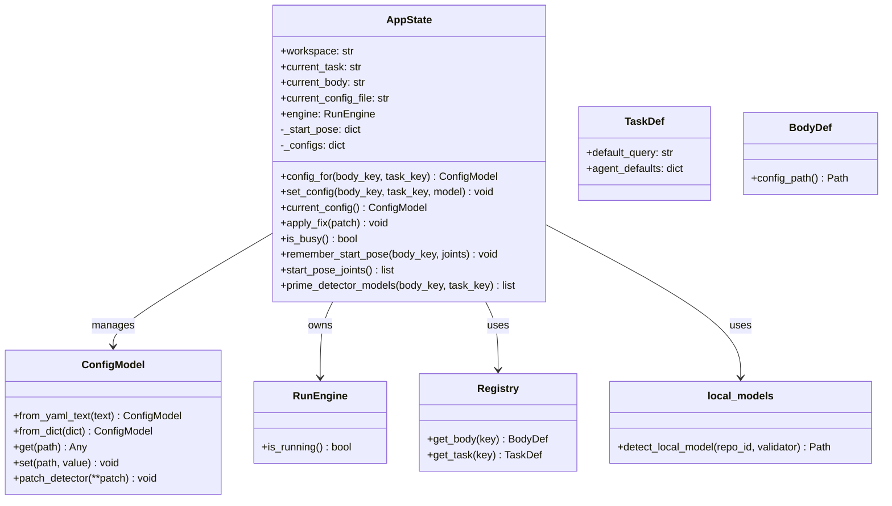
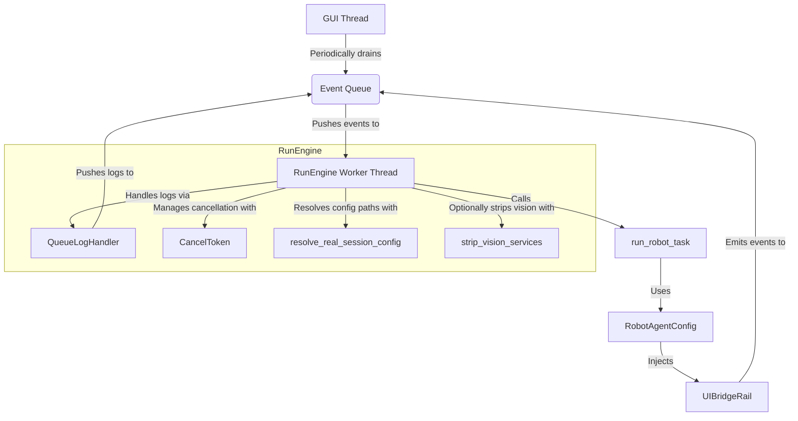
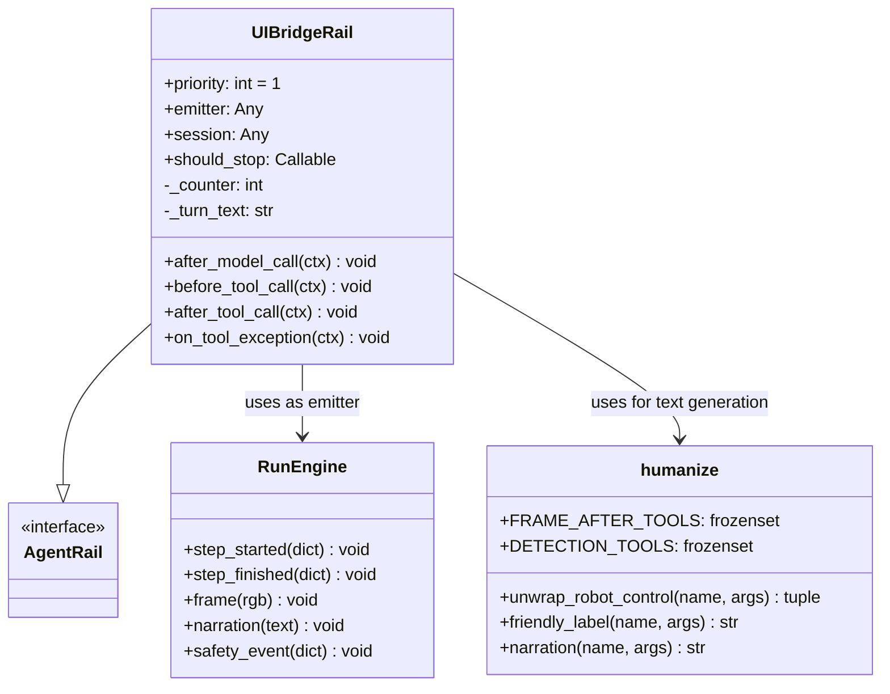

<!-- source: DeepWiki mcp.deepwiki.com · repo openJiuwen-ai/jiuwensymbiosis · page 7.2 GUI State, Bridge & Run Engine · fetched 2026-11-02 -->

# GUI State, Bridge & Run Engine

Relevant source files

The following files were used as context for generating this wiki page:

- [jiuwensymbiosis/gui/app_state.py](jiuwensymbiosis/gui/app_state.py)
- [jiuwensymbiosis/gui/bridge.py](jiuwensymbiosis/gui/bridge.py)
- [jiuwensymbiosis/gui/humanize.py](jiuwensymbiosis/gui/humanize.py)
- [jiuwensymbiosis/gui/pages/history_view.py](jiuwensymbiosis/gui/pages/history_view.py)
- [jiuwensymbiosis/gui/perception_engine.py](jiuwensymbiosis/gui/perception_engine.py)
- [jiuwensymbiosis/gui/run_engine.py](jiuwensymbiosis/gui/run_engine.py)
- [tests/unit_tests/gui/test_app_state.py](tests/unit_tests/gui/test_app_state.py)
- [tests/unit_tests/gui/test_bridge.py](tests/unit_tests/gui/test_bridge.py)
- [tests/unit_tests/gui/test_run_engine.py](tests/unit_tests/gui/test_run_engine.py)

This page details the core components that manage the GUI's state, facilitate communication between the GUI and the agent, and handle the execution of robot tasks. It covers the `AppState` for cross-page state sharing, the `RunEngine` for background task execution, the `UIBridgeRail` for translating agent events into GUI updates, and the `PerceptionEngine` for camera preview and pixel reprojection. Helper modules like `humanize` are also discussed.

## AppState: GUI-wide State Management

The `AppState` class [jiuwensymbiosis/gui/app_state.py:26-174]() acts as a singleton container for managing the GUI's shared state across different pages. It is framework-agnostic, meaning it does not depend on NiceGUI or Qt, allowing for independent testing.

Key responsibilities of `AppState` include:
*   **Workspace Management**: Stores the current workspace path where traces and sessions are saved [jiuwensymbiosis/gui/app_state.py:30]().
*   **Current Task and Body**: Keeps track of the currently selected robot body and task [jiuwensymbiosis/gui/app_state.py:31-32]().
*   **Configuration Caching**: Caches `ConfigModel` instances for different (body, task, config file) combinations to ensure editable configurations are shared [jiuwensymbiosis/gui/app_state.py:42]().
*   **Configuration Loading and Defaults**: The `config_for` method [jiuwensymbiosis/gui/app_state.py:44-76]() loads configurations from YAML files, applies task-specific agent defaults (e.g., `enable_tracing`, `exec_mode`), and pre-fills the task prompt.
*   **Start Pose Management**: Remembers the robot's joint angles at the start of a run, allowing for a "return to start pose" feature. This pose is invalidated if the body or configuration changes [jiuwensymbiosis/gui/app_state.py:100-117]().
*   **Detector Model Priming**: Before a real robot run, it attempts to locate local visual models (GroundingDINO, SAM2) and inject their paths into the detector configuration, enabling offline loading and bypassing online checks [jiuwensymbiosis/gui/app_state.py:119-174](). This respects user-defined environment variables or explicit model IDs in the configuration [tests/unit_tests/gui/test_app_state.py:143-177]().
*   **Busy State**: Indicates if a `RunEngine` is currently active [jiuwensymbiosis/gui/app_state.py:98]().

**Diagram: AppState Class and its Dependencies**

Sources:
*   [jiuwensymbiosis/gui/app_state.py:26-174]()
*   [tests/unit_tests/gui/test_app_state.py:143-177]()

## RunEngine: Background Task Execution

The `RunEngine` [jiuwensymbiosis/gui/run_engine.py:124-402]() is responsible for executing a robot task in a dedicated background thread. It acts as a bridge between the GUI and the agent's `run_robot_task` function, ensuring that the UI remains responsive.

Key features:
*   **Threaded Execution**: The entire `connect → run_robot_task → disconnect` sequence runs within a single `threading.Thread` [jiuwensymbiosis/gui/run_engine.py:6-8]().
*   **Event Queue**: It uses a thread-safe `queue.Queue` [jiuwensymbiosis/gui/run_engine.py:140]() to push `(event, payload)` tuples to the GUI. The GUI periodically drains this queue using `ui.timer` [jiuwensymbiosis/gui/run_engine.py:9-10]().
*   **Event Types**: Emits various events such as `run_started`, `step_started`, `step_finished`, `frame`, `step_frame`, `narration`, `safety_event`, `log`, and `run_finished` [jiuwensymbiosis/gui/run_engine.py:13-16]().
*   **Configuration Handling**: Takes a `TaskDef` and a `ConfigModel`'s data, along with the workspace and body key [jiuwensymbiosis/gui/run_engine.py:129-134]().
*   **Cancellation**: Uses a `CancelToken` [jiuwensymbiosis/gui/run_engine.py:145]() to allow for run-scoped cancellation, enabling the UI to stop a running task.
*   **Log Handling**: Integrates `QueueLogHandler` [jiuwensymbiosis/gui/run_engine.py:94-123]() to capture `jiuwensymbiosis` logs and push them to the event queue, also maintaining a circular buffer for post-failure diagnosis.
*   **Configuration Resolution**: `resolve_real_session_config` [jiuwensymbiosis/gui/run_engine.py:73-91]() deep-copies the configuration and resolves relative paths (e.g., for calibration files, URDF) to absolute paths, which is crucial for `RobotSession` construction.
*   **Vision Service Stripping**: `strip_vision_services` [jiuwensymbiosis/gui/run_engine.py:55-70]() creates a copy of the configuration with all vision-related services removed, used when the "disable vision" switch is active.

**Diagram: RunEngine Data Flow**

Sources:
*   [jiuwensymbiosis/gui/run_engine.py:6-16]()
*   [jiuwensymbiosis/gui/run_engine.py:55-91]()
*   [jiuwensymbiosis/gui/run_engine.py:94-123]()
*   [jiuwensymbiosis/gui/run_engine.py:124-402]()
*   [tests/unit_tests/gui/test_run_engine.py:90-101]()

## UIBridgeRail: Agent-to-GUI Event Translation

The `UIBridgeRail` [jiuwensymbiosis/gui/bridge.py:80-183]() is an `AgentRail` injected into the agent's `extra_rails` [jiuwensymbiosis/gui/bridge.py:6](). Its primary function is to translate agent runtime events (tool calls, model responses, exceptions) into GUI-friendly events that are then pushed to the `RunEngine`'s event queue.

Key aspects:
*   **Event Hooks**: Implements `after_model_call`, `before_tool_call`, `after_tool_call`, and `on_tool_exception` hooks [jiuwensymbiosis/gui/bridge.py:104-183]().
*   **Event Emission**: Uses an `emitter` object (which is the `RunEngine` in practice) to send `step_started`, `step_finished`, `frame`, `narration`, and `safety_event` [jiuwensymbiosis/gui/bridge.py:83-86]().
*   **Priority**: Has a low priority (`priority = 1`) [jiuwensymbiosis/gui/bridge.py:89]() to ensure it observes events after `SafetyRail` has made its decisions.
*   **Tool Call Unwrapping**: The `_extract` helper [jiuwensymbiosis/gui/bridge.py:44-49]() and `unwrap_robot_control` [jiuwensymbiosis/gui/humanize.py:63-87]() function correctly unpack `robot_control` tool calls to reveal the actual action and parameters, making the GUI display more intuitive.
*   **Result Interpretation**: The `_result_ok_error` function [jiuwensymbiosis/gui/bridge.py:52-78]() determines if a tool call was successful, handling both direct `ok: False` results and nested `ToolOutput` objects, and extracting error messages.
*   **Frame Grabbing**: After certain motion or grasping tools, it triggers a camera frame capture and sends it to the GUI [jiuwensymbiosis/gui/bridge.py:147-148]().
*   **Narration**: Generates human-readable descriptions of actions using the `humanize` module [jiuwensymbiosis/gui/bridge.py:137]().
*   **Safety Event Detection**: Identifies `SafetyRail` rejections from exceptions and emits a specific `safety_event` [jiuwensymbiosis/gui/bridge.py:178-182]().
*   **Cancellation Integration**: Checks a `should_stop` callable before each tool call to allow the GUI to force-finish the agent's execution [jiuwensymbiosis/gui/bridge.py:118-121]().

**Diagram: UIBridgeRail Class and its Collaborators**

Sources:
*   [jiuwensymbiosis/gui/bridge.py:6-10]()
*   [jiuwensymbiosis/gui/bridge.py:44-78]()
*   [jiuwensymbiosis/gui/bridge.py:80-183]()
*   [jiuwensymbiosis/gui/humanize.py:63-87]()
*   [tests/unit_tests/gui/test_bridge.py:67-79]()

## PerceptionEngine: Camera Preview and Reprojection

The `PerceptionEngine` [jiuwensymbiosis/gui/perception_engine.py:41-161]() is a background thread-based engine for the "Perception Test" tool in the GUI. It provides a live camera preview and reprojects UI-clicked pixels to base-frame coordinates.

Key functionalities:
*   **Background Thread**: Runs camera connection, frame grabbing, and click servicing in a separate thread [jiuwensymbiosis/gui/perception_engine.py:73-74]().
*   **Session Factory**: Takes a `session_factory` callable that returns an *unconnected* `RobotSession` [jiuwensymbiosis/gui/perception_engine.py:55-57](). This allows the GUI to build a session without immediately connecting to hardware.
*   **Event Queue**: Communicates with the UI via an event queue, sending `preview_started`, `frame` (as data URI), `point_result`, `error`, and `preview_stopped` events [jiuwensymbiosis/gui/perception_engine.py:8-9]().
*   **Live Preview**: Continuously grabs RGB frames from the robot's camera and converts them to data URIs for display [jiuwensymbiosis/gui/perception_engine.py:114-122]().
*   **Pixel Reprojection**: When a pixel `(u, v)` is requested, it uses the latest depth frame and the robot's API (`api.pixel_to_base_xyz`) to reproject the pixel into 3D base-frame coordinates `(x, y, z)` [jiuwensymbiosis/gui/perception_engine.py:153-161]().
*   **Error Handling**: Reports connection or frame grabbing failures to the UI via `error` events [jiuwensymbiosis/gui/perception_engine.py:132-134]().
*   **Z-Correction**: Supports an optional `z_correction_mm` for display-layer grasp Z correction [jiuwensymbiosis/gui/perception_engine.py:58-61]().

Sources:
*   [jiuwensymbiosis/gui/perception_engine.py:8-9]()
*   [jiuwensymbiosis/gui/perception_engine.py:41-161]()

## Humanize Helpers

The `humanize` module [jiuwensymbiosis/gui/humanize.py:1-113]() provides utility functions to translate technical robot actions and parameters into user-friendly Chinese descriptions for the GUI.

Key functions:
*   `unwrap_robot_control`: Decodes `robot_control` tool calls into their actual action name and parameters, ensuring consistent display across the GUI [jiuwensymbiosis/gui/humanize.py:63-87]().
*   `friendly_label`: Generates a short, friendly Chinese label for a given tool call, optionally including object names for clarity (e.g., "识别并定位物体「black box」") [jiuwensymbiosis/gui/humanize.py:98-108]().
*   `narration`: Creates a "what is currently happening" narrative for the main visual area [jiuwensymbiosis/gui/humanize.py:111-113]().
*   `TOOL_LABELS`: A dictionary mapping tool names to their Chinese labels [jiuwensymbiosis/gui/humanize.py:27-41]().
*   `FRAME_AFTER_TOOLS`: A set of tool names that, when executed, should trigger a camera frame capture for GUI refresh [jiuwensymbiosis/gui/humanize.py:44-54]().
*   `DETECTION_TOOLS`: A set of detection tool names that, when executed, should trigger a detection overlay to be pinned to that step [jiuwensymbiosis/gui/humanize.py:57]().

Sources:
*   [jiuwensymbiosis/gui/humanize.py:1-113]()
*   [jiuwensymbiosis/gui/humanize.py:27-57]()
*   [jiuwensymbiosis/gui/humanize.py:63-113]()

## Run Status and History

The GUI provides mechanisms to track the status of a running task and review past executions.

*   **Run Status**: The `RunEngine`'s `is_running()` method [jiuwensymbiosis/gui/run_engine.py:200]() indicates if a task is currently active. The `AppState` also exposes `is_busy()` [jiuwensymbiosis/gui/app_state.py:98]() which checks the `RunEngine`'s status.
*   **History View**: The `HistoryView` [jiuwensymbiosis/gui/pages/history_view.py:25-91]() page scans the `<workspace>/traces/` directory for `ExecutionTrace` JSON files generated by the `TraceRail`. It lists past runs, displays a summary, and allows users to open a replay of the trace in a web browser [jiuwensymbiosis/gui/pages/history_view.py:88-91](). The replay is rendered via a dedicated `/replay` route in the GUI application.

Sources:
*   [jiuwensymbiosis/gui/app_state.py:98]()
*   [jiuwensymbiosis/gui/run_engine.py:200]()
*   [jiuwensymbiosis/gui/pages/history_view.py:25-91]()

---

