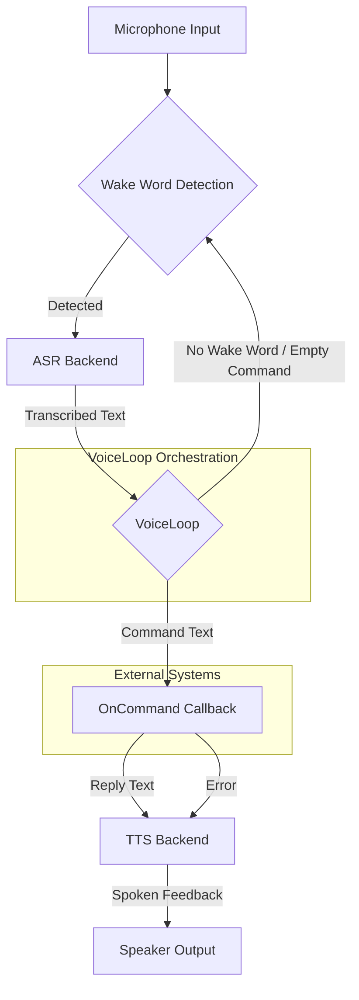

<!-- source: DeepWiki mcp.deepwiki.com · repo openJiuwen-ai/jiuwensymbiosis · page 7.4 Voice Interaction · fetched 2026-11-02 -->

# Voice Interaction

<details>
<summary>Relevant source files</summary>

The following files were used as context for generating this wiki page:

- [jiuwensymbiosis/voice/__init__.py](jiuwensymbiosis/voice/__init__.py)
- [jiuwensymbiosis/voice/asr.py](jiuwensymbiosis/voice/asr.py)
- [jiuwensymbiosis/voice/audio.py](jiuwensymbiosis/voice/audio.py)
- [jiuwensymbiosis/voice/config.py](jiuwensymbiosis/voice/config.py)
- [jiuwensymbiosis/voice/loop.py](jiuwensymbiosis/voice/loop.py)
- [jiuwensymbiosis/voice/tts.py](jiuwensymbiosis/voice/tts.py)
- [jiuwensymbiosis/voice/wake.py](jiuwensymbiosis/voice/wake.py)
- [tests/unit_tests/voice/test_loop.py](tests/unit_tests/voice/test_loop.py)
- [tests/unit_tests/voice/test_tts.py](tests/unit_tests/voice/test_tts.py)

</details>


This page details the voice interaction subsystem, covering wake word detection, Automatic Speech Recognition (ASR), Text-to-Speech (TTS), audio input/output (I/O), the voice loop orchestration, and configuration. It explains the implementation, data flow, key functions, and classes involved in enabling voice control for the robot agent.

## Voice Interaction Overview

The voice interaction system provides a natural language interface for controlling the robot. It follows a pipeline: microphone input -> wake word detection -> ASR -> command processing -> TTS feedback. The core `VoiceLoop` orchestrates these components, passing transcribed commands to a configurable `on_command` callback, which typically integrates with the robot's task execution system.


Sources: [jiuwensymbiosis/voice/__init__.py:6-9](), [jiuwensymbiosis/voice/loop.py:4-10]()

## Configuration

The voice layer's behavior is controlled by the `VoiceConfig` dataclass [jiuwensymbiosis/voice/config.py:21-88](). This configuration centralizes settings for wake word, ASR, audio capture, and TTS, replacing numerous environment variables found in previous iterations. It provides neutral defaults, allowing the voice layer to run without a GPU (e.g., `tts_backend="null"`).

Key configuration attributes include:
*   **Wake Word**: `wake_word` and `wake_variants` for detection [jiuwensymbiosis/voice/config.py:56-57]().
*   **ASR**: `asr_backend`, `asr_model`, `asr_device`, `asr_enable_vad`, `asr_enable_punc` for speech-to-text [jiuwensymbiosis/voice/config.py:61-65]().
*   **Audio Capture**: `audio_backend`, `sample_rate`, `chunk`, `silence_frames`, `min_frames`, `max_frames`, `timeout_frames`, `energy_min`, `vad_aggressiveness`, `preroll_frames`, `pulse_source` for microphone input and voice activity detection (VAD) [jiuwensymbiosis/voice/config.py:68-78]().
*   **TTS**: `tts_backend`, `tts_module_path`, `tts_async` for text-to-speech output [jiuwensymbiosis/voice/config.py:81-83]().
*   **Behavior**: `ack_text`, `speak_ack` for immediate feedback [jiuwensymbiosis/voice/config.py:86-87]().

The `VoiceConfig.from_dict` class method [jiuwensymbiosis/voice/config.py:90-102]() allows building a configuration from a dictionary, typically loaded from YAML, ignoring unknown keys and coercing `wake_variants` to a tuple.

Sources: [jiuwensymbiosis/voice/config.py:4-10](), [jiuwensymbiosis/voice/config.py:21-88](), [jiuwensymbiosis/voice/config.py:90-102]()

## Wake Word Detection

Wake word detection is handled by the `jiuwensymbiosis.voice.wake` module. It focuses on pure text-based matching, without audio or model dependencies.

The default wake word is "九问九问" (`WAKE_WORD`) [jiuwensymbiosis/voice/wake.py:26](), and a comprehensive list of near-homophone variants (`WAKE_WORD_VARIANTS`) [jiuwensymbiosis/voice/wake.py:27-56]() is provided to ensure robust detection despite ASR mis-transcriptions.

The `normalize_wake_text` function [jiuwensymbiosis/voice/wake.py:59-61]() strips whitespace and Chinese/ASCII punctuation to standardize text for matching.

The `split_after_last_wake` function [jiuwensymbiosis/voice/wake.py:64-92]() is crucial. It takes an ASR transcript and returns the command text that follows the *last* occurrence of any configured wake word variant. If no wake word is found, it returns `None`. An empty string indicates the wake word was heard but no command followed.

Sources: [jiuwensymbiosis/voice/wake.py:4-11](), [jiuwensymbiosis/voice/wake.py:26](), [jiuwensymbiosis/voice/wake.py:27-56](), [jiuwensymbiosis/voice/wake.py:59-61](), [jiuwensymbiosis/voice/wake.py:64-92]()

## Automatic Speech Recognition (ASR)

The ASR component converts captured audio utterances into text. The `ASRBackend` protocol [jiuwensymbiosis/voice/asr.py:33-37]() defines the contract for ASR implementations.

### `FunASRBackend`

The `FunASRBackend` [jiuwensymbiosis/voice/asr.py:43-97]() uses the FunASR `paraformer-zh` model. It supports optional VAD and punctuation models. The model is lazy-loaded on the first `transcribe` call [jiuwensymbiosis/voice/asr.py:60-76](). Audio is temporarily saved to a WAV file for FunASR processing [jiuwensymbiosis/voice/asr.py:81-96]().

### `FixedASRBackend`

For testing and development without a live ASR model, `FixedASRBackend` [jiuwensymbiosis/voice/asr.py:99-111]() provides scripted transcripts from a predefined list.

### `build_asr_backend`

The `build_asr_backend` function [jiuwensymbiosis/voice/asr.py:114-127]() constructs the appropriate ASR backend based on the `VoiceConfig.asr_backend` setting.

Sources: [jiuwensymbiosis/voice/asr.py:4-10](), [jiuwensymbiosis/voice/asr.py:33-37](), [jiuwensymbiosis/voice/asr.py:43-97](), [jiuwensymbiosis/voice/asr.py:60-76](), [jiuwensymbiosis/voice/asr.py:81-96](), [jiuwensymbiosis/voice/asr.py:99-111](), [jiuwensymbiosis/voice/asr.py:114-127]()

## Text-to-Speech (TTS)

The TTS component provides spoken feedback to the user. The `TTSBackend` protocol [jiuwensymbiosis/voice/tts.py:34-48]() defines the interface for TTS implementations.

### `NullTTS`

`NullTTS` [jiuwensymbiosis/voice/tts.py:51-70]() is the default backend. It logs spoken text instead of producing audio, making the voice layer runnable on CI or GPU-less machines. It records spoken text in the `spoken` attribute [jiuwensymbiosis/voice/tts.py:54]().

### `ChatTTSBackend`

`ChatTTSBackend` [jiuwensymbiosis/voice/tts.py:72-154]() integrates with a ChatTTS `tts.py` module. It dynamically loads the module and calls its `safe_speak_text` (or `speak_text`) entry point on a background thread if `async_play` is enabled [jiuwensymbiosis/voice/tts.py:81](), [jiuwensymbiosis/voice/tts.py:127](). If the module or entry point is missing, it degrades gracefully with warnings [jiuwensymbiosis/voice/tts.py:94-110](). The `wait` method [jiuwensymbiosis/voice/tts.py:144-153]() blocks until any in-flight speech finishes.

### `build_tts_backend`

The `build_tts_backend` function [jiuwensymbiosis/voice/tts.py:155-165]() constructs the appropriate TTS backend based on the `VoiceConfig.tts_backend` setting.

Sources: [jiuwensymbiosis/voice/tts.py:4-10](), [jiuwensymbiosis/voice/tts.py:34-48](), [jiuwensymbiosis/voice/tts.py:51-70](), [jiuwensymbiosis/voice/tts.py:54](), [jiuwensymbiosis/voice/tts.py:72-154](), [jiuwensymbiosis/voice/tts.py:81](), [jiuwensymbiosis/voice/tts.py:127](), [jiuwensymbiosis/voice/tts.py:94-110](), [jiuwensymbiosis/voice/tts.py:144-153](), [jiuwensymbiosis/voice/tts.py:155-165]()

## Audio I/O

The `jiuwensymbiosis.voice.audio` module handles audio capture and segmentation. The `AudioSource` protocol [jiuwensymbiosis/voice/audio.py:43-48]() defines the contract for audio input.

### `RecordTuning`

`RecordTuning` [jiuwensymbiosis/voice/audio.py:52-66]() is a dataclass that encapsulates frame-level segmentation parameters, derived from `VoiceConfig`. These parameters control how speech utterances are detected and segmented from continuous audio streams.

### `_VadGate`

The `_VadGate` class [jiuwensymbiosis/voice/audio.py:82-111]() implements Voice Activity Detection (VAD). It uses a hybrid approach: triggering on an energy threshold OR WebRTC VAD (if available). This ensures robust detection even with quiet microphones or when WebRTC VAD might miss soft speech.

### `_SegmentRecorder`

`_SegmentRecorder` [jiuwensymbiosis/voice/audio.py:114-171]() is a frame-driven utterance segmenter used by live capture backends. It processes audio frames, detects speech onset and offset, and manages a pre-roll buffer to prevent clipping the beginning of utterances [jiuwensymbiosis/voice/audio.py:131-135](). It determines when an utterance is complete based on silence, maximum length, or leading-silence timeout.

### `FileAudioSource`

`FileAudioSource` [jiuwensymbiosis/voice/audio.py:173-190]() is a mock audio source for testing and hardware-free runs. It replays pre-supplied PCM segments or WAV files.

### Live Audio Sources (Not fully shown in provided code, but mentioned)

The documentation mentions `PulseAudioSource` and `SoundDeviceSource` as real backends that port `n2_voice`'s recording logic. These would implement the `AudioSource` protocol to capture audio from system microphones.

### `build_audio_source`

The `build_audio_source` function (not explicitly shown, but implied by `VoiceLoop`'s lazy loading [jiuwensymbiosis/voice/loop.py:99-102]()) would construct the appropriate `AudioSource` based on `VoiceConfig.audio_backend`.

Sources: [jiuwensymbiosis/voice/audio.py:4-14](), [jiuwensymbiosis/voice/audio.py:43-48](), [jiuwensymbiosis/voice/audio.py:52-66](), [jiuwensymbiosis/voice/audio.py:82-111](), [jiuwensymbiosis/voice/audio.py:114-171](), [jiuwensymbiosis/voice/audio.py:131-135](), [jiuwensymbiosis/voice/audio.py:173-190](), [jiuwensymbiosis/voice/loop.py:99-102]()

## Voice Loop

The `VoiceLoop` class [jiuwensymbiosis/voice/loop.py:67-182]() is the central orchestrator of the voice interaction pipeline. It listens for wake-word-prefixed commands and dispatches them via an `on_command` callback.

### Initialization and Backends

The `VoiceLoop` is initialized with a `VoiceConfig` and an `OnCommand` callable [jiuwensymbiosis/voice/loop.py:77-83](). It can also accept injected ASR, TTS, and audio backends for testing or custom pipelines. If not injected, backends are lazily built using `build_asr_backend`, `build_tts_backend`, and `build_audio_source` [jiuwensymbiosis/voice/loop.py:99-114]().

### Two-Phase Wake Word

A key feature is the "two-phase wake" mechanism [jiuwensymbiosis/voice/loop.py:91-95](). If only the wake word is heard in a segment, the loop is "armed" (`_armed = True`) [jiuwensymbiosis/voice/loop.py:155](), and the next non-empty segment is treated as the command without requiring another wake word. This accommodates natural pauses between the wake word and the instruction.

### `run_once`

The `run_once` method [jiuwensymbiosis/voice/loop.py:123-161]() captures one utterance, transcribes it, applies wake word detection, and returns the command text. It handles the two-phase wake logic.

### `handle_command`

`handle_command` [jiuwensymbiosis/voice/loop.py:163-180]() is responsible for speaking an acknowledgment (`ack_text`) [jiuwensymbiosis/voice/loop.py:171](), executing the `on_command` callback, and speaking its reply. Exceptions during command execution are logged and spoken, but do not crash the loop [jiuwensymbiosis/voice/loop.py:174-178]().

### `run_forever`

The `run_forever` method [jiuwensymbiosis/voice/loop.py:182]() continuously listens for commands, dispatches them, and provides feedback until interrupted (e.g., by Ctrl-C).

### `result_to_speech`

The `result_to_speech` helper function [jiuwensymbiosis/voice/loop.py:33-64]() converts various return values from the `on_command` callback (e.g., `None`, strings, dictionaries, agent results) into a single spoken line for TTS feedback. It handles success/failure messages and extracts relevant content.

```mermaid
graph TD
    subgraph VoiceLoop
        VL_Init[VoiceLoop.__init__] --> VL_Audio[audio.record_segment()];
        VL_Audio -- PCM Audio --> VL_ASR[asr.transcribe()];
        VL_ASR -- Transcribed Text --> VL_Wake[split_after_last_wake()];
        VL_Wake -- Command Text / None --> VL_RunOnce[VoiceLoop.run_once()];
        VL_RunOnce -- Command Text --> VL_HandleCmd[VoiceLoop.handle_command()];
        VL_HandleCmd -- Command Text --> VL_OnCommand[on_command Callback];
        VL_OnCommand -- Result --> VL_ResultToSpeech[result_to_speech()];
        VL_ResultToSpeech -- Spoken Reply --> VL_TTS[tts.speak()];
        VL_HandleCmd -- Ack Text --> VL_TTS;
        VL_Wake -- Wake Only --> VL_Armed[Set _armed = True];
        VL_Armed -- Next Segment --> VL_RunOnce;
        VL_Wake -- No Wake / Empty --> VL_RunOnce;
    end

    subgraph Backends (Lazy Loaded)
        B_Audio[AudioSource]
        B_ASR[ASRBackend]
        B_TTS[TTSBackend]
    end

    VL_Audio -.-> B_Audio;
    VL_ASR -.-> B_ASR;
    VL_TTS -.-> B_TTS;

    style VL_Init fill:#f9f,stroke:#333,stroke-width:2px
    style VL_Audio fill:#bbf,stroke:#333,stroke-width:2px
    style VL_ASR fill:#bbf,stroke:#333,stroke-width:2px
    style VL_Wake fill:#bbf,stroke:#333,stroke-width:2px
    style VL_RunOnce fill:#f9f,stroke:#333,stroke-width:2px
    style VL_HandleCmd fill:#f9f,stroke:#333,stroke-width:2px
    style VL_OnCommand fill:#afa,stroke:#333,stroke-width:2px
    style VL_ResultToSpeech fill:#bbf,stroke:#333,stroke-width:2px
    style VL_TTS fill:#bbf,stroke:#333,stroke-width:2px
    style VL_Armed fill:#f9f,stroke:#333,stroke-width:2px
```
Sources: [jiuwensymbiosis/voice/loop.py:67-182](), [jiuwensymbiosis/voice/loop.py:77-83](), [jiuwensymbiosis/voice/loop.py:99-114](), [jiuwensymbiosis/voice/loop.py:91-95](), [jiuwensymbiosis/voice/loop.py:155](), [jiuwensymbiosis/voice/loop.py:123-161](), [jiuwensymbiosis/voice/loop.py:163-180](), [jiuwensymbiosis/voice/loop.py:171](), [jiuwensymbiosis/voice/loop.py:174-178](), [jiuwensymbiosis/voice/loop.py:182](), [jiuwensymbiosis/voice/loop.py:33-64]()

---

