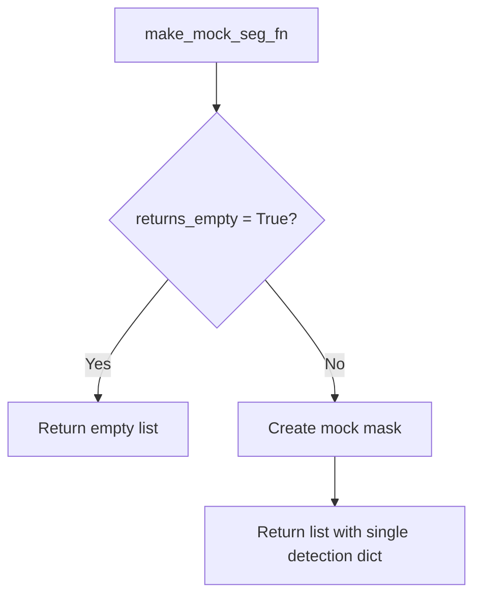
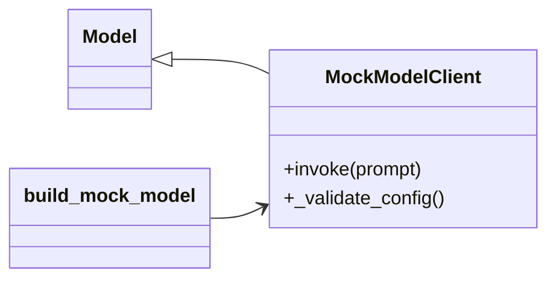

<!-- source: DeepWiki mcp.deepwiki.com · repo openJiuwen-ai/jiuwensymbiosis · page 8.2 Testing Infrastructure · fetched 2026-11-02 -->

# Testing Infrastructure

<details>
<summary>Relevant source files</summary>

The following files were used as context for generating this wiki page:

- [Makefile](Makefile)
- [tests/mocks/__init__.py](tests/mocks/__init__.py)
- [tests/mocks/mock_api.py](tests/mocks/mock_api.py)
- [tests/mocks/mock_detector.py](tests/mocks/mock_detector.py)
- [tests/unit_tests/adapters/common/test_builder.py](tests/unit_tests/adapters/common/test_builder.py)
- [tests/unit_tests/adapters/common/test_smoke.py](tests/unit_tests/adapters/common/test_smoke.py)
- [tests/unit_tests/adapters/common/test_validate_adapter.py](tests/unit_tests/adapters/common/test_validate_adapter.py)
- [tests/unit_tests/adapters/piper/test_geometry.py](tests/unit_tests/adapters/piper/test_geometry.py)
- [tests/unit_tests/agent/test_config.py](tests/unit_tests/agent/test_config.py)
- [tests/unit_tests/agent/test_mock_model.py](tests/unit_tests/agent/test_mock_model.py)
- [tests/unit_tests/skills/test_skills_dir.py](tests/unit_tests/skills/test_skills_dir.py)
- [tests/unit_tests/tools/test_builder.py](tests/unit_tests/tools/test_builder.py)

</details>


This page details the testing infrastructure within the `jiuwensymbiosis` codebase, covering the `tests/` directory layout, common `conftest.py` fixtures, various mock objects for different system components, strategies for layering tests, integration testing, and the `Makefile` targets used for running tests.

## Tests Directory Layout

The `tests/` directory is structured to separate different types of tests, primarily unit tests and integration tests.

```
tests/
├── conftest.py             # Global pytest fixtures and hooks
├── integration_tests/      # End-to-end tests involving multiple components
│   ├── __init__.py
│   └── ...
├── mocks/                  # Mock objects for various system components
│   ├── __init__.py
│   ├── mock_api.py
│   ├── mock_detector.py
│   ├── mock_driver.py
│   ├── mock_dual_arm.py
│   └── mock_env.py
└── unit_tests/             # Focused tests for individual modules or classes
    ├── __init__.py
    ├── adapters/
    │   ├── _common/
    │   │   ├── test_builder.py
    │   │   ├── test_smoke.py
    │   │   └── test_validate_adapter.py
    │   └── piper/
    │       └── test_geometry.py
    ├── agent/
    │   ├── test_config.py
    │   └── test_mock_model.py
    ├── skills/
    │   └── test_skills_dir.py
    └── tools/
        └── test_builder.py
```

Sources: `tests/` directory structure

## `conftest.py` Fixtures

The `conftest.py` file provides global fixtures that can be used across multiple test files, promoting reusability and consistent test environments.

## Mocks

The `jiuwensymbiosis` testing infrastructure heavily relies on mock objects to isolate components and simulate external dependencies. These mocks are located in the `tests/mocks/` directory.

### Mock API

The `MockApi` class [tests/mocks/mock_api.py:27-127]() provides an in-memory mock of a robot's API, mirroring the behavior of real robot APIs like Piper. It implements various `ActionSpec`s such as `HOME`, `GET_POSE`, `GOTO_XYZR`, `CLOSE_GRIPPER`, `OPEN_GRIPPER`, `GET_GRASP_INFO_SIMPLE`, `PIXEL_TO_BASE_XYZ`, and `ANALYZE_SCENE`. This allows testing of the agent's interaction with the robot's API without requiring actual hardware.

The `MockApi` records all API calls in `_call_log` [tests/mocks/mock_api.py:38-38]() and can be configured with predefined detection and pixel results [tests/mocks/mock_api.py:39-45]().

```mermaid
classDiagram
    direction LR
    BaseRobotApi <|-- MockApi
    MockApi : +env: MockArmEnv
    MockApi : +_call_log: list[str]
    MockApi : +_detection_result: dict
    MockApi : +_pixel_result: dict
    MockApi : +home()
    MockApi : +get_pose()
    MockApi : +goto_xyzr(x, y, z, r)
    MockApi : +close_gripper()
    MockApi : +open_gripper()
    MockApi : +get_grasp_info_simple(object_name)
    MockApi : +pixel_to_base_xyz(u, v, depth_m)
    MockApi : +get_image()
    MockApi : +analyze_scene(object_name)
    MockApi : +goto_xyzr_joint(x, y, z, r)
```
Title: MockApi Class Diagram
Sources: [tests/mocks/mock_api.py:27-127]()

### Mock Detector

The `make_mock_seg_fn` function [tests/mocks/mock_detector.py:14-44]() creates a mock segmentation function that adheres to the detector contract. This is useful for testing vision pipelines without needing a running detector server. It can be configured to return a single detection result with a specified score, label, bounding box, and mask shape, or to return an empty list of detections.


Title: make_mock_seg_fn Data Flow
Sources: [tests/mocks/mock_detector.py:14-44]()

### Mock Session

The `RobotSession` is a core component of the agent. While a direct `MockRobotSession` class isn't explicitly defined in the provided snippets, the `make_builder` function [tests/unit_tests/adapters/common/test_builder.py:30-32]() is used to construct `RobotSession` instances with mock environments and APIs for testing. This allows testing the session's behavior in isolation from real hardware.

For example, `TestMakeBuilder` demonstrates creating a `RobotSession` using `PiperConfig`, `_TestEnv` (a `MockArmEnv` subclass), and `_TestApi` (a `MockApi` subclass) [tests/unit_tests/adapters/common/test_builder.py:30-32]().

### Mock Model

The `MockModelClient` [jiuwensymbiosis/agent/mock_model.py]() and `build_mock_model` function [jiuwensymbiosis/agent/mock_model.py]() provide a mock for the LLM. This mock model is designed to return a simple `AssistantMessage` [jiuwensymbiosis/agent/mock_model.py]() containing "mock" in its content, allowing tests to run without requiring an actual LLM API key or network access. It also ensures that its configuration validation is a no-op, preventing failures on placeholder API keys [jiuwensymbiosis/agent/mock_model.py]().


Title: MockModelClient Class Diagram
Sources: [jiuwensymbiosis/agent/mock_model.py]()

## Layering Tests

Tests are organized into `unit_tests/` and `integration_tests/`.

### Unit Tests

Unit tests focus on individual components, modules, or functions in isolation. They often use mock objects to control dependencies and ensure that only the code under test is being evaluated. Examples include:
*   `tests/unit_tests/adapters/_common/test_builder.py`: Tests the `make_builder` function for constructing robot sessions [tests/unit_tests/adapters/common/test_builder.py:29-48]().
*   `tests/unit_tests/agent/test_config.py`: Verifies the behavior of `ModelSpec`, `RailConfig`, and `RobotAgentConfig` classes [tests/unit_tests/agent/test_config.py:17-188]().
*   `tests/unit_tests/tools/test_builder.py`: Checks the `build_robot_tools` and `list_tool_meta` functions, including capability gating [tests/unit_tests/tools/test_builder.py:14-107]().
*   `tests/unit_tests/skills/test_skills_dir.py`: Ensures the integrity of the `SKILLS_DIR` and `SKILL.md` files [tests/unit_tests/skills/test_skills_dir.py:11-44]().

### Integration Tests

Integration tests verify the interaction between multiple components. These tests are typically more complex and might involve a combination of real and mocked components. The `integration_tests/` directory is reserved for these.

A notable example of an integration-like test is the `smoke_test_api` function [tests/unit_tests/adapters/common/test_smoke.py:45-101](), which is part of the adapter smoke test harness. Although located in `unit_tests/`, it tests the integration of an `Api` with a `MockEnv` to ensure all exposed tools can be called without crashing and return JSON-serializable results. This catches issues early in the adapter development cycle.

## Makefile Targets

The `Makefile` provides convenient targets for running various checks and tests.

```mermaid
graph TD
    A[make help] --> B{Display usage}
    A --> C[make check]
    C --> C1[ruff format --check]
    C --> C2[ruff check]
    C --> C3[mypy (advisory)]
    A --> D[make fix]
    D --> D1[ruff format]
    D --> D2[ruff check --fix]
    A --> E[make format]
    E --> E1[ruff format --check]
    A --> F[make lint]
    F --> F1[ruff check]
    A --> G[make type-check]
    G --> G1[mypy]
    A --> H[make test]
    H --> H1[pytest tests/unit_tests/]
    A --> I[make test-all]
    I --> I1[pytest (all tests)]

    subgraph "Conditional Execution"
        C,D,E,F,G -- if staged changes --> J[has-staged-changes check]
        J -- No staged changes --> K[Exit with message]
        J -- Staged changes --> L[Proceed with checks]
    end

    subgraph "Environment Configuration"
        M[CONDA_ENV variable] --> N{Is CONDA_ENV empty?}
        N -- Yes --> O[Use plain PATH tools]
        N -- No --> P[Use conda run -n CONDA_ENV]
    end

    subgraph "File Selection"
        Q[COMMITS variable] --> R{COMMITS > 0?}
        R -- Yes --> S[git diff HEAD~COMMITS..]
        R -- No --> T[git diff --cached]
        S,T --> U[Filter for .py files]
        U --> V[CHANGED_FILES]
        C1,C2,C3,D1,D2,E1,F1,G1 --> V
    end
```
Title: Makefile Targets and Dependencies
Sources: [Makefile:1-100]()

*   `make help`: Displays usage information for all targets [Makefile:53-66]().
*   `make check`: Runs `ruff format --check`, `ruff check`, and `mypy` on staged Python files or files changed in the last `N` commits (if `COMMITS=N` is set) [Makefile:83-88](). `mypy` failures are advisory.
*   `make fix`: Applies `ruff format` and `ruff check --fix` to staged or recently changed files [Makefile:90-94]().
*   `make format`: Checks formatting with `ruff format --check` [Makefile:74-74]().
*   `make lint`: Runs linting with `ruff check` [Makefile:77-77]().
*   `make type-check`: Executes `mypy` for type checking [Makefile:80-80]().
*   `make test`: Runs `pytest` specifically for unit tests located in `tests/unit_tests/` [Makefile:97-97]().
*   `make test-all`: Runs all `pytest` tests, including integration tests [Makefile:100-100]().

The `Makefile` also handles environment configuration, allowing users to specify a Conda environment or use tools directly from the system's `PATH` [Makefile:18-31](). It intelligently determines which files to check based on staged changes or recent commits [Makefile:33-49]().

Sources: [Makefile:1-100]()

---

