<!-- source: DeepWiki mcp.deepwiki.com · repo openJiuwen-ai/jiuwensymbiosis · page 8.4 Documentation Site (docs/) · fetched 2026-11-02 -->

# Documentation Site (docs/)

<details>
<summary>Relevant source files</summary>

The following files were used as context for generating this wiki page:

- [README.zh.md](README.zh.md)
- [docs/en/how-to/calibrate-hand-eye.md](docs/en/how-to/calibrate-hand-eye.md)
- [docs/en/how-to/configure-gui.md](docs/en/how-to/configure-gui.md)
- [docs/en/how-to/configure-logging.md](docs/en/how-to/configure-logging.md)
- [docs/en/how-to/port-hardware-adapter.md](docs/en/how-to/port-hardware-adapter.md)
- [docs/en/how-to/use-trace-feedback.md](docs/en/how-to/use-trace-feedback.md)
- [docs/en/reference/adapter-reference.md](docs/en/reference/adapter-reference.md)
- [docs/en/reference/feature-matrix.md](docs/en/reference/feature-matrix.md)
- [docs/en/reference/framework-api.md](docs/en/reference/framework-api.md)
- [docs/en/reference/robot-api.md](docs/en/reference/robot-api.md)
- [docs/en/tutorial/01-quick-start.md](docs/en/tutorial/01-quick-start.md)
- [docs/en/tutorial/02-build-first-adapter.md](docs/en/tutorial/02-build-first-adapter.md)
- [docs/images/architecture-task-lifecycle.en.svg](docs/images/architecture-task-lifecycle.en.svg)
- [docs/zh/reference/feature-matrix.md](docs/zh/reference/feature-matrix.md)

</details>


This page outlines the structure and purpose of the `jiuwensymbiosis` documentation site, located in the `docs/` directory. The documentation is designed to be bilingual (English and Chinese) and follows a structured approach to provide comprehensive information for users and developers. It covers tutorials, how-to guides, reference material, and conceptual explanations, along with supporting images. This guide also explains where to update documentation when changes are made to the codebase.

## Documentation Structure

The `docs/` directory is organized into several categories to cater to different user needs and stages of engagement with the `jiuwensymbiosis` framework. Each category serves a specific purpose and contains different types of content. The documentation is available in both English (`docs/en/`) and Chinese (`docs/zh/`).

```mermaid
graph TD
    A[docs/] --> B[en/];
    A --> C[zh/];

    B --> B1[tutorial/];
    B --> B2[how-to/];
    B --> B3[reference/];
    B --> B4[explanation/];
    B --> B5[images/];

    C --> C1[tutorial/];
    C --> C2[how-to/];
    C --> C3[reference/];
    C --> C4[explanation/];
    C --> C5[images/];

    B1 -- "Step-by-step guides for new users" --> B1a[01-quick-start.md];
    B1 -- "Step-by-step guides for new users" --> B1b[02-build-first-adapter.md];
    B2 -- "Practical solutions to common tasks" --> B2a[calibrate-hand-eye.md];
    B2 -- "Practical solutions to common tasks" --> B2b[port-hardware-adapter.md];
    B2 -- "Practical solutions to common tasks" --> B2c[configure-gui.md];
    B2 -- "Practical solutions to common tasks" --> B2d[use-trace-feedback.md];
    B3 -- "Detailed API and system descriptions" --> B3a[adapter-reference.md];
    B3 -- "Detailed API and system descriptions" --> B3b[robot-api.md];
    B3 -- "Detailed API and system descriptions" --> B3c[framework-api.md];
    B3 -- "Detailed API and system descriptions" --> B3d[feature-matrix.md];
    B4 -- "Conceptual understanding of the framework" --> B4a[architecture.md];
    B5 -- "Visual assets for documentation" --> B5a[gui-home.png];
    B5 -- "Visual assets for documentation" --> B5b[gui-run.png];
    B5 -- "Visual assets for documentation" --> B5c[architecture-task-lifecycle.en.svg];

    style A fill:#f9f,stroke:#333,stroke-width:2px
    style B fill:#ccf,stroke:#333,stroke-width:2px
    style C fill:#ccf,stroke:#333,stroke-width:2px
```


Sources: [docs/en/reference/adapter-reference.md:1-5](), [docs/en/how-to/calibrate-hand-eye.md:1-5](), [docs/en/how-to/port-hardware-adapter.md:1-9](), [docs/en/reference/robot-api.md:1-5](), [docs/en/reference/framework-api.md:1-5](), [docs/en/tutorial/02-build-first-adapter.md:1-5](), [docs/en/tutorial/01-quick-start.md:1-3](), [docs/en/how-to/configure-gui.md:1-5](), [docs/en/reference/feature-matrix.md:1-5](), [docs/zh/reference/feature-matrix.md:1-5](), [docs/en/how-to/use-trace-feedback.md:1-5]()

### Tutorials (`tutorial/`)

These pages provide step-by-step guides for new users to get started with the framework. They focus on practical application and minimal setup.

*   **`01-quick-start.md`**: Covers installation and running a basic mock agent without hardware or a real LLM. [docs/en/tutorial/01-quick-start.md:1-3]()
*   **`02-build-first-adapter.md`**: Guides users through building a runnable SCARA-with-suction adapter without physical hardware, focusing on the adapter boundary. [docs/en/tutorial/02-build-first-adapter.md:1-5]()

### How-to Guides (`how-to/`)

These guides offer practical solutions to common tasks and specific procedures.

*   **`calibrate-hand-eye.md`**: Details the process of hand-eye calibration, including preparation, collection of viewing angles, solving, and verification. [docs/en/how-to/calibrate-hand-eye.md:1-7]()
*   **`port-hardware-adapter.md`**: Explains how to integrate a vendor SDK, camera, and end effector into a production hardware adapter, building upon a mock adapter. [docs/en/how-to/port-hardware-adapter.md:1-5]()
*   **`configure-gui.md`**: Provides instructions on configuring and using the NiceGUI-based graphical user interface. [docs/en/how-to/configure-gui.md:1-5]()
*   **`use-trace-feedback.md`**: Describes how to utilize the trace feedback loop for both online diagnosis and offline analysis of execution traces. [docs/en/how-to/use-trace-feedback.md:1-11]()
*   **`configure-logging.md`**: (Not shown in full, but implied by structure) Likely covers how to configure logging within the framework.

### Reference (`reference/`)

This section contains detailed descriptions of APIs, contracts, and system components. These pages are stable contracts and implementation locations.

*   **`adapter-reference.md`**: Provides a stable contract, parameters, and implementation locations for robot adapters. [docs/en/reference/adapter-reference.md:1-5]()
*   **`robot-api.md`**: Documents the `RobotObservation`, `BaseRobotEnv`, `BaseRobotApi`, action vocabulary, and `@implements(SPEC)` decorator. [docs/en/reference/robot-api.md:1-5]()
*   **`framework-api.md`**: Summarizes stable Agent construction, configuration, Session, and task-running interfaces. [docs/en/reference/framework-api.md:1-5]()
*   **`feature-matrix.md`**: Records features present in the current code, built-in adapter support, and activation conditions. [docs/en/reference/feature-matrix.md:1-5]()

### Explanation (`explanation/`)

These pages offer conceptual understanding of the framework's design and architecture.

*   **`architecture.md`**: (Not shown in full, but implied by structure) Likely provides an overview of the system's architecture.

### Images (`images/`)

This directory stores visual assets used across the documentation.

*   **`architecture-task-lifecycle.en.svg`**: A detailed SVG diagram illustrating the complete task lifecycle from session setup to feedback. [docs/images/architecture-task-lifecycle.en.svg:1-3]()
*   **`gui-home.png`**: Screenshot of the GUI home page. [docs/en/how-to/configure-gui.md:8]()
*   **`gui-run.png`**: Screenshot of the GUI run page. [docs/en/how-to/configure-gui.md:117]()

## Bilingual Documentation

The documentation is maintained in both English (`docs/en/`) and Chinese (`docs/zh/`). For reference pages, the Chinese source is often designated as authoritative. For example, `docs/en/reference/adapter-reference.md` states: "The [Chinese source](../../zh/reference/adapter-reference.md) is authoritative." [docs/en/reference/adapter-reference.md:3]() This ensures consistency and a single source of truth for critical technical details.

## Updating Documentation for Code Changes

When making changes to the codebase, it is crucial to update the relevant documentation to reflect these changes. The following guidelines indicate where to update documentation based on the type of code modification:

### 1. Adapter Changes

If you are modifying an existing adapter or creating a new one, consult the following:

*   **`docs/en/reference/adapter-reference.md`**: For changes to the stable contract, parameters, or implementation locations of an adapter. [docs/en/reference/adapter-reference.md:1-5]()
*   **`docs/en/how-to/port-hardware-adapter.md`**: If the process of porting a hardware adapter changes. [docs/en/how-to/port-hardware-adapter.md:1-5]()
*   **`docs/en/tutorial/02-build-first-adapter.md`**: If the tutorial for building a first adapter needs updates. [docs/en/tutorial/02-build-first-adapter.md:1-5]()
*   **`docs/en/reference/feature-matrix.md`**: Update the feature matrix to reflect new capabilities or changes in existing adapter support. [docs/en/reference/feature-matrix.md:1-5]()

The `adapter-reference.md` provides a table outlining the stable responsibilities of each file within an adapter's directory structure, such as `config.py`, `lowlevel.py`, `env.py`, `api.py`, and `session.py`. [docs/en/reference/adapter-reference.md:9-31]()

### 2. Action Vocabulary, Capabilities, and Tools

Changes to how actions are defined, capabilities are managed, or tools are generated require updates in:

*   **`docs/en/reference/robot-api.md`**: For modifications to `ActionSpec`, `@implements(SPEC)`, `BaseRobotApi`, or the overall action vocabulary. [docs/en/reference/robot-api.md:36-45]()
*   **`docs/en/reference/adapter-reference.md`**: Specifically, section 2, "Action vocabulary, capabilities, and tools," and section 3, "Driver Protocol contract," for changes to `ActionSpec` contracts, `KNOWN_CAPABILITIES`, or `RobotDriver` protocols. [docs/en/reference/adapter-reference.md:36-82]()
*   **`docs/en/reference/feature-matrix.md`**: To update the framework capability matrix. [docs/en/reference/feature-matrix.md:52-77]()

### 3. Agent Core and Framework API

Modifications to the core agent components, session management, or task execution flow should be documented in:

*   **`docs/en/reference/framework-api.md`**: This page summarizes stable Agent construction, configuration, Session, and task-running interfaces, including `ModelSpec`, `RobotAgentConfig`, `RobotSession`, `build_robot_agent`, and `run_robot_task`. [docs/en/reference/framework-api.md:1-5]()
*   **`docs/images/architecture-task-lifecycle.en.svg`**: If the overall task lifecycle changes, this diagram should be updated. [docs/images/architecture-task-lifecycle.en.svg:1-3]()

### 4. Rails and Feedback Mechanisms

Changes to `SafetyRail`, `RecoveryRail`, `VisualFeedbackRail`, `DiagnosisRail`, `TraceRail`, or the trace feedback loop require updates in:

*   **`docs/en/how-to/use-trace-feedback.md`**: For any changes to the online `DiagnosisRail` or offline `analyze_traces` functionality. [docs/en/how-to/use-trace-feedback.md:1-11]()
*   **`docs/en/reference/feature-matrix.md`**: To reflect changes in the "Rails, Trace & Feedback matrix." [docs/en/reference/feature-matrix.md:94-105]()

### 5. GUI and User Interfaces

Updates to the GUI application or its features should be reflected in:

*   **`docs/en/how-to/configure-gui.md`**: For any changes to installation, features, or usage of the GUI. [docs/en/how-to/configure-gui.md:1-5]()
*   **`docs/images/gui-home.png`** and **`docs/images/gui-run.png`**: Update these screenshots if the GUI interface changes significantly. [docs/en/how-to/configure-gui.md:8](), [docs/en/how-to/configure-gui.md:117]()

### 6. Calibration Workflows

Changes to hand-eye calibration procedures or scripts should be documented in:

*   **`docs/en/how-to/calibrate-hand-eye.md`**: This guide covers the entire calibration workflow. [docs/en/how-to/calibrate-hand-eye.md:1-7]()

### 7. General Architecture and Concepts

For high-level architectural changes or new core concepts, update:

*   **`docs/en/explanation/architecture.md`**: (Implied) For conceptual explanations of the framework.
*   **`docs/en/tutorial/02-build-first-adapter.md`**: The "Layered framework architecture" diagram and "Core concepts" table provide a high-level overview. [docs/en/tutorial/02-build-first-adapter.md:14-87]()

### Example: Task Lifecycle Diagram

The `architecture-task-lifecycle.en.svg` diagram provides a comprehensive overview of the system's execution flow.

```mermaid
graph TD
    subgraph "Caller (CLI / GUI)"
        C[Create RobotSession] --> S[Start Sidecars & Connect Env];
    end

    subgraph "Session (RobotSession)"
        S --> P[Prepare Actions, Skills, State];
    end

    subgraph "Orchestration (Agent / Runner)"
        P --> G[Generate Sequence (fastagent)];
        G --> B[Build Executor];
        B --> L{Loop: Each Step};
        L --> CC[Check State Conflicts];
        CC --> D[Dispatch Tools & Rails];
        D --> E[Execute through Adapter API, Env, Driver];
        E --> U[Update ExecutionMemory (on success)];
        U --> L;
        E --> F[Handle Failures (execution mode)];
        F --> L;
    end

    subgraph "State & Memory (WorldState)"
        U -- "Updates" --> WM[WorldState / ExecutionMemory];
        CC -- "Reads" --> WM;
    end

    subgraph "Tools & Rails (Check · Dispatch)"
        D -- "Invokes" --> TR[Tools / Rails];
    end

    subgraph "Adapter API (Action methods)"
        TR -- "Calls" --> AA[Adapter API];
    end

    subgraph "Env / Driver"
        AA -- "Executes" --> ED[Env / Driver];
    end

    L -- "Task Returns" --> TRT[Task Returns];
    TRT --> CE[Caller Exits Session to Clean Up];

    style C fill:#f0f4f9,stroke:#bac9da,stroke-width:1.5px
    style S fill:#eaf3ff,stroke:#aac9f3,stroke-width:1.5px
    style P fill:#f3efff,stroke:#c9bbf3,stroke-width:1.5px
    style G fill:#f3efff,stroke:#c9bbf3,stroke-width:1.5px
    style B fill:#f3efff,stroke:#c9bbf3,stroke-width:1.5px
    style L fill:#ecf9f4,stroke:#acd9c6,stroke-width:1.5px
    style CC fill:#ecf9f4,stroke:#acd9c6,stroke-width:1.5px
    style D fill:#fff7e8,stroke:#efc36f,stroke-width:1.5px
    style E fill:#e8f7f1,stroke:#9ed2bd,stroke-width:1.5px
    style U fill:#f3efff,stroke:#c9bbf3,stroke-width:1.5px
    style F fill:#eaf3ff,stroke:#aac9f3,stroke-width:1.5px
    style WM fill:#f3efff,stroke:#c9bbf3,stroke-width:1.5px
    style TR fill:#fff7e8,stroke:#efc36f,stroke-width:1.5px
    style AA fill:#f3efff,stroke:#c9bbf3,stroke-width:1.5px
    style ED fill:#e8f7f1,stroke:#9ed2bd,stroke-width:1.5px
    style TRT fill:#eaf3ff,stroke:#aac9f3,stroke-width:1.5px
    style CE fill:#f0f4f9,stroke:#bac9da,stroke-width:1.5px
```
Sources: [docs/images/architecture-task-lifecycle.en.svg:1-65]()

This diagram visually represents the flow described in the `desc` tag of the SVG: "The caller creates a RobotSession, which starts sidecars and connects Env. The task entry prepares actions, skills, and state; fastagent generates a sequence and builds its executor. Each step checks state conflicts, dispatches tools and Rails, and executes through adapter API, Env, and Driver. Successful results update ExecutionMemory by contract; later steps read the updated state. Failures are handled by execution mode. The task returns, and the caller exits the session to clean up resources." [docs/images/architecture-task-lifecycle.en.svg:3]()

When any part of this lifecycle changes, the diagram should be updated to maintain accuracy.

---

