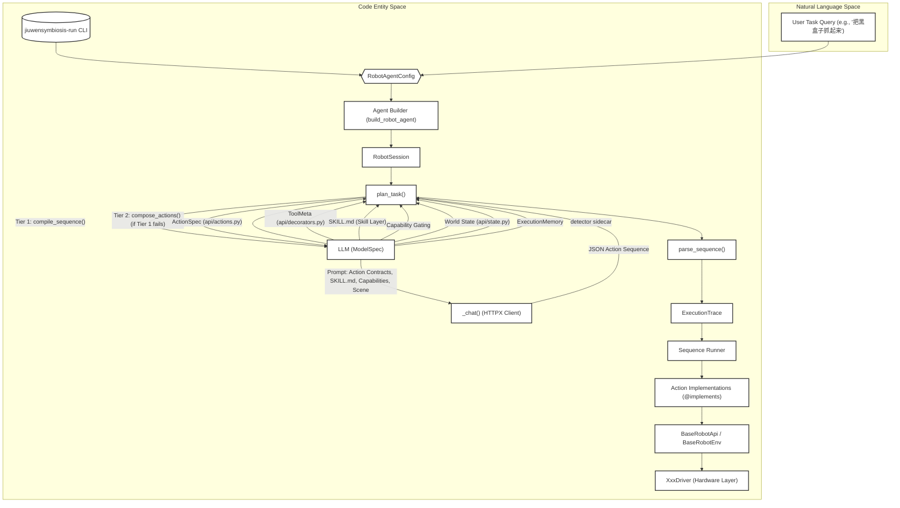
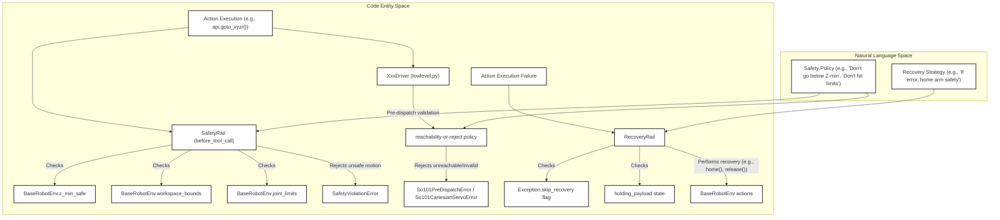

<!-- source: DeepWiki mcp.deepwiki.com · repo openJiuwen-ai/jiuwensymbiosis · page 9 Glossary · fetched 2026-11-02 -->

# Glossary

Relevant source files

The following files were used as context for generating this wiki page:

- [.claude/rules/code-style.md](.claude/rules/code-style.md)
- [.claude/rules/security.md](.claude/rules/security.md)
- [.claude/rules/testing.md](.claude/rules/testing.md)
- [AGENTS.md](AGENTS.md)
- [CLAUDE.md](CLAUDE.md)
- [jiuwensymbiosis/adapters/so101/lowlevel.py](jiuwensymbiosis/adapters/so101/lowlevel.py)
- [jiuwensymbiosis/agent/fast/planner.py](jiuwensymbiosis/agent/fast/planner.py)
- [jiuwensymbiosis/agent/fast/realtime/mask_tracking.py](jiuwensymbiosis/agent/fast/realtime/mask_tracking.py)
- [jiuwensymbiosis/agent/fast/sequence.py](jiuwensymbiosis/agent/fast/sequence.py)
- [scripts/cruzr/dual_arm_grasp_bringup.py](scripts/cruzr/dual_arm_grasp_bringup.py)
- [scripts/new_adapter/render.py](scripts/new_adapter/render.py)
- [scripts/validate_adapter.py](scripts/validate_adapter.py)
- [templates/xxx_adapter/calibration.py](templates/xxx_adapter/calibration.py)
- [templates/xxx_adapter/env.py](templates/xxx_adapter/env.py)
- [tests/unit_tests/adapters/so101/test_lowlevel.py](tests/unit_tests/adapters/so101/test_lowlevel.py)
- [tests/unit_tests/fast/test_compiler.py](tests/unit_tests/fast/test_compiler.py)
- [tests/unit_tests/fast/test_sequence.py](tests/unit_tests/fast/test_sequence.py)
- [tests/unit_tests/test_layering.py](tests/unit_tests/test_layering.py)

This page provides definitions for codebase-specific terms used within the `jiuwensymbiosis` framework. Each term includes a brief explanation, its role in the system, and pointers to relevant files for further technical detail.

## ActionSpec
`ActionSpec` is a core concept representing a shared action vocabulary across different robot bodies. It defines the contract for an action, including its name, parameters, expected results, preconditions (`requires`), and effects (`provides`, `invalidates`). This allows the framework to adapt to various robot configurations by providing a consistent interface for planning and execution.
[AGENTS.md:13-14]()

Sources:
* [AGENTS.md:13-14]()

## ToolMeta
`ToolMeta` is metadata associated with an action, typically used by the planning system (e.g., LLMs) to understand the action's capabilities and constraints. It includes information like input parameters, result fields, preconditions, effects, and crucially, the `capability` required to execute the action. This metadata is rendered into the prompt for the planner, enabling it to select appropriate actions based on the robot's available capabilities.
[jiuwensymbiosis/agent/fast/planner.py:72-77]()

Sources:
* [jiuwensymbiosis/agent/fast/planner.py:72-77]()

## Capability Gating
Capability gating is a mechanism that restricts the availability of actions or skills based on the robot's declared capabilities. Each action or skill can specify a `capability` it requires. The framework ensures that only actions whose required capabilities are present on the current robot are exposed to the planner or allowed to execute. This enables a single codebase to adapt to different robot form factors and hardware configurations.
[AGENTS.md:13-14]()

Sources:
* [AGENTS.md:13-14]()

## @implements
The `@implements` decorator is used in the API layer of an adapter to bind a specific action from the shared `ActionSpec` vocabulary to its implementation for that particular robot. This decorator ensures that the adapter explicitly declares which actions it supports and how they are implemented.
[AGENTS.md:102]()

Sources:
* [AGENTS.md:102]()

## SafetyRail
`SafetyRail` is a component within the agent's rail system responsible for enforcing safety policies during execution. It acts as a `before_tool_call` hook, performing checks before any tool (action) is executed. This rail reads safety boundaries like `z_min_safe` and `workspace_bounds` from the environment to prevent unsafe motions.
[AGENTS.md:99]()

Sources:
* [AGENTS.md:99]()

## RecoveryRail
`RecoveryRail` is another critical component of the agent's rail system, specifically designed to handle failures and attempt recovery. It is payload-aware, meaning its recovery strategy can adapt based on whether the robot is currently holding an object. It prevents unconditional homing or releasing of objects if another layer has already handled the failure.
[AGENTS.md:99]()
[CLAUDE.md:30-31]()

Sources:
* [AGENTS.md:99]()
* [CLAUDE.md:30-31]()

## TraceRail
`TraceRail` is an optional rail that captures execution traces. It operates in parallel to other rails and forwards `WARNING` and higher-level log records from specified loggers into the active execution trace. This allows for detailed post-mortem analysis and debugging, including rail warnings and detector failures.
[AGENTS.md:99]()

Sources:
* [AGENTS.md:99]()

## ExecutionTrace
An `ExecutionTrace` is a detailed record of an agent's execution, typically stored in JSON format. It contains frames of observations, actions, and events that occurred during a task run. This trace can be replayed for debugging, analysis, and generating HTML reports.
[AGENTS.md:99]()

Sources:
* [AGENTS.md:99]()

## ExecutionMemory
`ExecutionMemory` refers to the agent's ability to store and retrieve information relevant to the current task execution. While not explicitly defined as a single class in the provided snippets, it encompasses concepts like `WorldState` and the context maintained across action calls, allowing the agent to make informed decisions.

Sources:
* [jiuwensymbiosis/agent/fast/planner.py:1-157]()

## Fast Path C1
The "fast path C1" refers to the first tier of the two-tier task planning system. In this tier, the LLM both *picks* the skills and *expands* them into a flat action sequence in a single inference call. This path is designed for common tasks where skills are already defined in `SKILL.md`, aiming for efficiency by minimizing LLM interactions.
[jiuwensymbiosis/agent/fast/planner.py:4-9]()

Sources:
* [jiuwensymbiosis/agent/fast/planner.py:4-9]()

## LoopStep
`LoopStep` is a construct used within action sequences, likely for defining iterative or conditional execution blocks. While not explicitly detailed in the provided snippets, its presence in the context of sequence validation and planning suggests it enables more complex control flow within the otherwise flat action sequences.
[jiuwensymbiosis/agent/fast/planner.py:4-9]()

Sources:
* [jiuwensymbiosis/agent/fast/planner.py:4-9]()

## track_detect / track_grasp
`track_detect` and `track_grasp` are special operations or actions related to real-time visual tracking.
*   `track_detect`: Likely involves detecting an object and continuously tracking its pose.
*   `track_grasp`: Implies detecting an object and then actively tracking it while performing a grasping motion. These are often handled by specialized real-time components like `BackgroundTracker` and `MaskTargetFilter`.
[tests/unit_tests/fast/test_compiler.py:28-31]()
[tests/unit_tests/fast/test_compiler.py:33-36]()

Sources:
* [tests/unit_tests/fast/test_compiler.py:28-31]()
* [tests/unit_tests/fast/test_compiler.py:33-36]()

## ServoBinding
`ServoBinding` refers to the configuration or state that links a servo-controlled motion (e.g., a joint or end-effector) to its target. In the context of real-time servoing, it would define how a desired pose or joint configuration is translated into low-level motor commands.

Sources:
* [jiuwensymbiosis/adapters/so101/lowlevel.py:160-170]()

## MaskTargetFilter
`MaskTargetFilter` is a component likely used in conjunction with visual perception and tracking. It probably filters or refines target detections based on mask information, helping to maintain robust tracking of objects, especially in dynamic environments or when objects are partially occluded.

Sources:
* [jiuwensymbiosis/agent/fast/realtime/mask_tracking.py]()

## Eye-in-hand vs Eye-to-hand
These terms describe camera configurations in robotics:
*   **Eye-in-hand**: The camera is mounted on the robot's end-effector (hand). This provides a close-up view of the workspace and is useful for precise manipulation tasks. Calibration for this setup involves determining the camera's transform relative to the end-effector.
*   **Eye-to-hand**: The camera is fixed in the environment, observing the robot's workspace from a distance. This provides a broader view and is useful for scene understanding and global planning. Calibration involves determining the camera's transform relative to the robot's base.
[AGENTS.md:69-70]()

Sources:
* [AGENTS.md:69-70]()

## z_min_safe
`z_min_safe` is a safety parameter defining the minimum safe Z-coordinate (height) for the robot's end-effector. This value is typically read from the robot's configuration and is used by the `SafetyRail` to prevent the robot from colliding with the workspace surface or other objects below a certain height.
[templates/xxx_adapter/env.py:137-142]()

Sources:
* [templates/xxx_adapter/env.py:137-142]()

## holding_payload
`holding_payload` is a boolean flag or state indicating whether the robot is currently grasping or holding an object. This state is crucial for `RecoveryRail` to implement payload-aware recovery strategies, preventing accidental drops or unsafe movements when an object is being held.
[CLAUDE.md:30-31]()

Sources:
* [CLAUDE.md:30-31]()

## skip_recovery
`skip_recovery` is a flag that can be set on certain exceptions or error types. When `skip_recovery` is `True` for an exception, it signals to the `RecoveryRail` that a specific recovery action (e.g., homing the arm) should be bypassed. This is useful for errors where the arm might still be in a safe state, and a full recovery is unnecessary or counterproductive.
[jiuwensymbiosis/adapters/so101/lowlevel.py:115-116]()
[jiuwensymbiosis/adapters/so101/lowlevel.py:147]()

Sources:
* [jiuwensymbiosis/adapters/so101/lowlevel.py:115-116]()
* [jiuwensymbiosis/adapters/so101/lowlevel.py:147]()

## reachability-or-reject
`reachability-or-reject` describes a policy where any motion target that is kinematically unreachable or violates soft limits is rejected *before* the first hardware command is sent. This prevents the robot from attempting impossible or unsafe movements and ensures that the command path only receives valid targets.
[jiuwensymbiosis/adapters/so101/lowlevel.py:19-20]()

Sources:
* [jiuwensymbiosis/adapters/so101/lowlevel.py:19-20]()

## BaseRobotEnv / BaseRobotApi
*   **`BaseRobotEnv`**: This is the single hardware contract that all robot adapters must implement. It defines the fundamental interface for connecting/disconnecting from hardware, observing the robot's state, and performing basic actions like homing. It exposes `capabilities` that the specific robot supports.
    [AGENTS.md:103]()
    [templates/xxx_adapter/env.py:21]()
*   **`BaseRobotApi`**: This defines the shared action vocabulary that the agent interacts with. Adapter-specific API implementations (`XxxApi`) inherit from `BaseRobotApi` and use the `@implements` decorator to provide concrete implementations for the actions.
    [AGENTS.md:102]()

Sources:
* [AGENTS.md:102]()
* [AGENTS.md:103]()
* [templates/xxx_adapter/env.py:21]()

## RobotSession
`RobotSession` manages the lifecycle of an agent's interaction with the robot and its environment. It orchestrates the connection and disconnection of the robot, manages the detector sidecar, and provides the context for running tasks.
[AGENTS.md:48]()

Sources:
* [AGENTS.md:48]()

## Detector Sidecar
The `detector sidecar` is a separate process or service responsible for running perception models (e.g., GroundingDINO + SAM2) for object detection. It communicates with the main agent process, providing scene information and object detections. `RobotSession` is responsible for its startup, failure cleanup, and shutdown.
[AGENTS.md:48]()
[CLAUDE.md:47-49]()

Sources:
* [AGENTS.md:48]()
* [CLAUDE.md:47-49]()

## SKILL.md
`SKILL.md` files contain markdown-formatted definitions of high-level skills. These skills are composed of sequences of actions and can include capability-conditioned branches. The planning system (specifically the fast path C1) uses these definitions to compile action sequences for common tasks.
[AGENTS.md:101]()

Sources:
* [AGENTS.md:101]()

## Adapter Scaffolding
`Adapter scaffolding` refers to the process and tools used to generate the initial file structure and boilerplate code for a new robot adapter. The `scripts/new_adapter/render.py` script is used to create these templates, which include `SENTINEL` markers to guide the developer in replacing mock implementations with real hardware logic. The `scripts/validate_adapter.py` tool then checks the generated and modified adapter for compliance with framework conventions.
[scripts/new_adapter/render.py:11-12]()
[scripts/validate_adapter.py:1-24]()

Sources:
* [scripts/new_adapter/render.py:11-12]()
* [scripts/validate_adapter.py:1-24]()

### Diagram: Natural Language Space to Code Entity Space - Planning

Sources:
* [jiuwensymbiosis/agent/fast/planner.py:4-9]()
* [jiuwensymbiosis/agent/fast/planner.py:72-77]()
* [AGENTS.md:13-14]()
* [AGENTS.md:48]()
* [AGENTS.md:101]()
* [AGENTS.md:102]()
* [AGENTS.md:103]()
* [tests/unit_tests/fast/test_compiler.py:1-10]()

### Diagram: Natural Language Space to Code Entity Space - Safety and Recovery

Sources:
* [jiuwensymbiosis/adapters/so101/lowlevel.py:19-20]()
* [jiuwensymbiosis/adapters/so101/lowlevel.py:115-116]()
* [jiuwensymbiosis/adapters/so101/lowlevel.py:147]()
* [AGENTS.md:99]()
* [CLAUDE.md:30-31]()
* [templates/xxx_adapter/env.py:137-142]()