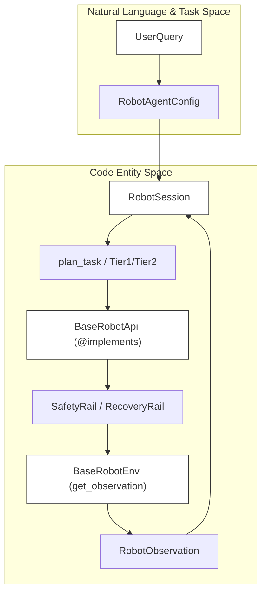
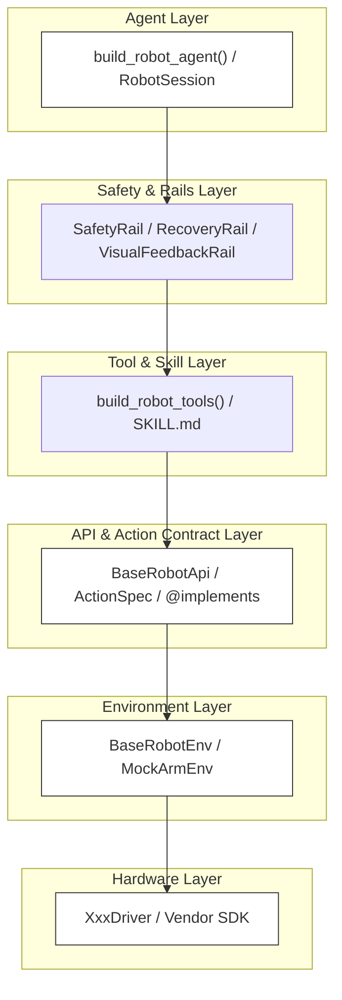
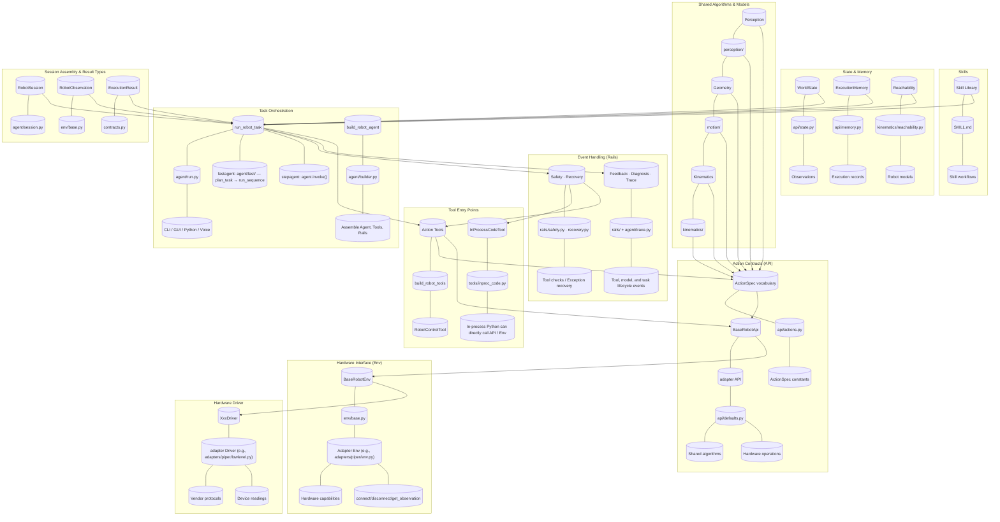
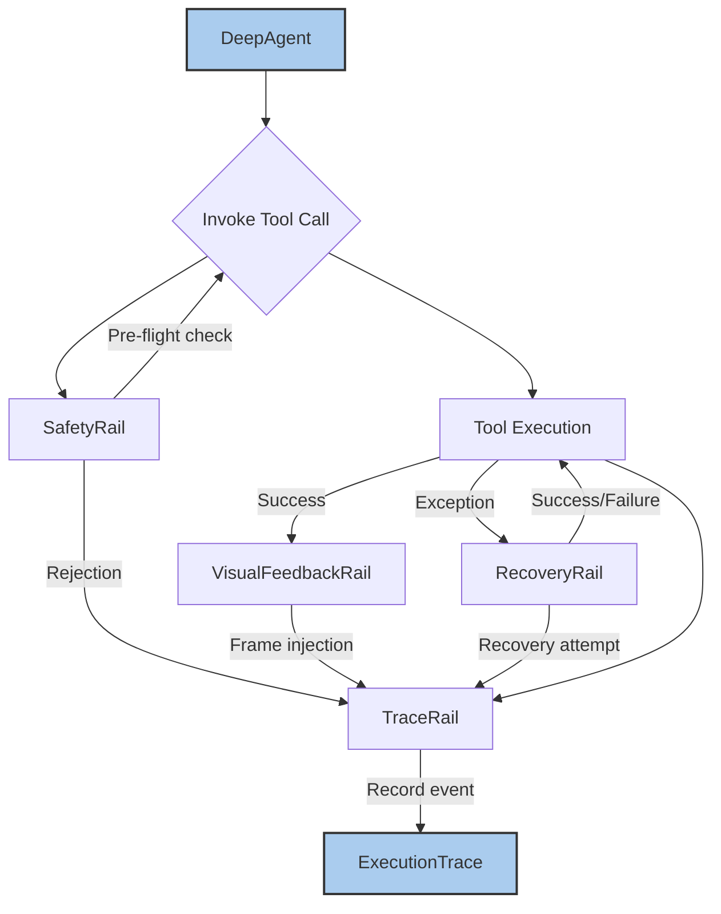

# Page: Overview

# Overview

<details>
<summary>Relevant source files</summary>

The following files were used as context for generating this wiki page:

- [.gitignore](.gitignore)
- [AGENTS.md](AGENTS.md)
- [Open_Source_Software_Notice.txt](Open_Source_Software_Notice.txt)
- [README.md](README.md)
- [docs/images/architecture-dependencies.en.svg](docs/images/architecture-dependencies.en.svg)
- [docs/images/architecture-dependencies.zh.svg](docs/images/architecture-dependencies.zh.svg)
- [docs/images/architecture-layers.en.svg](docs/images/architecture-layers.en.svg)
- [docs/images/architecture-layers.zh.svg](docs/images/architecture-layers.zh.svg)
- [docs/images/architecture-task-sequence.en.svg](docs/images/architecture-task-sequence.en.svg)
- [docs/images/architecture-task-sequence.zh.svg](docs/images/architecture-task-sequence.zh.svg)
- [jiuwensymbiosis/gui/__main__.py](jiuwensymbiosis/gui/__main__.py)
- [jiuwensymbiosis/gui/assets/app_icon.png](jiuwensymbiosis/gui/assets/app_icon.png)
- [pyproject.toml](pyproject.toml)
- [requirements.txt](requirements.txt)
- [scripts/cruzr/dual_arm_grasp_bringup.py](scripts/cruzr/dual_arm_grasp_bringup.py)
- [scripts/new_adapter/render.py](scripts/new_adapter/render.py)
- [scripts/validate_adapter.py](scripts/validate_adapter.py)
- [templates/xxx_adapter/calibration.py](templates/xxx_adapter/calibration.py)
- [templates/xxx_adapter/env.py](templates/xxx_adapter/env.py)
- [tests/unit_tests/test_layering.py](tests/unit_tests/test_layering.py)

</details>


`jiuwensymbiosis` is an embodied-agent framework built on top of `openjiuwen` designed to adapt a single safe, auditable Agent workflow across diverse robot bodies [README.md:5-6](), [pyproject.toml:9](). By decoupling the high-level task planner and action vocabulary from low-level vendor SDKs via a capability-gated adapter pattern, the framework enables robust hardware-agnostic operation [README.md:9-11]().

Sources: `[README.md:5-6]`, `[pyproject.toml:9-15]`

---

## Perceive-Plan-Execute-Observe-Feedback Loop

The runtime architecture centers around a continuous execution cycle where the agent perceives the world state, plans action contracts (`ActionSpec`), executes commands through safety rails and tools, observes the resulting environment changes, and feeds diagnostic data back into memory [README.md:26]().


*Figure 1: Perceive-Plan-Execute-Observe-Feedback loop mapped to core code entities.*

Sources: `[README.md:26-26]`, `[AGENTS.md:97-105]`

---

## Layered Architecture

The framework enforces strict layering from high-level agent constructs down to hardware drivers. Commands flow top-down while observations, errors, and traces propagate bottom-up [AGENTS.md:95-105](). Algorithmic packages like `perception/` and `motion/` reside strictly below the `api/` layer to prevent circular dependencies, validated by architectural tests [tests/unit_tests/test_layering.py:4-10]().


*Figure 2: Layered architecture mapping capability gates and control flow.*

For deep technical specifications on capability gating, boundary checks, and enforcement testing, see [Layered Architecture](#1.2).

Sources: `[AGENTS.md:97-105]`, `[tests/unit_tests/test_layering.py:4-44]`

---

## Repository Structure & Subsystems

The codebase is organized into modular packages separating agents, APIs, environment bindings, physical adapters, user interfaces, and calibration routines:

| Directory / Module | Core Responsibility |
| --- | --- |
| `jiuwensymbiosis/adapters/` | Hardware-specific implementations (`piper`, `so101`, `cruzr`) and shared commons (`_common`) [README.md:75-77](), [pyproject.toml:108-111]() |
| `jiuwensymbiosis/api/` | Shared action vocabulary (`ActionSpec`), state definitions, and `@implements` mixins [README.md:9](), [AGENTS.md:13]() |
| `jiuwensymbiosis/env/` | Single hardware abstraction contract (`BaseRobotEnv`, `RobotObservation`) [AGENTS.md:103]() |
| `jiuwensymbiosis/motion/` & `perception/` | Body-agnostic kinematics, trajectory planning, and vision pipelines [README.md:18]() |
| `jiuwensymbiosis/gui/` | NiceGUI browser-based application shell and run engine [AGENTS.md:55-66](), [pyproject.toml:72-77]() |
| `jiuwensymbiosis/calibration/` | Hand-eye calibration workflows (`eye-in-hand` vs `eye-to-hand`) [pyproject.toml:78-85]() |
| `scripts/` | Validation scripts (`validate_adapter.py`), adapter generation, and bringup demos [AGENTS.md:39-41](), [scripts/cruzr/dual_arm_grasp_bringup.py:5-12]() |

Sources: `[README.md:9-18]`, `[pyproject.toml:72-111]`, `[AGENTS.md:39-66]`, `[scripts/cruzr/dual_arm_grasp_bringup.py:5-12]`

---

## Child Pages

For detailed documentation, refer to the following sub-pages:
- [Getting Started & Installation](#1.1) — Installation procedures, optional extras (`piper`, `so101`, `cruzr`, `voice`, `gui`, `calib`), runtime requirements, and quick-start guides [README.md:35-69](), [pyproject.toml:23-86]().
- [Layered Architecture](#1.2) — Detailed breakdown of Agent, Rails, Tools, Skill/API, Env, and Hardware layering, along with capability gating and architecture enforcement tests [AGENTS.md:93-105](), [tests/unit_tests/test_layering.py:4-44]().
- [CLI Entrypoints](#1.3) — Console scripts including `jiuwensymbiosis-run`, replay utilities, GUI startup, state/action introspection, and calibration CLIs [pyproject.toml:87-101](), [AGENTS.md:46-73]().

Sources: `[README.md:35-69]`, `[pyproject.toml:23-101]`, `[AGENTS.md:46-105]`, `[tests/unit_tests/test_layering.py:4-44]`

---

# Page: Getting Started & Installation

# Getting Started & Installation

<details>
<summary>Relevant source files</summary>

The following files were used as context for generating this wiki page:

- [.gitignore](.gitignore)
- [Open_Source_Software_Notice.txt](Open_Source_Software_Notice.txt)
- [README.md](README.md)
- [docs/zh/tutorial/01-quick-start.md](docs/zh/tutorial/01-quick-start.md)
- [examples/README.en.md](examples/README.en.md)
- [examples/README.md](examples/README.md)
- [jiuwensymbiosis/gui/__main__.py](jiuwensymbiosis/gui/__main__.py)
- [jiuwensymbiosis/gui/assets/app_icon.png](jiuwensymbiosis/gui/assets/app_icon.png)
- [pyproject.toml](pyproject.toml)
- [requirements.txt](requirements.txt)

</details>


This page provides comprehensive instructions for setting up the `jiuwensymbiosis` framework, including core installation, optional dependencies for various hardware and functionalities, system requirements, and quick-start tutorials with example traces.

## Requirements

The `jiuwensymbiosis` framework has specific system and software requirements to ensure proper operation [README.md:35-43]().

| Dependency | Version or requirement |
| :--------- | :--------------------- |
| Operating system | Ubuntu 22.04 (currently verified platform) [README.md:39]() |
| Python | `>=3.11,<3.14`; the SO-101 adapter requires Python 3.12 [README.md:40]() |
| Core | `openjiuwen>=0.1.13`; other versions follow `[project.dependencies]` in `pyproject.toml` [README.md:41]() |
| Vision/GPU | The `[full]` extra uses the CUDA 12.8 build of PyTorch 2.8.0 [README.md:42]() |
| Real hardware | Prepare the adapter's CAN/serial bus, camera, calibration, vendor SDK, and validated safety bounds [README.md:43]() |

Sources: [README.md:35-43]()

## Installation

To get started with `jiuwensymbiosis`, follow these steps to clone the repository, set up a Python environment, and install the core dependencies.

1.  **Clone the repository:**
    ```bash
    git clone https://gitcode.com/openJiuwen/jiuwensymbiosis.git
    cd jiuwensymbiosis
    ```
    [README.md:48-49]()

2.  **Create and activate a Conda environment:**
    ```bash
    conda create -n jiuwensymbiosis python=3.12
    conda activate jiuwensymbiosis
    ```
    Note that the SO-101 adapter specifically requires Python 3.12 [README.md:40]().

3.  **Install the core package in editable mode:**
    ```bash
    python -m pip install --upgrade pip
    python -m pip install -e .
    ```
    This installs the `jiuwensymbiosis` package and its core dependencies listed in `pyproject.toml` [pyproject.toml:14-21]() and `requirements.txt` [requirements.txt:7-19]().

Sources: [README.md:47-53](), [docs/zh/tutorial/01-quick-start.md:9-15](), [pyproject.toml:14-21](), [requirements.txt:7-19]()

### Optional Dependencies (Extras)

`jiuwensymbiosis` supports various optional features and hardware adapters through "extras" that can be installed as needed.

| Extra | Description | Installation Command |
| :---- | :---------- | :------------------- |
| `dev` | Development tools and testing utilities [pyproject.toml:24-32]() | `python -m pip install -e ".[dev]"` [README.md:55]() |
| `full` | Vision and GPU stack, including PyTorch with CUDA support [pyproject.toml:33-47]() | `python -m pip install -e ".[full]" --extra-index-url https://download.pytorch.org/whl/cu128` [README.md:65-66]() |
| `piper` | Piper SDK for the Piper robot adapter [pyproject.toml:48]() | `python -m pip install -e ".[piper]"` [README.md:56]() |
| `so101` | SO-101 / LeRobot adapter, requires Python 3.12 [pyproject.toml:57-61]() | `python -m pip install -e ".[so101]"` [README.md:57]() |
| `cruzr` | Cruzr dual-arm robot adapter, includes `pinocchio` for IK [pyproject.toml:49-55]() | `python -m pip install -e ".[cruzr]"` [README.md:58]() |
| `voice` | ASR and audio capture functionalities [pyproject.toml:62-71]() | `python -m pip install -e ".[voice]"` [README.md:59]() |
| `gui` | Browser-based graphical user interface [pyproject.toml:72-77]() | `python -m pip install -e ".[gui]"` [README.md:60]() |
| `calib` | Hand-eye calibration scripts and dependencies [pyproject.toml:78-85]() | `python -m pip install -e ".[calib]"` [README.md:61]() |

You can combine extras, for example: `python -m pip install -e ".[full,piper]"`. If `[full]` is included, always use the `--extra-index-url` for PyTorch CUDA.

Sources: [README.md:54-67](), [pyproject.toml:23-85](), [docs/zh/tutorial/01-quick-start.md:59-85]()

### Pinned Dependencies

For reproducibility, `requirements.txt` provides a list of pinned versions for direct runtime dependencies, including the vision/GPU stack [requirements.txt:1-24](). To install these specific versions and then the project without re-resolving dependencies:

```bash
python -m pip install -r requirements.txt
python -m pip install -e . --no-deps
```
[docs/zh/tutorial/01-quick-start.md:93-96]()

Sources: [requirements.txt:1-24](), [docs/zh/tutorial/01-quick-start.md:90-96]()

### Proxy Environment Cleanup

When writing custom Python entry points, it is crucial to clear proxy environment variables before importing `openjiuwen` or any module that indirectly imports it. This prevents interference with local vLLM and detection calls [docs/zh/tutorial/01-quick-start.md:45-46](). The built-in CLIs and examples already perform this step [docs/zh/tutorial/01-quick-start.md:56]().

```python
from jiuwensymbiosis.utils.proxy import clear_proxy_env

clear_proxy_env()

# Import openjiuwen or other JiuwenSymbiosis Agent modules below.
```
[docs/zh/tutorial/01-quick-start.md:48-54]()

The GUI entry point `jiuwensymbiosis.gui.__main__:main` also performs this cleanup at startup [jiuwensymbiosis/gui/__main__.py:148-149]().

Sources: [docs/zh/tutorial/01-quick-start.md:45-56](), [jiuwensymbiosis/gui/__main__.py:148-149]()

## Quick Start Tutorials

The `examples/run_task.py` script serves as a generic entry point for running tasks on different robots [examples/README.en.md:8-9](). It uses the `--config` argument to select the robot configuration (which specifies the adapter from the registry) and `--query` (or `--voice`) to provide the task [examples/README.en.md:9]().

### Running a Mock Agent (Hardware-Free)

You can run a mock agent for Piper without any physical hardware or GPU. This is useful for smoke testing the agent's wiring and task composition without actual robot interaction.

```bash
python examples/run_task.py \
  --config configs/piper/piper.yaml \
  --mock \
  --max-iter 1 \
  --no-visual-feedback \
  --workspace /tmp/jiuwensymbiosis-demo \
  --query "把黑色盒子放到白色盒子上面"
```
[docs/zh/tutorial/01-quick-start.md:20-27]()

This command uses `MockArmEnv` and `MockModelClient` to build a `RobotSession` and an Agent, loading built-in skills and tools, and executing a single model call without connecting to CAN, cameras, detection services, or model endpoints [docs/zh/tutorial/01-quick-start.md:30-32](). The `--mock` flag is currently only supported for Piper [docs/zh/tutorial/01-quick-start.md:33]().

The expected output will indicate that the task was skipped due to the mock model:
```text
"mock: no real model, task skipped"
```
The program should exit with code `0` [docs/zh/tutorial/01-quick-start.md:39-40]().

Sources: [docs/zh/tutorial/01-quick-start.md:18-40](), [examples/README.en.md:8-9]()

### Running on Real Hardware

Before running on real hardware, ensure you have completed hardware setup, calibration, detector service configuration, and safety boundary acceptance [examples/README.en.md:11]().

#### SO-101 Table-Top Pick and Place

The SO-101 adapter requires Python 3.12, LeRobot 0.6.x, motor calibration, and a valid eye-to-hand calibration [examples/README.en.md:14-15]().

1.  Edit `configs/so101/so101.yaml`. Set `safety_validated` to `false`, then fill in your serial port, camera serial, calibration paths, and local safety bounds. Only after validating limits, workspace, and E-stop, set `safety_validated` back to `true` [examples/README.en.md:17-19]().
2.  Run the task:
    ```bash
    python examples/run_task.py \
      --config configs/so101/so101.yaml \
      --query "Put the banana on the plate." \
      --api-key "$OPENJIUWEN_API_KEY"
    ```
    [examples/README.en.md:20-24]()

Sources: [examples/README.en.md:13-26](), [examples/README.md:13-26]()

#### Cruzr Mobile Dual-Arm Transport

The Cruzr adapter requires a ROS 2 (Jazzy) workspace, waist/head cameras, calibration, and a detector service [examples/README.en.md:28]().

1.  Edit `configs/cruzr/cruzr.yaml`. Keep `adapter: cruzr`. Fill in the ROS workspace path, camera topics, calibration file, URDF path, detector service address, and the orchestration LLM endpoint. Validate safety bounds [examples/README.en.md:30-31]().
2.  Before running, `source` the ROS + Cruzr workspace and start the detector service [examples/README.en.md:32]().
3.  Run the task:
    ```bash
    python examples/run_task.py \
      --config configs/cruzr/cruzr.yaml \
      --query "Carry the white box on top of the brown box to the white table with the banana on it." \
      --api-key "$OPENJIUWEN_API_KEY"
    ```
    [examples/README.en.md:33-37]()

To keep sensitive information (serial ports, keys) out of `git status`, copy your configuration to `configs/<robot>/<robot>.local.yaml` and edit that file. Files matching `*.local.yaml` are ignored by Git [examples/README.en.md:41-42]().

Sources: [examples/README.en.md:28-43](), [examples/README.md:28-43]()

## Examples Directory and Sample Traces

The `examples/` directory contains various scripts and configurations for running tasks.

### Generic Task Runner (`examples/run_task.py`)

This script is the primary entry point for executing tasks across different robot configurations. It allows specifying the robot configuration via `--config` and the task query via `--query` or `--voice` [examples/README.en.md:8-9](). The execution mode is determined by the `agent.exec_mode` field in the YAML configuration, defaulting to `fastagent` (compiled sequence without per-step LLM inference). For single-step debugging, `--stepagent` can be used [examples/README.en.md:9]().

Sources: [examples/README.en.md:8-9]()

### Sample Traces

The `sample_trace/` directory contains a sanitized trace JSON, an HTML replay, and step images. This is provided to help users understand the structure and artifacts of execution traces, rather than serving as a correctness baseline for robot behavior [examples/README.en.md:46-47]().

Sources: [examples/README.en.md:46-47](), [examples/README.md:45-47]()

## CLI Entrypoints

The `pyproject.toml` file defines several command-line interface (CLI) entry points for `jiuwensymbiosis` [pyproject.toml:87-101](). These CLIs provide direct access to various functionalities, including running tasks, replaying traces, GUI, and introspection of actions, skills, and state.

### CLI Overview

```mermaid
graph TD
    subgraph "User Interaction"
        A[User Command] --> B(jiuwensymbiosis-run)
        A --> C(jiuwensymbiosis-replay)
        A --> D(jiuwensymbiosis-gui)
        A --> E(jiuwensymbiosis-calibrate-hand-eye)
        A --> F(jiuwensymbiosis-calibrate-eye-in-hand)
        A --> G(jiuwensymbiosis-calibrate-eye-to-hand)
        A --> H(jiuwensymbiosis-actions)
        A --> I(jiuwensymbiosis-skills)
        A --> J(jiuwensymbiosis-state)
    end

    subgraph "Core Functionality"
        B --> K[jiuwensymbiosis.cli:run_task]
        C --> L[jiuwensymbiosis.cli:replay_main]
        D --> M[jiuwensymbiosis.gui.__main__:main]
        E --> N[scripts.calibrate.hand_eye_calib:main]
        F --> O[scripts.calibrate.eye_in_hand_calib:main]
        G --> P[scripts.calibrate.eye_to_hand_calib:main]
        H --> Q[jiuwensymbiosis.cli:actions_main]
        I --> R[jiuwensymbiosis.cli:skills_main]
        J --> S[jiuwensymbiosis.cli:state_main]
    end

    subgraph "Optional Features"
        M -- "Requires [gui] extra" --> T[NiceGUI]
        N -- "Requires [calib] extra" --> U[OpenCV, pyrealsense2]
        O -- "Requires [calib] extra" --> U
        P -- "Requires [calib] extra" --> U
    end

    K -- "Task Execution" --> "Robot Agent"
    L -- "Trace Visualization" --> "ExecutionTrace"
    M -- "Web UI" --> "Agent State"
    Q -- "Action Contract Introspection" --> "api/actions.py"
    R -- "Skill Definition Introspection" --> "skills/**/SKILL.md"
    S -- "World State Introspection" --> "api/state.py"
```
**CLI Entrypoints and Their Corresponding Modules**

Sources: [pyproject.toml:87-101]()

### Specific CLIs

*   `jiuwensymbiosis-run`: Executes a task using the specified configuration and query. This maps to `jiuwensymbiosis.cli:run_task` [pyproject.toml:88]().
*   `piper-pick-demo`: An alias for `jiuwensymbiosis-run`, specifically for Piper pick-and-place demonstrations [pyproject.toml:89]().
*   `jiuwensymbiosis-replay`: Replays an `ExecutionTrace` from a saved trace file. This maps to `jiuwensymbiosis.cli:replay_main` [pyproject.toml:90]().
*   `jiuwensymbiosis-gui`: Launches the NiceGUI-based graphical user interface. This maps to `jiuwensymbiosis.gui.__main__:main` [pyproject.toml:91]().
*   `jiuwensymbiosis-calibrate-hand-eye`, `jiuwensymbiosis-calibrate-eye-in-hand`, `jiuwensymbiosis-calibrate-eye-to-hand`: These CLIs are for performing various hand-eye calibration workflows, mapping to scripts in `scripts.calibrate` [pyproject.toml:94-96](). They require the `[calib]` extra [pyproject.toml:78-85]().
*   `jiuwensymbiosis-actions`: Introspects available action contracts. This maps to `jiuwensymbiosis.cli:actions_main` [pyproject.toml:98]().
*   `jiuwensymbiosis-skills`: Introspects defined skills. This maps to `jiuwensymbiosis.cli:skills_main` [pyproject.toml:99]().
*   `jiuwensymbiosis-state`: Introspects the current world state. This maps to `jiuwensymbiosis.cli:state_main` [pyproject.toml:100]().

Sources: [pyproject.toml:87-101]()

---

# Page: Layered Architecture

# 1.2. Layered Architecture

<details>
<summary>Relevant source files</summary>

The following files were used as context for generating this wiki page:

- [AGENTS.md](AGENTS.md)
- [docs/en/explanation/architecture.md](docs/en/explanation/architecture.md)
- [docs/en/reference/cli.md](docs/en/reference/cli.md)
- [docs/images/architecture-modules.en.svg](docs/images/architecture-modules.en.svg)
- [docs/images/architecture-modules.zh.svg](docs/images/architecture-modules.zh.svg)
- [docs/images/architecture-perception.en.svg](docs/images/architecture-perception.en.svg)
- [docs/images/architecture-perception.zh.svg](docs/images/architecture-perception.zh.svg)
- [docs/images/architecture-planning.en.svg](docs/images/architecture-planning.en.svg)
- [docs/zh/explanation/architecture.md](docs/zh/explanation/architecture.md)
- [docs/zh/reference/cli.md](docs/zh/reference/cli.md)
- [scripts/cruzr/dual_arm_grasp_bringup.py](scripts/cruzr/dual_arm_grasp_bringup.py)
- [scripts/new_adapter/render.py](scripts/new_adapter/render.py)
- [scripts/validate_adapter.py](scripts/validate_adapter.py)
- [templates/xxx_adapter/calibration.py](templates/xxx_adapter/calibration.py)
- [templates/xxx_adapter/env.py](templates/xxx_adapter/env.py)
- [tests/unit_tests/test_layering.py](tests/unit_tests/test_layering.py)

</details>


This page details the layered architecture of the `jiuwensymbiosis` framework, focusing on the Agent → Rails → Tools → Skill/API → Env → Hardware layering. It explains how capability gating is enforced and how the architecture is tested. Architecture diagrams are included to illustrate the relationships between components.

The `jiuwensymbiosis` framework is designed with a layered architecture to promote modularity, reusability, and maintainability. This structure separates concerns, allowing different parts of the system to evolve independently while adhering to well-defined interfaces. The core design principle is a shared action vocabulary (`ActionSpec`) coupled with capability gating, enabling a single codebase to adapt to various robot form factors through a consistent contract per action and per-body `@implements` bindings [AGENTS.md:12-14]().

## Architecture Overview

The framework is organized into seven conceptual layers, with data and commands typically flowing top-down, and observations flowing bottom-up [AGENTS.md:93-95]().

```mermaid
graph TD
    subgraph "Top-Down Flow (Commands)"
        AgentLayer[("Agent Layer: RobotSession + build_robot_agent() + RobotAgentConfig")]
        SafetyRails[("Safety Rails: SafetyRail / RecoveryRail / VisualFeedbackRail / SkillUseRail")]
        ToolLayer[("Tool Layer: build_robot_tools(api) | RobotControlTool(api) | InProcessCodeTool")]
        SkillLayer[("Skill Layer: SKILL.md docs (visual_pick, visual_place, transport)")]
        APILayer[("API Layer: ActionSpec vocabulary (api/actions.py) + mixins implementing it (@implements)")]
        EnvLayer[("Env Layer: BaseRobotEnv — the SINGLE hardware contract (connect/disconnect/observe)")]
        HardwareLayer[("Hardware Layer: XxxDriver — adapter author's main work (serial/CAN/socket)")]
    end

    subgraph "Bottom-Up Flow (Observations)"
        HardwareLayer --> EnvLayer
        EnvLayer --> APILayer
        APILayer --> SkillLayer
        SkillLayer --> ToolLayer
        ToolLayer --> SafetyRails
        SafetyRails --> AgentLayer
    end

    AgentLayer --> SafetyRails
    SafetyRails --> ToolLayer
    ToolLayer --> SkillLayer
    SkillLayer --> APILayer
    APILayer --> EnvLayer
    EnvLayer --> HardwareLayer
```


**Title: Conceptual Layered Architecture**
Sources: [AGENTS.md:93-105]()

### Layer Responsibilities

Each layer has distinct responsibilities:

*   **Agent Layer**: Orchestrates tasks, manages the robot session, and configures the agent [docs/en/explanation/architecture.md:13-13](). Key components include `RobotSession`, `build_robot_agent()`, and `RobotAgentConfig` [AGENTS.md:98]().
*   **Safety Rails**: Intercepts actions and events to enforce safety policies, perform recovery, and collect diagnostic information. These are not a strict serial layer but hooks that trigger on specific events [docs/en/explanation/architecture.md:20-22](). Examples include `SafetyRail`, `RecoveryRail`, `VisualFeedbackRail`, `SkillUseRail`, and `TraceRail` [AGENTS.md:99]().
*   **Tool Layer**: Exposes robot capabilities as tools to the agent. This layer includes `build_robot_tools`, `RobotControlTool`, and `InProcessCodeTool` [docs/en/explanation/architecture.md:15-15]().
*   **Skill Layer**: Defines high-level robot skills, often described in `SKILL.md`, which are composed of sequences of actions [AGENTS.md:101]().
*   **API Layer**: Defines the shared action vocabulary (`ActionSpec`) and provides the interface for implementing these actions. It uses `@implements` decorators to bind actions to specific robot capabilities [AGENTS.md:102]().
*   **Env Layer**: Provides a single, hardware-agnostic contract (`BaseRobotEnv`) for interacting with the robot's environment, handling connection, disconnection, and observation [AGENTS.md:103]().
*   **Hardware Layer**: Contains the low-level drivers (`XxxDriver`) that interface directly with the physical robot hardware [AGENTS.md:104]().

Sources: [AGENTS.md:98-104](), [docs/en/explanation/architecture.md:13-22]()

### Module Ownership and Cross-Layer Relations

The following diagram illustrates how these conceptual layers map to specific code modules and their relationships.


**Title: Module Ownership and Cross-Layer Relations**
Sources: [docs/en/explanation/architecture.md:26-32](), [docs/images/architecture-modules.en.svg](), [docs/images/architecture-modules.zh.svg]()

## Capability Gating

Capability gating is a fundamental mechanism that allows the framework to adapt to different robot hardware while maintaining a unified action vocabulary. It ensures that only actions supported by the specific robot's hardware are exposed and executable.

### `BaseRobotEnv` and Capabilities

The `BaseRobotEnv` class, defined in `jiuwensymbiosis/env/base.py`, is the single hardware contract [docs/en/explanation/architecture.md:59](). Each concrete environment implementation (e.g., `XxxEnv`) declares its supported capabilities as a `frozenset` of strings [templates/xxx_adapter/env.py:29-31](). These capabilities describe various aspects of the robot, such as motion types, grasping mechanisms, and vision features.

For example, a mock arm environment might declare:
```python
capabilities = frozenset({
    "motion.cartesian", "motion.servo", "grasp.parallel",
    "vision.camera", "vision.detection",
})
```
Sources: [docs/en/explanation/architecture.md:60-67](), [templates/xxx_adapter/env.py:29-51]()

The full list of known capabilities is defined in `jiuwensymbiosis.env.base.KNOWN_CAPABILITIES` [scripts/validate_adapter.py:46](). These capabilities are categorized as follows:

| Capability String | Meaning |
|---|---|
| `motion.cartesian` | End-effector pose motion in the base coordinate system |
| `motion.joint` | Joint-space motion |
| `motion.servo` | Non-blocking streaming pose commands |
| `motion.base` | Relative motion of a planar mobile base; currently supports differential drive, not strafing |
| `motion.base_servo` | Non-blocking continuous base drive |
| `motion.lift` | Vertical torso/lifter position control |
| `motion.waist` | Torso yaw rotation |
| `motion.goal` | Drive to a target area via navigation interface |
| `motion.dual_arm` | Coordinated motion of two arms; end-effector type declared separately by `grasp.*` |
| `grasp.suction` | Suction cup control |
| `grasp.parallel` | Parallel gripper control |
| `grasp.paddle` | Clamping with two flat plates |
| `vision.camera` | Image acquisition |
| `vision.depth` | Depth acquisition |
| `vision.detection` | Object detection |
| `vision.eye_to_hand` | Hand-eye geometry using a fixed camera |
| `vision.search` | Target search; whether the robot moves is determined by the specific action |
| `planning.reachability` | Reachability check based on robot model; derived from implementation and model |
| `sorting.command` | Device-specific sorting protocol |
| `speech.tts` | Text-to-speech |

Sources: [docs/zh/explanation/architecture.md:82-107]()

### `ActionSpec` and `@implements`

The API layer defines action contracts using `ActionSpec` (defined in `api/decorators.py`) and instances in `api/actions.py` [docs/zh/explanation/architecture.md:115-116](). The `@implements(SPEC)` decorator is used to bind a method in a robot's API implementation to a shared `ActionSpec` [docs/zh/explanation/architecture.md:117-118](). This decorator attaches `ToolMeta` metadata, which includes the action's name, capability requirements, parameters, result type, preconditions, and effects.

For example, a `CruzrApi` might implement `search_target` by forwarding to a shared default implementation:
```python
class CruzrApi(BaseRobotApi):
    @implements(SEARCH_TARGET)
    def search_target(self, object_name: str = "box", reference: str | None = None,
                      relation: str = "on") -> dict:
        return defaults.search_target(self, object_name, reference, relation)
```
Sources: [docs/zh/explanation/architecture.md:120-127](), [scripts/cruzr/dual_arm_grasp_bringup.py:58-61]()

The `build_robot_tools` function then uses this metadata to create a set of available tools for the agent, filtering them based on the robot's declared capabilities [docs/en/explanation/architecture.md:15-15](). This ensures that the agent only attempts to use actions that the current robot hardware can perform.

### `validate_adapter.py`

The `scripts/validate_adapter.py` tool is crucial for enforcing capability gating and architectural compliance. It checks if an adapter's declared capabilities align with its implemented actions and driver methods [scripts/validate_adapter.py:21-22]().

The script performs various checks:
*   **Config/Env/Api Structure**: Ensures the adapter's configuration, environment, and API classes conform to framework conventions (ERROR severity) [scripts/validate_adapter.py:21]().
*   **Capability Declaration vs. Implementation**: Warns if capability declarations do not match action implementations (WARN severity) [scripts/validate_adapter.py:22]().
*   **Marked Capabilities/Optional Features**: Provides informational messages about declared capabilities and optional features (INFO severity) [scripts/validate_adapter.py:23]().

The tool imports `CAPABILITY_ACTIONS`, `CAPABILITY_DRIVER_MEMBERS`, and `KNOWN_CAPABILITIES` directly from the `jiuwensymbiosis` package to ensure consistency between the validator and the adapter generator (`scripts/new_adapter`) [scripts/validate_adapter.py:39-46]().

Sources: [scripts/validate_adapter.py:1-24](), [scripts/validate_adapter.py:39-46]()

## Layering Enforcement Tests

To prevent architectural violations, specific unit tests are in place to enforce layering rules. A key rule is that algorithm libraries like `perception/` and `motion/` should not import from the `api/` layer. This ensures that these low-level algorithms remain body-agnostic and can be composed by the API layer without creating circular dependencies.

The `tests/unit_tests/test_layering.py` module contains tests that check for these violations.
The `test_no_import_of_the_api_layer` function iterates through all Python files in the `perception/` and `motion/` directories [tests/unit_tests/test_layering.py:21-23](). For each file, it parses the abstract syntax tree (AST) to identify all imported modules [tests/unit_tests/test_layering.py:26-34](). If any imported module starts with `"jiuwensymbiosis.api"`, the test fails, indicating a layering violation [tests/unit_tests/test_layering.py:37-43]().

This test ensures that the `api/` layer composes these algorithm libraries through `api/defaults.py` and action implementations, rather than the algorithm libraries directly depending on the API [tests/unit_tests/test_layering.py:6-9](). Shared data structures needed by both layers are placed in `jiuwensymbiosis/contracts.py` to avoid import loops [tests/unit_tests/test_layering.py:9]().

Sources: [tests/unit_tests/test_layering.py:1-44]()

## Creating a New Adapter

The framework provides scaffolding and validation tools to simplify the creation of new hardware adapters.

### Adapter Scaffolding

The `scripts/new_adapter/render.py` script is used to generate boilerplate code for a new adapter based on a `Spec` [scripts/new_adapter/render.py:4](). This script generates mock adapter files (e.g., `config.py`, `env.py`, `api.py`, `session.py`) that include `SENTINEL` tags. These tags indicate sections where the user needs to replace mock implementations with real hardware-specific code [scripts/new_adapter/render.py:23]().

The generated `env.py` file, for instance, includes a placeholder `XxxEnv` class that extends `BaseRobotEnv` and declares a default set of capabilities [templates/xxx_adapter/env.py:22-51](). It also outlines the `connect()`, `disconnect()`, `get_observation()`, and `home()` methods, delegating to a mock `XxxDriver` [templates/xxx_adapter/env.py:61-67]().

Similarly, the generated `api.py` includes forwarders for generic actions, grouped by capabilities, ensuring that the adapter explicitly lists every action it offers [scripts/new_adapter/render.py:99-111]().

Sources: [scripts/new_adapter/render.py:4-23](), [templates/xxx_adapter/env.py:22-67](), [scripts/new_adapter/render.py:99-111]()

### Adapter Validation

After generating and implementing an adapter, the `scripts/validate_adapter.py` tool can be used to verify its compliance with the framework's architecture and conventions [AGENTS.md:39-41](). This tool checks for correct class structures, capability declarations, and method implementations, providing feedback on errors, warnings, and informational messages [scripts/validate_adapter.py:21-24]().

For calibration integration, a separate wrapper file (e.g., `jiuwensymbiosis/calibration/adapters/xxx.py`) is created. This wrapper exposes a `CALIBRATION_ADAPTER_SPEC` and handles machine-specific semantics like pose conversion and joint order, while generic plumbing is shared [templates/xxx_adapter/calibration.py:4-16](). The `validate_adapter.py` script also includes checks for calibration adapter conformance [templates/xxx_adapter/calibration.py:24]().

Sources: [AGENTS.md:39-41](), [scripts/validate_adapter.py:21-24](), [templates/xxx_adapter/calibration.py:4-24]()

---

# Page: CLI Entrypoints

# CLI Entrypoints

<details>
<summary>Relevant source files</summary>

The following files were used as context for generating this wiki page:

- [Makefile](Makefile)
- [docs/en/explanation/architecture.md](docs/en/explanation/architecture.md)
- [docs/en/how-to/use-tracing.md](docs/en/how-to/use-tracing.md)
- [docs/en/reference/cli.md](docs/en/reference/cli.md)
- [docs/zh/explanation/architecture.md](docs/zh/explanation/architecture.md)
- [docs/zh/how-to/use-tracing.md](docs/zh/how-to/use-tracing.md)
- [docs/zh/reference/cli.md](docs/zh/reference/cli.md)
- [jiuwensymbiosis/cli.py](jiuwensymbiosis/cli.py)
- [tests/unit_tests/test_cli_replay.py](tests/unit_tests/test_cli_replay.py)

</details>


This page details the command-line interface (CLI) entry points provided by the `jiuwensymbiosis` framework. These CLIs facilitate various operations, including running tasks, replaying execution traces, launching the graphical user interface, introspecting actions, skills, and world state, and performing hand-eye calibration.

Sources:
- [jiuwensymbiosis/cli.py]()
- [docs/en/reference/cli.md]()
- [docs/zh/reference/cli.md]()

## jiuwensymbiosis-run (Generic Task Runner)

The `jiuwensymbiosis-run` CLI is the primary entry point for executing robot tasks. It takes a configuration file and a task query as input.

```bash
jiuwensymbiosis-run --config configs/cruzr/cruzr.yaml --query "把箱子搬到桌上"
jiuwensymbiosis-run --config configs/piper/piper.yaml   --query "把瓶子放到左边"
```

The `--config` argument is mandatory and specifies the YAML configuration file for the robot. The `adapter:` field within this YAML selects the robot, which can be overridden by the `--robot` argument. The task itself is typically provided via the `--query` argument. If both `--query` and the optional `env.cfg.prompt` in the YAML are empty, the command will fail.

### Key Options

| Option | Effect |
|---|---|
| `--robot` | Overrides the `adapter:` field in the config (e.g., `piper`, `so101`, `cruzr`). |
| `--mock` | For Piper only: performs an in-memory dry run using `MockArmEnv` and an offline model. Implies `--stepagent`. |
| `--stepagent` | Forces a per-step LLM interaction, useful for single-step debugging. The default is `fastagent`, which compiles the plan once and avoids per-step LLM calls. |
| `--voice` / `--voice-text` / `--voice-audio-file` / `--voice-once` / `--no-wake` / `--tts` / `--asr-device` | Activates various voice interaction modes. |
| `--no-skill` | Disables the `SkillUseRail` and the `robot_control` dispatcher. |
| `--mode` | Sets the agent's operational mode: `tool`, `code`, or `hybrid`. |
| `--no-visual-feedback` | Disables the `VisualFeedbackRail`. |
| `--server-url` / `--model` / `--api-key` | Overrides the LLM endpoint, model, or API key. |
| `--max-iter` / `--workspace` / `--debug` | Configures the iteration limit, workspace directory, and logging level. |
| `--control-hz` / `--servo-step-mm` | Tunes the `fastagent` real-time servo parameters. |

The `piper-pick-demo` command is a back-compatibility alias for `jiuwensymbiosis-run`, pointing to the same underlying `run_task.py` script.

Sources:
- [docs/en/reference/cli.md:5-27]()
- [docs/zh/reference/cli.md:5-27]()
- [jiuwensymbiosis/cli.py:36-39]()
- [jiuwensymbiosis/cli.py:42-44]()

## jiuwensymbiosis-replay (Execution Trace Replayer)

The `jiuwensymbiosis-replay` CLI is used to visualize recorded execution traces. It can render traces as a plain-text timeline or a self-contained HTML page.

```bash
jiuwensymbiosis-replay TRACE_JSON [--open] [--text]
```

By default, it generates a self-contained HTML page (`{json_stem}.html`) in the same directory as the trace JSON. This HTML page embeds every step's frame as a base64 image, along with its parameters, errors, and rail events, making it portable. The path to the generated HTML is printed to the console. If the trace directory is not writable, it falls back to the system's temporary directory.

The `--open` flag automatically launches the generated HTML in the default web browser. The `--text` flag outputs a plain-text timeline to the terminal, showing frames only as paths.

### Implementation Details

The `replay` function [jiuwensymbiosis/cli.py:82-155]() handles the plain-text output. It loads the trace JSON using `_load_trace` [jiuwensymbiosis/cli.py:63-79]() and then iterates through the `entries` (tool-call steps) and `trace_log` to print a formatted timeline. It uses `_fmt_params` [jiuwensymbiosis/cli.py:56-61]() to format input parameters for display.

The `replay_html` function [jiuwensymbiosis/cli.py:158-191]() is responsible for generating the HTML output. It also uses `_load_trace` [jiuwensymbiosis/cli.py:63-79]() to load the trace data. It then calls `render_trace_html` from `jiuwensymbiosis.agent.trace_html` to produce the HTML string, which is written to a file. If `open_browser` is True, it uses `webbrowser.open` [jiuwensymbiosis/cli.py:170]() to open the generated HTML file.

### Trace File Structure

A trace JSON file contains:
- `conversation_id`: Identifier for the conversation.
- `robot_name`: Name of the robot.
- `query`: The task query.
- `entries`: A list of tool-call steps, each containing:
    - `step`: Step number.
    - `tool_name`: Name of the tool called.
    - `input_params`: Parameters passed to the tool.
    - `success`: Boolean indicating success or failure.
    - `duration_s`: Duration of the step.
    - `error`: Error message if the step failed.
    - `observation`: Snapshot of the robot's observation.
    - `frame_path`: Path to the visual frame associated with the step.
    - `rail_events`: Events from various Rails.
    - `log_events`: Log messages captured during the step.
- `trace_log`: General trace-level log messages.

Example of a text timeline output:
```
=== Execution Trace: conv-1_20260624_105551_693633_149333.json ===
robot=test_robot  conversation=conv-1
query: pick the red box

[  1] ✅ goto_xyzr({"x": 150, "y": 0, "z": 80})
       dur=0.80s
       pose: {'x': 150, 'y': 0, 'z': 80}
[  2] ❌ close_gripper({"force_n": 10})
       dur=1.20s
       error: ValueError: gripper timeout
       rail: [ok] RecoveryRail/recover {'home_ok': True, 'released_ok': True}
       log:  [WARNING] jiuwensymbiosis.rails.recovery: home() retried

2 step(s) recorded.
```

#### Replay CLI Data Flow
```mermaid
graph TD
    A[jiuwensymbiosis-replay CLI] --> B{Parse Arguments};
    B -- trace_path --> C[Call _load_trace(trace_path)];
    C -- Success --> D{Trace Data Loaded?};
    D -- Yes --> E{--text flag?};
    E -- Yes --> F[Call replay(data, path)];
    E -- No --> G[Call replay_html(data, path)];
    F --> H[Format and Print Text Timeline];
    G --> I[Call render_trace_html(data, path)];
    I --> J[Write HTML to File];
    J -- --open --> K[webbrowser.open(html_file)];
    D -- No --> L[Log Error and Exit 1];
    H --> M[Exit 0];
    K --> M;
    J --> M;
```
Sources:
- [jiuwensymbiosis/cli.py:47-191]()
- [docs/en/reference/cli.md:37-43]()
- [docs/zh/reference/cli.md:37-43]()
- [docs/en/how-to/use-tracing.md:134-141]()
- [docs/zh/how-to/use-tracing.md:93-125]()
- [tests/unit_tests/test_cli_replay.py:14-57]()

## jiuwensymbiosis-gui (Graphical User Interface)

The `jiuwensymbiosis-gui` command launches the NiceGUI-based graphical user interface.

```bash
jiuwensymbiosis-gui
# equivalent to
python -m jiuwensymbiosis.gui
```

This command starts a web server, typically listening on `127.0.0.1:8770`, and opens the UI in a browser. If required dependencies for the GUI are missing, a preflight check will prompt the user to install them (e.g., `.[gui]`).

Sources:
- [docs/en/reference/cli.md:45-53]()
- [docs/zh/reference/cli.md:45-53]()

## Hand-Eye Calibration CLIs

The `.[calib]` extra provides several CLI entry points for hand-eye calibration workflows. These tools are mount-neutral, meaning the camera mount type (eye-in-hand or eye-to-hand) is determined from the runtime configuration or an archive, not directly from the command line.

```bash
jiuwensymbiosis-calibrate-hand-eye --collect-poses OUTPUT --config RUNTIME_YAML [--import-poses INPUT]
jiuwensymbiosis-calibrate-hand-eye --auto WAYPOINT_ARCHIVE --config RUNTIME_YAML --confirm-estop
jiuwensymbiosis-calibrate-hand-eye --replay STATION_ARCHIVE [--config RUNTIME_YAML]
```

- `jiuwensymbiosis-calibrate-hand-eye`: This is the unified, mount-neutral entry point.
    - `--collect-poses OUTPUT [--import-poses INPUT]`: Collects poses. If `--import-poses` is used, it normalizes a self-describing waypoint archive into the specified `OUTPUT` without connecting to hardware.
    - `--auto WAYPOINT_ARCHIVE --confirm-estop`: Automatically performs calibration using a waypoint archive. Requires `--confirm-estop` for safety.
    - `--replay STATION_ARCHIVE`: Replays a calibration sequence from a station archive.

Specific CLIs for mount types:
- `jiuwensymbiosis-calibrate-eye-to-hand`: Runs the same flow as `calibrate-hand-eye` but strictly requires an `eye_to_hand` configuration.
- `jiuwensymbiosis-calibrate-eye-in-hand`: For archive modes (`--collect-poses`, `--replay`, or parameterized `--auto`), it strictly requires an `eye_in_hand` configuration. Other invocations use a legacy Piper wizard and issue a compatibility warning.

The exit codes for calibration CLIs are:
- `0`: Success or dry-run passed.
- `1`: Execution error.
- `2`: Preflight contract failure.
- `3`: Only an unloadable REVIEW/candidate report was produced.

The GUI's "Tools → Hand-eye calibration" wizard drives these same workflows and offers additional features like printable board PDF generation and live corner detection during teaching.

Sources:
- [docs/en/reference/cli.md:55-70]()
- [docs/zh/reference/cli.md:55-70]()

## Introspection Tools (jiuwensymbiosis-actions / -skills / -state)

These CLIs provide machine-readable views into the agent's capabilities, skill library, and current world state. They are crucial for understanding what actions are available, their preconditions, and the robot's perception of its environment.

```bash
jiuwensymbiosis-actions --vocabulary [--json]                       # shared action vocabulary (no robot)
jiuwensymbiosis-actions --config configs/cruzr/cruzr.yaml [--json]  # that vocabulary gated to one body
jiuwensymbiosis-skills  [--json]                                    # skill library + contracts
jiuwensymbiosis-state   --config configs/cruzr/cruzr.yaml [--json]  # live world state (connects!)
```

- `jiuwensymbiosis-actions`:
    - `--vocabulary`: Displays the shared action vocabulary, independent of any specific robot.
    - `--config <path_to_config.yaml>`: Shows the action vocabulary filtered and gated to the capabilities of the robot defined in the specified configuration.
    - `--json`: Outputs the information in JSON format.

- `jiuwensymbiosis-skills`:
    - Displays the skill library and their associated contracts.
    - `--json`: Outputs the information in JSON format.

- `jiuwensymbiosis-state`:
    - `--config <path_to_config.yaml>`: Connects to the robot defined in the configuration and displays its live world state. This command actively connects to hardware.
    - `--json`: Outputs the information in JSON format.

These tools provide the "machine-readable views a planner / coding agent reads" as described in the architecture guide, detailing "what an action is, what a skill's pre-conditions are, and where the current world stands."

#### Introspection CLI Data Flow
```mermaid
graph TD
    A[Introspection CLI] --> B{Command Type?};

    B -- jiuwensymbiosis-actions --> C[Load ActionSpecs];
    C -- --vocabulary --> D[Display All Action Vocabulary];
    C -- --config --> E[Filter Action Vocabulary by Robot Capabilities];
    D -- --json --> F[Output JSON];
    E -- --json --> F;
    D --> G[Output Human-Readable];
    E --> G;

    B -- jiuwensymbiosis-skills --> H[Load Skill Library & Contracts];
    H -- --json --> I[Output JSON];
    H --> J[Output Human-Readable];

    B -- jiuwensymbiosis-state --> K[Load RobotConfig];
    K --> L[Establish RobotSession];
    L --> M[Query Live WorldState];
    M -- --json --> N[Output JSON];
    M --> O[Output Human-Readable];
```
Sources:
- [docs/en/reference/cli.md:71-80]()
- [docs/zh/reference/cli.md:71-79]()
- [docs/en/explanation/architecture.md:1-68]()
- [docs/zh/explanation/architecture.md:1-68]()

## Makefile Targets

While not direct `console_scripts` entry points, the `Makefile` defines several targets that invoke Python scripts and tools, effectively acting as CLI entry points for development and testing workflows.

```makefile
# Usage:
#   make check           # ruff format --check + ruff check + mypy (staged files)
#   make check COMMITS=1 # same, on files changed in last 1 commit
#   make fix             # ruff format + ruff check --fix (staged files)
#   make type-check      # mypy only
#   make test            # pytest tests/unit_tests/
#   make test-all        # pytest (incl. integration)
```

These targets are used for code quality checks, formatting, type checking, and running tests. They often leverage `ruff`, `mypy`, and `pytest`. The `CONDA_ENV` variable can be used to specify the Conda environment for tool execution.

Sources:
- [Makefile:1-100]()

---

# Page: Agent Core

# Agent Core

<details>
<summary>Relevant source files</summary>

The following files were used as context for generating this wiki page:

- [jiuwensymbiosis/adapters/_common/builder.py](jiuwensymbiosis/adapters/_common/builder.py)
- [jiuwensymbiosis/agent/builder.py](jiuwensymbiosis/agent/builder.py)
- [jiuwensymbiosis/agent/cancel.py](jiuwensymbiosis/agent/cancel.py)
- [jiuwensymbiosis/agent/fast/realtime/tracking.py](jiuwensymbiosis/agent/fast/realtime/tracking.py)
- [jiuwensymbiosis/agent/run.py](jiuwensymbiosis/agent/run.py)
- [jiuwensymbiosis/agent/session.py](jiuwensymbiosis/agent/session.py)
- [jiuwensymbiosis/agent/trace.py](jiuwensymbiosis/agent/trace.py)
- [jiuwensymbiosis/perception/detector_sidecar.py](jiuwensymbiosis/perception/detector_sidecar.py)
- [tests/unit_tests/agent/test_builder_rails.py](tests/unit_tests/agent/test_builder_rails.py)
- [tests/unit_tests/agent/test_cancel.py](tests/unit_tests/agent/test_cancel.py)
- [tests/unit_tests/fast/test_cancellation.py](tests/unit_tests/fast/test_cancellation.py)

</details>


This page provides a high-level overview of how agents are constructed, their session lifecycle, configuration, and the various rails that govern their behavior. It serves as a parent page, linking to more detailed child pages for in-depth technical explanations.

The agent core is responsible for orchestrating the robot's actions, from interpreting high-level commands to executing low-level movements, while ensuring safety and providing feedback. It bridges the gap between natural language instructions and the robot's physical capabilities.

## Agent Construction & Configuration

The `build_robot_agent` function is the primary entry point for creating a `DeepAgent` instance tailored for robotics tasks [jiuwensymbiosis/agent/builder.py:44-45](). This function takes a `RobotSession` and a `RobotAgentConfig` to assemble the agent. The `RobotAgentConfig` dataclass [jiuwensymbiosis/agent/builder.py:31]() encapsulates various settings, including model selection, execution mode (`"stepagent"` for per-step LLM orchestration or `"fastagent"` for compiled sequences), and the activation of different rails.

The agent's workspace, where persistent data like traces and session information are stored, is resolved with a specific priority: explicit argument, environment variable (`JIUWENSYMBIOSIS_WORKSPACE`), user settings (`~/.jiuwensymbiosis/settings.json`), or a default path [jiuwensymbiosis/agent/builder.py:62-84]().

A central `_RailRegistry` manages the dynamic loading and activation of various rails based on the `RobotAgentConfig` flags and the `RobotSession`'s capabilities [jiuwensymbiosis/agent/builder.py:97-102](). This ensures that only relevant rails are enabled for a given robot setup. For details, see [Agent Builder & Configuration](#2.1).

### Agent Construction Flow
```mermaid
graph TD
    A[build_robot_agent(session, config)] --> B{Resolve Workspace};
    B --> C[RobotAgentConfig];
    C --> D{Build Model};
    C --> E{Get Enabled Rails};
    E --> F[_RailRegistry];
    F --> G{Check Flags & Capabilities};
    G --> H[Instantiate Rails];
    H --> I[Inject Trace Sinks];
    I --> J[Create DeepAgent];
    J --> K[DeepAgent Instance];

    style A fill:#ace,stroke:#333,stroke-width:2px;
    style K fill:#ace,stroke:#333,stroke-width:2px;
```
Sources:
- [jiuwensymbiosis/agent/builder.py:44-45]()
- [jiuwensymbiosis/agent/builder.py:31]()
- [jiuwensymbiosis/agent/builder.py:62-84]()
- [jiuwensymbiosis/agent/builder.py:97-102]()

## RobotSession & Task Run Loop

The `RobotSession` is a critical component that acts as a lifecycle container for a robot's environment, API, and any associated sidecar processes [jiuwensymbiosis/agent/session.py:4-15](). It manages the connection and disconnection of the hardware environment and the startup/shutdown of sidecars like the detector server. The session also holds a `CancelToken` [jiuwensymbiosis/agent/session.py:91-94]() which allows for graceful cancellation of ongoing tasks, particularly important for GUI-driven interactions.

The `run_robot_task` function [jiuwensymbiosis/agent/run.py:89-96]() serves as the unified entry point for executing tasks. It dispatches to either the `"stepagent"` mode (per-step LLM orchestration) or the `"fastagent"` mode (compiled action sequences) based on the `RobotAgentConfig.exec_mode`. The `"fastagent"` path, designed for efficiency, compiles a sequence of actions from a single LLM inference and then executes it without further LLM interaction [jiuwensymbiosis/agent/run.py:11-22](). For details, see [RobotSession & Task Run Loop](#2.2).

### RobotSession Lifecycle
```mermaid
graph TD
    A[RobotSession] --> B{__enter__ / connect()};
    B --> C[begin_run(motion_log_dir)];
    C --> D{Start Sidecars};
    D --> E[env.connect()];
    E --> F{Capability Validation};
    F --> G[RobotSession Connected];
    G --> H[Task Execution];
    H --> I{__exit__ / disconnect()};
    I --> J[env.disconnect()];
    J --> K[Stop Sidecars];
    K --> L[RobotSession Disconnected];

    style A fill:#ace,stroke:#333,stroke-width:2px;
    style G fill:#ace,stroke:#333,stroke-width:2px;
    style L fill:#ace,stroke:#333,stroke-width:2px;
```
Sources:
- [jiuwensymbiosis/agent/session.py:4-15]()
- [jiuwensymbiosis/agent/session.py:91-94]()
- [jiuwensymbiosis/agent/run.py:89-96]()
- [jiuwensymbiosis/agent/run.py:11-22]()

## Safety & Execution Rails

Rails are modular components that intercept and modify the agent's behavior at various points in its execution lifecycle. They are implemented as subclasses of `AgentRail` and are dynamically loaded and enabled by the `_RailRegistry` [jiuwensymbiosis/agent/builder.py:97-102](). Key rails include:

*   **SafetyRail**: Implements pre-flight checks and safety policies to prevent unsafe actions.
*   **RecoveryRail**: Handles error conditions by attempting to recover the robot to a safe state, often by executing a `home()` command.
*   **VisualFeedbackRail**: Integrates visual information into the agent's decision-making process and can inject frames into the trace.
*   **TraceRail**: Records a detailed `ExecutionTrace` of the agent's actions, observations, and rail events for debugging and analysis [jiuwensymbiosis/agent/trace.py:4-11]().

Rails can communicate with each other, for example, other rails can push structured events to the `TraceRail` via the `TraceEventSink` protocol [jiuwensymbiosis/agent/trace.py:62-70](). For details, see [Safety & Execution Rails](#2.3).

### Rail Interaction Diagram

Sources:
- [jiuwensymbiosis/agent/builder.py:97-102]()
- [jiuwensymbiosis/agent/trace.py:4-11]()
- [jiuwensymbiosis/agent/trace.py:62-70]()

## Tracing, Replay & Trace Feedback

The `TraceRail` is responsible for capturing a comprehensive `ExecutionTrace` of an agent's run. This trace includes tool calls, arguments, results, timings, observation snapshots, and events from other rails [jiuwensymbiosis/agent/trace.py:4-11](). The trace is stored as a JSON file in the agent's workspace upon completion of an invocation [jiuwensymbiosis/agent/trace.py:17-19]().

The `ExecutionTrace` can be used for:
*   **Debugging**: Understanding the agent's decision-making process and identifying points of failure.
*   **Replay**: Re-running a task based on a recorded trace, which is useful for development and testing.
*   **Trace Feedback**: Analyzing traces to improve agent performance and robustness.

The `TraceEventSink` protocol [jiuwensymbiosis/agent/trace.py:62-70]() allows other rails to push structured events into the trace, providing a rich context for analysis. For details, see [Tracing, Replay & Trace Feedback](#2.4).

### Trace Data Flow
```mermaid
graph TD
    A[RobotAgentConfig] --> B{enable_tracing=True};
    B --> C[TraceRail];
    C --> D[ExecutionTrace];
    E[SafetyRail] -- "record_rail_event" --> C;
    F[RecoveryRail] -- "record_rail_event" --> C;
    G[VisualFeedbackRail] -- "record_rail_event" --> C;
    H[Tool Calls] -- "before_tool_call / after_tool_call" --> C;
    C --> I[Log Lines (WARNING+)];
    I --> D;
    C --> J[Flush to JSON file];
    J --> K[Workspace/traces/];

    style A fill:#ace,stroke:#333,stroke-width:2px;
    style K fill:#ace,stroke:#333,stroke-width:2px;
```
Sources:
- [jiuwensymbiosis/agent/trace.py:4-11]()
- [jiuwensymbiosis/agent/trace.py:17-19]()
- [jiuwensymbiosis/agent/trace.py:62-70]()

---

# Page: Agent Builder & Configuration

# Agent Builder & Configuration

<details>
<summary>Relevant source files</summary>

The following files were used as context for generating this wiki page:

- [jiuwensymbiosis/agent/__init__.py](jiuwensymbiosis/agent/__init__.py)
- [jiuwensymbiosis/agent/builder.py](jiuwensymbiosis/agent/builder.py)
- [jiuwensymbiosis/agent/config.py](jiuwensymbiosis/agent/config.py)
- [jiuwensymbiosis/agent/trace.py](jiuwensymbiosis/agent/trace.py)
- [jiuwensymbiosis/rails/__init__.py](jiuwensymbiosis/rails/__init__.py)
- [jiuwensymbiosis/rails/visual_feedback.py](jiuwensymbiosis/rails/visual_feedback.py)
- [jiuwensymbiosis/skills/visual_place/SKILL.md](jiuwensymbiosis/skills/visual_place/SKILL.md)
- [tests/unit_tests/agent/test_builder.py](tests/unit_tests/agent/test_builder.py)
- [tests/unit_tests/agent/test_builder_rails.py](tests/unit_tests/agent/test_builder_rails.py)
- [tests/unit_tests/agent/test_session.py](tests/unit_tests/agent/test_session.py)
- [tests/unit_tests/rails/test_diagnosis.py](tests/unit_tests/rails/test_diagnosis.py)
- [tests/unit_tests/rails/test_trace.py](tests/unit_tests/rails/test_trace.py)
- [tests/unit_tests/rails/test_visual_feedback.py](tests/unit_tests/rails/test_visual_feedback.py)

</details>


This page details the construction and configuration of a robot agent within the `jiuwensymbiosis` framework. It covers the core functions `build_robot_agent` and `build_robot_agent_config`, the `RobotAgentConfig` dataclass for agent settings, the dynamic rail registry, workspace resolution logic, and how models are built, including mock models for testing.

## Agent Construction with `build_robot_agent`

The `build_robot_agent` function [jiuwensymbiosis/agent/builder.py:44-45]() is the primary entry point for creating a `DeepAgent` instance tailored for robotics tasks. It orchestrates the assembly of various components, including the language model, tools, and rails, based on the provided `RobotAgentConfig` and `RobotSession`.

The process involves:
1.  **Workspace Resolution**: Determining the agent's working directory.
2.  **Model Building**: Instantiating the LLM based on `ModelSpec`.
3.  **Tool Building**: Creating the `RobotControlTool` and other specified tools.
4.  **Rail Resolution**: Dynamically enabling and configuring rails like `SafetyRail`, `RecoveryRail`, `VisualFeedbackRail`, `DiagnosisRail`, and `TraceRail`.
5.  **System Prompt Construction**: Generating the initial prompt for the LLM.
6.  **DeepAgent Creation**: Assembling all components into a `DeepAgent` instance.

```mermaid
graph TD
    A[build_robot_agent(session, config)] --> B{Resolve Workspace};
    B --> C{Build Model};
    C --> D{Build Tools};
    D --> E{Resolve Rails};
    E --> F{Build System Prompt};
    F --> G[create_deep_agent];
    G --> H[DeepAgent Instance];

    subgraph Configuration
        config[RobotAgentConfig]
        session[RobotSession]
    end

    B -- "Workspace Path" --> G;
    C -- "Model Instance" --> G;
    D -- "Tool List" --> G;
    E -- "Enabled Rails" --> G;
    F -- "System Prompt" --> G;

    style config fill:#ace,stroke:#333,stroke-width:2px;
    style session fill:#ace,stroke:#333,stroke-width:2px;
```
Sources:
- [jiuwensymbiosis/agent/builder.py:44-45]()
- [jiuwensymbiosis/agent/builder.py:28-34]()

## `RobotAgentConfig`

The `RobotAgentConfig` dataclass [jiuwensymbiosis/agent/config.py:135-170]() centralizes all configurable settings for a robot agent. It allows fine-grained control over the agent's behavior, including:

*   **`mode`**: The operating mode, which can be `"tool"`, `"code"`, or `"hybrid"` [jiuwensymbiosis/agent/config.py:21-21]().
*   **`model` / `model_spec`**: Specifies the Large Language Model to be used. `model` takes precedence if both are provided [jiuwensymbiosis/agent/config.py:140-141]().
*   **`system_prompt`**: A custom system prompt for the LLM, overriding the default `ROBOT_PROMPT_TEMPLATE` [jiuwensymbiosis/agent/config.py:142-142]().
*   **Rail Flags**: Boolean flags to enable or disable specific rails, such as `enable_visual_feedback`, `enable_safety`, `enable_recovery`, `enable_skill`, `enable_diagnosis` [jiuwensymbiosis/agent/config.py:143-166]().
*   **`extra_tools` / `extra_rails`**: Lists for appending additional custom tools or rails [jiuwensymbiosis/agent/config.py:148-149]().
*   **`max_iterations`**: The maximum number of agent loop iterations [jiuwensymbiosis/agent/config.py:150-150]().
*   **`workspace`**: The agent's working directory [jiuwensymbiosis/agent/config.py:151-151]().
*   **`strict_capabilities`**: A boolean flag that, when `True`, raises an error if the API declares capabilities not provided by the environment [jiuwensymbiosis/agent/config.py:152-155]().
*   **Tracing Settings**: A suite of parameters for controlling the `TraceRail`, including `enable_tracing`, `trace_max_entries`, `trace_max_frames`, `trace_save_frames`, `trace_console`, `trace_dir`, and `trace_capture_loggers` [jiuwensymbiosis/agent/config.py:156-162]().

## Rail Registry and Dynamic Resolution

The `_RailRegistry` class [jiuwensymbiosis/agent/builder.py:97-97]() is responsible for managing the activation conditions and dynamic import of various `AgentRail` implementations. It centralizes the configuration for rails, defining which flags and capabilities are required for each rail to be enabled.

The `get_enabled_rails` class method [jiuwensymbiosis/agent/builder.py:133-139]() determines which rails should be instantiated based on the `flag_states` (from `RobotAgentConfig`) and `session_capabilities` (from `RobotSession`).

```mermaid
graph TD
    A[RobotAgentConfig] --> B{flag_states};
    C[RobotSession] --> D{session_capabilities};
    B & D --> E[_RailRegistry.get_enabled_rails];
    E --> F{Iterate RailConfig};
    F --> G{_should_enable(flag_states, session_capabilities, config)};
    G -- True --> H{_import_rail_class(config.rail_class_path)};
    H --> I[Instantiate Rail];
    I --> J[List of Enabled Rails];
    G -- False --> F;

    subgraph Rail Configuration
        RailConfig_VisualFeedback[RailConfig: VisualFeedbackRail]
        RailConfig_Safety[RailConfig: SafetyRail]
        RailConfig_Recovery[RailConfig: RecoveryRail]
    end

    E --> RailConfig_VisualFeedback;
    E --> RailConfig_Safety;
    E --> RailConfig_Recovery;
```
Sources:
- [jiuwensymbiosis/agent/builder.py:97-97]()
- [jiuwensymbiosis/agent/builder.py:133-139]()
- [jiuwensymbiosis/agent/builder.py:104-131]()
- [jiuwensymbiosis/agent/config.py:111-125]()

### Rail Activation Conditions

Each rail is defined by a `RailConfig` [jiuwensymbiosis/agent/config.py:111-111]() which specifies:
*   `rail_class_path`: The fully-qualified import path of the rail class [jiuwensymbiosis/agent/config.py:121-121]().
*   `required_flags`: A list of boolean flags that must all be `True` for the rail to activate [jiuwensymbiosis/agent/config.py:122-122]().
*   `required_capabilities`: A list of capabilities that must all be present in the `RobotSession` [jiuwensymbiosis/agent/config.py:123-123]().
*   `any_capabilities`: A list of capabilities where at least one must be present [jiuwensymbiosis/agent/config.py:124-124]().

The `_should_enable` method [jiuwensymbiosis/agent/builder.py:161-177]() checks these conditions. For example, `VisualFeedbackRail` requires `enable_visual_feedback` to be `True` and the `vision.camera` capability [jiuwensymbiosis/agent/builder.py:105-108](). `SafetyRail` requires `enable_safety` and at least one of several motion capabilities [jiuwensymbiosis/agent/builder.py:109-116]().

Sources:
- [jiuwensymbiosis/agent/config.py:111-111]()
- [jiuwensymbiosis/agent/config.py:121-124]()
- [jiuwensymbiosis/agent/builder.py:161-177]()
- [jiuwensymbiosis/agent/builder.py:105-116]()

## Workspace Resolution

The agent's workspace is a critical directory for persisting data such as traces, logs, and session-specific files. The `_resolve_workspace` function [jiuwensymbiosis/agent/builder.py:62-84]() determines the workspace path with a specific priority order:

1.  **Explicit `workspace` argument**: If provided directly to `build_robot_agent` or `RobotAgentConfig`.
2.  **`JIUWENSYMBIOSIS_WORKSPACE` environment variable**: If set.
3.  **`~/.jiuwensymbiosis/settings.json`**: Reads the `workspace` key from this file [jiuwensymbiosis/agent/builder.py:50-59]().
4.  **Default Path**: `~/.jiuwensymbiosis/{session.name}_workspace/`.

The resolved directory is created if it doesn't exist [jiuwensymbiosis/agent/builder.py:83-83]().

Sources:
- [jiuwensymbiosis/agent/builder.py:62-84]()
- [jiuwensymbiosis/agent/builder.py:50-59]()
- [jiuwensymbiosis/agent/builder.py:83-83]()

## Model Building

The `build_model` function [jiuwensymbiosis/agent/config.py:83-83]() constructs an `openjiuwen` `Model` instance from a `ModelSpec`. This abstraction allows the agent to be configured with various LLM backends.

The `ModelSpec` dataclass [jiuwensymbiosis/agent/config.py:59-71]() defines parameters such as:
*   `provider`: The LLM provider (e.g., "OpenAI") [jiuwensymbiosis/agent/config.py:73-73]().
*   `api_base`: The base URL for the API endpoint [jiuwensymbiosis/agent/config.py:74-74]().
*   `api_key`: The API key for authentication [jiuwensymbiosis/agent/config.py:75-75]().
*   `model_name`: The specific model identifier (e.g., "Qwen/Qwen3-VL-32B-Instruct") [jiuwensymbiosis/agent/config.py:76-76]().
*   `temperature`, `max_tokens`, `verify_ssl`, `extra_request_kwargs` [jiuwensymbiosis/agent/config.py:77-80]().

By default, `ModelSpec()` configures a local vLLM with "Qwen/Qwen3-VL-32B-Instruct" [jiuwensymbiosis/agent/config.py:73-76]().

Sources:
- [jiuwensymbiosis/agent/config.py:83-83]()
- [jiuwensymbiosis/agent/config.py:59-71]()
- [jiuwensymbiosis/agent/config.py:73-80]()
- [jiuwensymbiosis/agent/config.py:73-76]()

## Mock Model for Testing

While not explicitly a "mock model" class, the `build_model` function's default behavior, combined with the `ModelSpec`'s default values, facilitates testing without requiring a live LLM. By default, `ModelSpec()` points to `http://127.0.0.1:8110/v1` with `api_key="EMPTY"` and `model_name="Qwen/Qwen3-VL-32B-Instruct"` [jiuwensymbiosis/agent/config.py:73-76](). This setup is ideal for local development and testing with a vLLM server.

For unit tests, `openjiuwen`'s `Model` abstraction allows for mocking the LLM's behavior, enabling isolated testing of agent logic without actual API calls. The `tests.helpers.RecordingModelContext` [tests/unit_tests/rails/test_visual_feedback.py:15-15]() and `tests.helpers.FakeCtx` [tests/unit_tests/rails/test_visual_feedback.py:61-61]() are examples of how the model context and agent context are faked for testing purposes.

Sources:
- [jiuwensymbiosis/agent/config.py:73-76]()
- [tests/unit_tests/rails/test_visual_feedback.py:15-15]()
- [tests/unit_tests/rails/test_visual_feedback.py:61-61]()

---

# Page: RobotSession & Task Run Loop

# RobotSession & Task Run Loop

<details>
<summary>Relevant source files</summary>

The following files were used as context for generating this wiki page:

- [jiuwensymbiosis/adapters/_common/builder.py](jiuwensymbiosis/adapters/_common/builder.py)
- [jiuwensymbiosis/adapters/_common/kinematics.py](jiuwensymbiosis/adapters/_common/kinematics.py)
- [jiuwensymbiosis/adapters/_common/lerobot_backend.py](jiuwensymbiosis/adapters/_common/lerobot_backend.py)
- [jiuwensymbiosis/agent/cancel.py](jiuwensymbiosis/agent/cancel.py)
- [jiuwensymbiosis/agent/fast/realtime/tracking.py](jiuwensymbiosis/agent/fast/realtime/tracking.py)
- [jiuwensymbiosis/agent/run.py](jiuwensymbiosis/agent/run.py)
- [jiuwensymbiosis/agent/session.py](jiuwensymbiosis/agent/session.py)
- [jiuwensymbiosis/perception/detector_sidecar.py](jiuwensymbiosis/perception/detector_sidecar.py)
- [tests/unit_tests/agent/test_cancel.py](tests/unit_tests/agent/test_cancel.py)
- [tests/unit_tests/fast/test_cancellation.py](tests/unit_tests/fast/test_cancellation.py)

</details>


This page details the core components involved in managing a robot's operational lifecycle and executing tasks within the jiuwensymbiosis framework. It covers the `RobotSession` class, which encapsulates the robot's environment, API, and associated sidecars, and the task run loop defined in `run.py`, including cancellation mechanisms and adapter session builders.

## RobotSession: The Lifecycle Bag

The `RobotSession` class [jiuwensymbiosis/agent/session.py:61-99]() is a central container that holds all the necessary components for a robot's operation. It acts as a lifecycle manager, ensuring that resources are properly connected and disconnected.

### Key Attributes of `RobotSession`

*   **`env`**: An instance of `BaseRobotEnv` [jiuwensymbiosis/agent/session.py:84](), representing the hardware driver. It is constructed but not yet connected when passed to the session.
*   **`api`**: An instance of `BaseRobotApi` [jiuwensymbiosis/agent/session.py:85](), which provides a capability-mixin object for interacting with the `env`.
*   **`name`**: A string identifier for the session, used in logging and prompts.
*   **`sidecar_starters`**: A list of callables [jiuwensymbiosis/agent/session.py:87]() that return context managers or closers for optional sidecar processes, such as the detection server or video recorder. These are managed during the session's connect/disconnect lifecycle.
*   **`extra_globals`**: A dictionary of additional names exposed to `InProcessCodeTool`-executed code.
*   **`strict_capabilities`**: A boolean flag [jiuwensymbiosis/agent/session.py:89]() that, when `True`, enforces strict capability matching between the API and the environment, raising an error if the API declares capabilities the environment does not possess.
*   **`cancel_token`**: An optional `CancelToken` [jiuwensymbiosis/agent/session.py:91]() used for run-scoped cancellation, primarily in the GUI.
*   **`motion_log_dir`**: The root directory for per-run motion logs.

### Session Lifecycle

The `RobotSession` implements the context manager protocol (`__enter__` and `__exit__`) [jiuwensymbiosis/agent/session.py:108-116](), allowing it to be used with a `with` statement for automatic connection and disconnection.

*   **`connect()`**: This method [jiuwensymbiosis/agent/session.py:118]() establishes the connection to the robot's environment and starts all registered sidecar processes. It is idempotent. It also initializes the run's output directory for motion logs [jiuwensymbiosis/agent/session.py:127](). During connection, it checks for capability mismatches between the API and the environment, raising an error if `strict_capabilities` is `True` and an API-only capability is found [jiuwensymbiosis/agent/session.py:147-154]().
*   **`disconnect()`**: This method [jiuwensymbiosis/agent/session.py:156]() gracefully shuts down the environment and all sidecar processes. It is also idempotent.

```mermaid
graph TD
    A[RobotSession Instance] --> B{with RobotSession:};
    B -- "__enter__" --> C[connect()];
    C --> D[begin_run(motion_log_dir)];
    D --> E{For each sidecar_starter:};
    E -- "cancel_token.raise_if_set()" --> F{Sidecar Context Manager};
    F --> G[Enter Sidecar Context];
    G --> H[connect_env()];
    H --> I[Check Capabilities];
    I -- "Success" --> J[RobotSession Connected];
    J -- "Task Execution" --> K[Task Completion];
    K -- "__exit__" --> L[disconnect()];
    L --> M[Close Sidecar Contexts];
    M --> N[Disconnect Env];
    N --> O[RobotSession Disconnected];
    E -- "Exception during sidecar start" --> P[Close ExitStack];
    P --> Q[Raise Exception];
    I -- "Capability Mismatch & strict_capabilities=True" --> Q;
```
**Figure 1: RobotSession Lifecycle**

Sources:
- [jiuwensymbiosis/agent/session.py:61-99]()
- [jiuwensymbiosis/agent/session.py:108-116]()
- [jiuwensymbiosis/agent/session.py:118]()
- [jiuwensymbiosis/agent/session.py:127]()
- [jiuwensymbiosis/agent/session.py:147-154]()
- [jiuwensymbiosis/agent/session.py:156]()

### Detector Sidecar Ownership

The `RobotSession` manages the lifecycle of detector sidecar processes through its `sidecar_starters` attribute [jiuwensymbiosis/agent/session.py:87](). The `make_detector_sidecar` function [jiuwensymbiosis/adapters/_common/builder.py:69]() is a common builder for this purpose. It creates a `SidecarBuilder` that, when given a configuration, returns a callable that produces a `detector_subprocess` context manager [jiuwensymbiosis/adapters/_common/builder.py:102]().

The `detector_subprocess` context manager [jiuwensymbiosis/perception/detector_sidecar.py:53]() handles starting the GroundingDINO+SAM2 server as a separate process. It checks if a detector is already running on the specified port and attaches to it if so; otherwise, it spawns a new subprocess. This separation is crucial because the detector loads heavy CUDA models that can conflict with other GPU-intensive processes.

```mermaid
graph TD
    A[RobotSession.connect()] --> B{Iterate sidecar_starters};
    B --> C[Call sidecar_starter(cfg)];
    C -- "Returns None (no spawn)" --> B;
    C -- "Returns Callable (context manager factory)" --> D[Call factory with cancel_token];
    D --> E[detector_subprocess Context Manager];
    E -- "Port already open?" --> F{Yes};
    F --> G[Attach to existing detector];
    G --> H[Yield None (no Popen)];
    E -- "Port not open?" --> I{No};
    I --> J[Construct subprocess command];
    J --> K[subprocess.Popen(cmd)];
    K --> L[Wait for port to open (with cancel_token)];
    L -- "Timeout/Cancel" --> M[Raise DetectorStartError/RunCancelled];
    L -- "Port Open" --> N[Yield Popen object];
    H --> O[Add to ExitStack];
    N --> O;
    O --> P[RobotSession Connected];
    P --> Q[RobotSession.disconnect()];
    Q --> R[ExitStack.close()];
    R --> S[Terminate/Kill Popen (if spawned)];
    S --> T[Detector server stopped];
```
**Figure 2: Detector Sidecar Lifecycle**

Sources:
- [jiuwensymbiosis/agent/session.py:87]()
- [jiuwensymbiosis/adapters/_common/builder.py:69]()
- [jiuwensymbiosis/adapters/_common/builder.py:102]()
- [jiuwensymbiosis/perception/detector_sidecar.py:53]()

## Task Run Loop: `run.py`

The `run.py` module [jiuwensymbiosis/agent/run.py:1-5]() provides the unified entry point for executing robot tasks, primarily through the `run_robot_task` function [jiuwensymbiosis/agent/run.py:89](). This function acts as a "speed switch" between two execution mechanisms based on the `config.exec_mode`:

### Execution Modes

1.  **`"stepagent"`**: This mode [jiuwensymbiosis/agent/run.py:8]() builds a `DeepAgent` and invokes it. It involves per-step LLM orchestration, leading to many round-trips. This mode is suitable for single-step debugging or verification.
2.  **`"fastagent"` (Default)**: This is the primary task-running mode [jiuwensymbiosis/agent/run.py:11](), implementing the C1 single-source path.
    *   **Compile once**: A single LLM inference reads the `SKILL.md` files and generates a flat action sequence for the task.
    *   **Run**: The `run_sequence` function executes this sequence without per-step LLM inference, passing detection results and real-time tracking targets.

The `_prime_fast_agent` function [jiuwensymbiosis/agent/run.py:47]() ensures that the agent's lazy async rail registration is performed, which is otherwise skipped by the fast path. The `_fire_invoke_event` function [jiuwensymbiosis/agent/run.py:64]() fires `BEFORE_INVOKE` and `AFTER_INVOKE` events for the outer agent, which are used by `TraceRail` to manage `ExecutionTrace` data.

```mermaid
graph TD
    A[run_robot_task(session, query, config)] --> B{config.exec_mode?};
    B -- "stepagent" --> C[build_robot_agent(session, config)];
    C --> D[agent.invoke({"query": query, "conversation_id": conv_id})];
    D --> E[Per-step LLM orchestration];
    E --> F[Task Result];

    B -- "fastagent" --> G[conv_id = generate_id()];
    G --> H[run_fast_task(session, query, config, conv_id, cancel_token)];
    H --> I[LLM Compile (single inference)];
    I --> J[Action Sequence];
    J --> K[run_sequence(session, sequence, ...)];
    K --> L[Execute sequence without per-step LLM];
    L --> F;

    subgraph Fast Path Initialization
        H --> M[_prime_fast_agent(agent)];
        M --> N[Ensure agent rails initialized];
        H --> O[_fire_invoke_event(agent, BEFORE_INVOKE, ...)];
        O --> P[Prime TraceRail];
    end
    subgraph Fast Path Teardown
        K --> Q[_fire_invoke_event(agent, AFTER_INVOKE, ...)];
        Q --> R[Flush Trace JSON];
    end
```
**Figure 3: Task Run Loop Overview**

Sources:
- [jiuwensymbiosis/agent/run.py:1-5]()
- [jiuwensymbiosis/agent/run.py:89]()
- [jiuwensymbiosis/agent/run.py:8]()
- [jiuwensymbiosis/agent/run.py:11]()
- [jiuwensymbiosis/agent/run.py:47]()
- [jiuwensymbiosis/agent/run.py:64]()

## Cancellation

Cancellation is a critical feature, especially for GUI-driven operations, allowing users to stop long-running tasks. The framework provides a robust cancellation mechanism using `CancelToken` [jiuwensymbiosis/agent/cancel.py:41]() and `RunCancelled` [jiuwensymbiosis/agent/cancel.py:31]() exception.

### `CancelToken`

The `CancelToken` class [jiuwensymbiosis/agent/cancel.py:41]() is a thread-safe flag that can be set to signal cancellation.

*   **`set()`**: Flips the internal flag and fires all registered closers [jiuwensymbiosis/agent/cancel.py:57](). Closers are functions registered to interrupt blocking calls (e.g., closing an HTTPX client or terminating a subprocess).
*   **`is_set()`**: Checks if the token has been set [jiuwensymbiosis/agent/cancel.py:67]().
*   **`raise_if_set()`**: Raises a `RunCancelled` exception if the token is set [jiuwensymbiosis/agent/cancel.py:69](). This is used by framework poll-loops.
*   **`on_cancel()`**: Registers a best-effort closer [jiuwensymbiosis/agent/cancel.py:74]() that will be called when `set()` is invoked. If the token is already set, the closer fires immediately.

### Cancellable Operations

The framework provides utilities to make blocking operations cancellable:

*   **`cancellable_call(fn, token, poll)`**: Executes a function `fn` in a daemon thread [jiuwensymbiosis/agent/cancel.py:107](). If the `token` is set, it raises `RunCancelled` on the caller thread, abandoning the slow function. If `token` is `None`, it acts as a direct pass-through [jiuwensymbiosis/agent/cancel.py:117]().
*   **`sleep_cancellable(seconds, token, poll)`**: A cancellable version of `time.sleep` [jiuwensymbiosis/agent/cancel.py:140](). It periodically checks the `token` and raises `RunCancelled` if set.

### Cancellation in the Fast Path

The fast path execution (`run_fast_task`) integrates cancellation at several points:

*   **`run_robot_task`**: The `cancel_token` is passed to `run_fast_task` [jiuwensymbiosis/agent/run.py:110]().
*   **`run_sequence`**: Checks the `session.cancel_token` before each step [tests/unit_tests/fast/test_cancellation.py:54](), ensuring that a cancelled run does not trigger a safe retreat or a failed step.
*   **`compile_sequence`**: The LLM compilation step checks the `cancel_token` before making the chat call [tests/unit_tests/fast/test_cancellation.py:134]().
*   **`BackgroundTracker`**: The `wait_first` and `wait_for_capture_after` methods in `BackgroundTracker` accept a `cancel_token` to interrupt long waits for detection results [jiuwensymbiosis/agent/fast/realtime/tracking.py:160](), [tests/unit_tests/fast/test_cancellation.py:100](), [tests/unit_tests/fast/test_cancellation.py:115]().
*   **`ServoController`**: The servo loop checks a `should_continue` callable, which can be wired to the `cancel_token` [tests/unit_tests/fast/test_cancellation.py:91]().

```mermaid
graph TD
    A[User Initiates Cancel] --> B[CancelToken.set()];
    B --> C[Fires registered closers];
    C --> D[Interrupts blocking I/O (e.g., HTTP requests, subprocesses)];

    subgraph Task Execution Flow
        E[run_robot_task] --> F{exec_mode == "fastagent"?};
        F --> G[run_fast_task(..., cancel_token)];
        G --> H[compile_sequence(..., cancel_token)];
        H -- "cancel_token.is_set() check" --> I{Raise RunCancelled};
        H --> J[run_sequence(session, ...)];
        J -- "Per-step cancel_token check" --> I;
        J --> K[Ability Executor];
        K --> L[cancellable_call(adapter_fn, cancel_token)];
        L -- "cancel_token.is_set() check" --> I;
        K --> M[BackgroundTracker.wait_first(..., cancel_token)];
        M -- "cancel_token.is_set() check" --> I;
        K --> N[ServoController.run(..., should_continue)];
        N -- "should_continue check" --> I;
    end

    I --> O[Task Aborted];
```
**Figure 4: Cancellation Flow**

Sources:
- [jiuwensymbiosis/agent/cancel.py:41]()
- [jiuwensymbiosis/agent/cancel.py:31]()
- [jiuwensymbiosis/agent/cancel.py:57]()
- [jiuwensymbiosis/agent/cancel.py:67]()
- [jiuwensymbiosis/agent/cancel.py:69]()
- [jiuwensymbiosis/agent/cancel.py:74]()
- [jiuwensymbiosis/agent/cancel.py:107]()
- [jiuwensymbiosis/agent/cancel.py:117]()
- [jiuwensymbiosis/agent/cancel.py:140]()
- [jiuwensymbiosis/agent/run.py:110]()
- [tests/unit_tests/fast/test_cancellation.py:54]()
- [tests/unit_tests/fast/test_cancellation.py:134]()
- [jiuwensymbiosis/agent/fast/realtime/tracking.py:160]()
- [tests/unit_tests/fast/test_cancellation.py:100]()
- [tests/unit_tests/fast/test_cancellation.py:115]()
- [tests/unit_tests/fast/test_cancellation.py:91]()

## Adapter Session Builders

The `jiuwensymbiosis.adapters._common.builder` module [jiuwensymbiosis/adapters/_common/builder.py:1-10]() provides a generic factory, `make_builder` [jiuwensymbiosis/adapters/_common/builder.py:121](), for creating adapter-specific session builders. This reduces boilerplate by centralizing the logic for constructing `RobotSession` instances.

### `make_builder` Function

`make_builder` takes the following arguments:

*   **`cfg_cls`**: The configuration dataclass for the adapter, which must implement `from_yaml` and `from_dict` class methods [jiuwensymbiosis/adapters/_common/builder.py:107-119]().
*   **`env_cls`**: The `BaseRobotEnv` subclass for the adapter.
*   **`api_cls`**: The `BaseRobotApi` subclass for the adapter.
*   **`api_kwargs_from_cfg`**: An optional specification for mapping configuration attributes to API constructor keyword arguments [jiuwensymbiosis/adapters/_common/builder.py:39]().
*   **`sidecar_builders`**: A list of `SidecarBuilder` callables [jiuwensymbiosis/adapters/_common/builder.py:32]() that, given the configuration, return a context manager or `None` for sidecar processes.
*   **`decorate`**: An optional callback to perform final decoration on the `RobotSession` instance.

The `make_builder` function returns a callable `build(cfg)` [jiuwensymbiosis/adapters/_common/builder.py:155]() that also exposes `.from_yaml(path)` and `.from_dict(dict)` attributes. This allows adapters to easily construct sessions from various sources. The `include_sidecars` argument (default `True`) allows building the environment and API without starting sidecars, useful for calibration.

```mermaid
graph TD
    A[make_builder(cfg_cls, env_cls, api_cls, ...)] --> B[Returns build_xxx_session Callable];

    subgraph build_xxx_session
        C[build_xxx_session(cfg, include_sidecars=True)] --> D[env = env_cls(cfg)];
        D --> E[api_kwargs = _resolve_api_kwargs(api_kwargs_from_cfg, cfg)];
        E --> F[api = api_cls(env, **api_kwargs)];
        F --> G{include_sidecars?};
        G -- "Yes" --> H[Iterate sidecar_builders];
        H --> I[cm_or_lambda = build(cfg)];
        I -- "cm_or_lambda is not None" --> J[Add to sidecar_starters list];
        J --> H;
        G -- "No" --> K[Empty sidecar_starters list];
        H --> L[session = RobotSession(env, api, sidecar_starters, ...)];
        K --> L;
        L --> M[decorate(session, cfg) (if provided)];
        M --> N[Return RobotSession];
    end

    subgraph build_xxx_session.from_yaml
        O[build_xxx_session.from_yaml(path)] --> P[cfg = cfg_cls.from_yaml(path)];
        P --> C;
    end

    subgraph build_xxx_session.from_dict
        Q[build_xxx_session.from_dict(data)] --> R[cfg = cfg_cls.from_dict(data)];
        R --> C;
    end
```
**Figure 5: Adapter Session Builder Flow**

Sources:
- [jiuwensymbiosis/adapters/_common/builder.py:1-10]()
- [jiuwensymbiosis/adapters/_common/builder.py:121]()
- [jiuwensymbiosis/adapters/_common/builder.py:107-119]()
- [jiuwensymbiosis/adapters/_common/builder.py:39]()
- [jiuwensymbiosis/adapters/_common/builder.py:32]()
- [jiuwensymbiosis/adapters/_common/builder.py:155]()

---

# Page: Safety & Execution Rails

# Safety & Execution Rails

<details>
<summary>Relevant source files</summary>

The following files were used as context for generating this wiki page:

- [jiuwensymbiosis/agent/__init__.py](jiuwensymbiosis/agent/__init__.py)
- [jiuwensymbiosis/agent/fast/ability_exec.py](jiuwensymbiosis/agent/fast/ability_exec.py)
- [jiuwensymbiosis/agent/fast/realtime/__init__.py](jiuwensymbiosis/agent/fast/realtime/__init__.py)
- [jiuwensymbiosis/agent/fast/realtime/binding.py](jiuwensymbiosis/agent/fast/realtime/binding.py)
- [jiuwensymbiosis/rails/recovery.py](jiuwensymbiosis/rails/recovery.py)
- [jiuwensymbiosis/rails/safety.py](jiuwensymbiosis/rails/safety.py)
- [jiuwensymbiosis/rails/visual_feedback.py](jiuwensymbiosis/rails/visual_feedback.py)
- [jiuwensymbiosis/skills/visual_pick/SKILL.md](jiuwensymbiosis/skills/visual_pick/SKILL.md)
- [tests/unit_tests/adapters/so101/test_safety_integration.py](tests/unit_tests/adapters/so101/test_safety_integration.py)
- [tests/unit_tests/agent/test_builder.py](tests/unit_tests/agent/test_builder.py)
- [tests/unit_tests/agent/test_session.py](tests/unit_tests/agent/test_session.py)
- [tests/unit_tests/fast/test_run_fast_task.py](tests/unit_tests/fast/test_run_fast_task.py)
- [tests/unit_tests/rails/test_recovery.py](tests/unit_tests/rails/test_recovery.py)
- [tests/unit_tests/rails/test_safety.py](tests/unit_tests/rails/test_safety.py)
- [tests/unit_tests/rails/test_trace.py](tests/unit_tests/rails/test_trace.py)
- [tests/unit_tests/rails/test_visual_feedback.py](tests/unit_tests/rails/test_visual_feedback.py)

</details>


This page details the implementation and behavior of several key "rails" within the `jiuwensymbiosis` framework: `SafetyRail`, `RecoveryRail`, `VisualFeedbackRail`, `DiagnosisRail`, and `SkillUseRail`. These rails are crucial for ensuring safe, robust, and observable robot operation, handling everything from pre-flight safety checks to payload-aware error recovery and visual feedback injection.

## SafetyRail

The `SafetyRail` [jiuwensymbiosis/rails/safety.py:94-516]() acts as a software pre-flight check, preventing obviously unsafe motion commands from reaching the robot's environment. It does not replace hardware E-stops but provides a "cheap second line of defense" against LLM hallucinations, rejecting commands that violate predefined safety limits.

### Monitored Tools and Capabilities

The `SafetyRail` dynamically determines which tools to monitor based on the robot's declared capabilities. This ensures that any robot, regardless of its specific configuration, benefits from relevant safety checks without manual configuration of tool lists.

The `_CAPABILITY_WATCH_TOOLS` dictionary [jiuwensymbiosis/rails/safety.py:54-62]() maps capabilities (e.g., `motion.cartesian`, `motion.joint`, `motion.base`) to sets of tool names that should be watched. Additionally, `_ALWAYS_WATCHED` [jiuwensymbiosis/rails/safety.py:67]() ensures core motion tools like `goto_xyzr` and `move_joint` are always monitored.

### Safety Checks Implemented

The `SafetyRail` performs several types of checks:

*   **Cartesian Motion (`motion.cartesian`)**:
    *   **Z-floor**: Ensures that `z` coordinates in `goto_xyzr` or `goto_pose` commands do not go below a specified `z_floor_mm` [jiuwensymbiosis/rails/safety.py:101](). If `z_floor_mm` is not explicitly set, it defaults to the environment's `z_min_safe` [jiuwensymbiosis/rails/safety.py:16-17]().
    *   **XY Bounds**: Checks if `x` and `y` coordinates fall within `xy_bounds_mm` [jiuwensymbiosis/rails/safety.py:102](). If not provided, it defaults to the environment's `workspace_bounds` unless `enforce_xy_from_env` is `False` [jiuwensymbiosis/rails/safety.py:17-18]().
    *   **Non-finite Coordinates**: Rejects commands with `NaN` or `Infinity` values for coordinates [tests/unit_tests/rails/test_safety.py:52-55]().

*   **Joint Motion (`motion.joint`)**:
    *   **Joint Soft Limits**: Verifies that target joint positions in `move_joint` or `move_named_joint` commands are within the robot's `joint_limits` [jiuwensymbiosis/rails/safety.py:20-22](). If not explicitly set, it falls back to the environment's `joint_limits` [jiuwensymbiosis/rails/safety.py:113]().

*   **Base Motion (`motion.base`)**:
    *   **Step Limits**: Enforces per-command translation and rotation limits for tools like `navigate_relative` and `rotate_base` based on the environment's `base_step_limits` [jiuwensymbiosis/rails/safety.py:24-25]().

*   **Lift Motion (`motion.lift`)**:
    *   **Lift Limits**: Checks `set_lift_pose` commands against the environment's `lift_limits` [jiuwensymbiosis/rails/safety.py:26]().

*   **Waist Motion (`motion.waist`)**:
    *   **Waist Step Limit**: Applies a per-command yaw cap for `turn_waist` based on `waist_step_limit_rad` [jiuwensymbiosis/rails/safety.py:27]().

### Data Flow and Implementation

1.  **Initialization**: The `SafetyRail` is initialized with a `session` and optional explicit bounds (`z_floor_mm`, `xy_bounds_mm`, `joint_limits`) [jiuwensymbiosis/rails/safety.py:99-113](). It derives the set of tools to watch based on the session's capabilities using `_derive_watch_tools` [jiuwensymbiosis/rails/safety.py:128-144]().
2.  **`before_tool_call` Hook**: Before any tool is executed, the `before_tool_call` method [jiuwensymbiosis/rails/safety.py:155]() is invoked.
3.  **Tool Argument Coercion**: `_coerce_tool_args` [jiuwensymbiosis/rails/safety.py:72-91]() is used to normalize `tool_args` to a dictionary, handling cases where `tool_args` might be a JSON string (as delivered by `openjiuwen`'s `ToolCall.arguments`) [jiuwensymbiosis/rails/safety.py:72-75](). This ensures that safety checks operate on parsed arguments.
4.  **`robot_control` Unwrapping**: If the tool is `robot_control`, the rail unwraps the actual `action` and `params` from within the `robot_control` arguments to apply checks to the underlying motion command [tests/unit_tests/rails/test_safety.py:116-125]().
5.  **Validation**: The rail then calls specific validation methods (e.g., `_validate_cartesian_motion`, `_validate_joint_motion`) based on the tool name and its associated capability.
6.  **Rejection Mechanism**: If a safety violation is detected, the rail raises a `ValueError` [jiuwensymbiosis/rails/safety.py:32-33](). This prevents the tool from executing and provides a clear message to the LLM for self-correction. The `_notify_reject` method [jiuwensymbiosis/rails/safety.py:146-153]() records this rejection if a `trace_sink` is available.

```mermaid
graph TD
    A[LLM Generates ToolCall] --> B{before_tool_call Hook};
    B --> C{Is tool watched?};
    C -- No --> D[Execute Tool];
    C -- Yes --> E[Coerce tool_args to dict];
    E --> F{Is tool "robot_control"?};
    F -- Yes --> G[Unwrap actual action/params];
    F -- No --> H[Use tool_name/tool_args directly];
    G --> I{Perform Safety Checks};
    H --> I;
    I -- Violation --> J[Raise ValueError (SafetyViolationError)];
    J --> K[LLM sees error, self-corrects];
    I -- Safe --> D;
    D --> L[Tool Execution];
    L --> M[Robot Environment];

    subgraph SafetyRail
        B
        C
        E
        F
        G
        H
        I
        J
    end
```
**Diagram: SafetyRail Data Flow**
Sources: [jiuwensymbiosis/rails/safety.py:54-62](), [jiuwensymbiosis/rails/safety.py:72-91](), [jiuwensymbiosis/rails/safety.py:99-113](), [jiuwensymbiosis/rails/safety.py:128-144](), [jiuwensymbiosis/rails/safety.py:146-153](), [jiuwensymbiosis/rails/safety.py:155](), [tests/unit_tests/rails/test_safety.py:116-125]()

## RecoveryRail

The `RecoveryRail` [jiuwensymbiosis/rails/recovery.py:127-292]() is responsible for attempting to return the robot to a safe, known state after a motion or grasp tool exception. This is critical because an arm left mid-motion at an unknown pose can be unsafe for subsequent operations.

### Key Behaviors

*   **Payload-Aware Recovery**: A crucial feature is its awareness of whether the robot is `holding_payload` [jiuwensymbiosis/rails/recovery.py:20-22]().
    *   If `holding_payload` is `True` (confirmed payload), the rail attempts to `home()` the robot *without releasing the payload* [tests/unit_tests/rails/test_recovery.py:116-125](). This prevents accidental dropping of an object due to a motion failure.
    *   If `holding_payload` is `False` or unknown, the rail first attempts to release the end effector (e.g., `deactivate_suction`, `open_gripper`) and then `home()` [tests/unit_tests/rails/test_recovery.py:127-136]().
*   **Best-Effort Actions**: Recovery actions (release, home) are performed on a best-effort basis. Failures during recovery are logged but do not crash the rail, ensuring the system remains as stable as possible [jiuwensymbiosis/rails/recovery.py:15-16]().
*   **Skipping Recovery**: Certain exceptions, particularly those indicating a pre-dispatch rejection (e.g., IK failure before actual motion), can set `skip_recovery = True` [jiuwensymbiosis/rails/recovery.py:17-20](). In such cases, the `RecoveryRail` will not perform any recovery actions, as the robot is already in a safe state [tests/unit_tests/rails/test_recovery.py:49-56]().
*   **No Retries on Failed Home**: If the `home()` action itself fails, the `RecoveryRail` will not attempt to retry it, but will still attempt to release the end effector if applicable [jiuwensymbiosis/rails/recovery.py:21](), [tests/unit_tests/rails/test_recovery.py:147-154]().
*   **Adapter-Specific Hooks**: Adapters can provide `release_effector()` and `recovery_home()` methods. `recovery_home()` is preferred over a generic `home()` if it exists, allowing for payload-aware homing specific to the adapter [jiuwensymbiosis/rails/recovery.py:28-32](), [tests/unit_tests/rails/test_recovery.py:107-113]().

### Data Flow and Implementation

1.  **`on_tool_exception` Hook**: The `RecoveryRail`'s primary entry point is the `on_tool_exception` method [jiuwensymbiosis/rails/recovery.py:145](), which is triggered when a tool call raises an exception.
2.  **`skip_recovery` Check**: It first checks if the exception or its causes have `skip_recovery = True` [jiuwensymbiosis/rails/recovery.py:151-159](). If so, recovery is skipped.
3.  **Watched Tools**: Recovery is only triggered for tools tagged with "motion" or "grasp" [jiuwensymbiosis/rails/recovery.py:134](), avoiding reactions to non-critical exceptions like vision or diagnostics.
4.  **Payload State (`holding_payload`)**: The `read_holding_payload` function [jiuwensymbiosis/rails/recovery.py:46-70]() attempts to read the `holding_payload` status from the session's environment.
5.  **`recover_session` Function**: The core recovery logic is encapsulated in the `recover_session` function [jiuwensymbiosis/rails/recovery.py:72-124]().
    *   It attempts to release the end effector using `deactivate_suction`, `open_gripper`, or an adapter-specific `release_effector()` [jiuwensymbiosis/rails/recovery.py:83-93](), falling back to `env.set_end_effector(False)` [jiuwensymbiosis/rails/recovery.py:98-109]().
    *   It then attempts to home the robot, preferring `api.recovery_home()` over `api.home()` [jiuwensymbiosis/rails/recovery.py:112-114]().
6.  **Logging**: All recovery attempts and their outcomes are logged for diagnostic purposes [jiuwensymbiosis/rails/recovery.py:92](), [jiuwensymbiosis/rails/recovery.py:95](), [jiuwensymbiosis/rails/recovery.py:108](), [jiuwensymbiosis/rails/recovery.py:120](), [jiuwensymbiosis/rails/recovery.py:123]().

```mermaid
graph TD
    A[Tool Call Fails] --> B{on_tool_exception};
    B --> C{Exception has skip_recovery=True?};
    C -- Yes --> D[Log skip, exit];
    C -- No --> E{Is tool "motion" or "grasp"?};
    E -- No --> D;
    E -- Yes --> F{Read holding_payload status};
    F --> G{Payload confirmed held?};
    G -- Yes --> H[Attempt home (keep payload)];
    G -- No/Unknown --> I[Attempt release end effector];
    I --> J[Attempt home];
    H --> K[Log outcome];
    J --> K;

    subgraph RecoveryRail
        B
        C
        E
        F
        G
        H
        I
        J
        K
    end
```
**Diagram: RecoveryRail Data Flow**
Sources: [jiuwensymbiosis/rails/recovery.py:46-70](), [jiuwensymbiosis/rails/recovery.py:72-124](), [jiuwensymbiosis/rails/recovery.py:127-292](), [jiuwensymbiosis/rails/recovery.py:145](), [jiuwensymbiosis/rails/recovery.py:151-159](), [tests/unit_tests/rails/test_recovery.py:49-56](), [tests/unit_tests/rails/test_recovery.py:107-113](), [tests/unit_tests/rails/test_recovery.py:116-125](), [tests/unit_tests/rails/test_recovery.py:127-136](), [tests/unit_tests/rails/test_recovery.py:147-154]()

## VisualFeedbackRail

The `VisualFeedbackRail` [jiuwensymbiosis/rails/visual_feedback.py:19-303]() automatically injects visual observations (images) into the LLM's context after certain tool calls. This provides the LLM with up-to-date visual information about the environment, enabling it to make more informed decisions.

### Key Behaviors

*   **Automatic Image Injection**: After a "watched" tool (typically motion or grasp tools) completes, the rail captures an image from the robot's camera and encodes it as a base64 string [jiuwensymbiosis/rails/visual_feedback.py:55-59]().
*   **Staged Injection**: To comply with LLM API message ordering requirements (e.g., `assistant → tool(result) → user(image) → model call`), the image is not immediately injected into the `ModelContext` in `after_tool_call`. Instead, it is "staged" in `ctx.extra["visual_feedback_pending"]` [tests/unit_tests/rails/test_visual_feedback.py:71-80](). The actual injection happens in `before_model_call` [tests/unit_tests/rails/test_visual_feedback.py:96-124](), ensuring correct message flow.
*   **Configurable Watch Tools**: The set of tools that trigger visual feedback can be configured via `watch_tools` [jiuwensymbiosis/rails/visual_feedback.py:24](). By default, it watches tools tagged with "motion" or "grasp".
*   **Max Frames Limit**: To prevent overwhelming the LLM context, a `max_frames_per_invoke` limit can be set, controlling how many images are injected per LLM invocation [jiuwensymbiosis/rails/visual_feedback.py:25](), [tests/unit_tests/rails/test_visual_feedback.py:83-89]().
*   **Robustness**: Failures during image capture or injection are caught and logged, preventing them from disrupting the tool execution lifecycle [tests/unit_tests/rails/test_visual_feedback.py:147-159]().

### Data Flow and Implementation

1.  **`after_tool_call` Hook**: When a watched tool successfully completes, `after_tool_call` [jiuwensymbiosis/rails/visual_feedback.py:199]() is triggered.
2.  **Frame Capture and Encoding**: The `_grab_frame_b64` method [jiuwensymbiosis/rails/visual_feedback.py:170]() retrieves an image from `session.env.get_observation()` and encodes it as a base64 JPEG string using `_encode_jpeg_b64` [jiuwensymbiosis/rails/visual_feedback.py:39-52]().
3.  **Staging**: The encoded image and the tool name are stored in `ctx.extra["visual_feedback_pending"]` [jiuwensymbiosis/rails/visual_feedback.py:209-210]().
4.  **`before_model_call` Hook**: Before the LLM is invoked, `before_model_call` [jiuwensymbiosis/rails/visual_feedback.py:223]() is triggered.
5.  **Injection**: This method iterates through the staged frames in `visual_feedback_pending` and injects them as `UserMessage` objects containing `image_url` content blocks into the `ModelContext` [jiuwensymbiosis/rails/visual_feedback.py:230-236]().

```mermaid
graph TD
    A[Tool Call Completes] --> B{after_tool_call Hook};
    B --> C{Is tool watched?};
    C -- No --> D[Continue];
    C -- Yes --> E[Capture image from env];
    E --> F[Encode image to base64 JPEG];
    F --> G[Stage image in ctx.extra["visual_feedback_pending"]];
    G --> H[LLM Invocation];
    H --> I{before_model_call Hook};
    I --> J{Flush staged images};
    J --> K[Inject images as UserMessage into ModelContext];
    K --> L[LLM receives visual feedback];

    subgraph VisualFeedbackRail
        B
        C
        E
        F
        G
        I
        J
        K
    end
```
**Diagram: VisualFeedbackRail Data Flow**
Sources: [jiuwensymbiosis/rails/visual_feedback.py:19-303](), [jiuwensymbiosis/rails/visual_feedback.py:39-52](), [jiuwensymbiosis/rails/visual_feedback.py:55-59](), [jiuwensymbiosis/rails/visual_feedback.py:170](), [jiuwensymbiosis/rails/visual_feedback.py:199](), [jiuwensymbiosis/rails/visual_feedback.py:209-210](), [jiuwensymbiosis/rails/visual_feedback.py:223](), [jiuwensymbiosis/rails/visual_feedback.py:230-236](), [tests/unit_tests/rails/test_visual_feedback.py:71-80](), [tests/unit_tests/rails/test_visual_feedback.py:83-89](), [tests/unit_tests/rails/test_visual_feedback.py:96-124](), [tests/unit_tests/rails/test_visual_feedback.py:147-159]()

## DiagnosisRail

The `DiagnosisRail` is not explicitly detailed in the provided code snippets, but its purpose within the `jiuwensymbiosis` framework would typically be to monitor the system's health, detect anomalies, and provide diagnostic information. This could involve:

*   **System Health Checks**: Periodically checking the status of robot components, network connectivity, and sensor data.
*   **Anomaly Detection**: Identifying unusual behavior or deviations from expected operational parameters.
*   **Logging and Reporting**: Aggregating diagnostic data and reporting it to the LLM or a monitoring system, potentially suggesting troubleshooting steps or indicating the need for human intervention.
*   **Error Categorization**: Classifying errors to help the LLM understand the nature of a problem (e.g., "hardware fault," "perception error," "planning failure").

## SkillUseRail

The `SkillUseRail` is also not explicitly detailed as a separate class in the provided code. However, the `visual_pick/SKILL.md` [jiuwensymbiosis/skills/visual_pick/SKILL.md:1-169]() document provides extensive guidelines that effectively define the behavior and constraints of a "skill use rail" for the `visual_pick` skill. This rail would enforce:

*   **Preconditions (`requires`)**: Ensures that the robot's state meets the requirements for the skill (e.g., `payload.clear` for `visual_pick` [jiuwensymbiosis/skills/visual_pick/SKILL.md:4]()).
*   **Postconditions (`provides`)**: Guarantees that the robot's state changes as expected after the skill (e.g., `payload.held` after `visual_pick` [jiuwensymbiosis/skills/visual_pick/SKILL.md:5]()).
*   **Invalidations (`invalidates`, `invalidates_locations`)**: Specifies which aspects of the robot's state or world model become invalid after the skill's execution (e.g., `body.home` after `visual_pick` [jiuwensymbiosis/skills/visual_pick/SKILL.md:6]()).
*   **Capability Gating**: Ensures that the robot possesses the necessary capabilities (e.g., `vision.detection`, `grasp.parallel`) before attempting a skill [jiuwensymbiosis/skills/visual_pick/SKILL.md:16-17]().
*   **Action Mapping**: Guides the LLM to select the correct low-level actions based on the robot's specific capabilities (e.g., `close_gripper` for `grasp.parallel`, `activate_suction` for `grasp.suction`) [jiuwensymbiosis/skills/visual_pick/SKILL.md:31-33]().
*   **Parameter Validation**: Enforces rules for action parameters, such as the valid range for `approach_mm` in `track_grasp` [jiuwensymbiosis/skills/visual_pick/SKILL.md:93](), or the allowed values for `relation` in object detection [jiuwensymbiosis/skills/visual_pick/SKILL.md:54]().
*   **Failure Handling**: Dictates how to react to failures, including payload-aware recovery logic (e.g., "if `holding_payload=true`, **prohibit release**" [jiuwensymbiosis/skills/visual_pick/SKILL.md:146-147]()). This directly informs the `RecoveryRail`'s behavior.
*   **Anti-patterns**: Explicitly lists common mistakes to avoid, guiding the LLM towards robust planning [jiuwensymbiosis/skills/visual_pick/SKILL.md:163-169]().

The `SkillUseRail` would likely be implemented as a set of validation and transformation rules applied during the planning and execution phases, potentially leveraging the `ActionSpec` and `@implements` decorators to define and enforce these constraints.

## Payload-Aware Recovery

Payload-aware recovery is a critical safety feature, primarily implemented within the `RecoveryRail` and explicitly guided by skill definitions like `visual_pick`.

### Behavior

As detailed in the `RecoveryRail` section, if a motion tool fails while the robot is confirmed to be `holding_payload=True`, the `RecoveryRail` will attempt to `home()` the robot *without releasing the payload* [jiuwensymbiosis/rails/recovery.py:20-22](), [tests/unit_tests/rails/test_recovery.py:116-125](). This prevents accidental dropping of an object.

Conversely, if the robot is not holding a payload, or if the payload status is unknown, the `RecoveryRail` will first attempt to release the end effector (e.g., `open_gripper`, `deactivate_suction`) before attempting to `home()` [jiuwensymbiosis/rails/recovery.py:127-136](). This conservative approach ensures that if the robot *was* holding something but failed to report it, it won't drag the object during homing.

### Skill Definition Guidance

The `visual_pick` skill's `SKILL.md` [jiuwensymbiosis/skills/visual_pick/SKILL.md:1-169]() explicitly reinforces this behavior:

*   **"已持物" (Holding Payload)**: "禁止释放。保持夹持，由 RecoveryRail 安全回 home；若恢复失败，立即上报并等待人工处理。" (Prohibit release. Maintain grip, RecoveryRail safely homes; if recovery fails, report immediately and await manual intervention.) [jiuwensymbiosis/skills/visual_pick/SKILL.md:146-147]()
*   **"未确认持物" (Unconfirmed Payload)**: "恢复流程会先尝试释放再回 home，避免接触检测假阴性时闭爪拖件。" (Recovery process will first attempt to release then home, to avoid dragging items if contact detection has false negatives.) [jiuwensymbiosis/skills/visual_pick/SKILL.md:148-149]()
*   **"载荷未知" (Unknown Payload)**: "保守执行一次释放，再回 home。" (Conservatively perform one release, then home.) [jiuwensymbiosis/skills/visual_pick/SKILL.md:150]()

This demonstrates a clear contract between the skill's expected behavior and the `RecoveryRail`'s implementation, ensuring consistent and safe handling of payloads during error conditions.

Sources: [jiuwensymbiosis/rails/recovery.py:20-22](), [jiuwensymbiosis/rails/recovery.py:127-136](), [jiuwensymbiosis/rails/recovery.py:146-150](), [jiuwensymbiosis/skills/visual_pick/SKILL.md:146-150](), [tests/unit_tests/rails/test_recovery.py:116-125](), [tests/unit_tests/rails/test_recovery.py:127-136]()

---

# Page: Tracing, Replay & Trace Feedback

# Tracing, Replay & Trace Feedback

<details>
<summary>Relevant source files</summary>

The following files were used as context for generating this wiki page:

- [docs/en/reference/tracing.md](docs/en/reference/tracing.md)
- [examples/sample_trace/piper-demo-77816242_20260626_113438_033124_1743847.html](examples/sample_trace/piper-demo-77816242_20260626_113438_033124_1743847.html)
- [jiuwensymbiosis/agent/builder.py](jiuwensymbiosis/agent/builder.py)
- [jiuwensymbiosis/agent/mock_model.py](jiuwensymbiosis/agent/mock_model.py)
- [jiuwensymbiosis/agent/trace.py](jiuwensymbiosis/agent/trace.py)
- [jiuwensymbiosis/agent/trace_html.py](jiuwensymbiosis/agent/trace_html.py)
- [jiuwensymbiosis/rails/diagnosis.py](jiuwensymbiosis/rails/diagnosis.py)
- [jiuwensymbiosis/trace_feedback/analysis.py](jiuwensymbiosis/trace_feedback/analysis.py)
- [jiuwensymbiosis/trace_feedback/patches.py](jiuwensymbiosis/trace_feedback/patches.py)
- [tests/unit_tests/agent/test_builder_rails.py](tests/unit_tests/agent/test_builder_rails.py)
- [tests/unit_tests/agent/test_trace_html.py](tests/unit_tests/agent/test_trace_html.py)
- [tests/unit_tests/trace_feedback/test_patches.py](tests/unit_tests/trace_feedback/test_patches.py)

</details>


This page details the tracing, replay, and trace feedback mechanisms within the jiuwensymbiosis codebase. It covers the `TraceRail` for structured execution recording, the `ExecutionTrace` JSON format, the HTML report generation, the command-line interface for replaying traces, and the `trace_feedback` module for analyzing failures and proposing patches.

## TraceRail: Structured Execution Recording

The `TraceRail` is an `AgentRail` that captures detailed information about each tool call during an agent's invocation. When enabled via `RobotAgentConfig.enable_tracing`, it records tool names, arguments, results, timings, observation snapshots, rail events (e.g., `SafetyRail` rejections, `RecoveryRail` actions, `VisualFeedbackRail` frame injections), and `WARNING`+ log lines. This data is then persisted as a single JSON trace file in the workspace `traces/` directory upon invocation completion.

The `TraceRail` operates using several hooks provided by the `AgentRail` abstraction:
- `before_tool_call`: Creates a new `TraceEntry` for the upcoming tool call.
- `after_tool_call`: Completes the `TraceEntry` with results, duration, and observation.
- `on_tool_exception`: Marks the active `TraceEntry` as failed if an exception occurs.
- `before_invoke`: Initializes an `ExecutionTrace` and optionally saves an initial frame.
- `after_invoke`: Serializes and saves the `ExecutionTrace` to disk.

The `TraceRail` has a high `priority` of `100` [jiuwensymbiosis/agent/trace.py:58, jiuwensymbiosis/agent/trace.py:600]() to ensure it runs before other rails that might reject or modify tool calls, thus capturing the full context of the action.

### Data Flow and Key Components

The tracing mechanism involves several components working together:

1.  **`RobotAgentConfig`**: The `enable_tracing` flag in `RobotAgentConfig` [docs/en/reference/tracing.md:12]() controls whether tracing is active. Other configuration options like `trace_max_entries`, `trace_max_frames`, `trace_save_frames`, `trace_console`, and `trace_dir` [docs/en/reference/tracing.md:13-17]() customize the tracing behavior.
2.  **`TraceRail`**: This rail is instantiated and added to the agent's rail stack by `build_robot_agent` [jiuwensymbiosis/agent/builder.py:87-92](). It manages the lifecycle of an `ExecutionTrace` object.
3.  **`ExecutionTrace`**: An in-memory dataclass that accumulates `TraceEntry` objects and trace-level log events during an invocation [jiuwensymbiosis/agent/trace.py:400-410](). It is shared via `ctx.extra` during the agent's run.
4.  **`TraceEntry`**: Represents a single tool call, storing its details, success status, duration, observation, and associated rail and log events [jiuwensymbiosis/agent/trace.py:370-382]().
5.  **`TraceEventSink` and `StepAwareTraceEventSink`**: Protocols implemented by `TraceRail` [jiuwensymbiosis/agent/trace.py:62-109]() that allow other rails (e.g., `SafetyRail`, `RecoveryRail`, `VisualFeedbackRail`) to push structured events into the current `TraceEntry`.
6.  **`TraceLogHandler`**: A custom logging handler [jiuwensymbiosis/agent/trace.py:49]() that captures log messages (defaulting to `WARNING`+ from `jiuwensymbiosis` loggers [jiuwensymbiosis/agent/trace.py:56-57]()) and attaches them to the `ExecutionTrace` or specific `TraceEntry`.
7.  **Frame Capturing**: If `trace_save_frames` is enabled, `TraceRail` captures JPEG frames. An `initial_frame_path` is recorded at the start, and each `TraceEntry` stores an `frame_path` for the observation after the tool call completes [docs/en/reference/tracing.md:74-81]().

```mermaid
graph TD
    subgraph Agent Invocation
        A[RobotAgentConfig] --> B{build_robot_agent};
        B --> C[TraceRail (priority 100)];
        B --> D[Other Rails (Safety, Recovery, VisualFeedback)];
        C -- "before_invoke" --> E[Create ExecutionTrace];
        C -- "before_tool_call" --> F[Create TraceEntry];
        F -- "Unwrap robot_control" --> F1[Effective tool_name, args];
        D -- "record_rail_event" --> F;
        G[Loggers] -- "TraceLogHandler" --> F;
        C -- "after_tool_call" --> H[Complete TraceEntry (result, duration, observation, frame)];
        C -- "on_tool_exception" --> I[Mark TraceEntry failed];
        C -- "after_invoke" --> J[Save ExecutionTrace JSON];
        E -- "initial_frame_path" --> K[Capture initial frame];
        H -- "frame_path" --> L[Capture post-action frame];
    end

    subgraph Data Structures
        E --> M[ExecutionTrace];
        F --> N[TraceEntry];
        H --> N;
        I --> N;
        M -- "contains" --> N;
        M -- "contains" --> O[Trace-level log events];
    end

    subgraph Event Sinks
        D -- "TraceEventSink" --> C;
        D -- "StepAwareTraceEventSink" --> C;
    end

    style A fill:#f9f,stroke:#333,stroke-width:2px
    style B fill:#bbf,stroke:#333,stroke-width:2px
    style C fill:#bbf,stroke:#333,stroke-width:2px
    style D fill:#bbf,stroke:#333,stroke-width:2px
    style E fill:#ccf,stroke:#333,stroke-width:2px
    style F fill:#ccf,stroke:#333,stroke-width:2px
    style F1 fill:#ccf,stroke:#333,stroke-width:2px
    style G fill:#f9f,stroke:#333,stroke-width:2px
    style H fill:#ccf,stroke:#333,stroke-width:2px
    style I fill:#ccf,stroke:#333,stroke-width:2px
    style J fill:#ccf,stroke:#333,stroke-width:2px
    style K fill:#ccf,stroke:#333,stroke-width:2px
    style L fill:#ccf,stroke:#333,stroke-width:2px
    style M fill:#eef,stroke:#333,stroke-width:2px
    style N fill:#eef,stroke:#333,stroke-width:2px
    style O fill:#eef,stroke:#333,stroke-width:2px
```
Title: TraceRail Data Flow
Sources:
- [jiuwensymbiosis/agent/trace.py:4-26]()
- [jiuwensymbiosis/agent/trace.py:58]()
- [jiuwensymbiosis/agent/trace.py:62-109]()
- [jiuwensymbiosis/agent/trace.py:370-382]()
- [jiuwensymbiosis/agent/trace.py:400-410]()
- [jiuwensymbiosis/agent/trace.py:49]()
- [jiuwensymbiosis/agent/trace.py:56-57]()
- [jiuwensymbiosis/agent/builder.py:87-92]()
- [docs/en/reference/tracing.md:12-17]()
- [docs/en/reference/tracing.md:74-81]()

### `_unwrap_robot_control`

The `_unwrap_robot_control` function [jiuwensymbiosis/agent/trace.py:112-137]() is crucial for making traces more readable. The `RobotControlTool` in openjiuwen collapses all actions behind a single `robot_control` entry with `{action, params}`. This function unpacks this structure, so a trace entry shows the actual action name (e.g., `goto_xyzr`) instead of the generic `robot_control`. It handles JSON string arguments and falls back to the raw input if parsing fails.

Sources:
- [jiuwensymbiosis/agent/trace.py:112-137]()

### `_json_safe`

The `_json_safe` function [jiuwensymbiosis/agent/trace.py:140-172]() recursively coerces arbitrary Python objects into JSON-serializable primitives. This is necessary because `ExecutionTrace` is saved as JSON. It handles `numpy` arrays and scalars, `bytes` (encoding them as base64), dictionaries, and collections. For unsupported types, it falls back to `repr()`, truncating long outputs to `_MAX_OUTPUT_SUMMARY` (2000 characters) [jiuwensymbiosis/agent/trace.py:59]().

Sources:
- [jiuwensymbiosis/agent/trace.py:140-172]()
- [jiuwensymbiosis/agent/trace.py:59]()

## ExecutionTrace JSON Structure

A typical `ExecutionTrace` JSON file contains metadata about the invocation and a list of `TraceEntry` objects.

```json
{
  "conversation_id": "conv-1",
  "robot_name": "piper",
  "query": "pick the red box",
  "started_at": 1719207351.3,
  "entries": [
    {
      "step": 1,
      "tool_name": "goto_xyzr",
      "input_params": {"x": 150, "y": 0, "z": 80, "r": 0},
      "success": true,
      "error": null,
      "duration_s": 0.82,
      "observation": {"pose": {"x": 150.0, "y": 0.0, "z": 80.0}},
      "frame_path": "/workspace/traces/frames/<run-token>/step_001.jpg",
      "output_summary": "{\"ok\": true}",
      "rail_events": [],
      "log_events": []
    }
  ],
  "trace_log": [],
  "workspace": "/workspace",
  "initial_frame_path": "/workspace/traces/frames/<run-token>/step_000.jpg"
}
```
Each `TraceEntry` within the `entries` list represents a single tool call.
- `step`: The 1-based index of the tool call.
- `tool_name`: The effective name of the tool called (unwrapped from `robot_control`).
- `input_params`: The parameters passed to the tool.
- `success`: Boolean indicating if the tool call succeeded.
- `error`: Error message if the tool call failed.
- `duration_s`: Duration of the tool call in seconds.
- `observation`: Snapshot of the robot's observation after the tool call.
- `frame_path`: Path to the JPEG frame captured after this step.
- `output_summary`: A summary of the tool's output.
- `rail_events`: List of structured events from other rails.
- `log_events`: List of captured log messages.

The `trace_log` field contains log events that are not associated with a specific step. `initial_frame_path` points to the frame captured before the first tool call.

Sources:
- [docs/en/reference/tracing.md:131-155]()
- [docs/en/reference/tracing.md:38-57]()

## HTML Report Generation

The `jiuwensymbiosis.agent.trace_html` module provides the `render_trace_html` function [jiuwensymbiosis/agent/trace_html.py:30]() to convert a raw `ExecutionTrace` JSON into a self-contained HTML page. This HTML page embeds all captured JPEG frames as base64 data URIs, eliminating external dependencies.

Each step in the trace is rendered as a card, integrating the frame with a unified timeline of events (failures, rail events, log events). This chronological list helps in understanding the causal chain of events. The `output_summary` is presented separately to avoid cluttering the event timeline.

### Key Functions

-   **`_resolve_frame`**: Resolves a `frame_path` from the JSON to an actual file on disk, handling absolute, JSON-dir relative, and workspace/cwd relative paths [jiuwensymbiosis/agent/trace_html.py:48-79]().
-   **`_inline_frame`**: Reads the resolved frame file and converts it into a `data:image/jpeg;base64,...` URI for embedding in the HTML [jiuwensymbiosis/agent/trace_html.py:82-99]().
-   **`_step_timeline`**: Merges a step's failure, rail, and log events into a single chronological list, each with a consistent structure for rendering [jiuwensymbiosis/agent/trace_html.py:102-148]().

The HTML report includes a header with robot and conversation details, a sticky toolbar for filtering and collapsing steps, and a progress bar visualizing the success/failure of each step.

Sources:
- [jiuwensymbiosis/agent/trace_html.py:4-20]()
- [jiuwensymbiosis/agent/trace_html.py:30]()
- [jiuwensymbiosis/agent/trace_html.py:48-79]()
- [jiuwensymbiosis/agent/trace_html.py:82-99]()
- [jiuwensymbiosis/agent/trace_html.py:102-148]()
- [examples/sample_trace/piper-demo-77816242_20260626_113438_033124_1743847.html:19-87]()

## Replay CLI

The `jiuwensymbiosis-replay` CLI tool allows users to view and interact with recorded execution traces. It takes a trace JSON file as input and generates the HTML report, which can then be opened in a web browser.

```bash
jiuwensymbiosis-replay <path/to/trace.json>
```

This command leverages `render_trace_html` to create the visual representation of the trace.

Sources:
- [jiuwensymbiosis/agent/trace_html.py:4-20]()

## Trace Feedback Loop

The trace feedback loop aims to automatically analyze recurring failures in execution traces and propose patches to improve skill definitions. It consists of an offline analysis component and an online diagnosis component.

### Offline Analysis (`jiuwensymbiosis.trace_feedback.analysis`)

The `analysis.py` module [jiuwensymbiosis/trace_feedback/analysis.py:4-10]() loads trace JSON files, extracts failed steps, and clusters them based on their "failure signature".

1.  **`TraceCorpus`**: Represents a collection of loaded trace files [jiuwensymbiosis/trace_feedback/analysis.py:50-60]().
2.  **`FailureEvidence`**: Captures a failed step along with its neighboring context (previous and subsequent steps) [jiuwensymbiosis/trace_feedback/analysis.py:80-95](). This provides crucial context for understanding why a step failed.
3.  **`FailureSignature`**: A hashable dataclass that uniquely identifies a type of failure. It includes the `tool_name`, `rail_name` (if a rail caused the failure), `kind` of rail event, a normalized `reason_norm`, and `param_bucket` for parameter values [jiuwensymbiosis/trace_feedback/analysis.py:62-77](). This signature is used as the key for clustering.
4.  **`FailureCluster`**: Groups multiple `FailureEvidence` instances that share the same `FailureSignature` [jiuwensymbiosis/trace_feedback/analysis.py:98-105]().

The `load_trace_corpus` function [jiuwensymbiosis/trace_feedback/analysis.py:108-129]() loads trace JSONs, gracefully handling unreadable files. `extract_failure_evidence` [jiuwensymbiosis/trace_feedback/analysis.py:133-155]() iterates through traces to find failed steps and gather their context.

```mermaid
graph TD
    A[Trace JSON Files] --> B{load_trace_corpus};
    B --> C[TraceCorpus];
    C --> D{extract_failure_evidence};
    D --> E[List of FailureEvidence];
    E --> F{cluster_failures};
    F --> G[List of FailureCluster];

    subgraph Data Structures
        C1[TraceCorpus]
        E1[FailureEvidence]
        F1[FailureSignature]
        G1[FailureCluster]
    end

    style A fill:#f9f,stroke:#333,stroke-width:2px
    style B fill:#bbf,stroke:#333,stroke-width:2px
    style C fill:#eef,stroke:#333,stroke-width:2px
    style D fill:#bbf,stroke:#333,stroke-width:2px
    style E fill:#eef,stroke:#333,stroke-width:2px
    style F fill:#bbf,stroke:#333,stroke-width:2px
    style G fill:#eef,stroke:#333,stroke-width:2px
```
Title: Offline Trace Analysis Data Flow
Sources:
- [jiuwensymbiosis/trace_feedback/analysis.py:4-10]()
- [jiuwensymbiosis/trace_feedback/analysis.py:50-60]()
- [jiuwensymbiosis/trace_feedback/analysis.py:80-95]()
- [jiuwensymbiosis/trace_feedback/analysis.py:62-77]()
- [jiuwensymbiosis/trace_feedback/analysis.py:98-105]()
- [jiuwensymbiosis/trace_feedback/analysis.py:108-129]()
- [jiuwensymbiosis/trace_feedback/analysis.py:133-155]()

### Patch Proposals (`jiuwensymbiosis.trace_feedback.patches`)

The `patches.py` module [jiuwensymbiosis/trace_feedback/patches.py:4-10]() takes `FailureCluster` objects and generates `SkillPatchProposal` instances. These proposals are human-reviewable suggestions for modifying `SKILL.md` files to address recurring failures.

-   **`SkillPatchProposal`**: A dataclass representing a proposed patch, including a summary, evidence signatures, example failures, the proposed diff (as a string), confidence level, risks, and validation suggestions [jiuwensymbiosis/trace_feedback/patches.py:40-50]().
-   **`propose_skill_patches`**: The main function that generates proposals, currently deterministic and without LLM involvement [jiuwensymbiosis/trace_feedback/patches.py:53]().
-   **`_main_template`**: Generates the core patch suggestion based on the `FailureSignature`, providing specific advice for `SafetyRail` rejections (e.g., `z_min_safe`, `workspace_bounds`, `joint_limits`) or visual tool failures [jiuwensymbiosis/trace_feedback/patches.py:73-98]().
-   **`_append_recovery_advice`**: Appends advice related to `RecoveryRail` actions if recovery events are present in the failure examples [jiuwensymbiosis/trace_feedback/patches.py:101-112](). This is a post-processing step because recovery events typically indicate success (the rail *fixed* the issue), so they don't directly form part of the initial failure signature.

Sources:
- [jiuwensymbiosis/trace_feedback/patches.py:4-10]()
- [jiuwensymbiosis/trace_feedback/patches.py:40-50]()
- [jiuwensymbiosis/trace_feedback/patches.py:53]()
- [jiuwensymbiosis/trace_feedback/patches.py:73-98]()
- [jiuwensymbiosis/trace_feedback/patches.py:101-112]()

### Online Diagnosis (`jiuwensymbiosis.rails.diagnosis`)

The `DiagnosisRail` [jiuwensymbiosis/rails/diagnosis.py:4-10]() is the online component of the trace feedback loop. It injects a compact failure diagnosis into the next LLM turn when a step fails. This provides immediate feedback to the LLM, allowing it to potentially self-correct.

-   **Two-phase injection**: Diagnosis messages are *staged* in `on_tool_exception` or `after_tool_call` and then *flushed* in `before_model_call` [jiuwensymbiosis/rails/diagnosis.py:15-20](). This ensures the diagnosis message appears in the correct order relative to openjiuwen's `ToolMessage`.
-   **Priority**: `DiagnosisRail` has a `priority` of `5` [jiuwensymbiosis/rails/diagnosis.py:55](), lower than `TraceRail` (100) but higher than default rails, ensuring `TraceRail` has already created/updated the active entry.
-   **Message Content**: The diagnosis message includes details about the current failed step, a causal chain of relevant historical events (e.g., `SafetyRail` rejections, `RecoveryRail` actions), and system state (e.g., robot pose after recovery) [jiuwensymbiosis/rails/diagnosis.py:147-157]().

Sources:
- [jiuwensymbiosis/rails/diagnosis.py:4-10]()
- [jiuwensymbiosis/rails/diagnosis.py:15-20]()
- [jiuwensymbiosis/rails/diagnosis.py:55]()
- [jiuwensymbiosis/rails/diagnosis.py:147-157]()

---

# Page: Fast-Path Planning & Execution

# Fast-Path Planning & Execution

<details>
<summary>Relevant source files</summary>

The following files were used as context for generating this wiki page:

- [jiuwensymbiosis/agent/fast/__init__.py](jiuwensymbiosis/agent/fast/__init__.py)
- [jiuwensymbiosis/agent/fast/planner.py](jiuwensymbiosis/agent/fast/planner.py)
- [jiuwensymbiosis/agent/fast/realtime/servo.py](jiuwensymbiosis/agent/fast/realtime/servo.py)
- [jiuwensymbiosis/agent/fast/runner.py](jiuwensymbiosis/agent/fast/runner.py)
- [jiuwensymbiosis/agent/fast/sequence.py](jiuwensymbiosis/agent/fast/sequence.py)
- [tests/unit_tests/fast/test_compiler.py](tests/unit_tests/fast/test_compiler.py)
- [tests/unit_tests/fast/test_runner.py](tests/unit_tests/fast/test_runner.py)
- [tests/unit_tests/fast/test_sequence.py](tests/unit_tests/fast/test_sequence.py)
- [tests/unit_tests/fast/test_tracking.py](tests/unit_tests/fast/test_tracking.py)

</details>


## Purpose and Scope

The C1 fast-path architecture in `jiuwensymbiosis` bypasses traditional per-step LLM inference loops during execution. Instead of querying a language model at every state transition, the agent translates a user query and a library of task-specific Markdown specifications (`SKILL.md`) into a single, compiled, and validated sequence of primitive actions (`ActionStep`). A task-agnostic runtime then executes this sequence deterministically while high-frequency background trackers and servo loops handle closed-loop visual adjustments.

For deep technical specifications, refer to the child pages:
- [Planner & Sequence Validation](#3.1)
- [Sequence Runner](#3.2)
- [Real-Time Servo & Tracking](#3.3)
- [Skill Library (SKILL.md)](#3.4)

Sources: `[jiuwensymbiosis/agent/fast/__init__.py:4-16](), [jiuwensymbiosis/agent/fast/sequence.py:8-19]()`

---

### Diagram: Planning Pipeline (Natural Language to Code Entities)

```mermaid
graph TD
    UserQuery["User Natural Language Query"] --> PlanTask["plan_task()"]
    SkillLib["SKILL.md Registry"] --> CompileSeq["compile_sequence() (Tier 1)"]
    UserQuery --> CompileSeq
    ActionVocab["Action Contracts (@implements)"] --> ComposeAct["compose_actions() (Tier 2)"]
    CompileSeq -- "Fails / Declines" --> ComposeAct
    CompileSeq --> ParseSeq["parse_sequence()"]
    ComposeAct --> ParseSeq
    ParseSeq --> ValidSteps["List[ActionStep]"]
```
Sources: `[jiuwensymbiosis/agent/fast/planner.py:4-24](), [jiuwensymbiosis/agent/fast/sequence.py:15-36]()`

---

## 3.1 Planner & Sequence Validation

Task planning uses a two-tier strategy orchestrated by `plan_task`. Tier 1 (`compile_sequence`) simultaneously selects and expands matching skills from the `SKILL.md` library in a single LLM round trip. If Tier 1 declines or produces invalid output, Tier 2 (`compose_actions`) generates a sequence directly from raw action contracts without skill wrappers. 

Both tiers output a standard list of steps that `parse_sequence` subjects to strict syntax, vocabulary matching, and safety constraints. Parameter evaluation relies on a whitelisted AST evaluator (`evaluate_expr` and `resolve_params`) that resolves symbolic variables (such as detection bindings like `pick.x`) against runtime state without executing arbitrary code. Control flow constructs like `LoopStep` allow repetitive sub-tasks to be parsed and validated safely.

For complete details on schema checking, expression safety, and tier fallback behavior, see [Planner & Sequence Validation](#3.1).

Sources: `[jiuwensymbiosis/agent/fast/planner.py:4-36](), [jiuwensymbiosis/agent/fast/sequence.py:4-36]()`

---

## 3.2 Sequence Runner

Once a sequence is validated, `run_sequence` executes the instructions against a live robot session. The runner is entirely task-agnostic: it has no hardcoded knowledge of picking, placing, or carrying. Instead, it relies on an action index built from `@implements` annotations to dispatch arbitrary operations by name.

Execution begins with a pre-scan (`_prescan`) to initialize spatial contexts and record initial body states. Throughout execution, steps can store perception outputs into named bindings. The runner also monitors location drift, executes safe retreat maneuvers upon failures, confirms successful grasps via hardware hooks, and bridges execution steps to the capability-filtered tool layer.

For detailed mechanics on session lifecycles, execution configuration (`SkillExecConfig`), and recovery behaviors, see [Sequence Runner](#3.2).

Sources: `[jiuwensymbiosis/agent/fast/runner.py:4-20](), [jiuwensymbiosis/agent/fast/runner.py:69-118]()`

---

### Diagram: Execution & Servo Loop (Natural Language Bindings to Code Entities)

```mermaid
graph TD
    StepDef["ActionStep (e.g. track_grasp)"] --> RunSeq["run_sequence()"]
    RunSeq --> BackgroundTrk["BackgroundTracker"]
    BackgroundTrk --> MaskFilter["MaskTargetFilter"]
    MaskFilter --> ServoCtrl["ServoController.run()"]
    ServoCtrl --> NonBlockCmd["servo_to() / servo_to_flange()"]
    NonBlockCmd --> HardwareEnv["BaseRobotEnv / Hardware"]
```
Sources: `[jiuwensymbiosis/agent/fast/runner.py:6-17](), [jiuwensymbiosis/agent/fast/realtime/servo.py:6-26]()`

---

## 3.3 Real-Time Servo & Tracking

High-frequency closed-loop motion is managed by the realtime subsystem. `ServoController` operates at a configurable control rate (`ServoConfig.control_hz`), continuously reading tool poses, querying target providers, applying slew-rate limits (`max_lin_step_mm`, `max_ang_step_deg`), and issuing non-blocking pose commands until convergence tolerances are satisfied.

To prevent jitter and handle visual occlusions, the `BackgroundTracker` runs alongside `MaskTargetFilter`, classifying tracking states into categories such as visible stable, static occlusion, or blind last-target fallback. Compound bindings like `track_detect` and `track_grasp` integrate these filters directly into the fast-path execution loop.

For complete coverage of control loop configurations, filtering states, and servo bindings, see [Real-Time Servo & Tracking](#3.3).

Sources: `[jiuwensymbiosis/agent/fast/realtime/servo.py:6-26](), [jiuwensymbiosis/agent/fast/realtime/mask_tracking.py:1-40]()`

---

## 3.4 Skill Library (SKILL.md)

Skill specifications define reusable operational workflows without requiring procedural Python scripts. Placed within the skill registry path, each `SKILL.md` file documents a specific capability (such as `visual_pick`, `visual_place`, or `transport`) complete with pre-conditions, effects, and capability-conditioned branching rules.

The planning compiler reads these Markdown definitions to synthesize correct execution traces at runtime, ensuring that skills remain body-agnostic and fully transferable across different robot configurations.

For authoring conventions, directory layouts, and capability conditioning rules, see [Skill Library (SKILL.md)](#3.4).

Sources: `[jiuwensymbiosis/agent/fast/__init__.py:14-16](), [jiuwensymbiosis/agent/fast/registry.py:25-31]()`

---

# Page: Planner & Sequence Validation

# Planner & Sequence Validation

<details>
<summary>Relevant source files</summary>

The following files were used as context for generating this wiki page:

- [jiuwensymbiosis/agent/fast/planner.py](jiuwensymbiosis/agent/fast/planner.py)
- [jiuwensymbiosis/agent/fast/sequence.py](jiuwensymbiosis/agent/fast/sequence.py)
- [tests/unit_tests/fast/test_compiler.py](tests/unit_tests/fast/test_compiler.py)
- [tests/unit_tests/fast/test_sequence.py](tests/unit_tests/fast/test_sequence.py)

</details>


This page details the planning and sequence validation mechanisms within the jiuwensymbiosis framework's fast path (C1). It covers how tasks are planned, how action sequences are compiled and composed, the validation checks applied to these sequences, the expression evaluator, and the `LoopStep` construct. The core idea is a two-tier planning approach that prioritizes skill-based planning and falls back to action composition when skills are unavailable, ensuring a validated, executable sequence for the runner.

## Two-Tier Task Planning

The planning process is initiated by `plan_task` and employs a two-tier strategy to generate an executable action sequence. Both tiers ultimately produce a flat action sequence that is validated by `parse_sequence`, ensuring the runner receives a consistent format regardless of the planning tier. This design allows the system to leverage pre-defined skills for common tasks while retaining the flexibility to compose actions for novel scenarios.

**Tier 1: Skill Compilation (`compile_sequence`)**
This is the primary and preferred tier. It attempts to both *pick* relevant skills and *expand* them into an action sequence in a single inference call to the Language Model (LLM) [jiuwensymbiosis/agent/fast/planner.py:7-9](). This means that for tasks covered by the skill library (`SKILL.md`), the planning process incurs only one round trip to the LLM. The LLM is provided with the available skills, their markdown descriptions, and the action vocabulary to facilitate this process [tests/unit_tests/fast/test_compiler.py:76-78]().

**Tier 2: Action Composition (`compose_actions`)**
If Tier 1 declines to provide a sequence or if its output is invalid and cannot be repaired, Tier 2 is invoked [jiuwensymbiosis/agent/fast/planner.py:10-11](). This tier composes actions directly without relying on `SKILL.md`. It's a second LLM call, paid only when Tier 1 fails. A successfully executed Tier 2 sequence is a prime candidate for distillation into a new skill [jiuwensymbiosis/agent/fast/planner.py:13-14]().

Both tiers operate without an explicit order of operations. Instead, actions and skills carry their own pre-conditions and effects, which are rendered into the prompt as data [jiuwensymbiosis/agent/fast/planner.py:16-17](). The planner derives an order that satisfies these conditions, and the validator rejects sequences that do not, providing feedback for self-repair [jiuwensymbiosis/agent/fast/planner.py:17-19]().

### Data Flow for Planning

The `plan_task` function orchestrates the planning process. It prepares the context for the LLM, including the task query, available skills, action vocabulary, robot capabilities, and current scene perception.

```mermaid
graph TD
    subgraph "Planner & Sequence Validation"
        A[plan_task] --> B{Tier 1: compile_sequence};
        B -- "Success / Valid Sequence" --> F[parse_sequence];
        B -- "Failure / Invalid Sequence" --> C{Tier 2: compose_actions};
        C -- "Success / Valid Sequence" --> F;
        C -- "Failure / Invalid Sequence" --> D[Raise RuntimeError];
        F --> G[ActionSequence (list[ActionStep])];
        G --> H[Sequence Runner];

        subgraph "Inputs to LLM"
            I[Task Query]
            J[SKILL.md (for Tier 1)]
            K[Action Vocabulary]
            L[Robot Capabilities]
            M[Scene Perception]
            N[Reach Prior]
            O[Spatial Relations]
            P[Payload Tokens]
        end

        I --> B; I --> C;
        J --> B;
        K --> B; K --> C;
        L --> B; L --> C;
        M --> B; M --> C;
        N --> B; N --> C;
        O --> B; O --> C;
        P --> B; O --> C;
    end

    style A fill:#f9f,stroke:#333,stroke-width:2px
    style B fill:#bbf,stroke:#333,stroke-width:2px
    style C fill:#bbf,stroke:#333,stroke-width:2px
    style F fill:#f9f,stroke:#333,stroke-width:2px
    style G fill:#afa,stroke:#333,stroke-width:2px
    style H fill:#afa,stroke:#333,stroke-width:2px
```
**Diagram: Planner Data Flow**
Sources: [jiuwensymbiosis/agent/fast/planner.py:7-19](), [tests/unit_tests/fast/test_compiler.py:76-78]()

### Key Functions and Classes

*   `plan_task`: The main entry point for task planning. It orchestrates the two-tier planning process.
*   `compile_sequence`: Implements Tier 1 planning. It sends a prompt to the LLM that includes skill markdown, action vocabulary, and other contextual information to generate a sequence.
*   `compose_actions`: Implements Tier 2 planning. It's called if `compile_sequence` fails or declines, and it focuses on composing actions directly.
*   `_format_effects`: Renders an action's or skill's pre-conditions and effects into a compact string for the LLM prompt [jiuwensymbiosis/agent/fast/planner.py:42-55]().
*   `format_action_contracts`: Renders the full contract of every action, including parameters, result fields, pre-conditions, and effects, for the LLM [jiuwensymbiosis/agent/fast/planner.py:58-103](). This allows the planner to understand how to order actions based on their requirements and provisions.
*   `_format_capabilities`: Renders the robot's capabilities, enabling the LLM to resolve capability-gated skill steps [jiuwensymbiosis/agent/fast/planner.py:106-112]().
*   `_format_reach_prior`: Renders the robot's URDF-estimated reach envelope, providing a no-target planning prior to the LLM [jiuwensymbiosis/agent/fast/planner.py:115-126]().
*   `_format_scene`: Renders the pre-plan scene perception, allowing the LLM to make decisions based on detected objects, their distances, and reachability [jiuwensymbiosis/agent/fast/planner.py:129-157]().

Sources: [jiuwensymbiosis/agent/fast/planner.py:7-157]()

## Sequence Validation (`parse_sequence`)

The `parse_sequence` function is crucial for ensuring the integrity and executability of the action sequences generated by the LLM. It acts as a contract between the LLM (producer) and the sequence runner (consumer) [jiuwensymbiosis/agent/fast/sequence.py:12-13](). It validates a raw `list[dict]` (the LLM output) into a `list[ActionStep]`, rejecting unknown operations, malformed detection steps, and ensuring proper binding references.

### `ActionStep`

An `ActionStep` represents a single step in the action sequence. It consists of:
*   `op`: The name of an `@implements` action or a compound real-time operation like `track_detect` or `track_grasp` [jiuwensymbiosis/agent/fast/sequence.py:15-16]().
*   `params`: A dictionary of parameters for the operation. These can be literals or symbolic expressions [jiuwensymbiosis/agent/fast/sequence.py:16-17]().
*   `bind`: An optional identifier for detection steps, used to bind the detection result for later reference [jiuwensymbiosis/agent/fast/sequence.py:17-18]().

### Validation Checks

`parse_sequence` performs several critical checks:
*   **Type Validation**: Ensures the input is a list of dictionaries and that `params` are dictionaries [tests/unit_tests/fast/test_sequence.py:54-56](), [tests/unit_tests/fast/test_sequence.py:134-136]().
*   **Operation Validity**: Verifies that each `op` is either in the `allowed_ops` vocabulary or explicitly listed in `special_ops` [tests/unit_tests/fast/test_sequence.py:59-61](), [tests/unit_tests/fast/test_sequence.py:64-73]().
*   **Special Operation Constraints**: Enforces specific requirements for special operations like `track_detect` and `track_grasp`. For example, `track_detect` requires an `object_name` parameter and a `bind` identifier [tests/unit_tests/fast/test_sequence.py:111-117](), [tests/unit_tests/fast/test_sequence.py:139-146](). `track_grasp` also validates its `approach_mm` parameter to be within a specific range [tests/unit_tests/fast/test_sequence.py:86-96]().
*   **Binding References**: Checks that any symbolic expressions in `params` refer to bindings that have been previously defined in the sequence [tests/unit_tests/fast/test_sequence.py:149-158](). This prevents runtime errors from unbound variables.
*   **LoopStep Validation**: If a `LoopStep` is present, its `count` and `body` are validated. The `count` must be a positive integer, and the `body` must be a valid sequence of `ActionStep`s [jiuwensymbiosis/agent/fast/sequence.py:800-806]().

```mermaid
graph TD
    A[Raw LLM Output (list[dict])] --> B{parse_sequence};
    B -- "Iterate each item" --> C{Is item a dict?};
    C -- No --> E[SequenceError: Malformed step];
    C -- Yes --> D{Has "op" key?};
    D -- No --> E[SequenceError: Missing op];
    D -- Yes --> F{Is "op" in allowed_ops or special_ops?};
    F -- No --> E[SequenceError: Unknown op];
    F -- Yes --> G{Validate op-specific params and bind};
    G -- No --> E[SequenceError: Invalid params/bind];
    G -- Yes --> H{Check for unbound references in params};
    H -- No --> E[SequenceError: Unbound reference];
    H -- Yes --> I[Create ActionStep / LoopStep];
    I --> J[List of ActionStep / LoopStep];
    J --> K[Sequence Runner];
```
**Diagram: `parse_sequence` Validation Flow**
Sources: [jiuwensymbiosis/agent/fast/sequence.py:12-18](), [tests/unit_tests/fast/test_sequence.py:35-163]()

## Expression Evaluator (`evaluate_expr`)

The `evaluate_expr` and `resolve_params` functions provide a safe, whitelisted-AST evaluator for symbolic expressions within action parameters [jiuwensymbiosis/agent/fast/sequence.py:20-23](). This allows parameters to be dynamically calculated based on runtime variables, such as detection results.

### Whitelisted Operations

The evaluator is strictly limited to prevent arbitrary code execution. It only permits:
*   Numbers
*   Arithmetic operations: `+`, `-`, `*`, `/`
*   Unary negation: `-`
*   Name lookup (variables)
*   Attribute access: `var.field`
*   Indexed access: `var.field[idx]`

Any attempt to use other Python constructs will result in an `ExprError` [jiuwensymbiosis/agent/fast/sequence.py:400-402]().

### `normalize_detection`

The `normalize_detection` function standardizes the shape of detection results that are bound by operations like `track_detect`. It passes through raw perception fields and adds geometric conveniences like `x`, `y`, `z` (derived from `position[0]`, `position[1]`, `position[2]`) [jiuwensymbiosis/agent/fast/sequence.py:24-28](). This ensures a consistent interface for expressions, regardless of the specific detection mechanism.

```mermaid
graph TD
    A[ActionStep.params (e.g., "t.x", "t.z + lift")] --> B{resolve_params};
    B --> C{Iterate over params};
    C --> D{Is param a string?};
    D -- No --> E[Return literal value];
    D -- Yes --> F{Attempt evaluate_expr};
    F -- "Success (numeric expr)" --> G[Return evaluated number];
    F -- "Failure (not numeric expr)" --> H[Return literal string];
    G --> I[Resolved Parameters];
    H --> I;
    I --> J[Action Execution];

    subgraph "evaluate_expr Internals"
        K[AST parsing] --> L{Whitelisted AST nodes?};
        L -- No --> M[ExprError];
        L -- Yes --> N[Safe evaluation];
        N --> G;
    end

    subgraph "Runtime Environment"
        O[Detection Bindings (e.g., "t" from track_detect)]
        P[Global Variables (e.g., "lift")]
    end

    O --> N;
    P --> N;
```
**Diagram: Expression Evaluation Flow**
Sources: [jiuwensymbiosis/agent/fast/sequence.py:20-28](), [jiuwensymbiosis/agent/fast/sequence.py:400-402]()

## `LoopStep`

The `LoopStep` class represents a loop construct within the action sequence. It allows for repetitive execution of a sub-sequence of actions.

### Structure and Validation

A `LoopStep` contains:
*   `count`: The number of times the loop body should be executed. This must be a positive integer [jiuwensymbiosis/agent/fast/sequence.py:800-801]().
*   `body`: A list of `ActionStep`s that constitute the loop's content [jiuwensymbiosis/agent/fast/sequence.py:802]().

During `parse_sequence`, the `LoopStep`'s `count` is validated, and its `body` is recursively parsed and validated as a normal action sequence [jiuwensymbiosis/agent/fast/sequence.py:803-806](). This ensures that even nested loops adhere to the sequence validation rules.

### Access Checks and Loop Focus

The `_focus_scan` function handles how object references are carried forward through a sequence, especially for actions that don't explicitly name an object (e.g., `dual_arm_grasp` acting on the most recent detection) [jiuwensymbiosis/agent/fast/sequence.py:110-112](). A loop resets this carry, meaning its body is validated independently, and it's assumed to re-sense objects on each pass [jiuwensymbiosis/agent/fast/sequence.py:113-114](). This is crucial for access checks, which determine if an action is blocked by an obstacle.

Sources: [jiuwensymbiosis/agent/fast/sequence.py:797-806](), [jiuwensymbiosis/agent/fast/sequence.py:107-114]()

---

# Page: Sequence Runner

# Sequence Runner

<details>
<summary>Relevant source files</summary>

The following files were used as context for generating this wiki page:

- [jiuwensymbiosis/agent/fast/__init__.py](jiuwensymbiosis/agent/fast/__init__.py)
- [jiuwensymbiosis/agent/fast/ability_exec.py](jiuwensymbiosis/agent/fast/ability_exec.py)
- [jiuwensymbiosis/agent/fast/realtime/servo.py](jiuwensymbiosis/agent/fast/realtime/servo.py)
- [jiuwensymbiosis/agent/fast/runner.py](jiuwensymbiosis/agent/fast/runner.py)
- [jiuwensymbiosis/rails/recovery.py](jiuwensymbiosis/rails/recovery.py)
- [jiuwensymbiosis/skills/visual_pick/SKILL.md](jiuwensymbiosis/skills/visual_pick/SKILL.md)
- [tests/unit_tests/fast/test_run_fast_special_ops.py](tests/unit_tests/fast/test_run_fast_special_ops.py)
- [tests/unit_tests/fast/test_runner.py](tests/unit_tests/fast/test_runner.py)
- [tests/unit_tests/fast/test_tracking.py](tests/unit_tests/fast/test_tracking.py)
- [tests/unit_tests/rails/test_recovery.py](tests/unit_tests/rails/test_recovery.py)

</details>


The Sequence Runner is a core component of the fast-path execution in `jiuwensymbiosis`. Its primary purpose is to execute a pre-compiled sequence of `ActionStep` objects without requiring per-step LLM inference. This allows for efficient and deterministic execution of tasks like pick-and-place, where the overall plan is generated once and then executed. The runner is task-agnostic, meaning it doesn't inherently understand the high-level goal (e.g., "pick a box") but rather executes a series of low-level actions and manages their dependencies and outcomes.

Sources:
- [jiuwensymbiosis/agent/fast/runner.py:4-20]()

## `run_sequence` Lifecycle

The `run_sequence` function [jiuwensymbiosis/agent/fast/runner.py:1000-1147]() orchestrates the execution of a list of `ActionStep` objects. It manages the state of the execution, including variable bindings, detection results, and error handling.

The lifecycle of `run_sequence` involves several key phases:

1.  **Initialization**: Sets up the execution environment, including the `SkillExecConfig`, action index, and initial bindings.
2.  **Prescan**: Performs an initial scan for objects if `TRACK_DETECT` steps are present, populating initial bindings.
3.  **Step Execution Loop**: Iterates through each `ActionStep` in the sequence.
    *   **Parameter Resolution**: Resolves symbolic parameters using current bindings.
    *   **Drift Checks**: Verifies if previously detected objects have moved significantly.
    *   **Action Dispatch**: Executes the action using the ability executor.
    *   **Special Operation Handling**: Manages `TRACK_DETECT` and `TRACK_GRASP` operations, which involve real-time servoing and tracking.
    *   **Binding Updates**: Stores results of actions (especially detections) into the bindings.
    *   **Grip State Management**: Updates the `holding_payload` state based on gripper actions.
    *   **Error Handling**: Catches exceptions and initiates safe retreat or retries as configured.
4.  **Post-execution**: Returns the overall success or failure of the sequence, along with the number of steps completed.

```mermaid
graph TD
    A[Start run_sequence] --> B{Initialize SkillExecConfig, Action Index, Bindings};
    B --> C{Perform Prescan};
    C --> D{Loop through ActionSteps};
    D -- For each Step --> E{Resolve Parameters};
    E --> F{Perform Drift Checks};
    F --> G{Is Special Op (TRACK_DETECT/TRACK_GRASP)?};
    G -- Yes --> H{Handle Special Op (Servo, Track)};
    G -- No --> I{Dispatch Action via Ability Executor};
    H --> J{Update Bindings};
    I --> J;
    J --> K{Update Grip State};
    K --> L{Check for Errors};
    L -- Error --> M{Initiate Safe Retreat / Retry};
    L -- No Error --> D;
    D -- All Steps Done --> N[End run_sequence];
    M --> N;
```
**Diagram: `run_sequence` High-Level Flow**

Sources:
- [jiuwensymbiosis/agent/fast/runner.py:1000-1147]()

## `SkillExecConfig`

The `SkillExecConfig` dataclass [jiuwensymbiosis/agent/fast/runner.py:68-118]() provides tuning parameters for the fast-path runner, specifically for servoing and detection. It encapsulates various timeouts, rates, and retry limits that influence the real-time behavior of the robot during sequence execution.

Key parameters include:
*   `detect_hz`: Background detection rate cap.
*   `first_target_timeout_s`: Maximum time to wait for the initial detection.
*   `settle_grip_s`: Pause duration after a gripper command to allow actuation.
*   `max_re_align_iters`: Cap on post-descend re-alignment passes for `track_grasp`.
*   `max_grasp_retries`: Number of retries if `is_grasp_confirmed` reports an empty close.
*   `servo`: An instance of `ServoConfig` for fine-tuning the servo loop.
*   `mask_tracking`: An instance of `MaskTrackingConfig` for mask-based tracking.

These parameters are validated in the `__post_init__` method to ensure they are finite, positive, and of the correct type [jiuwensymbiosis/agent/fast/runner.py:95-118]().

Sources:
- [jiuwensymbiosis/agent/fast/runner.py:68-118]()

## Prescan

The `_prescan` function [jiuwensymbiosis/agent/fast/runner.py:700-749]() is executed before the main sequence loop begins. Its purpose is to perform initial detections for objects that are referenced in `TRACK_DETECT` steps. This is particularly useful for eye-in-hand setups where the wrist camera might be occluded after grasping.

The prescan process involves:
1.  Identifying all `TRACK_DETECT` steps in the sequence.
2.  Moving the robot to its home pose (`api.home()`) to ensure a stable visual baseline [jiuwensymbiosis/agent/fast/runner.py:716]().
3.  For each unique object name required by `TRACK_DETECT` steps, it calls `api.get_grasp_info_simple()` [jiuwensymbiosis/agent/fast/runner.py:725]() to get initial detection information.
4.  Successful detections are stored in the `initial_bindings` cache and also recorded in the agent's `memory` [jiuwensymbiosis/agent/fast/runner.py:734-735](). This ensures that the memory reflects the state observed during the prescan, which is crucial for subsequent drift checks.

Sources:
- [jiuwensymbiosis/agent/fast/runner.py:700-749]()
- [tests/unit_tests/fast/test_runner.py:115-159]()

## Bindings

Bindings are a dictionary-like structure (`MutableMapping[str, Any]`) that store the results of actions and detections, making them available for subsequent steps in the sequence. When an `ActionStep` has a `bind` attribute, its result (e.g., detection coordinates) is stored under that name in the bindings.

For example, an action step like `{"op": "get_grasp_info_simple", "params": {"object_name": "box"}, "bind": "b"}` will store the detection result of "box" under the key "b" in the bindings. Subsequent steps can then refer to these values using dot notation, such as `"b.x"`, `"b.y"`, or `"b.grasp_z"` [jiuwensymbiosis/agent/fast/runner.py:43-44]().

The `resolve_params` function [jiuwensymbiosis/agent/fast/sequence.py:200-230]() is responsible for evaluating these symbolic parameters against the current bindings and configuration constants.

Sources:
- [jiuwensymbiosis/agent/fast/runner.py:43-44]()
- [jiuwensymbiosis/agent/fast/sequence.py:200-230]()
- [tests/unit_tests/fast/test_runner.py:170-175]()

## Drift Checks

Drift checks are performed by the `_location_drift` function [jiuwensymbiosis/agent/fast/runner.py:751-799]() to ensure that objects previously detected and bound have not moved significantly from their last known position. This is crucial for maintaining accuracy in tasks where the robot or the environment might shift.

The check is triggered for `ActionStep`s that reference a binding (e.g., `goto_xyzr` to a bound object's coordinates). It compares the current location of the bound object (from `ExecutionMemory`) with its last known location. If the difference exceeds a predefined threshold (`_MAX_DRIFT_MM`), it indicates a significant drift.

When drift is detected, the system raises a `JiuwenSymbiosisError` with `error_code("DRIFT_DETECTED")` [jiuwensymbiosis/agent/fast/runner.py:797](). This typically triggers a re-plan or recovery mechanism, as the current plan might be invalid due to the object's new position.

Sources:
- [jiuwensymbiosis/agent/fast/runner.py:751-799]()

## Safe Retreat

Safe retreat is a mechanism to bring the robot to a known safe state when an error occurs during sequence execution. This is primarily handled by the `RecoveryRail` [jiuwensymbiosis/rails/recovery.py:127-292](), but the `run_sequence` also has specific logic for handling failures.

When an action fails, `run_sequence` checks if the `recovery_managed` flag is set in the failure result [jiuwensymbiosis/agent/fast/runner.py:1090](). If `True`, it means the `RecoveryRail` has already attempted to recover (e.g., by homing the robot or releasing the gripper), and `run_sequence` should not duplicate these efforts.

If `recovery_managed` is `False` (meaning the failure was not handled by `RecoveryRail` or it was a business logic failure like `ok=False` from a tool), `run_sequence` will attempt a safe retreat by calling `recover_session` [jiuwensymbiosis/agent/fast/runner.py:1096](). This function attempts to release the end effector and move the robot to its home position, taking into account whether the robot is currently `holding_payload` [jiuwensymbiosis/rails/recovery.py:72-124]().

The decision to release the gripper or not during recovery depends on the `holding_payload` state:
*   If `holding_payload` is `True`, the gripper is kept closed to prevent dropping the object [jiuwensymbiosis/rails/recovery.py:116-118]().
*   If `holding_payload` is `False` or unknown, the gripper is opened to ensure the end effector is clear [jiuwensymbiosis/rails/recovery.py:82-109]().

Sources:
- [jiuwensymbiosis/agent/fast/runner.py:1090]()
- [jiuwensymbiosis/agent/fast/runner.py:1096]()
- [jiuwensymbiosis/rails/recovery.py:72-124]()
- [jiuwensymbiosis/rails/recovery.py:127-292]()
- [tests/unit_tests/rails/test_recovery.py:116-136]()

## Grasp Confirmation

Grasp confirmation is a critical step after a `track_grasp` operation to ensure that the object has been successfully picked up. The `_confirm_grasp` function [jiuwensymbiosis/agent/fast/runner.py:650-698]() handles this.

After a `close_gripper` or `activate_suction` command, the runner checks if the robot's API exposes an `is_grasp_confirmed()` method [jiuwensymbiosis/agent/fast/runner.py:659](). If available and it returns `False` (indicating an empty grasp), the system attempts to retry the grasp.

The retry mechanism is controlled by `SkillExecConfig.max_grasp_retries` [jiuwensymbiosis/agent/fast/runner.py:88](). If retries are exhausted and the grasp is still not confirmed, a `GraspNotConfirmedError` is raised [jiuwensymbiosis/agent/fast/runner.py:697](). This error signals a failure in the pick operation, which might lead to a re-plan or task abortion.

Sources:
- [jiuwensymbiosis/agent/fast/runner.py:650-698]()
- [jiuwensymbiosis/agent/fast/runner.py:88]()

## Ability Executor

The `run_sequence` dispatches all primitive operations (e.g., `home`, `goto_xyzr`, `open_gripper`) through an "ability executor". This executor is built by `build_ability_executor` [jiuwensymbiosis/agent/fast/ability_exec.py:53-113]() and ensures that fast-path operations leverage the same rail stack as the agent's main loop.

Instead of directly calling `api` methods, the ability executor wraps each operation as a `robot_control` `ToolCall` [jiuwensymbiosis/agent/fast/ability_exec.py:72-77](). This `ToolCall` is then executed via `agent.ability_manager.execute` [jiuwensymbiosis/agent/fast/ability_exec.py:81]().

This approach provides several benefits:
*   **Rail Integration**: `SafetyRail`, `VisualFeedbackRail`, and `RecoveryRail` automatically apply to fast-path operations, ensuring consistent safety and feedback mechanisms.
*   **Unified Execution**: Both LLM-driven and fast-path executions use the same underlying dispatch mechanism, reducing code duplication and potential inconsistencies.
*   **Error Handling**: The executor captures exceptions and returns structured failure information, including `ok`, `reason`, `error_code`, and `recovery_managed` status [jiuwensymbiosis/agent/fast/ability_exec.py:87-103]().

```mermaid
graph TD
    A[ActionStep in Sequence] --> B{run_sequence};
    B --> C[Ability Executor (build_ability_executor)];
    C --> D{Wrap as robot_control ToolCall};
    D --> E[agent.ability_manager.execute];
    E --> F[AgentCallbackContext];
    F --> G[react_agent.agent_callback_manager];
    G --> H{Rails (SafetyRail, RecoveryRail, VisualFeedbackRail)};
    H --> I[RobotControlTool];
    I --> J[session.api (e.g., api.home())];
    J --> K[Hardware/Environment];
    K --> I;
    I --> H;
    H --> G;
    G --> F;
    F --> E;
    E --> D;
    D --> C;
    C --> B;
    B --> L[Result to run_sequence];
```
**Diagram: Ability Executor Data Flow**

Sources:
- [jiuwensymbiosis/agent/fast/ability_exec.py:53-113]()
- [jiuwensymbiosis/agent/fast/ability_exec.py:72-77]()
- [jiuwensymbiosis/agent/fast/ability_exec.py:81]()
- [jiuwensymbiosis/agent/fast/ability_exec.py:87-103]()

---

# Page: Real-Time Servo & Tracking

# Real-Time Servo & Tracking

<details>
<summary>Relevant source files</summary>

The following files were used as context for generating this wiki page:

- [jiuwensymbiosis/adapters/so101/lowlevel.py](jiuwensymbiosis/adapters/so101/lowlevel.py)
- [jiuwensymbiosis/agent/fast/__init__.py](jiuwensymbiosis/agent/fast/__init__.py)
- [jiuwensymbiosis/agent/fast/realtime/__init__.py](jiuwensymbiosis/agent/fast/realtime/__init__.py)
- [jiuwensymbiosis/agent/fast/realtime/binding.py](jiuwensymbiosis/agent/fast/realtime/binding.py)
- [jiuwensymbiosis/agent/fast/realtime/mask_tracking.py](jiuwensymbiosis/agent/fast/realtime/mask_tracking.py)
- [jiuwensymbiosis/agent/fast/realtime/servo.py](jiuwensymbiosis/agent/fast/realtime/servo.py)
- [jiuwensymbiosis/agent/fast/runner.py](jiuwensymbiosis/agent/fast/runner.py)
- [jiuwensymbiosis/rails/safety.py](jiuwensymbiosis/rails/safety.py)
- [tests/unit_tests/adapters/so101/test_lowlevel.py](tests/unit_tests/adapters/so101/test_lowlevel.py)
- [tests/unit_tests/adapters/so101/test_safety_integration.py](tests/unit_tests/adapters/so101/test_safety_integration.py)
- [tests/unit_tests/fast/test_run_fast_task.py](tests/unit_tests/fast/test_run_fast_task.py)
- [tests/unit_tests/fast/test_runner.py](tests/unit_tests/fast/test_runner.py)
- [tests/unit_tests/fast/test_tracking.py](tests/unit_tests/fast/test_tracking.py)
- [tests/unit_tests/rails/test_safety.py](tests/unit_tests/rails/test_safety.py)

</details>


This page details the real-time servo and tracking mechanisms within the `jiuwensymbiosis` framework, which are crucial for the fast-path execution of robot actions. It covers the `ServoController` loop, slewing logic, the `BackgroundTracker` for continuous perception, the states and behavior of the `MaskTargetFilter`, and the specific bindings for `track_detect` and `track_grasp` operations. These components enable precise and responsive robot movements, especially for tasks requiring visual feedback and object manipulation.

## ServoController Loop

The `ServoController` [jiuwensymbiosis/agent/fast/realtime/servo.py:1-156]() is the core of the high-frequency servo control loop. It operates at a configurable `control_hz` [jiuwensymbiosis/agent/fast/realtime/servo.py:56]() and, on each tick, performs the following steps:

1.  **Reads Current Pose**: It obtains the robot's current end-effector pose using a `read_pose` callable [jiuwensymbiosis/agent/fast/realtime/servo.py:88]().
2.  **Requests Target Pose**: It queries a `target_provider` for the latest goal pose. This provider is typically fed by a background perception tracker. If no target is available, the robot holds its current position.
3.  **Slew-Limits Movement**: It calculates a step towards the goal, applying slew limits (`max_lin_step_mm` and `max_ang_step_deg`) [jiuwensymbiosis/agent/fast/realtime/servo.py:57-58]() to prevent abrupt movements. The slew can optionally chain from the previous commanded step instead of re-anchoring to the live pose.
4.  **Issues Non-Blocking Command**: It sends a non-blocking pose command to the robot using a `servo_to` callable [jiuwensymbiosis/agent/fast/realtime/servo.py:92]().

The `ServoController` [jiuwensymbiosis/agent/fast/realtime/servo.py:33]() terminates when the robot's end-effector settles within a specified tolerance (`pos_tol_mm`, `ang_tol_deg`) [jiuwensymbiosis/agent/fast/realtime/servo.py:59-60]() for `settle_ticks` [jiuwensymbiosis/agent/fast/realtime/servo.py:61]() consecutive ticks, when progress towards the target stalls, when an absolute safety deadline (`absolute_timeout_s`) [jiuwensymbiosis/agent/fast/realtime/servo.py:68]() expires, or if the target is lost for too long (`lost_target_grace_s`) [jiuwensymbiosis/agent/fast/realtime/servo.py:72]().

The `ServoConfig` [jiuwensymbiosis/agent/fast/realtime/servo.py:53]() dataclass holds the tuning parameters for the servo loop. These parameters can be derived from the session's motion profile configuration using `servo_config_from_session` [jiuwensymbiosis/agent/fast/realtime/servo.py:111](), allowing for adapter-specific defaults.

### Slewing

Slewing is the process of limiting the maximum linear and angular movement per control tick. This prevents jerky motions and ensures smooth transitions, especially when the target pose changes rapidly or is far from the current pose. The `_slew` function [tests/unit_tests/fast/test_tracking.py:27]() (though not shown in full, its existence is implied by the test) is responsible for calculating the intermediate pose that respects these limits. The `ServoBinding` [jiuwensymbiosis/agent/fast/realtime/binding.py:38]() can be configured to `slew_from_last_command` [jiuwensymbiosis/agent/fast/realtime/binding.py:54](), meaning the slew origin is the previously commanded step rather than the live pose, which can be beneficial for certain robot kinematics like the SO-101 [jiuwensymbiosis/adapters/so101/lowlevel.py:1-20]().

```mermaid
graph TD
    A[ServoController.run()] --> B{Read Current Pose};
    B --> C{Get Latest Target Pose};
    C -- "Target available" --> D{Calculate Slew-Limited Step};
    C -- "No target / Target lost" --> E[Hold Position / Abort];
    D --> F{Issue Non-Blocking Pose Command};
    F --> G{Check Convergence / Timeout};
    G -- "Not converged" --> B;
    G -- "Converged / Timeout / Lost" --> H[Return ServoResult];

    subgraph ServoConfig
        SC1[control_hz]
        SC2[max_lin_step_mm]
        SC3[max_ang_step_deg]
        SC4[pos_tol_mm]
        SC5[ang_tol_deg]
        SC6[settle_ticks]
        SC7[timeout_s]
        SC8[absolute_timeout_s]
        SC9[lost_target_grace_s]
    end

    style SC1 fill:#fff,stroke:#333,stroke-width:2px
    style SC2 fill:#fff,stroke:#333,stroke-width:2px
    style SC3 fill:#fff,stroke:#333,stroke-width:2px
    style SC4 fill:#fff,stroke:#333,stroke-width:2px
    style SC5 fill:#fff,stroke:#333,stroke-width:2px
    style SC6 fill:#fff,stroke:#333,stroke-width:2px
    style SC7 fill:#fff,stroke:#333,stroke-width:2px
    style SC8 fill:#fff,stroke:#333,stroke-width:2px
    style SC9 fill:#fff,stroke:#333,stroke-width:2px
```
**Diagram: ServoController Loop**

Sources:
- [jiuwensymbiosis/agent/fast/realtime/servo.py:1-156]()
- [jiuwensymbiosis/agent/fast/realtime/binding.py:54]()
- [jiuwensymbiosis/adapters/so101/lowlevel.py:1-20]()
- [tests/unit_tests/fast/test_tracking.py:27]()

## BackgroundTracker

The `BackgroundTracker` [jiuwensymbiosis/agent/fast/realtime/tracking.py:28]() is responsible for continuously providing updated target poses to the `ServoController`. It operates in a separate thread, asynchronously processing frames from a `StreamingFrameSource` [jiuwensymbiosis/agent/fast/realtime/binding.py:64]() and updating the latest detected target.

Key aspects of the `BackgroundTracker`:

*   **Staleness Policy**: It has a `staleness_s` parameter [tests/unit_tests/fast/test_tracking.py:6]() to ensure that motion is not driven by arbitrarily old frames.
*   **Frame Source**: It consumes frames from a `StreamingFrameSource` [jiuwensymbiosis/agent/fast/realtime/binding.py:64]() which, in turn, pulls `(rgb, depth)` observations from `session.env.get_observation()` [jiuwensymbiosis/agent/fast/realtime/binding.py:119]().
*   **Target Filtering**: The raw detections from the frame source are passed through a `MaskTargetFilter` [jiuwensymbiosis/agent/fast/realtime/mask_tracking.py:164]() (if enabled) to refine and stabilize the target pose.
*   **Waiting Mechanisms**: It provides methods like `wait_first`, `wait_for_next`, and `wait_for_capture_after` [tests/unit_tests/fast/test_tracking.py:8]() to allow the main execution thread to synchronize with the tracker's perception updates.

```mermaid
graph TD
    A[RobotSession] --> B[ServoBinding];
    B --> C[StreamingFrameSource];
    C -- "start_frames()" --> D[BackgroundTracker];
    D -- "get_latest_target()" --> E[ServoController];
    C -- "grab_frame()" --> F[session.env.get_observation()];
    F --> C;
    D -- "update(detection)" --> G[MaskTargetFilter];
    G -- "filtered_target" --> D;
```
**Diagram: BackgroundTracker Data Flow**

Sources:
- [jiuwensymbiosis/agent/fast/realtime/tracking.py:28]()
- [jiuwensymbiosis/agent/fast/realtime/binding.py:64]()
- [jiuwensymbiosis/agent/fast/realtime/binding.py:119]()
- [jiuwensymbiosis/agent/fast/realtime/mask_tracking.py:164]()
- [tests/unit_tests/fast/test_tracking.py:6]()
- [tests/unit_tests/fast/test_tracking.py:8]()

## MaskTargetFilter States

The `MaskTargetFilter` [jiuwensymbiosis/agent/fast/realtime/mask_tracking.py:164]() is an opt-in component that refines tracking targets, especially for fixed-camera grasp tracking. It uses mask and depth information to maintain a "trusted" target, even in the presence of partial occlusion or noisy detections.

The `MaskTrackingState` [jiuwensymbiosis/agent/fast/realtime/mask_tracking.py:24]() enum defines the possible states of the filter:

*   `VISIBLE_STABLE`: The target is visible and its mask and position are consistent across frames [tests/unit_tests/fast/test_tracking.py:67]().
*   `VISIBLE_MOVING`: The target is visible and its position is consistently changing, indicating actual motion [tests/unit_tests/fast/test_tracking.py:143]().
*   `MOTION_PENDING`: An initial frame of motion has been detected, but not yet confirmed by a second consistent frame [tests/unit_tests/fast/test_tracking.py:138]().
*   `OCCLUDED_STATIC`: The target is partially occluded, but its mask remains mostly contained within a dilation of the trusted reference mask. The filter freezes the last known good position [tests/unit_tests/fast/test_tracking.py:83]().
*   `BLIND_LAST_TARGET`: The detector has missed the target, or the current detection is unreliable (e.g., low score, high depth span). The filter returns the last trusted target [tests/unit_tests/fast/test_tracking.py:161]().
*   `INVALID_OUTLIER`: The current detection is considered an outlier and is rejected.
*   `LOST`: The target has been lost, and there is no trusted reference to fall back on [tests/unit_tests/fast/test_tracking.py:182]().

The `MaskTrackingConfig` [jiuwensymbiosis/agent/fast/realtime/mask_tracking.py:37]() dataclass provides various thresholds and parameters to tune the filter's behavior, such as `min_score`, `dilation_px`, `static_containment`, `min_visible_ratio`, `occlusion_area_ratio`, and `motion_confirm_frames` [jiuwensymbiosis/agent/fast/realtime/mask_tracking.py:49-60]().

```mermaid
stateDiagram-v2
    [*] --> LOST: Initial state
    LOST --> MOTION_PENDING: First detection (score, depth, mask OK)
    MOTION_PENDING --> VISIBLE_MOVING: Second consistent detection
    MOTION_PENDING --> LOST: Inconsistent second detection / Timeout
    VISIBLE_MOVING --> VISIBLE_STABLE: Target stops moving
    VISIBLE_STABLE --> VISIBLE_MOVING: Target starts moving
    VISIBLE_STABLE --> OCCLUDED_STATIC: Mask shrinks, contained within reference
    VISIBLE_MOVING --> OCCLUDED_STATIC: Mask shrinks, contained within reference
    OCCLUDED_STATIC --> VISIBLE_STABLE: Full mask returns, consistent
    OCCLUDED_STATIC --> BLIND_LAST_TARGET: Mask too small / Unreliable depth
    VISIBLE_STABLE --> BLIND_LAST_TARGET: Detector miss / Unreliable detection
    VISIBLE_MOVING --> BLIND_LAST_TARGET: Detector miss / Unreliable detection
    BLIND_LAST_TARGET --> LOST: No new detections / Timeout
    BLIND_LAST_TARGET --> VISIBLE_STABLE: New reliable detection
    BLIND_LAST_TARGET --> VISIBLE_MOVING: New reliable detection (moving)
    [*] --> INVALID_OUTLIER: Detection fails initial checks
    INVALID_OUTLIER --> LOST: No trusted target to fall back on
    INVALID_OUTLIER --> BLIND_LAST_TARGET: Trusted target exists
```
**Diagram: MaskTargetFilter State Transitions**

Sources:
- [jiuwensymbiosis/agent/fast/realtime/mask_tracking.py:24]()
- [jiuwensymbiosis/agent/fast/realtime/mask_tracking.py:37]()
- [jiuwensymbiosis/agent/fast/realtime/mask_tracking.py:49-60]()
- [jiuwensymbiosis/agent/fast/realtime/mask_tracking.py:164]()
- [tests/unit_tests/fast/test_tracking.py:67]()
- [tests/unit_tests/fast/test_tracking.py:83]()
- [tests/unit_tests/fast/test_tracking.py:138]()
- [tests/unit_tests/fast/test_tracking.py:143]()
- [tests/unit_tests/fast/test_tracking.py:161]()
- [tests/unit_tests/fast/test_tracking.py:182]()

## `track_detect` and `track_grasp` Bindings

The fast-path sequence runner [jiuwensymbiosis/agent/fast/runner.py:1-20]() uses special operations `TRACK_DETECT` [jiuwensymbiosis/agent/fast/sequence.py:38]() and `TRACK_GRASP` [jiuwensymbiosis/agent/fast/sequence.py:39]() to leverage the real-time servo and tracking capabilities. These operations are not standard API calls but rather internal directives for the runner.

### `TRACK_DETECT`

`TRACK_DETECT` [jiuwensymbiosis/agent/fast/sequence.py:38]() is used for eye-in-hand relative tracking. When this operation is encountered in a sequence, the runner initiates a `BackgroundTracker` [jiuwensymbiosis/agent/fast/realtime/tracking.py:28]() to continuously detect and provide target poses. The `ServoController` [jiuwensymbiosis/agent/fast/realtime/servo.py:33]() then uses these targets to servo the end-effector. If the wrist camera is occluded (e.g., by a gripped object), the system falls back to a home pre-scan [jiuwensymbiosis/agent/fast/runner.py:13-15]().

### `TRACK_GRASP`

`TRACK_GRASP` [jiuwensymbiosis/agent/fast/sequence.py:39]() is used for eye-to-hand absolute two-stage approach/descend tracking. This operation also utilizes the `BackgroundTracker` [jiuwensymbiosis/agent/fast/realtime/tracking.py:28()] and `ServoController` [jiuwensymbiosis/agent/fast/realtime/servo.py:33()] but focuses on precise alignment for grasping. It uses absolute grasp targets for both the approach and descend phases [tests/unit_tests/fast/test_runner.py:182](). The runner includes logic for re-alignment passes (`max_re_align_iters`) [jiuwensymbiosis/agent/fast/runner.py:84]() and retries (`max_grasp_retries`) [jiuwensymbiosis/agent/fast/runner.py:87]() if the grasp is not confirmed.

### `ServoBinding`

The `ServoBinding` class [jiuwensymbiosis/agent/fast/realtime/binding.py:38]() acts as an adapter between the generic servo IO required by the real-time loop and the specific `RobotSession` implementation. It provides the necessary callables for `read_pose`, `servo_to`, `grip`, and `frames` by mapping them to the `session.api` and `session.env` methods [jiuwensymbiosis/agent/fast/realtime/binding.py:88-113](). This abstraction allows the `ServoController` and `BackgroundTracker` to remain hardware-agnostic.

The `ServoBinding` [jiuwensymbiosis/agent/fast/realtime/binding.py:38]() also integrates with the `SafetyRail` [jiuwensymbiosis/rails/safety.py:95]() to validate pose commands before they are sent to the hardware [jiuwensymbiosis/agent/fast/realtime/binding.py:94](). This ensures that real-time servo commands adhere to defined safety limits, such as `z_floor_mm` and `xy_bounds_mm` [tests/unit_tests/rails/test_safety.py:27-78]().

```mermaid
graph TD
    A[ActionStep: TRACK_DETECT] --> B{Runner initiates BackgroundTracker};
    A[ActionStep: TRACK_GRASP] --> B;
    B --> C[BackgroundTracker];
    C -- "Provides target poses" --> D[ServoController];
    D -- "Commands robot" --> E[ServoBinding];
    E -- "read_pose()" --> F[session.api.get_pose()];
    E -- "servo_to(pose)" --> G[session.api.servo_to_tip() / session.env.servo_to_flange()];
    E -- "grip(closed)" --> H[session.api.close_gripper() / session.env.set_end_effector()];
    E -- "frames" --> I[StreamingFrameSource];
    I -- "grab_frame()" --> J[session.env.get_observation()];
    G --> K[SafetyRail.validate_pose()];
    K -- "Rejects unsafe motion" --> L[Error];

    subgraph Fast-Path Runner
        A
    end

    subgraph Real-Time Components
        C
        D
        E
        I
    end

    subgraph RobotSession
        F
        G
        H
        J
    end

    subgraph Safety
        K
        L
    end
```
**Diagram: `track_detect` / `track_grasp` Execution Flow**

Sources:
- [jiuwensymbiosis/agent/fast/runner.py:1-20]()
- [jiuwensymbiosis/agent/fast/sequence.py:38]()
- [jiuwensymbiosis/agent/fast/sequence.py:39]()
- [jiuwensymbiosis/agent/fast/realtime/tracking.py:28]()
- [jiuwensymbiosis/agent/fast/realtime/servo.py:33]()
- [jiuwensymbiosis/agent/fast/realtime/binding.py:38]()
- [jiuwensymbiosis/agent/fast/realtime/binding.py:88-113]()
- [jiuwensymbiosis/agent/fast/realtime/binding.py:94]()
- [jiuwensymbiosis/agent/fast/runner.py:13-15]()
- [jiuwensymbiosis/agent/fast/runner.py:84]()
- [jiuwensymbiosis/agent/fast/runner.py:87]()
- [jiuwensymbiosis/rails/safety.py:95]()
- [tests/unit_tests/fast/test_runner.py:182]()
- [tests/unit_tests/rails/test_safety.py:27-78]()

---

# Page: Skill Library (SKILL.md)

# Skill Library (SKILL.md)

<details>
<summary>Relevant source files</summary>

The following files were used as context for generating this wiki page:

- [jiuwensymbiosis/agent/config.py](jiuwensymbiosis/agent/config.py)
- [jiuwensymbiosis/agent/fast/ability_exec.py](jiuwensymbiosis/agent/fast/ability_exec.py)
- [jiuwensymbiosis/rails/__init__.py](jiuwensymbiosis/rails/__init__.py)
- [jiuwensymbiosis/rails/recovery.py](jiuwensymbiosis/rails/recovery.py)
- [jiuwensymbiosis/skills/visual_pick/SKILL.md](jiuwensymbiosis/skills/visual_pick/SKILL.md)
- [jiuwensymbiosis/skills/visual_place/SKILL.md](jiuwensymbiosis/skills/visual_place/SKILL.md)
- [tests/unit_tests/rails/test_diagnosis.py](tests/unit_tests/rails/test_diagnosis.py)
- [tests/unit_tests/rails/test_recovery.py](tests/unit_tests/rails/test_recovery.py)

</details>


The Skill Library in `SKILL.md` files within the jiuwensymbiosis repository defines high-level robot skills such as `visual_pick`, `visual_place`, and `transport`. These skill specifications encapsulate detailed structured instructions, relevant predicates (capabilities), and authoring conventions that govern how skills are authored, interpreted, and executed within the framework. This page describes the implementation details, data flow, and conventions for these skills, highlighting capability-conditioned branching and the cooperative interactions with the agent's Rails (middleware layers).

---

## 1. Purpose and Scope

The `SKILL.md` files specify the robot's discrete skills that interpret natural language goals into sequences of primitive actions. These skills encapsulate:

- When and how a skill activates based on natural language intent and robot capabilities.
- The expected preconditions (`requires`), effects (`provides`), and resource invalidations.
- Structured action sequencing with placeholders dynamically mapped to available robot capabilities.
- Capability-conditioned branching to select the correct primitive actions based on robot hardware features.
- Coordination with the layered safety, recovery, and feedback Rails to ensure robust execution.

The primary skills illustrated in the codebase are:

- `visual_pick`: Vision-guided object grasping.
- `visual_place`: Vision or coordinate guided object placement.
- `transport`: Higher-level composition skill chaining pick and place.

The Skill Library is a foundational contract between natural language task inputs and the precise robotic hardware API commands to be dispatched by capability-aware runners.

---

## 2. Skill Specification Structure

Each `SKILL.md` file is a structured document with frontmatter metadata and Markdown documentation describing operation details. The key metadata fields include:

| Field               | Description                                                       |
|---------------------|-------------------------------------------------------------------|
| `name`              | Skill identifier string (e.g. `"visual_pick"`).                   |
| `description`       | Short natural language explanation of the skill purpose.         |
| `requires`          | List of boolean predicates or capability flags required before use (e.g. `"payload.clear"`). |
| `provides`          | List of predicates guaranteed after success (e.g. `"payload.held"`). |
| `invalidates`       | List of predicates that become invalid post skill, e.g. `"body.home"`. |
| `invalidates_locations` | Boolean indicating whether known object locations are invalidated. |

The body of the file extensively documents:

- When to enable the skill (including natural language triggers and capability gating).
- How to extract task intent and object references from natural language commands.
- Detailed action mapping tables linking placeholders (e.g., `<检测目标>` meaning `<detect target>`) to robot control action names conditioned on robot capabilities axes.
- Signal conventions for spatial relations (`reference` and `relation`) to disambiguate objects in natural language.
- Step sequences with parameters, including optional "fast" primitives for real-time visual servoing.
- Failure handling protocols informed by load state (`holding_payload`).
- Interactions with SafetyRail, RecoveryRail, VisualFeedbackRail for robust execution.
- Anti-patterns to avoid during skill authoring to prevent unsafe or incorrect behaviors.

---

## 3. Capability-Conditioned Action Mapping & Branching

The skills implement branching logic based on capability axes to adapt to the diverse robot hardware supported by the system. Two main orthogonal axes control the choice of primitive actions:

- `motion.*`: What parts of the robot can move, e.g., `motion.cartesian` (single-arm), `motion.dual_arm`, or `motion.base` (mobile base).
- `grasp.*`: What the robot's end effector can do, e.g., `grasp.parallel` (parallel jaw gripper), `grasp.suction` (vacuum end effector), `grasp.paddle` (dual-arm paddles).

This results in tables mapping abstract placeholders to concrete primitive actions for each capability combination.

### Example: visual_pick action mapping excerpt

| Your capability           | `<检测目标>`            | `<抓取>`          | `<释放>`         |
|--------------------------|------------------------|-------------------|------------------|
| `grasp.parallel`          | `get_grasp_info_simple` | `close_gripper`   | `open_gripper`   |
| `grasp.suction`           | `get_grasp_info_simple` | `activate_suction`| `deactivate_suction` |
| `motion.dual_arm`         | `locate_for_grasp`      | `dual_arm_grasp`  | `dual_arm_place` |

In run-time, the skill author only uses these placeholders and the fast runner compiles these into concrete actions on the adapter side per the robot's actual capabilities.

### Visual servoing special primitives

Optional special fast-path primitives like `track_grasp` and `track_detect` enable continuous visual feedback loops tightly integrated with the robot control motions for more robust grasp positioning. These appear in the fast execution path only if permitted by the robot's capabilities and the skill's configuration.

---

## 4. Natural Language to Code Entity Bridging

The skill definitions serve as the bridge between natural language task instructions and fine-grained code entities (actions, tools, rails). This is achieved by:

- Mapping natural language parse results on the user task (e.g., references to objects and spatial relations) into JSON action parameters (`object_name`, `reference`, `relation`).
- Using placeholders in skill steps that the fast-path compiler converts into action invocations with exact binding to robot API method names matching the adapter capabilities.
- Collaborating tightly with Rails (SafetyRail, RecoveryRail, VisualFeedbackRail) which monitor or augment skill executions.

### Mermaid Diagram: From Natural Language Task to Robot Actions flow

```mermaid
flowchart TD
  NL["Natural Language: 机器人任务描述"]
  NLP["Natural Language Processing / Parsing"]
  SkillSK["Skill Library (SKILL.md)"]
  Placeholder["Placeholders & Branching Based on\nCapabilities"]
  FastCompiler["Fast Path Compiler"]
  AgentRails["Agent: SafetyRail / RecoveryRail / VisualFeedbackRail"]
  RobotAPI["RobotControlTool / Adapter API Methods"]
  Hardware["Robot Hardware"]

  NL --> NLP --> SkillSK --> Placeholder --> FastCompiler
  FastCompiler --> AgentRails --> RobotAPI --> Hardware
```

This shows that the natural language input is parsed, matched to a skill specification that uses placeholders resolved to robot API primitives conditioned on the available capabilities, then executed through the agent's Rails and adapter layer.

---

## 5. Skill Workflow and Interaction with Rails

The Skill Library cooperates closely with Middleware Rails to ensure safety, recovery, and feedback:

- **SafetyRail** performs pre-execution checks — e.g., blocking moves below safe floors (`z_min_safe`).
- **VisualFeedbackRail** injects perception feedback after motion executions where appropriate to improve consistency.
- **RecoveryRail** triggers upon exceptions in motion or grasp tools to perform payload-aware recovery:
  - If the robot holds an object (`payload.held`), the recovery avoids releasing it.
  - If empty or unknown, the recovery attempts to release end effectors safely before homing.
- Skills explicitly avoid redundant calls to actions already handled by Rails (e.g., release or home after failure).
  
### Failure Handling in Skills

Skills carefully handle failure by:

- Reading the `holding_payload` state from `session.env` to decide whether to release or maintain payload during error recovery.
- Reporting failure reasons succinctly without exposing full stack traces.
- Avoiding repeated or conflicting recovery actions through clear coordination rules (e.g., visual_pick forbids releasing after failure if already holding).

---

## 6. Key Functions and Classes in Support

The Skill Library uses generic robot control actions that are dispatched through the agent's rails.

- `RecoveryRail` (defined in `jiuwensymbiosis/rails/recovery.py`) detects tool exceptions tagged `"motion"` or `"grasp"`, then calls best-effort `home()` and release functions depending on payload state. It supports adapter-specific overrides like `release_effector()` and `recovery_home()`.
- `build_ability_executor` (in `jiuwensymbiosis/agent/fast/ability_exec.py`) builds a fast-path executor function that wraps robot control action dispatch through the agent's ability manager, firing rails on each step but avoiding per-step LLM inference.
  
This layering ensures that skill-defined high-level commands are safely executed on hardware while respecting recovery and feedback policies.

---

## 7. Authoring Conventions

Skill authors must adhere to strict rules to ensure safe and consistent execution:

- Use only the placeholders indicated for your robot's capabilities; do not invent new action names or reuse placeholders with unsupported capabilities.
- Never emit primitive actions not listed in your allowed capability/action mapping.
- Do not release payloads at the end of `visual_pick`; releasing is delegated to `visual_place`.
- Avoid issuing `home` commands at inappropriate times inside skills; always let Rails coordinate end-effector safe poses.
- For tasks involving spatial references, use exactly the allowed spatial relations: `on`, `under`, `beside`, `near`.
- Gracefully handle failure by consulting `holding_payload` and obeying the rules to prevent accidental releasing or repeated recovery actions.
- Use "chain calls" to separate concerns, e.g., `visual_pick` only grasps and lifts, and `visual_place` separately places and releases.

---

## 8. Example Skill: visual_pick

The `visual_pick` skill demonstrates these conventions and capability-conditioned branching [jiuwensymbiosis/skills/visual_pick/SKILL.md:1-169]().

- Requires `payload.clear` (empty gripper) and provides `payload.held` (object held).
- Detects objects via vision and user instructions indicating grasp intent (`"把X抓起来"`).
- Selects grasp method and motion style based on capabilities (`grasp.parallel`, `grasp.suction`, `motion.dual_arm`).
- Implements fast closed-loop visual servo actions via `track_grasp` or `track_detect` when available.
- Handles object references involving relative spatial relations (`reference` + `relation`).
- Controls payload state during failure and recovery to avoid dropping objects prematurely.
- Explicitly avoids anti-patterns such as releasing payload at skill end or skipping initial calibration (`home`).

---

## 9. Example Skill: visual_place

Similarly, `visual_place` specifies vision or coordinate guided stable placement of held objects ([jiuwensymbiosis/skills/visual_place/SKILL.md:1-132]()):

- Requires `payload.held` and provides `payload.clear` and `body.home`.
- Uses placeholders like `<感知放置面>` and `<放置>` mapped by capability.
- For mobile bases (`motion.base`), includes full approach and search sequences.
- Coordinates with Rails to avoid placing below safety floors.
- Follows careful failure handling to prevent dropping the object on failure points.

---

## 10. Mermaid Diagram: Mapping Skill Library to Agent Rails and Robot Control Tool

```mermaid
flowchart TD
    SKILLMD[/"Skill Library\n(SKILL.md files)"/]
    FASTCOMPILER[Fast Path Compiler]
    AGENT["Agent (DeepAgent)\nability_manager"]
    RAILS["Rails Layer\n(SafetyRail, RecoveryRail, VisualFeedbackRail)"]
    TOOL["RobotControlTool\n(tool dispatch)"]
    ADAPTER["Adapter\n(robot API implementation)"]
    HARDWARE["Robot Hardware"]

    SKILLMD --> FASTCOMPILER
    FASTCOMPILER --> AGENT
    AGENT --> RAILS
    RAILS --> TOOL
    TOOL --> ADAPTER --> HARDWARE
```

This diagram clarifies how skills written in `SKILL.md` are compiled by the fast-path compiler into action sequences dispatched through the agent's ability manager, passing through layered rails for safety, recovery, and visual feedback before reaching the concrete adapter for hardware actuation.

---

# Summary

The Skill Library (`SKILL.md` files):

- Encodes high-level robot skills triggered by natural language using structured metadata.
- Employs capability-conditioned branching for modular hardware and grasp method support.
- Uses placeholders mapped to primitive robot actions, resolved dynamically per robot capability.
- Collaborates tightly with Rails to ensure safety, recovery, and observation-based feedback.
- Offers authoring conventions and failure handling rules to maintain safe, robust task execution.

This modular skill approach enables body-agnostic robot control by separating declarative skill plans from hardware-specific implementations and layered runtime validations.

---

## Sources

- `jiuwensymbiosis/skills/visual_pick/SKILL.md:1-170`  
- `jiuwensymbiosis/skills/visual_place/SKILL.md:1-133`  
- `jiuwensymbiosis/rails/recovery.py:1-162`  
- `jiuwensymbiosis/agent/fast/ability_exec.py:1-114`  
- `jiuwensymbiosis/agent/config.py:1-170`  
- `jiuwensymbiosis/rails/__init__.py:1-10`

---

# Page: Action Contracts, API & Tools

# Action Contracts, API & Tools

<details>
<summary>Relevant source files</summary>

The following files were used as context for generating this wiki page:

- [jiuwensymbiosis/api/decorators.py](jiuwensymbiosis/api/decorators.py)
- [jiuwensymbiosis/api/state.py](jiuwensymbiosis/api/state.py)
- [jiuwensymbiosis/api/world_state.py](jiuwensymbiosis/api/world_state.py)
- [jiuwensymbiosis/perception/scene3d.py](jiuwensymbiosis/perception/scene3d.py)
- [tests/unit_tests/adapters/cruzr/test_grasp_hygiene.py](tests/unit_tests/adapters/cruzr/test_grasp_hygiene.py)
- [tests/unit_tests/api/test_world_state.py](tests/unit_tests/api/test_world_state.py)

</details>


This page provides a high-level overview of how actions are defined, how the robot's world state is managed, and how these capabilities are exposed to the Language Model (LLM) as tools. It covers the shared vocabulary for actions, the mechanism for gating capabilities based on the robot's hardware, and the system's understanding of the world.

The core idea is to bridge the "Natural Language Space" where the LLM operates with the "Code Entity Space" of the robot's API. This is achieved through structured action definitions (`ActionSpec`), decorators (`@implements`), and a dynamic `WorldState` that informs the LLM about the current environment and robot capabilities.

## Action Contracts: Defining Robot Capabilities

Action contracts define the robot's capabilities in a structured, body-agnostic way. An `ActionSpec` describes what an action does, its parameters, expected results, and its impact on the robot's internal state and the world. These specifications form a shared vocabulary that the LLM uses for planning.

The `ActionSpec` includes:
*   `name`: A unique identifier for the action.
*   `description`: A natural language explanation for the LLM.
*   `capability`: The required hardware capability (e.g., "vision.detection", "grasp.parallel") for the action to be available.
*   `params` and `param_schema`: Define the input arguments and their types.
*   `result`: Describes the structure of the action's output.
*   `requires`, `provides`, `invalidates`: Tokens representing changes to the robot's self-state (e.g., `payload.held`, `payload.clear`).
*   `produces_location`, `consumes_location`, `invalidates_locations`: Flags for how the action affects the freshness of object locations in the world.
*   `opens_access`, `closes_access`: Indicate if an action changes the accessibility of an object (e.g., opening a drawer).
*   `planner_visible`: Controls whether the action is exposed to the LLM for planning.

For details, see [ActionSpec & @implements Decorators](#4.1).

### Action Contract Diagram

```mermaid
graph TD
    subgraph "Natural Language Space"
        NL_Prompt["User Prompt (e.g., 'Pick up the red box')"]
    end

    subgraph "Code Entity Space"
        A[ActionSpec]
        B[BaseRobotApi]
        C[Method decorated with @implements]
        D[ToolMeta]
        E[build_robot_tools]
        F[LocalFunction (Tool for LLM)]
        G[KNOWN_CAPABILITIES]
        H[KNOWN_STATE_TOKENS]
        I[WorldState]
        J[ExecutionMemory]
        K[BaseRobotEnv]
    end

    NL_Prompt --> A
    A -- "defines" --> C
    C -- "uses" --> B
    C -- "generates" --> D
    D -- "processed by" --> E
    E -- "creates" --> F
    A -- "validates capability against" --> G[jiuwensymbiosis/env/base.py:64-64]()
    A -- "validates state tokens against" --> H[jiuwensymbiosis/api/state.py:64-71]()
    F -- "exposed to" --> LLM_Planner["LLM Planner"]
    LLM_Planner -- "queries" --> I
    I -- "reads from" --> J
    I -- "observes" --> K
    J -- "updated by" --> C

    style NL_Prompt fill:#fff,stroke:#333,stroke-width:2px
    style LLM_Planner fill:#fff,stroke:#333,stroke-width:2px
```
Sources: [jiuwensymbiosis/api/decorators.py:67-127](), [jiuwensymbiosis/api/state.py:64-71](), [jiuwensymbiosis/env/base.py:64-64]()

## World State, Memory & Reachability

The `WorldState` provides a comprehensive snapshot of the robot's current situation, crucial for informed planning. It synthesizes information from three primary sources:

1.  **Observation**: Direct measurements from the robot's environment (`BaseRobotEnv`), such as its pose, joint angles, and whether it's `holding_payload`. This is the most authoritative source.
2.  **Belief**: Tokens maintained in `ExecutionMemory` that represent the robot's internal state, established by actions executed so far. This covers aspects not directly observable by sensors, like `payload.stowed`.
3.  **Proprioception + Scene**: The robot's current pose, joint states, and sensed object locations from `ExecutionMemory`.

The `WorldState` also incorporates reachability information, annotating sensed locations with whether the robot can currently reach them. This is dynamically re-evaluated on every re-plan, ensuring the planner has up-to-date spatial reasoning.

For details, see [World State, Memory & Reachability](#4.2).

### World State Data Flow

```mermaid
graph TD
    subgraph "Robot Environment"
        Env[BaseRobotEnv]
        Env_get_obs[get_observation()]
        Env_holding_payload["env.holding_payload (bool)"]
    end

    subgraph "Robot API"
        Api[BaseRobotApi]
        Api_check_reachable[check_reachable()]
        Api_describe_reach[describe_reach()]
    end

    subgraph "Memory & State"
        Mem[ExecutionMemory]
        Mem_self_state[self_state (frozenset[str])]
        Mem_locations[locations (list[dict])]
        WS[WorldState]
        WS_snapshot[WorldState.snapshot(session)]
        current_tokens_func[current_tokens(session)]
        _observed_payload_func[_observed_payload(env)]
        _with_reachability_func[_with_reachability(locations, api)]
        _reach_prior_func[_reach_prior(api)]
    end

    subgraph "LLM Planner"
        Planner[LLM Planner]
    end

    Env -- "provides" --> Env_get_obs
    Env_get_obs -- "RobotObservation (pose, joints, extra)" --> WS_snapshot
    Env -- "provides" --> Env_holding_payload
    Env_holding_payload -- "determines" --> _observed_payload_func
    _observed_payload_func -- "observed payload tokens" --> current_tokens_func

    Api -- "updates" --> Mem
    Mem_self_state -- "believed tokens" --> current_tokens_func
    current_tokens_func -- "synthesizes" --> WS_tokens[tokens (frozenset[str])]

    Mem_locations -- "sensed locations" --> _with_reachability_func
    Api_check_reachable -- "provides reachability verdict" --> _with_reachability_func
    _with_reachability_func -- "annotated locations" --> WS_locations[locations (list[dict])]

    Api_describe_reach -- "provides URDF reach model" --> _reach_prior_func
    _reach_prior_func -- "reach_prior (dict)" --> WS_reach_prior[reach_prior]

    WS_snapshot -- "assembles" --> WS
    WS_tokens --> WS
    WS_locations --> WS
    WS_reach_prior --> WS
    WS_pose[pose] --> WS
    WS_joints[joints] --> WS
    WS_extra[extra] --> WS
    WS_capabilities[capabilities] --> WS

    WS -- "informs" --> Planner
```
Sources: [jiuwensymbiosis/api/world_state.py:4-22](), [jiuwensymbiosis/api/world_state.py:36-63](), [jiuwensymbiosis/api/world_state.py:66-86](), [jiuwensymbiosis/api/world_state.py:98-107](), [jiuwensymbiosis/api/world_state.py:144-157]()

## Tool Layer: Exposing Capabilities to the LLM

The tool layer is responsible for transforming the robot's API methods into callable tools that the LLM can use. The `build_robot_tools` function inspects the `BaseRobotApi` implementation, identifies methods decorated with `@implements`, and constructs `LocalFunction` objects. Each `LocalFunction` encapsulates an action's `ToolMeta` (which includes the `ActionSpec` and the method's specific input schema) and makes it available to the LLM.

Crucially, tool exposure is gated by the robot's `capabilities`. If a robot's environment (`BaseRobotEnv`) does not declare a specific capability (e.g., "grasp.parallel"), then any action requiring that capability will not be exposed as a tool to the LLM, preventing the LLM from attempting actions the robot cannot perform. This ensures that the LLM's planning is always grounded in the physical reality of the connected hardware.

The system also handles potential risks of in-process code execution by carefully controlling the parameters and ensuring that only validated actions are exposed.

For details, see [Tool Layer](#4.3).

### Tool Exposure and Capability Gating

```mermaid
graph TD
    subgraph "Robot Implementation"
        ApiImpl[Concrete BaseRobotApi Implementation]
        MethodA["method_a(param: Type)"]
        MethodB["method_b(param: Type)"]
        MethodC["method_c(param: Type)"]
    end

    subgraph "Action Definition"
        ActionSpecA[ActionSpec for MethodA]
        ActionSpecB[ActionSpec for MethodB]
        ActionSpecC[ActionSpec for MethodC]
    end

    subgraph "Capability Management"
        EnvCaps[BaseRobotEnv.capabilities (frozenset)]
        KnownCaps[KNOWN_CAPABILITIES]
    end

    subgraph "Tool Building"
        ImplementsDecorator["@implements(ActionSpec)"]
        ToolMetaA[ToolMeta for MethodA]
        ToolMetaB[ToolMeta for MethodB]
        ToolMetaC[ToolMeta for MethodC]
        BuildTools[build_robot_tools(api)]
        FilteredTools[Capability-Filtered Tool Set]
    end

    subgraph "LLM Interaction"
        LLM[LLM Planner]
        LocalFunctionA[LocalFunction (Tool A)]
        LocalFunctionB[LocalFunction (Tool B)]
        LocalFunctionC[LocalFunction (Tool C)]
    end

    MethodA -- "decorated by" --> ImplementsDecorator
    MethodB -- "decorated by" --> ImplementsDecorator
    MethodC -- "decorated by" --> ImplementsDecorator

    ImplementsDecorator -- "attaches" --> ToolMetaA
    ImplementsDecorator -- "attaches" --> ToolMetaB
    ImplementsDecorator -- "attaches" --> ToolMetaC

    ActionSpecA -- "defines capability" --> CapA["capability='vision.detection'"]
    ActionSpecB -- "defines capability" --> CapB["capability='grasp.parallel'"]
    ActionSpecC -- "defines capability" --> CapC["capability=None (always available)"]

    ToolMetaA -- "contains" --> ActionSpecA
    ToolMetaB -- "contains" --> ActionSpecB
    ToolMetaC -- "contains" --> ActionSpecC

    BuildTools -- "inspects" --> ApiImpl
    BuildTools -- "collects" --> ToolMetaA
    BuildTools -- "collects" --> ToolMetaB
    BuildTools -- "collects" --> ToolMetaC

    BuildTools -- "filters by" --> EnvCaps
    EnvCaps -- "checked against" --> CapA
    EnvCaps -- "checked against" --> CapB
    EnvCaps -- "checked against" --> CapC

    CapA -- "e.g., 'vision.detection' in EnvCaps" --> FilteredTools
    CapB -- "e.g., 'grasp.parallel' in EnvCaps" --> FilteredTools
    CapC -- "e.g., None (always passes)" --> FilteredTools

    FilteredTools -- "exposes" --> LocalFunctionA
    FilteredTools -- "exposes" --> LocalFunctionB
    FilteredTools -- "exposes" --> LocalFunctionC

    LocalFunctionA --> LLM
    LocalFunctionB --> LLM
    LocalFunctionC --> LLM

    style EnvCaps fill:#fff,stroke:#333,stroke-width:2px
    style LLM fill:#fff,stroke:#333,stroke-width:2px
```
Sources: [jiuwensymbiosis/api/decorators.py:20-22](), [jiuwensymbiosis/api/decorators.py:130-134](), [tests/unit_tests/api/test_world_state.py:21-22](), [tests/unit_tests/api/test_world_state.py:28-29]()

---

# Page: ActionSpec & @implements Decorators

# 4.1. ActionSpec & @implements Decorators

<details>
<summary>Relevant source files</summary>

The following files were used as context for generating this wiki page:

- [docs/zh/reference/robot-api.md](docs/zh/reference/robot-api.md)
- [jiuwensymbiosis/api/decorators.py](jiuwensymbiosis/api/decorators.py)
- [jiuwensymbiosis/tools/robot_control_tool.py](jiuwensymbiosis/tools/robot_control_tool.py)
- [tests/mocks/mock_session.py](tests/mocks/mock_session.py)
- [tests/unit_tests/adapters/common/test_geometry.py](tests/unit_tests/adapters/common/test_geometry.py)
- [tests/unit_tests/adapters/piper/test_api.py](tests/unit_tests/adapters/piper/test_api.py)
- [tests/unit_tests/api/test_decorators.py](tests/unit_tests/api/test_decorators.py)
- [tests/unit_tests/tools/test_robot_control.py](tests/unit_tests/tools/test_robot_control.py)

</details>


This page details the core vocabulary for robot actions within `jiuwensymbiosis`, focusing on the `ActionSpec` class, the `@implements` decorator, and how these define the contract between robot capabilities and the planning system. It covers the role of `ToolMeta`, default implementations, the `BaseRobotApi` class, and the mechanism of capability sets.

## ActionSpec: The Robot-Agnostic Action Contract

The `ActionSpec` class [jiuwensymbiosis/api/decorators.py:68-127]() is the single source of truth for defining a robot action. It is body-agnostic, meaning it describes *what* an action does, its parameters, and its effects, without tying it to a specific robot's implementation details. This ensures that the planning system can reason about actions consistently across different robot hardware.

Key attributes of `ActionSpec` include:
*   `name`: A unique identifier for the action, used in plans. [jiuwensymbiosis/api/decorators.py:110]()
*   `description`: A natural language description of the action's purpose and effects, which is the only text the planner sees. [jiuwensymbiosis/api/decorators.py:111]()
*   `capability`: A string representing the required capability for this action (e.g., `"motion.cartesian"`, `"grasp.suction"`). If `None`, the action is considered universally available (e.g., `home`). [jiuwensymbiosis/api/decorators.py:112]()
*   `params`: A tuple of parameter names that the planner may pass. This restricts the parameters advertised to the planner, ensuring plans don't depend on robot-specific knobs. [jiuwensymbiosis/api/decorators.py:113]()
*   `required_params`: A subset of `params` that must always be provided. [jiuwensymbiosis/api/decorators.py:114]()
*   `param_schema`: An optional JSON Schema fragment to refine parameter types beyond what Python type hints can express (e.g., specifying fields within a `pose` dictionary). [jiuwensymbiosis/api/decorators.py:115]()
*   `result`: A `TypedDict` (or union) describing the expected fields in the action's result, enabling subsequent steps to bind to specific output fields. [jiuwensymbiosis/api/decorators.py:116]()
*   `requires`, `provides`, `invalidates`: Tuples of state tokens (from `jiuwensymbiosis.api.state`) that define the action's preconditions and postconditions on the robot's internal state (e.g., `payload.held`, `body.home`). [jiuwensymbiosis/api/decorators.py:117-119]()
*   `produces_location`, `consumes_location`, `invalidates_locations`: Booleans indicating how the action affects the freshness of perceived object locations. For example, moving the robot's base invalidates all previously sensed locations. [jiuwensymbiosis/api/decorators.py:120-122]()
*   `opens_access`, `closes_access`: Booleans indicating if the action changes access to a workspace area (e.g., opening a drawer). [jiuwensymbiosis/api/decorators.py:123-124]()
*   `tags`: A tuple of strings used by Rails for triggering specific behaviors (e.g., `VisualFeedbackRail`, `RecoveryRail`). [jiuwensymbiosis/api/decorators.py:125]()
*   `planner_visible`: A boolean indicating whether the action should be exposed to the LLM planner. Diagnostic or calibration actions are typically `False`. [jiuwensymbiosis/api/decorators.py:126]()

The `__post_init__` method of `ActionSpec` validates declared capabilities against `KNOWN_CAPABILITIES` [jiuwensymbiosis/api/decorators.py:130-135]() and state tokens against `KNOWN_STATE_TOKENS` [jiuwensymbiosis/api/decorators.py:136-139]().

Sources: [jiuwensymbiosis/api/decorators.py:68-139]()

## @implements Decorator and ToolMeta

The `@implements(SPEC)` decorator [jiuwensymbiosis/api/actions.py]() is the mechanism by which a method in a robot API class declares that it fulfills a specific `ActionSpec`. When applied to a method, it attaches a `ToolMeta` object [jiuwensymbiosis/api/decorators.py:67]() to that method.

The `ToolMeta` object carries:
*   A reference to the `ActionSpec` it implements (`meta.spec is spec`). [tests/unit_tests/api/test_decorators.py:122]() This ensures consistency between the contract and the implementation.
*   `input_params`: A JSON Schema derived from the *method's signature*, filtered by the `ActionSpec.params` list. This allows different robot implementations of the same `ActionSpec` to have slightly different method signatures (e.g., default values) while still presenting a consistent interface to the planner. [jiuwensymbiosis/api/decorators.py:12-15](), [tests/unit_tests/api/test_decorators.py:127-135]()

```mermaid
graph TD
    subgraph "Natural Language Space"
        NL_Action["Action: 'Move to X, Y, Z, R'"]
        NL_Capability["Capability: 'Cartesian Motion'"]
        NL_Precondition["Precondition: 'Gripper is empty'"]
        NL_Postcondition["Postcondition: 'Robot is at target pose'"]
    end

    subgraph "Code Entity Space"
        AS[ActionSpec]
        TM[ToolMeta]
        IMPL_DEC[@implements(SPEC)]
        API_METHOD[API Method]
        API_CLASS[BaseRobotApi Subclass]
        JSON_SCHEMA[JSON Schema (for LLM)]
        KNOWN_CAPS[KNOWN_CAPABILITIES]
        KNOWN_STATES[KNOWN_STATE_TOKENS]

        NL_Action --> AS{{"ActionSpec.name"}}
        NL_Capability --> AS{{"ActionSpec.capability"}}
        NL_Precondition --> AS{{"ActionSpec.requires"}}
        NL_Postcondition --> AS{{"ActionSpec.provides"}}

        AS -- "defines contract" --> TM
        IMPL_DEC -- "attaches" --> TM
        IMPL_DEC -- "decorates" --> API_METHOD
        API_METHOD -- "part of" --> API_CLASS

        API_METHOD -- "signature" --> TM{{"ToolMeta.input_params"}}
        AS -- "validates against" --> KNOWN_CAPS
        AS -- "validates against" --> KNOWN_STATES

        TM -- "generates" --> JSON_SCHEMA
        JSON_SCHEMA -- "exposed to" --> LLM_PLANNER[LLM Planner]
    end

    style NL_Action fill:#fff,stroke:#333,stroke-width:2px
    style NL_Capability fill:#fff,stroke:#333,stroke-width:2px
    style NL_Precondition fill:#fff,stroke:#333,stroke-width:2px
    style NL_Postcondition fill:#fff,stroke:#333,stroke-width:2px
    style AS fill:#f9f,stroke:#333,stroke-width:2px
    style TM fill:#f9f,stroke:#333,stroke-width:2px
    style IMPL_DEC fill:#f9f,stroke:#333,stroke-width:2px
    style API_METHOD fill:#f9f,stroke:#333,stroke-width:2px
    style API_CLASS fill:#f9f,stroke:#333,stroke-width:2px
    style JSON_SCHEMA fill:#f9f,stroke:#333,stroke-width:2px
    style KNOWN_CAPS fill:#f9f,stroke:#333,stroke-width:2px
    style KNOWN_STATES fill:#f9f,stroke:#333,stroke-width:2px
    style LLM_PLANNER fill:#fff,stroke:#333,stroke-width:2px
```
**Diagram: ActionSpec and ToolMeta Relationship**
Sources: [jiuwensymbiosis/api/decorators.py:67-127](), [jiuwensymbiosis/api/actions.py](), [tests/unit_tests/api/test_decorators.py:104-146]()

## BaseRobotApi and Capability Sets

The `BaseRobotApi` class [docs/zh/reference/robot-api.md:36]() serves as the base for all robot-specific API implementations. Its `capabilities` property is dynamically derived from the `ActionSpec.capability` of all `@implements`-decorated methods within the API class, plus any explicitly declared marker capabilities (e.g., `motion.servo`, `planning.reachability`) that don't correspond to a specific action. [docs/zh/reference/robot-api.md:41-44]()

This dynamic derivation ensures that:
1.  The API only advertises capabilities for actions it actually implements.
2.  The agent's `capabilities` (which are `api.capabilities & env.capabilities`) accurately reflect the intersection of what the API can do and what the environment supports. [jiuwensymbiosis/tools/robot_control_tool.py:101]()

For example, `PiperApi` [tests/unit_tests/adapters/piper/test_api.py:40]() explicitly declares capabilities like `"motion.servo"` and `"vision.depth"` because these are not tied to a single action but represent broader system abilities.

```mermaid
graph TD
    subgraph "Robot API Layer"
        BaseRobotApi[BaseRobotApi]
        ConcreteApi[ConcreteRobotApi (e.g., PiperApi)]
        MethodA[Method A @implements(SpecA)]
        MethodB[Method B @implements(SpecB)]
        MethodC[Method C (no decorator)]
    end

    subgraph "Action Specification Layer"
        SpecA[ActionSpec A (capability="cap.X")]
        SpecB[ActionSpec B (capability="cap.Y")]
        MarkerCap[Marker Capability (e.g., "cap.Z")]
    end

    subgraph "Environment Layer"
        BaseRobotEnv[BaseRobotEnv]
        ConcreteEnv[ConcreteRobotEnv (e.g., PiperEnv)]
    end

    subgraph "Tool Layer"
        RobotControlTool[RobotControlTool]
        ToolMetaA[ToolMeta A]
        ToolMetaB[ToolMeta B]
    end

    ConcreteApi -- "inherits from" --> BaseRobotApi
    ConcreteApi -- "implements" --> MethodA
    ConcreteApi -- "implements" --> MethodB
    ConcreteApi -- "has" --> MethodC

    MethodA -- "@implements" --> SpecA
    MethodB -- "@implements" --> SpecB

    SpecA -- "defines" --> ToolMetaA
    SpecB -- "defines" --> ToolMetaB

    ConcreteApi -- "dynamically derives capabilities from" --> SpecA
    ConcreteApi -- "dynamically derives capabilities from" --> SpecB
    ConcreteApi -- "explicitly declares" --> MarkerCap

    ConcreteApi -- "provides" --> ApiCaps[api.capabilities]
    ConcreteEnv -- "provides" --> EnvCaps[env.capabilities]

    ApiCaps -- "intersect with" --> EnvCaps
    EnvCaps -- "to form" --> EffectiveCaps[effective_capabilities]

    RobotControlTool -- "uses" --> EffectiveCaps
    RobotControlTool -- "to gate actions in" --> ToolIndex[action_index]

    style BaseRobotApi fill:#f9f,stroke:#333,stroke-width:2px
    style ConcreteApi fill:#f9f,stroke:#333,stroke-width:2px
    style MethodA fill:#f9f,stroke:#333,stroke-width:2px
    style MethodB fill:#f9f,stroke:#333,stroke-width:2px
    style MethodC fill:#f9f,stroke:#333,stroke-width:2px
    style SpecA fill:#f9f,stroke:#333,stroke-width:2px
    style SpecB fill:#f9f,stroke:#333,stroke-width:2px
    style MarkerCap fill:#f9f,stroke:#333,stroke-width:2px
    style BaseRobotEnv fill:#fff,stroke:#333,stroke-width:2px
    style ConcreteEnv fill:#fff,stroke:#333,stroke-width:2px
    style RobotControlTool fill:#fff,stroke:#333,stroke-width:2px
    style ToolMetaA fill:#f9f,stroke:#333,stroke-width:2px
    style ToolMetaB fill:#f9f,stroke:#333,stroke-width:2px
    style ApiCaps fill:#f9f,stroke:#333,stroke-width:2px
    style EnvCaps fill:#fff,stroke:#333,stroke-width:2px
    style EffectiveCaps fill:#fff,stroke:#333,stroke-width:2px
    style ToolIndex fill:#fff,stroke:#333,stroke-width:2px
```
**Diagram: Capability Gating and Tool Indexing**
Sources: [docs/zh/reference/robot-api.md:36-44](), [jiuwensymbiosis/tools/robot_control_tool.py:97-101](), [tests/unit_tests/adapters/piper/test_api.py:40-57]()

## Default Implementations

Many common robot actions have default implementations provided in `jiuwensymbiosis/api/defaults.py`. These defaults often forward calls directly to the `BaseRobotEnv` instance associated with the API. Adapters can then choose to use these defaults or provide their own specialized implementations. For example, the `home` action is a universal, unconditional action that typically delegates to `env.home()`. [docs/zh/reference/robot-api.md:39-40]()

## RobotControlTool: The Single-Entry Dispatcher

The `RobotControlTool` [jiuwensymbiosis/tools/robot_control_tool.py:154]() is a specialized `Tool` that acts as a single entry point for dispatching actions. Instead of exposing each `@implements`-decorated method as a separate tool to the LLM, `RobotControlTool` exposes a single tool with an `action` parameter. The LLM then specifies the action name and its parameters within a single `invoke` call to `robot_control`. [jiuwensymbiosis/tools/robot_control_tool.py:9-12]()

This approach is complementary to `build_robot_tools` (which exposes individual actions as separate tools) and is particularly useful for:
*   Workflow-style control using `SKILL.md`.
*   Scenarios with multiple robots sharing a prompt entry.
*   Reducing the number of tools exposed to the LLM.

The `RobotControlTool`'s `_build_action_index` method [jiuwensymbiosis/tools/robot_control_tool.py:81]() scans the `api` instance for `@implements`-decorated methods, respecting capability gates and `planner_only` flags, to create a dictionary mapping action names to bound methods. [jiuwensymbiosis/tools/robot_control_tool.py:97-119]()

The `invoke` method of `RobotControlTool` takes a dictionary with `"action"` and `"params"` keys, looks up the action in its `_action_index`, and calls the corresponding method. It also handles error reporting for unknown actions or bad parameters. [tests/unit_tests/tools/test_robot_control.py:46-75]()

Sources: [jiuwensymbiosis/tools/robot_control_tool.py:154](), [jiuwensymbiosis/tools/robot_control_tool.py:9-12](), [jiuwensymbiosis/tools/robot_control_tool.py:81](), [jiuwensymbiosis/tools/robot_control_tool.py:97-119](), [tests/unit_tests/tools/test_robot_control.py:46-75]()

---

# Page: World State, Memory & Reachability

# World State, Memory & Reachability

<details>
<summary>Relevant source files</summary>

The following files were used as context for generating this wiki page:

- [docs/zh/reference/framework-api.md](docs/zh/reference/framework-api.md)
- [jiuwensymbiosis/api/state.py](jiuwensymbiosis/api/state.py)
- [jiuwensymbiosis/api/world_state.py](jiuwensymbiosis/api/world_state.py)
- [jiuwensymbiosis/perception/scene3d.py](jiuwensymbiosis/perception/scene3d.py)
- [tests/unit_tests/adapters/cruzr/test_grasp_hygiene.py](tests/unit_tests/adapters/cruzr/test_grasp_hygiene.py)
- [tests/unit_tests/api/test_world_state.py](tests/unit_tests/api/test_world_state.py)

</details>


This page details the mechanisms by which the `jiuwensymbiosis` framework maintains a consistent understanding of the robot's environment and its own internal state. This includes the `WorldState` representation, the `ExecutionMemory` for tracking past actions and their effects, and the integration of reachability reasoning, often leveraging `scene3d` perception. These components are crucial for the planner to make informed decisions, avoid redundant actions, and prevent unsafe operations.

## World State

The `WorldState` class [jiuwensymbiosis/api/world_state.py:119-142]() provides a snapshot of the robot and its surroundings at a given moment, serving as the primary input for the planner. It aggregates information from three main sources, ordered by authority:

1.  **Observation**: Direct measurements from the environment (`env`), such as `holding_payload`, current pose, and joint states. This is the most authoritative source and overrides beliefs.
2.  **Belief**: Tokens established by previously executed actions, stored in `ExecutionMemory.self_state`. This covers aspects not directly measurable by sensors, like whether a carried payload has been stowed for travel.
3.  **Proprioception + Scene**: Robot's pose, joint states, and extra information from the environment observation, along with sensed locations from `ExecutionMemory`.

The `WorldState` is designed to be best-effort; if a body cannot report a specific piece of information, it is simply omitted, implying "unknown" rather than "false". This distinction is important for the planner, which can adapt its behavior when information is unknown.

### `WorldState` Structure

The `WorldState` is a dataclass [jiuwensymbiosis/api/world_state.py:119-142]() with the following key attributes:

*   `tokens`: A `frozenset` of strings representing the robot's self-state (e.g., `"payload.held"`, `"body.home"`).
*   `locations`: A list of dictionaries, each describing a sensed object's location and properties. These can be augmented with reachability information.
*   `pose`: The robot's current pose.
*   `joints`: The robot's current joint angles.
*   `joint_units`: Units for joint angles (e.g., "deg", "rad").
*   `default_orientation_policy`: The default orientation policy for `goto_xyzr` actions.
*   `workspace_bounds`: Cartesian bounds of the robot's workspace.
*   `z_min_safe`: A safe minimum Z-coordinate.
*   `reach_prior`: A dictionary describing the robot's reach model, typically derived from its URDF.
*   `extra`: A dictionary for any additional, unstructured information.
*   `capabilities`: A tuple of capabilities supported by the robot.

### `snapshot` Method

The `WorldState.snapshot(session)` class method [jiuwensymbiosis/api/world_state.py:144-157]() is responsible for creating a `WorldState` instance from a live `session`. It orchestrates the collection of information from the `env`, `api`, and `memory` objects within the session.

### Self-State Tokens

The `jiuwensymbiosis/api/state.py` module defines a closed vocabulary of robot self-state tokens [jiuwensymbiosis/api/state.py:64-70](). These tokens describe properties of the robot itself, independent of the specific task.

*   `payload.held`: The end effector is holding something.
*   `payload.clear`: The end effector is empty.
*   `payload.stowed`: A held payload is in a pose safe for travel.
*   `body.home`: The robot body is at its safe home posture.

The `PAYLOAD_TOKENS` [jiuwensymbiosis/api/state.py:77]() specifically identify tokens related to the end effector's payload state, which are critical for access checks.

The `EXCLUDES` dictionary [jiuwensymbiosis/api/state.py:92-96]() defines mutually exclusive tokens, ensuring that the `WorldState` remains logically consistent (e.g., `payload.held` excludes `payload.clear`).

The `validate_tokens` function [jiuwensymbiosis/api/state.py:103-120]() ensures that any tokens used in action annotations (`requires`, `provides`, `invalidates`) are part of the `KNOWN_STATE_TOKENS` vocabulary, preventing typos from leading to unresolvable planning states.

The `apply_effects` function [jiuwensymbiosis/api/state.py:123-139]() updates a set of state tokens based on the `provides` and `invalidates` effects of an action, respecting the `EXCLUDES` rules.

### `current_tokens` Function

The `current_tokens(session)` function [jiuwensymbiosis/api/world_state.py:48-62]() determines the currently true self-state tokens by combining belief from `ExecutionMemory` with observations from the environment. Observation takes precedence: if the environment reports a state that contradicts a belief, the observation wins. For example, if the robot believes it is holding a payload but the environment reports `holding_payload = False`, the `payload.clear` token will be present, and `payload.held` will be absent [tests/unit_tests/api/test_world_state.py:143-148]().

```mermaid
graph TD
    subgraph "Robot Session"
        S[Session] --> E[Env]
        S --> A[API]
        A --> M[ExecutionMemory]
    end

    M -- "self_state (belief)" --> CT[current_tokens]
    E -- "get_observation() -> holding_payload" --> CT

    CT -- "Observation overrides belief" --> FinalTokens[Frozenset of current tokens]

    style S fill:#fff,stroke:#333,stroke-width:2px
    style E fill:#fff,stroke:#333,stroke-width:2px
    style A fill:#fff,stroke:#333,stroke-width:2px
    style M fill:#fff,stroke:#333,stroke-width:2px
    style CT fill:#fff,stroke:#333,stroke-width:2px
    style FinalTokens fill:#fff,stroke:#333,stroke-width:2px
```
**Diagram: `current_tokens` Data Flow**

Sources:
- [jiuwensymbiosis/api/state.py:64-70]()
- [jiuwensymbiosis/api/state.py:77]()
- [jiuwensymbiosis/api/state.py:92-96]()
- [jiuwensymbiosis/api/state.py:103-120]()
- [jiuwensymbiosis/api/state.py:123-139]()
- [jiuwensymbiosis/api/world_state.py:48-62]()
- [jiuwensymbiosis/api/world_state.py:119-142]()
- [jiuwensymbiosis/api/world_state.py:144-157]()
- [tests/unit_tests/api/test_world_state.py:143-148]()

## Execution Memory

The `ExecutionMemory` class [jiuwensymbiosis/api/memory.py:29-30]() (imported by `WorldState` [jiuwensymbiosis/api/world_state.py:30]()) is responsible for tracking the effects of executed actions. It maintains:

*   `self_state`: A `frozenset` of tokens representing the robot's current internal state, based on the `provides` and `invalidates` effects of actions.
*   `locations`: A dictionary mapping referent names (e.g., "crate") to their last known location records.
*   `latest_location_record`: The most recently produced location record.

### `observe` Method

The `ExecutionMemory.observe(tool_meta, args, result)` method [jiuwensymbiosis/api/memory.py:60-100]() is the core of memory management. It processes the outcome of an executed tool call (`tool_meta`, `args`, `result`) and updates the `self_state` and `locations` accordingly.

Key behaviors of `observe`:

*   **Self-State Update**: It applies the `provides` and `invalidates` effects declared in the `ActionSpec` associated with `tool_meta` to update `self_state` [jiuwensymbiosis/api/memory.py:61-63]().
*   **Location Tracking**:
    *   If an action `produces_location=True` and its result indicates success (`ok=True`), the location is stored in `locations` under the `object_name` argument [jiuwensymbiosis/api/memory.py:65-74]().
    *   If an action `produces_location=True` but fails (`ok=False`), no location is recorded, ensuring that failed sensing attempts do not leave stale data [tests/unit_tests/api/test_world_state.py:107-113]().
    *   If an action `invalidates_locations=True` (e.g., a `drive` action), all stored locations are cleared, as they are no longer valid after the robot moves [jiuwensymbiosis/api/memory.py:76-77](), [tests/unit_tests/api/test_world_state.py:118-122]().
*   **Cache Hygiene**: The memory system actively clears stale data. For instance, a failed `locate_for_grasp` or `locate_for_place` call will clear any previously cached detection or surface information [tests/unit_tests/adapters/cruzr/test_grasp_hygiene.py:21-29](), [tests/unit_tests/adapters/cruzr/test_grasp_hygiene.py:37-42](). Similarly, `dual_arm_grasp` clears stale grasp data if no fresh detection is available [tests/unit_tests/adapters/cruzr/test_grasp_hygiene.py:61-66]().

```mermaid
graph TD
    A[Action Execution] --> B{Tool Call Result (ok=True/False)}
    B -- "tool_meta (ActionSpec)" --> EM[ExecutionMemory.observe]
    B -- "args" --> EM
    B -- "result" --> EM

    subgraph "ExecutionMemory"
        EM --> UpdateSelfState[Update self_state]
        EM --> UpdateLocations[Update locations]
        UpdateSelfState -- "uses ActionSpec.provides/invalidates" --> EM_SelfState[self_state: frozenset[str]]
        UpdateLocations -- "uses ActionSpec.produces_location" --> EM_Locations[locations: dict[str, LocationRecord]]
        UpdateLocations -- "uses ActionSpec.invalidates_locations" --> ClearLocations[Clear all locations]
        UpdateLocations -- "if ok=False" --> NoLocationRecord[Do not record location]
    end

    style A fill:#fff,stroke:#333,stroke-width:2px
    style B fill:#fff,stroke:#333,stroke-width:2px
    style EM fill:#fff,stroke:#333,stroke-width:2px
    style UpdateSelfState fill:#fff,stroke:#333,stroke-width:2px
    style UpdateLocations fill:#fff,stroke:#333,stroke-width:2px
    style EM_SelfState fill:#fff,stroke:#333,stroke-width:2px
    style EM_Locations fill:#fff,stroke:#333,stroke-width:2px
    style ClearLocations fill:#fff,stroke:#333,stroke-width:2px
    style NoLocationRecord fill:#fff,stroke:#333,stroke-width:2px
```
**Diagram: `ExecutionMemory.observe` Data Flow**

Sources:
- [jiuwensymbiosis/api/memory.py:29-30]()
- [jiuwensymbiosis/api/memory.py:60-100]()
- [jiuwensymbiosis/api/memory.py:61-63]()
- [jiuwensymbiosis/api/memory.py:65-74]()
- [jiuwensymbiosis/api/memory.py:76-77]()
- [jiuwensymbiosis/api/world_state.py:30]()
- [tests/unit_tests/adapters/cruzr/test_grasp_hygiene.py:21-29]()
- [tests/unit_tests/adapters/cruzr/test_grasp_hygiene.py:37-42]()
- [tests/unit_tests/adapters/cruzr/test_grasp_hygiene.py:61-66]()
- [tests/unit_tests/api/test_world_state.py:107-113]()
- [tests/unit_tests/api/test_world_state.py:118-122]()

## Reachability Reasoning

Reachability reasoning is a critical aspect of planning, ensuring that the robot attempts actions only on objects it can physically access. This is integrated into the `WorldState` through the `_with_reachability` function [jiuwensymbiosis/api/world_state.py:65-87]().

### Integration with `WorldState`

When `WorldState.snapshot` is called, it invokes `_with_reachability` to annotate sensed locations with a `reachable` flag [jiuwensymbiosis/api/world_state.py:65-87]().

*   This function checks if the `planning.reachability` capability is present in the API [jiuwensymbiosis/api/world_state.py:73-74]().
*   For each location with a `position_mm`, it calls `api.check_reachable({"position": position})` [jiuwensymbiosis/api/world_state.py:77-78]().
*   The result (`True`, `False`, or `None` if the check cannot be performed) is added to the location dictionary under the key `"reachable"` [jiuwensymbiosis/api/world_state.py:85-86](). A `None` verdict means the key is omitted, indicating "unknown" rather than "out of reach".

This ensures that the planner receives up-to-date reachability information for all known objects, allowing it to avoid planning actions to unreachable targets.

### `describe_reach`

The `_reach_prior` function [jiuwensymbiosis/api/world_state.py:98-107]() retrieves the robot's URDF-derived reach model via `api.describe_reach()`, if the `planning.reachability` capability is available. This model provides the planner with the robot's reach envelope, enabling it to build plans that stay within the robot's physical limits.

Sources:
- [jiuwensymbiosis/api/world_state.py:65-87]()
- [jiuwensymbiosis/api/world_state.py:73-74]()
- [jiuwensymbiosis/api/world_state.py:77-78]()
- [jiuwensymbiosis/api/world_state.py:85-86]()
- [jiuwensymbiosis/api/world_state.py:98-107]()

## Scene3D Perception Integration

The `jiuwensymbiosis.perception.scene3d` module [jiuwensymbiosis/perception/scene3d.py:1-23]() provides robot-agnostic 3D scene sensing capabilities. It processes `(rgb, depth, intrinsics, base←camera)` data along with a segmentation callable to extract geometric information about objects and surfaces.

While `scene3d` itself is stateless and does not directly integrate with `WorldState` or `ExecutionMemory`, its outputs are consumed by the API layer (e.g., `CruzrApi`) to populate the `locations` in `ExecutionMemory`.

### Key Concepts in `scene3d`

*   **Pure Functions**: All functions in `scene3d` are pure, meaning they depend only on their inputs and produce no side effects. This makes them highly testable and reusable across different robot bodies.
*   **Object and Surface Answers**: `scene3d` provides two main types of geometric answers:
    *   **Object answers**: Center, extents, face normal (used by grasp planners).
    *   **Surface answers**: Footprint, near-edge line (used by place planners).
*   **Grounded Variants**: Both object and surface answers come in "grounded" variants, which resolve spatial relations (e.g., "box **on** table") by sensing multiple objects from the same frame and filtering based on the relation.
*   **`Extent` NamedTuple**: Represents the axis-aligned bounding box of an object or surface, used for spatial relation calculations [jiuwensymbiosis/perception/scene3d.py:67-75]().
*   **Spatial Relations**: The module defines geometric predicates for spatial relations like `on_surface` [jiuwensymbiosis/perception/scene3d.py:41-52](), `_rests_on` [jiuwensymbiosis/perception/scene3d.py:130-135](), `_one_over_the_other` [jiuwensymbiosis/perception/scene3d.py:138-148](), and `_inside` [jiuwensymbiosis/perception/scene3d.py:151-159](). These are used to determine if a given spatial relationship holds between two `Extent` objects. The `CONTAINMENT_RELATIONS` [jiuwensymbiosis/api/state.py:80-87]() in `api/state.py` define which spatial relations imply containment and thus require access checks.

```mermaid
graph TD
    subgraph "Perception Pipeline"
        RGB[RGB Image]
        Depth[Depth Image]
        Intrinsics[Camera Intrinsics]
        BaseCamera[Base-to-Camera Transform]
        Segmentation[Segmentation Callable]
    end

    RGB & Depth & Intrinsics & BaseCamera & Segmentation --> Scene3D[jiuwensymbiosis.perception.scene3d]

    Scene3D -- "ObjectGeometry3D" --> ObjectAnswer[Object Answer (center, extents, normal)]
    Scene3D -- "SurfaceGeometry3D" --> SurfaceAnswer[Surface Answer (footprint, near-edge)]

    ObjectAnswer & SurfaceAnswer --> GroundedSensing[Grounded Sensing (e.g., "box on table")]

    GroundedSensing --> API[API Layer (e.g., CruzrApi)]
    API --> EM[ExecutionMemory.observe]
    EM --> WorldState[WorldState.locations]

    style RGB fill:#fff,stroke:#333,stroke-width:2px
    style Depth fill:#fff,stroke:#333,stroke-width:2px
    style Intrinsics fill:#fff,stroke:#333,stroke-width:2px
    style BaseCamera fill:#fff,stroke:#333,stroke-width:2px
    style Segmentation fill:#fff,stroke:#333,stroke-width:2px
    style Scene3D fill:#fff,stroke:#333,stroke-width:2px
    style ObjectAnswer fill:#fff,stroke:#333,stroke-width:2px
    style SurfaceAnswer fill:#fff,stroke:#333,stroke-width:2px
    style GroundedSensing fill:#fff,stroke:#333,stroke-width:2px
    style API fill:#fff,stroke:#333,stroke-width:2px
    style EM fill:#fff,stroke:#333,stroke-width:2px
    style WorldState fill:#fff,stroke:#333,stroke-width:2px
```
**Diagram: Scene3D Integration with World State**

Sources:
- [jiuwensymbiosis/api/state.py:80-87]()
- [jiuwensymbiosis/perception/scene3d.py:1-23]()
- [jiuwensymbiosis/perception/scene3d.py:41-52]()
- [jiuwensymbiosis/perception/scene3d.py:67-75]()
- [jiuwensymbiosis/perception/scene3d.py:130-135]()
- [jiuwensymbiosis/perception/scene3d.py:138-148]()
- [jiuwensymbiosis/perception/scene3d.py:151-159]()

---

# Page: Tool Layer

# 4.3. Tool Layer

<details>
<summary>Relevant source files</summary>

The following files were used as context for generating this wiki page:

- [.claude/rules/code-style.md](.claude/rules/code-style.md)
- [.claude/rules/security.md](.claude/rules/security.md)
- [.claude/rules/testing.md](.claude/rules/testing.md)
- [CLAUDE.md](CLAUDE.md)
- [jiuwensymbiosis/tools/builder.py](jiuwensymbiosis/tools/builder.py)
- [jiuwensymbiosis/tools/robot_control_tool.py](jiuwensymbiosis/tools/robot_control_tool.py)
- [tests/mocks/mock_session.py](tests/mocks/mock_session.py)
- [tests/unit_tests/adapters/common/test_geometry.py](tests/unit_tests/adapters/common/test_geometry.py)
- [tests/unit_tests/adapters/piper/test_api.py](tests/unit_tests/adapters/piper/test_api.py)
- [tests/unit_tests/api/test_decorators.py](tests/unit_tests/api/test_decorators.py)
- [tests/unit_tests/tools/test_robot_control.py](tests/unit_tests/tools/test_robot_control.py)

</details>


The Tool Layer is responsible for exposing the robot's capabilities to the agent (specifically, the LLM) in a structured and controlled manner. It bridges the "Natural Language Space" of the LLM's planning with the "Code Entity Space" of the robot's API. This involves building tool definitions, filtering them based on the robot's capabilities, and handling the execution of these tools, including considerations for in-process code execution.

## `robot_control_tool`

The `RobotControlTool` [jiuwensymbiosis/tools/robot_control_tool.py:154-155]() is a specialized `openjiuwen.Tool` subclass that acts as a single entry point for dispatching actions to the robot's API. Instead of exposing every individual action as a separate tool to the LLM, `RobotControlTool` provides a unified interface where the LLM specifies an `action` name and its `params` as arguments to this single tool.

This approach is complementary to `build_robot_tools` [jiuwensymbiosis/tools/builder.py:67-68](), which creates individual `LocalFunction` tools for each `@implements` decorated method.

*   **`build_robot_tools`**: Exposes each action with its full schema directly to the LLM. This is suitable when the number of tools is small, or the prompt capacity is ample, allowing the LLM to see detailed action schemas.
*   **`RobotControlTool`**: Provides a single entry point, dispatching based on an `action` field. This is beneficial for workflow-based control (e.g., using `SKILL.md` [CLAUDE.md:39]()), when multiple robots share a prompt entry, or when a shorter tool list is desired.

Both strategies can coexist; `build_robot_agent(..., enable_skill=True)` [jiuwensymbiosis/tools/robot_control_tool.py:15]() will enable both.

The `RobotControlTool`'s `__init__` method [jiuwensymbiosis/tools/robot_control_tool.py:156-175]() initializes `self._api` and `self._action_index` before calling `super().__init__(card)`. This order is crucial to avoid issues with `openjiuwen`'s `_ToolMeta` metaclass, which immediately accesses `instance.card` during its `__call__` method [jiuwensymbiosis/tools/robot_control_tool.py:18-22]().

The `invoke` method [jiuwensymbiosis/tools/robot_control_tool.py:181-230]() of `RobotControlTool` takes a dictionary with `action` and `params` keys. It looks up the action in `self._action_index` and calls the corresponding bound method on the API. It handles missing actions, invalid parameters, and records the action's outcome in the `ExecutionMemory` [jiuwensymbiosis/tools/robot_control_tool.py:40-57]().

```mermaid
graph TD
    subgraph "Natural Language Space"
        LLM["LLM (Agent)"]
    end

    subgraph "Code Entity Space"
        subgraph "Tool Layer"
            RCT["RobotControlTool"]
            BA["_build_action_index"]
            RA["record_action"]
        end

        subgraph "API Layer"
            RobotApi["BaseRobotApi (e.g., PiperApi)"]
            ActionMethod["@implements Action Method"]
            ExecutionMemory["ExecutionMemory"]
        end

        LLM -- "Calls tool: robot_control" --> RCT
        RCT -- "Extracts 'action' and 'params'" --> BA
        BA -- "Looks up action in _action_index" --> ActionMethod
        ActionMethod -- "Executes robot action" --> RobotApi
        ActionMethod -- "Returns result" --> RCT
        RCT -- "Calls record_action" --> RA
        RA -- "Updates" --> ExecutionMemory
        RCT -- "Returns ToolOutput" --> LLM
    end
```
**Diagram: `RobotControlTool` Data Flow**
Sources: [jiuwensymbiosis/tools/robot_control_tool.py:1-230](), [jiuwensymbiosis/agent/abstractions.py](), [jiuwensymbiosis/api/memory.py]()

## Tool Builder

The `build_robot_tools` function [jiuwensymbiosis/tools/builder.py:67-68]() is responsible for scanning a `BaseRobotApi` instance, identifying methods decorated with `@implements` [jiuwensymbiosis/api/actions.py:13](), and converting them into `openjiuwen.LocalFunction` tools. These tools are then exposed to the LLM.

The builder performs several key operations:
1.  **Capability Gating**: Tools are only emitted if their required `capability` (defined in `ToolMeta.capability` [jiuwensymbiosis/api/decorators.py:103-104]()) is present in the effective capabilities of the robot. The effective capabilities are determined by the intersection of the API's capabilities (`api.capabilities`) and the environment's capabilities (`env.capabilities`) if an `env` is provided [jiuwensymbiosis/tools/builder.py:54-62](). This ensures that the LLM only sees tools that the current robot hardware can actually perform.
2.  **MRO Traversal**: It walks the Method Resolution Order (MRO) of the API type [jiuwensymbiosis/tools/builder.py:101](), ensuring that subclass overrides of methods are preferred while still picking up decorators from base classes.
3.  **`ToolMeta` Extraction**: For each callable method, it checks for the presence of `__tool_meta__` [jiuwensymbiosis/tools/builder.py:108](), which is attached by the `@implements` decorator and contains the `ActionSpec` [jiuwensymbiosis/api/decorators.py:103-104]() and other metadata.
4.  **Filtering**: Tools can be filtered by `allow` and `deny` lists of tool names [jiuwensymbiosis/tools/builder.py:112-115](), and by `planner_only` [jiuwensymbiosis/tools/builder.py:116-117]() flag, which restricts tools to those marked as `planner_visible` in their `ActionSpec`.
5.  **Action Recording**: Each bound method is wrapped by `_recording` [jiuwensymbiosis/tools/builder.py:25-51]() to ensure that its execution outcome is recorded in the `ExecutionMemory` [jiuwensymbiosis/tools/builder.py:25-51](). This is crucial for maintaining world state and enabling features like trace feedback.

The `list_tool_meta` function [jiuwensymbiosis/tools/builder.py:132-159]() provides a diagnostic utility to enumerate the tools that `build_robot_tools` would emit, without actually instantiating `openjiuwen` objects. This is useful for testing and logging.

```mermaid
graph TD
    subgraph "Code Entity Space"
        RobotApiInstance["api: BaseRobotApi Instance"]
        RobotEnvInstance["env: BaseRobotEnv Instance (Optional)"]
        ActionMethod1["Method 1 (@implements)"]
        ActionMethod2["Method 2 (@implements)"]
        ActionMethod3["Method 3 (@implements)"]
        ActionMethodN["Method N (@implements)"]
        ToolMeta1["ToolMeta 1"]
        ToolMeta2["ToolMeta 2"]
        ToolMeta3["ToolMeta 3"]
        ToolMetaN["ToolMeta N"]
        EffectiveCaps["effective_capabilities"]
        LocalFunction1["openjiuwen.LocalFunction 1"]
        LocalFunction2["openjiuwen.LocalFunction 2"]
        LocalFunctionN["openjiuwen.LocalFunction N"]
        ExecutionMemory["ExecutionMemory"]

        RobotApiInstance -- "has methods" --> ActionMethod1
        RobotApiInstance -- "has methods" --> ActionMethod2
        RobotApiInstance -- "has methods" --> ActionMethod3
        RobotApiInstance -- "has methods" --> ActionMethodN

        ActionMethod1 -- "decorated with" --> ToolMeta1
        ActionMethod2 -- "decorated with" --> ToolMeta2
        ActionMethod3 -- "decorated with" --> ToolMeta3
        ActionMethodN -- "decorated with" --> ToolMetaN

        subgraph "jiuwensymbiosis/tools/builder.py"
            build_robot_tools["build_robot_tools(api, env, ...)"]
            _effective_capabilities["_effective_capabilities(api, env)"]
            _recording["_recording(api, bound_method)"]
        end

        build_robot_tools -- "calls" --> _effective_capabilities
        RobotApiInstance -- "api.capabilities" --> _effective_capabilities
        RobotEnvInstance -- "env.capabilities" --> _effective_capabilities
        _effective_capabilities -- "returns" --> EffectiveCaps

        build_robot_tools -- "iterates MRO of api" --> ActionMethod1
        build_robot_tools -- "checks ToolMeta.capability against" --> EffectiveCaps
        build_robot_tools -- "applies allow/deny/planner_only filters" --> ActionMethod1
        build_robot_tools -- "wraps bound method with" --> _recording
        _recording -- "creates" --> LocalFunction1
        LocalFunction1 -- "on execution, updates" --> ExecutionMemory
        build_robot_tools -- "collects" --> LocalFunction1
        build_robot_tools -- "collects" --> LocalFunction2
        build_robot_tools -- "collects" --> LocalFunctionN

        build_robot_tools -- "returns list of" --> ToolList["List[openjiuwen.LocalFunction]"]
    end

    subgraph "Natural Language Space"
        LLM["LLM (Agent)"]
    end

    ToolList -- "Provided to" --> LLM
```
**Diagram: Tool Builder Process**
Sources: [jiuwensymbiosis/tools/builder.py:1-159](), [jiuwensymbiosis/api/decorators.py:103-104](), [jiuwensymbiosis/api/actions.py:13]()

## In-Process Code Execution Risks

The `jiuwensymbiosis/tools/inproc_code.py` module (not fully shown in provided snippets, but referenced in security rules) is designed to execute Python code directly within the agent process. This capability, while powerful for dynamic task execution, carries significant security implications.

As highlighted in the security rules:
*   `jiuwensymbiosis/tools/inproc_code.py` executes Python in the agent process with live objects and no sandbox [security.md:38-39]().
*   Changes to its inputs, globals, and reachability must be treated as trust-boundary changes [security.md:39-40]().
*   It's crucial not to assume that outer tool callbacks inspect or gate every motion performed inside generated code [security.md:40-41]().

This means that any code executed via `inproc_code.py` has full access to the agent's environment, including the robot API and its underlying hardware drivers. This capability is intended for advanced use cases where the benefits of dynamic code execution outweigh the risks, and where the source of the code is trusted. Developers must exercise extreme caution and rigorous validation when modifying or extending this functionality.

Sources: [security.md:38-41]()

## Capability-Filtered Tool Sets

Both `RobotControlTool` and `build_robot_tools` implement capability filtering to ensure that the LLM is only presented with actions that the current robot configuration can actually perform.

The `_build_action_index` function [jiuwensymbiosis/tools/robot_control_tool.py:81-119]() (used by `RobotControlTool`) and `build_robot_tools` [jiuwensymbiosis/tools/builder.py:67-68]() both calculate `effective_caps` [jiuwensymbiosis/tools/robot_control_tool.py:97-101](), [jiuwensymbiosis/tools/builder.py:54-62]() by taking the intersection of the `api.capabilities` and `env.capabilities`.

*   `api.capabilities`: These are the capabilities declared by the `BaseRobotApi` implementation (e.g., `PiperApi` [tests/unit_tests/adapters/piper/test_api.py:40-57]()). These represent what the API *can* theoretically do.
*   `env.capabilities` (or `env.effective_capabilities`): These are the capabilities provided by the `BaseRobotEnv` implementation, representing what the *physical hardware* or environment can actually support. For example, a robot might have a `motion.cartesian` capability in its API, but if the environment (e.g., a mock environment or a specific hardware setup) doesn't support it, that capability will be filtered out.

A tool (or action) is only included in the final set if its `ToolMeta.capability` [jiuwensymbiosis/api/decorators.py:103-104]() is present in this `effective_caps` set [jiuwensymbiosis/tools/robot_control_tool.py:116-117](), [jiuwensymbiosis/tools/builder.py:118-119](). This mechanism prevents the LLM from attempting to use non-existent or unsupported robot functionalities, leading to more robust and reliable agent behavior.

For example, `test_env_capabilities_gate_actions` [tests/unit_tests/tools/test_robot_control.py:28-34]() demonstrates how `_build_action_index` filters actions: if the environment only provides `motion.cartesian`, then `goto_xyzr` is available, but `close_gripper` and `get_image` are not.

Sources: [jiuwensymbiosis/tools/robot_control_tool.py:81-119](), [jiuwensymbiosis/tools/builder.py:54-62](), [jiuwensymbiosis/tools/builder.py:67-68](), [jiuwensymbiosis/api/decorators.py:103-104](), [tests/unit_tests/tools/test_robot_control.py:28-34](), [tests/unit_tests/adapters/piper/test_api.py:40-57]()

---

# Page: Hardware Adapters & Environment Layer

# Hardware Adapters & Environment Layer

<details>
<summary>Relevant source files</summary>

The following files were used as context for generating this wiki page:

- [AGENTS.md](AGENTS.md)
- [jiuwensymbiosis/env/base.py](jiuwensymbiosis/env/base.py)
- [scripts/cruzr/dual_arm_grasp_bringup.py](scripts/cruzr/dual_arm_grasp_bringup.py)
- [scripts/new_adapter/render.py](scripts/new_adapter/render.py)
- [scripts/validate_adapter.py](scripts/validate_adapter.py)
- [templates/xxx_adapter/calibration.py](templates/xxx_adapter/calibration.py)
- [templates/xxx_adapter/env.py](templates/xxx_adapter/env.py)
- [tests/unit_tests/env/test_base.py](tests/unit_tests/env/test_base.py)
- [tests/unit_tests/test_layering.py](tests/unit_tests/test_layering.py)

</details>


This page provides a high-level overview of how `jiuwensymbiosis` interacts with physical robot hardware. It introduces the core `BaseRobotEnv` contract, the anatomy of a hardware adapter, and the various supported robot bodies. The framework's design emphasizes a shared action vocabulary and capability gating, allowing a single codebase to adapt to diverse robot form factors.

For detailed information on specific topics, please refer to the linked child pages.

## The `BaseRobotEnv` Contract

The `BaseRobotEnv` is the fundamental contract that every robot body must satisfy to integrate with the `jiuwensymbiosis` framework. It defines the minimal set of methods and properties required for the framework to interact with the hardware. Key aspects include:

*   **Capabilities**: Each `BaseRobotEnv` subclass declares a `frozenset` of `capabilities` [jiuwensymbiosis/env/base.py:108-108]() that advertise what the environment supports. These capabilities are drawn from a `KNOWN_CAPABILITIES` [jiuwensymbiosis/env/base.py:37-71]() vocabulary and are used by the framework's rails and tool builder to gate functionality.
*   **Lifecycle**: The `connect()` [jiuwensymbiosis/env/base.py:143-144]() and `disconnect()` [jiuwensymbiosis/env/base.py:147-148]() methods manage the hardware connection, ensuring idempotence.
*   **Observation**: The `get_observation()` [jiuwensymbiosis/env/base.py:150-151]() method provides a best-effort snapshot of the robot's state, returning a `RobotObservation` [jiuwensymbiosis/env/base.py:81-103]() object.
*   **Safe Posture**: The `home()` method is an unconditional action that every `BaseRobotEnv` subclass must implement to return the robot to a known-safe posture [templates/xxx_adapter/env.py:115-123]().

For a deeper dive into the `BaseRobotEnv` contract, its protocol capability slices, and how to use mock environments for hardware-free development, see [Environment Contract & Mock Env](#5.1).

Sources:
* [jiuwensymbiosis/env/base.py:37-71]()
* [jiuwensymbiosis/env/base.py:81-103]()
* [jiuwensymbiosis/env/base.py:108-108]()
* [jiuwensymbiosis/env/base.py:143-144]()
* [jiuwensymbiosis/env/base.py:147-148]()
* [jiuwensymbiosis/env/base.py:150-151]()
* [templates/xxx_adapter/env.py:115-123]()

## Adapter Anatomy

A hardware adapter in `jiuwensymbiosis` is typically structured as a Python package containing several modules that define its interaction with the robot. This modular design ensures clear separation of concerns and simplifies the process of integrating new hardware. The core components of an adapter include:

*   **Config**: Defines the robot's configuration parameters, often loaded from YAML files. This includes physical dimensions, joint limits, camera settings, and connection details.
*   **Low-Level Driver**: Implements the direct communication with the robot hardware (e.g., via serial, CAN, TCP, or ROS). This layer handles vendor-specific protocols and translates high-level commands into hardware-specific instructions.
*   **Environment (`env.py`)**: Contains the `BaseRobotEnv` subclass for the specific robot. It acts as a wrapper around the low-level driver, exposing the robot's capabilities and observations in a standardized way.
*   **API (`api.py`)**: Implements the `BaseRobotApi` for the robot, binding the shared `ActionSpec` vocabulary to the robot's specific capabilities and low-level driver functions.
*   **Session (`session.py`)**: Manages the lifecycle of the robot, including connecting to the hardware, initializing the API, and handling disconnections.

The `scripts/validate_adapter.py` [scripts/validate_adapter.py:1-24]() tool can be used to check if an adapter's structure and declared capabilities conform to the framework's conventions.

### Adapter Layering Diagram

```mermaid
graph TD
    subgraph "Agent Layer"
        A[RobotSession] --> B(build_robot_agent)
        B --> C(RobotAgentConfig)
    end

    subgraph "Safety Rails"
        C --> D(SafetyRail)
        C --> E(RecoveryRail)
        C --> F(VisualFeedbackRail)
        C --> G(SkillUseRail)
        C --> H(TraceRail)
    end

    subgraph "Tool Layer"
        G --> I(build_robot_tools)
        I --> J(RobotControlTool)
        I --> K(InProcessCodeTool)
    end

    subgraph "Skill Layer"
        J --> L(SKILL.md)
        K --> L
    end

    subgraph "API Layer"
        L --> M(ActionSpec vocabulary)
        M --> N(BaseRobotApi)
        N --> O(Mixins/@implements)
    end

    subgraph "Env Layer"
        O --> P(BaseRobotEnv)
        P --> Q(capabilities)
        P --> R(connect/disconnect)
        P --> S(get_observation)
    end

    subgraph "Hardware Layer"
        S --> T(XxxDriver)
        T --> U(Serial/CAN/Socket)
    end

    style A fill:#f9f,stroke:#333,stroke-width:2px
    style B fill:#f9f,stroke:#333,stroke-width:2px
    style C fill:#f9f,stroke:#333,stroke-width:2px
    style D fill:#f9f,stroke:#333,stroke-width:2px
    style E fill:#f9f,stroke:#333,stroke-width:2px
    style F fill:#f9f,stroke:#333,stroke-width:2px
    style G fill:#f9f,stroke:#333,stroke-width:2px
    style H fill:#f9f,stroke:#333,stroke-width:2px
    style I fill:#f9f,stroke:#333,stroke-width:2px
    style J fill:#f9f,stroke:#333,stroke-width:2px
    style K fill:#f9f,stroke:#333,stroke-width:2px
    style L fill:#f9f,stroke:#333,stroke-width:2px
    style M fill:#f9f,stroke:#333,stroke-width:2px
    style N fill:#f9f,stroke:#333,stroke-width:2px
    style O fill:#f9f,stroke:#333,stroke-width:2px
    style P fill:#f9f,stroke:#333,stroke-width:2px
    style Q fill:#f9f,stroke:#333,stroke-width:2px
    style R fill:#f9f,stroke:#333,stroke-width:2px
    style S fill:#f9f,stroke:#333,stroke-width:2px
    style T fill:#f9f,stroke:#333,stroke-width:2px
    style U fill:#f9f,stroke:#333,stroke-width:2px
```
*Diagram: Layered Architecture of `jiuwensymbiosis`*

Sources:
* [AGENTS.md:97-105]()
* [scripts/validate_adapter.py:1-24]()

## Supported Robot Bodies

`jiuwensymbiosis` supports various robot bodies through its adapter mechanism. Each adapter provides the necessary configuration, low-level drivers, environment implementation, and API bindings for its specific hardware.

### SO-101 Adapter

The SO-101 adapter integrates a 5-DoF robotic arm, leveraging the LeRobot backend for control. It includes specific implementations for its configuration, low-level control, environment, and API. For more details, see [SO-101 Adapter](#5.2).

### Piper Adapter

The Piper adapter supports a 6-DoF arm combined with a RealSense camera. Its implementation covers configuration, environment setup, API, low-level control, and calibration procedures, often relying on YAML configuration files. For more details, see [Piper Adapter](#5.3).

### Cruzr Mobile Dual-Arm Adapter & ROS 2

The Cruzr adapter integrates a mobile robot with dual arms, utilizing ROS 2 for communication and control. It features distinct layers for its configuration, environment, API, and low-level drivers, including ROS 2 bridge modules and scripts for dual-arm bringup and mobile-base navigation. For more details, see [Cruzr Mobile Dual-Arm Adapter & ROS 2](#5.4).

Sources:
* [scripts/cruzr/dual_arm_grasp_bringup.py:1-120]()

## Shared Adapter Commons: Kinematics & Motion

Many adapters share common functionalities related to kinematics and motion control. These shared components are often found in the `adapters/_common` directory and include:

*   **Geometry**: Utilities for handling robot geometry and transformations.
*   **Kinematic Driver**: Provides forward and inverse kinematics, reachability analysis, and self-collision detection.
*   **Joint Transport**: Manages joint-space movements.
*   **LeRobot Backend**: A common backend for certain robot types.
*   **Motion Primitives**: Implementations for common motion patterns like approach, dual-arm coordination, differential drive, and lifting.

For a detailed explanation of these shared components, see [Shared Adapter Commons: Kinematics & Motion](#5.5).

## Building a New Adapter

The framework provides tools and templates to streamline the creation of new hardware adapters. This process typically involves:

*   **Scaffolding**: Using templates like `templates/xxx_adapter` [templates/xxx_adapter/env.py:1-174]() to generate the basic file structure.
*   **Renderer**: Employing scripts like `scripts/new_adapter/render.py` [scripts/new_adapter/render.py:1-173]() to populate the templates with initial code based on the robot's specifications.
*   **Validation**: Using `scripts/validate_adapter.py` [scripts/validate_adapter.py:1-24]() to ensure the new adapter conforms to framework standards.
*   **Testing**: Running `smoke_test_adapter` checks to verify basic functionality.
*   **Porting Guide**: Following a guide to implement the specific hardware interactions.

For a comprehensive guide on creating a new adapter, see [Building a New Adapter](#5.6).

Sources:
* [scripts/new_adapter/render.py:1-173]()
* [scripts/validate_adapter.py:1-24]()
* [templates/xxx_adapter/env.py:1-174]()

---

# Page: Environment Contract & Mock Env

# Environment Contract & Mock Env

<details>
<summary>Relevant source files</summary>

The following files were used as context for generating this wiki page:

- [jiuwensymbiosis/env/base.py](jiuwensymbiosis/env/base.py)
- [jiuwensymbiosis/env/mock.py](jiuwensymbiosis/env/mock.py)
- [tests/mocks/mock_scene.py](tests/mocks/mock_scene.py)
- [tests/mocks/scene_api.py](tests/mocks/scene_api.py)
- [tests/unit_tests/env/test_base.py](tests/unit_tests/env/test_base.py)
- [tests/unit_tests/skills/test_visual_pick_flow.py](tests/unit_tests/skills/test_visual_pick_flow.py)
- [tests/unit_tests/skills/test_visual_pick_ground_truth.py](tests/unit_tests/skills/test_visual_pick_ground_truth.py)

</details>


## Purpose and Scope

This page documents the **environment hardware abstraction contract** within the `jiuwensymbiosis` framework and explains the mock environment implementation supporting hardware-free runs. It focuses on the `BaseRobotEnv` abstract base class that defines the minimal interface for all robot hardware adapters, the design pattern of capability slices for gating features, and the `MockArmEnv` for simulation and testing without physical hardware. The mock env's integration with synthetic scenes and tight coupling with the real perception pipeline enable end-to-end development and CI tests.

---

## 1. BaseRobotEnv: The Environment Contract

### 1.1. Overview

`BaseRobotEnv` is a **minimal common hardware interface** that every robot environment implementation must satisfy in this framework. It abstracts the robot hardware to a uniform protocol layer (Layer 2), enabling the rest of the system to depend on a stable contract regardless of the underlying body or simulator.

Key framework expectations embedded in `BaseRobotEnv`:

- A **closed set of `capabilities`** describing supported robot/environment features.
- Lifecycle management with `connect()` and `disconnect()` methods.
- Consistent state reporting via `get_observation()`.
- Optional safety and reset controls (`emergency_stop()`, `reset()`).
- Capability gating to check feature presence.

Importantly, **hardware emergency stop** remains a physical concern, not taken over by software rails.

### 1.2. Capabilities Vocabulary

Capabilities are precise strings representing supported robot features, which drive gating in rails and tool builders. This closed vocabulary is defined as a **frozen set** `KNOWN_CAPABILITIES` within `jiuwensymbiosis.env.base` and currently includes items such as:

- Motion commands (e.g., `"motion.cartesian"`, `"motion.servo"`, `"motion.base"`, `"motion.dual_arm"`)
- Gripper types (e.g., `"grasp.parallel"`, `"grasp.suction"`, `"grasp.paddle"`)
- Vision features (e.g., `"vision.camera"`, `"vision.depth"`, `"vision.detection"`, `"vision.eye_to_hand"`, `"vision.search"`)
- Other features: speech TTS, sorting command, planning reachability, etc.

Derived capabilities like `"planning.reachability"` are derived by intersection between API and Env sets for consistency.

Adding new capabilities requires extending this set and optionally API mixins and rails.

### 1.3. Lifecycle Methods and Context Manager

- `connect()`: Open hardware connection, idempotent.
- `disconnect()`: Close connection and safe release, idempotent.
- `get_observation()`: Best-effort robot+env state snapshot, returns a `RobotObservation` dataclass instance.
- `reset()`: Optional reset to safe pose (default no-op).
- `emergency_stop()`: Optional software halt (default no-op; hardware E-stop mandatory).
  
`BaseRobotEnv` also implements context manager protocol to automatically `connect()` on enter and `disconnect()` on exit, facilitating safe resource management.

### 1.4. RobotObservation

The `RobotObservation` dataclass captures a snapshot at an instant with optional fields:

- `pose`: Dict representing Cartesian pose (keys like `"x"`, `"y"`, `"z"`, `"r"` or Euler angles).
- `joints`: List of joint angles (rad or deg).
- `rgb`: HxWx3 ndarray RGB image from onboard or wrist camera.
- `depth`: HxW ndarray depth in meters aligned to RGB if present.
- `extra`: Arbitrary extra info such as gripper width, force/torque, status flags.

This flexible return type enables extensions without breaking backward compatibility.

### 1.5. Capability Query

`BaseRobotEnv` exposes:

```python
def has(self, capability: str) -> bool
```

This returns `True` if the environment supports the requested capability string.

### 1.6. Capability Validation on Subclasses

Subclasses must declare `capabilities` as a frozenset of known strings. Validation logic in `__init_subclass__` raises on unknown capability declarations, enforcing contract integrity at class definition time.

---

## 2. Capability Slices and Protocol Design

The contract design enforces **capability slices**, subsets of the contract modularized by capability strings. The system gates access to rails and tools based on declared environment capabilities.

For example:

- Environments with `"motion.cartesian"` must implement Cartesian move commands.
- Those declaring `"vision.camera"` expose RGB image streams.
- `"grasp.parallel"` environments provide parallel gripper controls.

These capability slices provide a declarative interface boundary. API implementations and rails dynamically adapt based on capabilities, enhancing extensibility and safety.

---

## 3. Mock Environment: MockArmEnv

### 3.1. Purpose

`MockArmEnv` is a **stand-in 4-DoF robotic arm environment** designed for **testing** and **dry runs** without requiring physical hardware. It fulfills the `BaseRobotEnv` contract and simulates motion and perception.

### 3.2. Features

- Tracks Cartesian pose in memory (x, y, z, r).
- Supports capabilities:

  ```python
  {"motion.cartesian", "motion.servo", "grasp.parallel", "vision.camera", "vision.detection"}
  ```

- Can accept an optional **scene object** to enable **scene-aware rendering** of RGB/depth frames:
  - The `scene` must implement `render_rgb()` and `render_depth_m()` methods.
  - When present, `get_observation()` returns scene-rendered RGB + depth frames with the exact pose.
  - Otherwise, returns a basic simulated RGB frame (gray background with center marker).

### 3.3. Internal State and Initialization

- `home_pose`: Default or user-supplied Cartesian pose.
- `z_min_safe`: Minimum Z height safety threshold.
- `image_hw`: Image dimensions (default 480x640).
- `workspace_bounds`: Optional bounding box limiting workspace.
- `_pose`: Current Cartesian pose.
- `_suction`: Simulated gripper suction flag.
- `_move_log`: History of pose commands executed (for testing).
- `_connected`: Connection state flag.
- `_scene`: Renderable mock scene instance.

### 3.4. Lifecycle

- `connect()`: Sets internal `_connected` flag `True`.
- `disconnect()`: Sets `_connected` flag `False`.
- `reset()`: Resets pose to `home_pose`, clears suction and move log.

### 3.5. Observations Retrieval

`get_observation()` aggregates current pose and image data:

- If a scene is set, calls its `render_rgb()` and `render_depth_m()` for consistent frames.
- Otherwise, returns a gray static frame with a bright center marker simulating a visual cue.

Returns a `RobotObservation` containing pose, RGB, depth (optional), and `extra` info including suction state and `z_min_safe`.

### 3.6. Motion and Control Interface

- `move(x, y, z, r=None)`: Blocks until reaching absolute Cartesian pose; enforces `z_min_safe` floor.
- `servo_to_flange(pose)`: Non-blocking pose command simulating real-time pose streaming (instantaneous in mock).
- `home()`: Returns instantly to home pose.
- `set_suction(on)`: Sets simulated suction binary state.

#### Safety Checks

`move()` raises an exception if commanded z falls below `z_min_safe`, enforcing workspace safety in simulation.

### 3.7. Read-Only Home Pose

`home_pose` is exposed as a read-only property returning a copy of the internal home pose dictionary.

### 3.8. Usage and Integration

`MockArmEnv` can run *hardware-free* with the perception pipeline wired to a mock scene, enabling synthetic validation and CI coverage of full perception → projection → motion workflows.

---

## 4. Mock Scene and Scene-Aware Perception Integration

### 4.1. MockScene

The `MockScene` represents a synthetic 3D tabletop environment for rendering ground-truth RGB + depth images:

- Maintains a list of `MockObject` with names, sizes, colors, and positions on the table.
- Uses a fixed top-down pinhole camera at a known height.
- Provides accurate projection geometry to generate pixel-aligned synthetic sensor data.
- Methods:
  - `render_rgb()`: Returns an RGB image with object colors rendered at projected bounding boxes.
  - `render_depth_m()`: Returns a depth image with synthetic depth in meters.
  
This provides a synthetic but physically meaningful backdrop for perception testing.

### 4.2. SceneMockApi

For perception testing, `SceneMockApi` wraps a real perception pipeline and operates on camera frames rendered by `MockScene` via `MockArmEnv`. Key features:

- Runs `detect_and_centroid` from the real perception module on synthetic RGB + depth.
- Uses scene-backed segmentation to generate realistic masks.
- Applies real camera geometry transformations to back-project detection pixels to base-frame coordinates.
- Provides API methods like `get_grasp_info_simple()` returning real-like grasp positions and confidence scores.
- Enables validating perception → planning → execution closed loops without hardware.

---

## 5. Data Flow Summary

This diagram shows the flow from **system concepts and natural language space** to **concrete code entities** relevant to the environment contract and mock environment:

```mermaid
flowchart TD
  NL_Space("Natural Language Concepts")

  NL_Space --> Capabilities["Capabilities (e.g. 'motion.cartesian', 'grasp.parallel')"]
  NL_Space --> Env_Contract["Robot Environment Contract"]
  NL_Space --> Mock_Env["Hardware-free Mock Environment"]
  NL_Space --> Scene_Aware_Perception["Scene-Aware Perception"]

  Capabilities --> BaseRobotEnv["BaseRobotEnv (jiuwensymbiosis/env/base.py)"]
  Env_Contract --> BaseRobotEnv
  Mock_Env --> MockArmEnv["MockArmEnv (jiuwensymbiosis/env/mock.py)"]
  Scene_Aware_Perception --> MockScene["MockScene (tests/mocks/mock_scene.py)"]
  Scene_Aware_Perception --> SceneMockApi["SceneMockApi (tests/mocks/scene_api.py)"]

  BaseRobotEnv -. defines contract .-> MockArmEnv
  MockArmEnv -. accepts .-> MockScene
  MockArmEnv -. used by .-> SceneMockApi

  SceneMockApi -. integrates .-> PerceptionPipeline["detect_and_centroid() from perception.vision"]

  PerceptionPipeline -. projects .-> MockScene
```

---

## 6. Class Diagram: Key Classes and Relationships

```mermaid
classDiagram
    class BaseRobotEnv {
        +frozenset~str~ capabilities
        +str name
        +connect()
        +disconnect()
        +get_observation() RobotObservation
        +reset()
        +emergency_stop()
        +has(str) bool
    }

    class RobotObservation {
        +dict pose
        +list~float~ joints
        +np.ndarray rgb
        +np.ndarray depth
        +dict extra
    }

    class MockArmEnv {
        +dict _pose
        +dict _home
        +bool _connected
        +Any _scene
        +move(float, float, float, float)
        +servo_to_flange(dict)
        +set_suction(bool)
        +home()
        +get_observation() RobotObservation
        +connect()
        +disconnect()
        +reset()
    }

    class MockScene {
        +list~MockObject~ objects
        +tuple~int, int~ image_hw
        +float camera_height_mm
        +np.ndarray intrinsics
        +np.ndarray tf_base_cam
        +render_rgb() np.ndarray
        +render_depth_m() np.ndarray
    }

    BaseRobotEnv <|-- MockArmEnv
    MockArmEnv o-- MockScene
    BaseRobotEnv --> RobotObservation
```

---

# Summary

- `BaseRobotEnv` defines the contractual interface for all robot hardware environments with capability-based protocol slices.
- The capability set is a closed vocabulary, with enforcement to prevent unknown declarations.
- `MockArmEnv` provides a simulated robot environment that satisfies the contract, enabling reliable dry-run and testing without physical hardware.
- `MockArmEnv` integrates optionally with `MockScene` for synthetic RGB + depth rendering.
- `SceneMockApi` runs the real perception pipeline on synthetic scene frames, enabling closed-loop perception → planning → execution tests.
- This layered abstraction decouples agent code from hardware specifics while promoting testability and simulation fidelity.

---

## Sources

- `jiuwensymbiosis/env/base.py:1-166`  
- `jiuwensymbiosis/env/mock.py:1-158`  
- `tests/mocks/mock_scene.py:1-176`  
- `tests/mocks/scene_api.py:1-130`  
- `tests/unit_tests/env/test_base.py:1-217`

---

# Page: SO-101 Adapter

# SO-101 Adapter

<details>
<summary>Relevant source files</summary>

The following files were used as context for generating this wiki page:

- [jiuwensymbiosis/adapters/so101/__init__.py](jiuwensymbiosis/adapters/so101/__init__.py)
- [jiuwensymbiosis/adapters/so101/api.py](jiuwensymbiosis/adapters/so101/api.py)
- [jiuwensymbiosis/adapters/so101/config.py](jiuwensymbiosis/adapters/so101/config.py)
- [jiuwensymbiosis/adapters/so101/env.py](jiuwensymbiosis/adapters/so101/env.py)
- [tests/unit_tests/adapters/so101/test_config.py](tests/unit_tests/adapters/so101/test_config.py)
- [tests/unit_tests/adapters/so101/test_env_api.py](tests/unit_tests/adapters/so101/test_env_api.py)
- [tests/unit_tests/adapters/so101/test_lerobot_kinematics.py](tests/unit_tests/adapters/so101/test_lerobot_kinematics.py)

</details>


The SO-101 Adapter provides the necessary components to integrate the SO-101 5-DoF underactuated arm, backed by LeRobot's `SOFollower`, into the `jiuwensymbiosis` framework. This page offers a high-level overview of the adapter's structure, its configuration, and how it exposes the robot's capabilities through the `BaseRobotEnv` and `BaseRobotApi` contracts.

The SO-101 is a 5-DoF arm with Feetech STS3215 servos. Its integration involves defining its configuration, environment, API, and low-level control mechanisms. The adapter handles aspects like joint limits, home positions, gripper control, and vision integration.

## Adapter Architecture

The SO-101 adapter follows the standard `jiuwensymbiosis` adapter pattern, providing distinct layers for configuration, environment abstraction, API exposure, and low-level hardware control.

```mermaid
graph TD
    subgraph "Jiuwen Symbiosis Framework"
        A[Agent] --> B(RobotSession)
        B --> C(BaseRobotEnv)
        B --> D(BaseRobotApi)
    end

    subgraph "SO-101 Adapter"
        C -- "Implements" --> E(So101Env)
        D -- "Implements" --> F(So101Api)
        E -- "Uses" --> G(So101Config)
        F -- "Uses" --> G
        E -- "Delegates to" --> H(So101Driver)
        F -- "Delegates to" --> H
        G -- "Defines" --> I(DetectorServerConfig)
    end

    subgraph "LeRobot Backend"
        H -- "Wraps" --> J(SOFollower)
        H -- "Uses" --> K(RobotKinematics)
    end

    subgraph "Perception"
        F -- "Uses" --> L(Detector Client)
        L -- "Connects to" --> M(Detector Server)
    end

    style A fill:#ace,stroke:#333,stroke-width:2px
    style B fill:#ace,stroke:#333,stroke-width:2px
    style C fill:#ace,stroke:#333,stroke-width:2px
    style D fill:#ace,stroke:#333,stroke-width:2px
    style E fill:#f9f,stroke:#333,stroke-width:2px
    style F fill:#f9f,stroke:#333,stroke-width:2px
    style G fill:#f9f,stroke:#333,stroke-width:2px
    style H fill:#f9f,stroke:#333,stroke-width:2px
    style I fill:#f9f,stroke:#333,stroke-width:2px
    style J fill:#afa,stroke:#333,stroke-width:2px
    style K fill:#afa,stroke:#333,stroke-width:2px
    style L fill:#f9f,stroke:#333,stroke-width:2px
    style M fill:#afa,stroke:#333,stroke-width:2px
```
Sources: [jiuwensymbiosis/adapters/so101/__init__.py](), [jiuwensymbiosis/adapters/so101/config.py](), [jiuwensymbiosis/adapters/so101/env.py](), [jiuwensymbiosis/adapters/so101/api.py]()

### SO-101 Configuration & Session

The `So101Config` dataclass defines all the configurable parameters for the SO-101 robot, including serial port, home joint positions, joint limits, IK weights, and gripper percentages [jiuwensymbiosis/adapters/so101/config.py:4-10](). It also includes `DetectorServerConfig` for managing the GroundingDINO/SAM2 sidecar [jiuwensymbiosis/adapters/so101/config.py:35-103](). Configuration validation ensures that all parameters are correctly specified and within acceptable ranges. YAML templates are used to define specific robot configurations.

The `build_so101_session` factory function is responsible for creating a `RobotSession` instance tailored for the SO-101, incorporating the validated configuration and setting up the necessary environment and API components. This session factory also handles the loading of URDF and geometry definitions for kinematics.

For details, see [SO-101 Configuration & Session](#5.2.1).
Sources: [jiuwensymbiosis/adapters/so101/config.py](), [jiuwensymbiosis/adapters/so101/__init__.py:14-16]()

### So101Env: Environment Abstraction

The `So101Env` class implements the `BaseRobotEnv` contract, providing an abstraction layer over the low-level `So101Driver` [jiuwensymbiosis/adapters/so101/env.py:36-36](). It exposes the robot's capabilities, such as `motion.cartesian`, `motion.joint`, `grasp.parallel`, and `motion.servo` [jiuwensymbiosis/adapters/so101/env.py:43-52](). Vision capabilities (`vision.camera`, `vision.depth`, `vision.detection`, `vision.eye_to_hand`) are dynamically added based on whether a camera is configured and successfully initialized [jiuwensymbiosis/adapters/so101/env.py:77-87](). The environment also provides read-only properties for safety parameters like `z_min_safe` and `workspace_bounds` [jiuwensymbiosis/adapters/so101/env.py:131-149](), which are crucial for the `SafetyRail`.

Sources: [jiuwensymbiosis/adapters/so101/env.py]()

### So101Api: Action Contracts

The `So101Api` class defines the actions the SO-101 robot can perform, adhering to the shared action vocabulary through the `@implements` decorator [jiuwensymbiosis/adapters/so101/api.py:49-50](). It extends `BaseRobotApi` and provides implementations for actions like `open_gripper`, `close_gripper`, `goto_pose`, `move_joint`, and vision-related actions [jiuwensymbiosis/adapters/so101/api.py:104-123](). Notably, the SO-101's gripper is two-state (percentage-based) rather than width/force-based, and its vision system uses a desktop-fixed eye-to-hand camera, which simplifies coordinate transformations compared to eye-in-hand systems [jiuwensymbiosis/adapters/so101/api.py:8-11](). The API also declares specific capabilities like `motion.servo` and `vision.eye_to_hand` [jiuwensymbiosis/adapters/so101/api.py:84-94]().

```mermaid
graph TD
    subgraph "Jiuwen Symbiosis Framework"
        A[BaseRobotApi]
        B[ANALYZE_SCENE]
        C[CLOSE_GRIPPER]
        D[GET_GRASP_INFO_SIMPLE]
        E[GET_HOME_POSE]
        F[GET_IMAGE]
        G[GET_POSE]
        H[GOTO_POSE]
        I[GOTO_XYZR]
        J[MOVE_DIRECTION]
        K[MOVE_JOINT]
        L[OPEN_GRIPPER]
        M[PIXEL_TO_BASE_XYZ]
    end

    subgraph "SO-101 Adapter"
        N(So101Api)
        O(So101Env)
        P(So101Driver)
        Q(So101Config)
        R(So101Pose)
    end

    N -- "Inherits from" --> A
    N -- "@implements" --> B
    N -- "@implements" --> C
    N -- "@implements" --> D
    N -- "@implements" --> E
    N -- "@implements" --> F
    N -- "@implements" --> G
    N -- "@implements" --> H
    N -- "@implements" --> I
    N -- "@implements" --> J
    N -- "@implements" --> K
    N -- "@implements" --> L
    N -- "@implements" --> M

    N -- "Uses" --> O
    N -- "Uses" --> P
    N -- "Uses" --> Q
    N -- "Uses" --> R

    O -- "Delegates to" --> P
    P -- "Uses" --> Q
```
Sources: [jiuwensymbiosis/adapters/so101/api.py](), [jiuwensymbiosis/adapters/so101/env.py]()

### So101Driver: Low-Level Control

The `So101Driver` (not directly shown in the provided files but implied by `So101Env` and `So101Api` delegating to `_inner`) is the core component for low-level hardware interaction. It wraps the LeRobot `SOFollower` and handles direct commands to the robot's servos. This includes implementing policies like "reachability-or-reject" for motion commands, executing `servo_to_pose` for real-time control, and managing gripper states. The driver also incorporates mechanisms for settling over-compensation, a z-floor escape hatch for safety, and hand guiding capabilities. Exceptions like `So101PreDispatchError` are raised for issues before motion execution [jiuwensymbiosis/adapters/so101/lowlevel.py:32-32]().

For details, see [So101Driver Low-Level Control](#5.2.2).
Sources: [jiuwensymbiosis/adapters/so101/lowlevel.py](), [jiuwensymbiosis/adapters/so101/api.py:34-34]()

---

# Page: SO-101 Configuration & Session

# SO-101 Configuration & Session

<details>
<summary>Relevant source files</summary>

The following files were used as context for generating this wiki page:

- [configs/so101/so101.yaml](configs/so101/so101.yaml)
- [configs/so101/so101_calib.json](configs/so101/so101_calib.json)
- [jiuwensymbiosis/adapters/so101/__init__.py](jiuwensymbiosis/adapters/so101/__init__.py)
- [jiuwensymbiosis/adapters/so101/api.py](jiuwensymbiosis/adapters/so101/api.py)
- [jiuwensymbiosis/adapters/so101/config.py](jiuwensymbiosis/adapters/so101/config.py)
- [jiuwensymbiosis/adapters/so101/config_template.yaml](jiuwensymbiosis/adapters/so101/config_template.yaml)
- [jiuwensymbiosis/adapters/so101/description/so101_new_calib.urdf](jiuwensymbiosis/adapters/so101/description/so101_new_calib.urdf)
- [jiuwensymbiosis/adapters/so101/env.py](jiuwensymbiosis/adapters/so101/env.py)
- [jiuwensymbiosis/adapters/so101/geometry.py](jiuwensymbiosis/adapters/so101/geometry.py)
- [jiuwensymbiosis/adapters/so101/session.py](jiuwensymbiosis/adapters/so101/session.py)
- [jiuwensymbiosis/gui/pages/tools_view.py](jiuwensymbiosis/gui/pages/tools_view.py)
- [tests/unit_tests/adapters/so101/test_config.py](tests/unit_tests/adapters/so101/test_config.py)
- [tests/unit_tests/adapters/so101/test_env_api.py](tests/unit_tests/adapters/so101/test_env_api.py)
- [tests/unit_tests/adapters/so101/test_lerobot_kinematics.py](tests/unit_tests/adapters/so101/test_lerobot_kinematics.py)
- [tests/unit_tests/adapters/so101/test_urdf.py](tests/unit_tests/adapters/so101/test_urdf.py)

</details>


This page details the configuration and session management for the SO-101 adapter. It covers the `So101Config` dataclass, its validation logic, the structure of YAML configuration templates, the `DetectorServerConfig` for managing the perception sidecar, the `build_so101_session` factory function, and the role of URDF and geometry definitions in the adapter.

## So101Config Validation

The `So101Config` dataclass [jiuwensymbiosis/adapters/so101/config.py:19-19]() defines the parameters for the SO-101 adapter. It includes settings for serial port communication, joint limits, kinematics, motion control, safety boundaries, gripper behavior, and vision. The configuration undergoes rigorous validation at load time to ensure consistency and prevent unsafe operations.

Key validation aspects include:
*   **Port and Robot ID**: Ensures `port` is a non-empty string and `robot_id` matches the calibrated ID [jiuwensymbiosis/adapters/so101/config.py:180-183]().
*   **Safety Validation**: The `safety_validated` flag [jiuwensymbiosis/adapters/so101/config.py:184-186]() acts as a gate, preventing connection if set to `false` unless `home_use_init_pose` is `true`.
*   **Home Joints**: `home_joints_deg` must be a list of 5 floats, corresponding to `ARM_JOINT_ORDER` [jiuwensymbiosis/adapters/so101/config.py:190-192](). If `home_use_init_pose` is `true`, it can be omitted.
*   **Joint Limits**: `joint_limits` must be a dictionary with exactly 5 entries, one for each joint in `ARM_JOINT_ORDER`, with each limit being a `(lower, upper)` tuple [jiuwensymbiosis/adapters/so101/config.py:193-200]().
*   **Kinematics**: `ik_target_frame` must be a string present in the URDF [jiuwensymbiosis/adapters/so101/config.py:204-205](). IK weights and tolerances are validated as finite numbers [jiuwensymbiosis/adapters/so101/config.py:206-211]().
*   **Cartesian Orientation Policy**: `cartesian_orientation_policy` is normalized to lowercase and must be one of "preserve", "grasp", or "top_down" [jiuwensymbiosis/adapters/so101/config.py:212-216](). `grasp_orientation` is validated as a dictionary with `rx`, `ry`, `rz` keys, all finite floats [jiuwensymbiosis/adapters/so101/config.py:217-223]().
*   **Motion Parameters**: Various motion parameters like `trajectory_hz`, `max_joint_vel_dps`, `max_cartesian_vel_mm_s`, `tracking_error_deg`, and `servo_min_send_period_s` are validated as finite positive numbers [jiuwensymbiosis/adapters/so101/config.py:226-260](). Derived parameters like `max_joint_step_deg` are computed based on these values [jiuwensymbiosis/adapters/so101/config.py:300-303]().
*   **Safety Boundaries**: `z_min_safe_mm`, `z_max_safe_mm`, `table_z_mm`, `gripper_lowest_offset_mm`, `payload_protrusion_mm`, and `minimum_floor_margin_mm` are validated as finite numbers [jiuwensymbiosis/adapters/so101/config.py:263-272](). `workspace_bounds` is validated as a tuple of four finite numbers [jiuwensymbiosis/adapters/so101/config.py:273-276]().
*   **Gripper**: Gripper positions (`gripper_open_pos`, `gripper_close_pos`) and tolerances are validated as floats within `[0, 100]` [jiuwensymbiosis/adapters/so101/config.py:279-283]().
*   **Vision**: `camera_serial` and `camera_mount` are validated as strings [jiuwensymbiosis/adapters/so101/config.py:310-313](). `calib_path` is validated as a string or `None` [jiuwensymbiosis/adapters/so101/config.py:314-315]().
*   **Detector Server**: The `DetectorServerConfig` nested dataclass handles validation for the GroundingDINO/SAM2 sidecar [jiuwensymbiosis/adapters/so101/config.py:35-103]().

The `from_dict` class method [jiuwensymbiosis/adapters/so101/config.py:160-177]() is responsible for loading configuration from a dictionary, typically parsed from YAML, and performing initial type conversions and checks before the `__post_init__` method performs more detailed validation.

### DetectorServerConfig

The `DetectorServerConfig` dataclass [jiuwensymbiosis/adapters/so101/config.py:35-54]() manages the connection and spawn settings for the GroundingDINO/SAM2 sidecar. It includes parameters such as `url`, `spawn` (whether to launch the server), `host`, `port`, `device`, `startup_timeout_s`, and model IDs.

When `spawn` is `True`, the `host` and `port` are derived from the `url` to ensure consistency between the client's connection and the server's binding address [jiuwensymbiosis/adapters/so101/config.py:90-103](). The `_extract_detector_from_api_servers` function [jiuwensymbiosis/adapters/so101/config.py:136-155]() parses the `api_servers` list in the YAML to find the detector configuration, mirroring the approach used by other adapters.

```mermaid
classDiagram
    direction BT
    class So101Config {
        +str port
        +str robot_id
        +bool safety_validated
        +list~float~ home_joints_deg
        +dict~str, tuple~float, float~~ joint_limits
        +str ik_target_frame
        +float ik_orientation_weight
        +float ik_position_tolerance_mm
        +str cartesian_orientation_policy
        +dict~str, float~ grasp_orientation
        +float trajectory_hz
        +float max_joint_vel_dps
        +float max_cartesian_vel_mm_s
        +float z_min_safe_mm
        +tuple~float, float, float, float~ workspace_bounds
        +float gripper_open_pos
        +float gripper_close_pos
        +str camera_serial
        +str camera_mount
        +str calib_path
        +DetectorServerConfig detector
        +from_dict(raw: Any) So101Config
        +__post_init__()
    }
    class DetectorServerConfig {
        +str url
        +bool spawn
        +str host
        +int port
        +str device
        +float startup_timeout_s
        +str gdino_model_id
        +str sam2_model_id
        +float box_threshold
        +float text_threshold
        +bool use_sam2
        +from_dict(raw: Any) DetectorServerConfig
        +__post_init__()
    }
    So101Config "1" *-- "1" DetectorServerConfig : contains
    So101Config ..> _is_finite : uses
    So101Config ..> _server_value : uses
    So101Config ..> _server_number : uses
    So101Config ..> _server_bool : uses
    So101Config ..> _extract_detector_from_api_servers : uses
```
**Diagram: So101Config and DetectorServerConfig Structure**
Sources:
*   [jiuwensymbiosis/adapters/so101/config.py:19-34]()
*   [jiuwensymbiosis/adapters/so101/config.py:35-54]()
*   [jiuwensymbiosis/adapters/so101/config.py:55-66]()
*   [jiuwensymbiosis/adapters/so101/config.py:67-103]()
*   [jiuwensymbiosis/adapters/so101/config.py:105-107]()
*   [jiuwensymbiosis/adapters/so101/config.py:109-113]()
*   [jiuwensymbiosis/adapters/so101/config.py:115-125]()
*   [jiuwensymbiosis/adapters/so101/config.py:127-134]()
*   [jiuwensymbiosis/adapters/so101/config.py:136-155]()
*   [jiuwensymbiosis/adapters/so101/config.py:160-177]()
*   [jiuwensymbiosis/adapters/so101/config.py:180-183]()
*   [jiuwensymbiosis/adapters/so101/config.py:184-186]()
*   [jiuwensymbiosis/adapters/so101/config.py:190-192]()
*   [jiuwensymbiosis/adapters/so101/config.py:193-200]()
*   [jiuwensymbiosis/adapters/so101/config.py:204-205]()
*   [jiuwensymbiosis/adapters/so101/config.py:206-211]()
*   [jiuwensymbiosis/adapters/so101/config.py:212-216]()
*   [jiuwensymbiosis/adapters/so101/config.py:217-223]()
*   [jiuwensymbiosis/adapters/so101/config.py:226-260]()
*   [jiuwensymbiosis/adapters/so101/config.py:263-272]()
*   [jiuwensymbiosis/adapters/so101/config.py:273-276]()
*   [jiuwensymbiosis/adapters/so101/config.py:279-283]()
*   [jiuwensymbiosis/adapters/so101/config.py:300-303]()
*   [jiuwensymbiosis/adapters/so101/config.py:310-313]()
*   [jiuwensymbiosis/adapters/so101/config.py:314-315]()

## YAML Templates

The SO-101 adapter uses YAML files for configuration. A template `config_template.yaml` [jiuwensymbiosis/adapters/so101/config_template.yaml]() provides a comprehensive set of configurable parameters with comments explaining their purpose and validation rules. This template serves as a guide for users to create their specific robot configurations, such as `so101.yaml` [configs/so101/so101.yaml]().

The YAML configuration is structured into several sections:
*   **Basic Information & Connection**: `name`, `port`, `robot_id`, `calibration_dir`, `disable_torque_on_disconnect`, `max_relative_target`, `safety_validated`, `home_use_init_pose`.
*   **Kinematics**: `home_joints_deg`, `joint_limits`, `urdf_path`, `ik_target_frame`, `ik_orientation_weight`, `ik_position_tolerance_mm`, `ik_orientation_tolerance_deg`, `cartesian_orientation_policy`, `grasp_orientation`.
*   **Motion & Settling**: `trajectory_hz`, `max_joint_vel_dps`, `max_cartesian_vel_mm_s`, `fast_control_hz`, `servo_max_joint_vel_dps`, `servo_max_cartesian_vel_mm_s`, `servo_max_joint_step_deg`, `servo_max_cartesian_step_mm`, `fast_move_timeout_s`, `fast_absolute_timeout_s`, `tracking_error_deg`, `servo_goal_tolerance_mm`, `joint_tolerance_deg`, `settle_samples`, `settle_soft_tolerance_deg`, `settle_soft_samples`, `settle_max_z_undershoot_mm`, `settle_z_only_lift_enabled`, `settle_z_only_lift_step_mm`, `settle_z_only_lift_max_joint_offset_deg`, `move_timeout_s`, `settle_resend_period_s`, `settle_drift_abort_samples`, `settle_overcompensate`, `settle_gain`.
*   **Safety Boundaries**: `z_min_safe_mm`, `workspace_bounds`, `table_z_mm`, `gripper_lowest_offset_mm`, `payload_protrusion_mm`, `minimum_floor_margin_mm`.
*   **Gripper**: `gripper_open_pos`, `gripper_close_pos`, `gripper_tolerance`, `gripper_timeout_s`, `gripper_settle_s`, `gripper_contact_min_travel`, `gripper_contact_stall_tolerance`, `gripper_contact_stall_samples`, `gripper_contact_hold_offset`.
*   **Vision/Detection**: `camera_serial`, `camera_mount`, `calib_path`, and the `api_servers` block for the detector.
*   **Top Surface Grasping**: `grasp_top_surface_enabled`, `grasp_top_band_mm`, `grasp_top_percentile`, `grasp_min_points`, `grasp_mask_erode_px`.

The `so101.yaml` example [configs/so101/so101.yaml]() demonstrates a specific configuration for a "so101_left" robot, including settings for a desktop eye-to-hand RealSense D405 camera and the GroundingDINO+SAM2 sidecar.

Sources:
*   [jiuwensymbiosis/adapters/so101/config_template.yaml:1-131]()
*   [configs/so101/so101.yaml:1-125]()

## Detector Server Configuration

The detector server, typically running GroundingDINO and SAM2, is configured within the `api_servers` section of the YAML. The `_extract_detector_from_api_servers` function [jiuwensymbiosis/adapters/so101/config.py:136-155]() in `So101Config` is responsible for parsing this section. It identifies the detector server by looking for `_target_` values containing "grounding_dino" or "gdino".

The configuration allows specifying the `host`, `port`, `device`, `startup_timeout_s`, and model IDs (`gdino_model_id`, `sam2_model_id`). Environment variables `GDINO_MODEL_ID` and `SAM2_MODEL_ID` can override the YAML-specified model paths, which is useful for local offline model deployment [jiuwensymbiosis/adapters/so101/config.py:141-143]().

If `spawn` is `True` (which is the default when configured via `api_servers` [jiuwensymbiosis/adapters/so101/config.py:155]()), the system will attempt to launch the detector server as a sidecar process. Otherwise, it will try to connect to an existing server at the specified `url`.

Sources:
*   [jiuwensymbiosis/adapters/so101/config.py:35-103]()
*   [jiuwensymbiosis/adapters/so101/config.py:136-155]()
*   [configs/so101/so101.yaml:88-98]()

## Session Factory

The `build_so101_session` function [jiuwensymbiosis/adapters/so101/session.py:1-1]() (imported in `jiuwensymbiosis/adapters/so101/__init__.py:33]()) is the entry point for creating an `So101RobotSession`. This factory function is responsible for:
1.  Loading the `So101Config` from a YAML file or a dictionary.
2.  Instantiating the `So101Env` with the loaded configuration.
3.  Creating the `So101Api` instance, passing the `So101Env`.
4.  Constructing and returning a `RobotSession` object that encapsulates the environment and API.

The `RobotSession` manages the lifecycle of the robot, including connecting to hardware, initializing the API, and handling disconnections.

```mermaid
graph TD
    subgraph "Configuration Loading"
        A[YAML Config File] --> B{Load YAML};
        B --> C[So101Config.from_dict()];
        C --> D[So101Config Instance];
    end

    subgraph "Session Construction"
        D --> E[So101Env(cfg)];
        E --> F[So101Api(env)];
        F --> G[RobotSession(env, api)];
    end

    subgraph "Usage"
        G --> H[Agent Interaction];
    end

    style A fill:#ace,stroke:#333,stroke-width:2px
    style B fill:#f9f,stroke:#333,stroke-width:2px
    style C fill:#ace,stroke:#333,stroke-width:2px
    style D fill:#ace,stroke:#333,stroke-width:2px
    style E fill:#ace,stroke:#333,stroke-width:2px
    style F fill:#ace,stroke:#333,stroke-width:2px
    style G fill:#ace,stroke:#333,stroke-width:2px
    style H fill:#ace,stroke:#333,stroke-width:2px
```
**Diagram: SO-101 Session Factory Data Flow**
Sources:
*   [jiuwensymbiosis/adapters/so101/__init__.py:33]()
*   [jiuwensymbiosis/adapters/so101/config.py:160-177]()
*   [jiuwensymbiosis/adapters/so101/env.py:64-66]()
*   [jiuwensymbiosis/adapters/so101/api.py:137-150]()
*   [jiuwensymbiosis/adapters/so101/session.py:1-1]()

## URDF and Geometry

The SO-101 adapter relies on a Universal Robot Description Format (URDF) file, `so101_new_calib.urdf` [jiuwensymbiosis/adapters/so101/description/so101_new_calib.urdf](), to define its kinematic structure. This URDF is a kinematics-only model, intentionally omitting inertial, visual, collision, mesh, or transmission elements to simplify its use with `LeRobot.model.kinematics.RobotKinematics` [jiuwensymbiosis/adapters/so101/description/so101_new_calib.urdf:3-8]().

The URDF defines:
*   **Links**: `base_link`, `shoulder_link`, `upper_arm_link`, `lower_arm_link`, `wrist_link`, `gripper_link`, `gripper_frame_link` [jiuwensymbiosis/adapters/so101/description/so101_new_calib.urdf:10-16]().
*   **Joints**: Five revolute joints (`shoulder_pan`, `shoulder_lift`, `elbow_flex`, `wrist_flex`, `wrist_roll`) and a fixed joint (`gripper_frame_joint`) [jiuwensymbiosis/adapters/so101/description/so101_new_calib.urdf:18-62]().
*   **`gripper_frame_link`**: This link is crucial as it serves as the `ik_target_frame` [jiuwensymbiosis/adapters/so101/config_template.yaml:32]() for Inverse Kinematics (IK) calculations, representing the control frame of the end-effector.

The `jiuwensymbiosis.adapters.so101.geometry` module [jiuwensymbiosis/adapters/so101/geometry.py:1-1]() provides utility functions for converting between different pose representations, such as `So101Pose` (x, y, z, rx, ry, rz in mm/deg) and 4x4 transformation matrices (meters/radians) used by `LeRobot.model.kinematics.RobotKinematics` [jiuwensymbiosis/adapters/so101/geometry.py:1-1](). This ensures seamless integration between the adapter's configuration (which uses mm/deg) and the underlying kinematics library.

The `RobotKinematics` object is instantiated with the URDF path and the `gripper_frame_link` as the `target_frame_name` [tests/unit_tests/adapters/so101/test_lerobot_kinematics.py:38-42](), allowing for Forward Kinematics (FK) and IK computations. These kinematics are essential for planning robot movements and validating reachability.

Sources:
*   [jiuwensymbiosis/adapters/so101/description/so101_new_calib.urdf:1-63]()
*   [jiuwensymbiosis/adapters/so101/config_template.yaml:32]()
*   [jiuwensymbiosis/adapters/so101/geometry.py:1-1]()
*   [tests/unit_tests/adapters/so101/test_lerobot_kinematics.py:38-42]()
*   [tests/unit_tests/adapters/so101/test_lerobot_kinematics.py:75-86]()
*   [tests/unit_tests/adapters/so101/test_lerobot_kinematics.py:97-117]()

---

# Page: So101Driver Low-Level Control

# So101Driver Low-Level Control

<details>
<summary>Relevant source files</summary>

The following files were used as context for generating this wiki page:

- [jiuwensymbiosis/adapters/so101/lowlevel.py](jiuwensymbiosis/adapters/so101/lowlevel.py)
- [jiuwensymbiosis/agent/fast/realtime/mask_tracking.py](jiuwensymbiosis/agent/fast/realtime/mask_tracking.py)
- [tests/unit_tests/adapters/so101/test_lowlevel.py](tests/unit_tests/adapters/so101/test_lowlevel.py)
- [tests/unit_tests/adapters/so101/test_smoke.py](tests/unit_tests/adapters/so101/test_smoke.py)
- [tests/unit_tests/perception/test_detector_client.py](tests/unit_tests/perception/test_detector_client.py)
- [tests/unit_tests/perception/test_detector_sidecar.py](tests/unit_tests/perception/test_detector_sidecar.py)

</details>


This page details the low-level control mechanisms of the `So101Driver` [jiuwensymbiosis/adapters/so101/lowlevel.py:54-54](), which interfaces with the SO-101 robotic arm. It covers the driver's policies for motion planning and execution, including reachability checks, Cartesian servoing, settling behavior, safety features like the Z-floor escape hatch, and hand guiding capabilities. The `So101Driver` [jiuwensymbiosis/adapters/so101/lowlevel.py:54-54]() is designed to be robust, rejecting unsafe or unreachable commands before they are sent to the hardware.

## Reachability-or-Reject Policy

The `So101Driver` [jiuwensymbiosis/adapters/so101/lowlevel.py:54-54]() implements a strict "reachable-or-reject" policy. This means that any motion command that is kinematically impossible, outside of joint soft limits, or would result in a non-finite target will be rejected *before* any commands are sent to the physical robot. This prevents the robot from attempting unsafe or undefined movements. The driver explicitly raises a `ValueError` [jiuwensymbiosis/adapters/so101/lowlevel.py:19-20]() in such cases, rather than silently clamping or attempting to execute a problematic command.

This policy is enforced during various operations, including:
*   **Inverse Kinematics (IK) solutions**: If an IK solution for a target pose does not converge or exceeds a specified tolerance, the command is rejected.
*   **Joint limits**: Any target joint configuration that violates the configured soft limits will be rejected.
*   **Non-finite values**: Commands containing `NaN` or `Inf` values for joint positions or Cartesian coordinates are immediately rejected.

The `So101PreDispatchError` [jiuwensymbiosis/adapters/so101/lowlevel.py:135-144]() is a specific exception raised for these pre-dispatch rejections, indicating that a motion request was rejected before the first hardware command was sent. This error is designed to be distinct from hardware or transport failures.

Sources:
*   [jiuwensymbiosis/adapters/so101/lowlevel.py:19-20]()
*   [jiuwensymbiosis/adapters/so101/lowlevel.py:135-144]()
*   [tests/unit_tests/adapters/so101/test_lowlevel.py:11-12]()

## `servo_to_pose` Implementation

The `servo_to_pose` method in `So101Driver` [jiuwensymbiosis/adapters/so101/lowlevel.py:54-54]() is responsible for moving the end-effector to a specified Cartesian pose. Unlike `move_joint_blocking`, which interpolates in joint space, `servo_to_pose` [jiuwensymbiosis/adapters/so101/lowlevel.py:1680-1680]() performs Cartesian path planning and execution.

The core of `servo_to_pose` [jiuwensymbiosis/adapters/so101/lowlevel.py:1680-1680]() involves an iterative process to find a safe and achievable intermediate target pose. It uses a bounded Cartesian progress search, rather than directly clipping a full IK result. This search is guided by parameters like `_SERVO_ALPHA_SEARCH_ITERS` [jiuwensymbiosis/adapters/so101/lowlevel.py:73-73]() and `_SERVO_ALPHA_MIN` [jiuwensymbiosis/adapters/so101/lowlevel.py:74-74](), which control the granularity and minimum step size of the search.

The process can be visualized as follows:

```mermaid
graph TD
    A["`servo_to_pose(target_pose)`"] --> B{Calculate current pose};
    B --> C{Is target reached?};
    C -- Yes --> D["`Return`"];
    C -- No --> E{Calculate error (position/orientation)};
    E --> F{Iterative Alpha Search};
    F --> G{Propose intermediate pose (alpha)};
    G --> H{Perform IK for intermediate pose};
    H -- IK Fails / Unreachable --> I{Reject alpha, reduce alpha};
    H -- IK Succeeds --> J{Check joint limits / safety};
    J -- Safety Violation --> K{Reject alpha, reduce alpha};
    J -- Safe --> L{Accept alpha, send joint command};
    L --> M{Wait for command execution};
    M --> B;
    I --> F;
    K --> F;
```
**Diagram: `servo_to_pose` Control Flow**

The `_ServoSearchContext` [jiuwensymbiosis/adapters/so101/lowlevel.py:160-170]() dataclass holds immutable inputs for evaluating servo candidates, including the target pose, planned matrices, and step limits.

If the arm fails to converge to the Cartesian target within the specified tolerances, a `So101PoseConvergenceError` [jiuwensymbiosis/adapters/so101/lowlevel.py:105-125]() is raised. This error explicitly indicates that the arm stopped in a safe state but did not reach the exact Cartesian target, allowing recovery rails to handle it appropriately without blindly homing the arm.

Sources:
*   [jiuwensymbiosis/adapters/so101/lowlevel.py:72-74]()
*   [jiuwensymbiosis/adapters/so101/lowlevel.py:105-125]()
*   [jiuwensymbiosis/adapters/so101/lowlevel.py:160-170]()
*   [jiuwensymbiosis/adapters/so101/lowlevel.py:1680-1680]()

## Settle Over-Compensation

The `So101Driver` [jiuwensymbiosis/adapters/so101/lowlevel.py:54-54]() incorporates a mechanism to prevent servo limit cycles caused by gear backlash and static-to-kinetic friction. This is addressed by temporarily widening the dead zone for joint position control during the settling phase.

When a joint is commanded to a position and left under torque, it can oscillate around the target due to mechanical play and friction characteristics. To counteract this, the driver temporarily increases the `CW_Dead_Zone` and `CCW_Dead_Zone` [jiuwensymbiosis/adapters/so101/lowlevel.py:89-89]() registers for the motors. This wider dead zone allows the joint to settle within a larger tolerance band, effectively starving the oscillation. Once settled, the original dead zone can be restored.

The `_SETTLE_DEAD_ZONE_TICKS` [jiuwensymbiosis/adapters/so101/lowlevel.py:87-87]() constant defines the amount by which the dead zone is widened, and `_SETTLE_DWELL_S` [jiuwensymbiosis/adapters/so101/lowlevel.py:88-88]() specifies the duration for which the wider dead zone is applied.

This over-compensation is part of the `_settle_arm_blocking` [jiuwensymbiosis/adapters/so101/lowlevel.py:1090-1090]() method, which is called after a motion command to ensure the arm comes to a stable rest.

Sources:
*   [jiuwensymbiosis/adapters/so101/lowlevel.py:87-89]()
*   [jiuwensymbiosis/adapters/so101/lowlevel.py:1090-1090]()

## Z-Floor Escape Hatch

The `So101Driver` [jiuwensymbiosis/adapters/so101/lowlevel.py:54-54]() includes a safety feature known as the "Z-floor escape hatch." This mechanism prevents the end-effector from moving below a configured safe Z-height (`z_min_safe_mm` [jiuwensymbiosis/adapters/so101/lowlevel.py:2000-2000]()).

During Cartesian motion planning, specifically within the `_plan_cartesian_path` [jiuwensymbiosis/adapters/so101/lowlevel.py:1800-1800]() method, each interpolated waypoint is checked against this `z_min_safe_mm` [jiuwensymbiosis/adapters/so101/lowlevel.py:2000-2000](). If any waypoint's Z-coordinate falls below this threshold, the entire motion command is rejected, and a `So101PreDispatchError` [jiuwensymbiosis/adapters/so101/lowlevel.py:135-144]() is raised with a specific error code (`error_code.SAFETY_REJECTED_Z_FLOOR` [jiuwensymbiosis/adapters/so101/lowlevel.py:2000-2000]()).

This ensures that the robot's end-effector does not collide with the workspace surface or other objects below a designated safe plane. The `z_min_safe_mm` [jiuwensymbiosis/adapters/so101/lowlevel.py:2000-2000]() value is configured via the `So101Config` [jiuwensymbiosis/adapters/so101/config.py:50-50]() and can be adjusted based on the specific workspace setup.

Sources:
*   [jiuwensymbiosis/adapters/so101/lowlevel.py:135-144]()
*   [jiuwensymbiosis/adapters/so101/lowlevel.py:1800-1800]()
*   [jiuwensymbiosis/adapters/so101/lowlevel.py:2000-2000]()
*   [tests/unit_tests/adapters/so101/test_lowlevel.py:74-74]()

## Hand Guiding

The `So101Driver` [jiuwensymbiosis/adapters/so101/lowlevel.py:54-54]() supports hand guiding functionality, allowing a human operator to physically move the robot arm. This is achieved by temporarily disabling torque on the arm joints, making them compliant.

The `So101Driver` [jiuwensymbiosis/adapters/so101/lowlevel.py:54-54]() implements the `HandGuidingDriver` [jiuwensymbiosis/env/protocol.py:200-200]() protocol, providing methods to enable and disable hand guiding.
*   `start_hand_guiding()` [jiuwensymbiosis/adapters/so101/lowlevel.py:2300-2300()]: Disables torque on the arm joints, making them compliant.
*   `stop_hand_guiding()` [jiuwensymbiosis/adapters/so101/lowlevel.py:2310-2310()]: Re-enables torque on the arm joints, locking them in their current position.

During hand guiding, the robot's internal state (joint positions) is continuously observed. When `stop_hand_guiding()` [jiuwensymbiosis/adapters/so101/lowlevel.py:2310-2310]() is called, the current observed joint positions are set as the new goal, effectively "teaching" the robot the new pose.

The `_FakeTorqueBus` [tests/unit_tests/adapters/so101/test_lowlevel.py:114-123]() in the unit tests demonstrates how torque is disabled and enabled on the `ARM_JOINT_ORDER` [jiuwensymbiosis/adapters/so101/lowlevel.py:94-99]() joints.

```mermaid
graph TD
    A["`User calls start_hand_guiding()`"] --> B{"`So101Driver.start_hand_guiding()`"};
    B --> C["`Disable torque on ARM_JOINT_ORDER`"];
    C --> D["`Robot arm becomes compliant`"];
    D --> E["`User physically moves arm`"];
    E --> F["`User calls stop_hand_guiding()`"];
    F --> G{"`So101Driver.stop_hand_guiding()`"};
    G --> H["`Read current joint positions`"];
    H --> I["`Set current positions as new joint goal`"];
    I --> J["`Enable torque on ARM_JOINT_ORDER`"];
    J --> K["`Robot arm holds new pose`"];
```
**Diagram: Hand Guiding Workflow**

Sources:
*   [jiuwensymbiosis/adapters/so101/lowlevel.py:54-54]()
*   [jiuwensymbiosis/adapters/so101/lowlevel.py:94-99]()
*   [jiuwensymbiosis/adapters/so101/lowlevel.py:2300-2300]()
*   [jiuwensymbiosis/adapters/so101/lowlevel.py:2310-2310]()
*   [jiuwensymbiosis/env/protocol.py:200-200]()
*   [tests/unit_tests/adapters/so101/test_lowlevel.py:114-123]()
*   [tests/unit_tests/adapters/so101/test_lowlevel.py:189-192]()

## Exceptions

The `So101Driver` [jiuwensymbiosis/adapters/so101/lowlevel.py:54-54]() defines several custom exception types to provide detailed feedback on control failures:

*   `So101PoseConvergenceError` [jiuwensymbiosis/adapters/so101/lowlevel.py:105-125()]: Raised when the arm fails to reach a Cartesian target within specified tolerances, but is in a safe state. This error has a `skip_recovery` [jiuwensymbiosis/adapters/so101/lowlevel.py:115-115]() flag, indicating that the `RecoveryRail` [jiuwensymbiosis/adapters/so101/lowlevel.py:115-115]() should not blindly home the arm.
*   `So101CartesianServoError` [jiuwensymbiosis/adapters/so101/lowlevel.py:128-133()]: A `ValueError` subclass for typed, fail-closed Cartesian servo rejections. It includes a `code` and `detail` for specific error classification.
*   `So101PreDispatchError` [jiuwensymbiosis/adapters/so101/lowlevel.py:135-144()]: A `JiuwenSymbiosisError` [jiuwensymbiosis/errors.py:10-10()] and `ValueError` subclass indicating that a motion request was rejected *before* any hardware commands were sent. This can be due to envelope/limit rejections, IK non-convergence, or malformed configurations. It also has a `skip_recovery` [jiuwensymbiosis/adapters/so101/lowlevel.py:145-145]() flag.
*   `So101HardwareSendMismatch` [jiuwensymbiosis/adapters/so101/lowlevel.py:54-54()]: (Not shown in provided snippet, but implied by `__all__` [jiuwensymbiosis/adapters/so101/lowlevel.py:54-60]()) Likely indicates a discrepancy between commanded and observed hardware state.

These specific exceptions allow higher-level components, such as the `RecoveryRail`, to implement nuanced error handling strategies.

Sources:
*   [jiuwensymbiosis/adapters/so101/lowlevel.py:54-60]()
*   [jiuwensymbiosis/adapters/so101/lowlevel.py:105-125]()
*   [jiuwensymbiosis/adapters/so101/lowlevel.py:128-133]()
*   [jiuwensymbiosis/adapters/so101/lowlevel.py:135-144]()
*   [jiuwensymbiosis/adapters/so101/lowlevel.py:115-115]()
*   [jiuwensymbiosis/adapters/so101/lowlevel.py:145-145]()
*   [jiuwensymbiosis/errors.py:10-10()]()

---

# Page: Piper Adapter

# Piper Adapter

<details>
<summary>Relevant source files</summary>

The following files were used as context for generating this wiki page:

- [configs/piper/piper.yaml](configs/piper/piper.yaml)
- [jiuwensymbiosis/adapters/_common/__init__.py](jiuwensymbiosis/adapters/_common/__init__.py)
- [jiuwensymbiosis/adapters/_common/geometry.py](jiuwensymbiosis/adapters/_common/geometry.py)
- [jiuwensymbiosis/adapters/_common/joint_transport.py](jiuwensymbiosis/adapters/_common/joint_transport.py)
- [jiuwensymbiosis/adapters/_common/kinematic_driver.py](jiuwensymbiosis/adapters/_common/kinematic_driver.py)
- [jiuwensymbiosis/adapters/piper/__init__.py](jiuwensymbiosis/adapters/piper/__init__.py)
- [jiuwensymbiosis/adapters/piper/_calibration.py](jiuwensymbiosis/adapters/piper/_calibration.py)
- [jiuwensymbiosis/adapters/piper/api.py](jiuwensymbiosis/adapters/piper/api.py)
- [jiuwensymbiosis/adapters/piper/config.py](jiuwensymbiosis/adapters/piper/config.py)
- [jiuwensymbiosis/adapters/piper/env.py](jiuwensymbiosis/adapters/piper/env.py)
- [jiuwensymbiosis/adapters/piper/geometry.py](jiuwensymbiosis/adapters/piper/geometry.py)
- [jiuwensymbiosis/adapters/piper/lowlevel.py](jiuwensymbiosis/adapters/piper/lowlevel.py)
- [jiuwensymbiosis/adapters/piper/session.py](jiuwensymbiosis/adapters/piper/session.py)
- [jiuwensymbiosis/serving/grounding_dino_sam2_server.py](jiuwensymbiosis/serving/grounding_dino_sam2_server.py)
- [jiuwensymbiosis/tools/__init__.py](jiuwensymbiosis/tools/__init__.py)
- [templates/xxx_adapter/config.py](templates/xxx_adapter/config.py)
- [templates/xxx_adapter/config_template.yaml](templates/xxx_adapter/config_template.yaml)
- [tests/unit_tests/adapters/piper/test_config.py](tests/unit_tests/adapters/piper/test_config.py)

</details>


The Piper Adapter integrates the AgileX Piper 6-DoF robotic arm with a RealSense camera into the `jiuwensymbiosis` framework. This page details its configuration, environment setup, API, low-level control, calibration, and geometry.

## Purpose and Scope

The Piper Adapter provides the necessary components to operate the Piper robot within the `jiuwensymbiosis` ecosystem. It defines how the robot's hardware capabilities are exposed to the agent, including motion control (6-DoF Cartesian and joint space), gripper operations, and wrist-mounted vision. The adapter handles the translation between the framework's abstract commands and the Piper SDK's specific interfaces, manages safety boundaries, and integrates with the open-vocabulary detection server for perception tasks.

## Configuration

The `PiperConfig` dataclass [jiuwensymbiosis/adapters/piper/config.py:41-117]() defines all configurable parameters for the Piper adapter. This includes arm-specific settings, workspace boundaries, camera parameters, gripper settings, and vision-related offsets.

```mermaid
classDiagram
    class PiperConfig {
        +str can_port
        +int move_speed
        +float tool_offset_mm
        +str calib_path
        +float home_lift_mm
        +float z_safe_margin_mm
        +list[float] home_pose_xyzrxryrz_mm_deg
        +list[float] calib_object_xyzrxryrz_mm_deg
        +float z_min_safe_mm
        +bool home_use_init_pose
        +float x_min_mm
        +float x_max_mm
        +float y_min_mm
        +float y_max_mm
        +float z_max_mm
        +dict[str, tuple[float, float]] joint_limits
        +str camera_serial
        +tuple[int, int] camera_resolution
        +int camera_fps
        +Literal["eye_in_hand"] camera_mount
        +float gripper_open_mm
        +int gripper_effort
        +float gripper_settle_s
        +float z_correction_mm
        +float grasp_z_offset_mm
        +float place_z_offset_mm
        +DetectorServerConfig detector
        +str task_prompt
        +str name
        +from_dict(data: dict) PiperConfig
        +from_yaml(path: Path) PiperConfig
    }
    class DetectorServerConfig {
        +str url
        +bool spawn
        +str host
        +int port
        +str device
        +float startup_timeout_s
        +str gdino_model_id
        +str sam2_model_id
        +float box_threshold
        +float text_threshold
        +bool use_sam2
    }
    PiperConfig "1" *-- "1" DetectorServerConfig : contains
```
**PiperConfig Data Structure**
Sources:
- [jiuwensymbiosis/adapters/piper/config.py:41-117]()

Key configuration parameters include:
*   `can_port`: The CAN interface name for arm communication [jiuwensymbiosis/adapters/piper/config.py:43]().
*   `move_speed`: Percentage of maximum speed for arm movements [jiuwensymbiosis/adapters/piper/config.py:45]().
*   `tool_offset_mm`: Offset from the flange to the tool tip along the base -Z axis [jiuwensymbiosis/adapters/piper/config.py:47]().
*   `calib_path`: Path to the hand-eye calibration JSON file [jiuwensymbiosis/adapters/piper/config.py:50]().
*   `home_pose_xyzrxryrz_mm_deg`: Default 6-DoF home pose in flange frame (mm/deg) [jiuwensymbiosis/adapters/piper/config.py:54]().
*   `z_min_safe_mm`: Minimum safe Z-height for the tool tip [jiuwensymbiosis/adapters/piper/config.py:57]().
*   `x_min_mm`, `x_max_mm`, `y_min_mm`, `y_max_mm`, `z_max_mm`: Cartesian workspace boundaries [jiuwensymbiosis/adapters/piper/config.py:63-67]().
*   `joint_limits`: Soft joint limits for each joint (degree) [jiuwensymbiosis/adapters/piper/config.py:70]().
*   `camera_serial`: RealSense camera serial number [jiuwensymbiosis/adapters/piper/config.py:73]().
*   `gripper_open_mm`: Commanded width when the gripper is "open" [jiuwensymbiosis/adapters/piper/config.py:81]().
*   `z_correction_mm`: Z-offset added to detected base-frame Z coordinates, used to correct for initial hand-eye calibration inaccuracies [jiuwensymbiosis/adapters/piper/config.py:93]().
*   `grasp_z_offset_mm`: Offset from the detected top surface to the gripper's closing point for grasping [jiuwensymbiosis/adapters/piper/config.py:98]().
*   `place_z_offset_mm`: Offset for stacking, determining the gripper tip height above a target's top surface during placement [jiuwensymbiosis/adapters/piper/config.py:105]().
*   `detector`: An instance of `DetectorServerConfig` specifying how to reach the open-vocabulary detection server [jiuwensymbiosis/adapters/piper/config.py:114]().

The `PiperConfig.from_dict` method [jiuwensymbiosis/adapters/piper/config.py:120-158]() allows loading configuration from a dictionary, supporting both flat and nested structures (e.g., `env.cfg.low_level`). It also handles the extraction of detector configuration from `api_servers` [jiuwensymbiosis/adapters/piper/config.py:127-128]() and normalizes joint limits to tuples [jiuwensymbiosis/adapters/piper/config.py:141-154]().

### YAML Configuration

The `configs/piper/piper.yaml` file [configs/piper/piper.yaml:1-89]() provides a concrete example of how to configure the Piper adapter. This YAML defines the robot's physical characteristics, calibration paths, workspace, and integration with the detection server.

```yaml
# Example snippet from configs/piper/piper.yaml
adapter: piper
env:
  cfg:
    low_level:
      can_port: "can_left"
      move_speed: 20
      tool_offset_mm: 95.0
      z_correction_mm: -57.0
      grasp_z_offset_mm: -25.0
      place_z_offset_mm: 75.0
      calib_path: "piper_calib.json"
      home_use_init_pose: true
      x_min_mm: 0.0
      x_max_mm: 700.0
      y_min_mm: -500.0
      y_max_mm: 500.0
      z_max_mm: 800.0
      gripper_open_mm: 90.0
      gripper_effort: 1000
      gripper_settle_s: 0.8
      camera_resolution: [640, 480]
      camera_fps: 30
api_servers:
  - _target_: jiuwensymbiosis.serving.grounding_dino_sam2_server.main
    device: cuda
    port: 8114
    host: 127.0.0.1
    gdino_model_id: "IDEA-Research/grounding-dino-base"
    sam2_model_id: "facebook/sam2.1-hiera-large"
    box_threshold: 0.35
    text_threshold: 0.25
    use_sam2: true
```
Sources:
- [configs/piper/piper.yaml:1-89]()

## Environment Layer (`PiperEnv`)

The `PiperEnv` class [jiuwensymbiosis/adapters/piper/env.py:27-253]() acts as the adapter between the `BaseRobotEnv` contract and the `PiperLowLevel` driver. It wraps the low-level driver, exposes environment capabilities, and manages safety parameters.

```mermaid
classDiagram
    direction LR
    BaseRobotEnv <|-- PiperEnv
    PiperEnv "1" *-- "1" PiperConfig : uses
    PiperEnv "1" *-- "1" CartesianDriver : wraps

    class BaseRobotEnv {
        +capabilities
        +name
        +z_min_safe
        +joint_names
        +workspace_bounds
        +joint_limits
        +home_pose
        +tool_offset_mm
        +connect()
        +disconnect()
        +get_observation()
        +home()
        +move_to_pose_blocking()
        +move_joint_blocking()
        +open_gripper()
        +close_gripper()
        +get_image()
        +get_depth_image()
        +get_flange_pose()
        +servo_to_flange()
        +set_end_effector()
    }
    class PiperEnv {
        +capabilities: frozenset
        +name: str = "piper"
        -_joint_units: str = "deg"
        -_default_orientation_policy: str = "top_down"
        +cfg: PiperConfig
        -_inner: CartesianDriver
        -_connected: bool
        +low_level: CartesianDriver
        +z_min_safe: float
        +joint_names: list[str]
        +workspace_bounds: tuple[float, float, float, float]
        +joint_limits: dict[str, tuple[float, float]]
        +home_pose
        +tool_offset_mm: float
        +connect()
        +disconnect()
        +get_observation() RobotObservation
        +get_flange_pose() FlangePose
        +get_image() np.ndarray
        +get_depth_image() np.ndarray
    }
    class PiperConfig {
        <<dataclass>>
    }
    class CartesianDriver {
        <<interface>>
    }
```
**PiperEnv Class Diagram**
Sources:
- [jiuwensymbiosis/adapters/piper/env.py:27-253]()
- [jiuwensymbiosis/adapters/piper/env.py:30-39]()

`PiperEnv` declares the following capabilities [jiuwensymbiosis/adapters/piper/env.py:30-39]():
*   `motion.cartesian`
*   `motion.joint`
*   `motion.servo`
*   `grasp.parallel`
*   `vision.camera`
*   `vision.depth`
*   `vision.detection`

The `connect()` method [jiuwensymbiosis/adapters/piper/env.py:151-200]() instantiates and connects the `PiperLowLevel` driver, passing configuration parameters from `PiperConfig`. It also handles the loading of calibration data.

## API Layer (`PiperApi`)

The `PiperApi` class [jiuwensymbiosis/adapters/piper/api.py:67-491]() exposes the robot's functionalities to the agent through a set of `@implements` decorated methods, adhering to the `BaseRobotApi` contract. It translates high-level actions into low-level driver commands, incorporating Piper-specific geometry and vision processing.

```mermaid
classDiagram
    direction LR
    BaseRobotApi <|-- PiperApi
    PiperEnv "1" *-- "1" PiperApi : uses

    class BaseRobotApi {
        +env
        +capability
        +home()
        +get_pose()
        +get_home_pose()
        +goto_xyzr()
        +move_direction()
        +move_joint()
        +open_gripper()
        +close_gripper()
        +get_image()
        +pixel_to_base_xyz()
        +analyze_scene()
        +get_grasp_info_simple()
    }
    class PiperApi {
        +capability: set
        -_detector_service_url: str
        -_seg_fn: Callable
        -_default_object: str
        -_z_correction_mm: float
        -_grasp_z_offset_mm: float
        -_place_z_offset_mm: float
        +move_direction(direction: str, distance_mm: float) dict
        +get_pose() dict
        +get_home_pose() dict
        +goto_xyzr(x: float, y: float, z: float, r: float, orientation_policy: Literal["top_down"]) None
        +move_joint(joint_name: str, angle: float) None
        +open_gripper(width_mm: float, effort: float) None
        +close_gripper(width_mm: float, effort: float) GraspResult
        +get_image(camera_name: str) dict
        +pixel_to_base_xyz(x: int, y: int, depth: float) dict
        +analyze_scene(text_prompt: str, camera_name: str) list
        +get_grasp_info_simple(text_prompt: str, camera_name: str) GraspResult
    }
```
**PiperApi Class Diagram**
Sources:
- [jiuwensymbiosis/adapters/piper/api.py:67-491]()

Notable API methods and their Piper-specific implementations:
*   `move_direction`: Delegates to `defaults.move_direction` [jiuwensymbiosis/adapters/piper/api.py:111-112]().
*   `get_pose`: Returns the current tool tip pose by adjusting the flange pose with `tool_offset_mm` [jiuwensymbiosis/adapters/piper/api.py:115-125]().
*   `goto_xyzr`: Moves the tool tip to a specified `(x, y, z, r)` pose. It enforces a `top_down` orientation policy and adjusts the target flange pose based on `_TOOL_DOWN_RY` (30 degrees) to ensure reachability [jiuwensymbiosis/adapters/piper/api.py:140-171]().
*   `open_gripper` / `close_gripper`: Controls the parallel gripper using the configured `gripper_open_mm` and `gripper_effort` [jiuwensymbiosis/adapters/piper/api.py:200-216]().
*   `get_image`: Captures an image from the wrist-mounted RealSense camera [jiuwensymbiosis/adapters/piper/api.py:220-221]().
*   `pixel_to_base_xyz`: Converts a pixel coordinate and depth to a 3D point in the base frame, using the camera's intrinsics and `tf_base_cam` [jiuwensymbiosis/adapters/piper/api.py:224-236]().
*   `analyze_scene`: Uses the `GroundingDINO + SAM2` detector to identify objects based on a text prompt and returns their masks and bounding boxes [jiuwensymbiosis/adapters/piper/api.py:240-260]().
*   `get_grasp_info_simple`: A core perception action that combines detection with Piper-specific geometry to calculate a deterministic grasp point (`grasp_z`) and placement height (`place_z`) [jiuwensymbiosis/adapters/piper/api.py:263-320](). It applies `z_correction_mm` to detected Z values and uses `grasp_z_offset_mm` and `place_z_offset_mm` for precise manipulation.

## Low-Level Control (`PiperLowLevel`)

The `PiperLowLevel` class [jiuwensymbiosis/adapters/piper/lowlevel.py:139-805]() is the direct interface to the AgileX Piper arm via its SDK. It handles CAN communication, joint and Cartesian movements, gripper control, and camera access.

```mermaid
classDiagram
    direction LR
    CartesianDriver <|-- PiperLowLevel
    GripperDriver <|-- PiperLowLevel
    CameraDriver <|-- PiperLowLevel
    VisionDriver <|-- PiperLowLevel
    ServoDriver <|-- PiperLowLevel

    class PiperLowLevel {
        +can_port: str
        +move_speed: int
        +tool_offset_mm: float
        +calib_path: str
        +home_lift_mm: float
        +z_safe_margin_mm: float
        +home_pose_xyzrxryrz_mm_deg: list[float]
        +calib_object_xyzrxryrz_mm_deg: list[float]
        +z_min_safe_mm: float
        +home_use_init_pose: bool
        +x_min_mm: float
        +x_max_mm: float
        +y_min_mm: float
        +y_max_mm: float
        +z_max_mm: float
        +camera_serial: str
        +camera_resolution: tuple[int, int]
        +camera_fps: int
        +gripper_open_mm: float
        +gripper_effort: int
        +gripper_settle_s: float
        +reach_tol_mm: float
        +reach_tol_deg: float
        +move_timeout_s: float
        +enable_timeout_s: float
        +connect()
        +disconnect()
        +home()
        +move_to_pose_blocking(pose: PiperPose, speed: int, linear: bool)
        +move_joint_blocking(q: PiperJointAngles, speed: int)
        +open_gripper(width_mm: float, effort: int)
        +close_gripper(width_mm: float, effort: int)
        +get_flange_pose() FlangePose
        +get_joint_angles() PiperJointAngles
        +get_image() np.ndarray
        +get_depth_image() np.ndarray
        +get_camera_intrinsics() dict
        +get_tf_flange_cam() np.ndarray
        +servo_to_flange(target_pose: FlangePose, speed: int)
        +set_end_effector(state: Literal["open", "close"])
        +z_min_safe: float
        +home_pose: PiperPose
        +tool_offset_mm: float
    }
    class PiperPose {
        <<dataclass>>
        +x: float
        +y: float
        +z: float
        +rx: float
        +ry: float
        +rz: float
    }
    class PiperJointAngles {
        <<dataclass>>
        +j1: float
        +j2: float
        +j3: float
        +j4: float
        +j5: float
        +j6: float
    }
```
**PiperLowLevel Class Diagram**
Sources:
- [jiuwensymbiosis/adapters/piper/lowlevel.py:139-805]()
- [jiuwensymbiosis/adapters/piper/lowlevel.py:108-116]()
- [jiuwensymbiosis/adapters/piper/lowlevel.py:122-132]()

The driver uses `piper_sdk` for communication. It defines `PiperPose` [jiuwensymbiosis/adapters/piper/lowlevel.py:108-116]() and `PiperJointAngles` [jiuwensymbiosis/adapters/piper/lowlevel.py:122-132]() dataclasses to represent robot states.

Key functionalities:
*   **Connection**: `connect()` establishes the CAN connection and initializes the RealSense camera if configured [jiuwensymbiosis/adapters/piper/lowlevel.py:300-320]().
*   **Motion Control**:
    *   `move_to_pose_blocking`: Moves the flange to a target Cartesian pose (mm/deg) [jiuwensymbiosis/adapters/piper/lowlevel.py:400-440](). It supports both point-to-point (`_MOVE_P`) and linear (`_MOVE_L`) movements [jiuwensymbiosis/adapters/piper/lowlevel.py:34-36]().
    *   `move_joint_blocking`: Moves joints to target angles (degrees) [jiuwensymbiosis/adapters/piper/lowlevel.py:443-468]().
    *   `servo_to_flange`: Streams non-blocking flange targets for real-time tracking [jiuwensymbiosis/adapters/piper/lowlevel.py:600-620]().
*   **Gripper Control**: `open_gripper` and `close_gripper` control the parallel gripper's width and effort [jiuwensymbiosis/adapters/piper/lowlevel.py:500-520]().
*   **Vision**: `get_image` and `get_depth_image` retrieve RGB and depth frames from the RealSense camera [jiuwensymbiosis/adapters/piper/lowlevel.py:560-570]().
*   **Safety**: Implements workspace bounds checking and `z_min_safe` for collision avoidance [jiuwensymbiosis/adapters/piper/lowlevel.py:165-170]().
*   **Command Logging**: A per-run command log (`commands.log`) is maintained to trace all motion commands [jiuwensymbiosis/adapters/piper/lowlevel.py:46-98]().

## Calibration

The Piper adapter supports hand-eye calibration, which is crucial for accurate vision-based manipulation. The `calib_path` in `PiperConfig` [jiuwensymbiosis/adapters/piper/config.py:50]() points to a JSON file containing calibration data.

The `_calibration.py` module handles loading this data, which includes:
*   `tf_flange_cam`: The transformation matrix from the robot's flange frame to the camera frame.
*   Camera intrinsics.
*   `calib_object_pose`: The pose of a calibration anchor object, used when `calib_path` is not provided to define a default workspace.

The `PiperLowLevel` driver uses `load_calibration` [jiuwensymbiosis/adapters/piper/lowlevel.py:24]() to load this data during connection [jiuwensymbiosis/adapters/piper/lowlevel.py:300-320]().

## Geometry

The `jiuwensymbiosis.adapters._common.geometry` module [jiuwensymbiosis/adapters/_common/geometry.py:1-106]() provides utilities for pose conversions between the framework's standard (mm + Euler degrees) and kinematics backends (meters + rotation matrices).

```mermaid
classDiagram
    direction LR
    class CartesianPose {
        +x: float
        +y: float
        +z: float
        +rx: float
        +ry: float
        +rz: float
        +as_tuple() tuple
    }
    class PoseXYZRPY {
        +x: float
        +y: float
        +z: float
        +rx: float
        +ry: float
        +rz: float
    }
    class geometry {
        +pose_to_matrix(pose, euler_axes) np.ndarray
        +matrix_to_pose(matrix, euler_axes) CartesianPose
        +read_pose_xyzrpy(obj) PoseXYZRPY
        +position_error_mm(actual, target) float
        +orientation_error_deg(actual, target) float
    }
    geometry --> CartesianPose
    geometry --> PoseXYZRPY
```
**Geometry Utilities**
Sources:
- [jiuwensymbiosis/adapters/_common/geometry.py:1-106]()

Key functions:
*   `pose_to_matrix`: Converts a tool-frame pose (mm/deg) to a 4x4 SE(3) matrix with translation in meters [jiuwensymbiosis/adapters/_common/geometry.py:72-77]().
*   `matrix_to_pose`: Converts a 4x4 SE(3) matrix (translation in meters) back to a `CartesianPose` (mm/deg) [jiuwensymbiosis/adapters/_common/geometry.py:80-94]().
*   `read_pose_xyzrpy`: Extracts `(x, y, z, rx, ry, rz)` from various pose-like objects [jiuwensymbiosis/adapters/_common/geometry.py:57-69]().

The `jiuwensymbiosis.adapters.piper.geometry` module provides Piper-specific geometry functions, such as `pixel_and_depth_to_base_xyz` [jiuwensymbiosis/adapters/piper/geometry.py:24-40](), which is used by `PiperApi.pixel_to_base_xyz` [jiuwensymbiosis/adapters/piper/api.py:224-236]() for vision-based localization. This function leverages the `tf_base_cam` transformation (derived from `tf_base_flange` and `tf_flange_cam`) to project 2D pixel coordinates with depth into the robot's base frame.

## Session Builder

The `build_piper_session` function [jiuwensymbiosis/adapters/piper/session.py:1-30]() is the public entry point for creating a Piper robot session. It takes a `PiperConfig` object or a path to a YAML configuration file and constructs a `RobotSession` instance.

```mermaid
graph TD
    A[YAML Config Path] --> B{build_piper_session.from_yaml}
    B --> C[PiperConfig]
    C --> D{build_piper_session.from_config}
    D --> E[PiperEnv]
    E --> F[PiperLowLevel]
    E --> G[PiperApi]
    F -- wraps --> E
    G -- uses --> E
    E --> H[RobotSession]
```
**Piper Session Construction Flow**
Sources:
- [jiuwensymbiosis/adapters/piper/session.py:1-30]()
- [jiuwensymbiosis/adapters/piper/env.py:151-200]()
- [jiuwensymbiosis/adapters/piper/api.py:95-105]()

The `build_piper_session` function [jiuwensymbiosis/adapters/piper/session.py:1-30]() first loads the `PiperConfig`, then instantiates `PiperEnv` with this config, and finally creates `PiperApi` using the `PiperEnv`. This `PiperApi` instance is then used to build the `RobotSession`.

---

# Page: Cruzr Mobile Dual-Arm Adapter & ROS 2

# Cruzr Mobile Dual-Arm Adapter & ROS 2

<details>
<summary>Relevant source files</summary>

The following files were used as context for generating this wiki page:

- [AGENTS.md](AGENTS.md)
- [jiuwensymbiosis/api/state.py](jiuwensymbiosis/api/state.py)
- [jiuwensymbiosis/api/world_state.py](jiuwensymbiosis/api/world_state.py)
- [jiuwensymbiosis/perception/scene3d.py](jiuwensymbiosis/perception/scene3d.py)
- [scripts/cruzr/dual_arm_grasp_bringup.py](scripts/cruzr/dual_arm_grasp_bringup.py)
- [scripts/new_adapter/render.py](scripts/new_adapter/render.py)
- [scripts/validate_adapter.py](scripts/validate_adapter.py)
- [templates/xxx_adapter/calibration.py](templates/xxx_adapter/calibration.py)
- [templates/xxx_adapter/env.py](templates/xxx_adapter/env.py)
- [tests/unit_tests/adapters/cruzr/test_grasp_hygiene.py](tests/unit_tests/adapters/cruzr/test_grasp_hygiene.py)
- [tests/unit_tests/api/test_world_state.py](tests/unit_tests/api/test_world_state.py)
- [tests/unit_tests/test_layering.py](tests/unit_tests/test_layering.py)

</details>


This page details the implementation of the Cruzr mobile dual-arm adapter within the `jiuwensymbiosis` framework. It covers the adapter's layered architecture, the ROS 2 bridge modules used for communication, scripts for dual-arm bringup, and the mobile-base approach flows. The goal is to provide a comprehensive understanding of how the Cruzr robot is integrated and controlled.

## Cruzr Adapter Layers

The Cruzr adapter, like other hardware adapters in `jiuwensymbiosis`, adheres to a layered architecture to maintain hardware-agnosticism and modularity [AGENTS.md:93-105](). This structure separates concerns, allowing for easier integration of new hardware and maintenance.

The key layers for the Cruzr adapter are:
*   **Config Layer**: Defines the configuration parameters specific to the Cruzr robot, such as URDF paths, camera calibration paths, and detector service URLs. This is handled by `CruzrConfig` [scripts/cruzr/dual_arm_grasp_bringup.py:43]().
*   **Env Layer**: Provides the `BaseRobotEnv` implementation for the Cruzr, abstracting the low-level hardware interactions. This is `CruzrEnv` [scripts/cruzr/dual_arm_grasp_bringup.py:44](). It delegates to a low-level driver for actual hardware control [templates/xxx_adapter/env.py:66-67]().
*   **API Layer**: Exposes the robot's capabilities through a set of `ActionSpec`-defined actions, implemented by `CruzrApi` [scripts/cruzr/dual_arm_grasp_bringup.py:45](). This layer interacts with the `Env` layer to execute commands and retrieve observations.
*   **Low-Level Driver**: This is the core hardware interface, responsible for direct communication with the Cruzr robot's motors, sensors, and other components. For Cruzr, this typically involves ROS 2 communication.

### Adapter Structure
The `scripts/validate_adapter.py` tool is used to ensure that adapters conform to the framework's conventions, checking for correct `Config`, `Env`, and `Api` structures [scripts/validate_adapter.py:20-21](). The `scripts/new_adapter/render.py` script provides templates for creating new adapters, including placeholders for connection-specific fields like ROS [scripts/new_adapter/render.py:171-173]().

The `CruzrEnv` class declares the capabilities of the Cruzr robot, such as `motion.cartesian`, `motion.joint`, `motion.base`, `motion.dual_arm`, `grasp.parallel`, and various `vision` capabilities [templates/xxx_adapter/env.py:31-50](). These capabilities are crucial for the framework to understand what actions the robot can perform.

```mermaid
graph TD
    subgraph "JiuwenSymbiosis Framework"
        A[Agent Layer] --> B(Safety Rails)
        B --> C(Tool Layer)
        C --> D(Skill Layer)
        D --> E(API Layer)
        E --> F(Env Layer)
        F --> G(Hardware Layer)
    end

    subgraph "Cruzr Adapter"
        E -- "CruzrApi" --> F_cruzr(CruzrEnv)
        F_cruzr -- "CruzrDriver (ROS 2)" --> G_cruzr(Cruzr Hardware)
        C -- "build_robot_tools" --> C_cruzr(Cruzr-specific Tools)
        D -- "SKILL.md" --> D_cruzr(Cruzr Skills)
        E_cruzr(CruzrApi) -- "ActionSpec" --> E
        F_cruzr -- "BaseRobotEnv" --> F
        G_cruzr -- "ROS 2 Topics/Services" --> G
    end

    style F_cruzr fill:#f9f,stroke:#333,stroke-width:2px
    style E_cruzr fill:#f9f,stroke:#333,stroke-width:2px
    style G_cruzr fill:#f9f,stroke:#333,stroke-width:2px
    style C_cruzr fill:#f9f,stroke:#333,stroke-width:2px
    style D_cruzr fill:#f9f,stroke:#333,stroke-width:2px
```
**Diagram: Cruzr Adapter within the Layered Architecture**

Sources:
* `AGENTS.md:93-105`
* `scripts/cruzr/dual_arm_grasp_bringup.py:43`
* `scripts/cruzr/dual_arm_grasp_bringup.py:44`
* `scripts/cruzr/dual_arm_grasp_bringup.py:45`
* `scripts/new_adapter/render.py:171-173`
* `scripts/validate_adapter.py:20-21`
* `templates/xxx_adapter/env.py:31-50`
* `templates/xxx_adapter/env.py:66-67`

## ROS 2 Bridge Modules

The Cruzr adapter leverages ROS 2 for communication with the robot's hardware. The `jiuwensymbiosis` framework is designed to lazily load ROS 2 components only when `env.connect()` is called, preventing unnecessary dependencies at module import time [scripts/cruzr/dual_arm_grasp_bringup.py:12-13]().

The ROS 2 integration typically involves:
*   **ROS 2 Client Library**: `rclpy` is the Python client library for ROS 2, used for creating nodes, publishers, subscribers, and clients for services.
*   **Topics and Services**: The Cruzr driver communicates with the robot's various components (e.g., motors, sensors, grippers) via ROS 2 topics for continuous data streams (like joint states or camera feeds) and services for request-response interactions (like moving to a pose or activating a gripper).
*   **URDF**: The Unified Robot Description Format (URDF) is used to describe the robot's kinematic and dynamic properties. For Cruzr, the `urdf_path` is specified in its configuration, and `jiuwensymbiosis.kinematics.urdf_chain.parse_chain` is used to parse these descriptions for kinematic calculations [scripts/cruzr/dual_arm_grasp_bringup.py:93-94]().

The `CruzrApi` and `CruzrEnv` classes encapsulate the ROS 2 interactions. For instance, `CruzrEnv.connect()` would initialize the ROS 2 node and establish connections to relevant topics and services. The `CruzrApi` then uses these connections to implement actions like `move_joint`, `activate_suction`, or `get_image` [scripts/new_adapter/render.py:83-90]().

## Dual-Arm Bringup Scripts

The `scripts/cruzr/dual_arm_grasp_bringup.py` script demonstrates the bringup and operation of the Cruzr's dual-arm system for a box-grasping task. This script showcases the integration of perception, kinematics, and motion control for coordinated dual-arm manipulation.

The script supports different modes of operation:
*   `--dry-run`: Detects an object and solves inverse kinematics (IK) but does not move the physical robot [scripts/cruzr/dual_arm_grasp_bringup.py:32]().
*   `--single-arm`: Executes a low-speed reach with one arm after IK is solved (deferred to manual execution) [scripts/cruzr/dual_arm_grasp_bringup.py:36-37]().
*   `--full`: Runs the complete orchestrated dual-arm grasp pipeline, including detection, IK, clamping, force-torque sensing, and lifting [scripts/cruzr/dual_arm_grasp_bringup.py:40-41]().

The dual-arm grasping process involves several steps:
1.  **Object Detection**: `api.locate_for_grasp(args.object)` is called to detect the 3D geometry of the target object [scripts/cruzr/dual_arm_grasp_bringup.py:58](). This relies on the `vision.detection` capability and a detector service [templates/xxx_adapter/env.py:45](). The detected object's properties are then encapsulated in an `ObjectGeometry3D` object [scripts/cruzr/dual_arm_grasp_bringup.py:80-90]().
2.  **Kinematic Chain Parsing**: The URDF for the left and right arms is parsed to obtain their kinematic chains using `jiuwensymbiosis.kinematics.urdf_chain.parse_chain` [scripts/cruzr/dual_arm_grasp_bringup.py:93-94]().
3.  **Joint State Acquisition**: The current joint positions of the lifter and waist are read from the low-level driver [scripts/cruzr/dual_arm_grasp_bringup.py:97-99]().
4.  **Dual-Arm Grasp IK Solution**: `jiuwensymbiosis.adapters.cruzr.geometry.solve_grasp` calculates the inverse kinematics for both arms to achieve a stable grasp on the detected object [scripts/cruzr/dual_arm_grasp_bringup.py:102]().
5.  **Execution (Optional)**: If not in dry-run mode, the planned joint movements are executed. For the `--full` mode, `api.dual_arm_grasp()` is called, which uses the cached detection to perform the coordinated grasp [scripts/cruzr/dual_arm_grasp_bringup.py:64](). After grasping, `api.dual_arm_place()` can be used to place the object back [scripts/cruzr/dual_arm_grasp_bringup.py:68](), followed by `api.home()` to return the arms to a safe posture [scripts/cruzr/dual_arm_grasp_bringup.py:70]().

```mermaid
graph TD
    A[Start] --> B{Run Mode?};
    B -- "dry-run" --> C[Detect Object (locate_for_grasp)];
    B -- "single-arm" --> C;
    B -- "full" --> C;

    C --> D[Parse URDF Chains (parse_chain)];
    D --> E[Get Fixed Joint Positions (get_joint_positions)];
    E --> F[Solve Dual-Arm Grasp IK (solve_grasp)];

    F -- "plan.ok is False OR dry-run" --> G[Exit];
    F -- "plan.ok is True AND not dry-run" --> H{Mode == single-arm?};

    H -- "Yes" --> I[Move Left Arm Joints (move_joints_blocking)];
    H -- "No (full mode)" --> J[Execute dual_arm_grasp];
    J --> K[Execute dual_arm_place];
    K --> L[Execute home];
    L --> G;
    I --> G;
```
**Diagram: Dual-Arm Grasp Bringup Flow**

Sources:
* `scripts/cruzr/dual_arm_grasp_bringup.py:12-13`
* `scripts/cruzr/dual_arm_grasp_bringup.py:32`
* `scripts/cruzr/dual_arm_grasp_bringup.py:36-37`
* `scripts/cruzr/dual_arm_grasp_bringup.py:40-41`
* `scripts/cruzr/dual_arm_grasp_bringup.py:58`
* `scripts/cruzr/dual_arm_grasp_bringup.py:64`
* `scripts/cruzr/dual_arm_grasp_bringup.py:68`
* `scripts/cruzr/dual_arm_grasp_bringup.py:70`
* `scripts/cruzr/dual_arm_grasp_bringup.py:80-90`
* `scripts/cruzr/dual_arm_grasp_bringup.py:93-94`
* `scripts/cruzr/dual_arm_grasp_bringup.py:97-99`
* `scripts/cruzr/dual_arm_grasp_bringup.py:102`
* `templates/xxx_adapter/env.py:45`

## Mobile-Base Approach Flows

The Cruzr robot, being a mobile platform, includes capabilities for mobile-base navigation. The `motion.base` and `motion.base_servo` capabilities are declared in the `BaseRobotEnv` [templates/xxx_adapter/env.py:35-36]().

The `WorldState` mechanism plays a crucial role in mobile-base operations. When the mobile base moves, all previously sensed object locations become stale. The `test_moving_the_base_drops_every_location` unit test confirms this behavior: after a `drive` action, the `locations` in `ExecutionMemory` are cleared [tests/unit_tests/api/test_world_state.py:119-122](). This ensures that the robot does not attempt to interact with objects at outdated coordinates.

The `WorldState` also tracks the robot's self-state, including whether it is holding a payload (`payload.held`, `payload.clear`, `payload.stowed`) [jiuwensymbiosis/api/state.py:66-68](). This is important for mobile operations, as the robot might need to stow a payload before moving to prevent collisions or maintain stability. The `_observed_payload` function in `jiuwensymbiosis.api.world_state.py` reads the `holding_payload` status from the environment, and this observation overrides any conflicting beliefs in the `ExecutionMemory` [jiuwensymbiosis/api/world_state.py:36-46]().

For tasks involving placing objects, the `locate_for_place` action is used. Similar to `locate_for_grasp`, it clears stale surface detections on failure to prevent the robot from attempting to place an object on an incorrect or non-existent surface [tests/unit_tests/adapters/cruzr/test_grasp_hygiene.py:31-38]().

The `jiuwensymbiosis.perception.scene3d.py` module provides robot-agnostic 3D scene sensing functions, which are critical for mobile navigation and interaction. These functions take `(rgb, depth, intrinsics, base←camera)` and a segmentation callable to identify objects and surfaces in the environment [jiuwensymbiosis/perception/scene3d.py:6-10](). This allows the mobile base to approach targets based on perceived spatial relationships.

Sources:
* `jiuwensymbiosis/api/state.py:66-68`
* `jiuwensymbiosis/api/world_state.py:36-46`
* `jiuwensymbiosis/perception/scene3d.py:6-10`
* `templates/xxx_adapter/env.py:35-36`
* `tests/unit_tests/adapters/cruzr/test_grasp_hygiene.py:31-38`
* `tests/unit_tests/api/test_world_state.py:119-122`

---

# Page: Shared Adapter Commons: Kinematics & Motion

# Shared Adapter Commons: Kinematics & Motion

<details>
<summary>Relevant source files</summary>

The following files were used as context for generating this wiki page:

- [configs/piper/piper.yaml](configs/piper/piper.yaml)
- [jiuwensymbiosis/adapters/_common/capability_spec.py](jiuwensymbiosis/adapters/_common/capability_spec.py)
- [jiuwensymbiosis/adapters/_common/geometry.py](jiuwensymbiosis/adapters/_common/geometry.py)
- [jiuwensymbiosis/adapters/_common/joint_transport.py](jiuwensymbiosis/adapters/_common/joint_transport.py)
- [jiuwensymbiosis/adapters/_common/kinematic_driver.py](jiuwensymbiosis/adapters/_common/kinematic_driver.py)
- [jiuwensymbiosis/adapters/_common/kinematics.py](jiuwensymbiosis/adapters/_common/kinematics.py)
- [jiuwensymbiosis/adapters/_common/lerobot_backend.py](jiuwensymbiosis/adapters/_common/lerobot_backend.py)
- [jiuwensymbiosis/adapters/piper/session.py](jiuwensymbiosis/adapters/piper/session.py)
- [scripts/new_adapter/README.md](scripts/new_adapter/README.md)
- [scripts/new_adapter/__init__.py](scripts/new_adapter/__init__.py)
- [scripts/new_adapter/checks.py](scripts/new_adapter/checks.py)
- [scripts/new_adapter/main.py](scripts/new_adapter/main.py)
- [scripts/new_adapter/spec.py](scripts/new_adapter/spec.py)
- [tests/unit_tests/scripts/__init__.py](tests/unit_tests/scripts/__init__.py)

</details>


This page details the shared components within the `jiuwensymbiosis.adapters._common` module, focusing on kinematics and motion control. These common utilities provide a standardized way to handle robot geometry, kinematic calculations (forward kinematics, inverse kinematics, reachability, self-collision), and various motion primitives (approach, dual-arm control, differential drive, lift mechanisms) across different robot adapters. The goal is to reduce boilerplate code and ensure consistency in how robots interact with the framework's higher-level planning and execution layers.

Sources:
* [jiuwensymbiosis/adapters/_common/geometry.py]()
* [jiuwensymbiosis/adapters/_common/kinematic_driver.py]()
* [jiuwensymbiosis/adapters/_common/kinematics.py]()
* [jiuwensymbiosis/adapters/_common/lerobot_backend.py]()
* [jiuwensymbiosis/adapters/_common/joint_transport.py]()
* [jiuwensymbiosis/adapters/_common/builder.py]()
* [jiuwensymbiosis/adapters/_common/capability_spec.py]()
* [scripts/new_adapter/spec.py]()
* [scripts/new_adapter/main.py]()
* [scripts/new_adapter/README.md]()
* [configs/piper/piper.yaml]()
* [jiuwensymbiosis/adapters/piper/session.py]()

## Core Components

The `_common` module provides several key abstractions that facilitate the integration of diverse robotic hardware.

### `geometry.py`: Pose and Unit Conversions

The `geometry.py` module handles the fundamental conversions between different representations of robot poses and units. The framework's tool layer operates with **millimetres and Euler degrees**, while kinematic backends (like URDF solvers) typically use **metres and rotation matrices**. This module acts as the bridge, preventing the need for scattered unit conversions throughout the codebase.

Key classes and functions:
*   `CartesianPose`: A `dataclass` representing an end-effector pose in the tool convention (`x, y, z, rx, ry, rz` in mm and Euler degrees). [jiuwensymbiosis/adapters/_common/geometry.py:28-45]()
*   `PoseXYZRPY`: A `NamedTuple` for positional pose reads, also in mm and Euler degrees. [jiuwensymbiosis/adapters/_common/geometry.py:46-55]()
*   `read_pose_xyzrpy(obj: Any) -> PoseXYZRPY`: Extracts pose components from various object types, handling missing rotation fields by defaulting to 0. [jiuwensymbiosis/adapters/_common/geometry.py:57-69]()
*   `pose_to_matrix(pose: Any, *, euler_axes: str = "xyz") -> np.ndarray`: Converts a tool-frame pose (mm/deg) into a 4x4 SE(3) transformation matrix with translation in **metres**. [jiuwensymbiosis/adapters/_common/geometry.py:72-77]()
*   `matrix_to_pose(matrix: np.ndarray, *, euler_axes: str = "xyz") -> CartesianPose`: Converts a 4x4 SE(3) matrix (translation in metres) back to a `CartesianPose` (mm/deg). [jiuwensymbiosis/adapters/_common/geometry.py:80-94]()
*   `position_error_mm(actual: np.ndarray, target: np.ndarray) -> float`: Calculates the Euclidean translation error in mm between two metre-scale SE(3) matrices. [jiuwensymbiosis/adapters/_common/geometry.py:97-100]()
*   `orientation_error_deg(actual: np.ndarray, target: np.ndarray) -> float`: Calculates the geodesic rotation error in degrees between the rotation parts of two SE(3) matrices. [jiuwensymbiosis/adapters/_common/geometry.py:103-106]()

Sources:
* [jiuwensymbiosis/adapters/_common/geometry.py:1-106]()

### `joint_transport.py`: Joint-Level SDK Seam

The `joint_transport.py` module defines the `JointTransport` `Protocol`, which serves as the minimal interface for interacting with a robot's joint-level SDK. This is crucial for arms whose SDKs only provide joint targets and observations, requiring the Cartesian layer (FK/IK, path planning, safety) to be implemented above the SDK.

The `JointTransport` contract includes:
*   `open()` / `close()`: For managing the SDK connection lifecycle. [jiuwensymbiosis/adapters/_common/joint_transport.py:43-48]()
*   `precheck()`: To validate SDK-specific preconditions before connection. [jiuwensymbiosis/adapters/_common/joint_transport.py:50-54]()
*   `read_arm_joints()` / `send_arm_joints()`: For reading and commanding arm joint values in the SDK's native unit. The end-effector joints are explicitly excluded from this vector. [jiuwensymbiosis/adapters/_common/joint_transport.py:56-61]()
*   `read_effector()` / `send_effector()`: For controlling a two-state end-effector (e.g., parallel gripper or suction cup). [jiuwensymbiosis/adapters/_common/joint_transport.py:63-66]()

A `JointTransport` implementation can also optionally expose `grab_frames`, `intrinsics`, `tf_flange_cam`, and `calibration` if it carries a camera or hand-eye calibration, allowing vision capabilities to compose with the kinematic driver. [jiuwensymbiosis/adapters/_common/joint_transport.py:29-32]()

Sources:
* [jiuwensymbiosis/adapters/_common/joint_transport.py:1-66]()

### `kinematics.py`: Kinematics Solver Backend

The `kinematics.py` module provides the `FkIkBackend` `Protocol`, which defines the interface for a URDF-based kinematics solver. This backend is responsible for performing forward kinematics (FK) and inverse kinematics (IK) calculations, as well as checking for self-collision and reachability.

Key functions within this module (though not explicitly shown in the provided `kinematics.py` snippet, their existence is implied by `KinematicArmDriver`'s usage):
*   `solve_ik_checked()`: Solves inverse kinematics for a target pose, considering joint limits and self-collision. [jiuwensymbiosis/adapters/_common/kinematic_driver.py:50]()
*   `plan_cartesian_move()`: Plans a Cartesian path between two poses. [jiuwensymbiosis/adapters/_common/kinematic_driver.py:51]()
*   `plan_joint_move()`: Plans a joint-space path between two joint configurations. [jiuwensymbiosis/adapters/_common/kinematic_driver.py:52]()
*   `interp_se3_at()`: Interpolates SE(3) poses. [jiuwensymbiosis/adapters/_common/kinematic_driver.py:49]()
*   `_check_limits()`: Checks if a joint configuration is within limits. [jiuwensymbiosis/adapters/_common/kinematic_driver.py:49]()

The `lerobot_backend.py` module likely provides a concrete implementation of `FkIkBackend` using the LeRobot library, as suggested by the `SO-101` adapter's description.

Sources:
* [jiuwensymbiosis/adapters/_common/kinematic_driver.py:46-52]()

### `kinematic_driver.py`: Reusable Cartesian Driver

The `kinematic_driver.py` module implements `KinematicArmDriver`, a reusable `CartesianDriver` for arms that primarily operate at the joint level. This driver builds the entire Cartesian motion layer expected by the framework (e.g., `move_to_pose_blocking`, `move_joint_blocking`, `home`, `get_pose`, safety floors) on top of two injected seams:
1.  A `JointTransport` (the vendor SDK glue).
2.  An `FkIkBackend` (a URDF kinematics solver).

This design allows a joint-level arm to fully compose with the framework's existing capability machinery, including `GripperDriver`, `SuctionDriver`, `ServoDriver`, and `CameraDriver`/`VisionDriver` (if the transport provides camera capabilities).

The `KinematicSpec` `dataclass` [jiuwensymbiosis/adapters/_common/kinematic_driver.py:69-149]() encapsulates all generic robot constants required by `KinematicArmDriver`, such as:
*   `arm_joint_names`, `home_joints`, `joint_limits` [jiuwensymbiosis/adapters/_common/kinematic_driver.py:76-79]()
*   IK parameters (`ik_orientation_weight`, `ik_position_tolerance_mm`, `euler_axes`) [jiuwensymbiosis/adapters/_common/kinematic_driver.py:83-87]()
*   Trajectory and arrival parameters (`max_joint_step_deg`, `max_cartesian_step_mm`, `trajectory_hz`, `joint_tolerance_deg`, `settle_samples`) [jiuwensymbiosis/adapters/_common/kinematic_driver.py:90-96]()
*   Safety parameters (`z_min_safe_mm`, `z_max_safe_mm`, `tool_offset_mm`) [jiuwensymbiosis/adapters/_common/kinematic_driver.py:99-101]()
*   End-effector parameters (`effector_engaged_pos`, `effector_released_pos`, `effector_settle_s`, `gripper_contact_min_travel`) [jiuwensymbiosis/adapters/_common/kinematic_driver.py:104-116]()
*   Settle-loop hardening and real-time servo enforcement parameters. [jiuwensymbiosis/adapters/_common/kinematic_driver.py:118-137]()
*   Safety validation flags (`requires_safety_validation`, `safety_validated`) [jiuwensymbiosis/adapters/_common/kinematic_driver.py:145-146]()

The `KinematicArmDriver` handles:
*   **Cartesian Motion**: Translates desired Cartesian poses into joint commands using the `FkIkBackend`.
*   **Joint Motion**: Directly sends joint commands via the `JointTransport`.
*   **Homing**: Moves the arm to a predefined home position.
*   **Pose Retrieval**: Reads the current arm pose using FK from joint readings.
*   **Safety Floors**: Enforces `z_min_safe_mm` and `z_max_safe_mm` limits.
*   **End-Effector Control**: Manages gripper or suction states.
*   **Servo Control**: Provides non-blocking, single-step IK for real-time control, respecting velocity limits.

Sources:
* [jiuwensymbiosis/adapters/_common/kinematic_driver.py:1-158]()

### `builder.py`: Adapter Session Builder

The `builder.py` module provides the `make_builder` function, a factory for creating adapter session builders. This function streamlines the process of constructing a `RobotSession` from a configuration, attaching necessary components like the environment (`Env`), API (`Api`), and sidecars (e.g., detector servers).

The `build_piper_session` function in `jiuwensymbiosis/adapters/piper/session.py` is an example of using `make_builder`:
```python
build_piper_session = make_builder(
    PiperConfig,
    PiperEnv,
    PiperApi,
    api_kwargs_from_cfg=[
        "detector.url:detector_service_url",
        "z_correction_mm",
        "grasp_z_offset_mm",
        "place_z_offset_mm",
    ],
    sidecar_builders=[make_detector_sidecar()],
    decorate=_attach_piper_cfg,
)
```
[jiuwensymbiosis/adapters/piper/session.py:28-43]()

This builder:
*   Takes `PiperConfig`, `PiperEnv`, and `PiperApi` as core components.
*   Maps configuration attributes to API keyword arguments (e.g., `detector.url` to `detector_service_url`).
*   Includes `make_detector_sidecar()` to manage the lifecycle of the GroundingDINO + SAM2 detection server.
*   Uses a `decorate` function (`_attach_piper_cfg`) to expose the configuration to in-process code execution.

Sources:
* [jiuwensymbiosis/adapters/piper/session.py:17-43]()

## Kinematics and Motion Capabilities

The `_common` modules support a range of kinematics and motion capabilities, which are declared by adapters and used by the framework's planning and execution layers.

### Kinematics

*   **Forward Kinematics (FK)**: Calculating the end-effector pose given a set of joint angles. This is handled by the `FkIkBackend` and used by `KinematicArmDriver` to report the current pose.
*   **Inverse Kinematics (IK)**: Calculating the joint angles required to reach a target end-effector pose. This is a core function of the `FkIkBackend` and is invoked by `KinematicArmDriver` for Cartesian movements. The `KinematicSpec` defines parameters like `ik_orientation_weight` and `ik_position_tolerance_mm` to guide the IK solver. [jiuwensymbiosis/adapters/_common/kinematic_driver.py:83-85]()
*   **Reachability**: Determining if a target pose is physically reachable by the robot. This is implicitly handled by the IK solver's ability to find a solution within joint limits and workspace constraints.
*   **Self-Collision**: Checking if a robot's configuration results in parts of the robot colliding with itself. This is a function of the `FkIkBackend`.

### Motion Primitives

The framework supports various motion primitives, some of which are implemented generically in `_common` or rely on the underlying kinematic driver.

*   **Approach**: Moving the end-effector towards a target. This often involves a sequence of Cartesian moves. The `CAPABILITY_ACTIONS` define `approach_for_grasp` and `approach_for_place` actions. [jiuwensymbiosis/adapters/_common/capability_spec.py:39]()
*   **Dual-Arm Control**: For robots with multiple arms, coordinating their movements. The `CAPABILITY_ACTIONS` include `dual_arm_grasp` and `dual_arm_place`. [jiuwensymbiosis/adapters/_common/capability_spec.py:41]()
*   **Differential Drive**: For mobile bases, controlling movement using differential wheels. This falls under `motion.base` capabilities, with actions like `navigate_relative`, `rotate_base`, and `drive_arc`. [jiuwensymbiosis/adapters/_common/capability_spec.py:36]()
*   **Lift**: Controlling a vertical lift mechanism. The `motion.lift` capability includes `set_lift_pose` and `lift_to_clearance`. [jiuwensymbiosis/adapters/_common/capability_spec.py:37]()

## Adapter Generation and Kinematics

The `scripts/new_adapter` wizard plays a crucial role in setting up the kinematic and motion capabilities for a new robot. When generating an adapter, the wizard asks questions that determine which common components are used and how they are configured.

The `Spec` class in `scripts/new_adapter/spec.py` captures these choices:
*   `dof`: Degrees of freedom (4 for SCARA, 6 for 6-axis arms). [scripts/new_adapter/spec.py:118]()
*   `motion_backend`: Crucially determines how Cartesian motion is handled. [scripts/new_adapter/spec.py:127]()
    *   `sdk_cartesian`: The vendor SDK provides Cartesian motion directly. The driver is a thin wrapper.
    *   `joint_ik`: The SDK only takes joint targets. The `KinematicArmDriver` from `_common` is used, building the Cartesian layer from a URDF FK/IK backend. This is the path that leverages `joint_transport.py` and `kinematics.py`.
*   `joint_count`: For `joint_ik` backends, this specifies the number of kinematic joints. [scripts/new_adapter/spec.py:128]()
*   `servo`: Whether to declare `motion.servo` for streaming, non-blocking control. [scripts/new_adapter/spec.py:132]()

The wizard's help messages clarify these choices:
*   `_HELP_DOF`: Explains how to determine the DOF. [scripts/new_adapter/spec.py:45-50]()
*   `_HELP_MOTION_BACKEND`: Details the difference between `sdk_cartesian` and `joint_ik` and how to choose. [scripts/new_adapter/spec.py:87-94]()
*   `_HELP_JOINT_COUNT`: Explains how to count kinematic joints for FK/IK. [scripts/new_adapter/spec.py:96-99]()

The `capabilities` property of `Spec` [scripts/new_adapter/spec.py:163-178]() dynamically generates the list of capabilities the adapter will declare based on these choices, such as `motion.cartesian`, `motion.joint`, `motion.servo`, `grasp.parallel`, etc. These capabilities then dictate which actions are exposed to the LLM and which low-level driver members must be implemented, as defined in `CAPABILITY_ACTIONS` and `CAPABILITY_DRIVER_MEMBERS` in `capability_spec.py`. [jiuwensymbiosis/adapters/_common/capability_spec.py:29-83]()

### Diagram: Kinematics & Motion Data Flow

```mermaid
graph TD
    subgraph "High-Level Planning & API"
        A[LLM Planner] --> B(Action Contracts / API)
        B -- "e.g., goto_pose(x,y,z,rx,ry,rz)" --> C(RobotEnv)
    end

    subgraph "Adapter Layer"
        C --> D{KinematicArmDriver}
        D -- "KinematicSpec" --> D
        D -- "CartesianPose (mm/deg)" --> E(geometry.py)
        E -- "SE(3) Matrix (m)" --> F{FkIkBackend (e.g., LeRobot)}
        F -- "Joint Angles (rad)" --> G{JointTransport}
        G -- "Native Joint Units" --> H(Robot SDK / Hardware)
        H -- "Joint Readings" --> G
        G -- "Native Joint Units" --> F
        F -- "SE(3) Matrix (m)" --> E
        E -- "CartesianPose (mm/deg)" --> D
        D -- "Current Pose" --> C
    end

    subgraph "Adapter Generation"
        I[scripts/new_adapter/main.py] --> J(Spec)
        J -- "motion_backend=joint_ik" --> D
        J -- "joint_count" --> F
        J -- "capabilities" --> B
    end

    style A fill:#f9f,stroke:#333,stroke-width:2px
    style B fill:#bbf,stroke:#333,stroke-width:2px
    style C fill:#bfb,stroke:#333,stroke-width:2px
    style D fill:#ffb,stroke:#333,stroke-width:2px
    style E fill:#fbb,stroke:#333,stroke-width:2px
    style F fill:#ccf,stroke:#333,stroke-width:2px
    style G fill:#fcf,stroke:#333,stroke-width:2px
    style H fill:#cfc,stroke:#333,stroke-width:2px
    style I fill:#eee,stroke:#333,stroke-width:2px
    style J fill:#eef,stroke:#333,stroke-width:2px
```
Title: Kinematics and Motion Data Flow
Sources:
* [jiuwensymbiosis/adapters/_common/geometry.py]()
* [jiuwensymbiosis/adapters/_common/kinematic_driver.py]()
* [jiuwensymbiosis/adapters/_common/kinematics.py]()
* [jiuwensymbiosis/adapters/_common/joint_transport.py]()
* [scripts/new_adapter/spec.py]()
* [scripts/new_adapter/main.py]()

### Diagram: `KinematicArmDriver` Internal Structure

```mermaid
classDiagram
    direction LR
    class KinematicArmDriver {
        +KinematicSpec spec
        +JointTransport transport
        +FkIkBackend fk_ik_backend
        +move_to_pose_blocking(pose)
        +move_joint_blocking(q)
        +home()
        +get_pose()
        +set_gripper(on)
        +servo_to_pose(pose)
        -plan_cartesian_trajectory()
        -solve_ik_checked()
        -check_limits()
        -interp_se3_at()
    }

    class KinematicSpec {
        +arm_joint_names
        +home_joints
        +joint_limits
        +ik_position_tolerance_mm
        +z_min_safe_mm
        +tool_offset_mm
        +effector_engaged_pos
    }

    class JointTransport {
        <<interface>>
        +open()
        +close()
        +read_arm_joints()
        +send_arm_joints(q)
        +read_effector()
        +send_effector(pos)
    }

    class FkIkBackend {
        <<interface>>
        +solve_ik(target_pose, current_joints)
        +compute_fk(joints)
        +check_self_collision(joints)
        +check_reachability(target_pose)
    }

    class CartesianPose {
        +x, y, z, rx, ry, rz
    }

    class PoseXYZRPY {
        +x, y, z, rx, ry, rz
    }

    class geometry_py {
        +pose_to_matrix()
        +matrix_to_pose()
        +position_error_mm()
        +orientation_error_deg()
    }

    KinematicArmDriver "1" *-- "1" KinematicSpec : "uses"
    KinematicArmDriver "1" *-- "1" JointTransport : "delegates to"
    KinematicArmDriver "1" *-- "1" FkIkBackend : "delegates to"
    KinematicArmDriver ..> geometry_py : "converts poses"
    geometry_py ..> CartesianPose
    geometry_py ..> PoseXYZRPY
```
Title: KinematicArmDriver Internal Structure
Sources:
* [jiuwensymbiosis/adapters/_common/geometry.py]()
* [jiuwensymbiosis/adapters/_common/kinematic_driver.py]()
* [jiuwensymbiosis/adapters/_common/kinematics.py]()
* [jiuwensymbiosis/adapters/_common/joint_transport.py]()

---

# Page: Building a New Adapter

# Building a New Adapter

<details>
<summary>Relevant source files</summary>

The following files were used as context for generating this wiki page:

- [docs/zh/how-to/port-hardware-adapter.md](docs/zh/how-to/port-hardware-adapter.md)
- [jiuwensymbiosis/adapters/_common/capability_spec.py](jiuwensymbiosis/adapters/_common/capability_spec.py)
- [scripts/new_adapter/README.md](scripts/new_adapter/README.md)
- [scripts/new_adapter/__init__.py](scripts/new_adapter/__init__.py)
- [scripts/new_adapter/checks.py](scripts/new_adapter/checks.py)
- [scripts/new_adapter/main.py](scripts/new_adapter/main.py)
- [scripts/new_adapter/spec.py](scripts/new_adapter/spec.py)
- [scripts/smoke_test_adapter.py](scripts/smoke_test_adapter.py)
- [templates/xxx_adapter/__init__.py](templates/xxx_adapter/__init__.py)
- [templates/xxx_adapter/api.py](templates/xxx_adapter/api.py)
- [templates/xxx_adapter/lowlevel.py](templates/xxx_adapter/lowlevel.py)
- [templates/xxx_adapter/session.py](templates/xxx_adapter/session.py)
- [tests/integration/test_new_adapter.py](tests/integration/test_new_adapter.py)
- [tests/unit_tests/scripts/__init__.py](tests/unit_tests/scripts/__init__.py)

</details>


This page details the process of creating a new hardware adapter for the jiuwensymbiosis framework. It covers the use of the `scripts/new_adapter` tool for scaffolding, the structure of the generated adapter files, and the steps involved in porting a real hardware SDK. The goal is to streamline the integration of new robotic platforms by providing a guided, iterative development workflow.

## Adapter Scaffolding with `scripts/new_adapter`

The `scripts/new_adapter/main.py` script provides an interactive wizard to generate the foundational files for a new adapter. This tool significantly reduces the boilerplate code required, ensuring that the generated structure adheres to the framework's contracts.

### Wizard Interaction

The wizard prompts the user for key hardware characteristics, such as:
*   **Adapter Name**: A unique, lowercase identifier for the robot (e.g., `my_arm`).
*   **Degrees of Freedom (DOF)**: Typically 4 (SCARA) or 6 (6-axis arm).
*   **Joint Motion Support**: Whether the SDK provides joint-space control (e.g., `move_joint(q)`).
*   **End-Effector Type**: `none`, `parallel` (gripper), or `suction`.
*   **Camera Presence**: Whether the robot has an RGB or RGB-D camera.
*   **Object Detection Capability**: Whether the adapter needs to support natural language object detection to 3D grasp points. This implies camera presence and hand-eye calibration.
*   **Tool Geometry**: `straight_down` or `tilted`.
*   **Connection Type**: `can`, `serial`, `tcp`, `usb`, `ros`, or `custom`. The `can` option generates a more complete template, while others start with empty templates.
*   **Motion Backend**: `sdk_cartesian` (vendor SDK handles Cartesian motion) or `joint_ik` (local FK/IK from URDF for joint-only SDKs).
*   **Joint Count**: For `joint_ik` backend, the number of kinematic joints.
*   **Orientation Mode**: `full` or `soft` for Cartesian motion.
*   **Gripper Unit**: `mm`, `percent`, or `none`.
*   **Servo Support**: For `joint_ik` backend, whether to declare `motion.servo` for streaming.

Users can type `?` at any prompt for an explanation of the question [scripts/new_adapter/spec.py:43-99]().

### Generation Process

The `_generate` function [scripts/new_adapter/main.py:171-184]() orchestrates the file creation. It uses the `render_all` function from `scripts/new_adapter/render.py` to populate the template files based on the `Spec` object [scripts/new_adapter/spec.py:114-132]() derived from user input.

The generated files include:
*   `jiuwensymbiosis/adapters/<name>/__init__.py`
*   `jiuwensymbiosis/adapters/<name>/api.py`
*   `jiuwensymbiosis/adapters/<name>/config.py`
*   `jiuwensymbiosis/adapters/<name>/env.py`
*   `jiuwensymbiosis/adapters/<name>/lowlevel.py`
*   `jiuwensymbiosis/adapters/<name>/session.py`
*   `configs/<name>/default.yaml`

After generation, the script attempts to format the Python files using `black` [scripts/new_adapter/checks.py:71-96]().

#### Adapter File Structure

The generated adapter follows a layered architecture:

```mermaid
graph TD
    A[Agent/Tools] --> B(API Layer: `api.py`)
    B --> C(Environment Layer: `env.py`)
    C --> D(Low-Level Driver: `lowlevel.py`)
    D --> E(Hardware SDK/Controller)
    subgraph Adapter Files
        B
        C
        D
        F[Configuration: `config.py`]
        G[Session Builder: `session.py`]
        H[Package Init: `__init__.py`]
    end
    F --> C
    F --> G
    G --> B
    G --> C
    H --> G
```
**Diagram 1: Adapter File Structure and Data Flow**
Sources: [templates/xxx_adapter/__init__.py:18-24](), [templates/xxx_adapter/session.py:29](), [templates/xxx_adapter/api.py:57](), [templates/xxx_adapter/lowlevel.py:26]()

*   **`config.py`**: Defines a `dataclass` for the adapter's configuration, loaded from `default.yaml`. This includes parameters like `can_port`, `can_bitrate`, `move_speed`, `tool_offset_mm`, and `home_pose_xyzrxryrz_mm_deg`. These values are passed down to the `Env` and `Driver` [docs/zh/how-to/port-hardware-adapter.md:140-157]().
*   **`lowlevel.py`**: This is the direct interface to the hardware SDK. It contains a mock `XxxDriver` class [templates/xxx_adapter/lowlevel.py:26-31]() with placeholder methods for `connect`, `disconnect`, `get_pose`, `home`, `move_to_pose_blocking`, `move_joint_blocking`, `set_gripper`, `set_suction`, and `grab_frames`. These methods are marked with `GENERATED-MOCK` comments, indicating where real hardware SDK calls should be integrated [scripts/new_adapter/checks.py:178]().
*   **`env.py`**: Implements the `BaseRobotEnv` contract. It manages the lifecycle of the `XxxDriver`, exposes hardware capabilities, and provides observation data. It delegates core actions to the `lowlevel` driver [docs/zh/how-to/port-hardware-adapter.md:125-159]().
*   **`api.py`**: Defines the `XxxApi` class, which implements the shared action vocabulary using `@implements` decorators [templates/xxx_adapter/api.py:40-53](). It translates high-level agent commands into `Env` verbs. Generic actions often forward to `api.defaults`, while body-specific actions handle geometry conversions (e.g., tip-to-flange) or vision projections [templates/xxx_adapter/api.py:68-104]().
*   **`session.py`**: Provides the `build_xxx_session` function, which is the entry point for creating a `RobotSession` from a YAML configuration. It uses `make_builder` from `adapters._common.builder` to construct the session, optionally allowing for `api_kwargs_from_cfg`, `sidecar_builders`, and `decorate` functions for advanced setup [templates/xxx_adapter/session.py:29-59]().
*   **`__init__.py`**: Handles package exports and provides the `build_xxx_session` entry point [templates/xxx_adapter/__init__.py:18-24]().

### Capability Alignment

The `Spec` object [scripts/new_adapter/spec.py:114-132]() derives the adapter's capabilities based on the user's answers. These capabilities (e.g., `motion.cartesian`, `grasp.parallel`, `vision.detection`) are then declared in `env.py` and used to gate the available actions in `api.py` [scripts/new_adapter/spec.py:161-178](). The `CAPABILITY_ACTIONS` and `CAPABILITY_DRIVER_MEMBERS` dictionaries in `jiuwensymbiosis/adapters/_common/capability_spec.py` define the mapping between capabilities and the actions/driver methods they gate [jiuwensymbiosis/adapters/_common/capability_spec.py:29-83]().

```mermaid
graph TD
    A[User Input (scripts/new_adapter/main.py)] --> B(Spec Object: scripts/new_adapter/spec.py)
    B -- "Derives" --> C(Capabilities: Spec.capabilities)
    C -- "Generates" --> D(Env.capabilities: env.py)
    C -- "Generates" --> E(Api @implements: api.py)
    C -- "Generates" --> F(Driver Methods: lowlevel.py)
    D -- "Checked by" --> G(validate_adapter)
    E -- "Checked by" --> G
    F -- "Checked by" --> G
    subgraph Code Entities
        B
        C
        D
        E
        F
        G
    end
```
**Diagram 2: Capability Derivation and Validation Flow**
Sources: [scripts/new_adapter/main.py:140-159](), [scripts/new_adapter/spec.py:161-178](), [docs/zh/how-to/port-hardware-adapter.md:46-55](), [jiuwensymbiosis/adapters/_common/capability_spec.py:29-83]()

## Validation and Smoke Testing

After generating the adapter, the `new_adapter` script automatically runs two checks:
1.  **`validate_adapter` (Static Structural Validation)**: This check ensures that the generated adapter adheres to the framework's structural contracts. It verifies that the `Env` and `Api` declare capabilities correctly and that the necessary driver methods are present (even if they are mocks). It reports any `ERROR`s [scripts/new_adapter/checks.py:115-121]().
2.  **`smoke_test_adapter` (Runtime Smoke Test)**: This test attempts to connect the mock environment and call every gated tool (action) exposed by the `Api`. It verifies basic runtime functionality and ensures that the mock implementations are runnable. It reports any `FAIL`s [scripts/new_adapter/checks.py:124-140]().

These checks are crucial for providing immediate feedback on the generated adapter's compliance with the framework. The `test_new_adapter.py` integration tests [tests/integration/test_new_adapter.py:29]() further validate the generator by creating, checking, and removing generated adapters for various presets.

## Porting Guide: From Mock to Real Hardware

The generated adapter provides a functional mock implementation. The next step is to replace these mocks with real hardware SDK calls.

### 1. Confirm Hardware Capabilities and Coordinate Conventions

Before writing code, clearly define the robot's actual capabilities and coordinate systems. This includes:
*   **Motion**: Cartesian, joint, or real-time servo; blocking semantics; units (mm/deg).
*   **End-Effector**: Suction or parallel gripper; open/close semantics; state feedback reliability.
*   **Camera**: RGB, depth, frame alignment; eye-in-hand or eye-to-hand.
*   **Coordinates**: Whether the vendor returns TIP or FLANGE pose; orientation order and units.
*   **Safety**: Z-min safe, workspace bounds, joint soft limits, hardware limits.

The `Env.capabilities` should only declare what the hardware truly supports [docs/zh/how-to/port-hardware-adapter.md:46-55](). The `Api` uses `@implements(SPEC)` to bind supported actions from the shared vocabulary [docs/zh/how-to/port-hardware-adapter.md:57-69]().

### 2. Replace Mock Driver with Vendor SDK

The `lowlevel.py` file is where the actual hardware integration happens. It translates framework verbs into vendor SDK calls.

#### Production Driver Requirements
*   **Idempotent `connect()`/`close()`**: `connect()` and `disconnect()` methods must be idempotent and handle error cleanup [docs/zh/how-to/port-hardware-adapter.md:91-92]().
*   **Blocking Motion**: `move_to_pose_blocking()` must wait for completion, not just "received" [docs/zh/how-to/port-hardware-adapter.md:95]().
*   **Coordinate System and Units**: Document all coordinate systems and units in method comments. Depth should be in meters [docs/zh/how-to/port-hardware-adapter.md:96]().
*   **Error Handling**: Throw specific exceptions for timeouts, unreachable states, communication errors [docs/zh/how-to/port-hardware-adapter.md:97]().
*   **Thread Safety**: If the SDK is not thread-safe, serialize motion, camera, and state reads [docs/zh/how-to/port-hardware-adapter.md:98]().
*   **Safety**: The driver or controller should maintain the last line of defense for workspace limits [docs/zh/how-to/port-hardware-adapter.md:99]().
*   **Gradual Integration**: Start with low speeds and ensure physical emergency stops are accessible [docs/zh/how-to/port-hardware-adapter.md:100]().

The `lowlevel.py` file will contain `GENERATED-MOCK` comments [scripts/new_adapter/checks.py:178]() that guide the developer to replace the mock implementations with real SDK calls. For example, the `connect()` method in a CAN-based adapter might look like this:

```python
from robot_sdk import RobotClient
self._client = RobotClient(channel=self.can_port, bitrate=self.can_bitrate)
self._client.connect()
self._client.enable()
self._connected = True
```
This is a reference shape, not directly runnable code, guiding the integration of the vendor's SDK [docs/zh/how-to/port-hardware-adapter.md:177-182]().

### 3. Complete Production Env and Model-Specific Api

The `Env` is the sole hardware contract for the Agent, Tools, and Rails. It manages lifecycle, observations, and safety properties.

#### Env Lifecycle and Observation
The `connect()` method should create and connect the driver, then expose it via `self.low_level`. `disconnect()` should clear the reference and then release resources [docs/zh/how-to/port-hardware-adapter.md:133-149](). The `get_observation()` method should return a `RobotObservation` with the current pose and other relevant data [docs/zh/how-to/port-hardware-adapter.md:151-158]().

Configuration parameters like `z_min_safe`, `workspace_bounds`, `joint_limits` are exposed from `Config`, while `home_pose` and `tool_offset_mm` come from the `Driver` [docs/zh/how-to/port-hardware-adapter.md:161]().

#### Api Geometry and Vision Projection
Most motion, joint, grasp, and image acquisition actions can directly forward to `api.defaults`. Overwrite only parts where the common semantic differs from the robot's specific implementation. For example, `goto_xyzr` might need to convert a TIP target to a FLANGE command if the tool has an offset [templates/xxx_adapter/api.py:94-104](), or if the tool is tilted [docs/zh/how-to/port-hardware-adapter.md:168-174]().

For vision, if `--detection` was selected, `get_grasp_info_simple()` and `pixel_to_base_xyz()` need to be implemented. `pixel_to_base_xyz()` projects a pixel and depth to base coordinates, requiring camera intrinsics and hand-eye calibration [docs/zh/how-to/port-hardware-adapter.md:178-196]().

### 4. Testing and Re-checking

The `scripts/new_adapter/main.py` script facilitates an iterative development process. After modifying the generated files, the user can re-run the script with the same `--name` to enter "Phase B" [scripts/new_adapter/__init__.py:10-12](). This phase scans for remaining `GENERATED-MOCK` markers and re-runs the structural validation and smoke tests.

#### Checking Pending Items
The `scan_pending` function [scripts/new_adapter/checks.py:181-187]() identifies methods in `lowlevel.py` and `api.py` that still contain the `GENERATED-MOCK` sentinel, providing a clear checklist of remaining work.

#### Manual Validation
*   **Static Validation**: `python scripts/validate_adapter.py --module jiuwensymbiosis.adapters.my_arm --errors-only` [docs/zh/how-to/port-hardware-adapter.md:227-230]()
*   **Runtime Smoke Test**: Once the real SDK functions are implemented, use the adapter's own debug scripts or session to perform a real hardware smoke test.

The `test_generated_adapter_passes_checks` function in `test_new_adapter.py` [tests/integration/test_new_adapter.py:130-149]() demonstrates how the `run_validate` and `run_smoke` functions are used to verify the generated adapter.

By following this iterative process, developers can gradually replace mock implementations with real hardware logic, ensuring that the adapter remains compliant with the framework's contracts at each step.

Sources:
*   [docs/zh/how-to/port-hardware-adapter.md:1-314]()
*   [jiuwensymbiosis/adapters/_common/capability_spec.py:29-83]()
*   [scripts/new_adapter/__init__.py:1-14]()
*   [scripts/new_adapter/checks.py:1-201]()
*   [scripts/new_adapter/main.py:1-340]()
*   [scripts/new_adapter/README.md:1-285]()
*   [scripts/new_adapter/spec.py:1-189]()
*   [templates/xxx_adapter/__init__.py:1-24]()
*   [templates/xxx_adapter/api.py:1-151]()
*   [templates/xxx_adapter/lowlevel.py:1-125]()
*   [templates/xxx_adapter/session.py:1-59]()
*   [tests/integration/test_new_adapter.py:1-192]()

---

# Page: Perception & Calibration

# Perception & Calibration

<details>
<summary>Relevant source files</summary>

The following files were used as context for generating this wiki page:

- [jiuwensymbiosis/perception/calibration.py](jiuwensymbiosis/perception/calibration.py)
- [jiuwensymbiosis/perception/vision.py](jiuwensymbiosis/perception/vision.py)
- [scripts/calibrate/calibrate.yaml](scripts/calibrate/calibrate.yaml)
- [scripts/calibrate/calibrate_hand_eye.py](scripts/calibrate/calibrate_hand_eye.py)
- [scripts/calibrate/handeye_board.py](scripts/calibrate/handeye_board.py)
- [tests/unit_tests/perception/test_vision.py](tests/unit_tests/perception/test_vision.py)

</details>


This page provides a high-level overview of the perception and calibration subsystems within `jiuwensymbiosis`. It covers the vision pipeline, the role of detector sidecars, and the hand-eye calibration workflows. Detailed technical information for each topic is provided in linked child pages.

## Vision Pipeline & Detector Sidecars

The vision pipeline in `jiuwensymbiosis` is responsible for processing visual data from robot-mounted cameras to enable object detection, segmentation, and 3D pose estimation. A key component of this pipeline is the detector sidecar, which offloads computationally intensive vision tasks to a separate server. This architecture allows for flexible integration of various vision models, such as GroundingDINO and SAM2, without tightly coupling them to the robot's control loop. The `jiuwensymbiosis.perception.vision` module provides cross-vendor vision helpers for tasks like `detect_and_centroid` and `apply_xy_correction` [jiuwensymbiosis/perception/vision.py:3-19](). These utilities are designed to be hardware-agnostic, focusing on core vision functionalities that can be reused across different robot adapters. The `detect_and_centroid` function, for instance, combines detector output with depth information to estimate 3D object locations [jiuwensymbiosis/perception/vision.py:8-9]().

For details, see [Detection Sidecar & Serving](#6.1).

### Vision Pipeline Overview

```mermaid
graph TD
    A[Robot Camera] --> B{RGB-D Stream};
    B --> C[Detector Sidecar Server];
    C -- "Detection Results (Masks, BBoxes, Labels)" --> D[Robot Agent];
    D -- "RGB-D Frame" --> E[jiuwensymbiosis.perception.vision];
    E -- "Centroid, Depth, XYZ" --> F[Robot API / Skill Layer];
    F --> G[Action Execution];

    subgraph Detector Sidecar
        C -- "GroundingDINO" --> C1[Object Detection];
        C -- "SAM2" --> C2[Segmentation];
    end

    subgraph Robot Agent
        D -- "Request Detection" --> C;
        D -- "Process Vision Data" --> E;
    end
```
Sources:
- [jiuwensymbiosis/perception/vision.py:3-19]()
- [jiuwensymbiosis/perception/vision.py:52-97]()

### Detector Sidecar Integration

The detector sidecar operates as a separate service, communicating with the main robot agent. This separation ensures that the robot's real-time control is not impacted by the latency of complex vision model inference. The `detect_and_centroid` function in `jiuwensymbiosis.perception.vision` is a primary entry point for integrating detector outputs into the robot's perception of the world [jiuwensymbiosis/perception/vision.py:8-9](). It takes an RGB image, depth map, and a segmentation function (`seg_fn`) as input, returning a dictionary containing detection results, including the centroid and depth information [jiuwensymbiosis/perception/vision.py:52-97](). The system also includes mechanisms for handling detection failures and applying corrections to perceived object locations, such as `apply_xy_correction` [jiuwensymbiosis/perception/vision.py:10-12]().

For details, see [Detection Sidecar & Serving](#6.1).

## Hand-Eye Calibration Workflows

Accurate hand-eye calibration is crucial for robots to precisely interact with their environment. This subsystem provides tools and workflows for determining the rigid transformation between a robot's end-effector (flange) and a camera mounted on it (eye-in-hand) or a camera fixed in the environment (eye-to-hand). The `scripts/calibrate/calibrate_hand_eye.py` script is a primary tool for eye-in-hand calibration, guiding users through data collection and solving for the `T_flange_cam` transform [scripts/calibrate/calibrate_hand_eye.py:4-10](). It supports various calibration board types, such as ChArUco and chessboard patterns, and provides quality metrics for the calibration results [scripts/calibrate/calibrate_hand_eye.py:36-43](). Calibration artifacts are stored in JSON files, following a defined schema, which are then loaded by the robot adapters for use in perception and control [jiuwensymbiosis/perception/calibration.py:47-135]().

For details, see [Hand-Eye Calibration Workflows](#6.2).

### Calibration Process Flow

```mermaid
graph TD
    A[User Initiates Calibration CLI] --> B{scripts/calibrate/calibrate_hand_eye.py};
    B -- "Loads CalibrationAdapterSpec" --> C[jiuwensymbiosis.calibration.integration.load_adapter_spec];
    C -- "Connects to RobotSession" --> D[Robot Hardware];
    D -- "Provides CalibrationCaptureSource" --> E[Camera Frame (RGB-D)];
    D -- "Provides CalibrationPoseSource" --> F[Flange Pose (SE(3))];
    E & F --> G[Collect Data Points (Stations)];
    G -- "Detect Board (handeye_board.py)" --> H[ViewDetection];
    H --> I[Solve Eye-in-Hand (solve_eye_in_hand)];
    I -- "T_flange_cam (4x4 matrix)" --> J[Save Calibration JSON];
    J --> K[Robot Adapter (e.g., piper_calib.json)];
```
Sources:
- [scripts/calibrate/calibrate_hand_eye.py:4-10]()
- [scripts/calibrate/calibrate_hand_eye.py:181-186]()
- [scripts/calibrate/handeye_board.py:107-130]()
- [jiuwensymbiosis/calibration/domain/solver.py]() (implied by `solve_eye_in_hand`)
- [jiuwensymbiosis/perception/calibration.py:47-135]()

### Calibration Artifacts and Integration

Calibration results are stored in JSON files, such as `configs/piper/piper_calib.json` [scripts/calibrate/calibrate_hand_eye.py:8](). These files contain the camera intrinsics and the `T_flange_cam` transformation matrix, which defines the camera's pose relative to the robot's flange. The `jiuwensymbiosis.perception.calibration.load_calibration` function is responsible for loading and parsing these JSON files, converting relevant fields into NumPy arrays for use in the codebase [jiuwensymbiosis/perception/calibration.py:47-135](). This function also handles schema versioning and provides mechanisms for backward compatibility with legacy calibration files, ensuring that older calibrations can still be used, albeit with potential warnings about degraded accuracy [jiuwensymbiosis/perception/calibration.py:71-117]().

Sources:
- [scripts/calibrate/calibrate_hand_eye.py:8]()
- [jiuwensymbiosis/perception/calibration.py:47-135]()
- [jiuwensymbiosis/perception/calibration.py:71-117]()

---

# Page: Detection Sidecar & Serving

# Detection Sidecar & Serving

<details>
<summary>Relevant source files</summary>

The following files were used as context for generating this wiki page:

- [jiuwensymbiosis/adapters/piper/__init__.py](jiuwensymbiosis/adapters/piper/__init__.py)
- [jiuwensymbiosis/adapters/piper/config.py](jiuwensymbiosis/adapters/piper/config.py)
- [jiuwensymbiosis/perception/calibration.py](jiuwensymbiosis/perception/calibration.py)
- [jiuwensymbiosis/perception/vision.py](jiuwensymbiosis/perception/vision.py)
- [jiuwensymbiosis/serving/grounding_dino_sam2_server.py](jiuwensymbiosis/serving/grounding_dino_sam2_server.py)
- [jiuwensymbiosis/tools/__init__.py](jiuwensymbiosis/tools/__init__.py)
- [tests/unit_tests/adapters/piper/test_config.py](tests/unit_tests/adapters/piper/test_config.py)
- [tests/unit_tests/adapters/so101/test_smoke.py](tests/unit_tests/adapters/so101/test_smoke.py)
- [tests/unit_tests/perception/test_detector_client.py](tests/unit_tests/perception/test_detector_client.py)
- [tests/unit_tests/perception/test_detector_sidecar.py](tests/unit_tests/perception/test_detector_sidecar.py)
- [tests/unit_tests/perception/test_vision.py](tests/unit_tests/perception/test_vision.py)

</details>


This page details the perception pipeline, focusing on the open-vocabulary detection server (GroundingDINO + SAM2), its client, and how it integrates with the robot's vision utilities and `scene3d` for object detection and localization.

## GroundingDINO + SAM2 Server

The core of the detection system is a server that provides open-vocabulary object detection and segmentation. It leverages GroundingDINO for text-to-box detection and SAM2 for high-quality mask generation from these boxes. This server exposes a `/segment` HTTP endpoint for clients to request object segmentation.

### Server Implementation

The server is implemented in `jiuwensymbiosis/serving/grounding_dino_sam2_server.py` [jiuwensymbiosis/serving/grounding_dino_sam2_server.py:1-373](). It uses `FastAPI` to serve the API and `uvicorn` as the ASGI server.

**Key Components:**
*   **GroundingDINO (text→box):** `_GDINO_MODEL` and `_GDINO_PROCESSOR` [jiuwensymbiosis/serving/grounding_dino_sam2_server.py:68-69]() are loaded from HuggingFace `transformers`. It performs open-vocabulary object detection based on a text prompt.
*   **SAM2 (box→mask):** `_SAM2_MODEL` and `_SAM2_PROCESSOR` [jiuwensymbiosis/serving/grounding_dino_sam2_server.py:70-71]() are used to refine the bounding box detections from GroundingDINO into precise segmentation masks. This is optional and can be disabled with `--no-sam2` for lighter/faster operation [jiuwensymbiosis/serving/grounding_dino_sam2_server.py:35-36]().
*   **GPU Serialization:** To prevent Out-Of-Memory (OOM) errors on GPUs, especially with concurrent inference requests, a `_GPU_SEMAPHORE` [jiuwensymbiosis/serving/grounding_dino_sam2_server.py:78]() is used to serialize GPU access. The `_run_on_gpu` function [jiuwensymbiosis/serving/grounding_dino_sam2_server.py:85-89]() ensures that GPU-intensive operations are run one at a time.
*   **API Contract:** The server exposes a `POST /segment` endpoint [jiuwensymbiosis/serving/grounding_dino_sam2_server.py:9-10]() that accepts `image_base64` and `text_prompt` and returns a list of `MaskData` objects [jiuwensymbiosis/serving/grounding_dino_sam2_server.py:131-137]().

**Inference Flow:**
1.  An incoming request to `/segment` [jiuwensymbiosis/serving/grounding_dino_sam2_server.py:200]() is received.
2.  The `image_base64` is decoded into a PIL Image using `_decode_image` [jiuwensymbiosis/serving/grounding_dino_sam2_server.py:113-118]().
3.  The `text_prompt` is normalized for GroundingDINO using `_normalize_prompt` [jiuwensymbiosis/serving/grounding_dino_sam2_server.py:144-149]().
4.  `_gdino_detect` [jiuwensymbiosis/serving/grounding_dino_sam2_server.py:152-178]() performs the initial object detection, returning bounding boxes and scores.
5.  If `_USE_SAM2` is true, `_sam2_segment` [jiuwensymbiosis/serving/grounding_dino_sam2_server.py:181-197]() refines these boxes into masks. Otherwise, the bounding box itself is used as the mask.
6.  The results, including `mask_base64`, `shape`, `box`, `score`, and `label`, are returned in a `SegmentResponse` [jiuwensymbiosis/serving/grounding_dino_sam2_server.py:139-141]().

### Configuration

The `DetectorServerConfig` dataclass [jiuwensymbiosis/adapters/piper/config.py:21-38]() defines how to reach (or spawn) the detection server. This configuration includes:
*   `url`, `host`, `port`: Network details for the server.
*   `spawn`: Whether the server should be spawned automatically.
*   `device`: The compute device (e.g., "cuda").
*   `startup_timeout_s`: Timeout for server startup.
*   `gdino_model_id`, `sam2_model_id`: HuggingFace model IDs for GroundingDINO and SAM2.
*   `box_threshold`, `text_threshold`: Confidence thresholds for detection.
*   `use_sam2`: Flag to enable/disable SAM2.

This configuration is typically loaded from the adapter's YAML configuration, for example, within `PiperConfig` [jiuwensymbiosis/adapters/piper/config.py:114](). The `_extract_detector_from_api_servers` function [jiuwensymbiosis/adapters/piper/config.py:128]() parses the `api_servers` section of the configuration to populate `DetectorServerConfig`.

```mermaid
graph TD
    A[Robot Agent Configuration] --> B{PiperConfig.from_dict};
    B --> C{_extract_detector_from_api_servers};
    C --> D[DetectorServerConfig];
    D -- "url, host, port, model_ids, thresholds" --> E[GroundingDINO + SAM2 Server];
    E -- "POST /segment" --> F[Detector Client];
    F -- "seg_fn(image, text_prompt)" --> G[Vision Utilities];
    G -- "detect_and_centroid" --> H[Robot API / Scene3D];

    subgraph "Server Startup"
        S1[Python -m jiuwensymbiosis.serving.grounding_dino_sam2_server] --> E;
        E -- "uvicorn" --> E;
    end

    subgraph "Inference Request"
        F -- "image_base64, text_prompt" --> E;
        E -- "_decode_image" --> E_img[PIL Image];
        E -- "_normalize_prompt" --> E_text[Normalized Text];
        E_img & E_text -- "_gdino_detect" --> E_boxes[Bounding Boxes];
        E_boxes -- "_sam2_segment (optional)" --> E_masks[Segmentation Masks];
        E_masks -- "SegmentResponse" --> F;
    end
```
**Diagram: GroundingDINO + SAM2 Server Architecture and Data Flow**
Sources:
- [jiuwensymbiosis/adapters/piper/config.py:21-38]()
- [jiuwensymbiosis/adapters/piper/config.py:114]()
- [jiuwensymbiosis/adapters/piper/config.py:128]()
- [jiuwensymbiosis/serving/grounding_dino_sam2_server.py:1-373]()
- [jiuwensymbiosis/serving/grounding_dino_sam2_server.py:9-10]()
- [jiuwensymbiosis/serving/grounding_dino_sam2_server.py:21-38]()
- [jiuwensymbiosis/serving/grounding_dino_sam2_server.py:35-36]()
- [jiuwensymbiosis/serving/grounding_dino_sam2_server.py:68-69]()
- [jiuwensymbiosis/serving/grounding_dino_sam2_server.py:70-71]()
- [jiuwensymbiosis/serving/grounding_dino_sam2_server.py:78]()
- [jiuwensymbiosis/serving/grounding_dino_sam2_server.py:85-89]()
- [jiuwensymbiosis/serving/grounding_dino_sam2_server.py:113-118]()
- [jiuwensymbiosis/serving/grounding_dino_sam2_server.py:131-137]()
- [jiuwensymbiosis/serving/grounding_dino_sam2_server.py:139-141]()
- [jiuwensymbiosis/serving/grounding_dino_sam2_server.py:144-149]()
- [jiuwensymbiosis/serving/grounding_dino_sam2_server.py:152-178]()
- [jiuwensymbiosis/serving/grounding_dino_sam2_server.py:181-197]()
- [jiuwensymbiosis/serving/grounding_dino_sam2_server.py:200]()

## Detector Client & Sidecar Lifecycle

The robot agent interacts with the detection server via a client. This client handles communication, including spawning the server if configured, and retrying connections.

### Detector Client (`detector_client.py`)

The `init_detector` function [tests/unit_tests/perception/test_detector_client.py:14]() in `jiuwensymbiosis.perception.detector_client` initializes a callable `seg_fn` that acts as the interface to the detection server.

**Key functionalities:**
*   **HTTP Communication:** The `seg_fn` makes `requests.post` calls to the configured server URL [tests/unit_tests/perception/test_detector_client.py:36]().
*   **Image Encoding:** `_encode_image` [tests/unit_tests/perception/test_detector_client.py:70-76]() converts NumPy images to base64 strings for transmission.
*   **Mask Decoding:** Received base64 masks are decoded back into NumPy arrays.
*   **Retry Logic:** If the server is unreachable, the client attempts to reconnect with exponential backoff [tests/unit_tests/perception/test_detector_client.py:55-68]().

### Detector Sidecar (`detector_sidecar.py`)

The `detector_sidecar` module manages the lifecycle of the detection server process. It is responsible for:
*   **Spawning the Server:** If `DetectorServerConfig.spawn` is `True`, the sidecar starts the `grounding_dino_sam2_server.py` as a subprocess.
*   **Health Checks:** It periodically checks if the server port is open using `_port_open` [tests/unit_tests/perception/test_detector_sidecar.py:11-25]() to ensure the server is ready.
*   **Process Management:** It handles the server process, including graceful shutdown.

```mermaid
graph TD
    A[Robot Agent] --> B{init_detector(DetectorServerConfig)};
    B -- "seg_fn callable" --> C[Robot API / Vision Utilities];

    subgraph "Detector Client (jiuwensymbiosis.perception.detector_client)"
        C -- "seg_fn(rgb, text_prompt)" --> D{_encode_image};
        D -- "image_base64" --> E[HTTP POST /segment Request];
        E -- "requests.post" --> F{Server Unreachable?};
        F -- "Yes (retry)" --> G[time.sleep];
        G -- "Retry attempts" --> E;
        F -- "No" --> H[HTTP Response];
        H -- "Decode mask_base64" --> I[Detection Results (NumPy masks)];
        I --> C;
    end

    subgraph "Detector Sidecar (jiuwensymbiosis.perception.detector_sidecar)"
        B -- "DetectorServerConfig.spawn=True" --> J[Spawn Server Process];
        J -- "python -m grounding_dino_sam2_server" --> K[GroundingDINO + SAM2 Server];
        J -- "Check port open (_port_open)" --> K;
        K -- "Server ready" --> B;
    end
```
**Diagram: Detector Client and Sidecar Lifecycle**
Sources:
- [tests/unit_tests/perception/test_detector_client.py:14]()
- [tests/unit_tests/perception/test_detector_client.py:36]()
- [tests/unit_tests/perception/test_detector_client.py:55-68]()
- [tests/unit_tests/perception/test_detector_client.py:70-76]()
- [tests/unit_tests/perception/test_detector_sidecar.py:11-25]()

## Scene3D and Vision Utilities

The detected 2D masks and bounding boxes are integrated into the robot's 3D perception system to enable grasping and manipulation.

### Vision Utilities (`vision.py`)

The `jiuwensymbiosis.perception.vision` module [jiuwensymbiosis/perception/vision.py:1-965]() provides cross-vendor vision helpers.

**Key functions:**
*   `_run_detect_pick_best` [jiuwensymbiosis/perception/vision.py:52-97](): Runs the detector, filters results by `score_threshold`, and returns the highest-scoring detection. It also logs all candidates for debugging.
*   `detect_and_centroid`: This is a crucial function that takes an RGB image, depth image, the `seg_fn` from the detector client, and an object name. It performs the following steps:
    1.  Calls `_run_detect_pick_best` to get the best detection.
    2.  Calculates the 2D centroid of the mask using `_mask_centroid` [tests/unit_tests/perception/test_vision.py:37-50]().
    3.  Estimates the median depth within a window around the centroid using `_median_depth_window` [tests/unit_tests/perception/test_vision.py:53-64]().
    4.  Applies `xy_correction` if configured [tests/unit_tests/perception/test_vision.py:66-102]().
    5.  Returns a `GraspResult` or `GraspFailure` [tests/unit_tests/perception/test_vision.py:20-34]() dictionary containing the 2D pixel coordinates, depth, and other detection metadata.
*   `apply_xy_correction` [jiuwensymbiosis/perception/vision.py:209-250](): Corrects the X/Y coordinates of a detected object in the base frame, either via a simple translation (`xy_correction_mm`) or a more complex affine transformation (`xy_transform`).
*   `extract_color_word` [jiuwensymbiosis/perception/vision.py:104-115]() and `region_color_matches` [jiuwensymbiosis/perception/vision.py:118-162](): These functions provide color-based verification for detections, helping to reject false positives where the detected object's color contradicts the prompt.
*   `dump_grasp_debug` [jiuwensymbiosis/perception/vision.py:8-15](): Saves RGB images, detector overlays, and JSON snapshots for debugging.

### Scene3D Integration

The `detect_and_centroid` function provides the 2D pixel coordinates and depth information. This information is then used by the robot's API (e.g., `PiperApi`) to project the 2D detection into 3D space (base frame).

**Data Flow for 3D Localization:**
1.  The robot's camera captures an RGB image and a depth image.
2.  These images are passed to `detect_and_centroid` along with the `seg_fn` and `object_name`.
3.  `detect_and_centroid` returns the 2D pixel coordinates (u, v) and the estimated depth (Z) of the object.
4.  The robot's API (e.g., `PiperApi.pixel_to_base_xyz`) uses the camera's intrinsic parameters (`intrinsics`) and the camera's pose relative to the robot's base frame (`tf_base_cam` or `tf_flange_cam` from calibration) to back-project the (u, v, Z) into a 3D (X, Y, Z) coordinate in the robot's base frame.
5.  This 3D coordinate is then used by the `scene3d` module (part of `jiuwensymbiosis.api.state`) to update the world model, enabling the robot to plan grasps and movements.

The `calibration.py` module [jiuwensymbiosis/perception/calibration.py:1-135]() is responsible for loading calibration data, which includes the camera's intrinsic parameters and its transformation matrix (`tf_flange_cam` or `tf_base_cam`). This calibration data is crucial for accurate 3D projection.

```mermaid
graph TD
    A[Robot Camera] -- "RGB Image, Depth Image" --> B[Robot API (e.g., PiperApi)];
    B -- "grab_frames()" --> C[Vision Utilities (detect_and_centroid)];
    C -- "seg_fn(rgb, text_prompt)" --> D[Detector Client];
    D -- "Detection Results (mask, score, box)" --> C;
    C -- "Calculate (u,v) centroid, median depth" --> E[2D Pixel (u,v), Depth (Z)];
    E -- "Camera Intrinsics (K), Camera Pose (T_base_cam)" --> B;
    B -- "pixel_to_base_xyz" --> F[3D Object Pose (X,Y,Z) in Base Frame];
    F --> G[Scene3D / World State];
    G -- "Object location" --> H[Robot Planner / Execution];

    subgraph "Calibration Data"
        I[Calibration File (JSON)] --> J[load_calibration];
        J -- "K, T_flange_cam/T_base_cam" --> B;
    end
```
**Diagram: Scene3D and Vision Utilities Data Flow**
Sources:
- [jiuwensymbiosis/perception/calibration.py:1-135]()
- [jiuwensymbiosis/perception/vision.py:1-965]()
- [jiuwensymbiosis/perception/vision.py:8-15]()
- [jiuwensymbiosis/perception/vision.py:52-97]()
- [jiuwensymbiosis/perception/vision.py:104-115]()
- [jiuwensymbiosis/perception/vision.py:118-162]()
- [jiuwensymbiosis/perception/vision.py:209-250]()
- [tests/unit_tests/perception/test_vision.py:20-34]()
- [tests/unit_tests/perception/test_vision.py:37-50]()
- [tests/unit_tests/perception/test_vision.py:53-64]()
- [tests/unit_tests/perception/test_vision.py:66-102]()

---

# Page: Hand-Eye Calibration Workflows

# Hand-Eye Calibration Workflows

<details>
<summary>Relevant source files</summary>

The following files were used as context for generating this wiki page:

- [.claude/skills/review-architecture-change/references/calibration-terms.md](.claude/skills/review-architecture-change/references/calibration-terms.md)
- [docs/en/how-to/calibrate-so101-eye-to-hand.md](docs/en/how-to/calibrate-so101-eye-to-hand.md)
- [docs/zh/how-to/calibrate-hand-eye.md](docs/zh/how-to/calibrate-hand-eye.md)
- [scripts/calibrate/__init__.py](scripts/calibrate/__init__.py)
- [scripts/calibrate/calibrate.yaml](scripts/calibrate/calibrate.yaml)
- [scripts/calibrate/calibrate_hand_eye.py](scripts/calibrate/calibrate_hand_eye.py)
- [scripts/calibrate/handeye_board.py](scripts/calibrate/handeye_board.py)
- [scripts/calibrate/so101_calibrate.yaml](scripts/calibrate/so101_calibrate.yaml)

</details>


This page details the hand-eye calibration workflows within the `jiuwensymbiosis` codebase. It covers the calibration domain, the available workflows, the artifacts produced, how adapters integrate with the calibration system, board detection mechanisms, and the command-line interface (CLI) scripts for both eye-in-hand and eye-to-hand calibration, including their JSON outputs. The goal is to provide a comprehensive technical understanding of how hand-eye calibration is performed and integrated.

## Calibration Domain and Architecture

The calibration subsystem is a self-contained domain within `jiuwensymbiosis`, responsible for managing models, solvers, archiving, workflows, and hardware interaction through a defined `CalibrationAdapterSpec` protocol. It operates independently of the `Agent` or `SafetyRail` components, ensuring that calibration processes are controlled and do not interfere with normal robot operation.

The core calibration logic resides in `jiuwensymbiosis/calibration/`, with integration aspects handled by `jiuwensymbiosis.calibration.integration`. This separation allows for a clear boundary between the calibration algorithms and their application within the broader `jiuwensymbiosis` framework.

### Key Concepts

*   **`CalibrationAdapterSpec`**: An explicit contract used by calibration scripts to discover and interact with robot adapters. This ensures that calibration capabilities are accessed through a standardized interface, independent of the specific robot type.
*   **`CalibrationCaptureSource`**: A device calibration protocol that defines methods like `capture_calibration_frame` and `camera_mount` for acquiring camera data during calibration.
*   **`CalibrationPoseSource`**: A device calibration protocol that provides methods like `get_flange_transform_mm` to obtain the robot's flange pose.
*   **`Station`**: A collection of calibration samples, each comprising a robot pose and a corresponding camera observation of the calibration board.
*   **`EyeInHandResult`**: The output of an eye-in-hand calibration, typically `T_flange_cam`, representing the camera's pose relative to the robot's flange.
*   **`VerifyStat`**: Statistics used for quality assessment of the calibration, including reprojection RMS, hand-eye consistency, and board origin consistency.

### Calibration Subsystem Structure

The calibration subsystem is structured to provide clear interfaces for different functionalities:

```mermaid
graph TD
    A[Calibration Subsystem] --> B{Domain}
    A --> C{Workflows}
    A --> D{Integration}

    B --> B1[Models: EyeInHandResult, Station, ViewDetection]
    B --> B2[Quality: axxb_residuals, board_origin_in_base]
    B --> B3[Solver: solve_eye_in_hand, save_calibration]

    C --> C1[Preflight Checks: validate_mount]
    C --> C2[Board Detection: detect_board, generate_board_image]
    C --> C3[CLI Scripts: calibrate_hand_eye.py, eye_to_hand_calib.py]

    D --> D1[CalibrationAdapterSpec]
    D --> D2[CalibrationCaptureSource]
    D --> D3[CalibrationPoseSource]
    D --> D4[RobotSession Integration]

    C3 --> E[Calibration JSON Output]
```
Sources: [scripts/calibrate/calibrate_hand_eye.py:1-45](), [jiuwensymbiosis/calibration/domain/models.py](), [jiuwensymbiosis/calibration/domain/quality.py](), [jiuwensymbiosis/calibration/domain/solver.py](), [jiuwensymbiosis/calibration/workflows/preflight.py](), [scripts/calibrate/handeye_board.py:1-7]()

## Calibration Workflows

The `jiuwensymbiosis` framework supports two primary hand-eye calibration workflows: eye-in-hand and eye-to-hand. Each workflow has dedicated CLI scripts and follows a structured process for data collection, solving, and validation.

### Eye-in-Hand Calibration

This workflow is used when the camera is mounted on the robot's wrist (flange). The goal is to determine the `T_flange_cam` transform, which describes the camera's pose relative to the robot's flange. This transform is constant and allows the robot to know the camera's position in its own coordinate system.

The primary script for eye-in-hand calibration is `scripts/calibrate/calibrate_hand_eye.py` [scripts/calibrate/calibrate_hand_eye.py:4]().

#### Workflow Steps

1.  **Preparation**:
    *   Install dependencies: `pip install -e ".[calib,piper]"` [docs/zh/how-to/calibrate-hand-eye.md:33]().
    *   Prepare a ChArUco or chessboard calibration board. The script can generate a printable board image using the `--generate-board` argument [scripts/calibrate/calibrate_hand_eye.py:34-36]().
    *   Configure the robot by editing `scripts/calibrate/calibrate.yaml` [docs/zh/how-to/calibrate-hand-eye.md:63]() to specify the camera serial number and other robot-specific settings.

2.  **Self-Check and Confirmation**: The script performs a self-check of the camera and robot readiness and displays a configuration summary [scripts/calibrate/calibrate_hand_eye.py:199-204]().

3.  **Data Collection**:
    *   **Manual Mode**: The user manually moves the robot arm to various poses, ensuring the calibration board is visible to the camera. For each pose, the user presses Enter to capture a frame [docs/zh/how-to/calibrate-hand-eye.md:97-98](). The script provides real-time feedback on the number of frames collected and the rotation spread.
    *   **Automatic Mode**: The `--auto` argument can be used to automatically drive the robot through a series of poses and collect data [docs/zh/how-to/calibrate-hand-eye.md:110](). This mode requires careful safety considerations, as the robot will move autonomously. A dry run can be performed with `--auto-dry-run`.

4.  **Solving and Output**: After sufficient data is collected (typically 10-15 frames with good rotation spread), pressing `s` triggers the solver [docs/zh/how-to/calibrate-hand-eye.md:99](). The script uses OpenCV's `calibrateHandEye` to compute `T_flange_cam` [scripts/calibrate/calibrate_hand_eye.py:6-7](). A quality report is generated, and the calibration result is saved to a JSON file (e.g., `configs/piper/piper_calib.json`) [docs/zh/how-to/calibrate-hand-eye.md:113]().

5.  **Verification**:
    *   **Numerical Verification**: The script prints a detailed quality report with metrics like reprojection RMS, hand-eye consistency (rotation/translation), and board origin consistency [docs/zh/how-to/calibrate-hand-eye.md:119-126]().
    *   **Physical Verification (`--verify-touch`)**: The robot can be commanded to move its end-effector to hover above the detected board center, allowing for visual inspection of accuracy [docs/zh/how-to/calibrate-hand-eye.md:136-137](). This requires specifying the tool offset if a tool is attached.

#### Eye-in-Hand Calibration Flow

```mermaid
graph TD
    A[Start Eye-in-Hand Calibration] --> B{Install Dependencies}
    B --> C{Prepare Calibration Board}
    C --> D{Configure Robot (calibrate.yaml)}
    D --> E[Run calibrate_hand_eye.py]
    E --> F{Self-Check & Confirmation}
    F --> G{Data Collection (Manual/Auto)}
    G -- "Collect Stations" --> H[Solve Eye-in-Hand (OpenCV calibrateHandEye)]
    H --> I[Generate Quality Report]
    I --> J[Save T_flange_cam to JSON]
    J --> K{Verification (Numerical/Physical)}
    K --> L[End Calibration]

    C -- "Generate Board Image" --> C1[--generate-board]
    G -- "Manual Capture" --> G1[Press Enter to capture]
    G -- "Automatic Capture" --> G2[--auto / --auto-dry-run]
    K -- "Physical Verification" --> K1[--verify-touch / --verify-tool-offset-mm]
```
Sources: [scripts/calibrate/calibrate_hand_eye.py:34-36](), [scripts/calibrate/calibrate_hand_eye.py:6-7](), [docs/zh/how-to/calibrate-hand-eye.md:33](), [docs/zh/how-to/calibrate-hand-eye.md:63](), [docs/zh/how-to/calibrate-hand-eye.md:97-99](), [docs/zh/how-to/calibrate-hand-eye.md:110](), [docs/zh/how-to/calibrate-hand-eye.md:113](), [docs/zh/how-to/calibrate-hand-eye.md:119-126](), [docs/zh/how-to/calibrate-hand-eye.md:136-137]()

### Eye-to-Hand Calibration

This workflow is used when the camera is fixed in the environment (e.g., on a table or stand) and does not move with the robot arm. The calibration board is typically attached to the robot's end-effector. The goal is to determine the `T_base_cam` transform, which describes the camera's fixed pose relative to the robot's base frame.

The primary script for eye-to-hand calibration is `scripts/calibrate/eye_to_hand_calib.py` [docs/zh/how-to/calibrate-hand-eye.md:222](). This script is designed to be body-agnostic and supports various robots like SO-101 and Piper through the `CalibrationAdapterSpec` interface.

#### Workflow Stages

The eye-to-hand workflow is typically divided into three stages:

1.  **Collect Waypoints (`--collect-poses`)**:
    *   The user manually guides the robot arm to a series of poses, ensuring the calibration board (attached to the end-effector) is visible to the fixed camera.
    *   For SO-101, this involves using `ManualGuidance` to teach joint-space waypoints [docs/zh/how-to/calibrate-hand-eye.md:240-242]().
    *   These waypoints are saved to a file (e.g., `tmp/so101_wp.npz`) [scripts/calibrate/so101_calibrate.yaml:23]().

2.  **Automatic Collection and Solving (`--auto`)**:
    *   The robot automatically replays the collected waypoints.
    *   At each waypoint, the fixed camera captures an image of the board.
    *   The script then solves for `T_base_cam` and attempts to publish the calibration [scripts/calibrate/so101_calibrate.yaml:27-30]().

3.  **Offline Re-solving (`--replay`)**:
    *   This stage allows for re-solving the calibration using previously collected station archives without requiring hardware [scripts/calibrate/so101_calibrate.yaml:34-36](). This is useful for trying different solver parameters or reviewing results.

#### Eye-to-Hand Calibration Flow

```mermaid
graph TD
    A[Start Eye-to-Hand Calibration] --> B{Install Dependencies}
    B --> C{Prepare Calibration Board (on gripper)}
    C --> D{Configure Robot (so101_calibrate.yaml)}
    D --> E[Stage 1: Collect Waypoints (--collect-poses)]
    E -- "Save Waypoints" --> F[Stage 2: Auto Collect & Solve (--auto)]
    F -- "Save Stations" --> G[Stage 3: Offline Replay (--replay)]
    G --> H[Generate Quality Report]
    H --> I[Save T_base_cam to JSON]
    I --> J[End Calibration]

    D -- "Example Config" --> D1[scripts/calibrate/so101_calibrate.yaml]
    E -- "Manual Guidance" --> E1[ManualGuidance (SO-101)]
    F -- "Requires Hardware" --> F1[Robot moves, Camera captures]
    G -- "No Hardware Needed" --> G1[Re-solve from archive]
```
Sources: [scripts/calibrate/so101_calibrate.yaml:23](), [scripts/calibrate/so101_calibrate.yaml:27-30](), [scripts/calibrate/so101_calibrate.yaml:34-36](), [docs/zh/how-to/calibrate-hand-eye.md:222](), [docs/zh/how-to/calibrate-hand-eye.md:240-242]()

## Calibration Artifacts and Outputs

The primary output of a successful hand-eye calibration is a JSON file containing the computed transformation matrix and other relevant calibration parameters.

### Calibration JSON Output

The calibration scripts produce a JSON file that adheres to a specific schema. For eye-in-hand calibration, this typically includes the `T_flange_cam` 4x4 SE(3) transformation matrix. For eye-to-hand, it's `T_base_cam`.

Example structure (simplified):

```json
{
  "T_flange_cam": [
    [1.0, 0.0, 0.0, 0.0],
    [0.0, 1.0, 0.0, 0.0],
    [0.0, 0.0, 1.0, 0.0],
    [0.0, 0.0, 0.0, 1.0]
  ],
  "camera_intrinsics": {
    "fx": ...,
    "fy": ...,
    "ppx": ...,
    "ppy": ...,
    "width": ...,
    "height": ...
  },
  "camera_distortion": [...],
  "timestamp": "YYYY-MM-DDTHH:MM:SSZ",
  "solver_metrics": {
    "reprojection_rms_px": ...,
    "axxb_rotation_deg": ...,
    "axxb_translation_mm": ...,
    "board_origin_std_mm": ...
  }
}
```
Sources: [scripts/calibrate/calibrate_hand_eye.py:64]()

### Station Archive

During the data collection phase, especially for eye-to-hand calibration with `--auto` or `--replay`, the raw data (robot poses and corresponding camera observations) is often saved as a "station archive" (e.g., `tmp/so101_eye_stations.npz`). This archive contains the `Station` objects, which are crucial for offline re-solving or detailed analysis.

The term "station archive" refers to a dataset of calibration samples, not a physical workstation [references/calibration-terms.md:12]().

### Quality Report

Both eye-in-hand and eye-to-hand calibration workflows generate a quality report. This report provides critical metrics to assess the accuracy and reliability of the calibration. Key metrics include:

*   **Reprojection RMS**: Measures how accurately the detected board points in the image can be reprojected back into the camera frame using the calculated intrinsics and pose. A value `< 1 px` is considered good [docs/zh/how-to/calibrate-hand-eye.md:123]().
*   **Hand-Eye Consistency (Rotation / Translation)**: For eye-in-hand, this assesses the consistency of `T_flange_cam` across different collected stations. For eye-to-hand, it assesses `T_base_cam`. Good values are typically `< 0.5°` for rotation and `< 2-3 mm` for translation [docs/zh/how-to/calibrate-hand-eye.md:124]().
*   **Board Origin Consistency**: Measures the standard deviation of the board's origin in the robot's base frame across all collected stations. A `std < 2-3 mm` is desirable [docs/zh/how-to/calibrate-hand-eye.md:125]().

The `_judge` function [scripts/calibrate/calibrate_hand_eye.py:140-147]() is used to provide a visual indicator (✅/⚠️/❌) for these metrics based on predefined thresholds.

## Adapters and Integration Specification

The calibration system is designed to be body-agnostic, meaning it can work with different robot hardware through a standardized adapter interface. This is achieved through the `CalibrationAdapterSpec` and associated protocols.

### `CalibrationAdapterSpec`

The `CalibrationAdapterSpec` is a key component for integrating new robot adapters with the calibration system. It acts as an explicit contract that the calibration scripts use to discover and interact with adapter-specific calibration capabilities [scripts/calibrate/calibrate_hand_eye.py:16-19]().

When a calibration script starts, it resolves the appropriate `CalibrationAdapterSpec` based on the provided configuration (e.g., `jiuwensymbiosis.adapters.piper` for Piper) [scripts/calibrate/calibrate_hand_eye.py:181-184](). This spec then provides access to the necessary device calibration protocols.

### Calibration Protocols

The `jiuwensymbiosis.calibration.integration.integration` module defines the interfaces that adapters must implement to support calibration. These include:

*   **`CalibrationCaptureSource`**: This protocol defines how the calibration system captures images and depth data from the camera. Key methods include:
    *   `capture_calibration_frame()`: Returns an aligned RGB-D frame.
    *   `camera_mount()`: Specifies whether the camera is `eye_in_hand` or `eye_to_hand`.
*   **`CalibrationPoseSource`**: This protocol defines how the calibration system obtains the robot's pose. Key methods include:
    *   `get_flange_transform_mm()`: Returns the 4x4 SE(3) transform of the robot's flange in millimeters.
*   **`move_to_flange_transform_mm(tf)`**: A Cartesian motion command to move the robot's flange to a specified transform.

These protocols ensure that the calibration logic does not depend on the specific robot type but rather on a common set of capabilities exposed by the adapter.

### Adapter Configuration

Calibration-specific configurations for adapters are typically defined in YAML files, such as `scripts/calibrate/calibrate.yaml` for Piper [scripts/calibrate/calibrate.yaml:1-2]() and `scripts/calibrate/so101_calibrate.yaml` for SO-101 [scripts/calibrate/so101_calibrate.yaml:1-3](). These configurations specify:

*   `camera_serial`: The serial number of the RealSense camera [scripts/calibrate/calibrate.yaml:31]().
*   `camera_mount`: Whether the camera is `eye_in_hand` or `eye_to_hand` [scripts/calibrate/so101_calibrate.yaml:78]().
*   `joint_limits`, `z_min_safe_mm`, `workspace_bounds`: Relaxed safety parameters for calibration to allow for a wider range of motion [scripts/calibrate/so101_calibrate.yaml:56-67]().
*   `home_use_init_pose`: Allows the robot's initial pose to be used as home, which is useful for calibration where starting positions vary [scripts/calibrate/so101_calibrate.yaml:53]().

### Adapter Integration Diagram

```mermaid
graph TD
    A[Calibration CLI (e.g., calibrate_hand_eye.py)] --> B{Load Adapter Spec}
    B -- "Resolves module_name" --> C[CalibrationAdapterSpec]
    C -- "Provides protocols" --> D[Adapter Wrapper]

    D --> D1[CalibrationCaptureSource]
    D1 -- "capture_calibration_frame()" --> E[Camera Hardware]
    D1 -- "camera_mount()" --> F[Mount Type (eye_in_hand/eye_to_hand)]

    D --> D2[CalibrationPoseSource]
    D2 -- "get_flange_transform_mm()" --> G[Robot Kinematics/Encoders]

    D --> D3[Robot Motion Control]
    D3 -- "move_to_flange_transform_mm(tf)" --> H[Robot Low-Level Driver]

    subgraph Adapter Implementation
        E
        G
        H
    end
```
Sources: [scripts/calibrate/calibrate_hand_eye.py:16-19](), [scripts/calibrate/calibrate_hand_eye.py:181-184](), [scripts/calibrate/so101_calibrate.yaml:53](), [scripts/calibrate/so101_calibrate.yaml:56-67](), [scripts/calibrate/so101_calibrate.yaml:78](), [scripts/calibrate/calibrate.yaml:31]()

## Board Detection

Accurate detection of the calibration board is fundamental to hand-eye calibration. The `jiuwensymbiosis` framework supports both ChArUco and chessboard patterns and provides utilities for board generation and detection.

### `handeye_board.py`

The `scripts/calibrate/handeye_board.py` module [scripts/calibrate/handeye_board.py:1-3]() encapsulates all functionalities related to calibration board handling, including:

*   **`BoardSpec`**: A dataclass that defines the specifications of a calibration board, including its kind (`charuco` or `chessboard`), dimensions (`squares_x`, `squares_y`), and physical sizes (`square_size_mm`, `marker_size_mm`) [scripts/calibrate/handeye_board.py:24-34]().
*   **`generate_board_image`**: This function can generate a printable PNG image of a ChArUco or chessboard pattern based on a `BoardSpec` [scripts/calibrate/handeye_board.py:64-78](). This is useful for creating custom calibration boards.
*   **`detect_board`**: This is the core function for detecting board corners in an RGB image. It takes an RGB image, a `BoardSpec`, and optionally camera intrinsics and distortion coefficients. It returns a `ViewDetection` object [scripts/calibrate/handeye_board.py:107-115]().

### `ViewDetection`

The `ViewDetection` object [jiuwensymbiosis/calibration/domain/models.py:10-17]() is a dataclass that stores the results of board detection for a single view:

*   `ok`: A boolean indicating whether the detection was successful.
*   `reason`: A string providing a reason if detection failed.
*   `image_points`: The 2D pixel coordinates of the detected board corners.
*   `object_points`: The 3D coordinates of the board corners in the board's own coordinate system.
*   `T_cam_target`: The 4x4 SE(3) transform from the camera to the target (board) frame, computed using `solvePnP` if intrinsics are provided.
*   `reprojection_error_px`: The reprojection error in pixels if `T_cam_target` is computed.

### Detection Process

1.  **Image Conversion**: The input RGB image is converted to grayscale [scripts/calibrate/handeye_board.py:123]().
2.  **Board-Specific Detection**:
    *   **ChArUco**: `_detect_charuco` uses `cv2.aruco.CharucoDetector` to detect ChArUco corners and IDs. It requires a minimum number of corners (default 6) for a valid detection [scripts/calibrate/handeye_board.py:144-158]().
    *   **Chessboard**: `_detect_chessboard` uses `cv2.findChessboardCorners` to detect chessboard corners and then refines them using `cv2.cornerSubPix` [scripts/calibrate/handeye_board.py:133-141]().
3.  **Pose Estimation (`solvePnP`)**: If camera intrinsics are provided, `_fill_pose` uses `cv2.solvePnP` to estimate the `T_cam_target` transform and calculate the reprojection error [scripts/calibrate/handeye_board.py:161-171]().

The `detect_board` function is designed to be robust; it never raises an exception on a bad frame but instead returns `ok=False` with a descriptive reason [scripts/calibrate/handeye_board.py:6]().

## CLI Scripts and Calibration JSON Outputs

The `jiuwensymbiosis` framework provides dedicated CLI entry points for calibration, simplifying the user experience.

### `jiuwensymbiosis-calibrate-eye-in-hand`

This CLI is the entry point for eye-in-hand calibration, primarily wrapping `scripts/calibrate/calibrate_hand_eye.py`.

**Usage Example**:

```bash
jiuwensymbiosis-calibrate-eye-in-hand --config scripts/calibrate/calibrate.yaml \
    --board charuco --squares-x 5 --squares-y 7 --square-size-mm 30 --marker-size-mm 22
```
Sources: [docs/zh/how-to/calibrate-hand-eye.md:80-82]()

**Key Arguments**:

*   `--generate-board <path>`: Generates a printable calibration board image [scripts/calibrate/calibrate_hand_eye.py:34]().
*   `--config <path>`: Specifies the robot configuration YAML file [docs/zh/how-to/calibrate-hand-eye.md:188]().
*   `--board {charuco,chessboard}`: Type of calibration board [docs/zh/how-to/calibrate-hand-eye.md:189]().
*   `--squares-x`, `--squares-y`: Number of squares in X and Y directions [docs/zh/how-to/calibrate-hand-eye.md:190]().
*   `--square-size-mm`, `--marker-size-mm`: Physical dimensions of the board elements [docs/zh/how-to/calibrate-hand-eye.md:191-192]().
*   `--auto`: Enables automatic data collection by driving the robot [docs/zh/how-to/calibrate-hand-eye.md:193]().
*   `--calibrate-intrinsics`: Performs camera intrinsic calibration during the process [docs/zh/how-to/calibrate-hand-eye.md:194]().
*   `--out <path>`: Specifies the output path for the calibration JSON file [docs/zh/how-to/calibrate-hand-eye.md:195]().
*   `--verify`, `--verify-touch`: Enables verification steps after calibration [docs/zh/how-to/calibrate-hand-eye.md:196]().
*   `--selftest`: Runs an offline self-test with synthetic data, requiring no hardware [scripts/calibrate/calibrate_hand_eye.py:44]().

### `jiuwensymbiosis-calibrate-eye-to-hand`

This CLI is the entry point for eye-to-hand calibration, primarily wrapping `scripts/calibrate/eye_to_hand_calib.py`.

**Usage Examples**:

*   **Collect Waypoints**:
    ```bash
    jiuwensymbiosis-calibrate-eye-to-hand \
        --config scripts/calibrate/so101_calibrate.yaml \
        --board charuco --squares-x 5 --squares-y 7 \
        --square-size-mm 15.28 --marker-size-mm 11 \
        --collect-poses tmp/so101_wp.npz
    ```
    Sources: [scripts/calibrate/so101_calibrate.yaml:21-25]()

*   **Auto Collect & Solve**:
    ```bash
    jiuwensymbiosis-calibrate-eye-to-hand \
        --config scripts/calibrate/so101_calibrate.yaml \
        --board charuco --squares-x 5 --squares-y 7 \
        --square-size-mm 15.28 --marker-size-mm 11 \
        --auto tmp/so101_wp.npz --n-stations 24 --confirm-estop \
        --out tmp/so101_eye_to_hand.json
    ```
    Sources: [scripts/calibrate/so101_calibrate.yaml:28-33]()

*   **Offline Replay**:
    ```bash
    jiuwensymbiosis-calibrate-eye-to-hand \
        --replay tmp/so101_eye_stations.npz \
        --config scripts/calibrate/so101_calibrate.yaml --out tmp/so101_eye_to_hand.json
    ```
    Sources: [scripts/calibrate/so101_calibrate.yaml:34-36]()

**Key Arguments**:

*   `--collect-poses <path>`: Enters manual teaching mode to collect robot poses and save them as waypoints.
*   `--auto <waypoint_path>`: Automatically moves the robot through saved waypoints, captures data, and solves.
*   `--replay <station_archive_path>`: Re-solves calibration from a previously saved station archive.
*   `--out <path>`: Specifies the output path for the calibration JSON file.

### Calibration Output Schema

The output JSON files for both eye-in-hand and eye-to-hand calibrations follow a consistent schema, ensuring interoperability with other parts of the `jiuwensymbiosis` framework. The schema includes the transformation matrix (`T_flange_cam` or `T_base_cam`), camera intrinsics, distortion coefficients, and solver metrics for quality assessment. This standardized output allows the calibrated parameters to be easily loaded and used by the robot's perception and control systems.

Sources: [scripts/calibrate/calibrate_hand_eye.py:64](), [scripts/calibrate/so101_calibrate.yaml:21-36](), [docs/zh/how-to/calibrate-hand-eye.md:80-82](), [docs/zh/how-to/calibrate-hand-eye.md:188-201]()

---

# Page: User Interfaces

# User Interfaces

<details>
<summary>Relevant source files</summary>

The following files were used as context for generating this wiki page:

- [jiuwensymbiosis/gui/app.py](jiuwensymbiosis/gui/app.py)
- [jiuwensymbiosis/gui/data/bodies.yaml](jiuwensymbiosis/gui/data/bodies.yaml)
- [jiuwensymbiosis/gui/diagnostics.py](jiuwensymbiosis/gui/diagnostics.py)
- [jiuwensymbiosis/voice/__init__.py](jiuwensymbiosis/voice/__init__.py)
- [jiuwensymbiosis/voice/asr.py](jiuwensymbiosis/voice/asr.py)
- [jiuwensymbiosis/voice/audio.py](jiuwensymbiosis/voice/audio.py)
- [jiuwensymbiosis/voice/config.py](jiuwensymbiosis/voice/config.py)
- [jiuwensymbiosis/voice/loop.py](jiuwensymbiosis/voice/loop.py)
- [jiuwensymbiosis/voice/tts.py](jiuwensymbiosis/voice/tts.py)
- [jiuwensymbiosis/voice/wake.py](jiuwensymbiosis/voice/wake.py)
- [tests/unit_tests/gui/test_app.py](tests/unit_tests/gui/test_app.py)
- [tests/unit_tests/gui/test_diagnostics.py](tests/unit_tests/gui/test_diagnostics.py)
- [tests/unit_tests/gui/test_run_status.py](tests/unit_tests/gui/test_run_status.py)
- [tests/unit_tests/voice/test_tts.py](tests/unit_tests/voice/test_tts.py)

</details>


This page provides a high-level overview of the user interfaces available in the jiuwensymbiosis codebase, focusing on the NiceGUI desktop application and the voice interaction stack. Detailed technical information for each component is provided in dedicated child pages.

## GUI Application Shell

The jiuwensymbiosis GUI is built using NiceGUI, running in a browser-based mode. The application's startup sequence, layout, and core functionalities are managed within `app.py` [jiuwensymbiosis/gui/app.py](). This includes handling multiple instances, ensuring port availability, and managing the application's lifecycle. The GUI provides a unified interface for interacting with the robot agent, configuring its behavior, and reviewing past operations.

For details on the application startup, layout, and asset management, see [GUI Application Shell](#7.1).

Sources:
- [jiuwensymbiosis/gui/app.py:1-228]()
- [tests/unit_tests/gui/test_app.py:1-104]()

## GUI State, Bridge & Run Engine

The GUI maintains its operational state through an `AppState` object [jiuwensymbiosis/gui/app.py:194](), which acts as a bridge to the underlying robot agent. This state manages the execution of tasks, monitors the `run_status` [tests/unit_tests/gui/test_run_status.py:8](), and integrates with the perception engine. Helper functions are also provided to humanize various system outputs for better user understanding.

For details on the application state, the bridge to the agent, and the run engine, see [GUI State, Bridge & Run Engine](#7.2).

Sources:
- [jiuwensymbiosis/gui/app.py:194]()
- [tests/unit_tests/gui/test_run_status.py:1-123]()

## GUI Pages & Configuration Editing

The NiceGUI application is structured into several distinct pages, including `home`, `run`, `config`, `tools`, `history`, and `settings` views. These pages allow users to interact with the robot, initiate tasks, and crucially, edit configuration parameters. The configuration editing functionality maps directly to the adapter YAML files, providing a user-friendly way to modify robot and system settings.

For details on the various GUI pages and configuration editing, see [GUI Pages & Configuration Editing](#7.3).

Sources:
- [jiuwensymbiosis/gui/data/bodies.yaml]()

## Voice Interaction

The voice interaction stack provides a natural language interface for controlling the robot. This subsystem encompasses several key components: wake word detection, Automatic Speech Recognition (ASR), Text-to-Speech (TTS), and audio input/output (IO). The `VoiceLoop` [jiuwensymbiosis/voice/loop.py:67]() orchestrates these components, enabling users to issue commands verbally and receive spoken feedback.

### Voice Interaction Stack Diagram
```mermaid
graph TD
    subgraph "User"
        User["User (Speech)"]
    end

    subgraph "Voice Interaction Stack"
        AudioInput[("AudioSource.record_segment()")]
        WakeWord[("split_after_last_wake()")]
        ASR[("ASRBackend.transcribe()")]
        VoiceLoop[("VoiceLoop.run_once()")]
        OnCommandCallback[("VoiceLoop.on_command()")]
        TTS[("TTSBackend.speak()")]
        AudioOutput[("Audio Output")]
    end

    subgraph "Robot Agent"
        RobotAgent["run_robot_task()"]
    end

    User -- "Speech" --> AudioInput
    AudioInput -- "PCM Audio" --> ASR
    ASR -- "Transcript" --> WakeWord
    WakeWord -- "Command Text (if woken)" --> VoiceLoop
    VoiceLoop -- "Command Text" --> OnCommandCallback
    OnCommandCallback -- "Task Execution" --> RobotAgent
    RobotAgent -- "Result/Feedback" --> OnCommandCallback
    OnCommandCallback -- "Speech Text" --> TTS
    TTS -- "Audio" --> AudioOutput
    AudioOutput -- "Spoken Feedback" --> User

    style User fill:#fff,stroke:#333,stroke-width:2px
    style RobotAgent fill:#fff,stroke:#333,stroke-width:2px
```
Title: Voice Interaction Flow
Sources:
- [jiuwensymbiosis/voice/__init__.py:16-45]()
- [jiuwensymbiosis/voice/loop.py:67-182]()
- [jiuwensymbiosis/voice/audio.py:48]()
- [jiuwensymbiosis/voice/asr.py]()
- [jiuwensymbiosis/voice/wake.py:64]()
- [jiuwensymbiosis/voice/tts.py:35]()

### Wake Word Detection

The system continuously monitors audio input for a predefined wake word, such as "九问九问" (`WAKE_WORD`) [jiuwensymbiosis/voice/wake.py:26](). To enhance robustness against variations in pronunciation and transcription, a list of `WAKE_WORD_VARIANTS` [jiuwensymbiosis/voice/wake.py:27]() is used. The `split_after_last_wake` function [jiuwensymbiosis/voice/wake.py:64]() processes the ASR transcript to extract the command following the wake word.

Sources:
- [jiuwensymbiosis/voice/wake.py:1-92]()

### Automatic Speech Recognition (ASR)

Once the wake word is detected, the subsequent speech segment is passed to an ASR backend for transcription. The system supports different ASR implementations, configurable via `asr_backend` in `VoiceConfig` [jiuwensymbiosis/voice/config.py:61](). The `ASRBackend` protocol [jiuwensymbiosis/voice/asr.py]() defines the interface for transcribing audio to text.

Sources:
- [jiuwensymbiosis/voice/asr.py]()
- [jiuwensymbiosis/voice/config.py:61]()

### Text-to-Speech (TTS)

For spoken feedback, the system utilizes a TTS backend. The `TTSBackend` protocol [jiuwensymbiosis/voice/tts.py:35]() defines the contract for speaking text aloud. `NullTTS` [jiuwensymbiosis/voice/tts.py:51]() is a default no-op implementation for environments without audio output, while `ChatTTSBackend` [jiuwensymbiosis/voice/tts.py:72]() provides a more advanced speech synthesis capability. The `build_tts_backend` function [jiuwensymbiosis/voice/tts.py:155]() selects the appropriate backend based on the `VoiceConfig`.

Sources:
- [jiuwensymbiosis/voice/tts.py:1-165]()
- [tests/unit_tests/voice/test_tts.py:1-98]()

### Audio Input/Output

The `AudioSource` protocol [jiuwensymbiosis/voice/audio.py:42]() defines how audio is captured from the microphone. Implementations like `PulseAudioSource` and `SoundDeviceSource` handle real-time audio streams, while `FileAudioSource` [jiuwensymbiosis/voice/audio.py:173]() is used for testing and simulated environments. The `RecordTuning` dataclass [jiuwensymbiosis/voice/audio.py:53]() encapsulates parameters for frame-level segmentation and Voice Activity Detection (VAD).

Sources:
- [jiuwensymbiosis/voice/audio.py:1-190]()

### Voice Loop and Configuration

The `VoiceLoop` [jiuwensymbiosis/voice/loop.py:67]() is the central orchestrator of the voice interaction. It continuously listens for commands, dispatches them to an `on_command` callback, and speaks back the reply. The behavior of the voice loop is governed by `VoiceConfig` [jiuwensymbiosis/voice/config.py:21](), which allows detailed customization of wake word, ASR, TTS, and audio capture parameters.

For details on the voice interaction stack, including wake word, ASR, TTS, audio IO, and configuration, see [Voice Interaction](#7.4).

Sources:
- [jiuwensymbiosis/voice/loop.py:1-193]()
- [jiuwensymbiosis/voice/config.py:1-102]()

### Error Diagnostics

The GUI includes a diagnostic system to translate runtime failures into user-friendly explanations. The `diagnose` function [jiuwensymbiosis/gui/diagnostics.py:30]() analyzes error messages and log tails to provide a `Diagnosis` [jiuwensymbiosis/gui/diagnostics.py:35]() object, which includes a title, cause, suggested steps, and potential fixes. This system prioritizes structured error codes over text-based pattern matching for accuracy.

Sources:
- [jiuwensymbiosis/gui/diagnostics.py:1-207]()
- [tests/unit_tests/gui/test_diagnostics.py:1-183]()

### Error Diagnosis Flow
```mermaid
graph TD
    subgraph "Error Reporting"
        RunEngine["Run Engine (e.g., run_robot_task)"]
        ErrorEvent["Error Event (Exception, Result Dict)"]
    end

    subgraph "Diagnosis System"
        DiagnoseFunc[("diagnose(err_str, log_tail, code)")]
        RuleTable["_RULES (Ordered List of _Rule)"]
        CodeTable["_CODE_TABLE (Code-to-Diagnosis Map)"]
        DiagnosisOutput[("Diagnosis Object")]
    end

    subgraph "GUI Presentation"
        GUIPage["GUI Page (e.g., Run View)"]
        Title["Diagnosis.title"]
        Cause["Diagnosis.cause"]
        Steps["Diagnosis.steps"]
        Fixes["Diagnosis.fixes (Buttons)"]
    end

    RunEngine -- "Failure" --> ErrorEvent
    ErrorEvent -- "err_str, log_tail, error_code" --> DiagnoseFunc
    DiagnoseFunc -- "Check error_code first" --> CodeTable
    DiagnoseFunc -- "If no code match, check err_str/log_tail" --> RuleTable
    RuleTable -- "Match first rule" --> DiagnosisOutput
    CodeTable -- "Match code" --> DiagnosisOutput
    DiagnosisOutput -- "Display" --> GUIPage
    GUIPage -- "User sees" --> Title
    GUIPage -- "User sees" --> Cause
    GUIPage -- "User sees" --> Steps
    GUIPage -- "User interacts with" --> Fixes
```
Title: Error Diagnosis Process
Sources:
- [jiuwensymbiosis/gui/diagnostics.py:30]()
- [jiuwensymbiosis/gui/diagnostics.py:168]()
- [jiuwensymbiosis/gui/diagnostics.py:35]()
- [tests/unit_tests/gui/test_diagnostics.py:111]()

---

# Page: GUI Application Shell

# GUI Application Shell

<details>
<summary>Relevant source files</summary>

The following files were used as context for generating this wiki page:

- [.gitignore](.gitignore)
- [Open_Source_Software_Notice.txt](Open_Source_Software_Notice.txt)
- [README.md](README.md)
- [jiuwensymbiosis/gui/__init__.py](jiuwensymbiosis/gui/__init__.py)
- [jiuwensymbiosis/gui/__main__.py](jiuwensymbiosis/gui/__main__.py)
- [jiuwensymbiosis/gui/app.py](jiuwensymbiosis/gui/app.py)
- [jiuwensymbiosis/gui/assets/app_icon.png](jiuwensymbiosis/gui/assets/app_icon.png)
- [jiuwensymbiosis/gui/data/bodies.yaml](jiuwensymbiosis/gui/data/bodies.yaml)
- [jiuwensymbiosis/gui/data/tasks.yaml](jiuwensymbiosis/gui/data/tasks.yaml)
- [jiuwensymbiosis/gui/diagnostics.py](jiuwensymbiosis/gui/diagnostics.py)
- [jiuwensymbiosis/gui/layout.py](jiuwensymbiosis/gui/layout.py)
- [jiuwensymbiosis/gui/pages/run_view.py](jiuwensymbiosis/gui/pages/run_view.py)
- [jiuwensymbiosis/gui/registry.py](jiuwensymbiosis/gui/registry.py)
- [jiuwensymbiosis/gui/run_status.py](jiuwensymbiosis/gui/run_status.py)
- [pyproject.toml](pyproject.toml)
- [requirements.txt](requirements.txt)
- [tests/unit_tests/gui/test_app.py](tests/unit_tests/gui/test_app.py)
- [tests/unit_tests/gui/test_diagnostics.py](tests/unit_tests/gui/test_diagnostics.py)
- [tests/unit_tests/gui/test_run_status.py](tests/unit_tests/gui/test_run_status.py)

</details>


This page details the implementation of the Graphical User Interface (GUI) application shell for `jiuwensymbiosis`, focusing on its startup process, main layout, and core components for managing application state, diagnostics, and loading configuration assets. The GUI is built using NiceGUI and runs in a browser-based mode.

## Startup and Main Entry Point

The GUI application is launched via the `jiuwensymbiosis-gui` CLI entry point, which maps to `jiuwensymbiosis.gui.__main__:main` [pyproject.toml:91](). The `main` function in `__main__.py` is responsible for initial setup, including proxy environment cleanup and then calling `jiuwensymbiosis.gui.app.run()` [jiuwensymbiosis/gui/__main__.py:14-15]().

The `app.run()` function [jiuwensymbiosis/gui/app.py:162-211]() handles several critical startup procedures:
1.  **Logging Configuration**: It configures logging to `INFO` level [jiuwensymbiosis/gui/app.py:168]().
2.  **Port Takeover Logic**: It checks if another instance of the GUI is already running on the default port (`8770`) [jiuwensymbiosis/gui/app.py:26](). This is managed by `_port_takeover()` [jiuwensymbiosis/gui/app.py:145-160](), which determines whether to:
    *   `start`: Launch a new instance if the port is free or becomes free after a timeout.
    *   `open`: Open a new browser tab pointing to an already running healthy instance (identified by a lock file [jiuwensymbiosis/gui/app.py:63-65]()).
    *   `abort`: If running in headless mode (`show=False`) and the port remains occupied, the process aborts [jiuwensymbiosis/gui/app.py:159]().
3.  **Instance Marker**: A lock file (`jiuwensymbiosis-gui-{port}.lock`) [jiuwensymbiosis/gui/app.py:63]() is used to mark a healthy running instance. This marker is created by `_mark_instance_healthy()` [jiuwensymbiosis/gui/app.py:67-73]() on startup and cleared by `clear_instance_marker()` [jiuwensymbiosis/gui/app.py:76-81]() on exit or before a replacement spawn. This mechanism prevents multiple GUI instances from conflicting and allows for graceful restarts.
4.  **NiceGUI Application Setup**: If a new instance is to be started, it initializes the NiceGUI application. The root page (`/`) is defined by the `index()` function [jiuwensymbiosis/gui/app.py:191-195](), which creates an `AppState` instance for each client connection and calls `build_layout()` [jiuwensymbiosis/gui/app.py:194-195]() to construct the UI.
5.  **Replay Route**: A `/replay/{stem}` route is registered [jiuwensymbiosis/gui/app.py:197-211]() to serve HTML traces for historical replays. This route uses `_resolve_trace()` [jiuwensymbiosis/gui/app.py:131-142]() to safely locate trace files within the configured workspace, preventing directory traversal attacks.

```mermaid
graph TD
    A[User executes jiuwensymbiosis-gui] --> B{jiuwensymbiosis.gui.__main__:main};
    B --> C[jiuwensymbiosis.gui.app:run()];
    C --> D[Configure Logging];
    C --> E{_port_takeover(host, port, show)};
    E -- "Port free or released" --> F[Start New GUI Instance];
    E -- "Healthy instance running, show=True" --> G[Open Browser to Existing Instance];
    E -- "Port occupied, show=False" --> H[Abort Startup];
    F --> I[Set _active_host, _active_port];
    F --> J[NiceGUI app initialization];
    J --> K[Register "/" route to jiuwensymbiosis.gui.layout:build_layout];
    J --> L[Register "/replay/{stem}" route to _replay];
    K --> M[Create AppState for client];
    M --> N[Build Layout (Layout class)];
    L --> O[Call _resolve_trace(stem, _active_workspace)];
    O -- "Valid trace" --> P[Render trace HTML];
    P --> Q[Return HTMLResponse];
    O -- "Invalid trace" --> R[Return 404/500 HTMLResponse];
    F --> S[Start NiceGUI/uvicorn event loop];
    G --> T[Schedule Browser to open URL];
```
**Diagram: GUI Application Startup Flow**
Sources: [pyproject.toml:91](), [jiuwensymbiosis/gui/__main__.py:14-15](), [jiuwensymbiosis/gui/app.py:26](), [jiuwensymbiosis/gui/app.py:63-65](), [jiuwensymbiosis/gui/app.py:67-73](), [jiuwensymbiosis/gui/app.py:76-81](), [jiuwensymbiosis/gui/app.py:131-142](), [jiuwensymbiosis/gui/app.py:145-160](), [jiuwensymbiosis/gui/app.py:162-211](), [jiuwensymbiosis/gui/app.py:191-195](), [jiuwensymbiosis/gui/app.py:197-211]()

## GUI Layout and Navigation

The main GUI layout is constructed by the `Layout` class in `jiuwensymbiosis.gui.layout` [jiuwensymbiosis/gui/layout.py:48-52](). This class manages the top-level UI elements, including the header, navigation tabs, and tab panels for different views.

The `_build()` method [jiuwensymbiosis/gui/layout.py:54-105]() sets up:
*   **Header**: Contains the application name (`APP_NAME`) and buttons for "About", "Restart", and "Quit" [jiuwensymbiosis/gui/layout.py:62-66]().
*   **Navigation Tabs**: `ui.tabs()` are used for primary navigation, including "Home", "Config", "Run", "Tools", "History", and "Settings" [jiuwensymbiosis/gui/layout.py:69-75]().
*   **Tab Panels**: `ui.tab_panels()` display the content corresponding to the selected tab. Each panel hosts a specific view:
    *   `HomeView` [jiuwensymbiosis/gui/layout.py:79]()
    *   `ConfigView` [jiuwensymbiosis/gui/layout.py:81]()
    *   `RunView` [jiuwensymbiosis/gui/layout.py:87]()
    *   `ToolsView` [jiuwensymbiosis/gui/layout.py:94]()
    *   `HistoryView` [jiuwensymbiosis/gui/layout.py:96]()
    *   `SettingsView` [jiuwensymbiosis/gui/layout.py:98]()

### Drag-and-Drop Configuration

The GUI supports drag-and-drop functionality for YAML configuration files [jiuwensymbiosis/gui/layout.py:101-104]().
*   A JavaScript handler `_DROP_JS` [jiuwensymbiosis/gui/layout.py:41-45]() processes dropped files, reading YAML content (up to 2MB) and emitting it back to the Python backend.
*   The `_on_yaml_dropped()` method [jiuwensymbiosis/gui/layout.py:116-129]() receives the dropped YAML. It checks if the content is a valid body configuration using `registry.is_body_config_text()` [jiuwensymbiosis/gui/layout.py:122]().
*   If valid, a dialog (`_drop_dialog`) [jiuwensymbiosis/gui/layout.py:107-114]() prompts the user to either "Apply only" or "Apply and save" the configuration.
*   `_confirm_drop()` [jiuwensymbiosis/gui/layout.py:130-154]() applies the configuration to the current `AppState` and optionally saves it using `registry.save_body_config()` [jiuwensymbiosis/gui/layout.py:148]().

```mermaid
graph TD
    subgraph "jiuwensymbiosis.gui.layout:Layout"
        A[Layout Constructor] --> B[Call _build()];
        B --> C[Build Header (APP_NAME, About, Restart, Quit)];
        B --> D[Build Navigation Tabs (Home, Config, Run, Tools, History, Settings)];
        B --> E[Build Tab Panels];
        E -- "Home Tab" --> F[HomeView];
        E -- "Config Tab" --> G[ConfigView];
        E -- "Run Tab" --> H[RunView];
        E -- "Tools Tab" --> I[ToolsView];
        E -- "History Tab" --> J[HistoryView];
        E -- "Settings Tab" --> K[SettingsView];
        B --> L[Setup Drag-and-Drop for YAML];
        L -- "File dropped" --> M[JS Handler _DROP_JS];
        M -- "YAML content" --> N[_on_yaml_dropped(e)];
        N -- "Valid body config?" --> O{registry.is_body_config_text()};
        O -- "Yes" --> P[Open _drop_dialog];
        P -- "User confirms" --> Q[_confirm_drop()];
        Q --> R[Apply config to AppState];
        Q -- "If 'Apply and save'" --> S[registry.save_body_config()];
        O -- "No" --> T[ui.notify("Not a valid body config")];
    end
```
**Diagram: GUI Layout and Configuration Flow**
Sources: [jiuwensymbiosis/gui/layout.py:48-52](), [jiuwensymbiosis/gui/layout.py:54-105](), [jiuwensymbiosis/gui/layout.py:62-66](), [jiuwensymbiosis/gui/layout.py:69-75](), [jiuwensymbiosis/gui/layout.py:79](), [jiuwensymbiosis/gui/layout.py:81](), [jiuwensymbiosis/gui/layout.py:87](), [jiuwensymbiosis/gui/layout.py:94](), [jiuwensymbiosis/gui/layout.py:96](), [jiuwensymbiosis/gui/layout.py:98](), [jiuwensymbiosis/gui/layout.py:101-104](), [jiuwensymbiosis/gui/layout.py:41-45](), [jiuwensymbiosis/gui/layout.py:116-129](), [jiuwensymbiosis/gui/layout.py:122](), [jiuwensymbiosis/gui/layout.py:107-114](), [jiuwensymbiosis/gui/layout.py:130-154](), [jiuwensymbiosis/gui/layout.py:148]()

## Registry and Diagnostics

The GUI interacts with a `registry` module [jiuwensymbiosis/gui/registry.py]() to manage configurations and assets.
*   `registry.is_body_config_text()` [jiuwensymbiosis/gui/layout.py:122]() is used to validate dropped YAML files.
*   `registry.save_body_config()` [jiuwensymbiosis/gui/layout.py:148]() persists body configurations.

Diagnostics are handled within the `RunView` [jiuwensymbiosis/gui/pages/run_view.py:32-34]() page, specifically in the `_build_diagnosis()` method [jiuwensymbiosis/gui/pages/run_view.py:149-158](). This section displays error causes, steps, and potential fixes, often related to model paths or Hugging Face mirror usage. The `diagnose` function from `jiuwensymbiosis.gui.diagnostics` [jiuwensymbiosis/gui/diagnostics.py]() is central to this.

## Assets and Configuration YAMLs

The GUI uses several static assets and YAML files for configuration:
*   **Favicon**: `jiuwensymbiosis/gui/assets/favicon.svg` [jiuwensymbiosis/gui/app.py:34]() is used as the browser tab icon.
*   **Application Icon**: `jiuwensymbiosis/gui/assets/app_icon.png` is also present.
*   **Bodies Configuration**: `jiuwensymbiosis/gui/data/bodies.yaml` defines available robot bodies and their properties.
*   **Tasks Configuration**: `jiuwensymbiosis/gui/data/tasks.yaml` [jiuwensymbiosis/gui/data/tasks.yaml:1-27]() lists built-in tasks. These tasks are body-agnostic, describing "what to do" rather than "how to do it" for a specific robot. They include fields like `key`, `display_name`, `description`, `default_query`, `bodies` (optional, for limiting applicability), and `agent_defaults` for agent configuration overrides. User-defined tasks can be saved to `~/.jiuwensymbiosis/gui/tasks.yaml` and merged with the built-in ones [jiuwensymbiosis/gui/data/tasks.yaml:1-27]().

```mermaid
graph TD
    subgraph "GUI Application"
        A[jiuwensymbiosis.gui.app] --> B[jiuwensymbiosis.gui.layout];
        B --> C[jiuwensymbiosis.gui.app_state];
        B --> D[jiuwensymbiosis.gui.registry];
        B --> E[jiuwensymbiosis.gui.pages.HomeView];
        B --> F[jiuwensymbiosis.gui.pages.ConfigView];
        B --> G[jiuwensymbiosis.gui.pages.RunView];
        B --> H[jiuwensymbiosis.gui.pages.ToolsView];
        B --> I[jiuwensymbiosis.gui.pages.HistoryView];
        B --> J[jiuwensymbiosis.gui.pages.SettingsView];
    end

    subgraph "Configuration & Assets"
        D --> K[jiuwensymbiosis/gui/data/bodies.yaml];
        D --> L[jiuwensymbiosis/gui/data/tasks.yaml];
        A --> M[jiuwensymbiosis/gui/assets/favicon.svg];
        A --> N[jiuwensymbiosis/gui/assets/app_icon.png];
    end

    subgraph "Diagnostics"
        G --> O[jiuwensymbiosis.gui.diagnostics:diagnose];
        G --> P[jiuwensymbiosis.gui.run_status:outcome_from_result];
    end

    L -- "Defines tasks" --> E;
    K -- "Defines robot bodies" --> F;
    P -- "Maps result to status" --> G;
```
**Diagram: GUI Component Interaction with Configuration and Diagnostics**
Sources: [jiuwensymbiosis/gui/app.py:34](), [jiuwensymbiosis/gui/data/tasks.yaml:1-27](), [jiuwensymbiosis/gui/pages/run_view.py:32-34](), [jiuwensymbiosis/gui/pages/run_view.py:149-158](), [jiuwensymbiosis/gui/diagnostics.py](), [jiuwensymbiosis/gui/registry.py]()

---

# Page: GUI State, Bridge & Run Engine

# GUI State, Bridge & Run Engine

<details>
<summary>Relevant source files</summary>

The following files were used as context for generating this wiki page:

- [jiuwensymbiosis/gui/app_state.py](jiuwensymbiosis/gui/app_state.py)
- [jiuwensymbiosis/gui/bridge.py](jiuwensymbiosis/gui/bridge.py)
- [jiuwensymbiosis/gui/humanize.py](jiuwensymbiosis/gui/humanize.py)
- [jiuwensymbiosis/gui/pages/history_view.py](jiuwensymbiosis/gui/pages/history_view.py)
- [jiuwensymbiosis/gui/perception_engine.py](jiuwensymbiosis/gui/perception_engine.py)
- [jiuwensymbiosis/gui/run_engine.py](jiuwensymbiosis/gui/run_engine.py)
- [tests/unit_tests/gui/test_app_state.py](tests/unit_tests/gui/test_app_state.py)
- [tests/unit_tests/gui/test_bridge.py](tests/unit_tests/gui/test_bridge.py)
- [tests/unit_tests/gui/test_run_engine.py](tests/unit_tests/gui/test_run_engine.py)

</details>


This page details the core components that manage the GUI's state, facilitate communication between the GUI and the agent, and handle the execution of robot tasks. It covers the `AppState` for cross-page state sharing, the `RunEngine` for background task execution, the `UIBridgeRail` for translating agent events into GUI updates, and the `PerceptionEngine` for camera preview and pixel reprojection. Helper modules like `humanize` are also discussed.

## AppState: GUI-wide State Management

The `AppState` class [jiuwensymbiosis/gui/app_state.py:26-174]() acts as a singleton container for managing the GUI's shared state across different pages. It is framework-agnostic, meaning it does not depend on NiceGUI or Qt, allowing for independent testing.

Key responsibilities of `AppState` include:
*   **Workspace Management**: Stores the current workspace path where traces and sessions are saved [jiuwensymbiosis/gui/app_state.py:30]().
*   **Current Task and Body**: Keeps track of the currently selected robot body and task [jiuwensymbiosis/gui/app_state.py:31-32]().
*   **Configuration Caching**: Caches `ConfigModel` instances for different (body, task, config file) combinations to ensure editable configurations are shared [jiuwensymbiosis/gui/app_state.py:42]().
*   **Configuration Loading and Defaults**: The `config_for` method [jiuwensymbiosis/gui/app_state.py:44-76]() loads configurations from YAML files, applies task-specific agent defaults (e.g., `enable_tracing`, `exec_mode`), and pre-fills the task prompt.
*   **Start Pose Management**: Remembers the robot's joint angles at the start of a run, allowing for a "return to start pose" feature. This pose is invalidated if the body or configuration changes [jiuwensymbiosis/gui/app_state.py:100-117]().
*   **Detector Model Priming**: Before a real robot run, it attempts to locate local visual models (GroundingDINO, SAM2) and inject their paths into the detector configuration, enabling offline loading and bypassing online checks [jiuwensymbiosis/gui/app_state.py:119-174](). This respects user-defined environment variables or explicit model IDs in the configuration [tests/unit_tests/gui/test_app_state.py:143-177]().
*   **Busy State**: Indicates if a `RunEngine` is currently active [jiuwensymbiosis/gui/app_state.py:98]().

```mermaid
classDiagram
    class AppState {
        +workspace: str
        +current_task: str
        +current_body: str
        +current_config_file: str
        +engine: RunEngine
        -_start_pose: dict
        -_configs: dict
        +config_for(body_key, task_key) ConfigModel
        +set_config(body_key, task_key, model) void
        +current_config() ConfigModel
        +apply_fix(patch) void
        +is_busy() bool
        +remember_start_pose(body_key, joints) void
        +start_pose_joints() list<float>
        +prime_detector_models(body_key, task_key) list<str>
    }
    class ConfigModel {
        +from_yaml_text(text) ConfigModel
        +from_dict(dict) ConfigModel
        +get(path) Any
        +set(path, value) void
        +patch_detector(**patch) void
    }
    class RunEngine {
        +is_running() bool
    }
    class TaskDef {
        +default_query: str
        +agent_defaults: dict
    }
    class BodyDef {
        +config_path() Path
    }
    class Registry {
        +get_body(key) BodyDef
        +get_task(key) TaskDef
    }
    class local_models {
        +detect_local_model(repo_id, validator) Path
    }

    AppState --> ConfigModel : manages
    AppState --> RunEngine : owns
    AppState --> Registry : uses
    AppState --> local_models : uses
```
**Diagram: AppState Class and its Dependencies**

Sources:
*   [jiuwensymbiosis/gui/app_state.py:26-174]()
*   [tests/unit_tests/gui/test_app_state.py:143-177]()

## RunEngine: Background Task Execution

The `RunEngine` [jiuwensymbiosis/gui/run_engine.py:124-402]() is responsible for executing a robot task in a dedicated background thread. It acts as a bridge between the GUI and the agent's `run_robot_task` function, ensuring that the UI remains responsive.

Key features:
*   **Threaded Execution**: The entire `connect → run_robot_task → disconnect` sequence runs within a single `threading.Thread` [jiuwensymbiosis/gui/run_engine.py:6-8]().
*   **Event Queue**: It uses a thread-safe `queue.Queue` [jiuwensymbiosis/gui/run_engine.py:140]() to push `(event, payload)` tuples to the GUI. The GUI periodically drains this queue using `ui.timer` [jiuwensymbiosis/gui/run_engine.py:9-10]().
*   **Event Types**: Emits various events such as `run_started`, `step_started`, `step_finished`, `frame`, `step_frame`, `narration`, `safety_event`, `log`, and `run_finished` [jiuwensymbiosis/gui/run_engine.py:13-16]().
*   **Configuration Handling**: Takes a `TaskDef` and a `ConfigModel`'s data, along with the workspace and body key [jiuwensymbiosis/gui/run_engine.py:129-134]().
*   **Cancellation**: Uses a `CancelToken` [jiuwensymbiosis/gui/run_engine.py:145]() to allow for run-scoped cancellation, enabling the UI to stop a running task.
*   **Log Handling**: Integrates `QueueLogHandler` [jiuwensymbiosis/gui/run_engine.py:94-123]() to capture `jiuwensymbiosis` logs and push them to the event queue, also maintaining a circular buffer for post-failure diagnosis.
*   **Configuration Resolution**: `resolve_real_session_config` [jiuwensymbiosis/gui/run_engine.py:73-91]() deep-copies the configuration and resolves relative paths (e.g., for calibration files, URDF) to absolute paths, which is crucial for `RobotSession` construction.
*   **Vision Service Stripping**: `strip_vision_services` [jiuwensymbiosis/gui/run_engine.py:55-70]() creates a copy of the configuration with all vision-related services removed, used when the "disable vision" switch is active.

```mermaid
graph TD
    A[GUI Thread] -- Periodically drains --> Q(Event Queue)
    Q -- Pushes events to --> B[RunEngine Worker Thread]
    B -- Calls --> C[run_robot_task]
    C -- Uses --> D[RobotAgentConfig]
    D -- Injects --> E[UIBridgeRail]
    E -- Emits events to --> Q
    B -- Handles logs via --> F[QueueLogHandler]
    F -- Pushes logs to --> Q
    B -- Manages cancellation with --> G[CancelToken]
    B -- Resolves config paths with --> H[resolve_real_session_config]
    B -- Optionally strips vision with --> I[strip_vision_services]

    subgraph RunEngine
        B
        F
        G
        H
        I
    end
```
**Diagram: RunEngine Data Flow**

Sources:
*   [jiuwensymbiosis/gui/run_engine.py:6-16]()
*   [jiuwensymbiosis/gui/run_engine.py:55-91]()
*   [jiuwensymbiosis/gui/run_engine.py:94-123]()
*   [jiuwensymbiosis/gui/run_engine.py:124-402]()
*   [tests/unit_tests/gui/test_run_engine.py:90-101]()

## UIBridgeRail: Agent-to-GUI Event Translation

The `UIBridgeRail` [jiuwensymbiosis/gui/bridge.py:80-183]() is an `AgentRail` injected into the agent's `extra_rails` [jiuwensymbiosis/gui/bridge.py:6](). Its primary function is to translate agent runtime events (tool calls, model responses, exceptions) into GUI-friendly events that are then pushed to the `RunEngine`'s event queue.

Key aspects:
*   **Event Hooks**: Implements `after_model_call`, `before_tool_call`, `after_tool_call`, and `on_tool_exception` hooks [jiuwensymbiosis/gui/bridge.py:104-183]().
*   **Event Emission**: Uses an `emitter` object (which is the `RunEngine` in practice) to send `step_started`, `step_finished`, `frame`, `narration`, and `safety_event` [jiuwensymbiosis/gui/bridge.py:83-86]().
*   **Priority**: Has a low priority (`priority = 1`) [jiuwensymbiosis/gui/bridge.py:89]() to ensure it observes events after `SafetyRail` has made its decisions.
*   **Tool Call Unwrapping**: The `_extract` helper [jiuwensymbiosis/gui/bridge.py:44-49]() and `unwrap_robot_control` [jiuwensymbiosis/gui/humanize.py:63-87]() function correctly unpack `robot_control` tool calls to reveal the actual action and parameters, making the GUI display more intuitive.
*   **Result Interpretation**: The `_result_ok_error` function [jiuwensymbiosis/gui/bridge.py:52-78]() determines if a tool call was successful, handling both direct `ok: False` results and nested `ToolOutput` objects, and extracting error messages.
*   **Frame Grabbing**: After certain motion or grasping tools, it triggers a camera frame capture and sends it to the GUI [jiuwensymbiosis/gui/bridge.py:147-148]().
*   **Narration**: Generates human-readable descriptions of actions using the `humanize` module [jiuwensymbiosis/gui/bridge.py:137]().
*   **Safety Event Detection**: Identifies `SafetyRail` rejections from exceptions and emits a specific `safety_event` [jiuwensymbiosis/gui/bridge.py:178-182]().
*   **Cancellation Integration**: Checks a `should_stop` callable before each tool call to allow the GUI to force-finish the agent's execution [jiuwensymbiosis/gui/bridge.py:118-121]().

```mermaid
classDiagram
    class UIBridgeRail {
        +priority: int = 1
        +emitter: Any
        +session: Any
        +should_stop: Callable
        -_counter: int
        -_turn_text: str
        +after_model_call(ctx) void
        +before_tool_call(ctx) void
        +after_tool_call(ctx) void
        +on_tool_exception(ctx) void
    }
    class AgentRail {
        <<interface>>
    }
    class RunEngine {
        +step_started(dict) void
        +step_finished(dict) void
        +frame(rgb) void
        +narration(text) void
        +safety_event(dict) void
    }
    class humanize {
        +unwrap_robot_control(name, args) tuple
        +friendly_label(name, args) str
        +narration(name, args) str
        +FRAME_AFTER_TOOLS: frozenset
        +DETECTION_TOOLS: frozenset
    }

    UIBridgeRail --|> AgentRail
    UIBridgeRail --> RunEngine : uses as emitter
    UIBridgeRail --> humanize : uses for text generation
```
**Diagram: UIBridgeRail Class and its Collaborators**

Sources:
*   [jiuwensymbiosis/gui/bridge.py:6-10]()
*   [jiuwensymbiosis/gui/bridge.py:44-78]()
*   [jiuwensymbiosis/gui/bridge.py:80-183]()
*   [jiuwensymbiosis/gui/humanize.py:63-87]()
*   [tests/unit_tests/gui/test_bridge.py:67-79]()

## PerceptionEngine: Camera Preview and Reprojection

The `PerceptionEngine` [jiuwensymbiosis/gui/perception_engine.py:41-161]() is a background thread-based engine for the "Perception Test" tool in the GUI. It provides a live camera preview and reprojects UI-clicked pixels to base-frame coordinates.

Key functionalities:
*   **Background Thread**: Runs camera connection, frame grabbing, and click servicing in a separate thread [jiuwensymbiosis/gui/perception_engine.py:73-74]().
*   **Session Factory**: Takes a `session_factory` callable that returns an *unconnected* `RobotSession` [jiuwensymbiosis/gui/perception_engine.py:55-57](). This allows the GUI to build a session without immediately connecting to hardware.
*   **Event Queue**: Communicates with the UI via an event queue, sending `preview_started`, `frame` (as data URI), `point_result`, `error`, and `preview_stopped` events [jiuwensymbiosis/gui/perception_engine.py:8-9]().
*   **Live Preview**: Continuously grabs RGB frames from the robot's camera and converts them to data URIs for display [jiuwensymbiosis/gui/perception_engine.py:114-122]().
*   **Pixel Reprojection**: When a pixel `(u, v)` is requested, it uses the latest depth frame and the robot's API (`api.pixel_to_base_xyz`) to reproject the pixel into 3D base-frame coordinates `(x, y, z)` [jiuwensymbiosis/gui/perception_engine.py:153-161]().
*   **Error Handling**: Reports connection or frame grabbing failures to the UI via `error` events [jiuwensymbiosis/gui/perception_engine.py:132-134]().
*   **Z-Correction**: Supports an optional `z_correction_mm` for display-layer grasp Z correction [jiuwensymbiosis/gui/perception_engine.py:58-61]().

Sources:
*   [jiuwensymbiosis/gui/perception_engine.py:8-9]()
*   [jiuwensymbiosis/gui/perception_engine.py:41-161]()

## Humanize Helpers

The `humanize` module [jiuwensymbiosis/gui/humanize.py:1-113]() provides utility functions to translate technical robot actions and parameters into user-friendly Chinese descriptions for the GUI.

Key functions:
*   `unwrap_robot_control`: Decodes `robot_control` tool calls into their actual action name and parameters, ensuring consistent display across the GUI [jiuwensymbiosis/gui/humanize.py:63-87]().
*   `friendly_label`: Generates a short, friendly Chinese label for a given tool call, optionally including object names for clarity (e.g., "识别并定位物体「black box」") [jiuwensymbiosis/gui/humanize.py:98-108]().
*   `narration`: Creates a "what is currently happening" narrative for the main visual area [jiuwensymbiosis/gui/humanize.py:111-113]().
*   `TOOL_LABELS`: A dictionary mapping tool names to their Chinese labels [jiuwensymbiosis/gui/humanize.py:27-41]().
*   `FRAME_AFTER_TOOLS`: A set of tool names that, when executed, should trigger a camera frame capture for GUI refresh [jiuwensymbiosis/gui/humanize.py:44-54]().
*   `DETECTION_TOOLS`: A set of detection tool names that, when executed, should trigger a detection overlay to be pinned to that step [jiuwensymbiosis/gui/humanize.py:57]().

Sources:
*   [jiuwensymbiosis/gui/humanize.py:1-113]()
*   [jiuwensymbiosis/gui/humanize.py:27-57]()
*   [jiuwensymbiosis/gui/humanize.py:63-113]()

## Run Status and History

The GUI provides mechanisms to track the status of a running task and review past executions.

*   **Run Status**: The `RunEngine`'s `is_running()` method [jiuwensymbiosis/gui/run_engine.py:200]() indicates if a task is currently active. The `AppState` also exposes `is_busy()` [jiuwensymbiosis/gui/app_state.py:98]() which checks the `RunEngine`'s status.
*   **History View**: The `HistoryView` [jiuwensymbiosis/gui/pages/history_view.py:25-91]() page scans the `<workspace>/traces/` directory for `ExecutionTrace` JSON files generated by the `TraceRail`. It lists past runs, displays a summary, and allows users to open a replay of the trace in a web browser [jiuwensymbiosis/gui/pages/history_view.py:88-91](). The replay is rendered via a dedicated `/replay` route in the GUI application.

Sources:
*   [jiuwensymbiosis/gui/app_state.py:98]()
*   [jiuwensymbiosis/gui/run_engine.py:200]()
*   [jiuwensymbiosis/gui/pages/history_view.py:25-91]()

---

# Page: GUI Pages & Configuration Editing

# GUI Pages & Configuration Editing

<details>
<summary>Relevant source files</summary>

The following files were used as context for generating this wiki page:

- [configs/so101/so101.yaml](configs/so101/so101.yaml)
- [configs/so101/so101_calib.json](configs/so101/so101_calib.json)
- [docs/zh/how-to/configure-gui.md](docs/zh/how-to/configure-gui.md)
- [jiuwensymbiosis/adapters/so101/config_template.yaml](jiuwensymbiosis/adapters/so101/config_template.yaml)
- [jiuwensymbiosis/gui/config_model.py](jiuwensymbiosis/gui/config_model.py)
- [jiuwensymbiosis/gui/pages/config_view.py](jiuwensymbiosis/gui/pages/config_view.py)
- [jiuwensymbiosis/gui/pages/home_view.py](jiuwensymbiosis/gui/pages/home_view.py)
- [jiuwensymbiosis/gui/pages/settings_view.py](jiuwensymbiosis/gui/pages/settings_view.py)
- [jiuwensymbiosis/gui/pages/tools_view.py](jiuwensymbiosis/gui/pages/tools_view.py)
- [tests/unit_tests/gui/test_config_model.py](tests/unit_tests/gui/test_config_model.py)
- [tests/unit_tests/gui/test_perception_engine.py](tests/unit_tests/gui/test_perception_engine.py)

</details>


This page details the implementation of the various GUI pages within the `jiuwensymbiosis` application, focusing on the `home`, `run`, `config`, `tools`, `history`, and `settings` views. A key aspect covered is the mapping between the `ConfigModel` and the adapter-specific YAML configurations, enabling dynamic and user-friendly configuration editing.

## GUI Page Overview

The `jiuwensymbiosis` GUI is built using NiceGUI and provides a browser-based interface for interacting with the robot agent. The main navigation is structured around six primary pages: Home, Config, Run, Tools, History, and Settings. Each page serves a distinct purpose in the user workflow, from selecting tasks and configuring robot parameters to monitoring execution and reviewing past traces.

The GUI application shell is defined in `jiuwensymbiosis/gui/app.py`(), which handles startup, layout, and overall registry management. The `AppState` class [jiuwensymbiosis/gui/app_state.py]() manages the shared state across different GUI components, including the currently selected robot body, task, and configuration file.

Sources:
* [docs/zh/how-to/configure-gui.md:8-9]()
* [jiuwensymbiosis/gui/app.py]()
* [jiuwensymbiosis/gui/app_state.py]()

## Home View

The Home page (`HomeView`) is the entry point for users to select a robot body and a specific task. It displays a list of available robot bodies and tasks, allowing the user to choose one and then either run it or configure it.

The `HomeView` [jiuwensymbiosis/gui/pages/home_view.py:27-37]() initializes with an `AppState` object and callbacks for running and configuring tasks. It dynamically populates dropdowns for robot bodies and configuration files based on the `registry.list_bodies()` and `registry.alternate_configs()` functions [jiuwensymbiosis/gui/pages/home_view.py:39-52](). Task cards are generated using `registry.tasks_for_body()` [jiuwensymbiosis/gui/pages/home_view.py:114-128]() and clicking a card selects the task, updating the `_selected` attribute and the `AppState.current_task` [jiuwensymbiosis/gui/pages/home_view.py:100-104]().

### Home View Data Flow
```mermaid
graph TD
    A[User selects Robot Body] --> B{_on_body_change()};
    B --> C[refresh_config_files()];
    C --> D[registry.alternate_configs(body_key)];
    D --> E[Populate Config File Dropdown];
    B --> F[refresh_cards()];
    F --> G[registry.tasks_for_body(body_key)];
    G --> H[Display Task Cards];
    H --> I[User selects Task Card];
    I --> J{_select(task_key)};
    J --> K[AppState.current_task = task_key];
    J --> L[Highlight selected card];
    L --> M[User clicks "Run" or "Config"];
    M --> N{_run_current() / _config_current()};
    N --> O[on_run(selected_task) / on_config(selected_task)];
```
Sources:
* [jiuwensymbiosis/gui/pages/home_view.py:27-37]()
* [jiuwensymbiosis/gui/pages/home_view.py:39-52]()
* [jiuwensymbiosis/gui/pages/home_view.py:100-104]()
* [jiuwensymbiosis/gui/pages/home_view.py:114-128]()

## Configuration Editing

The Configuration page (`ConfigView`) provides a user-friendly interface for editing robot and task parameters. It features a grouped form for commonly modified settings and a raw YAML editor for advanced configurations. The core of this functionality relies on the `ConfigModel` [jiuwensymbiosis/gui/config_model.py:29]() which acts as the single source of truth for configuration data, enabling bidirectional synchronization between the form controls and the underlying YAML.

The `ConfigView` [jiuwensymbiosis/gui/pages/config_view.py:27-53]() is initialized with callbacks for running the current configuration and navigating back to the home page. The `load()` method [jiuwensymbiosis/gui/pages/config_view.py:55-63]() is responsible for loading a `ConfigModel` and rebuilding the form based on the selected robot body and task.

### ConfigModel and FieldSpec

The `ConfigModel` [jiuwensymbiosis/gui/config_model.py:29]() class manages the configuration data as a dictionary and provides methods for reading (`get()`) and writing (`set()`) values using dotted paths (e.g., `env.cfg.prompt`) [tests/unit_tests/gui/test_config_model.py:21-24](). It also handles YAML serialization (`to_yaml()`) and deserialization (`from_yaml_text()`) [tests/unit_tests/gui/test_config_model.py:28-33]().

Configuration fields are defined using `FieldSpec` dataclasses [jiuwensymbiosis/gui/config_model.py:38-70](). Each `FieldSpec` specifies:
*   `path`: The dotted path to the field in the configuration dictionary.
*   `label`: The display name in the GUI.
*   `kind`: The type of GUI control (e.g., "text", "int", "bool", "choice").
*   `group`: The category for grouping fields in the form (e.g., "基础", "机器人参数").
*   `choices`: For "choice" kind, a list of `(value, display_text)` tuples.
*   `help`: A tooltip description.
*   `default`: The default value if the field is not present in the configuration.
*   `min_value`, `max_value`, `step`: For numeric fields.
*   `on_value`, `off_value`: For boolean fields that map to specific values instead of `True`/`False`.

The `FIELD_GROUPS` tuple [jiuwensymbiosis/gui/config_model.py:74-158]() defines common configuration fields applicable across different robot bodies. `ROBOT_PARAM_FIELDS` [jiuwensymbiosis/gui/config_model.py:165-229]() is a dictionary mapping robot body keys (e.g., "piper", "so101") to their specific configuration fields. This allows the "机器人参数" group to dynamically change based on the selected robot.

The `field_groups_for_config()` function [jiuwensymbiosis/gui/config_model.py:410-419]() combines the shared `FIELD_GROUPS` with the robot-specific `ROBOT_PARAM_FIELDS` and dynamically adds `DETECTOR_FIELDS` [jiuwensymbiosis/gui/config_model.py:380-408]() if a detector server is configured.

### Form Building and Synchronization

The `_build_form()` method [jiuwensymbiosis/gui/pages/config_view.py:77-103]() dynamically generates the GUI form. It creates tabs for each `group` defined in `GROUP_ORDER` [jiuwensymbiosis/gui/config_model.py:35](), including a special "原始 YAML" tab. Each field within a group is rendered using `_make_control()` [jiuwensymbiosis/gui/pages/config_view.py:111-151]() based on its `FieldSpec.kind`.

Changes made in the form controls are immediately reflected in the `ConfigModel` via the `_set()` method [jiuwensymbiosis/gui/pages/config_view.py:153-155](). Conversely, changes in the "原始 YAML" editor are applied to the `ConfigModel` via `_apply_yaml()` [jiuwensymbiosis/gui/pages/config_view.py:190-200](), which then triggers a rebuild of the form to reflect any structural changes.

The `ConfigModel` also includes validation logic (`validate()`) to check for out-of-range values based on `min_value` and `max_value` defined in `FieldSpec` [tests/unit_tests/gui/test_config_model.py:61-66](). Warnings are displayed to the user via `_refresh_warnings()` [jiuwensymbiosis/gui/pages/config_view.py:202-204]().

### Configuration Editing Data Flow
```mermaid
graph TD
    A[User selects Robot Body & Task] --> B[ConfigView.load(title, model, body_key)];
    B --> C[ConfigModel initialized with YAML data];
    C --> D[field_groups_for_config(body_key, model)];
    D --> E[Filter FieldSpecs by body_key and detector presence];
    E --> F[ConfigView._build_form()];
    F --> G[Create Tabs for each GROUP_ORDER];
    G --> H[For each FieldSpec in group];
    H --> I[ConfigView._make_control(spec)];
    I --> J[GUI Control (e.g., ui.input, ui.switch)];
    J -- User input --> K[ConfigView._set(path, value)];
    K --> L[ConfigModel.set(path, value)];
    L --> M[ConfigModel.data updated];
    M --> N[ConfigView._refresh_warnings()];
    O[User edits "原始 YAML"] --> P[ConfigView._apply_yaml()];
    P --> Q[ConfigModel.replace_from_yaml(yaml_text)];
    Q --> R[ConfigModel.data updated];
    R --> S[ConfigView._build_form(active_tab)];
    S --> T[GUI Form rebuilt];
    T --> U[ConfigView._refresh_warnings()];
```
Sources:
* [jiuwensymbiosis/gui/config_model.py:29]()
* [jiuwensymbiosis/gui/config_model.py:35]()
* [jiuwensymbiosis/gui/config_model.py:38-70]()
* [jiuwensymbiosis/gui/config_model.py:74-158]()
* [jiuwensymbiosis/gui/config_model.py:165-229]()
* [jiuwensymbiosis/gui/config_model.py:380-408]()
* [jiuwensymbiosis/gui/config_model.py:410-419]()
* [jiuwensymbiosis/gui/pages/config_view.py:27-53]()
* [jiuwensymbiosis/gui/pages/config_view.py:55-63]()
* [jiuwensymbiosis/gui/pages/config_view.py:77-103]()
* [jiuwensymbiosis/gui/pages/config_view.py:111-151]()
* [jiuwensymbiosis/gui/pages/config_view.py:153-155]()
* [jiuwensymbiosis/gui/pages/config_view.py:190-200]()
* [jiuwensymbiosis/gui/pages/config_view.py:202-204]()
* [tests/unit_tests/gui/test_config_model.py:21-24]()
* [tests/unit_tests/gui/test_config_model.py:28-33]()
* [tests/unit_tests/gui/test_config_model.py:61-66]()

## Tools View

The Tools page (`ToolsView`) provides task-agnostic debugging and calibration utilities. It follows a master-detail layout, with a list of tools on the left and the selected tool's workspace on the right [jiuwensymbiosis/gui/pages/tools_view.py:4-15]().

Currently, the implemented tools include:
*   **感知测试 (Perception Test)**: Displays live camera feed and allows clicking on pixels to get their 3D coordinates in the base frame [jiuwensymbiosis/gui/pages/tools_view.py:9-10](). This functionality is powered by the `PerceptionEngine` [jiuwensymbiosis/gui/perception_engine.py:19](), which runs in a background thread and processes camera frames and point requests.
*   **手眼标定 (Hand-Eye Calibration)**: A wizard for performing hand-eye calibration, implemented in `CalibrationView` [jiuwensymbiosis/gui/pages/calibration_view.py]().
*   **硬件控制 (Hardware Control)**: Provides basic hardware control functionalities, implemented in `HardwareView` [jiuwensymbiosis/gui/pages/hardware_view.py]().

The `ToolsView` [jiuwensymbiosis/gui/pages/tools_view.py:55-70]() manages the selection of tools, ensuring that only one tool can actively use the camera or robot bus at a time. Switching tools stops the previously active tool to release resources [jiuwensymbiosis/gui/pages/tools_view.py:122-135]().

The `PerceptionEngine` [jiuwensymbiosis/gui/perception_engine.py:19]() uses a `RobotSession` [jiuwensymbiosis/agent/session.py:17]() to interact with the robot environment and camera. It processes events such as `preview_started`, `frame`, `point_result`, and `error` [jiuwensymbiosis/gui/pages/tools_view.py:71-77](). The `_drain_until()` helper function [tests/unit_tests/gui/test_perception_engine.py:35-43]() is used in tests to wait for specific events from the engine.

Sources:
* [jiuwensymbiosis/agent/session.py:17]()
* [jiuwensymbiosis/gui/pages/calibration_view.py]()
* [jiuwensymbiosis/gui/pages/hardware_view.py]()
* [jiuwensymbiosis/gui/pages/tools_view.py:4-15]()
* [jiuwensymbiosis/gui/pages/tools_view.py:9-10]()
* [jiuwensymbiosis/gui/pages/tools_view.py:55-70]()
* [jiuwensymbiosis/gui/pages/tools_view.py:71-77]()
* [jiuwensymbiosis/gui/pages/tools_view.py:122-135]()
* [jiuwensymbiosis/gui/perception_engine.py:19]()
* [tests/unit_tests/gui/test_perception_engine.py:35-43]()

## Settings View

The Settings page (`SettingsView`) provides global application settings, such as the current running code directory, Python interpreter path, and the location for saving execution traces [jiuwensymbiosis/gui/pages/settings_view.py:4-9]().

The `SettingsView` [jiuwensymbiosis/gui/pages/settings_view.py:30-44]() displays read-only information about the `jiuwensymbiosis` package directory (`_package_dir()` [jiuwensymbiosis/gui/pages/settings_view.py:23-26]()) and the Python interpreter. It also allows the user to modify the workspace directory where execution records are saved, with changes propagated via the `on_workspace_change` callback [jiuwensymbiosis/gui/pages/settings_view.py:41]().

Sources:
* [jiuwensymbiosis/gui/pages/settings_view.py:4-9]()
* [jiuwensymbiosis/gui/pages/settings_view.py:23-26]()
* [jiuwensymbiosis/gui/pages/settings_view.py:30-44]()
* [jiuwensymbiosis/gui/pages/settings_view.py:41]()

## Adapter YAML Configuration Example

The configuration for each robot adapter is defined in YAML files. These files specify low-level hardware parameters, kinematics, safety boundaries, gripper settings, and vision configurations. The GUI's `ConfigModel` maps to these YAML structures.

Below is an example of the `so101` adapter configuration, illustrating the detailed parameters that can be set. This `config_template.yaml` [jiuwensymbiosis/adapters/so101/config_template.yaml]() serves as a template, and specific instances like `configs/so101/so101.yaml` [configs/so101/so101.yaml]() provide concrete values.

```yaml
# SO-101 机械臂配置模板（5-DoF + 平行夹爪，基于 LeRobot 0.6.x SOFollower）
# 复制此文件到 configs/so101/so101.yaml 后按真机情况修改。
# 标注: [必填] / [选填] / [真机风险]
# 单位约定: 关节 = 度, 夹爪 = 0..100 百分比, 位移 = mm, 姿态 = intrinsic XYZ Euler 度

# ==================== 基本信息与连接 [必填] ====================
name: "so101"
port: "/dev/ttyUSB0"          # [必填] 串口设备路径；用 `lerobot-find-port` 确认
robot_id: "so101"             # [必填] 必须与 `lerobot-calibrate --robot.id=` 一致
calibration_dir: null        # [选填] 标定目录；null 用 LeRobot 默认 (~/.cache/huggingface/lerobot/calibration/robots/so_follower/{robot_id}.json)
disable_torque_on_disconnect: true  # [选填] 断开时是否释放扭矩
max_relative_target: null     # 驱动统一限速；非 null 仅用于旧配置兼容，返回值不一致会立即停止
# [必填-真机门禁] 仅在示教确认安全 home、收紧软限位并完成低速验收后改为 true。
# false 时 Driver.connect() 会在打开串口前拒绝连接。
# home_use_init_pose: true 可豁免此门禁（见下方运动学段）。
safety_validated: false

# ==================== 运动学 [必填/选填] ====================
# [选填-免每次手填] true=connect 时把当前关节角记作 home，免去每次换初始位
# 都手填一组关节角。开启后会豁免上方 safety_validated 门禁（必须先上电才能
# 读当前角），并允许下方 home_joints_deg 缺省。语义：操作者手动摆好安全观察
# 位再上电。connect 仍校验当前角在 joint_limits 软限位内，越限则拒绝。
home_use_init_pose: false
home_joints_deg: [0.0, 0.0, 0.0, 0.0, 0.0]   # [必填] 安全 home 关节位 (5 项, ARM_JOINT_ORDER)；home_use_init_pose=true 时可缺省
joint_limits:                 # [必填] 关节软限位, 键必须恰为 5 个 ARM_JOINT_ORDER
  shoulder_pan: [-90.0, 90.0]
  shoulder_lift: [-90.0, 90.0]
  elbow_flex: [-90.0, 90.0]
  wrist_flex: [-90.0, 90.0]
  wrist_roll: [-150.0, 150.0]  # URDF 机械极限约 -157.2..162.8；软件限位必须更窄
# urdf_path: null             # [选填] null -> 随包发布的 so101_new_calib.urdf
ik_target_frame: "gripper_frame_link"  # [选填] IK 控制帧, 必须存在于 URDF
ik_orientation_weight: 0.01  # [选填] IK 姿态权重 (越小越偏向位置)
ik_position_tolerance_mm: 3.0        # [选填] 位置残差上限, 超限则拒绝下发
ik_orientation_tolerance_deg: null  # [选填] null=只记录姿态残差不拒绝; 设值则超限拒绝
# 普通笛卡尔移动默认保持当前姿态，避免 5-DoF 机械臂被无条件约束到顶视姿态。
# 可选 preserve / grasp / top_down；grasp 需要先完成下方真机示教。
cartesian_orientation_policy: preserve
# 真机示教并验证后填写，例如 {rx: 145.0, ry: -10.0, rz: 90.0}。
# 未标定时保持 null，显式使用 grasp 策略会安全拒绝。
grasp_orientation: null

# ==================== 运动与到位 [选填] ====================
trajectory_hz: 20.0
max_joint_vel_dps: 35.0
max_cartesian_vel_mm_s: 60.0
fast_control_hz: 5.0
servo_max_joint_vel_dps: 35.0
servo_max_cartesian_vel_mm_s: 60.0
servo_max_joint_step_deg: null       # null=普通模式关节步长的 2 倍（默认 3.5°）
servo_max_cartesian_step_mm: null    # null=普通模式笛卡尔步长的 2 倍（默认 6 mm）
fast_move_timeout_s: 20.0            # fast 连续无有效接近目标的超时；持续接近时会刷新
fast_absolute_timeout_s: 60.0        # fast 单阶段最终安全上限，防止移动目标被无限追踪
tracking_error_deg: 4.0             # fast 规划态与实时关节的最大跟随误差（高于默认 3.5° 步长）
servo_goal_tolerance_mm: 1.0     # 规划端进入此位置死区后保持末点，等待真实关节追上
joint_tolerance_deg: 1.5
settle_samples: 3
settle_soft_tolerance_deg: 3.0
settle_soft_samples: 5
settle_max_z_undershoot_mm: 10.0  # 所有阻塞运动到位时，实际 Z 最多允许低于目标 10 mm
settle_z_only_lift_enabled: true   # 持物上移时，关节已稳定但 Z 仍偏低则只优化 Z，允许 XY 小幅漂移
settle_z_only_lift_step_mm: 2.0    # 每次局部 Z Jacobian 补偿期望提升量
settle_z_only_lift_max_joint_offset_deg: 4.0  # Z 补偿相对原 IK 关节目标的最大偏置
move_timeout_s: 30.0
settle_resend_period_s: 0.2
settle_drift_abort_samples: 5
settle_overcompensate: true
settle_gain: 0.5

# ==================== 安全边界 [选填] ====================
z_min_safe_mm: 30.0           # [选填] 控制/Z 向安全下限 (SafetyRail 用)
# workspace_bounds: [0.0, -300.0, 500.0, 300.0]  # [选填] (xmin, ymin, xmax, ymax) mm
table_z_mm: null              # [真机标定] base frame 中桌面 Z；null 时不启用实体最低点模型
gripper_lowest_offset_mm: 0.0 # [真机标定] 控制帧到夹爪最低实体点的向下距离
payload_protrusion_mm: 0.0    # [真机标定] 抓持物低于夹爪最低点的最大距离
minimum_floor_margin_mm: 8.0  # 抓取目标相对 z_min 及桌面模型的最小余量

# ==================== 夹爪 (两态百分比) [选填-仅 grasp.parallel] ====================
gripper_open_pos: 100.0       # [选填] 全开百分比位置
gripper_close_pos: 0.0        # [选填] 全闭百分比位置
gripper_tolerance: 2.0        # [选填] 真实夹爪观测的到位容差（百分比位置）
gripper_timeout_s: 5.0        # [选填] 到位循环超时（秒）
gripper_settle_s: 0.0         # [选填] 确认到位后的额外停留（秒）
# 关闭时至少移动该距离后若连续稳定，可判为接触物体；打开时不启用。
gripper_contact_min_travel: 5.0
gripper_contact_stall_tolerance: 0.5
gripper_contact_stall_samples: 5
gripper_contact_hold_offset: 1.0  # 接触后仅保留少量闭合预紧，避免持续顶全闭目标

# ==================== 视觉/检测（可选） ====================
# camera_serial: "123456789"  # 配置后才会暴露 vision.* 工具；null=无相机
# camera_mount: "eye_to_hand"  # SO-101 相机桌面固定，只接受该值；标定据此选输出坐标系
# calib_path: "calibration/so101_eye_to_hand.json"
# 检测服务统一在顶层 api_servers 中配置；未配置时 detector 默认 spawn=False。
# 无相机时保持整段注释。真机参数放在不提交的本地调试 YAML 中。
# 指定 host/port 已有服务时 session 直接 attach，否则自动启动 sidecar。
# api_servers:
#   - _target_: jiuwensymbiosis.serving.grounding_dino_sam2_server.main
#     host: 127.0.0.1
#     port: 8114
#     device: cuda
#     startup_timeout_s: 300.0
#     gdino_model_id: "IDEA-Research/grounding-dino-base"
#     sam2_model_id: "facebook/sam2.1-hiera-large"
#     box_threshold: 0.35
#     text_threshold: 0.25
#     use_sam2: true

# ==================== 顶面抓取点（实验，默认关） ====================
# 开启后抓取点取自掩码点云的 “yaw-only 外接盒”（base +Z 顶面），而非 mask 2D
# 质心那一个像素——斜视相机不再把物体正面中央当抓取点。关闭时与原行为完全一致，
# grasp_z_offset_mm 语义不变（仍是“相对顶面向下扎多深”）。
grasp_top_surface_enabled: false  # [选填] 顶面抓取点开关；默认关
# grasp_top_band_mm: 15.0         # 顶面下多少 mm 内算“可夹顶面”
# grasp_top_percentile: 90.0      # 稳健顶面高度用的 Z 百分位（抗深度飞点）
# grasp_min_points: 30            # 点数低于此值回退到旧的质心选点
# grasp_mask_erode_px: 2          # 采样深度前向内腐蚀的像素数（去边缘噪声）

# ==================== 任务 [选填] ====================
# task_prompt: "把红色方块放到目标区"  # [选填] 任务提示词

# ==================== 真机风险提示 ====================
# 1. 首次部署必须先运行 `lerobot-calibrate --robot.id=so101` 生成标定文件，
#    否则驱动 connect() 会在标定预检阶段直接报错，不进入交互标定。
# 2. 关节软限位以真机和官方资料为准；上表数值仅为占位，务必实测收紧。
# 3. tool_offset_mm 在里程碑 A 固定为 0.0；若真实 TCP 与 gripper_frame_link 不同，
#    不要用单一 Z 标量近似，应后续以完整 SE(3) TCP 变换实现。
# 4. z_min_safe / workspace_bounds 是 TCP 边界，不等于整臂碰撞检测；真机验收必须
#    覆盖连杆碰桌、底座、自碰风险。
# 5. 关节与夹爪限速由驱动统一执行；保持 max_relative_target=null，避免 LeRobot 二次逐轴裁剪。
# 6. 未完成真机验收前保持 safety_validated=false；不要仅为绕过门禁而改成 true。
```
Sources:
* [jiuwensymbiosis/adapters/so101/config_template.yaml]()
* [configs/so101/so101.yaml]()
* [configs/so101/so101_calib.json]()

---

# Page: Voice Interaction

# Voice Interaction

<details>
<summary>Relevant source files</summary>

The following files were used as context for generating this wiki page:

- [jiuwensymbiosis/voice/__init__.py](jiuwensymbiosis/voice/__init__.py)
- [jiuwensymbiosis/voice/asr.py](jiuwensymbiosis/voice/asr.py)
- [jiuwensymbiosis/voice/audio.py](jiuwensymbiosis/voice/audio.py)
- [jiuwensymbiosis/voice/config.py](jiuwensymbiosis/voice/config.py)
- [jiuwensymbiosis/voice/loop.py](jiuwensymbiosis/voice/loop.py)
- [jiuwensymbiosis/voice/tts.py](jiuwensymbiosis/voice/tts.py)
- [jiuwensymbiosis/voice/wake.py](jiuwensymbiosis/voice/wake.py)
- [tests/unit_tests/voice/test_loop.py](tests/unit_tests/voice/test_loop.py)
- [tests/unit_tests/voice/test_tts.py](tests/unit_tests/voice/test_tts.py)

</details>


This page details the voice interaction subsystem, covering wake word detection, Automatic Speech Recognition (ASR), Text-to-Speech (TTS), audio input/output (I/O), the voice loop orchestration, and configuration. It explains the implementation, data flow, key functions, and classes involved in enabling voice control for the robot agent.

## Voice Interaction Overview

The voice interaction system provides a natural language interface for controlling the robot. It follows a pipeline: microphone input -> wake word detection -> ASR -> command processing -> TTS feedback. The core `VoiceLoop` orchestrates these components, passing transcribed commands to a configurable `on_command` callback, which typically integrates with the robot's task execution system.

```mermaid
graph TD
    A[Microphone Input] --> B{Wake Word Detection};
    B -- Detected --> C[ASR Backend];
    C -- Transcribed Text --> D{VoiceLoop};
    D -- Command Text --> E[OnCommand Callback];
    E -- Reply Text --> F[TTS Backend];
    F -- Spoken Feedback --> G[Speaker Output];
    D -- No Wake Word / Empty Command --> B;
    E -- Error --> F;

    subgraph VoiceLoop Orchestration
        D
    end

    subgraph External Systems
        E
    end
```
Sources: [jiuwensymbiosis/voice/__init__.py:6-9](), [jiuwensymbiosis/voice/loop.py:4-10]()

## Configuration

The voice layer's behavior is controlled by the `VoiceConfig` dataclass [jiuwensymbiosis/voice/config.py:21-88](). This configuration centralizes settings for wake word, ASR, audio capture, and TTS, replacing numerous environment variables found in previous iterations. It provides neutral defaults, allowing the voice layer to run without a GPU (e.g., `tts_backend="null"`).

Key configuration attributes include:
*   **Wake Word**: `wake_word` and `wake_variants` for detection [jiuwensymbiosis/voice/config.py:56-57]().
*   **ASR**: `asr_backend`, `asr_model`, `asr_device`, `asr_enable_vad`, `asr_enable_punc` for speech-to-text [jiuwensymbiosis/voice/config.py:61-65]().
*   **Audio Capture**: `audio_backend`, `sample_rate`, `chunk`, `silence_frames`, `min_frames`, `max_frames`, `timeout_frames`, `energy_min`, `vad_aggressiveness`, `preroll_frames`, `pulse_source` for microphone input and voice activity detection (VAD) [jiuwensymbiosis/voice/config.py:68-78]().
*   **TTS**: `tts_backend`, `tts_module_path`, `tts_async` for text-to-speech output [jiuwensymbiosis/voice/config.py:81-83]().
*   **Behavior**: `ack_text`, `speak_ack` for immediate feedback [jiuwensymbiosis/voice/config.py:86-87]().

The `VoiceConfig.from_dict` class method [jiuwensymbiosis/voice/config.py:90-102]() allows building a configuration from a dictionary, typically loaded from YAML, ignoring unknown keys and coercing `wake_variants` to a tuple.

Sources: [jiuwensymbiosis/voice/config.py:4-10](), [jiuwensymbiosis/voice/config.py:21-88](), [jiuwensymbiosis/voice/config.py:90-102]()

## Wake Word Detection

Wake word detection is handled by the `jiuwensymbiosis.voice.wake` module. It focuses on pure text-based matching, without audio or model dependencies.

The default wake word is "九问九问" (`WAKE_WORD`) [jiuwensymbiosis/voice/wake.py:26](), and a comprehensive list of near-homophone variants (`WAKE_WORD_VARIANTS`) [jiuwensymbiosis/voice/wake.py:27-56]() is provided to ensure robust detection despite ASR mis-transcriptions.

The `normalize_wake_text` function [jiuwensymbiosis/voice/wake.py:59-61]() strips whitespace and Chinese/ASCII punctuation to standardize text for matching.

The `split_after_last_wake` function [jiuwensymbiosis/voice/wake.py:64-92]() is crucial. It takes an ASR transcript and returns the command text that follows the *last* occurrence of any configured wake word variant. If no wake word is found, it returns `None`. An empty string indicates the wake word was heard but no command followed.

Sources: [jiuwensymbiosis/voice/wake.py:4-11](), [jiuwensymbiosis/voice/wake.py:26](), [jiuwensymbiosis/voice/wake.py:27-56](), [jiuwensymbiosis/voice/wake.py:59-61](), [jiuwensymbiosis/voice/wake.py:64-92]()

## Automatic Speech Recognition (ASR)

The ASR component converts captured audio utterances into text. The `ASRBackend` protocol [jiuwensymbiosis/voice/asr.py:33-37]() defines the contract for ASR implementations.

### `FunASRBackend`

The `FunASRBackend` [jiuwensymbiosis/voice/asr.py:43-97]() uses the FunASR `paraformer-zh` model. It supports optional VAD and punctuation models. The model is lazy-loaded on the first `transcribe` call [jiuwensymbiosis/voice/asr.py:60-76](). Audio is temporarily saved to a WAV file for FunASR processing [jiuwensymbiosis/voice/asr.py:81-96]().

### `FixedASRBackend`

For testing and development without a live ASR model, `FixedASRBackend` [jiuwensymbiosis/voice/asr.py:99-111]() provides scripted transcripts from a predefined list.

### `build_asr_backend`

The `build_asr_backend` function [jiuwensymbiosis/voice/asr.py:114-127]() constructs the appropriate ASR backend based on the `VoiceConfig.asr_backend` setting.

Sources: [jiuwensymbiosis/voice/asr.py:4-10](), [jiuwensymbiosis/voice/asr.py:33-37](), [jiuwensymbiosis/voice/asr.py:43-97](), [jiuwensymbiosis/voice/asr.py:60-76](), [jiuwensymbiosis/voice/asr.py:81-96](), [jiuwensymbiosis/voice/asr.py:99-111](), [jiuwensymbiosis/voice/asr.py:114-127]()

## Text-to-Speech (TTS)

The TTS component provides spoken feedback to the user. The `TTSBackend` protocol [jiuwensymbiosis/voice/tts.py:34-48]() defines the interface for TTS implementations.

### `NullTTS`

`NullTTS` [jiuwensymbiosis/voice/tts.py:51-70]() is the default backend. It logs spoken text instead of producing audio, making the voice layer runnable on CI or GPU-less machines. It records spoken text in the `spoken` attribute [jiuwensymbiosis/voice/tts.py:54]().

### `ChatTTSBackend`

`ChatTTSBackend` [jiuwensymbiosis/voice/tts.py:72-154]() integrates with a ChatTTS `tts.py` module. It dynamically loads the module and calls its `safe_speak_text` (or `speak_text`) entry point on a background thread if `async_play` is enabled [jiuwensymbiosis/voice/tts.py:81](), [jiuwensymbiosis/voice/tts.py:127](). If the module or entry point is missing, it degrades gracefully with warnings [jiuwensymbiosis/voice/tts.py:94-110](). The `wait` method [jiuwensymbiosis/voice/tts.py:144-153]() blocks until any in-flight speech finishes.

### `build_tts_backend`

The `build_tts_backend` function [jiuwensymbiosis/voice/tts.py:155-165]() constructs the appropriate TTS backend based on the `VoiceConfig.tts_backend` setting.

Sources: [jiuwensymbiosis/voice/tts.py:4-10](), [jiuwensymbiosis/voice/tts.py:34-48](), [jiuwensymbiosis/voice/tts.py:51-70](), [jiuwensymbiosis/voice/tts.py:54](), [jiuwensymbiosis/voice/tts.py:72-154](), [jiuwensymbiosis/voice/tts.py:81](), [jiuwensymbiosis/voice/tts.py:127](), [jiuwensymbiosis/voice/tts.py:94-110](), [jiuwensymbiosis/voice/tts.py:144-153](), [jiuwensymbiosis/voice/tts.py:155-165]()

## Audio I/O

The `jiuwensymbiosis.voice.audio` module handles audio capture and segmentation. The `AudioSource` protocol [jiuwensymbiosis/voice/audio.py:43-48]() defines the contract for audio input.

### `RecordTuning`

`RecordTuning` [jiuwensymbiosis/voice/audio.py:52-66]() is a dataclass that encapsulates frame-level segmentation parameters, derived from `VoiceConfig`. These parameters control how speech utterances are detected and segmented from continuous audio streams.

### `_VadGate`

The `_VadGate` class [jiuwensymbiosis/voice/audio.py:82-111]() implements Voice Activity Detection (VAD). It uses a hybrid approach: triggering on an energy threshold OR WebRTC VAD (if available). This ensures robust detection even with quiet microphones or when WebRTC VAD might miss soft speech.

### `_SegmentRecorder`

`_SegmentRecorder` [jiuwensymbiosis/voice/audio.py:114-171]() is a frame-driven utterance segmenter used by live capture backends. It processes audio frames, detects speech onset and offset, and manages a pre-roll buffer to prevent clipping the beginning of utterances [jiuwensymbiosis/voice/audio.py:131-135](). It determines when an utterance is complete based on silence, maximum length, or leading-silence timeout.

### `FileAudioSource`

`FileAudioSource` [jiuwensymbiosis/voice/audio.py:173-190]() is a mock audio source for testing and hardware-free runs. It replays pre-supplied PCM segments or WAV files.

### Live Audio Sources (Not fully shown in provided code, but mentioned)

The documentation mentions `PulseAudioSource` and `SoundDeviceSource` as real backends that port `n2_voice`'s recording logic. These would implement the `AudioSource` protocol to capture audio from system microphones.

### `build_audio_source`

The `build_audio_source` function (not explicitly shown, but implied by `VoiceLoop`'s lazy loading [jiuwensymbiosis/voice/loop.py:99-102]()) would construct the appropriate `AudioSource` based on `VoiceConfig.audio_backend`.

Sources: [jiuwensymbiosis/voice/audio.py:4-14](), [jiuwensymbiosis/voice/audio.py:43-48](), [jiuwensymbiosis/voice/audio.py:52-66](), [jiuwensymbiosis/voice/audio.py:82-111](), [jiuwensymbiosis/voice/audio.py:114-171](), [jiuwensymbiosis/voice/audio.py:131-135](), [jiuwensymbiosis/voice/audio.py:173-190](), [jiuwensymbiosis/voice/loop.py:99-102]()

## Voice Loop

The `VoiceLoop` class [jiuwensymbiosis/voice/loop.py:67-182]() is the central orchestrator of the voice interaction pipeline. It listens for wake-word-prefixed commands and dispatches them via an `on_command` callback.

### Initialization and Backends

The `VoiceLoop` is initialized with a `VoiceConfig` and an `OnCommand` callable [jiuwensymbiosis/voice/loop.py:77-83](). It can also accept injected ASR, TTS, and audio backends for testing or custom pipelines. If not injected, backends are lazily built using `build_asr_backend`, `build_tts_backend`, and `build_audio_source` [jiuwensymbiosis/voice/loop.py:99-114]().

### Two-Phase Wake Word

A key feature is the "two-phase wake" mechanism [jiuwensymbiosis/voice/loop.py:91-95](). If only the wake word is heard in a segment, the loop is "armed" (`_armed = True`) [jiuwensymbiosis/voice/loop.py:155](), and the next non-empty segment is treated as the command without requiring another wake word. This accommodates natural pauses between the wake word and the instruction.

### `run_once`

The `run_once` method [jiuwensymbiosis/voice/loop.py:123-161]() captures one utterance, transcribes it, applies wake word detection, and returns the command text. It handles the two-phase wake logic.

### `handle_command`

`handle_command` [jiuwensymbiosis/voice/loop.py:163-180]() is responsible for speaking an acknowledgment (`ack_text`) [jiuwensymbiosis/voice/loop.py:171](), executing the `on_command` callback, and speaking its reply. Exceptions during command execution are logged and spoken, but do not crash the loop [jiuwensymbiosis/voice/loop.py:174-178]().

### `run_forever`

The `run_forever` method [jiuwensymbiosis/voice/loop.py:182]() continuously listens for commands, dispatches them, and provides feedback until interrupted (e.g., by Ctrl-C).

### `result_to_speech`

The `result_to_speech` helper function [jiuwensymbiosis/voice/loop.py:33-64]() converts various return values from the `on_command` callback (e.g., `None`, strings, dictionaries, agent results) into a single spoken line for TTS feedback. It handles success/failure messages and extracts relevant content.

```mermaid
graph TD
    subgraph VoiceLoop
        VL_Init[VoiceLoop.__init__] --> VL_Audio[audio.record_segment()];
        VL_Audio -- PCM Audio --> VL_ASR[asr.transcribe()];
        VL_ASR -- Transcribed Text --> VL_Wake[split_after_last_wake()];
        VL_Wake -- Command Text / None --> VL_RunOnce[VoiceLoop.run_once()];
        VL_RunOnce -- Command Text --> VL_HandleCmd[VoiceLoop.handle_command()];
        VL_HandleCmd -- Command Text --> VL_OnCommand[on_command Callback];
        VL_OnCommand -- Result --> VL_ResultToSpeech[result_to_speech()];
        VL_ResultToSpeech -- Spoken Reply --> VL_TTS[tts.speak()];
        VL_HandleCmd -- Ack Text --> VL_TTS;
        VL_Wake -- Wake Only --> VL_Armed[Set _armed = True];
        VL_Armed -- Next Segment --> VL_RunOnce;
        VL_Wake -- No Wake / Empty --> VL_RunOnce;
    end

    subgraph Backends (Lazy Loaded)
        B_Audio[AudioSource]
        B_ASR[ASRBackend]
        B_TTS[TTSBackend]
    end

    VL_Audio -.-> B_Audio;
    VL_ASR -.-> B_ASR;
    VL_TTS -.-> B_TTS;

    style VL_Init fill:#f9f,stroke:#333,stroke-width:2px
    style VL_Audio fill:#bbf,stroke:#333,stroke-width:2px
    style VL_ASR fill:#bbf,stroke:#333,stroke-width:2px
    style VL_Wake fill:#bbf,stroke:#333,stroke-width:2px
    style VL_RunOnce fill:#f9f,stroke:#333,stroke-width:2px
    style VL_HandleCmd fill:#f9f,stroke:#333,stroke-width:2px
    style VL_OnCommand fill:#afa,stroke:#333,stroke-width:2px
    style VL_ResultToSpeech fill:#bbf,stroke:#333,stroke-width:2px
    style VL_TTS fill:#bbf,stroke:#333,stroke-width:2px
    style VL_Armed fill:#f9f,stroke:#333,stroke-width:2px
```
Sources: [jiuwensymbiosis/voice/loop.py:67-182](), [jiuwensymbiosis/voice/loop.py:77-83](), [jiuwensymbiosis/voice/loop.py:99-114](), [jiuwensymbiosis/voice/loop.py:91-95](), [jiuwensymbiosis/voice/loop.py:155](), [jiuwensymbiosis/voice/loop.py:123-161](), [jiuwensymbiosis/voice/loop.py:163-180](), [jiuwensymbiosis/voice/loop.py:171](), [jiuwensymbiosis/voice/loop.py:174-178](), [jiuwensymbiosis/voice/loop.py:182](), [jiuwensymbiosis/voice/loop.py:33-64]()

---

# Page: Development Workflow & Conventions

# Development Workflow & Conventions

<details>
<summary>Relevant source files</summary>

The following files were used as context for generating this wiki page:

- [.claude/rules/code-style.md](.claude/rules/code-style.md)
- [.claude/rules/security.md](.claude/rules/security.md)
- [.claude/rules/testing.md](.claude/rules/testing.md)
- [.claude/skills/python-testing/SKILL.md](.claude/skills/python-testing/SKILL.md)
- [.claude/skills/review-architecture-change/SKILL.md](.claude/skills/review-architecture-change/SKILL.md)
- [.claude/skills/security-review/SKILL.md](.claude/skills/security-review/SKILL.md)
- [CLAUDE.md](CLAUDE.md)
- [CONTRIBUTING.md](CONTRIBUTING.md)

</details>


This page provides a high-level overview of the development workflow and conventions for contributing to the `jiuwensymbiosis` codebase. It covers contribution rules, coding standards, testing infrastructure, and tooling. For detailed information on each topic, please refer to the linked child pages.

## Contribution Guidelines

Contributing to `jiuwensymbiosis` involves a standard Fork & Pull Request (PR) workflow on GitCode. Developers are expected to set up their Python environment, clone their personal fork, and keep it synchronized with the upstream main branch. All contributions should be made through feature branches and submitted as PRs to the `upstream/main` branch.

The project adheres to specific development principles outlined in [.claude/rules/development-principles.md](). These principles guide decisions on demand and evidence, design investment, responsibility reuse, scope of changes, and validation results.

For detailed instructions on setting up your environment, GitCode workflow, and commit message conventions, see [CONTRIBUTING.md]().

Sources: [CONTRIBUTING.md:1-141]()

## Code Style, Safety & Review Rules

The `jiuwensymbiosis` project enforces strict coding standards and safety protocols to maintain code quality, security, and architectural integrity. These rules are primarily defined in the `.claude/rules/` directory and are used by AI agents (like Claude) for automated reviews.

### Code Style

Python code style is governed by `pyproject.toml` and enforced by `ruff` for formatting, linting, and import sorting. Key guidelines include:
- Python 3.11+ and a line length of 120 characters.
- Use of type annotations for new public interfaces.
- Absolute package imports and explicit public exports in `__init__.py`.
- Preference for immutable value records.
- Use of `jiuwensymbiosis.utils.logging.get_logger(__name__)` for logging in library code, avoiding `print()`.
- Adherence to `jiuwensymbiosis/errors.py` for exception handling.

For a comprehensive list of code style rules, refer to [.claude/rules/code-style.md]().

### Safety Rules

Physical safety and execution trust boundaries are paramount. The codebase includes `SafetyRail` and `RecoveryRail` to prevent unsafe operations and handle failures gracefully. Key safety rules include:
- Never bypassing `SafetyRail` checks for `z_min_safe`, `joint_limits`, and workspace boundaries.
- Preserving payload-aware recovery logic in `jiuwensymbiosis/rails/recovery.py`.
- Loading credentials at runtime from environment variables, never hardcoding them.
- Ensuring `clear_proxy_env()` is called before `import openjiuwen` to prevent proxy issues.
- Reviewing new dependencies for security impact using `pip-audit`.
- Special scrutiny for changes in `jiuwensymbiosis/rails/`, `adapters/*/lowlevel.py`, and `serving/`.

For a complete overview of security and physical safety rules, see [.claude/rules/security.md]().

### Review Rules

The project utilizes AI-assisted review processes. For architectural changes, the `review-architecture-change` skill is used to assess how modifications impact the system model, identifying responsibility shifts, dependency inversions, duplicate contracts, and state ownership splits. This skill reads `AGENTS.md` and relevant architecture documentation to establish a baseline and compare actual changes against intended constraints.

**Architecture Review Workflow**
```mermaid
graph TD
    A[Change Proposed] --> B{Invoke review-architecture-change skill};
    B --> C[Read AGENTS.md, rules, architecture docs];
    C --> D[Establish Base Model (pre-change)];
    C --> E[Establish Head Model (post-change)];
    D --> F{Compare Models};
    E --> F;
    F --> G[Identify Changes in Responsibilities, Contracts, Dependencies];
    G --> H[Check against Project Constraints (e.g., capability gating, state ownership)];
    H --> I[Assess Architectural Impact (Controlled Evolution, Debt, Corruption)];
    I --> J[Generate Review Report (Markdown/HTML)];
    J --> K[Provide Findings, Evidence, Consequences, Recommendations];
```
Sources: [.claude/skills/review-architecture-change/SKILL.md:1-111]()

For details on the architecture review process, refer to [.claude/skills/review-architecture-change/SKILL.md]().

For a summary of all Claude-specific rules and skills, see [CLAUDE.md]().

For details, see [Code Style, Safety & Review Rules](#8.1).

Sources: [.claude/rules/code-style.md:1-71](), [.claude/rules/security.md:1-69](), [.claude/skills/review-architecture-change/SKILL.md:1-111](), [CLAUDE.md:1-58]()

## Testing Infrastructure

The `jiuwensymbiosis` project employs a robust testing infrastructure to ensure reliability and correctness. Tests are categorized into unit and integration tests, with specific conventions for their placement and execution.

### Test Organization

- **Unit Tests**: Located in `tests/unit_tests/`, these are fast, deterministic, and hardware-free. They typically mirror the source subsystem's directory structure (e.g., `jiuwensymbiosis/tools/builder.py` has tests in `tests/unit_tests/tools/test_builder.py`).
- **Integration Tests**: Located in `tests/integration/`, these require real hardware, GPUs, or external services and are often skipped in CI.
- **Mocks**: Shared mock objects like `MockApi`, `MockArmEnvWrapper`, `MockPiperDriver`, and `MockScene` are available in `tests/mocks/` to facilitate hardware-free unit testing.

### Test Doubles and Fixtures

The `tests/conftest.py` file provides common fixtures, and `tests/helpers.py` offers lifecycle helpers like `make_mock_session` and `FakeCtx`. For LLM tests, `build_mock_model()` from `jiuwensymbiosis/agent/mock_model.py` is used via `RobotAgentConfig(model=...)` to avoid real credentials or hardware.

**Test Double Selection**
```mermaid
graph TD
    A[Need to Test] --> B{Hardware-free?};
    B -- Yes --> C{In-memory arm/common fixtures?};
    C -- Yes --> D[jiuwensymbiosis/env/mock.py, tests/conftest.py];
    B -- No --> E[Integration Test (real hardware/GPU)];
    C -- No --> F{API, Driver, Detector doubles?};
    F -- Yes --> G[tests/mocks/__init__.py];
    F -- No --> H{Session, Callback, Trace sink?};
    H -- Yes --> I[tests/helpers.py (make_mock_session, FakeCtx, RecordingRailSink)];
    H -- No --> J{LLM replacement?};
    J -- Yes --> K[jiuwensymbiosis/agent/mock_model.py (build_mock_model)];
    J -- No --> L{Calibration workflow dependencies?};
    L -- Yes --> M[tests/unit_tests/calibration/conftest.py];
    L -- No --> N[Consider creating a focused local fake];
```
Sources: [.claude/skills/python-testing/SKILL.md:27-42]()

### Testing Safety and Execution

Safety-related behaviors, such as `SafetyRail` enforcement, are tested by invoking the rail's callbacks directly with mock contexts and sessions. This ensures policy behavior is checked independently of the full execution path. Logging behavior is verified using `caplog`.

For detailed information on the testing workflow, test double selection, and specific testing rules, refer to [.claude/rules/testing.md]() and [.claude/skills/python-testing/SKILL.md]().

For details, see [Testing Infrastructure](#8.2).

Sources: [CONTRIBUTING.md:183-187](), [.claude/rules/testing.md:1-40](), [.claude/skills/python-testing/SKILL.md:1-98]()

## Logging, Utilities & Scripts

The codebase includes various utilities and scripts to aid development, debugging, and analysis.

### Logging

Logging in library code should use `jiuwensymbiosis.utils.logging.get_logger(__name__)` to ensure consistent configuration and proper handling by `TraceLogHandler` and file handlers. This central logging configuration is crucial for capturing execution traces and debugging. `print()` statements are reserved for user-facing CLI output.

### Proxy Management

The `jiuwensymbiosis/utils/proxy.py` module provides `clear_proxy_env()`, which is critical for preventing `httpx` from routing localhost traffic through HTTP proxies, especially when interacting with local vLLM or detection services. This function **must be called before `import openjiuwen`**.

### Analysis and Design Notes

The project includes tools for analyzing execution traces, such as `analyze_traces`. Design notes and miscellaneous scripts are also part of the `utils/` and `scripts/` directories, providing insights into specific functionalities or offering helper automation.

For details, see [Logging, Utilities & Scripts](#8.3).

Sources: [CONTRIBUTING.md:29-31](), [CONTRIBUTING.md:156-158](), [.claude/rules/code-style.md:53-55](), [.claude/rules/security.md:55-56]()

## Documentation Site (docs/)

The `docs/` directory hosts the project's documentation site, which is structured to provide comprehensive information for various user needs.

### Documentation Structure

The documentation is bilingual and organized into standard categories:
- **Tutorials**: Step-by-step guides for common tasks.
- **How-to Guides**: Instructions for achieving specific goals.
- **Reference**: Detailed descriptions of APIs, configurations, and technical concepts.
- **Explanation**: High-level overviews and conceptual discussions.
- **Images**: Supporting visual assets.

When making changes to the codebase, it is essential to update the relevant documentation to reflect those changes. This includes updating API descriptions, configuration options, and any behavioral modifications.

For details, see [Documentation Site (docs/)](#8.4).

---

# Page: Code Style, Safety & Review Rules

# Code Style, Safety & Review Rules

<details>
<summary>Relevant source files</summary>

The following files were used as context for generating this wiki page:

- [.claude/references/change-validation.md](.claude/references/change-validation.md)
- [.claude/rules/code-style.md](.claude/rules/code-style.md)
- [.claude/rules/development-principles.md](.claude/rules/development-principles.md)
- [.claude/rules/security.md](.claude/rules/security.md)
- [.claude/rules/testing.md](.claude/rules/testing.md)
- [.claude/skills/module-design/SKILL.md](.claude/skills/module-design/SKILL.md)
- [.claude/skills/python-testing/SKILL.md](.claude/skills/python-testing/SKILL.md)
- [.claude/skills/review-architecture-change/SKILL.md](.claude/skills/review-architecture-change/SKILL.md)
- [.claude/skills/review-architecture-change/references/html-report.md](.claude/skills/review-architecture-change/references/html-report.md)
- [.claude/skills/security-review/SKILL.md](.claude/skills/security-review/SKILL.md)
- [CLAUDE.md](CLAUDE.md)
- [CONTRIBUTING.md](CONTRIBUTING.md)

</details>


This page documents the coding style, safety constraints, review processes, and architecture validation rules embedded in the JiuwenSymbiosis codebase. It consolidates the explicit project policies for writing, reviewing, and verifying code changes to ensure maintainability, security, physical safety, and architectural clarity. This covers Python code style, concurrency, exception handling, security hygiene, module design, architecture reviews, and change validation workflows.

---

## 1. Purpose and Scope

The rules and practices here guide contributors to produce clean, reliable, and safe code consistent with JiuwenSymbiosis’s layered robot framework. They integrate static conventions (think: style and typing), runtime safety guarantees (hardware motion bounds, recovery), architectural modularization, and continuous validation (testing and reviews).

Key goals:

- Enforce consistent Python style aligned with `ruff` tooling and type annotations.
- Prevent unsafe physical commands and privileges bypass.
- Organize and review module dependencies and data ownership clearly.
- Keep code safe from credential leaks, injection, or unsafe subprocess use.
- Validate each change via automated tests and architectural inspection.
- Use shared documentation artifacts such as `CLAUDE.md` and `AGENTS.md` for norm reference and integration with tooling (“Claude” and others).

This is a **leaf page** describing this part of the development workflow without child pages; it cross-references project documentation and embedded `.claude` skill and rule files extensively.

---

## 2. Python Code Style

The JiuwenSymbiosis codebase adopts explicit style and typing guidelines to maintain safety and clarity:

- **Code Target:** Python 3.11+ with a hard line width limit of 120 characters, matching Ruff settings in `pyproject.toml`.
- **Formatting/Linting:** Use *only* `ruff` for linting, formatting, and import sorting. It is configured to be compatible with Black and the project Python version.
- **Imports:** Use absolute imports grouped by standard library / third-party / local. No wildcard imports allowed.
- **Type Annotations:** Add comprehensive type annotations on all new public interfaces. Reuse common contracts defined in `jiuwensymbiosis/contracts.py` without introducing competing schema definitions.
- **Module Interfaces:** Explicit exports only in `__init__.py`, generally one public class/function per module.
- **Naming:** Follow PEP8. Use conventional suffixes for configuration dataclasses (`<Feature>Config`), environment classes (`BaseRobotEnv` subclassing), API submodules (`BaseRobotApi`), and driver implementations (`RobotDriver`).
- **Mutability:** Prefer immutable records unless existing code uses mutable config dataclasses with runtime overrides. Avoid changing mutability as a pure style refactor.
- **Concurrency:** Hardware I/O is generally synchronous, avoid async wrappers without carefully checking driver threading and cancellation semantics.
- **Logging:** Use `get_logger(__name__)` from `jiuwensymbiosis.utils.logging` in new code to ensure uniform configuration and structured output. Legacy `logging.getLogger` calls remain valid.
- **Comments:** Comment only non-obvious invariants, interfaces, and external API behaviors. Avoid narrating code or test logic. Use docstrings for public interfaces and complex behaviors.
- **Suppressions:** Avoid bare `# noqa` or type ignores; use very specific lint/type error suppressions with reasons.
- **Runtime Checks:** Favor explicit runtime validations over `assert` since `assert` statements can be disabled.
- **Helpers:** Use module functions or static methods if no instance state is needed; keep protocol signatures intact.

An important project-unique rule is that **`clear_proxy_env()` must be invoked before importing `openjiuwen`** to prevent proxy environment variables from interfering with local calls (especially HTTP to local services).

Sources: `.claude/rules/code-style.md:10-72`(), `CONTRIBUTING.md:150-162`()

---

## 3. Physical Safety and Security

Physical safety and security are paramount concerns in robot control:

### 3.1 Motion Safety Rules
- All physical motion requests must pass through the `SafetyRail` at execution entry points. Direct calling of `api.goto_xyzr()` or direct tool calls bypass `SafetyRail` and are not evidence of safety checks.
- Strict enforcement of workspace boundaries:
  - `z_min_safe` defines a hard lower Z-limit below which motion commands are rejected.
  - XY workspace limits and joint soft limits are also checked and enforced.
- Limits are set based on official hardware specifications and must reflect true mechanical limits, not relaxed for testing convenience.
- The `RecoveryRail` is preserved for payload-aware, graceful failure recovery (e.g., safe retreat and payload release).
- Hardware velocity and force limits are enforced at the low-level driver layer, not soft Python layers.
- Adapter implementations and tests must respect these enforced safety envelopes.

### 3.2 Security Rules
- No credentials (API keys, tokens, real hardware endpoints) are ever hardcoded in source or YAML configs.
- Credentials must be loaded at runtime from environment variables or runtime config overrides.
- Network code must be reviewed for transport security; plaintext HTTP moved to config keys doesn’t confer security.
- Executable inputs (e.g., Python code run via `tools/inproc_code.py`) have no sandbox—trust boundary needs close audit.
- Detector sidecar processes are owned and managed exclusively by the `RobotSession` lifecycle.
- Proxy environment variables are forcibly cleared at startup to avoid artifact influences from external network proxies.
- New dependencies must be audited with tools like `pip-audit` for vulnerabilities before merging.

### 3.3 Review and Enforcement Locations
- SafetyRail: `jiuwensymbiosis/rails/safety.py` wraps motion entry points.
- RecoveryRail: `jiuwensymbiosis/rails/recovery.py` maintains recovery semantics.
- Low-level driver: e.g., `adapters/*/lowlevel.py` implement hardware-bound limits.
- Session and sidecar lifecycle: `jiuwensymbiosis/agent/session.py` and `perception/detector_sidecar.py`.
- Subprocess execution in `tools/inproc_code.py` is scrutinized for injection and trust assumptions.

Sources: `.claude/rules/security.md:13-69`(), `.claude/skills/security-review/SKILL.md:7-110`(), `CONTRIBUTING.md:165-180`()

---

## 4. Review and Architecture Change Rules

JiuwenSymbiosis uses formalized CLAUDE rules and skills for architectural change review and module design:

### 4.1 Module Design Skill
- For any public contract updates, cross-module refactoring, or new module introductions, a module-design review is required.
- Responsibilities, ownership, data and state lifecycles, dependence direction, and failure handling must be clearly stated.
- Avoid multiple ownership; prefer enhancing clear owners and reuse existing abstractions.
- Decisions documented with Mermaid diagrams visualize dependencies, state flow, failure paths.
- Designs stored in `design/` folder or inline in existing docs.
- Use existing contracts (e.g., `ActionSpec`) as canonical public interfaces.
- Changes to contracts must respect tooling-supported capability gating and avoid silent API drift.

### 4.2 Architecture Change Review Skill
- Provides a rigorous process to compare system models before and after any set of commits or PRs.
- Reconstructs original and new architectural views by analyzing interfaces, data ownership, dependencies, test coverage, and documentation.
- Checks for responsibilities drift, repeated contracts, unintended state ownership splits, or dependency inversion.
- Produces markdown or self-contained HTML reports (on-demand).
- Uses `AGENTS.md` as the single authoritative source of truth for expected state.
- Flags:
  - Controlled evolution (clear owner changes and synchronised old owner removal),
  - Architectural debt (known compromises with scope and cleanup plans),
  - Architectural rot (splitting roles and states without stable new contracts).
- Emphasizes detecting:
  - Cross-layer dependencies,
  - Duplicate contract definitions or conversions,
  - Multiple update sites for same state,
  - Implicit sequencing coupling,
  - Violation of lifecycle ownership,
  - Dual track compatibility of legacy and new models,
  - Hardware-dependent changes leaking into core layers.

Sources: `.claude/skills/module-design/SKILL.md:6-94`(), `.claude/skills/review-architecture-change/SKILL.md:6-112`(), `CLAUDE.md:22-40`()

---

## 5. Change Validation - Automated Testing

A mature testing infrastructure enforces correctness and guards against regressions:

- **Unit tests** under `tests/unit_tests/` mirror individual libraries, avoid hardware or external service dependencies.
- **Integration tests** (with hardware, cameras, GPUs) are marked separately—commonly skipped in automated runs.
- Approved test doubles and fakes exist for API, adapters, drivers, sessions, and LLM models (e.g. `build_mock_model()`).
- Testing practices:
  - Focus on behavior changes and public interfaces, not mirror internal implementation.
  - Separate tests for safety rails and recovery behavior from executor logic.
  - Use `pytest` with asynchronous test support and capability gates.
  - Use the change-validation map (`.claude/references/change-validation.md`) to select relevant test modules.
  - Run adapter validation and smoke tests for any adapter-related changes.
- Logging behavior tested with `caplog`.
- Careful environment variable management keeps tests hermetic.
- Test failures and skips must be documented with reasons; an empty test run is not a pass.

Sources: `.claude/rules/testing.md:6-41`(), `.claude/skills/python-testing/SKILL.md:6-99`(), `.claude/references/change-validation.md:12-65`()

---

## 6. Summary Diagram: Natural Language Concepts to Core Modules

```mermaid
graph LR
  "Code Style" --> "SafetyRail[jiuwensymbiosis.rails.safety]"
  "Physical Safety" --> "RecoveryRail[jiuwensymbiosis.rails.recovery]"
  "Motion Entry" --> "AgentTools[jiuwensymbiosis.agent.builder]"
  "Sidecar Lifecycle" --> "DetectorSidecar[jiuwensymbiosis.perception.detector_sidecar]"
  "Executable Inputs" --> "InprocCode[jiuwensymbiosis.tools.inproc_code]"
  "Security" --> "ProxyClear[jiuwensymbiosis.utils.proxy.clear_proxy_env]"
  "Module Design" --> "ModuleDesignSkill[.claude.skills.module-design.SKILL.md]"
  "Arch Review" --> "ArchReviewSkill[.claude.skills.review-architecture-change.SKILL.md]"
  "Change Validation" --> "TestRules[.claude.rules.testing.md]"
  "Test Doubles" --> "MockModel[jiuwensymbiosis.agent.mock_model]"
  "Test Doubles" --> "MockEnv[tests.mocks]"
```

*This diagram maps key natural language governance concepts to their concrete code modules and document sources for easy navigation and understanding of the enforceable points in the codebase.*

Sources: All files cited above.

---

## 7. Detailed Data Flow in Code Style & Safety Enforcement

```mermaid
flowchart TD
  subgraph Commit / PR
    A[Source Code Changes]
  end

  subgraph Static Checks
    B[Ruff Formatting & Lint]
    C[Type Checking (mypy, optional)]
    D[Rule Checks (.claude/rules/*.md)]
  end
  
  subgraph Review & Design
    E[Module Design Skill]
    F[Architecture Change Skill]
    G[Security Review Skill]
  end

  subgraph Validation
    H[Unit Tests (hardware-free)]
    I[Integration Tests (hardware)]
    J[Adapter Validation & Smoke Tests]
    K[CI Pipeline Runs]
  end

  subgraph Runtime
    L[Agent Session: attach Rails]
    M[SafetyRail Enforced on Motion Tools]
    N[RecoveryRail Handles Failures]
    O[Detector Sidecar Lifecycle via Session]
  end

  A --> B --> C --> D --> F
  D --> E
  F --> G
  G --> H --> I --> J --> K
  K --> L --> M --> N --> O
```

*This diagram captures the lifecycle of a source code change from commit through static analysis, manual architectural review, automated testing, up to controlled runtime enforcement for critical physical safety and recovery features.*

Sources: `.claude/rules/code-style.md`(), `.claude/rules/security.md`(), `.claude/skills/module-design/SKILL.md`(), `.claude/skills/review-architecture-change/SKILL.md`(), `.claude/skills/security-review/SKILL.md`(), `.claude/rules/testing.md`()

---

## 8. Key Functions, Classes, and Files Referenced

| Concept                 | Code Entity / File                       | Role / Description                                           |
|-------------------------|---------------------------------------|--------------------------------------------------------------|
| Code Style Enforcement  | `.claude/rules/code-style.md`          | Style, typing, concurrency, exceptions, logging guidelines   |
| SafetyRail Enforcement  | `jiuwensymbiosis/rails/safety.py`      | Wraps motion entry points with checks on workspace, units    |
| RecoveryRail            | `jiuwensymbiosis/rails/recovery.py`    | Handles failure recovery with payload awareness               |
| Agent Tool Binding      | `jiuwensymbiosis/agent/builder.py`     | Builds agent and attaches safety rails                        |
| Detector Sidecar        | `jiuwensymbiosis/perception/detector_sidecar.py` | Manages detector subprocess lifecycle                         |
| In-Process Code Exec    | `jiuwensymbiosis/tools/inproc_code.py` | Runs dynamically generated Python with live objects           |
| Proxy Environment Clear | `jiuwensymbiosis/utils/proxy.py`       | Clears HTTP proxy env variables before `openjiuwen` import   |
| Module Design Skill     | `.claude/skills/module-design/SKILL.md`| Guides architectural design before implementation            |
| Architecture Review     | `.claude/skills/review-architecture-change/SKILL.md` | Review diffs for architectural responsibility and contract drift |
| Security Review Skill   | `.claude/skills/security-review/SKILL.md` | Explicit safety security review for physical/executable changes |
| Testing Rules           | `.claude/rules/testing.md`              | Test categorization (unit, integration), doubles usage       |
| Test Double Sources     | `tests/mocks/`, `jiuwensymbiosis/agent/mock_model.py` | Provide fakes for hardware-free tests                         |
| Change Validation Map   | `.claude/references/change-validation.md` | Maps change types to existing tests and validations           |
| Contributor Guide       | `CONTRIBUTING.md`                      | Git, commit, PR workflow and developer conduct norms         |

Sources: All files cited above.

---

# References

- `.claude/rules/code-style.md`
- `.claude/rules/security.md`
- `.claude/rules/testing.md`
- `.claude/skills/module-design/SKILL.md`
- `.claude/skills/review-architecture-change/SKILL.md`
- `.claude/skills/security-review/SKILL.md`
- `.claude/references/change-validation.md`
- `CONTRIBUTING.md`
- `CLAUDE.md`

---

This page forms a comprehensive reference for contributors and maintainers to adhere to JiuwenSymbiosis’s coding, safety, and architecture review standards. The rules synergize to keep the codebase robust, safe for robotic hardware use, and well-structured for continued evolution.

---

# Page: Testing Infrastructure

# Testing Infrastructure

<details>
<summary>Relevant source files</summary>

The following files were used as context for generating this wiki page:

- [Makefile](Makefile)
- [tests/mocks/__init__.py](tests/mocks/__init__.py)
- [tests/mocks/mock_api.py](tests/mocks/mock_api.py)
- [tests/mocks/mock_detector.py](tests/mocks/mock_detector.py)
- [tests/unit_tests/adapters/common/test_builder.py](tests/unit_tests/adapters/common/test_builder.py)
- [tests/unit_tests/adapters/common/test_smoke.py](tests/unit_tests/adapters/common/test_smoke.py)
- [tests/unit_tests/adapters/common/test_validate_adapter.py](tests/unit_tests/adapters/common/test_validate_adapter.py)
- [tests/unit_tests/adapters/piper/test_geometry.py](tests/unit_tests/adapters/piper/test_geometry.py)
- [tests/unit_tests/agent/test_config.py](tests/unit_tests/agent/test_config.py)
- [tests/unit_tests/agent/test_mock_model.py](tests/unit_tests/agent/test_mock_model.py)
- [tests/unit_tests/skills/test_skills_dir.py](tests/unit_tests/skills/test_skills_dir.py)
- [tests/unit_tests/tools/test_builder.py](tests/unit_tests/tools/test_builder.py)

</details>


This page details the testing infrastructure within the `jiuwensymbiosis` codebase, covering the `tests/` directory layout, common `conftest.py` fixtures, various mock objects for different system components, strategies for layering tests, integration testing, and the `Makefile` targets used for running tests.

## Tests Directory Layout

The `tests/` directory is structured to separate different types of tests, primarily unit tests and integration tests.

```
tests/
├── conftest.py             # Global pytest fixtures and hooks
├── integration_tests/      # End-to-end tests involving multiple components
│   ├── __init__.py
│   └── ...
├── mocks/                  # Mock objects for various system components
│   ├── __init__.py
│   ├── mock_api.py
│   ├── mock_detector.py
│   ├── mock_driver.py
│   ├── mock_dual_arm.py
│   └── mock_env.py
└── unit_tests/             # Focused tests for individual modules or classes
    ├── __init__.py
    ├── adapters/
    │   ├── _common/
    │   │   ├── test_builder.py
    │   │   ├── test_smoke.py
    │   │   └── test_validate_adapter.py
    │   └── piper/
    │       └── test_geometry.py
    ├── agent/
    │   ├── test_config.py
    │   └── test_mock_model.py
    ├── skills/
    │   └── test_skills_dir.py
    └── tools/
        └── test_builder.py
```

Sources: `tests/` directory structure

## `conftest.py` Fixtures

The `conftest.py` file provides global fixtures that can be used across multiple test files, promoting reusability and consistent test environments.

## Mocks

The `jiuwensymbiosis` testing infrastructure heavily relies on mock objects to isolate components and simulate external dependencies. These mocks are located in the `tests/mocks/` directory.

### Mock API

The `MockApi` class [tests/mocks/mock_api.py:27-127]() provides an in-memory mock of a robot's API, mirroring the behavior of real robot APIs like Piper. It implements various `ActionSpec`s such as `HOME`, `GET_POSE`, `GOTO_XYZR`, `CLOSE_GRIPPER`, `OPEN_GRIPPER`, `GET_GRASP_INFO_SIMPLE`, `PIXEL_TO_BASE_XYZ`, and `ANALYZE_SCENE`. This allows testing of the agent's interaction with the robot's API without requiring actual hardware.

The `MockApi` records all API calls in `_call_log` [tests/mocks/mock_api.py:38-38]() and can be configured with predefined detection and pixel results [tests/mocks/mock_api.py:39-45]().

```mermaid
classDiagram
    direction LR
    BaseRobotApi <|-- MockApi
    MockApi : +env: MockArmEnv
    MockApi : +_call_log: list[str]
    MockApi : +_detection_result: dict
    MockApi : +_pixel_result: dict
    MockApi : +home()
    MockApi : +get_pose()
    MockApi : +goto_xyzr(x, y, z, r)
    MockApi : +close_gripper()
    MockApi : +open_gripper()
    MockApi : +get_grasp_info_simple(object_name)
    MockApi : +pixel_to_base_xyz(u, v, depth_m)
    MockApi : +get_image()
    MockApi : +analyze_scene(object_name)
    MockApi : +goto_xyzr_joint(x, y, z, r)
```
Title: MockApi Class Diagram
Sources: [tests/mocks/mock_api.py:27-127]()

### Mock Detector

The `make_mock_seg_fn` function [tests/mocks/mock_detector.py:14-44]() creates a mock segmentation function that adheres to the detector contract. This is useful for testing vision pipelines without needing a running detector server. It can be configured to return a single detection result with a specified score, label, bounding box, and mask shape, or to return an empty list of detections.

```mermaid
graph TD
    A[make_mock_seg_fn] --> B{returns_empty = True?}
    B -- Yes --> C[Return empty list]
    B -- No --> D[Create mock mask]
    D --> E[Return list with single detection dict]
```
Title: make_mock_seg_fn Data Flow
Sources: [tests/mocks/mock_detector.py:14-44]()

### Mock Session

The `RobotSession` is a core component of the agent. While a direct `MockRobotSession` class isn't explicitly defined in the provided snippets, the `make_builder` function [tests/unit_tests/adapters/common/test_builder.py:30-32]() is used to construct `RobotSession` instances with mock environments and APIs for testing. This allows testing the session's behavior in isolation from real hardware.

For example, `TestMakeBuilder` demonstrates creating a `RobotSession` using `PiperConfig`, `_TestEnv` (a `MockArmEnv` subclass), and `_TestApi` (a `MockApi` subclass) [tests/unit_tests/adapters/common/test_builder.py:30-32]().

### Mock Model

The `MockModelClient` [jiuwensymbiosis/agent/mock_model.py]() and `build_mock_model` function [jiuwensymbiosis/agent/mock_model.py]() provide a mock for the LLM. This mock model is designed to return a simple `AssistantMessage` [jiuwensymbiosis/agent/mock_model.py]() containing "mock" in its content, allowing tests to run without requiring an actual LLM API key or network access. It also ensures that its configuration validation is a no-op, preventing failures on placeholder API keys [jiuwensymbiosis/agent/mock_model.py]().

```mermaid
classDiagram
    direction LR
    Model <|-- MockModelClient
    MockModelClient : +invoke(prompt)
    MockModelClient : +_validate_config()
    build_mock_model --> MockModelClient
```
Title: MockModelClient Class Diagram
Sources: [jiuwensymbiosis/agent/mock_model.py]()

## Layering Tests

Tests are organized into `unit_tests/` and `integration_tests/`.

### Unit Tests

Unit tests focus on individual components, modules, or functions in isolation. They often use mock objects to control dependencies and ensure that only the code under test is being evaluated. Examples include:
*   `tests/unit_tests/adapters/_common/test_builder.py`: Tests the `make_builder` function for constructing robot sessions [tests/unit_tests/adapters/common/test_builder.py:29-48]().
*   `tests/unit_tests/agent/test_config.py`: Verifies the behavior of `ModelSpec`, `RailConfig`, and `RobotAgentConfig` classes [tests/unit_tests/agent/test_config.py:17-188]().
*   `tests/unit_tests/tools/test_builder.py`: Checks the `build_robot_tools` and `list_tool_meta` functions, including capability gating [tests/unit_tests/tools/test_builder.py:14-107]().
*   `tests/unit_tests/skills/test_skills_dir.py`: Ensures the integrity of the `SKILLS_DIR` and `SKILL.md` files [tests/unit_tests/skills/test_skills_dir.py:11-44]().

### Integration Tests

Integration tests verify the interaction between multiple components. These tests are typically more complex and might involve a combination of real and mocked components. The `integration_tests/` directory is reserved for these.

A notable example of an integration-like test is the `smoke_test_api` function [tests/unit_tests/adapters/common/test_smoke.py:45-101](), which is part of the adapter smoke test harness. Although located in `unit_tests/`, it tests the integration of an `Api` with a `MockEnv` to ensure all exposed tools can be called without crashing and return JSON-serializable results. This catches issues early in the adapter development cycle.

## Makefile Targets

The `Makefile` provides convenient targets for running various checks and tests.

```mermaid
graph TD
    A[make help] --> B{Display usage}
    A --> C[make check]
    C --> C1[ruff format --check]
    C --> C2[ruff check]
    C --> C3[mypy (advisory)]
    A --> D[make fix]
    D --> D1[ruff format]
    D --> D2[ruff check --fix]
    A --> E[make format]
    E --> E1[ruff format --check]
    A --> F[make lint]
    F --> F1[ruff check]
    A --> G[make type-check]
    G --> G1[mypy]
    A --> H[make test]
    H --> H1[pytest tests/unit_tests/]
    A --> I[make test-all]
    I --> I1[pytest (all tests)]

    subgraph "Conditional Execution"
        C,D,E,F,G -- if staged changes --> J[has-staged-changes check]
        J -- No staged changes --> K[Exit with message]
        J -- Staged changes --> L[Proceed with checks]
    end

    subgraph "Environment Configuration"
        M[CONDA_ENV variable] --> N{Is CONDA_ENV empty?}
        N -- Yes --> O[Use plain PATH tools]
        N -- No --> P[Use conda run -n CONDA_ENV]
    end

    subgraph "File Selection"
        Q[COMMITS variable] --> R{COMMITS > 0?}
        R -- Yes --> S[git diff HEAD~COMMITS..]
        R -- No --> T[git diff --cached]
        S,T --> U[Filter for .py files]
        U --> V[CHANGED_FILES]
        C1,C2,C3,D1,D2,E1,F1,G1 --> V
    end
```
Title: Makefile Targets and Dependencies
Sources: [Makefile:1-100]()

*   `make help`: Displays usage information for all targets [Makefile:53-66]().
*   `make check`: Runs `ruff format --check`, `ruff check`, and `mypy` on staged Python files or files changed in the last `N` commits (if `COMMITS=N` is set) [Makefile:83-88](). `mypy` failures are advisory.
*   `make fix`: Applies `ruff format` and `ruff check --fix` to staged or recently changed files [Makefile:90-94]().
*   `make format`: Checks formatting with `ruff format --check` [Makefile:74-74]().
*   `make lint`: Runs linting with `ruff check` [Makefile:77-77]().
*   `make type-check`: Executes `mypy` for type checking [Makefile:80-80]().
*   `make test`: Runs `pytest` specifically for unit tests located in `tests/unit_tests/` [Makefile:97-97]().
*   `make test-all`: Runs all `pytest` tests, including integration tests [Makefile:100-100]().

The `Makefile` also handles environment configuration, allowing users to specify a Conda environment or use tools directly from the system's `PATH` [Makefile:18-31](). It intelligently determines which files to check based on staged changes or recent commits [Makefile:33-49]().

Sources: [Makefile:1-100]()

---

# Page: Logging, Utilities & Scripts

# 8.3 Logging, Utilities & Scripts

<details>
<summary>Relevant source files</summary>

The following files were used as context for generating this wiki page:

- [configs/piper/piper_calib.json](configs/piper/piper_calib.json)
- [design/logging.md](design/logging.md)
- [design/trace-feedback-loop.md](design/trace-feedback-loop.md)
- [design/tracing.md](design/tracing.md)
- [jiuwensymbiosis/__init__.py](jiuwensymbiosis/__init__.py)
- [jiuwensymbiosis/trace_feedback/__init__.py](jiuwensymbiosis/trace_feedback/__init__.py)
- [jiuwensymbiosis/trace_feedback/report.py](jiuwensymbiosis/trace_feedback/report.py)
- [jiuwensymbiosis/utils/__init__.py](jiuwensymbiosis/utils/__init__.py)
- [jiuwensymbiosis/utils/logging.py](jiuwensymbiosis/utils/logging.py)
- [scripts/__init__.py](scripts/__init__.py)
- [scripts/analyze_traces.py](scripts/analyze_traces.py)
- [tests/unit_tests/scripts/test_analyze_traces.py](tests/unit_tests/scripts/test_analyze_traces.py)
- [tests/unit_tests/trace_feedback/__init__.py](tests/unit_tests/trace_feedback/__init__.py)
- [tests/unit_tests/trace_feedback/conftest.py](tests/unit_tests/trace_feedback/conftest.py)
- [tests/unit_tests/utils/test_logging.py](tests/unit_tests/utils/test_logging.py)
- [tests/unit_tests/utils/test_proxy.py](tests/unit_tests/utils/test_proxy.py)

</details>


This page details the logging infrastructure, utility functions, and various scripts within the `jiuwensymbiosis` codebase. It covers the centralized logging configuration, proxy management, and the `analyze_traces` script for offline trace feedback analysis.

## Logging

The `jiuwensymbiosis` framework provides a centralized logging configuration to ensure uniform log formatting and handling across the system.

### Centralized Logging Configuration

The `jiuwensymbiosis.utils.logging` module [jiuwensymbiosis/utils/logging.py:4-27]() is responsible for setting up the root logger. The `configure_logging` function [jiuwensymbiosis/utils/logging.py:142-158]() is the primary entry point for this setup. It is designed to be idempotent, meaning repeated calls will adjust the log level or format but will not stack duplicate handlers [jiuwensymbiosis/utils/logging.py:157-158]().

Key features include:
*   **StreamHandler**: A default `StreamHandler` is attached to `sys.stderr` for console output [jiuwensymbiosis/utils/logging.py:167-170]().
*   **RotatingFileHandler**: An optional `RotatingFileHandler` can be configured to write logs to a file, with rotation based on size and backup count [jiuwensymbiosis/utils/logging.py:177-187](). This file handler is filtered by `_FrameworkFilter` [jiuwensymbiosis/utils/logging.py:125-140]() to only include logs from the `jiuwensymbiosis.*` namespace, preventing external library logs from cluttering the framework's log file.
*   **Uniform Formatting**: All handlers use a common `_Formatter` [jiuwensymbiosis/utils/logging.py:73-81]() to ensure consistent log message appearance. This formatter includes a `repr` fallback for non-string messages [jiuwensymbiosis/utils/logging.py:77-80]().
*   **Idempotency**: Handlers managed by `configure_logging` are tagged with `_OWNED_TAG` [jiuwensymbiosis/utils/logging.py:43]() to prevent duplication on subsequent calls [jiuwensymbiosis/utils/logging.py:120-122]().

The `get_logger` function [jiuwensymbiosis/utils/logging.py:260-263]() provides a thin alias for `logging.getLogger`, ensuring that new code imports the logger from a single, consistent location.

#### TraceLogHandler

The `TraceLogHandler` class [jiuwensymbiosis/utils/logging.py:83-118]() is a specialized `logging.Handler` that forwards `WARNING` level and higher log records to a bound trace sink. This allows critical log events, such as rail warnings or detector failures, to be automatically captured within the execution trace without requiring explicit business logic modifications [jiuwensymbiosis/utils/logging.py:17-20](). The sink is optional and can be set or swapped dynamically [jiuwensymbiosis/utils/logging.py:99-102]().

#### Run Directory Management

The `begin_run` [jiuwensymbiosis/utils/logging.py:209-220]() and `current_run_dir` [jiuwensymbiosis/utils/logging.py:222-258]() functions manage a per-run output directory. This directory, typically `<root>/<timestamp>`, serves as a centralized location for all on-disk artifacts related to a specific execution run, including command logs and debug dumps [jiuwensymbiosis/utils/logging.py:21-24]().

```mermaid
graph TD
    subgraph "Logging Configuration"
        A[configure_logging(level, log_dir, fmt)] --> B{Root Logger}
        B -- "Attaches if not owned" --> C[StreamHandler (sys.stderr)]
        B -- "Attaches if log_dir given" --> D[RotatingFileHandler (jiuwensymbiosis.log)]
        C -- "Sets _OWNED_TAG" --> E[_Formatter]
        D -- "Sets _OWNED_TAG" --> E
        D -- "Filters by jiuwensymbiosis.*" --> F[_FrameworkFilter]
        E -- "Formats messages" --> G[Log Output]
    end

    subgraph "Trace Integration"
        H[TraceLogHandler] --> I{_TraceSinkLike (e.g., TraceRail)}
        H -- "Forwards WARNING+ records" --> I
        I -- "Records log_event" --> J[Execution Trace]
    end

    subgraph "Run Directory"
        K[begin_run(root_dir)] --> L[_run_dir: Path]
        L -- "Generates timestamped subdir" --> M[current_run_dir()]
        M --> N[Per-run Artifacts]
    end

    style A fill:#f9f,stroke:#333,stroke-width:2px
    style B fill:#bbf,stroke:#333,stroke-width:2px
    style C fill:#ccf,stroke:#333,stroke-width:2px
    style D fill:#ccf,stroke:#333,stroke-width:2px
    style E fill:#cfc,stroke:#333,stroke-width:2px
    style F fill:#cfc,stroke:#333,stroke-width:2px
    style G fill:#eee,stroke:#333,stroke-width:1px
    style H fill:#f9f,stroke:#333,stroke-width:2px
    style I fill:#bbf,stroke:#333,stroke-width:2px
    style J fill:#eee,stroke:#333,stroke-width:1px
    style K fill:#f9f,stroke:#333,stroke-width:2px
    style L fill:#bbf,stroke:#333,stroke-width:2px
    style M fill:#ccf,stroke:#333,stroke-width:2px
    style N fill:#eee,stroke:#333,stroke-width:1px
```
**Diagram: Logging System Overview**

Sources:
*   [jiuwensymbiosis/utils/logging.py:4-27]()
*   [jiuwensymbiosis/utils/logging.py:43]()
*   [jiuwensymbiosis/utils/logging.py:73-81]()
*   [jiuwensymbiosis/utils/logging.py:83-118]()
*   [jiuwensymbiosis/utils/logging.py:120-122]()
*   [jiuwensymbiosis/utils/logging.py:125-140]()
*   [jiuwensymbiosis/utils/logging.py:142-158]()
*   [jiuwensymbiosis/utils/logging.py:167-170]()
*   [jiuwensymbiosis/utils/logging.py:177-187]()
*   [jiuwensymbiosis/utils/logging.py:209-220]()
*   [jiuwensymbiosis/utils/logging.py:222-258]()
*   [jiuwensymbiosis/utils/logging.py:260-263]()
*   [jiuwensymbiosis/utils/__init__.py:5-10]()
*   [tests/unit_tests/utils/test_logging.py:31-34]()
*   [tests/unit_tests/utils/test_logging.py:36-39]()
*   [tests/unit_tests/utils/test_logging.py:66-69]()
*   [tests/unit_tests/utils/test_logging.py:90-100]()
*   [tests/unit_tests/utils/test_logging.py:165-171]()

## Proxy Helpers

The `jiuwensymbiosis.utils.proxy` module provides functionality to manage proxy environment variables. The `clear_proxy_env` function [jiuwensymbiosis/utils/proxy.py]() (not fully shown, but imported and used) is crucial for "proxy hygiene" [jiuwensymbiosis/__init__.py:6](). It removes common proxy environment variables (e.g., `HTTP_PROXY`, `HTTPS_PROXY`, `ALL_PROXY`) and sets `NO_PROXY` to `*` to prevent unintended proxy usage for local connections [jiuwensymbiosis/__init__.py:16-21](). This is particularly important at the very top of the package initialization to ensure that `openjiuwen`'s `httpx` layer does not route local vLLM/detection through a SOCKS proxy [jiuwensymbiosis/__init__.py:7-12]().

Sources:
*   [jiuwensymbiosis/__init__.py:6-21]()
*   [jiuwensymbiosis/utils/__init__.py:11]()
*   [jiuwensymbiosis/utils/proxy.py]()
*   [tests/unit_tests/utils/test_proxy.py:14-26]()
*   [tests/unit_tests/utils/test_proxy.py:28-31]()

## Scripts

The `scripts/` directory contains various developer scripts. This section focuses on `analyze_traces.py`, a critical tool for offline trace feedback analysis.

### `analyze_traces.py`

The `scripts/analyze_traces.py` script [scripts/analyze_traces.py:1-30]() is designed for offline analysis of execution traces generated by `TraceRail`. It processes trace JSON files, extracts failed steps, clusters them by normalized signatures, and generates reports and proposed skill patches for human review. This tool is part of the "Trace Feedback Loop" (P2/P3) as described in `design/trace-feedback-loop.md`.

#### Data Flow and Key Functions

The `run` function [scripts/analyze_traces.py:58-96]() orchestrates the entire analysis pipeline:
1.  **Load Trace Corpus**: `load_trace_corpus` [scripts/analyze_traces.py:73]() reads trace JSON files from a specified directory or individual paths, creating a `TraceCorpus` object.
2.  **Extract Failure Evidence**: `extract_failure_evidence` [scripts/analyze_traces.py:77]() identifies failed steps within the corpus and extracts relevant `FailureEvidence`, including the error, input parameters, and rail events.
3.  **Cluster Failures**: `cluster_failures` [scripts/analyze_traces.py:78]() groups similar failures into `FailureCluster` objects based on normalized signatures (`FailureSignature`). This signature includes `skill_hint`, `tool_name`, `rail_name`, `kind`, `reason_norm`, and `param_bucket` [jiuwensymbiosis/trace_feedback/report.py:38-46]().
4.  **Propose Skill Patches**: `propose_skill_patches` [scripts/analyze_traces.py:79]() generates `SkillPatchProposal` objects based on the identified clusters, suggesting potential modifications to skills.
5.  **Render Reports**: The script then renders three main outputs to the specified output directory [scripts/analyze_traces.py:81-85]():
    *   `failure_clusters.json`: A machine-readable JSON serialization of the clusters [jiuwensymbiosis/trace_feedback/report.py:24-26]().
    *   `failure_report.md`: A human-readable Markdown report summarizing the failures and clusters [jiuwensymbiosis/trace_feedback/report.py:61-86]().
    *   `skill_patch_proposals.md`: A Markdown report detailing proposed skill patches for human review [jiuwensymbiosis/trace_feedback/report.py:122-135]().

The script handles command-line arguments for specifying trace sources (`--trace-dir` or `--trace`), output directory (`--out`), minimum cluster size (`--min-cluster-size`), and context steps to include in the evidence (`--context-steps`) [scripts/analyze_traces.py:112-117]().

```mermaid
graph TD
    subgraph "scripts/analyze_traces.py"
        A[CLI Arguments] --> B{run(trace_paths, out_dir, min_cluster_size, context_steps)}
        B --> C[load_trace_corpus]
        C -- "TraceCorpus" --> D[extract_failure_evidence]
        D -- "FailureEvidence" --> E[cluster_failures]
        E -- "list[FailureCluster]" --> F[propose_skill_patches]
        F -- "list[SkillPatchProposal]" --> G[render_clusters_json]
        F -- "list[SkillPatchProposal]" --> H[render_failure_report]
        F -- "list[SkillPatchProposal]" --> I[render_patch_proposals]
        G -- "failure_clusters.json" --> J[Output Directory]
        H -- "failure_report.md" --> J
        I -- "skill_patch_proposals.md" --> J
    end

    subgraph "jiuwensymbiosis.trace_feedback"
        C -- "uses" --> TF1[TraceCorpus]
        D -- "uses" --> TF2[FailureEvidence]
        E -- "uses" --> TF3[FailureSignature]
        E -- "uses" --> TF4[FailureCluster]
        F -- "uses" --> TF5[SkillPatchProposal]
    end

    style A fill:#f9f,stroke:#333,stroke-width:2px
    style B fill:#bbf,stroke:#333,stroke-width:2px
    style C fill:#ccf,stroke:#333,stroke-width:2px
    style D fill:#ccf,stroke:#333,stroke-width:2px
    style E fill:#ccf,stroke:#333,stroke-width:2px
    style F fill:#ccf,stroke:#333,stroke-width:2px
    style G fill:#cfc,stroke:#333,stroke-width:2px
    style H fill:#cfc,stroke:#333,stroke-width:2px
    style I fill:#cfc,stroke:#333,stroke-width:2px
    style J fill:#eee,stroke:#333,stroke-width:1px
    style TF1 fill:#bbf,stroke:#333,stroke-width:2px
    style TF2 fill:#bbf,stroke:#333,stroke-width:2px
    style TF3 fill:#bbf,stroke:#333,stroke-width:2px
    style TF4 fill:#bbf,stroke:#333,stroke-width:2px
    style TF5 fill:#bbf,stroke:#333,stroke-width:2px
```
**Diagram: Trace Analysis Pipeline**

Sources:
*   [scripts/analyze_traces.py:1-30]()
*   [scripts/analyze_traces.py:58-96]()
*   [scripts/analyze_traces.py:73]()
*   [scripts/analyze_traces.py:77]()
*   [scripts/analyze_traces.py:78]()
*   [scripts/analyze_traces.py:79]()
*   [scripts/analyze_traces.py:81-85]()
*   [scripts/analyze_traces.py:112-117]()
*   [jiuwensymbiosis/trace_feedback/__init__.py:11-21]()
*   [jiuwensymbiosis/trace_feedback/report.py:24-26]()
*   [jiuwensymbiosis/trace_feedback/report.py:38-46]()
*   [jiuwensymbiosis/trace_feedback/report.py:61-86]()
*   [jiuwensymbiosis/trace_feedback/report.py:122-135]()
*   [tests/unit_tests/scripts/test_analyze_traces.py:31-49]()
*   [tests/unit_tests/scripts/test_analyze_traces.py:78-95]()

## Miscellaneous Scripts

The `scripts/` directory also serves as a package for other developer scripts [scripts/__init__.py:4-11](). While not detailed here, these scripts typically aid in development workflows, such as adapter scaffolding or calibration. An example is the `new_adapter/` directory, which contains tools for generating new adapter structures [scripts/__init__.py:9-11]().

Sources:
*   [scripts/__init__.py:4-11]()
*   [configs/piper/piper_calib.json]() (Example of a calibration artifact, implying calibration scripts)

---

# Page: Documentation Site (docs/)

# Documentation Site (docs/)

<details>
<summary>Relevant source files</summary>

The following files were used as context for generating this wiki page:

- [README.zh.md](README.zh.md)
- [docs/en/how-to/calibrate-hand-eye.md](docs/en/how-to/calibrate-hand-eye.md)
- [docs/en/how-to/configure-gui.md](docs/en/how-to/configure-gui.md)
- [docs/en/how-to/configure-logging.md](docs/en/how-to/configure-logging.md)
- [docs/en/how-to/port-hardware-adapter.md](docs/en/how-to/port-hardware-adapter.md)
- [docs/en/how-to/use-trace-feedback.md](docs/en/how-to/use-trace-feedback.md)
- [docs/en/reference/adapter-reference.md](docs/en/reference/adapter-reference.md)
- [docs/en/reference/feature-matrix.md](docs/en/reference/feature-matrix.md)
- [docs/en/reference/framework-api.md](docs/en/reference/framework-api.md)
- [docs/en/reference/robot-api.md](docs/en/reference/robot-api.md)
- [docs/en/tutorial/01-quick-start.md](docs/en/tutorial/01-quick-start.md)
- [docs/en/tutorial/02-build-first-adapter.md](docs/en/tutorial/02-build-first-adapter.md)
- [docs/images/architecture-task-lifecycle.en.svg](docs/images/architecture-task-lifecycle.en.svg)
- [docs/zh/reference/feature-matrix.md](docs/zh/reference/feature-matrix.md)

</details>


This page outlines the structure and purpose of the `jiuwensymbiosis` documentation site, located in the `docs/` directory. The documentation is designed to be bilingual (English and Chinese) and follows a structured approach to provide comprehensive information for users and developers. It covers tutorials, how-to guides, reference material, and conceptual explanations, along with supporting images. This guide also explains where to update documentation when changes are made to the codebase.

## Documentation Structure

The `docs/` directory is organized into several categories to cater to different user needs and stages of engagement with the `jiuwensymbiosis` framework. Each category serves a specific purpose and contains different types of content. The documentation is available in both English (`docs/en/`) and Chinese (`docs/zh/`).

```mermaid
graph TD
    A[docs/] --> B[en/];
    A --> C[zh/];

    B --> B1[tutorial/];
    B --> B2[how-to/];
    B --> B3[reference/];
    B --> B4[explanation/];
    B --> B5[images/];

    C --> C1[tutorial/];
    C --> C2[how-to/];
    C --> C3[reference/];
    C --> C4[explanation/];
    C --> C5[images/];

    B1 -- "Step-by-step guides for new users" --> B1a[01-quick-start.md];
    B1 -- "Step-by-step guides for new users" --> B1b[02-build-first-adapter.md];
    B2 -- "Practical solutions to common tasks" --> B2a[calibrate-hand-eye.md];
    B2 -- "Practical solutions to common tasks" --> B2b[port-hardware-adapter.md];
    B2 -- "Practical solutions to common tasks" --> B2c[configure-gui.md];
    B2 -- "Practical solutions to common tasks" --> B2d[use-trace-feedback.md];
    B3 -- "Detailed API and system descriptions" --> B3a[adapter-reference.md];
    B3 -- "Detailed API and system descriptions" --> B3b[robot-api.md];
    B3 -- "Detailed API and system descriptions" --> B3c[framework-api.md];
    B3 -- "Detailed API and system descriptions" --> B3d[feature-matrix.md];
    B4 -- "Conceptual understanding of the framework" --> B4a[architecture.md];
    B5 -- "Visual assets for documentation" --> B5a[gui-home.png];
    B5 -- "Visual assets for documentation" --> B5b[gui-run.png];
    B5 -- "Visual assets for documentation" --> B5c[architecture-task-lifecycle.en.svg];

    style A fill:#f9f,stroke:#333,stroke-width:2px
    style B fill:#ccf,stroke:#333,stroke-width:2px
    style C fill:#ccf,stroke:#333,stroke-width:2px
```
Sources: [docs/en/reference/adapter-reference.md:1-5](), [docs/en/how-to/calibrate-hand-eye.md:1-5](), [docs/en/how-to/port-hardware-adapter.md:1-9](), [docs/en/reference/robot-api.md:1-5](), [docs/en/reference/framework-api.md:1-5](), [docs/en/tutorial/02-build-first-adapter.md:1-5](), [docs/en/tutorial/01-quick-start.md:1-3](), [docs/en/how-to/configure-gui.md:1-5](), [docs/en/reference/feature-matrix.md:1-5](), [docs/zh/reference/feature-matrix.md:1-5](), [docs/en/how-to/use-trace-feedback.md:1-5]()

### Tutorials (`tutorial/`)

These pages provide step-by-step guides for new users to get started with the framework. They focus on practical application and minimal setup.

*   **`01-quick-start.md`**: Covers installation and running a basic mock agent without hardware or a real LLM. [docs/en/tutorial/01-quick-start.md:1-3]()
*   **`02-build-first-adapter.md`**: Guides users through building a runnable SCARA-with-suction adapter without physical hardware, focusing on the adapter boundary. [docs/en/tutorial/02-build-first-adapter.md:1-5]()

### How-to Guides (`how-to/`)

These guides offer practical solutions to common tasks and specific procedures.

*   **`calibrate-hand-eye.md`**: Details the process of hand-eye calibration, including preparation, collection of viewing angles, solving, and verification. [docs/en/how-to/calibrate-hand-eye.md:1-7]()
*   **`port-hardware-adapter.md`**: Explains how to integrate a vendor SDK, camera, and end effector into a production hardware adapter, building upon a mock adapter. [docs/en/how-to/port-hardware-adapter.md:1-5]()
*   **`configure-gui.md`**: Provides instructions on configuring and using the NiceGUI-based graphical user interface. [docs/en/how-to/configure-gui.md:1-5]()
*   **`use-trace-feedback.md`**: Describes how to utilize the trace feedback loop for both online diagnosis and offline analysis of execution traces. [docs/en/how-to/use-trace-feedback.md:1-11]()
*   **`configure-logging.md`**: (Not shown in full, but implied by structure) Likely covers how to configure logging within the framework.

### Reference (`reference/`)

This section contains detailed descriptions of APIs, contracts, and system components. These pages are stable contracts and implementation locations.

*   **`adapter-reference.md`**: Provides a stable contract, parameters, and implementation locations for robot adapters. [docs/en/reference/adapter-reference.md:1-5]()
*   **`robot-api.md`**: Documents the `RobotObservation`, `BaseRobotEnv`, `BaseRobotApi`, action vocabulary, and `@implements(SPEC)` decorator. [docs/en/reference/robot-api.md:1-5]()
*   **`framework-api.md`**: Summarizes stable Agent construction, configuration, Session, and task-running interfaces. [docs/en/reference/framework-api.md:1-5]()
*   **`feature-matrix.md`**: Records features present in the current code, built-in adapter support, and activation conditions. [docs/en/reference/feature-matrix.md:1-5]()

### Explanation (`explanation/`)

These pages offer conceptual understanding of the framework's design and architecture.

*   **`architecture.md`**: (Not shown in full, but implied by structure) Likely provides an overview of the system's architecture.

### Images (`images/`)

This directory stores visual assets used across the documentation.

*   **`architecture-task-lifecycle.en.svg`**: A detailed SVG diagram illustrating the complete task lifecycle from session setup to feedback. [docs/images/architecture-task-lifecycle.en.svg:1-3]()
*   **`gui-home.png`**: Screenshot of the GUI home page. [docs/en/how-to/configure-gui.md:8]()
*   **`gui-run.png`**: Screenshot of the GUI run page. [docs/en/how-to/configure-gui.md:117]()

## Bilingual Documentation

The documentation is maintained in both English (`docs/en/`) and Chinese (`docs/zh/`). For reference pages, the Chinese source is often designated as authoritative. For example, `docs/en/reference/adapter-reference.md` states: "The [Chinese source](../../zh/reference/adapter-reference.md) is authoritative." [docs/en/reference/adapter-reference.md:3]() This ensures consistency and a single source of truth for critical technical details.

## Updating Documentation for Code Changes

When making changes to the codebase, it is crucial to update the relevant documentation to reflect these changes. The following guidelines indicate where to update documentation based on the type of code modification:

### 1. Adapter Changes

If you are modifying an existing adapter or creating a new one, consult the following:

*   **`docs/en/reference/adapter-reference.md`**: For changes to the stable contract, parameters, or implementation locations of an adapter. [docs/en/reference/adapter-reference.md:1-5]()
*   **`docs/en/how-to/port-hardware-adapter.md`**: If the process of porting a hardware adapter changes. [docs/en/how-to/port-hardware-adapter.md:1-5]()
*   **`docs/en/tutorial/02-build-first-adapter.md`**: If the tutorial for building a first adapter needs updates. [docs/en/tutorial/02-build-first-adapter.md:1-5]()
*   **`docs/en/reference/feature-matrix.md`**: Update the feature matrix to reflect new capabilities or changes in existing adapter support. [docs/en/reference/feature-matrix.md:1-5]()

The `adapter-reference.md` provides a table outlining the stable responsibilities of each file within an adapter's directory structure, such as `config.py`, `lowlevel.py`, `env.py`, `api.py`, and `session.py`. [docs/en/reference/adapter-reference.md:9-31]()

### 2. Action Vocabulary, Capabilities, and Tools

Changes to how actions are defined, capabilities are managed, or tools are generated require updates in:

*   **`docs/en/reference/robot-api.md`**: For modifications to `ActionSpec`, `@implements(SPEC)`, `BaseRobotApi`, or the overall action vocabulary. [docs/en/reference/robot-api.md:36-45]()
*   **`docs/en/reference/adapter-reference.md`**: Specifically, section 2, "Action vocabulary, capabilities, and tools," and section 3, "Driver Protocol contract," for changes to `ActionSpec` contracts, `KNOWN_CAPABILITIES`, or `RobotDriver` protocols. [docs/en/reference/adapter-reference.md:36-82]()
*   **`docs/en/reference/feature-matrix.md`**: To update the framework capability matrix. [docs/en/reference/feature-matrix.md:52-77]()

### 3. Agent Core and Framework API

Modifications to the core agent components, session management, or task execution flow should be documented in:

*   **`docs/en/reference/framework-api.md`**: This page summarizes stable Agent construction, configuration, Session, and task-running interfaces, including `ModelSpec`, `RobotAgentConfig`, `RobotSession`, `build_robot_agent`, and `run_robot_task`. [docs/en/reference/framework-api.md:1-5]()
*   **`docs/images/architecture-task-lifecycle.en.svg`**: If the overall task lifecycle changes, this diagram should be updated. [docs/images/architecture-task-lifecycle.en.svg:1-3]()

### 4. Rails and Feedback Mechanisms

Changes to `SafetyRail`, `RecoveryRail`, `VisualFeedbackRail`, `DiagnosisRail`, `TraceRail`, or the trace feedback loop require updates in:

*   **`docs/en/how-to/use-trace-feedback.md`**: For any changes to the online `DiagnosisRail` or offline `analyze_traces` functionality. [docs/en/how-to/use-trace-feedback.md:1-11]()
*   **`docs/en/reference/feature-matrix.md`**: To reflect changes in the "Rails, Trace & Feedback matrix." [docs/en/reference/feature-matrix.md:94-105]()

### 5. GUI and User Interfaces

Updates to the GUI application or its features should be reflected in:

*   **`docs/en/how-to/configure-gui.md`**: For any changes to installation, features, or usage of the GUI. [docs/en/how-to/configure-gui.md:1-5]()
*   **`docs/images/gui-home.png`** and **`docs/images/gui-run.png`**: Update these screenshots if the GUI interface changes significantly. [docs/en/how-to/configure-gui.md:8](), [docs/en/how-to/configure-gui.md:117]()

### 6. Calibration Workflows

Changes to hand-eye calibration procedures or scripts should be documented in:

*   **`docs/en/how-to/calibrate-hand-eye.md`**: This guide covers the entire calibration workflow. [docs/en/how-to/calibrate-hand-eye.md:1-7]()

### 7. General Architecture and Concepts

For high-level architectural changes or new core concepts, update:

*   **`docs/en/explanation/architecture.md`**: (Implied) For conceptual explanations of the framework.
*   **`docs/en/tutorial/02-build-first-adapter.md`**: The "Layered framework architecture" diagram and "Core concepts" table provide a high-level overview. [docs/en/tutorial/02-build-first-adapter.md:14-87]()

### Example: Task Lifecycle Diagram

The `architecture-task-lifecycle.en.svg` diagram provides a comprehensive overview of the system's execution flow.

```mermaid
graph TD
    subgraph "Caller (CLI / GUI)"
        C[Create RobotSession] --> S[Start Sidecars & Connect Env];
    end

    subgraph "Session (RobotSession)"
        S --> P[Prepare Actions, Skills, State];
    end

    subgraph "Orchestration (Agent / Runner)"
        P --> G[Generate Sequence (fastagent)];
        G --> B[Build Executor];
        B --> L{Loop: Each Step};
        L --> CC[Check State Conflicts];
        CC --> D[Dispatch Tools & Rails];
        D --> E[Execute through Adapter API, Env, Driver];
        E --> U[Update ExecutionMemory (on success)];
        U --> L;
        E --> F[Handle Failures (execution mode)];
        F --> L;
    end

    subgraph "State & Memory (WorldState)"
        U -- "Updates" --> WM[WorldState / ExecutionMemory];
        CC -- "Reads" --> WM;
    end

    subgraph "Tools & Rails (Check · Dispatch)"
        D -- "Invokes" --> TR[Tools / Rails];
    end

    subgraph "Adapter API (Action methods)"
        TR -- "Calls" --> AA[Adapter API];
    end

    subgraph "Env / Driver"
        AA -- "Executes" --> ED[Env / Driver];
    end

    L -- "Task Returns" --> TRT[Task Returns];
    TRT --> CE[Caller Exits Session to Clean Up];

    style C fill:#f0f4f9,stroke:#bac9da,stroke-width:1.5px
    style S fill:#eaf3ff,stroke:#aac9f3,stroke-width:1.5px
    style P fill:#f3efff,stroke:#c9bbf3,stroke-width:1.5px
    style G fill:#f3efff,stroke:#c9bbf3,stroke-width:1.5px
    style B fill:#f3efff,stroke:#c9bbf3,stroke-width:1.5px
    style L fill:#ecf9f4,stroke:#acd9c6,stroke-width:1.5px
    style CC fill:#ecf9f4,stroke:#acd9c6,stroke-width:1.5px
    style D fill:#fff7e8,stroke:#efc36f,stroke-width:1.5px
    style E fill:#e8f7f1,stroke:#9ed2bd,stroke-width:1.5px
    style U fill:#f3efff,stroke:#c9bbf3,stroke-width:1.5px
    style F fill:#eaf3ff,stroke:#aac9f3,stroke-width:1.5px
    style WM fill:#f3efff,stroke:#c9bbf3,stroke-width:1.5px
    style TR fill:#fff7e8,stroke:#efc36f,stroke-width:1.5px
    style AA fill:#f3efff,stroke:#c9bbf3,stroke-width:1.5px
    style ED fill:#e8f7f1,stroke:#9ed2bd,stroke-width:1.5px
    style TRT fill:#eaf3ff,stroke:#aac9f3,stroke-width:1.5px
    style CE fill:#f0f4f9,stroke:#bac9da,stroke-width:1.5px
```
Sources: [docs/images/architecture-task-lifecycle.en.svg:1-65]()

This diagram visually represents the flow described in the `desc` tag of the SVG: "The caller creates a RobotSession, which starts sidecars and connects Env. The task entry prepares actions, skills, and state; fastagent generates a sequence and builds its executor. Each step checks state conflicts, dispatches tools and Rails, and executes through adapter API, Env, and Driver. Successful results update ExecutionMemory by contract; later steps read the updated state. Failures are handled by execution mode. The task returns, and the caller exits the session to clean up resources." [docs/images/architecture-task-lifecycle.en.svg:3]()

When any part of this lifecycle changes, the diagram should be updated to maintain accuracy.

---

# Page: Glossary

# Glossary

<details>
<summary>Relevant source files</summary>

The following files were used as context for generating this wiki page:

- [.claude/rules/code-style.md](.claude/rules/code-style.md)
- [.claude/rules/security.md](.claude/rules/security.md)
- [.claude/rules/testing.md](.claude/rules/testing.md)
- [AGENTS.md](AGENTS.md)
- [CLAUDE.md](CLAUDE.md)
- [jiuwensymbiosis/adapters/so101/lowlevel.py](jiuwensymbiosis/adapters/so101/lowlevel.py)
- [jiuwensymbiosis/agent/fast/planner.py](jiuwensymbiosis/agent/fast/planner.py)
- [jiuwensymbiosis/agent/fast/realtime/mask_tracking.py](jiuwensymbiosis/agent/fast/realtime/mask_tracking.py)
- [jiuwensymbiosis/agent/fast/sequence.py](jiuwensymbiosis/agent/fast/sequence.py)
- [scripts/cruzr/dual_arm_grasp_bringup.py](scripts/cruzr/dual_arm_grasp_bringup.py)
- [scripts/new_adapter/render.py](scripts/new_adapter/render.py)
- [scripts/validate_adapter.py](scripts/validate_adapter.py)
- [templates/xxx_adapter/calibration.py](templates/xxx_adapter/calibration.py)
- [templates/xxx_adapter/env.py](templates/xxx_adapter/env.py)
- [tests/unit_tests/adapters/so101/test_lowlevel.py](tests/unit_tests/adapters/so101/test_lowlevel.py)
- [tests/unit_tests/fast/test_compiler.py](tests/unit_tests/fast/test_compiler.py)
- [tests/unit_tests/fast/test_sequence.py](tests/unit_tests/fast/test_sequence.py)
- [tests/unit_tests/test_layering.py](tests/unit_tests/test_layering.py)

</details>


This page provides definitions for codebase-specific terms used within the `jiuwensymbiosis` framework. Each term includes a brief explanation, its role in the system, and pointers to relevant files for further technical detail.

## ActionSpec
`ActionSpec` is a core concept representing a shared action vocabulary across different robot bodies. It defines the contract for an action, including its name, parameters, expected results, preconditions (`requires`), and effects (`provides`, `invalidates`). This allows the framework to adapt to various robot configurations by providing a consistent interface for planning and execution.
[AGENTS.md:13-14]()

Sources:
* [AGENTS.md:13-14]()

## ToolMeta
`ToolMeta` is metadata associated with an action, typically used by the planning system (e.g., LLMs) to understand the action's capabilities and constraints. It includes information like input parameters, result fields, preconditions, effects, and crucially, the `capability` required to execute the action. This metadata is rendered into the prompt for the planner, enabling it to select appropriate actions based on the robot's available capabilities.
[jiuwensymbiosis/agent/fast/planner.py:72-77]()

Sources:
* [jiuwensymbiosis/agent/fast/planner.py:72-77]()

## Capability Gating
Capability gating is a mechanism that restricts the availability of actions or skills based on the robot's declared capabilities. Each action or skill can specify a `capability` it requires. The framework ensures that only actions whose required capabilities are present on the current robot are exposed to the planner or allowed to execute. This enables a single codebase to adapt to different robot form factors and hardware configurations.
[AGENTS.md:13-14]()

Sources:
* [AGENTS.md:13-14]()

## @implements
The `@implements` decorator is used in the API layer of an adapter to bind a specific action from the shared `ActionSpec` vocabulary to its implementation for that particular robot. This decorator ensures that the adapter explicitly declares which actions it supports and how they are implemented.
[AGENTS.md:102]()

Sources:
* [AGENTS.md:102]()

## SafetyRail
`SafetyRail` is a component within the agent's rail system responsible for enforcing safety policies during execution. It acts as a `before_tool_call` hook, performing checks before any tool (action) is executed. This rail reads safety boundaries like `z_min_safe` and `workspace_bounds` from the environment to prevent unsafe motions.
[AGENTS.md:99]()

Sources:
* [AGENTS.md:99]()

## RecoveryRail
`RecoveryRail` is another critical component of the agent's rail system, specifically designed to handle failures and attempt recovery. It is payload-aware, meaning its recovery strategy can adapt based on whether the robot is currently holding an object. It prevents unconditional homing or releasing of objects if another layer has already handled the failure.
[AGENTS.md:99]()
[CLAUDE.md:30-31]()

Sources:
* [AGENTS.md:99]()
* [CLAUDE.md:30-31]()

## TraceRail
`TraceRail` is an optional rail that captures execution traces. It operates in parallel to other rails and forwards `WARNING` and higher-level log records from specified loggers into the active execution trace. This allows for detailed post-mortem analysis and debugging, including rail warnings and detector failures.
[AGENTS.md:99]()

Sources:
* [AGENTS.md:99]()

## ExecutionTrace
An `ExecutionTrace` is a detailed record of an agent's execution, typically stored in JSON format. It contains frames of observations, actions, and events that occurred during a task run. This trace can be replayed for debugging, analysis, and generating HTML reports.
[AGENTS.md:99]()

Sources:
* [AGENTS.md:99]()

## ExecutionMemory
`ExecutionMemory` refers to the agent's ability to store and retrieve information relevant to the current task execution. While not explicitly defined as a single class in the provided snippets, it encompasses concepts like `WorldState` and the context maintained across action calls, allowing the agent to make informed decisions.

Sources:
* [jiuwensymbiosis/agent/fast/planner.py:1-157]()

## Fast Path C1
The "fast path C1" refers to the first tier of the two-tier task planning system. In this tier, the LLM both *picks* the skills and *expands* them into a flat action sequence in a single inference call. This path is designed for common tasks where skills are already defined in `SKILL.md`, aiming for efficiency by minimizing LLM interactions.
[jiuwensymbiosis/agent/fast/planner.py:4-9]()

Sources:
* [jiuwensymbiosis/agent/fast/planner.py:4-9]()

## LoopStep
`LoopStep` is a construct used within action sequences, likely for defining iterative or conditional execution blocks. While not explicitly detailed in the provided snippets, its presence in the context of sequence validation and planning suggests it enables more complex control flow within the otherwise flat action sequences.
[jiuwensymbiosis/agent/fast/planner.py:4-9]()

Sources:
* [jiuwensymbiosis/agent/fast/planner.py:4-9]()

## track_detect / track_grasp
`track_detect` and `track_grasp` are special operations or actions related to real-time visual tracking.
*   `track_detect`: Likely involves detecting an object and continuously tracking its pose.
*   `track_grasp`: Implies detecting an object and then actively tracking it while performing a grasping motion. These are often handled by specialized real-time components like `BackgroundTracker` and `MaskTargetFilter`.
[tests/unit_tests/fast/test_compiler.py:28-31]()
[tests/unit_tests/fast/test_compiler.py:33-36]()

Sources:
* [tests/unit_tests/fast/test_compiler.py:28-31]()
* [tests/unit_tests/fast/test_compiler.py:33-36]()

## ServoBinding
`ServoBinding` refers to the configuration or state that links a servo-controlled motion (e.g., a joint or end-effector) to its target. In the context of real-time servoing, it would define how a desired pose or joint configuration is translated into low-level motor commands.

Sources:
* [jiuwensymbiosis/adapters/so101/lowlevel.py:160-170]()

## MaskTargetFilter
`MaskTargetFilter` is a component likely used in conjunction with visual perception and tracking. It probably filters or refines target detections based on mask information, helping to maintain robust tracking of objects, especially in dynamic environments or when objects are partially occluded.

Sources:
* [jiuwensymbiosis/agent/fast/realtime/mask_tracking.py]()

## Eye-in-hand vs Eye-to-hand
These terms describe camera configurations in robotics:
*   **Eye-in-hand**: The camera is mounted on the robot's end-effector (hand). This provides a close-up view of the workspace and is useful for precise manipulation tasks. Calibration for this setup involves determining the camera's transform relative to the end-effector.
*   **Eye-to-hand**: The camera is fixed in the environment, observing the robot's workspace from a distance. This provides a broader view and is useful for scene understanding and global planning. Calibration involves determining the camera's transform relative to the robot's base.
[AGENTS.md:69-70]()

Sources:
* [AGENTS.md:69-70]()

## z_min_safe
`z_min_safe` is a safety parameter defining the minimum safe Z-coordinate (height) for the robot's end-effector. This value is typically read from the robot's configuration and is used by the `SafetyRail` to prevent the robot from colliding with the workspace surface or other objects below a certain height.
[templates/xxx_adapter/env.py:137-142]()

Sources:
* [templates/xxx_adapter/env.py:137-142]()

## holding_payload
`holding_payload` is a boolean flag or state indicating whether the robot is currently grasping or holding an object. This state is crucial for `RecoveryRail` to implement payload-aware recovery strategies, preventing accidental drops or unsafe movements when an object is being held.
[CLAUDE.md:30-31]()

Sources:
* [CLAUDE.md:30-31]()

## skip_recovery
`skip_recovery` is a flag that can be set on certain exceptions or error types. When `skip_recovery` is `True` for an exception, it signals to the `RecoveryRail` that a specific recovery action (e.g., homing the arm) should be bypassed. This is useful for errors where the arm might still be in a safe state, and a full recovery is unnecessary or counterproductive.
[jiuwensymbiosis/adapters/so101/lowlevel.py:115-116]()
[jiuwensymbiosis/adapters/so101/lowlevel.py:147]()

Sources:
* [jiuwensymbiosis/adapters/so101/lowlevel.py:115-116]()
* [jiuwensymbiosis/adapters/so101/lowlevel.py:147]()

## reachability-or-reject
`reachability-or-reject` describes a policy where any motion target that is kinematically unreachable or violates soft limits is rejected *before* the first hardware command is sent. This prevents the robot from attempting impossible or unsafe movements and ensures that the command path only receives valid targets.
[jiuwensymbiosis/adapters/so101/lowlevel.py:19-20]()

Sources:
* [jiuwensymbiosis/adapters/so101/lowlevel.py:19-20]()

## BaseRobotEnv / BaseRobotApi
*   **`BaseRobotEnv`**: This is the single hardware contract that all robot adapters must implement. It defines the fundamental interface for connecting/disconnecting from hardware, observing the robot's state, and performing basic actions like homing. It exposes `capabilities` that the specific robot supports.
    [AGENTS.md:103]()
    [templates/xxx_adapter/env.py:21]()
*   **`BaseRobotApi`**: This defines the shared action vocabulary that the agent interacts with. Adapter-specific API implementations (`XxxApi`) inherit from `BaseRobotApi` and use the `@implements` decorator to provide concrete implementations for the actions.
    [AGENTS.md:102]()

Sources:
* [AGENTS.md:102]()
* [AGENTS.md:103]()
* [templates/xxx_adapter/env.py:21]()

## RobotSession
`RobotSession` manages the lifecycle of an agent's interaction with the robot and its environment. It orchestrates the connection and disconnection of the robot, manages the detector sidecar, and provides the context for running tasks.
[AGENTS.md:48]()

Sources:
* [AGENTS.md:48]()

## Detector Sidecar
The `detector sidecar` is a separate process or service responsible for running perception models (e.g., GroundingDINO + SAM2) for object detection. It communicates with the main agent process, providing scene information and object detections. `RobotSession` is responsible for its startup, failure cleanup, and shutdown.
[AGENTS.md:48]()
[CLAUDE.md:47-49]()

Sources:
* [AGENTS.md:48]()
* [CLAUDE.md:47-49]()

## SKILL.md
`SKILL.md` files contain markdown-formatted definitions of high-level skills. These skills are composed of sequences of actions and can include capability-conditioned branches. The planning system (specifically the fast path C1) uses these definitions to compile action sequences for common tasks.
[AGENTS.md:101]()

Sources:
* [AGENTS.md:101]()

## Adapter Scaffolding
`Adapter scaffolding` refers to the process and tools used to generate the initial file structure and boilerplate code for a new robot adapter. The `scripts/new_adapter/render.py` script is used to create these templates, which include `SENTINEL` markers to guide the developer in replacing mock implementations with real hardware logic. The `scripts/validate_adapter.py` tool then checks the generated and modified adapter for compliance with framework conventions.
[scripts/new_adapter/render.py:11-12]()
[scripts/validate_adapter.py:1-24]()

Sources:
* [scripts/new_adapter/render.py:11-12]()
* [scripts/validate_adapter.py:1-24]()

### Diagram: Natural Language Space to Code Entity Space - Planning
```mermaid
graph TD
    subgraph "Natural Language Space"
        NL_TASK["User Task Query (e.g., '把黑盒子抓起来')"]
    end

    subgraph "Code Entity Space"
        direction LR
        A[("jiuwensymbiosis-run CLI")] --> B{{"RobotAgentConfig"}}
        B --> C["Agent Builder (build_robot_agent)"]
        C --> D["RobotSession"]
        D --> E["plan_task()"]
        E -- "Tier 1: compile_sequence()" --> F["LLM (ModelSpec)"]
        F -- "Prompt: Action Contracts, SKILL.md, Capabilities, Scene" --> G["_chat() (HTTPX Client)"]
        G -- "JSON Action Sequence" --> E
        E -- "Tier 2: compose_actions() (if Tier 1 fails)" --> F
        E --> H["parse_sequence()"]
        H --> I["ExecutionTrace"]
        I --> J["Sequence Runner"]
        J --> K["Action Implementations (@implements)"]
        K --> L["BaseRobotApi / BaseRobotEnv"]
        L --> M["XxxDriver (Hardware Layer)"]

        NL_TASK --> B
        F -- "ActionSpec (api/actions.py)" --> E
        F -- "ToolMeta (api/decorators.py)" --> E
        F -- "SKILL.md (Skill Layer)" --> E
        F -- "Capability Gating" --> E
        F -- "World State (api/state.py)" --> E
        F -- "ExecutionMemory" --> E
        F -- "detector sidecar" --> E
    end

    style NL_TASK fill:#fff,stroke:#333,stroke-width:2px
    style A fill:#fff,stroke:#333,stroke-width:2px
    style B fill:#fff,stroke:#333,stroke-width:2px
    style C fill:#fff,stroke:#333,stroke-width:2px
    style D fill:#fff,stroke:#333,stroke-width:2px
    style E fill:#fff,stroke:#333,stroke-width:2px
    style F fill:#fff,stroke:#333,stroke-width:2px
    style G fill:#fff,stroke:#333,stroke-width:2px
    style H fill:#fff,stroke:#333,stroke-width:2px
    style I fill:#fff,stroke:#333,stroke-width:2px
    style J fill:#fff,stroke:#333,stroke-width:2px
    style K fill:#fff,stroke:#333,stroke-width:2px
    style L fill:#fff,stroke:#333,stroke-width:2px
    style M fill:#fff,stroke:#333,stroke-width:2px
```
Sources:
* [jiuwensymbiosis/agent/fast/planner.py:4-9]()
* [jiuwensymbiosis/agent/fast/planner.py:72-77]()
* [AGENTS.md:13-14]()
* [AGENTS.md:48]()
* [AGENTS.md:101]()
* [AGENTS.md:102]()
* [AGENTS.md:103]()
* [tests/unit_tests/fast/test_compiler.py:1-10]()

### Diagram: Natural Language Space to Code Entity Space - Safety and Recovery
```mermaid
graph TD
    subgraph "Natural Language Space"
        NL_SAFETY["Safety Policy (e.g., 'Don't go below Z-min', 'Don't hit limits')"]
        NL_RECOVERY["Recovery Strategy (e.g., 'If error, home arm safely')"]
    end

    subgraph "Code Entity Space"
        direction LR
        A["Action Execution (e.g., api.goto_xyzr())"] --> B["SafetyRail (before_tool_call)"]
        B -- "Checks" --> C["BaseRobotEnv.z_min_safe"]
        B -- "Checks" --> D["BaseRobotEnv.workspace_bounds"]
        B -- "Checks" --> E["BaseRobotEnv.joint_limits"]
        B -- "Rejects unsafe motion" --> F["SafetyViolationError"]

        A --> G["XxxDriver (lowlevel.py)"]
        G -- "Pre-dispatch validation" --> H["reachability-or-reject policy"]
        H -- "Rejects unreachable/invalid" --> I["So101PreDispatchError / So101CartesianServoError"]

        J["Action Execution Failure"] --> K["RecoveryRail"]
        K -- "Checks" --> L["Exception.skip_recovery flag"]
        K -- "Checks" --> M["holding_payload state"]
        K -- "Performs recovery (e.g., home(), release())" --> N["BaseRobotEnv actions"]

        NL_SAFETY --> B
        NL_SAFETY --> H
        NL_RECOVERY --> K
    end

    style NL_SAFETY fill:#fff,stroke:#333,stroke-width:2px
    style NL_RECOVERY fill:#fff,stroke:#333,stroke-width:2px
    style A fill:#fff,stroke:#333,stroke-width:2px
    style B fill:#fff,stroke:#333,stroke-width:2px
    style C fill:#fff,stroke:#333,stroke-width:2px
    style D fill:#fff,stroke:#333,stroke-width:2px
    style E fill:#fff,stroke:#333,stroke-width:2px
    style F fill:#fff,stroke:#333,stroke-width:2px
    style G fill:#fff,stroke:#333,stroke-width:2px
    style H fill:#fff,stroke:#333,stroke-width:2px
    style I fill:#fff,stroke:#333,stroke-width:2px
    style J fill:#fff,stroke:#333,stroke-width:2px
    style K fill:#fff,stroke:#333,stroke-width:2px
    style L fill:#fff,stroke:#333,stroke-width:2px
    style M fill:#fff,stroke:#333,stroke-width:2px
    style N fill:#fff,stroke:#333,stroke-width:2px
```
Sources:
* [jiuwensymbiosis/adapters/so101/lowlevel.py:19-20]()
* [jiuwensymbiosis/adapters/so101/lowlevel.py:115-116]()
* [jiuwensymbiosis/adapters/so101/lowlevel.py:147]()
* [AGENTS.md:99]()
* [CLAUDE.md:30-31]()
* [templates/xxx_adapter/env.py:137-142]()