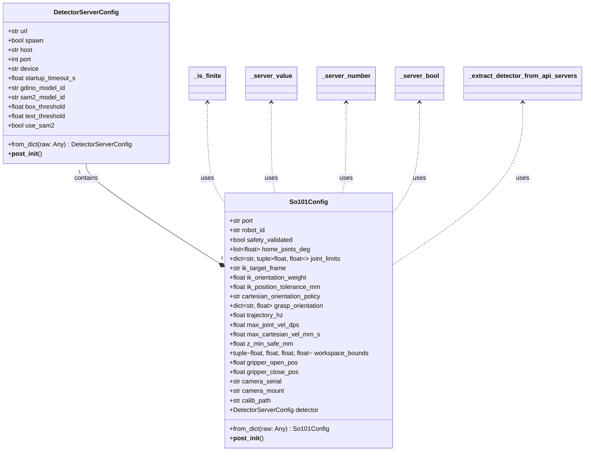

<!-- source: DeepWiki mcp.deepwiki.com · repo openJiuwen-ai/jiuwensymbiosis · extra page SO-101 Configuration & Session · fetched 2026-11-02 -->

# SO-101 Configuration & Session

<details>
<summary>Relevant source files</summary>

The following files were used as context for generating this wiki page:

- [configs/so101/so101.yaml](configs/so101/so101.yaml)
- [configs/so101/so101_calib.json](configs/so101/so101_calib.json)
- [jiuwensymbiosis/adapters/so101/__init__.py](jiuwensymbiosis/adapters/so101/__init__.py)
- [jiuwensymbiosis/adapters/so101/api.py](jiuwensymbiosis/adapters/so101/api.py)
- [jiuwensymbiosis/adapters/so101/config.py](jiuwensymbiosis/adapters/so101/config.py)
- [jiuwensymbiosis/adapters/so101/config_template.yaml](jiuwensymbiosis/adapters/so101/config_template.yaml)
- [jiuwensymbiosis/adapters/so101/description/so101_new_calib.urdf](jiuwensymbiosis/adapters/so101/description/so101_new_calib.urdf)
- [jiuwensymbiosis/adapters/so101/env.py](jiuwensymbiosis/adapters/so101/env.py)
- [jiuwensymbiosis/adapters/so101/geometry.py](jiuwensymbiosis/adapters/so101/geometry.py)
- [jiuwensymbiosis/adapters/so101/session.py](jiuwensymbiosis/adapters/so101/session.py)
- [jiuwensymbiosis/gui/pages/tools_view.py](jiuwensymbiosis/gui/pages/tools_view.py)
- [tests/unit_tests/adapters/so101/test_config.py](tests/unit_tests/adapters/so101/test_config.py)
- [tests/unit_tests/adapters/so101/test_env_api.py](tests/unit_tests/adapters/so101/test_env_api.py)
- [tests/unit_tests/adapters/so101/test_lerobot_kinematics.py](tests/unit_tests/adapters/so101/test_lerobot_kinematics.py)
- [tests/unit_tests/adapters/so101/test_urdf.py](tests/unit_tests/adapters/so101/test_urdf.py)

</details>


This page details the configuration and session management for the SO-101 adapter. It covers the `So101Config` dataclass, its validation logic, the structure of YAML configuration templates, the `DetectorServerConfig` for managing the perception sidecar, the `build_so101_session` factory function, and the role of URDF and geometry definitions in the adapter.

## So101Config Validation

The `So101Config` dataclass [jiuwensymbiosis/adapters/so101/config.py:19-19]() defines the parameters for the SO-101 adapter. It includes settings for serial port communication, joint limits, kinematics, motion control, safety boundaries, gripper behavior, and vision. The configuration undergoes rigorous validation at load time to ensure consistency and prevent unsafe operations.

Key validation aspects include:
*   **Port and Robot ID**: Ensures `port` is a non-empty string and `robot_id` matches the calibrated ID [jiuwensymbiosis/adapters/so101/config.py:180-183]().
*   **Safety Validation**: The `safety_validated` flag [jiuwensymbiosis/adapters/so101/config.py:184-186]() acts as a gate, preventing connection if set to `false` unless `home_use_init_pose` is `true`.
*   **Home Joints**: `home_joints_deg` must be a list of 5 floats, corresponding to `ARM_JOINT_ORDER` [jiuwensymbiosis/adapters/so101/config.py:190-192](). If `home_use_init_pose` is `true`, it can be omitted.
*   **Joint Limits**: `joint_limits` must be a dictionary with exactly 5 entries, one for each joint in `ARM_JOINT_ORDER`, with each limit being a `(lower, upper)` tuple [jiuwensymbiosis/adapters/so101/config.py:193-200]().
*   **Kinematics**: `ik_target_frame` must be a string present in the URDF [jiuwensymbiosis/adapters/so101/config.py:204-205](). IK weights and tolerances are validated as finite numbers [jiuwensymbiosis/adapters/so101/config.py:206-211]().
*   **Cartesian Orientation Policy**: `cartesian_orientation_policy` is normalized to lowercase and must be one of "preserve", "grasp", or "top_down" [jiuwensymbiosis/adapters/so101/config.py:212-216](). `grasp_orientation` is validated as a dictionary with `rx`, `ry`, `rz` keys, all finite floats [jiuwensymbiosis/adapters/so101/config.py:217-223]().
*   **Motion Parameters**: Various motion parameters like `trajectory_hz`, `max_joint_vel_dps`, `max_cartesian_vel_mm_s`, `tracking_error_deg`, and `servo_min_send_period_s` are validated as finite positive numbers [jiuwensymbiosis/adapters/so101/config.py:226-260](). Derived parameters like `max_joint_step_deg` are computed based on these values [jiuwensymbiosis/adapters/so101/config.py:300-303]().
*   **Safety Boundaries**: `z_min_safe_mm`, `z_max_safe_mm`, `table_z_mm`, `gripper_lowest_offset_mm`, `payload_protrusion_mm`, and `minimum_floor_margin_mm` are validated as finite numbers [jiuwensymbiosis/adapters/so101/config.py:263-272](). `workspace_bounds` is validated as a tuple of four finite numbers [jiuwensymbiosis/adapters/so101/config.py:273-276]().
*   **Gripper**: Gripper positions (`gripper_open_pos`, `gripper_close_pos`) and tolerances are validated as floats within `[0, 100]` [jiuwensymbiosis/adapters/so101/config.py:279-283]().
*   **Vision**: `camera_serial` and `camera_mount` are validated as strings [jiuwensymbiosis/adapters/so101/config.py:310-313](). `calib_path` is validated as a string or `None` [jiuwensymbiosis/adapters/so101/config.py:314-315]().
*   **Detector Server**: The `DetectorServerConfig` nested dataclass handles validation for the GroundingDINO/SAM2 sidecar [jiuwensymbiosis/adapters/so101/config.py:35-103]().

The `from_dict` class method [jiuwensymbiosis/adapters/so101/config.py:160-177]() is responsible for loading configuration from a dictionary, typically parsed from YAML, and performing initial type conversions and checks before the `__post_init__` method performs more detailed validation.

### DetectorServerConfig

The `DetectorServerConfig` dataclass [jiuwensymbiosis/adapters/so101/config.py:35-54]() manages the connection and spawn settings for the GroundingDINO/SAM2 sidecar. It includes parameters such as `url`, `spawn` (whether to launch the server), `host`, `port`, `device`, `startup_timeout_s`, and model IDs.

When `spawn` is `True`, the `host` and `port` are derived from the `url` to ensure consistency between the client's connection and the server's binding address [jiuwensymbiosis/adapters/so101/config.py:90-103](). The `_extract_detector_from_api_servers` function [jiuwensymbiosis/adapters/so101/config.py:136-155]() parses the `api_servers` list in the YAML to find the detector configuration, mirroring the approach used by other adapters.


**Diagram: So101Config and DetectorServerConfig Structure**
Sources:
*   [jiuwensymbiosis/adapters/so101/config.py:19-34]()
*   [jiuwensymbiosis/adapters/so101/config.py:35-54]()
*   [jiuwensymbiosis/adapters/so101/config.py:55-66]()
*   [jiuwensymbiosis/adapters/so101/config.py:67-103]()
*   [jiuwensymbiosis/adapters/so101/config.py:105-107]()
*   [jiuwensymbiosis/adapters/so101/config.py:109-113]()
*   [jiuwensymbiosis/adapters/so101/config.py:115-125]()
*   [jiuwensymbiosis/adapters/so101/config.py:127-134]()
*   [jiuwensymbiosis/adapters/so101/config.py:136-155]()
*   [jiuwensymbiosis/adapters/so101/config.py:160-177]()
*   [jiuwensymbiosis/adapters/so101/config.py:180-183]()
*   [jiuwensymbiosis/adapters/so101/config.py:184-186]()
*   [jiuwensymbiosis/adapters/so101/config.py:190-192]()
*   [jiuwensymbiosis/adapters/so101/config.py:193-200]()
*   [jiuwensymbiosis/adapters/so101/config.py:204-205]()
*   [jiuwensymbiosis/adapters/so101/config.py:206-211]()
*   [jiuwensymbiosis/adapters/so101/config.py:212-216]()
*   [jiuwensymbiosis/adapters/so101/config.py:217-223]()
*   [jiuwensymbiosis/adapters/so101/config.py:226-260]()
*   [jiuwensymbiosis/adapters/so101/config.py:263-272]()
*   [jiuwensymbiosis/adapters/so101/config.py:273-276]()
*   [jiuwensymbiosis/adapters/so101/config.py:279-283]()
*   [jiuwensymbiosis/adapters/so101/config.py:300-303]()
*   [jiuwensymbiosis/adapters/so101/config.py:310-313]()
*   [jiuwensymbiosis/adapters/so101/config.py:314-315]()

## YAML Templates

The SO-101 adapter uses YAML files for configuration. A template `config_template.yaml` [jiuwensymbiosis/adapters/so101/config_template.yaml]() provides a comprehensive set of configurable parameters with comments explaining their purpose and validation rules. This template serves as a guide for users to create their specific robot configurations, such as `so101.yaml` [configs/so101/so101.yaml]().

The YAML configuration is structured into several sections:
*   **Basic Information & Connection**: `name`, `port`, `robot_id`, `calibration_dir`, `disable_torque_on_disconnect`, `max_relative_target`, `safety_validated`, `home_use_init_pose`.
*   **Kinematics**: `home_joints_deg`, `joint_limits`, `urdf_path`, `ik_target_frame`, `ik_orientation_weight`, `ik_position_tolerance_mm`, `ik_orientation_tolerance_deg`, `cartesian_orientation_policy`, `grasp_orientation`.
*   **Motion & Settling**: `trajectory_hz`, `max_joint_vel_dps`, `max_cartesian_vel_mm_s`, `fast_control_hz`, `servo_max_joint_vel_dps`, `servo_max_cartesian_vel_mm_s`, `servo_max_joint_step_deg`, `servo_max_cartesian_step_mm`, `fast_move_timeout_s`, `fast_absolute_timeout_s`, `tracking_error_deg`, `servo_goal_tolerance_mm`, `joint_tolerance_deg`, `settle_samples`, `settle_soft_tolerance_deg`, `settle_soft_samples`, `settle_max_z_undershoot_mm`, `settle_z_only_lift_enabled`, `settle_z_only_lift_step_mm`, `settle_z_only_lift_max_joint_offset_deg`, `move_timeout_s`, `settle_resend_period_s`, `settle_drift_abort_samples`, `settle_overcompensate`, `settle_gain`.
*   **Safety Boundaries**: `z_min_safe_mm`, `workspace_bounds`, `table_z_mm`, `gripper_lowest_offset_mm`, `payload_protrusion_mm`, `minimum_floor_margin_mm`.
*   **Gripper**: `gripper_open_pos`, `gripper_close_pos`, `gripper_tolerance`, `gripper_timeout_s`, `gripper_settle_s`, `gripper_contact_min_travel`, `gripper_contact_stall_tolerance`, `gripper_contact_stall_samples`, `gripper_contact_hold_offset`.
*   **Vision/Detection**: `camera_serial`, `camera_mount`, `calib_path`, and the `api_servers` block for the detector.
*   **Top Surface Grasping**: `grasp_top_surface_enabled`, `grasp_top_band_mm`, `grasp_top_percentile`, `grasp_min_points`, `grasp_mask_erode_px`.

The `so101.yaml` example [configs/so101/so101.yaml]() demonstrates a specific configuration for a "so101_left" robot, including settings for a desktop eye-to-hand RealSense D405 camera and the GroundingDINO+SAM2 sidecar.

Sources:
*   [jiuwensymbiosis/adapters/so101/config_template.yaml:1-131]()
*   [configs/so101/so101.yaml:1-125]()

## Detector Server Configuration

The detector server, typically running GroundingDINO and SAM2, is configured within the `api_servers` section of the YAML. The `_extract_detector_from_api_servers` function [jiuwensymbiosis/adapters/so101/config.py:136-155]() in `So101Config` is responsible for parsing this section. It identifies the detector server by looking for `_target_` values containing "grounding_dino" or "gdino".

The configuration allows specifying the `host`, `port`, `device`, `startup_timeout_s`, and model IDs (`gdino_model_id`, `sam2_model_id`). Environment variables `GDINO_MODEL_ID` and `SAM2_MODEL_ID` can override the YAML-specified model paths, which is useful for local offline model deployment [jiuwensymbiosis/adapters/so101/config.py:141-143]().

If `spawn` is `True` (which is the default when configured via `api_servers` [jiuwensymbiosis/adapters/so101/config.py:155]()), the system will attempt to launch the detector server as a sidecar process. Otherwise, it will try to connect to an existing server at the specified `url`.

Sources:
*   [jiuwensymbiosis/adapters/so101/config.py:35-103]()
*   [jiuwensymbiosis/adapters/so101/config.py:136-155]()
*   [configs/so101/so101.yaml:88-98]()

## Session Factory

The `build_so101_session` function [jiuwensymbiosis/adapters/so101/session.py:1-1]() (imported in `jiuwensymbiosis/adapters/so101/__init__.py:33]()) is the entry point for creating an `So101RobotSession`. This factory function is responsible for:
1.  Loading the `So101Config` from a YAML file or a dictionary.
2.  Instantiating the `So101Env` with the loaded configuration.
3.  Creating the `So101Api` instance, passing the `So101Env`.
4.  Constructing and returning a `RobotSession` object that encapsulates the environment and API.

The `RobotSession` manages the lifecycle of the robot, including connecting to hardware, initializing the API, and handling disconnections.

```mermaid
graph TD
    subgraph "Configuration Loading"
        A[YAML Config File] --> B{Load YAML};
        B --> C[So101Config.from_dict()];
        C --> D[So101Config Instance];
    end

    subgraph "Session Construction"
        D --> E[So101Env(cfg)];
        E --> F[So101Api(env)];
        F --> G[RobotSession(env, api)];
    end

    subgraph "Usage"
        G --> H[Agent Interaction];
    end

    style A fill:#ace,stroke:#333,stroke-width:2px
    style B fill:#f9f,stroke:#333,stroke-width:2px
    style C fill:#ace,stroke:#333,stroke-width:2px
    style D fill:#ace,stroke:#333,stroke-width:2px
    style E fill:#ace,stroke:#333,stroke-width:2px
    style F fill:#ace,stroke:#333,stroke-width:2px
    style G fill:#ace,stroke:#333,stroke-width:2px
    style H fill:#ace,stroke:#333,stroke-width:2px
```
**Diagram: SO-101 Session Factory Data Flow**
Sources:
*   [jiuwensymbiosis/adapters/so101/__init__.py:33]()
*   [jiuwensymbiosis/adapters/so101/config.py:160-177]()
*   [jiuwensymbiosis/adapters/so101/env.py:64-66]()
*   [jiuwensymbiosis/adapters/so101/api.py:137-150]()
*   [jiuwensymbiosis/adapters/so101/session.py:1-1]()

## URDF and Geometry

The SO-101 adapter relies on a Universal Robot Description Format (URDF) file, `so101_new_calib.urdf` [jiuwensymbiosis/adapters/so101/description/so101_new_calib.urdf](), to define its kinematic structure. This URDF is a kinematics-only model, intentionally omitting inertial, visual, collision, mesh, or transmission elements to simplify its use with `LeRobot.model.kinematics.RobotKinematics` [jiuwensymbiosis/adapters/so101/description/so101_new_calib.urdf:3-8]().

The URDF defines:
*   **Links**: `base_link`, `shoulder_link`, `upper_arm_link`, `lower_arm_link`, `wrist_link`, `gripper_link`, `gripper_frame_link` [jiuwensymbiosis/adapters/so101/description/so101_new_calib.urdf:10-16]().
*   **Joints**: Five revolute joints (`shoulder_pan`, `shoulder_lift`, `elbow_flex`, `wrist_flex`, `wrist_roll`) and a fixed joint (`gripper_frame_joint`) [jiuwensymbiosis/adapters/so101/description/so101_new_calib.urdf:18-62]().
*   **`gripper_frame_link`**: This link is crucial as it serves as the `ik_target_frame` [jiuwensymbiosis/adapters/so101/config_template.yaml:32]() for Inverse Kinematics (IK) calculations, representing the control frame of the end-effector.

The `jiuwensymbiosis.adapters.so101.geometry` module [jiuwensymbiosis/adapters/so101/geometry.py:1-1]() provides utility functions for converting between different pose representations, such as `So101Pose` (x, y, z, rx, ry, rz in mm/deg) and 4x4 transformation matrices (meters/radians) used by `LeRobot.model.kinematics.RobotKinematics` [jiuwensymbiosis/adapters/so101/geometry.py:1-1](). This ensures seamless integration between the adapter's configuration (which uses mm/deg) and the underlying kinematics library.

The `RobotKinematics` object is instantiated with the URDF path and the `gripper_frame_link` as the `target_frame_name` [tests/unit_tests/adapters/so101/test_lerobot_kinematics.py:38-42](), allowing for Forward Kinematics (FK) and IK computations. These kinematics are essential for planning robot movements and validating reachability.

Sources:
*   [jiuwensymbiosis/adapters/so101/description/so101_new_calib.urdf:1-63]()
*   [jiuwensymbiosis/adapters/so101/config_template.yaml:32]()
*   [jiuwensymbiosis/adapters/so101/geometry.py:1-1]()
*   [tests/unit_tests/adapters/so101/test_lerobot_kinematics.py:38-42]()
*   [tests/unit_tests/adapters/so101/test_lerobot_kinematics.py:75-86]()
*   [tests/unit_tests/adapters/so101/test_lerobot_kinematics.py:97-117]()

---

