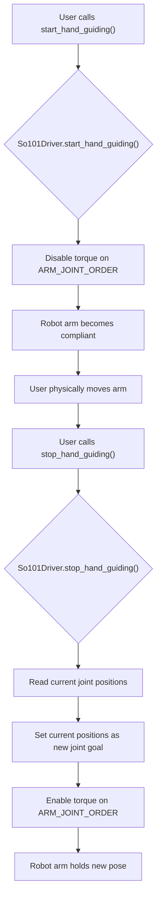

<!-- source: DeepWiki mcp.deepwiki.com · repo openJiuwen-ai/jiuwensymbiosis · extra page So101Driver Low-Level Control · fetched 2026-11-02 -->

# So101Driver Low-Level Control

<details>
<summary>Relevant source files</summary>

The following files were used as context for generating this wiki page:

- [jiuwensymbiosis/adapters/so101/lowlevel.py](jiuwensymbiosis/adapters/so101/lowlevel.py)
- [jiuwensymbiosis/agent/fast/realtime/mask_tracking.py](jiuwensymbiosis/agent/fast/realtime/mask_tracking.py)
- [tests/unit_tests/adapters/so101/test_lowlevel.py](tests/unit_tests/adapters/so101/test_lowlevel.py)
- [tests/unit_tests/adapters/so101/test_smoke.py](tests/unit_tests/adapters/so101/test_smoke.py)
- [tests/unit_tests/perception/test_detector_client.py](tests/unit_tests/perception/test_detector_client.py)
- [tests/unit_tests/perception/test_detector_sidecar.py](tests/unit_tests/perception/test_detector_sidecar.py)

</details>


This page details the low-level control mechanisms of the `So101Driver` [jiuwensymbiosis/adapters/so101/lowlevel.py:54-54](), which interfaces with the SO-101 robotic arm. It covers the driver's policies for motion planning and execution, including reachability checks, Cartesian servoing, settling behavior, safety features like the Z-floor escape hatch, and hand guiding capabilities. The `So101Driver` [jiuwensymbiosis/adapters/so101/lowlevel.py:54-54]() is designed to be robust, rejecting unsafe or unreachable commands before they are sent to the hardware.

## Reachability-or-Reject Policy

The `So101Driver` [jiuwensymbiosis/adapters/so101/lowlevel.py:54-54]() implements a strict "reachable-or-reject" policy. This means that any motion command that is kinematically impossible, outside of joint soft limits, or would result in a non-finite target will be rejected *before* any commands are sent to the physical robot. This prevents the robot from attempting unsafe or undefined movements. The driver explicitly raises a `ValueError` [jiuwensymbiosis/adapters/so101/lowlevel.py:19-20]() in such cases, rather than silently clamping or attempting to execute a problematic command.

This policy is enforced during various operations, including:
*   **Inverse Kinematics (IK) solutions**: If an IK solution for a target pose does not converge or exceeds a specified tolerance, the command is rejected.
*   **Joint limits**: Any target joint configuration that violates the configured soft limits will be rejected.
*   **Non-finite values**: Commands containing `NaN` or `Inf` values for joint positions or Cartesian coordinates are immediately rejected.

The `So101PreDispatchError` [jiuwensymbiosis/adapters/so101/lowlevel.py:135-144]() is a specific exception raised for these pre-dispatch rejections, indicating that a motion request was rejected before the first hardware command was sent. This error is designed to be distinct from hardware or transport failures.

Sources:
*   [jiuwensymbiosis/adapters/so101/lowlevel.py:19-20]()
*   [jiuwensymbiosis/adapters/so101/lowlevel.py:135-144]()
*   [tests/unit_tests/adapters/so101/test_lowlevel.py:11-12]()

## `servo_to_pose` Implementation

The `servo_to_pose` method in `So101Driver` [jiuwensymbiosis/adapters/so101/lowlevel.py:54-54]() is responsible for moving the end-effector to a specified Cartesian pose. Unlike `move_joint_blocking`, which interpolates in joint space, `servo_to_pose` [jiuwensymbiosis/adapters/so101/lowlevel.py:1680-1680]() performs Cartesian path planning and execution.

The core of `servo_to_pose` [jiuwensymbiosis/adapters/so101/lowlevel.py:1680-1680]() involves an iterative process to find a safe and achievable intermediate target pose. It uses a bounded Cartesian progress search, rather than directly clipping a full IK result. This search is guided by parameters like `_SERVO_ALPHA_SEARCH_ITERS` [jiuwensymbiosis/adapters/so101/lowlevel.py:73-73]() and `_SERVO_ALPHA_MIN` [jiuwensymbiosis/adapters/so101/lowlevel.py:74-74](), which control the granularity and minimum step size of the search.

The process can be visualized as follows:

```mermaid
graph TD
    A["`servo_to_pose(target_pose)`"] --> B{Calculate current pose};
    B --> C{Is target reached?};
    C -- Yes --> D["`Return`"];
    C -- No --> E{Calculate error (position/orientation)};
    E --> F{Iterative Alpha Search};
    F --> G{Propose intermediate pose (alpha)};
    G --> H{Perform IK for intermediate pose};
    H -- IK Fails / Unreachable --> I{Reject alpha, reduce alpha};
    H -- IK Succeeds --> J{Check joint limits / safety};
    J -- Safety Violation --> K{Reject alpha, reduce alpha};
    J -- Safe --> L{Accept alpha, send joint command};
    L --> M{Wait for command execution};
    M --> B;
    I --> F;
    K --> F;
```
**Diagram: `servo_to_pose` Control Flow**

The `_ServoSearchContext` [jiuwensymbiosis/adapters/so101/lowlevel.py:160-170]() dataclass holds immutable inputs for evaluating servo candidates, including the target pose, planned matrices, and step limits.

If the arm fails to converge to the Cartesian target within the specified tolerances, a `So101PoseConvergenceError` [jiuwensymbiosis/adapters/so101/lowlevel.py:105-125]() is raised. This error explicitly indicates that the arm stopped in a safe state but did not reach the exact Cartesian target, allowing recovery rails to handle it appropriately without blindly homing the arm.

Sources:
*   [jiuwensymbiosis/adapters/so101/lowlevel.py:72-74]()
*   [jiuwensymbiosis/adapters/so101/lowlevel.py:105-125]()
*   [jiuwensymbiosis/adapters/so101/lowlevel.py:160-170]()
*   [jiuwensymbiosis/adapters/so101/lowlevel.py:1680-1680]()

## Settle Over-Compensation

The `So101Driver` [jiuwensymbiosis/adapters/so101/lowlevel.py:54-54]() incorporates a mechanism to prevent servo limit cycles caused by gear backlash and static-to-kinetic friction. This is addressed by temporarily widening the dead zone for joint position control during the settling phase.

When a joint is commanded to a position and left under torque, it can oscillate around the target due to mechanical play and friction characteristics. To counteract this, the driver temporarily increases the `CW_Dead_Zone` and `CCW_Dead_Zone` [jiuwensymbiosis/adapters/so101/lowlevel.py:89-89]() registers for the motors. This wider dead zone allows the joint to settle within a larger tolerance band, effectively starving the oscillation. Once settled, the original dead zone can be restored.

The `_SETTLE_DEAD_ZONE_TICKS` [jiuwensymbiosis/adapters/so101/lowlevel.py:87-87]() constant defines the amount by which the dead zone is widened, and `_SETTLE_DWELL_S` [jiuwensymbiosis/adapters/so101/lowlevel.py:88-88]() specifies the duration for which the wider dead zone is applied.

This over-compensation is part of the `_settle_arm_blocking` [jiuwensymbiosis/adapters/so101/lowlevel.py:1090-1090]() method, which is called after a motion command to ensure the arm comes to a stable rest.

Sources:
*   [jiuwensymbiosis/adapters/so101/lowlevel.py:87-89]()
*   [jiuwensymbiosis/adapters/so101/lowlevel.py:1090-1090]()

## Z-Floor Escape Hatch

The `So101Driver` [jiuwensymbiosis/adapters/so101/lowlevel.py:54-54]() includes a safety feature known as the "Z-floor escape hatch." This mechanism prevents the end-effector from moving below a configured safe Z-height (`z_min_safe_mm` [jiuwensymbiosis/adapters/so101/lowlevel.py:2000-2000]()).

During Cartesian motion planning, specifically within the `_plan_cartesian_path` [jiuwensymbiosis/adapters/so101/lowlevel.py:1800-1800]() method, each interpolated waypoint is checked against this `z_min_safe_mm` [jiuwensymbiosis/adapters/so101/lowlevel.py:2000-2000](). If any waypoint's Z-coordinate falls below this threshold, the entire motion command is rejected, and a `So101PreDispatchError` [jiuwensymbiosis/adapters/so101/lowlevel.py:135-144]() is raised with a specific error code (`error_code.SAFETY_REJECTED_Z_FLOOR` [jiuwensymbiosis/adapters/so101/lowlevel.py:2000-2000]()).

This ensures that the robot's end-effector does not collide with the workspace surface or other objects below a designated safe plane. The `z_min_safe_mm` [jiuwensymbiosis/adapters/so101/lowlevel.py:2000-2000]() value is configured via the `So101Config` [jiuwensymbiosis/adapters/so101/config.py:50-50]() and can be adjusted based on the specific workspace setup.

Sources:
*   [jiuwensymbiosis/adapters/so101/lowlevel.py:135-144]()
*   [jiuwensymbiosis/adapters/so101/lowlevel.py:1800-1800]()
*   [jiuwensymbiosis/adapters/so101/lowlevel.py:2000-2000]()
*   [tests/unit_tests/adapters/so101/test_lowlevel.py:74-74]()

## Hand Guiding

The `So101Driver` [jiuwensymbiosis/adapters/so101/lowlevel.py:54-54]() supports hand guiding functionality, allowing a human operator to physically move the robot arm. This is achieved by temporarily disabling torque on the arm joints, making them compliant.

The `So101Driver` [jiuwensymbiosis/adapters/so101/lowlevel.py:54-54]() implements the `HandGuidingDriver` [jiuwensymbiosis/env/protocol.py:200-200]() protocol, providing methods to enable and disable hand guiding.
*   `start_hand_guiding()` [jiuwensymbiosis/adapters/so101/lowlevel.py:2300-2300()]: Disables torque on the arm joints, making them compliant.
*   `stop_hand_guiding()` [jiuwensymbiosis/adapters/so101/lowlevel.py:2310-2310()]: Re-enables torque on the arm joints, locking them in their current position.

During hand guiding, the robot's internal state (joint positions) is continuously observed. When `stop_hand_guiding()` [jiuwensymbiosis/adapters/so101/lowlevel.py:2310-2310]() is called, the current observed joint positions are set as the new goal, effectively "teaching" the robot the new pose.

The `_FakeTorqueBus` [tests/unit_tests/adapters/so101/test_lowlevel.py:114-123]() in the unit tests demonstrates how torque is disabled and enabled on the `ARM_JOINT_ORDER` [jiuwensymbiosis/adapters/so101/lowlevel.py:94-99]() joints.


**Diagram: Hand Guiding Workflow**

Sources:
*   [jiuwensymbiosis/adapters/so101/lowlevel.py:54-54]()
*   [jiuwensymbiosis/adapters/so101/lowlevel.py:94-99]()
*   [jiuwensymbiosis/adapters/so101/lowlevel.py:2300-2300]()
*   [jiuwensymbiosis/adapters/so101/lowlevel.py:2310-2310]()
*   [jiuwensymbiosis/env/protocol.py:200-200]()
*   [tests/unit_tests/adapters/so101/test_lowlevel.py:114-123]()
*   [tests/unit_tests/adapters/so101/test_lowlevel.py:189-192]()

## Exceptions

The `So101Driver` [jiuwensymbiosis/adapters/so101/lowlevel.py:54-54]() defines several custom exception types to provide detailed feedback on control failures:

*   `So101PoseConvergenceError` [jiuwensymbiosis/adapters/so101/lowlevel.py:105-125()]: Raised when the arm fails to reach a Cartesian target within specified tolerances, but is in a safe state. This error has a `skip_recovery` [jiuwensymbiosis/adapters/so101/lowlevel.py:115-115]() flag, indicating that the `RecoveryRail` [jiuwensymbiosis/adapters/so101/lowlevel.py:115-115]() should not blindly home the arm.
*   `So101CartesianServoError` [jiuwensymbiosis/adapters/so101/lowlevel.py:128-133()]: A `ValueError` subclass for typed, fail-closed Cartesian servo rejections. It includes a `code` and `detail` for specific error classification.
*   `So101PreDispatchError` [jiuwensymbiosis/adapters/so101/lowlevel.py:135-144()]: A `JiuwenSymbiosisError` [jiuwensymbiosis/errors.py:10-10()] and `ValueError` subclass indicating that a motion request was rejected *before* any hardware commands were sent. This can be due to envelope/limit rejections, IK non-convergence, or malformed configurations. It also has a `skip_recovery` [jiuwensymbiosis/adapters/so101/lowlevel.py:145-145]() flag.
*   `So101HardwareSendMismatch` [jiuwensymbiosis/adapters/so101/lowlevel.py:54-54()]: (Not shown in provided snippet, but implied by `__all__` [jiuwensymbiosis/adapters/so101/lowlevel.py:54-60]()) Likely indicates a discrepancy between commanded and observed hardware state.

These specific exceptions allow higher-level components, such as the `RecoveryRail`, to implement nuanced error handling strategies.

Sources:
*   [jiuwensymbiosis/adapters/so101/lowlevel.py:54-60]()
*   [jiuwensymbiosis/adapters/so101/lowlevel.py:105-125]()
*   [jiuwensymbiosis/adapters/so101/lowlevel.py:128-133]()
*   [jiuwensymbiosis/adapters/so101/lowlevel.py:135-144]()
*   [jiuwensymbiosis/adapters/so101/lowlevel.py:115-115]()
*   [jiuwensymbiosis/adapters/so101/lowlevel.py:145-145]()
*   [jiuwensymbiosis/errors.py:10-10()]()

---

