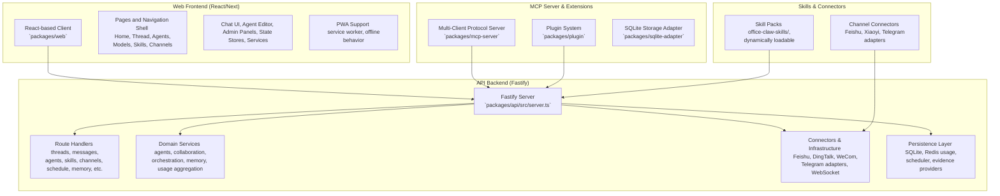
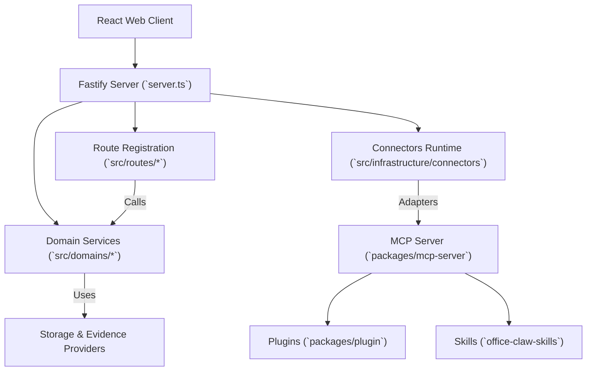

<!-- source: DeepWiki mcp.deepwiki.com · repo openJiuwen-ai/relay · page 1 Overview · fetched 2026-11-02 -->

# Overview

<details>
<summary>Relevant source files</summary>

The following files were used as context for generating this wiki page:

- [.gitignore](.gitignore)
- [README.md](README.md)
- [README_zh.md](README_zh.md)

</details>


## Purpose and Scope

Relay, also known as OfficeClaw, is a self-hosted multi-agent AI collaboration platform designed to orchestrate multiple AI Agents into a cohesive team. Unlike frameworks that simply enable calling individual agents, Relay facilitates their collaboration across various tasks such as development, code review, and task management, all through a unified interface.

This page provides a high-level introduction to Relay's architecture and monorepo layout, and points to child pages for in-depth details on installation, repository structure, and configuration. It aims to familiarize technical readers with the platform's core components and overall design philosophy.

---

## What is Relay / OfficeClaw?

Relay organizes multiple AI Agents to work collaboratively as a real team. It supports:

- Multi-agent chat with thread isolation and rich card replies
- Agent role and collaboration strategy configuration
- Dynamic skill pack loading to extend agent capabilities
- Multi-platform channel management (Web, Xiaoyi, Feishu, etc.)
- Scheduled tasks with cron triggers for automation
- Real-time monitoring of agent runtime status

The system is designed for self-hosting to ensure full data sovereignty. It natively supports Huawei Cloud MaaS models and integrates with Xiaoyi Open Platform. It does not embed AI models itself but orchestrates AI model usage via these integrations.

> **"Most frameworks help you call Agents, Relay helps them work together."**

_Sources: README.md:3-124_

---

## High-Level Architecture

Relay's architecture consists of the following core components:



- **Fastify API Server** (`packages/api`): Hosts HTTP endpoints that power Relay’s backend services. Handles threads, agents, skills management, scheduling, memory, and connector orchestration.
- **React/Next Web UI** (`packages/web`): The frontend client providing interactive pages for chat threads, agent management, model configuration, skillpacks, channels, scheduling, and runtime monitoring.
- **MCP Server** (`packages/mcp-server`): Supports real-time multi-client collaboration, agent orchestration tools, memory systems, and workflow tools.
- **Skills System** (`office-claw-skills`): Contains modular skill packs extending agent functions like debugging, code review, email, and PDF processing.
- **Connectors**: Bridge external platforms such as Feishu, Xiaoyi, Telegram to allow multi-channel agent access.
- **Storage/Adapters**: SQLite-based persistence via `sqlite-adapter`, Redis caching, and evidence/scheduler module support.

This modular architecture balances flexibility, real-time collaboration, and extensibility.

_Sources: README.md:48-98, inferred from project structure_

---

## Monorepo Layout (Brief Overview)

The Relay repository is structured as a monorepo with multiple structured packages and directories:

| Directory / Package           | Purpose                                                                     |
|------------------------------|-----------------------------------------------------------------------------|
| `packages/api`               | Fastify backend server with API routes, domain logic, storage adapters      |
| `packages/web`               | React/Next frontend client                                                  |
| `packages/core`              | Core primitives and shared business logic                                  |
| `packages/shared`            | Shared types, schemas, and utilities for cross-package consistency          |
| `packages/mcp-server`        | MCP server implementation including collaboration tools and memory system  |
| `packages/plugin`            | Plugin SDK for extending both API and web layers                           |
| `packages/sqlite-adapter`    | SQLite driver modules for evidence and scheduler providers                  |
| `office-claw-skills`         | Collection of skill packs, each extending agent capabilities dynamically    |
| `config/`                   | Configuration files such as environment defaults and model presets          |
| `scripts/`                   | Development, build, and runtime support scripts                            |

Each package is designed to be loosely coupled but dependent on core and shared libraries for consistent typing and domain modeling.

For detailed layout, see [Monorepo Layout](#1.2).

_Sources: README.md:48-98, .gitignore for directory hints_

---

## Links to Child Pages

To dive deeper into specific aspects of Relay, consult the dedicated child pages:

- **[Getting Started](#1.1)**: Step-by-step instructions to install, configure, build, and run Relay on Node.js 20+ environments using pnpm. Includes environment setup, ports, and startup scripts.
- **[Monorepo Layout](#1.2)**: Detailed tour of all packages and directories explaining their responsibilities, dependencies, and interactions.
- **[Configuration Reference](#1.3)**: Explanation of two-tier environment loading (.inner.env and .env), key environment variable groups, and detailed config files like `model.json`, `maas-details.json`, and `office-claw-config.json`.

These pages collectively enable new developers and users to effectively deploy, customize, and extend Relay.

---

## Bridging Natural Language to Code Entities

The following diagram maps key natural language components of Relay to concrete code and file entries:

```mermaid
graph LR
    NL["Natural Language"] --> CE["Code Entities and Files"]

    NL -->|Fastify API Server| API["`packages/api/src/server.ts`"]
    NL -->|React Web UI| WEB["`packages/web`"]
    NL -->|MCP Server| MCP["`packages/mcp-server`"]
    NL -->|Skills System| SKILLS["`office-claw-skills/`"]
    NL -->|Connectors| CONNECTORS["`packages/api/src/infrastructure/connectors`"]

    CE -->|Route Handlers| ROUTES["`packages/api/src/routes/`"]
    CE -->|Domain Services| DOMAINS["`packages/api/src/domains/`"]
    CE -->|Storage Providers| STORAGE["`packages/sqlite-adapter` and `packages/api/src/infrastructure/storage`"]
    CE -->|Plugin SDK| PLUGIN["`packages/plugin`"]
```

This mapping helps quickly locate code relevant to a specific system component within the monorepo.

---

Another diagram focusing on the main server bootstrap and runtime relationships:



This diagram clarifies how API routes, domain logic, connectors, and plugins interlink during runtime.

---

## Summary

Relay/OfficeClaw is a comprehensive platform that elevates AI agent orchestration from isolated calls to coordinated teamwork through modular architecture. Its core is a Fastify API backend integrated tightly with a React/Next frontend and multi-client protocol server. Skills and connectors extend the core with realtime, multi-channel AI collaboration capabilities, all housed within a well-organized monorepo.

To get started or explore the internals, use the child pages for installation, repo layout, and configuration deep dives.

---

Sources: README.md:3-124, .gitignore:1-155

---

