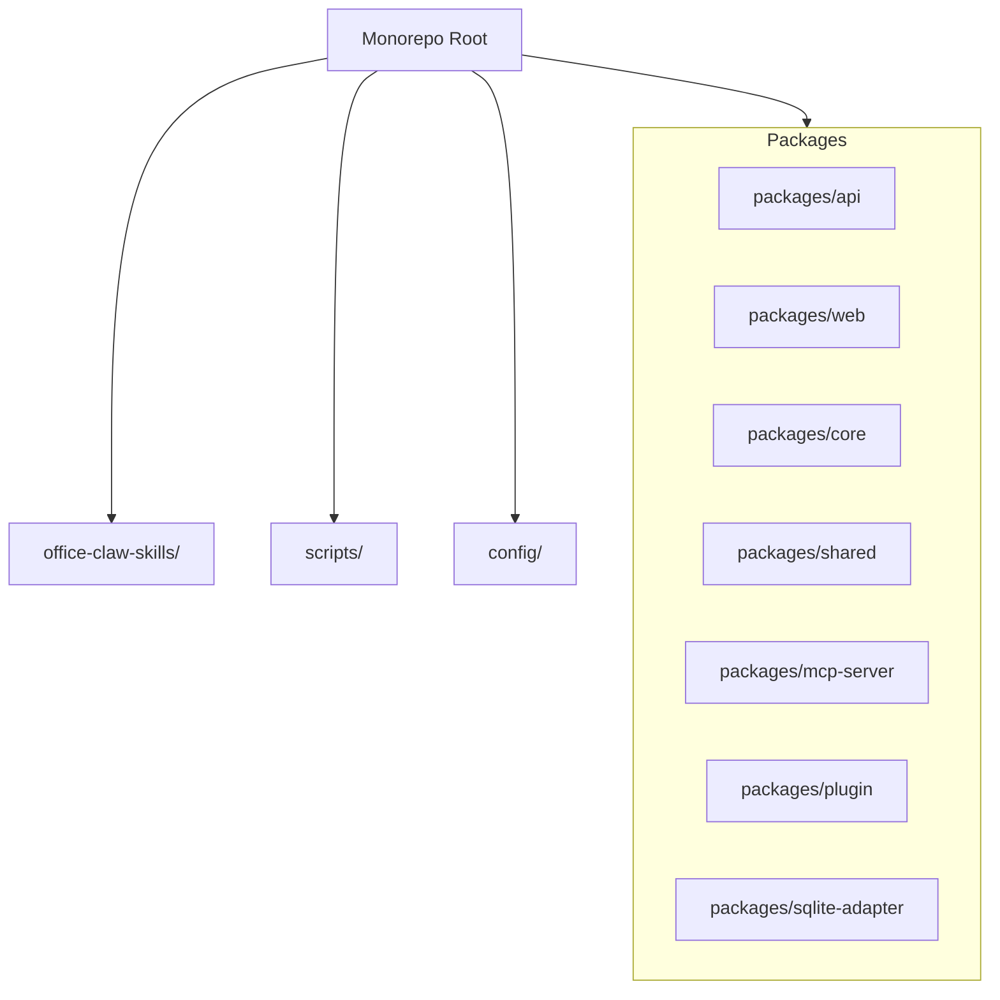
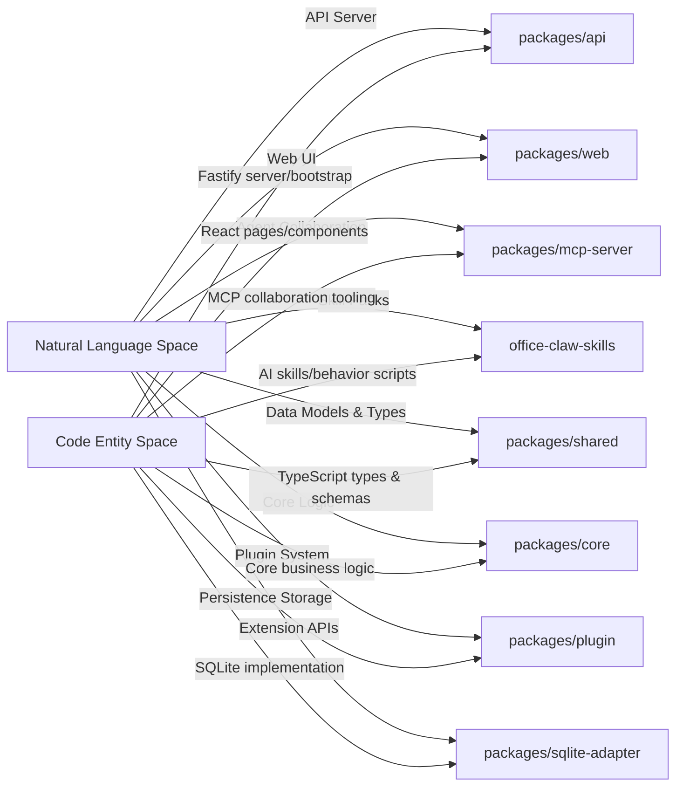

<!-- source: DeepWiki mcp.deepwiki.com · repo openJiuwen-ai/relay · page 1.2 Monorepo Layout · fetched 2026-11-02 -->

# 1.2 Monorepo Layout

<details>
<summary>Relevant source files</summary>

The following files were used as context for generating this wiki page:

- [.gitignore](.gitignore)
- [.npmrc](.npmrc)

</details>


This section provides an in-depth technical tour of the Relay / OfficeClaw monorepo structure, focusing on the key top-level directories and packages, their interdependencies, main implementation focus, data flow, and notable classes or functions. Understanding how the different components collaborate within the monorepo is critical for contributing effectively, debugging, or extending the platform.

---

## Monorepo Top-Level Structure Overview

At the root, the monorepo contains several key directories and packages:

- `packages/`
  - `api`
  - `web`
  - `core`
  - `shared`
  - `mcp-server`
  - `plugin`
  - `sqlite-adapter`
- `office-claw-skills/`
- `scripts/`
- `config/`

The monorepo uses **pnpm** with hoisted node modules for package management, as configured in `.npmrc`. This ensures workspace packages are linked flatly for compatibility, particularly on Windows, and simplifies dependency resolution.



Sources:  
- `.npmrc:1-12`  
- inferred from package names and repo conventions

---

## `packages` Directory

### 1. `packages/api`

- **Role:** The Fastify backend API server serves as the main interface for all client and agent interactions.
- **Key Features:** Routes, domains (agents, memory, projects, skills, schedule), storage and evidence providers.
- **Important files:** Typically `src/server.ts` (server bootstrap), route modules under `src/routes`, domain services in `src/domains`.
- **Data flow:** Accepts HTTP requests → route handlers → domain service logic → evidence and storage layers (often via adapters like SQLite).
- **Dependencies:** Depends on `core`, `shared` for data models and types. Uses `sqlite-adapter` for persistence. May also rely on `plugin` for extending API features.

### 2. `packages/web`

- **Role:** React/Next.js based web client that provides the entire user interface including dashboards, chat, admin panels.
- **Key Features:** Pages (HomePage, Agents, Models, Skills, Channels), shell components (MainShell), UI components for chat and thread views, frontend state stores, service workers for PWA.
- **Key files:** `src/pages/`, `src/components/`, `src/stores/`, `src/services/`.
- **Data flow:** User interaction → UI components → HTTP API calls to `packages/api`.
- **Dependencies:** Depends on `shared` for shared types and schemas. Uses API routes provided by `packages/api`.

### 3. `packages/core`

- **Role:** Contains core domain primitives, logic, and utilities — fundamental core algorithms and agent systems.
- **Key features:** Core utilities, low-level logic used across API server and MCP server.
- **Dependencies:** Used extensively by `api` and `mcp-server`.

### 4. `packages/shared`

- **Role:** Defines shared types, data schemas, registries, and cross-package contracts.
- **Key features:** Registries for agents, tasks, error transforms, and type schemas.
- **Dependencies:** Used by almost every package to ensure consistent data shapes and behavior contracts.

### 5. `packages/mcp-server`

- **Role:** MCP (Multi-agent Collaboration Protocol) server, coordinating tools and memory layers for agent collaboration.
- **Key features:** Server-toolsets, collaborative memory implementations, agent dare utilities.
- **Data flow:** Interfaces with agents, manages memory and collaborations, provides tools consumed by agent processes.
- **Dependencies:** Uses `core` primitives and `shared` types extensively.

### 6. `packages/plugin`

- **Role:** Plugin API and SDK for both server and web clients.
- **Key features:** Extension API surface, plugin lifecycle management, API for plugins on server and client side.
- **Dependencies:** Interacts with `api` and `web` packages.

### 7. `packages/sqlite-adapter`

- **Role:** Provides SQLite-backed storage adapter implementations for evidence and scheduler providers.
- **Key features:** Implements persistent storage interfaces used by API server and MCP server.
- **Dependencies:** Depends on code contracts defined in `shared` and `core`.

---

## `office-claw-skills/`

- **Role:** Skill packs and AI skills implementation folder.
- **Key features:** Houses skill plugins, AI agent behaviors, specialized document generation skills, communication skills (email, speech).
- **Data flow:** Skills are dynamically loaded by the API server or MCP server, executing agent tasks or orchestrating multi-step AI logic.
- **Dependencies:** Depends on `packages/core` and `packages/shared` for shared primitives and schemas. May call out to `plugin` APIs or external services.

---

## `scripts/`

- **Role:** Developer tooling and automation scripts.
- **Key features:** Development environment setup scripts (`dev-backend`, `dev-frontend`, `dev-all`), proxy servers (Anthropic proxy), Python virtual environments for ASR/TTS servers, installers, crash logging, preflight checks.
- **Usage:** Facilitate local development, CI workflows, release processes.
- **Dependencies:** Typically orchestrate package build and run commands; depend on tooling inside packages.

---

## `config/`

- **Role:** Central configuration management folder.
- **Key features:** Configuration files supporting environment loading (.env layered approach), model configuration JSONs, MaaS presets, OfficeClaw-specific config JSONs.
- **Usage:** Provides runtime and build-time configuration defaults and overrides for all sub-packages.
- **Dependencies:** Loaded by API server, CLI tools, and other runtime components.

---

## Dependency & Data Flow Diagram: Core Interaction between Packages

```mermaid
flowchart TD
  API[packages/api (Fastify API Server)]
  WEB[packages/web (React/Next web UI)]
  CORE[packages/core (Core primitives and logic)]
  SHARED[packages/shared (Shared types & schemas)]
  MCP[packages/mcp-server (Multi-agent Collab Server)]
  PLUGIN[packages/plugin (Plugin APIs & SDK)]
  SQLITE[packages/sqlite-adapter (SQLite Storage Adapter)]
  SKILLS[office-claw-skills (Skill Packs/AI Skills)]
  
  WEB -- Calls HTTP API --> API
  API -- Uses Types & Models --> SHARED
  MCP -- Uses Core primitives --> CORE
  API -- Uses Core primitives --> CORE
  API -- Uses Storage Adapter --> SQLITE
  MCP -- Uses Storage Adapter --> SQLITE
  API -- Extends Functionality --> PLUGIN
  WEB -- Extends UI --> PLUGIN
  API -- Loads --> SKILLS
  MCP -- Loads --> SKILLS
  SKILLS -- Uses --> CORE & SHARED
  
```

Sources:  
- inferred from package names and components described in overview and typical monorepo architecture.

---

## Symbolic Bridge Diagram: Natural Language to Code Entity Spaces

This diagram maps user-facing conceptual entities to code module components, useful for understanding where code implementations for certain Relay concepts live:



Sources:  
- package naming and implied roles from repo structure

---

## Summary Table of Packages with Functional Focus and Dependencies

| Package             | Role                                | Depends On          | Used By              |
|---------------------|-----------------------------------|---------------------|----------------------|
| `packages/api`      | Fastify API server backend         | `core`, `shared`, `sqlite-adapter`, `plugin`, `office-claw-skills` | `web`, external clients |
| `packages/web`      | React/Next frontend UI             | `shared`, `plugin`  | End users             |
| `packages/core`     | Fundamental domain primitives      | -                   | `api`, `mcp-server`, `office-claw-skills` |
| `packages/shared`   | Shared types, schemas, registries  | -                   | All packages          |
| `packages/mcp-server` | Multi-agent collaboration server  | `core`, `shared`, `sqlite-adapter`, `office-claw-skills` | Agent processes, `api` |
| `packages/plugin`   | Plugin API and SDK                 | -                   | `api`, `web`, external plugins |
| `packages/sqlite-adapter` | SQLite storage adapters          | `core`, `shared`    | `api`, `mcp-server`   |
| `office-claw-skills` | AI skill packs and behaviors       | `core`, `shared`, `plugin` | `api`, `mcp-server`  |
| `scripts/`          | Dev tooling and automation         | -                   | Developers            |
| `config/`           | Configuration files                | -                   | All runtime components|

Sources: inferred from package names, standard monorepo architecture, and role descriptions

---

## Additional Notes

- `.gitignore` excludes build artifacts, runtime-generated files, logs, and sensitive environment configs to keep the repo clean.  
- `node-linker=hoisted` in `.npmrc` configures pnpm for a flat `node_modules` structure for compatibility, particularly necessary for `next.js` builds on Windows.  
- The monorepo promotes code reuse via `shared` and `core` libraries, which are heavily depended upon by other packages to maintain consistency across the platform.  
- Inter-package dependencies favor decoupling: `api` and `mcp-server` implement backend logic; `web` is purely frontend; `plugin` is cross-cutting extension point.

---

This layout allows Relay / OfficeClaw to function as an integrated multi-agent collaboration platform with modular components enabling advanced AI-powered skills, real-time infrastructure, and robust web UIs, all maintained within a single unified monorepo environment.

---

# End of 1.2 Monorepo Layout

Sources:  
- `.npmrc:1-12`  
- inferred package roles and dependencies from repo structure and conventions

---

