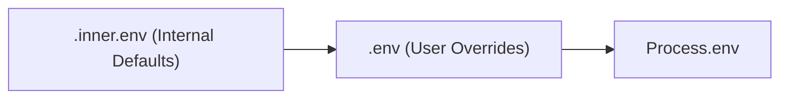
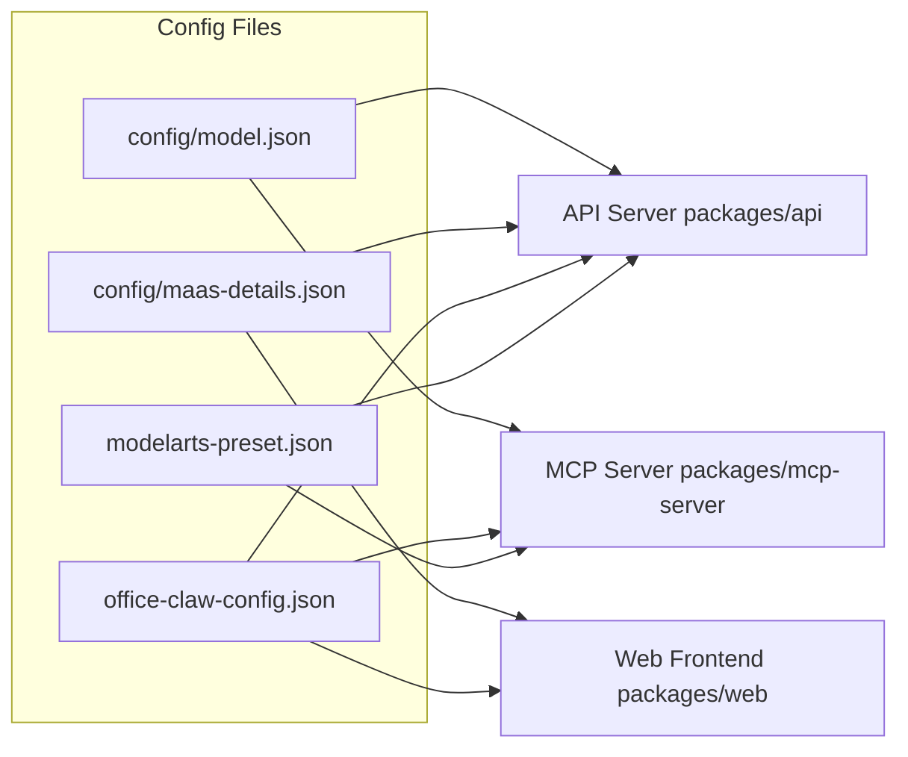
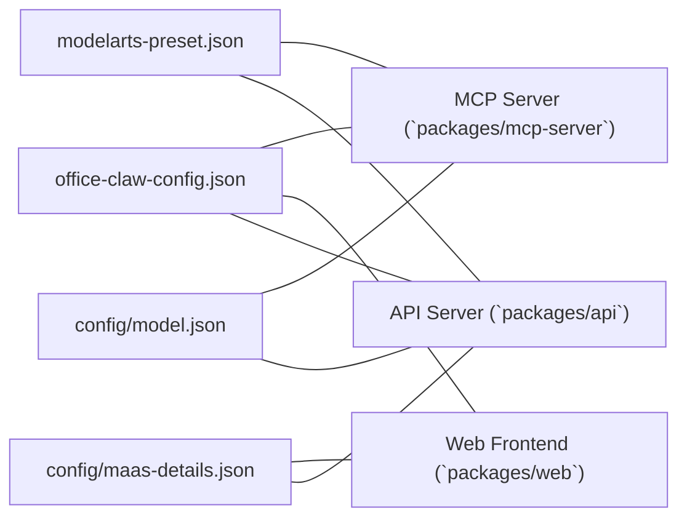

<!-- source: DeepWiki mcp.deepwiki.com · repo openJiuwen-ai/relay · page 1.3 Configuration Reference · fetched 2026-11-02 -->

# Configuration Reference

<details>
<summary>Relevant source files</summary>

The following files were used as context for generating this wiki page:

- [.env.example](.env.example)
- [.inner.env](.inner.env)
- [config/maas-details.json](config/maas-details.json)
- [config/model.json](config/model.json)
- [modelarts-preset.json](modelarts-preset.json)
- [office-claw-config.json](office-claw-config.json)

</details>


This page details the configuration mechanisms and key configuration files used in the Relay / OfficeClaw platform. It describes the two-tier environment variable loading, the critical grouping of environment keys, the whitelist for environment patching in the Hub, and the structure and role of important JSON configuration files (`model.json`, `maas-details.json`, `office-claw-config.json`, and `modelarts-preset.json`).

---

## 1. Two-Tier Environment Loading

Relay follows a hierarchical environment loading strategy to manage configuration variables securely and flexibly. This strategy enables a set of internal default values to be overridden by user-defined variables.

### Loading Order and File Roles

- **`.inner.env`**  
  This file holds *internal defaults* such as default platform URLs, CDN endpoints, and signal sources. It is intended for internal platform configuration that users typically do not modify lightly.

- **`.env`**  
  This is the *user override* file where administrators or operators specify their custom configuration, replacing or overriding `.inner.env` defaults with runtime-specific values such as credentials, ports, and feature toggles.

The environment variables are thus loaded in the following order (lowest to highest priority):



This guarantees that explicit user settings in `.env` take precedence, but fallback to `.inner.env` if variables are unspecified.

### Implementation Details

- These `.env` files contain placeholders, with strict rules defined in comments for security and handling to prevent inadvertent disclosure or injection attacks.
- The loading mechanism enforces that `.env` overrides are applied on top of `.inner.env` defaults, ensuring consistent configuration with flexibility.

Sources: `.inner.env:1-127`, `.env.example:1-130`()

---

## 2. Key Environment Variable Groups and Hub Env Patch Whitelist

Though the exact keys are defined within the `.inner.env` and `.env` files with security in mind, the key concepts involve:

- **Platform URLs:** API base URLs, WebSocket endpoints, Signal servers.
- **Credential Sets:** OAuth client IDs, API keys (kept secure and not explicitly enumerated).
- **Ports and Feature Toggles:** For Fastify API server, frontend ports, and Redis settings.
- **Hub Environment Patch Whitelist:**  
  The Relay Hub component manages environment patches dynamically but only allows certain environment variables to be patched at runtime for safety and integrity. This white-listing prevents unauthorized or unsafe modification of critical config values on active deployment.

The Hub patch whitelist works by specifying which environment keys may be patched via the Hub's management API. This ensures controlled flexibility needed during runtime without full re-deployment or manual file edits.

Sources: `.inner.env:22-120`, `.env.example:124-130`()

---

## 3. Configuration JSON Files in `config/` Directory

Relay leverages several important JSON configuration files for AI model setups, multi-agent profile descriptions, and deployment presets.

### 3.1 `config/model.json`

This file contains a list of AI models (via the `maas-data` array), each represented with minimal metadata.

Example entry:

```json
{
  "id": "deepseek-v3.1-terminus",
  "object": "list",
  "created": 0,
  "owned_by": "system"
}
```

- `id` corresponds to the model identifier used in codebase and UI.
- This list defines the available MaaS (Model-as-a-Service) models known to the platform.

This JSON acts as a registry for available AI models linked with provider profiles.

Sources: `config/model.json:1-70`()

---

### 3.2 `config/maas-details.json`

Provides detailed metadata about MaaS model IDs referenced in `model.json`.

Each model entry includes:

- `name`: Display name of the model.
- `description`: Localized model description.
- `labels`: Key feature tags (e.g., "文本生成" [Text Generation], "Function Call", "深度思考" [Deep Reasoning], token context window sizes).
- `developer`: Developer or vendor brand.
- `icon`: Path to an icon asset representing the model.

Example excerpt:

```json
"deepseek-v3.2": {
  "name": "DeepSeek-V3.2",
  "description": "DeepSeek-V3.2 是一款在计算效率与出色推理及代理能力之间实现出色平衡的模型，整体性能达到了 GPT-5 的水平。",
  "labels": [
    "文本生成",
    "Function Call",
    "深度思考",
    "160K"
  ],
  "developer": "DeepSeek",
  "icon": "/images/deepseek.svg"
}
```

The structure facilitates the UI and other platform subsystems to present enriched model information and differentiate capabilities visually and functionally.

Sources: `config/maas-details.json:1-128`()

---

### 3.3 `office-claw-config.json`

Defines the configuration for the core multi-agent collaboration team and their "breeds" (agent variants).

Key components:

- **Versioning:** `"version": 2` indicates config format version.
- **CoCreator:** Defines referential user attributes (e.g., mention patterns).
- **Roster:** Specifies agent IDs with family tags, roles, lead designation, availability, and "evaluation" labels.
- **Review Policy:** Rules for automated peer review in agent collaboration with flags for family matching, lead preference, availability exclusion.
- **Breeds:**  
  Array of agent breed definitions with rich attributes:
  - Agent identity and appearance (`id`, `agentId`, `name`, `avatar`, etc.)
  - Mention patterns for addressing agents conversationally.
  - Role and personality descriptions for dialogue behavior.
  - Team strengths and cautions.
  - Default and variant IDs mapped to providers and profiles.
  - `contextBudget` limits specify prompt token and message limits per breed.
  
Example breed snippet:

```json
{
  "id": "office",
  "agentId": "office",
  "displayName": "通用助手",
  "mentionPatterns": ["@office", "@小通", "@通用助手"],
  "defaultVariantId": "office-default",
  "variants": [
    {
      "id": "office-default",
      "provider": "relayclaw",
      "defaultModel": "glm-5.1",
      "contextBudget": {
        "maxPromptTokens": 180000,
        "maxContextTokens": 160000,
        ...
      },
      ...
    }
  ],
  ...
}
```

This file customizes the AI team composition, agent behaviors, capabilities, and deployment details used by server and frontend modules.

Sources: `office-claw-config.json:1-166`()

---

### 3.4 `modelarts-preset.json`

This preset JSON defines a ModelArts-customized deployment configuration for OfficeClaw, including:

- **Shared Account Profile:**
  - `profileId`, `displayName`, base API URL, permitted models, and protocol type.
- **Members:**
  - Pre-configured agents with agent IDs, display names, avatars, color schemes, mention regexes, default ML models, role descriptions, personalities, and strengths.

Example member configuration excerpt:

```json
{
  "agentId": "office",
  "nickname": "小通",
  "displayName": "通用助手",
  "avatar": "/avatars/agent-avatar-2.png",
  "providerProfileId": "huawei-maas",
  "defaultModel": "glm-5.1",
  "roleDescription": "全局梳理、脉络串联",
  "strengths": ["document-writing", "meeting-notes", "project-management", "data-analysis"]
}
```

This file serves as a template for deployment automation, ensuring agents and profiles align with ModelArts platform requirements and regional customizations.

Sources: `modelarts-preset.json:1-61`()

---

## 4. Data Flow and Implementation Integration

### Environment Variable Loading Flow within Startup

```mermaid
flowchart TD
    subgraph Env Loading
      A[Load `.inner.env`] --> B[Load `.env` overrides]
      B --> C[Process.env populated]
    end

    subgraph Platform Startup
      C --> D[Fastify Server Startup (API)]
      C --> E[React/Next Frontend Startup]
      C --> F[MCP Server & Plugins]
    end
```

- The `.inner.env` guarantees minimum defaults.
- The `.env` lets operators override.
- Populated node environment variables configure the API server, frontend, and microservices.

### Configuration Files Usage by System Components



- `model.json` and `maas-details.json` are mainly used by API and MCP server to configure AI provider profiles and accessible models.
- `office-claw-config.json` is a full roster and breed config referenced both backend and frontend to harmonize the UI and agent orchestration.
- `modelarts-preset.json` is a deployment preset mainly consumed during installation and initial setup for specialized environments.

Sources: All JSON files above.

---

## 5. Summary Table of Config Files

| Config File             | Purpose                                              | Key Fields/Structure                       | Usage Scope                      |
|-------------------------|------------------------------------------------------|-------------------------------------------|---------------------------------|
| `.inner.env`             | Internal platform env defaults                        | URLs, ports, CDN, signal sources          | Lowest-env-layer for all services |
| `.env`                   | User override environment variables                   | Credentials, ports, feature toggles       | Overrides `.inner.env`          |
| `config/model.json`      | List of ML models recognized by the system           | `maas-data`: list of `{id, object, ...}` | Backend (API, MCP)              |
| `config/maas-details.json`| Detailed metadata about each ML model                 | `name`, `description`, `labels`, `icon`  | Backend (API), Frontend UI      |
| `office-claw-config.json`| Multi-agent roster and behavior configuration         | `roster`, `breeds`, `reviewPolicy`        | Backend and Frontend            |
| `modelarts-preset.json`  | Pre-configured deployment profile for ModelArts       | Shared accounts, members array             | Deployment automation           |

---

# Diagrams Bridging Natural Language to Code Entities

## Diagram 1: Environment Loading Explained in Code Context

```mermaid
flowchart TD
    subgraph EnvLoader
      IE["`.inner.env` (Internal Defaults)"]
      UE["`.env` (User Overrides)"]
      EnvLoad["Function: loadEnvFiles()"]
    end

    IE --> EnvLoad
    UE --> EnvLoad
    EnvLoad --> ENV["Process Environment Variables `process.env`"]

    ENV --> API["Fastify API Server Startup (`packages/api/src/server.ts`)"]
    ENV --> Web["React Frontend Startup (`packages/web/`)"]
    ENV --> MCP["MCP Server (`packages/mcp-server/`) initialization"]
```

Explanation: The function `loadEnvFiles()` (conceptually located near server bootstrapping) reads `.inner.env` first, then applies `.env`, ultimately populating `process.env` which configures all main components.

Sources: `.inner.env:1-127`, `.env.example:1-130`()

---

## Diagram 2: Core JSON Config Files to System Modules



Natural language config concepts like "model metadata," "agent roster," and "deployment presets" link directly to concrete files and the code packages that load and apply these configurations.

Sources: `config/*.json`, `office-claw-config.json`, `modelarts-preset.json`()

---

# Conclusion

The Relay / OfficeClaw platform employs a carefully layered environment configuration system combined with rich structural JSON files defining the AI model registry, agent breeds, and deployment presets. This enables flexible, secure, and scalable control over the entire platform's runtime behavior, multi-agent collaboration, model selection, and environment patching. Understanding the two-tier env loading, key environment variable domains, and the purpose of configuration JSONs is critical for operators and developers extending or customizing the system.

---

Sources:  
`.inner.env:1-127`, `.env.example:1-130`,  
`config/model.json:1-70`, `config/maas-details.json:1-128`,  
`office-claw-config.json:1-166`, `modelarts-preset.json:1-61`

---

