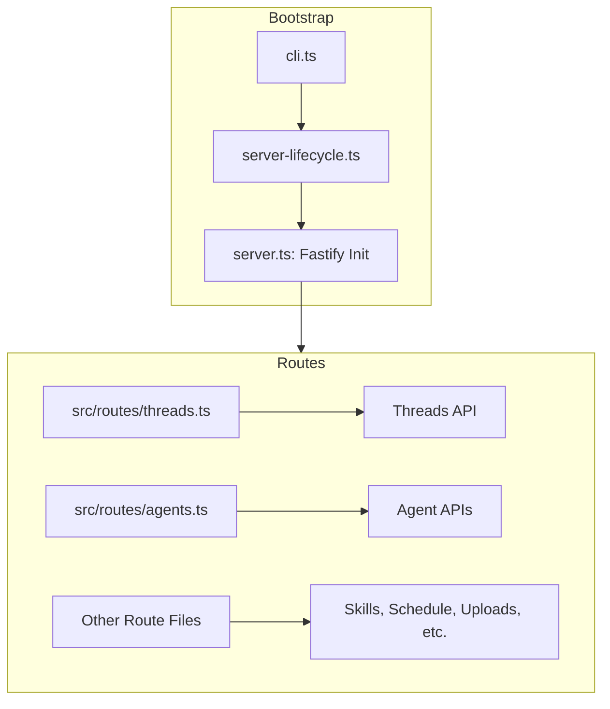
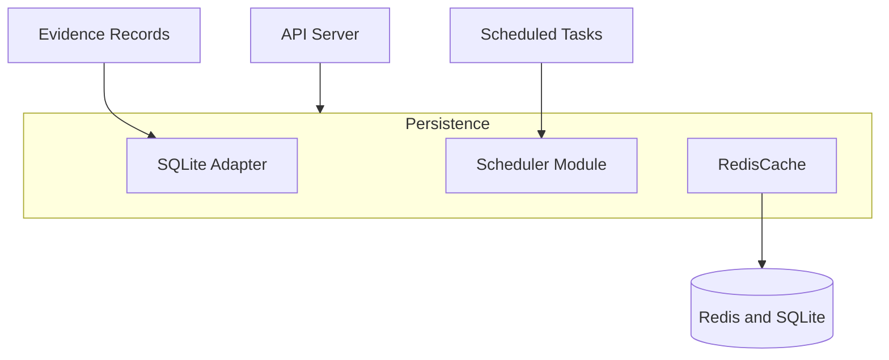
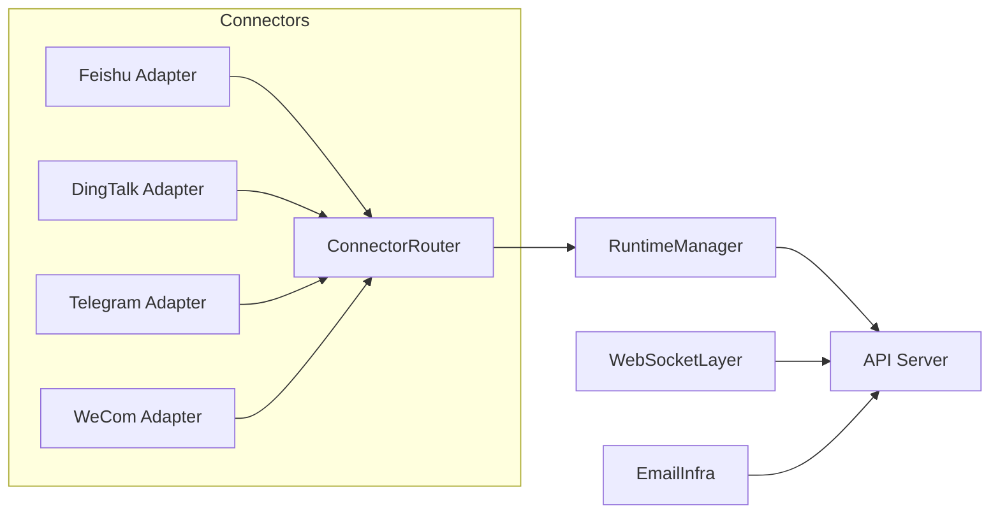
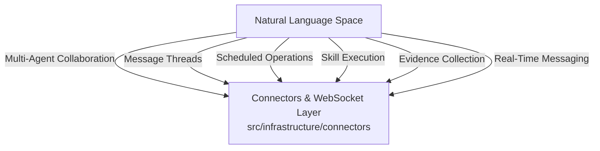

<!-- source: DeepWiki mcp.deepwiki.com · repo openJiuwen-ai/relay · page 2 API Server (packages/api) · fetched 2026-11-02 -->

# API Server (packages/api)

Relevant source files

The following files were used as context for generating this wiki page:

- [.env.example](.env.example)
- [README.md](README.md)

The `packages/api` module is the backend core of the Relay platform, implemented as a Fastify server that provides a rich HTTP API surface for all system functions. It acts as the central orchestrator by bootstrapping the server, managing route registration, hosting multiple domain services, and coordinating infrastructure and persistence layers. This API server powers the Relay web frontend and external clients along with real-time agents, connectors, and scheduler components.

---

## Overview and Purpose

`packages/api` exposes a scalable Fastify backend architecture that underpins Relay’s multi-agent collaboration platform. This backend is responsible for:

- Bootstrapping and lifecycle management of the HTTP server and CLI.
- Defining and registering RESTful routes grouped by domain (agents, messages, skills, threads, schedules, uploads, etc.).
- Encapsulating domain logic for key business areas such as agent orchestration, memory, projects, collaboration, and more.
- Managing persistence and data storage through pluggable evidence and scheduler providers.
- Coordinating communication infrastructure including connectors, websockets, and email.
- Enforcing authentication, authorization, and event auditing across the platform.

This design cleanly separates domain layers from infrastructure and route handling, enabling modular growth and maintenance.

---

## Server Bootstrap and Route Surface

The server boots up primarily through `server.ts` and associated lifecycle management files. It initializes Fastify, loads plugins (e.g., authentication, CORS), and registers a broad collection of HTTP routes. These routes serve various domain APIs such as:

- Threads and messages, enabling conversation persistence and retrieval.
- Agents and their orchestration endpoints (creation, interaction, status).
- Skills and skillhub management to handle AI skill packs on demand.
- Task scheduling, evidence tracking, and callback interfaces.
- Authentication, authorization, and provider profile management.
- File uploads, text-to-speech (TTS), and real-time streaming hooks.

Each route is organized inside the `src/routes` directory by domain, and route handlers generally delegate processing to domain services. Authentication and authorization middleware are applied consistently for security.

For details on server lifecycle methods, route registration, and endpoint structure, see the child page [HTTP Routes and Server Lifecycle](#2.1).

Sources: `packages/api/src/server.ts`, `server-lifecycle.ts`, `cli.ts`, `src/routes/*`

---

## Core Domains

The API server organizes its business logic into clearly separated domain service layers. The main domains include:

- **Agent Domain and Orchestration:**  
  Implements the logic around agent lifecycle, collaboration sessions, orchestration strategies like DegradationPolicy, EventAuditLog for auditing, task extraction and scheduling. It manages agent context, sessions, skillhub access, push notifications, TTS integration and usage aggregation.  
  See child page [Agent Domain and Orchestration](#2.2).

- **Memory, Projects, and Supporting Domains:**  
  Handles memory persistence, project management, inspiration sources, PPT generation, preview rendering, and auxiliary domains like limb and terminal interfaces. It also hosts cataloging and compatibility layers to unify various data sources.  
  See child page [Other API Domains](#2.3).

---

## Persistence and Storage Layers

To handle evidence collection, scheduling, and long-term data storage, the API server uses a pluggable persistence architecture:

- Providers include SQLite-backed storage via the `relay-storage-sqlite` module and the `packages/sqlite-adapter`.
- Evidence files are maintained in `evidence.sqlite` databases.
- Redis supports pub-sub and transient data caching.
- The `storage` module abstracts the persistence interface for clean domain usage.

This approach ensures flexibility in storage backend options and robust evidence tracking for auditing and operational reliability.

Refer to [Persistence: Evidence, Scheduler, Storage](#2.4) for full details.

Sources: `packages/api/src/domains/evidence`, `packages/sqlite-adapter`, `relay-storage-sqlite`

---

## Infrastructure and Connectors

Beyond core domain logic, the API server also integrates infrastructure components that provide multi-channel connectivity and real-time interaction:

- Connectors within `src/infrastructure/connectors` include adaptors for Feishu, DingTalk, WeCom, and Telegram platforms.
- ConnectorRouter and runtime managers handle inbound event routing and outbound webhook hooks.
- WebSocket and Socket.IO integration allows for real-time messaging and event streaming to clients.
- Email infrastructure supports mail relay and notifications.

These layers enable Relay to communicate externally across multiple enterprise chat ecosystems and realtime protocols.

For comprehensive coverage, see [Connectors and Real-Time Infrastructure](#2.5).

Sources: `packages/api/src/infrastructure/connectors/*`, `src/infrastructure/websocket`, `src/infrastructure/email`

---

## Relationship Between Natural Language Concepts and Code Entities

The API server translates user-facing concepts like multi-agent collaboration, threads, and scheduled tasks into concrete code entities.

This mapping clarifies how high-level user intents engage specific domain modules and route handlers in the backend.

---

## Summary

`packages/api` is the vital backend module in Relay, serving as a Fastify HTTP API server that exposes domain-driven REST endpoints, coordinates agent orchestration, manages persistence, and integrates connector infrastructure for real-time multi-channel communication. This modular and extensible design supports Relay’s multi-agent AI collaboration platform by cleanly separating concerns across server lifecycle, routes, domains, storage, and infrastructure.

For detailed technical coverage, explore these child pages:

- [HTTP Routes and Server Lifecycle](#2.1) — server bootstrap, route registration, auth
- [Agent Domain and Orchestration](#2.2) — agent-related domain services and orchestration
- [Other API Domains](#2.3) — memory, projects, inspiration, and auxiliary domains
- [Persistence: Evidence, Scheduler, Storage](#2.4) — pluggable storage providers and data files
- [Connectors and Real-Time Infrastructure](#2.5) — adapters, webhook routing, websockets, email

---

Sources:  
`packages/api/src/server.ts`  
`packages/api/src/server-lifecycle.ts`  
`packages/api/src/cli.ts`  
`packages/api/src/routes/*`  
`packages/api/src/domains/agents/services/*`  
`packages/api/src/domains/evidence/*`  
`packages/api/src/domains/schedule/*`  
`packages/api/src/infrastructure/connectors/*`  
`packages/sqlite-adapter`  
`relay-storage-sqlite`

---

