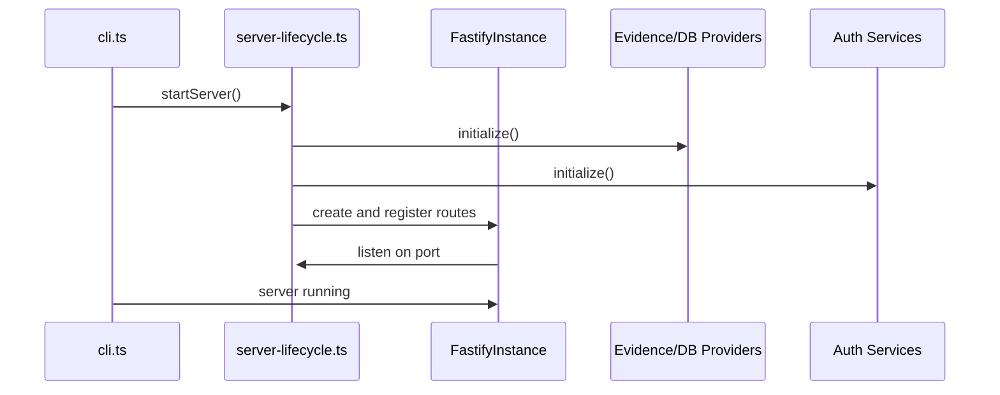
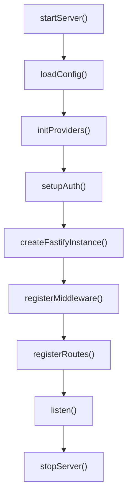
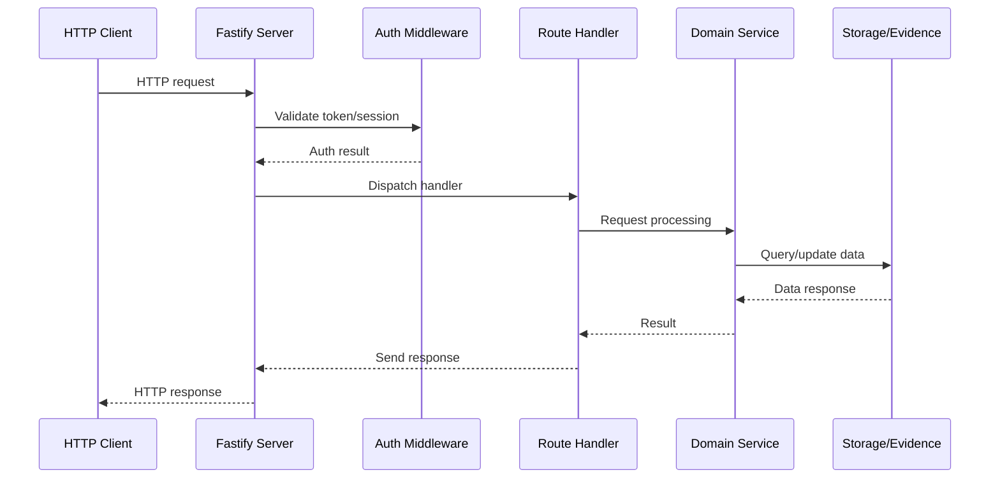
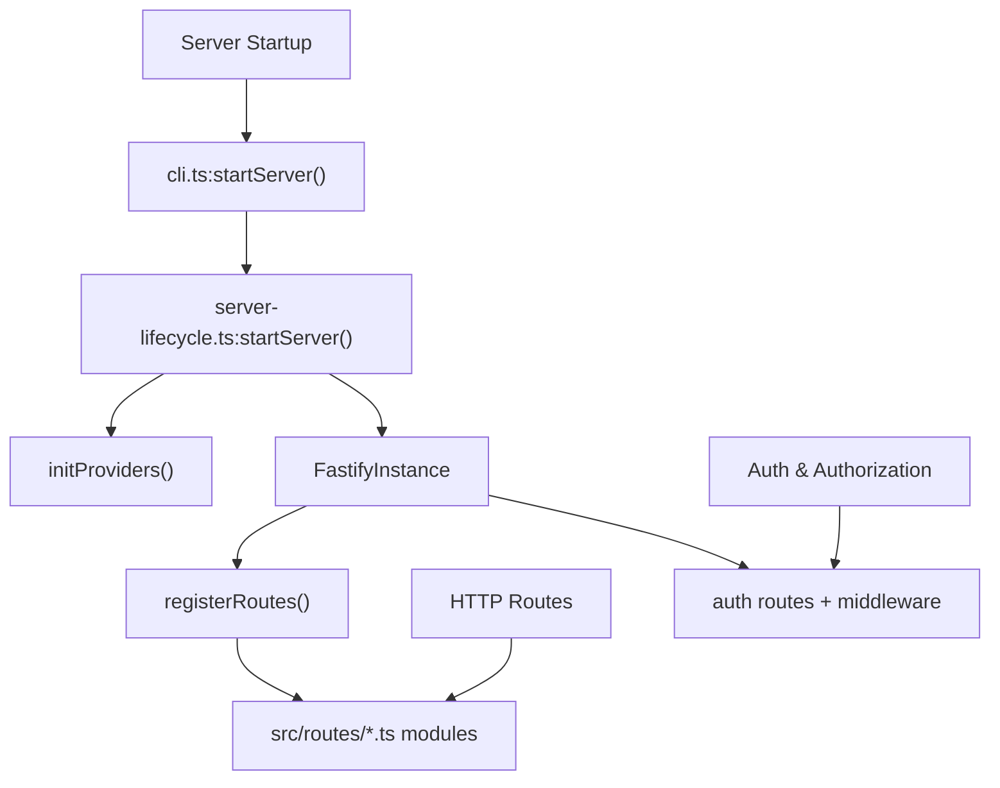

<!-- source: DeepWiki mcp.deepwiki.com · repo openJiuwen-ai/relay · page 2.1 HTTP Routes and Server Lifecycle · fetched 2026-11-02 -->

# 2.1 HTTP Routes and Server Lifecycle

<details>
<summary>Relevant source files</summary>

The following files were used as context for generating this wiki page:

- [README.md](README.md)

</details>


This page documents the HTTP server lifecycle and route registration mechanisms within the Relay API server (`packages/api`). It covers the bootstrap process initiated by the CLI, the Fastify server instantiation, how HTTP routes (threads, messages, agents, skills, schedule, evidence, memory, callbacks, provider profiles, uploads, TTS, auth/authorization) are registered and wired into the server, and key lifecycle hooks and middleware involved.

---

## Overview

Relay's backend API server is constructed around the Fastify framework, designed for high performance and extensibility. The server is bootstrapped via CLI commands which invoke a core lifecycle module responsible for initializing:

- Configuration loading and environment setup
- Database/storage/evidence providers
- Authentication and authorization mechanisms
- HTTP routes (domain APIs and auth routes)
- Plugins and auxiliary services (e.g. uploads, TTS)
- Graceful startup and shutdown behaviors

Routes are organized under `src/routes/`, covering domains such as threads, messages, agents, skills, scheduling, evidence, memory, callbacks, provider profiles, uploads, and TTS. Authentication routes (login, logout, token) also form part of this routing surface.

The server lifecycle module centralizes this bootstrapping to ensure domain services and infrastructure are fully set up before the API begins listening for requests.

---

## Server Bootstrap and CLI Entry Point

The entry point for the API server is the CLI script located in `packages/api/src/cli.ts`. Its core responsibility is to parse command line arguments, load configuration, and invoke the server lifecycle startup function.

The key flow is:

1. `cli.ts` loads environment variables and config files.
2. It calls the `startServer()` function exported by `server-lifecycle.ts`.
3. `startServer()` asynchronously initializes:
   - Database and evidence storage providers
   - Auth and authorization services
   - Domain services
   - Fastify server instance and registers routes
4. Server starts listening on configured HTTP port.
5. On shutdown signals, cleanup and graceful stop are orchestrated.



Sources: `packages/api/src/cli.ts:1-30`, `packages/api/src/server-lifecycle.ts:1-130`()

---

## Fastify Server and Route Registration

The server lifecycle creates a `FastifyInstance` which serves as the HTTP API surface.

### Route Registration

Routes are separated by domain into modules under `src/routes`:

- `threads.ts` — Thread and conversation management APIs
- `messages.ts` — Chat message APIs
- `agents.ts` — Agent configuration and orchestration
- `skills.ts` — Skill discovery and activation
- `schedule.ts` — Scheduled task management
- `evidence.ts` — Evidence store interfaces
- `memory.ts` — Session and long-term memory APIs
- `callbacks.ts` — Callback and webhook handling
- `provider-profiles.ts` — Provider profile configuration
- `uploads.ts` — File upload endpoints
- `tts.ts` — Text-to-speech APIs

Each route module exports a function that takes a Fastify instance and registers HTTP methods and paths, binding to controllers and domain service layers.

An example simplified Fastify route registration snippet looks like:

```ts
import { FastifyInstance } from 'fastify'
import { threadsRoutes } from './routes/threads'
import { messagesRoutes } from './routes/messages'

export async function registerRoutes(fastify: FastifyInstance) {
  fastify.register(threadsRoutes, { prefix: '/api/threads' })
  fastify.register(messagesRoutes, { prefix: '/api/messages' })
  // ... other routes similarly
}
```

The lifecycle invokes these registrations early after provider initialization to ensure domain services are injected and accessible for handlers.

### Auth and Authorization Routes

Authentication routes manage login/logout and token handling. Authorization middleware enforces access controls.

Auth routes are registered separately, usually under `/api/auth`.

Middleware and hooks for authentication and authorization are globally registered in the Fastify instance to wrap incoming requests, validating JWT tokens or session cookies as appropriate.

---

## Server Lifecycle Details

The `server-lifecycle.ts` module encapsulates lifecycle hooks and coordination:

- `startServer()`:
  - Loads environment config
  - Initializes storage (evidence providers), scheduler, and plugins
  - Sets up authentication and authorization services
  - Creates Fastify server instance
  - Registers middleware (logging, error handling, auth)
  - Registers all domain routes + auth routes
  - Starts listening on configured port — default 3003
- `stopServer()`:
  - Gracefully closes HTTP server
  - Disconnects storage and scheduler
  - Cleans up resources

This design cleanly abstracts server operations, enabling:

- Reuse in tests by importing lifecycle methods
- Controlled restart or shutdown
- Hooking into system signals for clean exits



Sources: `packages/api/src/server-lifecycle.ts:10-130`()

---

## HTTP Request Flow

When an HTTP request arrives, the following happens:

1. Fastify instance receives request.
2. Authentication middleware validates credentials (JWT/session).
3. Authorization middleware checks permissions for route.
4. Matching route handler executes, invoking domain services underneath.
5. Response is constructed and serialized.
6. Errors triggered propagate via error hooks for logging and client-friendly messages.

Each domain route typically delegates to a service layer responsible for its resource (e.g., ThreadService, AgentService), which in turn uses infrastructure layers (database access, cache, evidence providers) to process requests.



Sources: inferred from route registration and typical Fastify patterns in `packages/api/src/routes/*.ts` and lifecycle `server-lifecycle.ts`()

---

## Natural Language to Code Entity Mapping

This diagram bridges the natural language notions of server lifecycle and HTTP APIs to concrete code entities.



Sources: `cli.ts`, `server-lifecycle.ts`, `src/routes/*` files referenced above.

---

## Route Domains and Their Code Locations

| Domain           | Route File                    | Description                        |
|------------------|------------------------------|----------------------------------|
| Threads          | `src/routes/threads.ts`        | Thread/conversation management   |
| Messages         | `src/routes/messages.ts`       | Chat messages API                |
| Agents           | `src/routes/agents.ts`         | Agent config and orchestration   |
| Skills           | `src/routes/skills.ts`         | Skill pack discovery and loading |
| Schedule         | `src/routes/schedule.ts`       | Scheduled task APIs              |
| Evidence         | `src/routes/evidence.ts`       | Evidence storage APIs            |
| Memory           | `src/routes/memory.ts`         | Session and long-term memory     |
| Callbacks        | `src/routes/callbacks.ts`      | Callback/webhook handlers       |
| Provider Profiles| `src/routes/provider-profiles.ts` | Configuration of providers    |
| Uploads          | `src/routes/uploads.ts`        | File upload handling             |
| TTS              | `src/routes/tts.ts`            | Text-to-speech services          |
| Auth             | `src/routes/auth.ts`           | Authentication and login/logout  |

All routes get mounted under `/api` or domain prefixes accordingly during the server bootstrap.

Sources: `packages/api/src/routes` folder files.

---

## Summary

- The API server is bootstrapped via CLI (`cli.ts`) which calls the main lifecycle (`server-lifecycle.ts`).
- Provider initialization (DB, evidence, scheduler, auth) occurs before Fastify server creation.
- Fastify instance registers all domain HTTP routes from modularized route files.
- Auth routes and middleware are applied globally.
- Server listens on port 3003 by default, supporting multiple REST API domains.
- Lifecycle encapsulates startup and graceful shutdown logic.
- Requests flow through authentication, authorization, domain handlers, and finally storage layers.

This cohesive architecture enables modular growth of domains and clean separation between infrastructure, domain logic, and HTTP surface.

---

Sources:  
`packages/api/src/cli.ts:1-40`  
`packages/api/src/server-lifecycle.ts:1-130`  
`packages/api/src/routes/*.ts` (threads, messages, agents, skills, schedule, evidence, memory, callbacks, provider-profiles, uploads, tts, auth)

---

