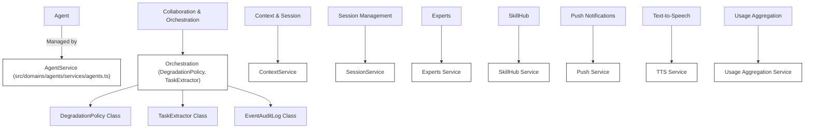
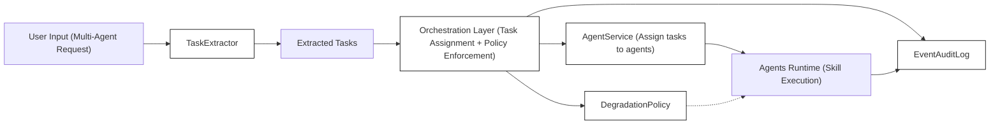
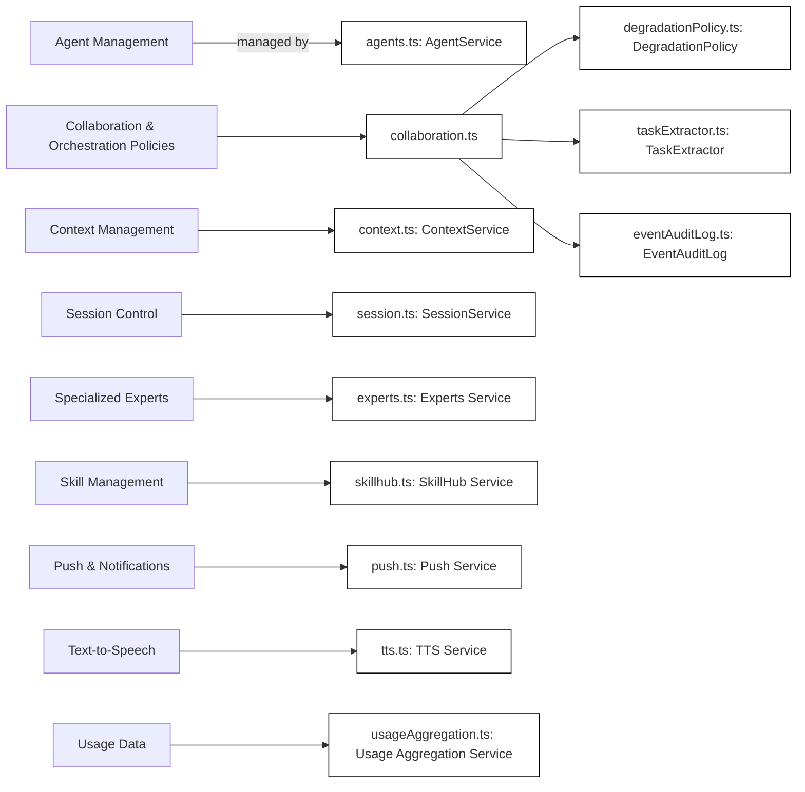
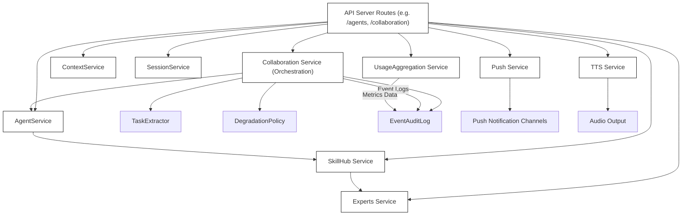

<!-- source: DeepWiki mcp.deepwiki.com · repo openJiuwen-ai/relay · page 2.2 Agent Domain and Orchestration · fetched 2026-11-02 -->

# Agent Domain and Orchestration

Relevant source files

The following files were used as context for generating this wiki page:

- [README.md](README.md)
- [README_zh.md](README_zh.md)

This section provides an in-depth technical exploration of the Agent Domain and Orchestration services implemented in the Relay API Server, located under `src/domains/agents/services`. It covers the core components involved in managing Agents, their collaboration, orchestration policies, context and session management, expert systems integration, the SkillHub mechanism, push notifications, text-to-speech (TTS) features, and usage aggregation. This is a leaf-level documentation focusing on implementation details, key classes/functions, and the overall data flow within this domain.

---

## Purpose and Scope

The Agent Domain in Relay encapsulates the coordination of multiple AI agents working as a collaborative team. It provides mechanisms for:

- Agent lifecycle, profiles, and configuration management.
- Collaboration orchestration between agents, including task delegation and event auditing.
- Context and session state management for multi-turn, multi-agent conversations.
- Integration of domain-specific expert modules and skill packs.
- A SkillHub system to dynamically load and coordinate skills.
- Maintaining push notification and TTS services.
- Aggregating usage data for auditing and policy enforcement.

This domain is foundational for implementing Relay’s multi-agent collaboration paradigm where agents go beyond isolated function calls and engage in complex workflows under orchestrated policies.

---

## 1. Core Components

The `agents/services` folder contains multiple service modules providing cohesive yet modular functionality:

- **Agents Service**: Creates, updates, and manages agent entities and their states.
- **Collaboration / Orchestration**: Implements orchestration policies including `DegradationPolicy`, task extraction (`TaskExtractor`), and event audit logs.
- **Context and Session Services**: Handle contextual state and session lifecycle for multi-agent dialogues.
- **Experts**: Manage integration points for domain experts or specialized skill modules.
- **SkillHub**: Skill loading and skill hub coordination framework.
- **Push and TTS Services**: Manage outbound push notifications and text-to-speech for agents.
- **Usage Aggregation**: Collect usage metrics for agents, supporting policy enforcement and analytics.

### Diagram 1: Natural Language to Code Entity Mapping — Agent Domain Overview

**Sources:**  
`src/domains/agents/services/agents.ts` through `src/domains/agents/services/usageAggregation.ts` (general coverage)

---

## 2. Agents Service

This service manages agent entities which represent autonomous AI characters or tools in Relay. An agent encapsulates configuration such as roles, associated skills, operational parameters, and runtime state.

- Main responsibilities include agent creation, update, retrieval, and deletion.
- Provides APIs to adjust agent collaboration roles and related metadata.
- Agents are persisted via database abstractions in the infrastructure/storage layer.
  
Key functions/classes:
- `AgentService` class (in `agents.ts`): core CRUD and helper methods for managing agents.
- Agent model schema maps attributes like `id`, `name`, `skills`, `role`, and active status.

Data flow:
- Incoming API calls are routed to this service.
- Changes are persisted to the underlying storage (usually SQLite).
- Agents are referenced by orchestration and collaboration modules during runtime.

**Sources:**  
`src/domains/agents/services/agents.ts`

---

## 3. Collaboration and Orchestration

### 3.1 DegradationPolicy

The `DegradationPolicy` class governs fallback and throttling rules when agent collaboration or skill invocations encounter capacity or failure constraints.

- Implements logic to degrade gracefully under overload or failures.
- Defines priority between agents or skills to favor more critical workflows.
- Can dynamically adjust thresholds based on runtime conditions.

### 3.2 EventAuditLog

This logging component captures events in agent collaboration:

- Event-driven actions such as task delegation, session progress, errors, or policy application.
- Records timestamped logs for auditing and debugging.
- Supports replay or trace back for complex multi-agent interactions.

### 3.3 TaskExtractor

A utility that parses rich inputs (e.g., multi-turn dialog, task descriptions) to break complex requests into actionable subtasks:

- Enables orchestrated workflows by splitting jobs to multiple agents.
- Assists the coordination layer in assigning tasks efficiently.

### Diagram 2: Collaboration and Orchestration Data Flow

Data flows from user input through task extraction, then orchestration assigns tasks to agents guided by degradation policies. All key events are audited.

**Sources:**  
`src/domains/agents/services/collaboration.ts`  
`src/domains/agents/services/degradationPolicy.ts`  
`src/domains/agents/services/eventAuditLog.ts`  
`src/domains/agents/services/taskExtractor.ts`

---

## 4. Context and Session Management

Multi-agent collaboration heavily depends on maintaining conversation and operational context.

- The **ContextService** manages runtime context objects that include the current state of dialogues, information relevant to multiple agents, and shared knowledge.
- The **SessionService** manages user sessions, tracking session lifecycle, multi-turn states, and agent-to-agent communication chains.
- Supports session chaining, allowing agents to pass states and knowledge downstream during workflows.

These services ensure that agents maintain coherence and state across complex interactions involving multiple participants.

**Sources:**  
`src/domains/agents/services/context.ts`  
`src/domains/agents/services/session.ts`

---

## 5. Experts and SkillHub

### 5.1 Experts Service

This module manages the registration and invocation of external or internal domain expert modules:

- Experts represent specialized skills or knowledge domains.
- The Experts service abstracts expert selection and execution, enabling multiplexing across various skill providers.

### 5.2 SkillHub

The SkillHub service acts as a central registry and loader for skill packs:

- Dynamically loads skill modules on demand.
- Coordinates skill life-cycles and their integration with agents.
- Facilitates extensions of agent capabilities by enabling modular skills.

This design decouples skill development and deployment from the core agent implementations, supporting extensibility.

**Sources:**  
`src/domains/agents/services/experts.ts`  
`src/domains/agents/services/skillhub.ts`

---

## 6. Push Notifications and Text-to-Speech (TTS)

- **Push Service**: Sends outbound notifications or messages to users or systems as part of the multi-agent collaboration workflow.
- **TTS Service**: Converts text responses generated by agents into speech, supporting multimodal interaction through audio channels.

These services enhance the delivery of agent outputs across various channels and devices.

**Sources:**  
`src/domains/agents/services/push.ts`  
`src/domains/agents/services/tts.ts`

---

## 7. Usage Aggregation

This service accumulates usage data such as API calls, skill invocations, agent interactions:

- Supports monitoring, billing, and quota enforcement.
- Aggregated data feeds into governance and policy layers.

It collects detailed metrics that are critical for maintaining system health and compliance.

**Sources:**  
`src/domains/agents/services/usageAggregation.ts`

---

## 8. Bridging Natural Language Concepts and Code Entities

The following diagram visualizes how high-level natural language system components correspond to source code files and classes in `src/domains/agents/services`.

### Diagram 3: Natural Language Component to Source Code Entity Mapping

---

### Diagram 4: Data Flow and Service Interaction in Agent Domain

---

## Summary

- The Agent Domain and Orchestration layer in Relay encapsulates complex multi-agent management, collaboration policies, and skill coordination.
- It implements modular services covering agents, context, sessions, experts, skillhub, push, TTS, and usage aggregation.
- Collaboration is enabled through orchestrated task extraction, degradation policies for fault tolerance, and rich event logging.
- The system is designed for extensibility and dynamic skill loading to support evolving AI team workflows.

This layer forms the heart of Relay's ability to make AI agents work together cohesively under defined policies and adaptive controls.

---

**Sources:**  
`src/domains/agents/services/agents.ts`  
`src/domains/agents/services/collaboration.ts`  
`src/domains/agents/services/degradationPolicy.ts`  
`src/domains/agents/services/eventAuditLog.ts`  
`src/domains/agents/services/taskExtractor.ts`  
`src/domains/agents/services/context.ts`  
`src/domains/agents/services/session.ts`  
`src/domains/agents/services/experts.ts`  
`src/domains/agents/services/skillhub.ts`  
`src/domains/agents/services/push.ts`  
`src/domains/agents/services/tts.ts`  
`src/domains/agents/services/usageAggregation.ts`

---

