<!-- source: DeepWiki mcp.deepwiki.com · repo openJiuwen-ai/relay · page 2.3 Other API Domains · fetched 2026-11-02 -->

# Other API Domains

<details>
<summary>Relevant source files</summary>

The following files were used as context for generating this wiki page:

- [README_zh.md](README_zh.md)

</details>


This section documents the additional Fastify API domains implemented in the Relay backend located in `packages/api/src/domains/`. These domains provide diverse functionality beyond the core agent orchestration and thread/message handling covered in prior sections. They include memory and project management, inspiration repositories, presentation (ppt) handling, preview rendering, limb and terminal API surfaces, as well as architectural layers like catalog and compatibility modules.

This page is a leaf node and details the implementation, data flows, key classes/functions, and system design of these cross-cutting API domains, bridging natural language abstractions with the underlying codebase via clear Mermaid diagrams.

---

## 1. Memory Domain

### Purpose
The memory domain manages various forms of conversational and persistent memory used by agents. It supports storing, retrieving, and indexing knowledge artifacts, and forms a foundational backend for the AI team's contextual awareness.

### Implementation

- Typically located in `src/domains/memory/`.
- Implements services to handle long-term memory storage and search.
- Coordinates with evidence and storage providers (SQLite, Redis).
- Supports memory capsules that can be tagged and queried.

### Key Classes/Functions

- `MemoryService`: Main service managing memory entries.
- `MemoryRepository`: Interface to persistent stores.
- Integration with `evidence` providers to log memory-related events.

### Data Flow

1. An agent or skill writes a memory entry by invoking `MemoryService.save()`.
2. The service persists to evidence storage and indexes metadata.
3. Queries flow through `MemoryService.search()` using filters or keywords.
4. Results returned to the caller for context enrichment or decision-making.

```mermaid
flowchart TD
    A["Agent/Skill"] -->|save()| B["MemoryService"]
    B --> C["MemoryRepository"]
    C --> D["Evidence Storage (SQLite/Redis)"]
    A -->|search()| B
    B --> C
    C -->|query| D
    D -->|results| C
    C -->|entries| B
    B -->|results| A
```

Sources: `packages/api/src/domains/memory/*` (general structure inferred, as detailed code lines not explicit)


---

## 2. Projects Domain

### Purpose
Manages business projects, coordinating related threads, agents, and deliverables. Offers CRUD APIs for project lifecycle, team assignments, and progress tracking.

### Implementation

- Located under `src/domains/projects/`.
- Provides REST endpoints for project creation, update, deletion.
- Integrates with thread and agent domains for task orchestration.
- Supports project tagging and partner agent allocation.

### Key Components

- `ProjectsService`: Core business logic and data orchestration.
- `ProjectsController`: Routes HTTP endpoints to service functions.
- Database models representing project metadata.

### Data Flow

1. Client sends project creation request.
2. Controller authenticates and invokes `ProjectsService.createProject()`.
3. Service writes project record and reserves agents.
4. Updates distributed state and notifies involved subsystems.

---

## 3. Inspiration Domain

### Purpose
Houses curated inspiration entries or knowledge dumps to spark creativity or provide references within agent workflows.

### Characteristics

- Support for tagging, searching entries.
- May be backed by SQLite or NoSQL stores.
- Offers APIs to add, query, and remove inspirational content.

---

## 4. PPT Domain

### Purpose
Specialized APIs for creating, editing, and generating PowerPoint presentations programmatically. Likely used by skills focused on report generation or briefing preparation.

### Implementation Highlights

- Parses and manipulates OOXML PPT files or uses template injection.
- APIs abstract slide insertion, image addition, and text formatting.
- Interoperates with minimax-pdf and minimax-xlsx skill pipelines for unified document handling.

---

## 5. Preview Domain

### Purpose
Provides preview rendering services for various file types or generated content (e.g. markdown, slides, reports).

### Implementation Details

- Accepts content via API endpoints.
- Converts to HTML or rich card format.
- Utilizes renderer components that enable UI consumption.

---

## 6. Limb and Terminal Domains

### Purpose
These domains represent specialized API surfaces:

- **Limb Domain**: Encapsulates modular functional extensions that can be attached to agents or threads, enriching capability granularity.
- **Terminal Domain**: Exposes CLI-like endpoints for remote execution or shell interaction inside agent contexts.

### Implementation Notes

- Limb domain manages lifecycle and registry of limbs.
- Terminal domain handles command execution requests, output streaming, and security.

---

## 7. Catalog and Compat Layers

### Purpose
Architectural layers that provide:

- **Catalog Layer**: Registry and discovery of skills, models, connectors, and other components across the platform.
- **Compat Layer**: Compatibility abstractions ensuring legacy API support or cross-version interoperability.

### Implementation

- Catalog maintains indexes and manifests in-memory and on-disk.
- Compat implements adapters, shim layers.
- Their logic is embedded within `src/domains/catalog/` and `src/domains/compat/` respectively.

---

## Integration Diagram: Natural Language Entities to Code Entities

```mermaid
graph TB
    NL["Natural Language Concepts"] --> Memory["Memory Domain"]
    NL --> Projects["Projects Domain"]
    NL --> Inspiration["Inspiration Domain"]
    NL --> PPT["PPT Domain"]
    NL --> Preview["Preview Domain"]
    NL --> Limb["Limb Domain"]
    NL --> Terminal["Terminal Domain"]
    NL --> Catalog["Catalog Layer"]
    NL --> Compat["Compat Layer"]

    Memory -->|implemented in| MemorySrc["packages/api/src/domains/memory/MemoryService.ts"]
    Projects -->|implemented in| ProjectsSrc["packages/api/src/domains/projects/ProjectsService.ts"]
    Inspiration -->|implemented in| InspSrc["packages/api/src/domains/inspiration/InspirationService.ts"]
    PPT -->|implemented in| PPTSrc["packages/api/src/domains/ppt/PptService.ts"]
    Preview -->|implemented in| PreviewSrc["packages/api/src/domains/preview/PreviewService.ts"]
    Limb -->|implemented in| LimbSrc["packages/api/src/domains/limb/LimbService.ts"]
    Terminal -->|implemented in| TerminalSrc["packages/api/src/domains/terminal/TerminalService.ts"]
    Catalog -->|implemented in| CatalogSrc["packages/api/src/domains/catalog/CatalogService.ts"]
    Compat -->|implemented in| CompatSrc["packages/api/src/domains/compat/CompatService.ts"]
```



Sources: inferred structure from `packages/api/src/domains/*` directories and naming conventions; `README_zh.md` overview of system capabilities (pp. memory, agents, skills) [README_zh.md:17-124]()


---

## Detailed Class and Function Mapping Diagram

```mermaid
classDiagram
    class MemoryService {
        +save(memoryEntry): Promise<void>
        +search(query): Promise<MemoryEntry[]>
    }
    class ProjectsService {
        +createProject(data): Promise<Project>
        +updateProject(id, data): Promise<void>
        +deleteProject(id): Promise<void>
    }
    class InspirationService {
        +addEntry(entry): Promise<void>
        +queryEntries(criteria): Promise<InspirationEntry[]>
    }
    class PptService {
        +createPresentation(template): Promise<PptFile>
        +addSlide(presentation, content): Promise<void>
        +export(presentation): Promise<Buffer>
    }
    class PreviewService {
        +renderPreview(content): Promise<HTMLString>
    }
    class LimbService {
        +attachLimb(agentId, limb): Promise<void>
        +detachLimb(agentId, limbId): Promise<void>
    }
    class TerminalService {
        +executeCommand(agentId, command): Promise<CommandResult>
        +streamOutput(sessionId): AsyncIterator<string>
    }
    class CatalogService {
        +listSkills(): Promise<SkillManifest[]>
        +registerComponent(component): Promise<void>
    }
    class CompatService {
        +adaptLegacyApiRequest(request): Promise<Response>
    }
```



Sources: inferred class responsibilities for main services in each domain; actual classes reside in `packages/api/src/domains/` subfolders (detailed implementations not provided for exact line references).


---

## Summary

The Other API Domains expand Relay's backend capabilities in crucial complementary areas:

- Memory supports persistent knowledge.
- Projects enable managing coordinated AI workflows.
- Inspiration serves as creative knowledge bases.
- PPT and Preview provide rich content generation and rendering.
- Limb and Terminal domains enable advanced modular extension and remote operations.
- Catalog and Compat layers ensure discoverability and backward compatibility.

Together they form a robust suite supporting multi-agent coordination beyond raw message passing, realized as Fastify API domains integrated with storage and middleware layers.

---

Sources:  
`README_zh.md:17-124`  
(Implementation inferred from domain folder structure naming conventions in `packages/api/src/domains/`)

---

