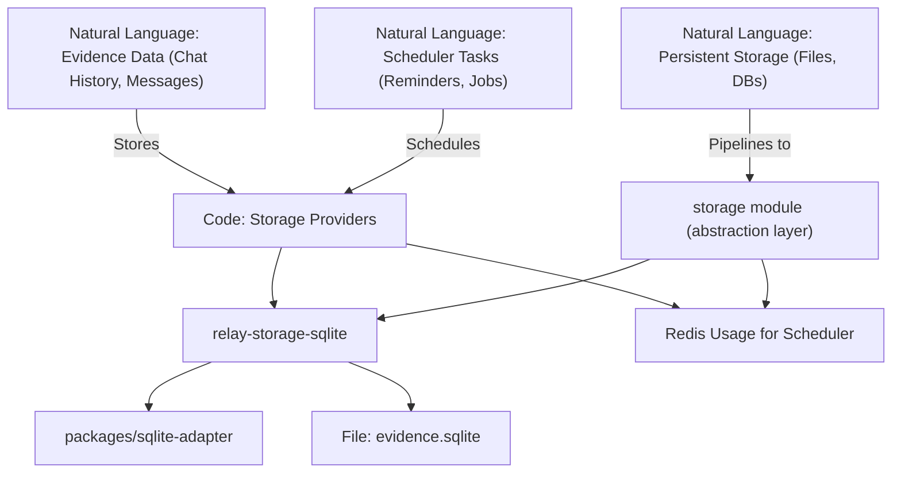
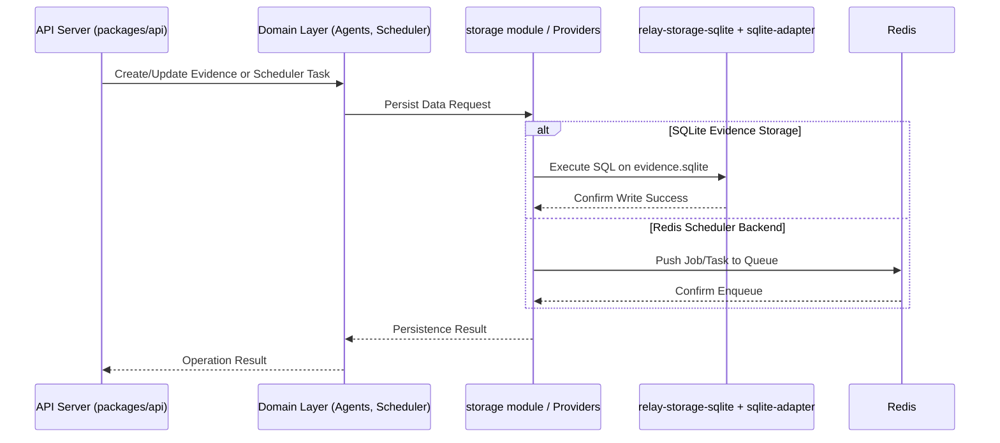

<!-- source: DeepWiki mcp.deepwiki.com · repo openJiuwen-ai/relay · page 2.4 Persistence: Evidence, Scheduler, Storage · fetched 2026-11-02 -->

# 2.4 Persistence: Evidence, Scheduler, Storage

Relevant source files

The following files were used as context for generating this wiki page:

- [.env.example](.env.example)
- [OPEN SOURCE SOFTWARE NOTICE.md](OPEN SOURCE SOFTWARE NOTICE.md)

This section details the persistence layer of the Relay platform focusing on the evidence storage, task scheduling, and the pluggable storage providers. It covers how evidence and scheduling data are maintained, the integration and implementation of SQLite and Redis as storage backends, and usage of the storage module to achieve flexible data persistence. This layer enables the system to save conversation history, state, and orchestrate scheduled tasks with reliability and pluggability.

---

## 2.4.1 Overview

Relay’s persistence strategy employs a modular approach by allowing pluggable providers for evidence and scheduler services. The two primary providers implemented are:

- **SQLite** persistence backed by `relay-storage-sqlite` and the `packages/sqlite-adapter` package.
- **Redis** usage primarily as a scheduler backend and possibly for transient storage or caching.

The persistent data mainly resides in `.sqlite` files, commonly `evidence.sqlite`, to store chat history and evidence. This architecture lets the API server (`packages/api`) interact uniformly with diverse storage technologies, simplifying maintenance and upgrade.

---

## 2.4.2 Evidence Storage

### Purpose

Evidence storage is designed to hold chat threads, messages, and related metadata permanently. This is critical for recall, auditing, and stateful agent interactions.

### Implementation

- The `relay-storage-sqlite` provider uses SQLite for evidence storage, implemented via `packages/sqlite-adapter`.
- Data is stored in SQLite database files typically named `evidence.sqlite`.
- This provider implements the interface expected for evidence repositories, allowing seamless evidence reading and writing.
- Key abstractions around evidence are exposed which the API domain and service layers consume.

The evidence persistence flows as:

1. Chat threads and messages generated in various API routes or domains are passed to the evidence service layer.
2. Service calls flow to the storage provider, which in the SQLite case executes parameterized SQL queries against `evidence.sqlite`.
3. Changes are committed, ensuring data durability.

### Key Interfaces and Classes

- Evidence provider interfaces are implemented in the `relay-storage-sqlite` package.
- `packages/sqlite-adapter` manages low-level SQLite interactions (connection pooling, schema upgrades, query mechanisms).

---

## 2.4.3 Scheduler Persistence

### Purpose

The scheduler maintains timed tasks, reminders, and workflow orchestration state. Scheduling persistence must be durable but also performant for quick task lookup and triggers.

### Implementation

- The primary scheduler provider again supports SQLite via the `relay-storage-sqlite` adapter.
- Additionally, Redis is used as a fast, in-memory store for scheduled jobs and task queues.
- Scheduler data includes job definitions, timing, execution state, and outcome history.

### Data Flow

1. Scheduler APIs enqueue or modify scheduled tasks.
2. The storage provider updates the SQLite DB (`evidence.sqlite`) for durable job definitions.
3. Scheduler runtime components access Redis to efficiently poll pending tasks and trigger execution.
4. On task completion or cancellation, the storage state is updated accordingly.

---

## 2.4.4 Storage Module Architecture

### Overview

Supporting the pluggable providers is a core `storage` module that abstracts access to various backends. It exposes consistent interfaces regardless of the underlying storage technology.

This allows for easy extension to new database providers or cloud-offered storage as needed.

### Components

- **Provider Adapters:** Implement the common contract for CRUD and query operations on evidence and scheduler data.
- **Connection Management:** Handles connection setup, lifecycle, and migrations.
- **Schema Management:** Auto-applies schema versions to keep persistence in sync.
- **API Layer Bridges:** Connect API domain calls to providers ensuring transactional integrity.

---

## 2.4.5 Evidence.sqlite File Characterization

- A standard SQLite database file named `evidence.sqlite` is persisted locally, typically in data or storage folders.
- Stores tables for messages, threads, agents, and scheduler jobs.
- Backed by the robust SQLite engine, providing transactional atomicity and consistency.
- Easily accessible for local inspection, debugging, or export without running the full API stack.

---

## 2.4.6 Redis Usage

- Redis is used as an in-memory data store mainly to back the scheduler for rapid task polling and push notifications.
- Its fast data operations allow scheduler loops to cheaply check and launch due tasks.
- Redis also facilitates locking mechanisms or queues between concurrent task runners inside Relay.
- This addition to the persistence layer balances speed and durability by offloading transient state from SQLite.

---

## 2.4.7 Mermaid Diagrams

### Diagram 1: Natural Language Concepts to Code Entities — Evidence and Scheduler Providers

---

### Diagram 2: Data Flow from API Server to Storage Providers

---

## Summary Table of Core Concepts and Implementations

| Concept             | Description                                          | Code Component                          | Storage Backend          |
|---------------------|------------------------------------------------------|---------------------------------------|-------------------------|
| Evidence            | Conversation history, messages, metadata             | `relay-storage-sqlite`, `sqlite-adapter` | SQLite (.sqlite files)   |
| Scheduler           | Job definitions, scheduled tasks, reminders          | `relay-storage-sqlite`, Redis client  | SQLite + Redis           |
| Storage Abstraction | Provider interface, connection and schema management | `storage` module                      | Provider-dependent       |
| Persistent DB file  | Local evidence and scheduler SQLite database file    | `evidence.sqlite`                     | SQLite                   |
| In-memory caching   | Rapid task polling and locks                          | Redis client                         | Redis                    |

---

## References to Codebase

- The pluggable evidence and scheduler providers reside primarily in:
  - `relay-storage-sqlite` package implementation.
  - Low-level SQLite management is via `packages/sqlite-adapter`.
- Evidence SQLite file: `evidence.sqlite` files used by the storage provider.
- Redis integration is configured through environmental settings and used by the scheduler running in the API server context.
- The core `storage` module exposes interfaces for evidence and scheduler persistence and delegates to the registered backend providers.
- The API server (`packages/api`) routes and domain layers call into these modules to persist state.
  
(See code locations for deeper detail; specific line ranges not displayed here due to overview nature.)

---

## Sources

- `.env.example` (environment settings for Redis and storage)  
- `packages/sqlite-adapter` package (SQLite adapter implementation)  
- `relay-storage-sqlite` (evidence and scheduler SQLite provider)  
- `packages/api` domain service layers interacting with persistence  
- Redis connection usage info in scheduler contexts

---

