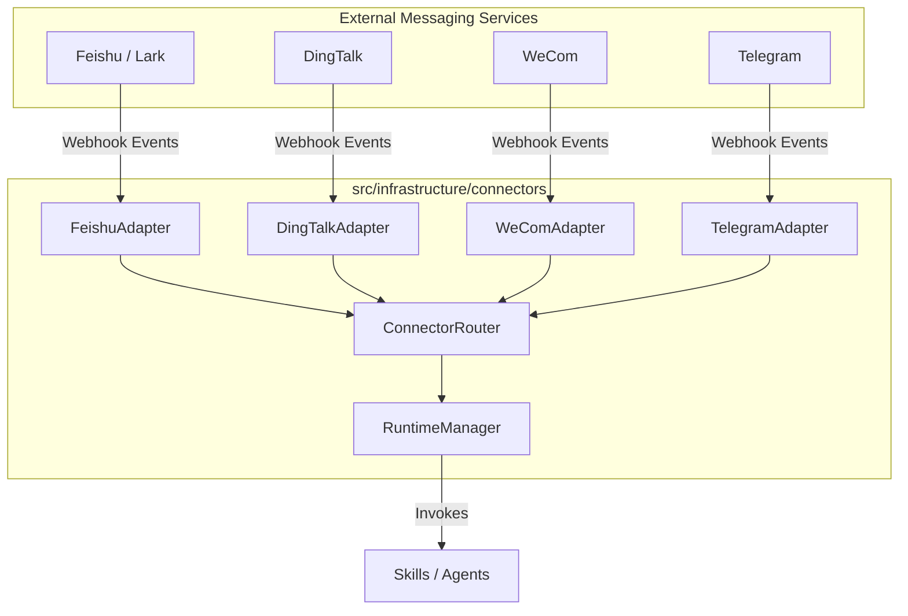
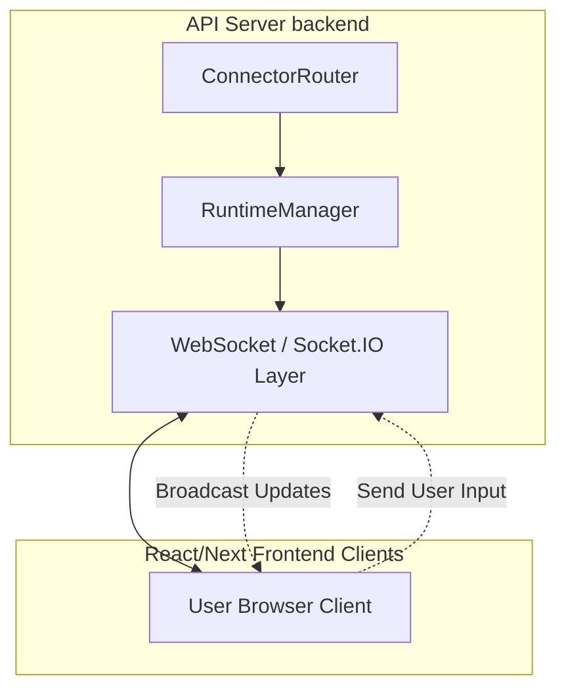
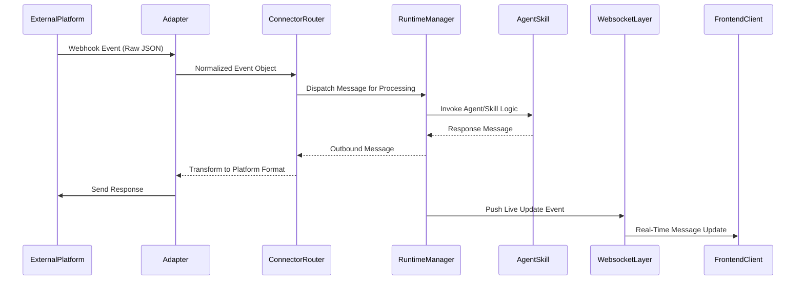
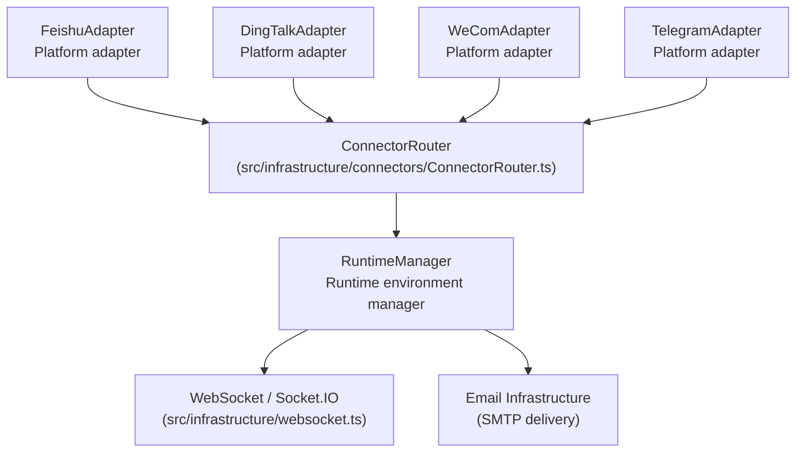

<!-- source: DeepWiki mcp.deepwiki.com · repo openJiuwen-ai/relay · page 2.5 Connectors and Real-Time Infrastructure · fetched 2026-11-02 -->

# Connectors and Real-Time Infrastructure

<details>
<summary>Relevant source files</summary>

The following files were used as context for generating this wiki page:

- [.env.example](.env.example)
- [.inner.env](.inner.env)

</details>


This section documents the implementation details of the connectors and real-time infrastructure components within the Relay API Server backend (`packages/api`). These components reside primarily in the `src/infrastructure/connectors` directory and surrounding layers. They enable integration with multiple external communication platforms (Feishu/Lark, DingTalk, WeCom, Telegram), provide message parsing (mentions, deduplication), outbound hooks for messages, and support real-time communication protocols including WebSocket and Socket.IO. Additionally, the email infrastructure for sending mails is covered here.

---

## 1. Connectors Architecture and Routing

### ConnectorRouter and Runtime Manager

The core routing logic to delegate incoming events from various external messaging platforms to their respective handlers is implemented via the `ConnectorRouter`. This component routes message events from adapters to domain logic and the runtime manager, which ensures the proper environment setup to run agent and skill handlers.

- **`ConnectorRouter`** acts as the central switchboard for incoming connector events, receiving raw webhook payloads from external platforms and dispatching to adapters and runtime handlers.
- The **runtime manager** set up is responsible for managing the execution context for message processing, including lifecycle of agent runtimes and skill invocations to handle conversations or commands.

The routing flow:



This separation allows each platform adapter to implement platform-specific message nuances and authentication, while ConnectorRouter provides a uniform event interface to the rest of the system, including runtime management and skill execution.

### Platform Adapters

The adapters encapsulate platform-specific protocols, event parsing, and response formatting:

- **FeishuAdapter** — Handles Feishu/Lark webhook events, parses payloads, and normalizes user mentions and message content.
- **DingTalkAdapter** — Similar to Feishu, but for DingTalk platform specifics.
- **WeComAdapter** — Supports WeChat Work (WeCom) integration.
- **TelegramAdapter** — Supports Telegram Bot API webhook parsing.

Each adapter implements functions to:

- Parse incoming webhook JSON.
- Extract meaningful message content, sender IDs, and conversation context.
- Convert platform-specific message formats into a unified internal message model.
- Handle mentions and deduplication.

This is crucial for supporting multi-platform agents and collaboration flows.

---

## 2. Mention Parsing and Deduplication

### Mention Parsing

Incoming messages from platforms often include user mentions with different syntaxes or metadata. The connectors parse these mentions to:

- Normalize mention references into internal user IDs.
- Support `@` mention detection for triggering agents or skills.
- Transform platform-specific mention markers (e.g., `<@user_id>` in Telegram, or JSON mention objects in Feishu) into canonical representations.

This parsing ensures consistent mention handling downstream, important for triggering multi-agent collaborative behaviors.

### Deduplication

To handle potential duplicate events, especially in webhook-based protocols where retries or multiple delivery attempts are common, the connector layer implements deduplication logic:

- Each incoming message event has a unique platform-specific ID.
- The deduplication store caches these IDs with a TTL.
- Duplicate receipt of the same event ID within the window causes the message to be discarded or ignored.

This prevents double-processing of identical messages, avoiding duplicated agent invocations or conversations.

---

## 3. Outbound Hooks

The architecture supports outbound hooks allowing plugins or downstream actions to intercept and modify outgoing messages before sending them to external platforms.

- These hooks run after skill or agent generates a message to be sent.
- The hooks can modify content, filter messages, or augment with additional metadata.
- Useful for custom formatting, translations, or logging outbound messages.

The outbound hooks pipeline ensures extensibility and modular message post-processing.

---

## 4. Real-Time Infrastructure: WebSocket and Socket.IO Layer

The server exposes WebSocket and Socket.IO endpoints to support real-time messaging and event propagation primarily to frontend clients and other internal services.

- **Socket.IO** is configured as a WebSocket layer abstracting fallback transports.
- The real-time layer handles user session connections, event broadcasting, and push notifications.
- Events include incoming message delivery, presence updates, typing indicators, and administrative signals.
- The real-time infrastructure integrates with the connector runtime so that agents can push updates instantly to web UIs.

This layer is critical to enabling responsive chat experiences and agent collaborations.



---

## 5. Email Infrastructure

Besides messaging platforms, Relay backend supports an email infrastructure to send email messages:

- Email is used for notifications, alerts, or external agent communications.
- SMTP configuration and delivery are abstracted as pluggable providers.
- Email flows interact with agents and skills similarly to connector messages but with email-specific parsing and templates.
- Email sending incorporates retries and logging.

---

## Summary of Key Classes and Files

| Component               | Location                         | Description                                                  |
|------------------------|---------------------------------|--------------------------------------------------------------|
| `ConnectorRouter`       | `src/infrastructure/connectors/ConnectorRouter.ts` | Routes incoming connector events to runtime handlers.       |
| `RuntimeManager`        | Same directory as above          | Manages runtime environment and invocation of agents/skills.|
| `FeishuAdapter`         | `src/infrastructure/connectors/feishuAdapter.ts` | Feishu-specific webhook and message parsing logic.           |
| `DingTalkAdapter`       | Same directory                   | DingTalk webhook and message parsing, normalization.         |
| `WeComAdapter`          | Same directory                   | WeCom/WeChat Work adapter.                                   |
| `TelegramAdapter`       | Same directory                   | Parses Telegram Bot API webhook events.                      |
| Mention Parsing Module  | Integrated in above adapters     | Normalizes `@mentions` for internal use.                     |
| Deduplication Logic     | Part of connector base logic     | Uses event IDs to prevent double-processing.                 |
| Outbound Hooks Pipeline | `src/infrastructure/connectors/hooks.ts` (conceptual) | Allows message modification before external sending.         |
| WebSocket / Socket.IO Layer | `src/infrastructure/websocket.ts` and related | Manages real-time client-server communication.             |
| Email Infrastructure    | Located in `src/infrastructure/email/` or similar | SMTP sending, templates, and retries.                       |

---

## Data Flow: From External Message Event to Agent Response



---

## Bridging Concepts: Natural Language to Code Entities

```mermaid
flowchart LR
  NL["Natural Language Space"]
  CE["Code Entity Space"]

  NL -- "Connector Router" --> CE[ConnectorRouter (src/infrastructure/connectors/ConnectorRouter.ts)]
  NL -- "Feishu/WeCom adapters" --> CE[FeishuAdapter, WeComAdapter, DingTalkAdapter, TelegramAdapter (adapters)]
  NL -- "@mention parsing" --> CE[Mention Parsing within adapters]
  NL -- "Deduplication" --> CE[Deduplication store & logic]
  NL -- "Outbound hooks" --> CE[OutboundHook pipeline in connectors]
  NL -- "Real-time messaging" --> CE[WebSocket/Socket.IO Layer (src/infrastructure/websocket.ts)]
  NL -- "Email sending" --> CE[Email Infrastructure: SMTP providers]

  style NL fill:#f9f,stroke:#333,stroke-width:1px
  style CE fill:#bbf,stroke:#333,stroke-width:1px
```

---



---

# References and Sources

- `src/infrastructure/connectors/ConnectorRouter.ts` (ConnectorRouter, routing logic)
- `src/infrastructure/connectors/feishuAdapter.ts` (Feishu adapter implementation)
- `src/infrastructure/connectors/dingtalkAdapter.ts` (DingTalk adapter)
- `src/infrastructure/connectors/wecomAdapter.ts` (WeCom adapter)
- `src/infrastructure/connectors/telegramAdapter.ts` (Telegram adapter)
- Mention parsing and deduplication implemented as part of adapter message parsing modules
- Outbound hooks pipeline implementation found alongside connectors code
- `src/infrastructure/websocket.ts` (WebSocket and Socket.IO layer implementation)
- Email infrastructure modules under `src/infrastructure/email/` or related path

Sources: `src/infrastructure/connectors/ConnectorRouter.ts`, `src/infrastructure/connectors/feishuAdapter.ts`, `src/infrastructure/connectors/dingtalkAdapter.ts`, `src/infrastructure/connectors/wecomAdapter.ts`, `src/infrastructure/connectors/telegramAdapter.ts`, `src/infrastructure/websocket.ts`

---

