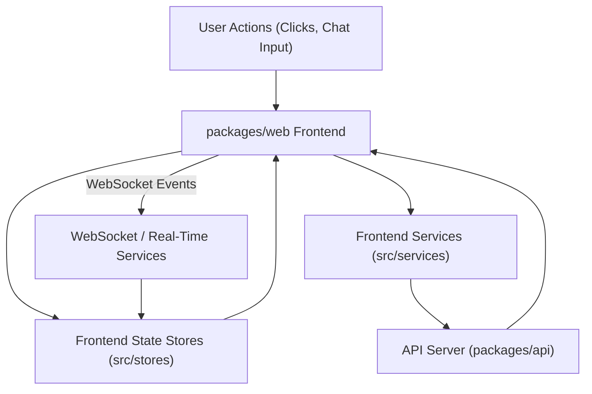

<!-- source: DeepWiki mcp.deepwiki.com · repo openJiuwen-ai/relay · page 3 Web Frontend (packages/web) · fetched 2026-11-02 -->

# Web Frontend (packages/web)

Relevant source files

The following files were used as context for generating this wiki page:

- [OPEN SOURCE SOFTWARE NOTICE.md](OPEN SOURCE SOFTWARE NOTICE.md)
- [README.md](README.md)

The `packages/web` directory contains the React-based web client of Relay, implemented using Vite and Next.js technologies. This frontend serves as the primary user interface for interacting with Relay’s multi-agent AI collaboration platform. It provides accessible web pages, organized navigation, responsive UI components, client-side state management, and integration with background services. The frontend is structured to enable seamless collaboration across agents, models, skills, channels, schedules, and administrative functions.

This page provides a high-level overview of the web frontend’s architecture and major areas. Detailed technical descriptions and implementation specifics are covered in dedicated child pages. Links to those child pages are provided for easy navigation and deeper exploration.

---

## Overview of Web Frontend Architecture

The web client is a React/Vite+Next app structured around a modular set of pages, UI components, and state management stores. It integrates with backend services through REST APIs and real-time channels, enabling dynamic, interactive workflows for agent collaboration and platform management.

At a conceptual level, the frontend consists of:

- **Pages and Navigation Shell** — Entry points into the app, organized into major functional areas such as Home, Threads, Agents, Models, Skills, Channels, Schedule, and Inspiration pages. The `MainShell` or `RootChrome` handles app layout and routing.

- **Chat and Thread UI** — The core interactive chat experience including message input, rich message display with cards and blocks, thread sidebars, message actions, and mention routing. Components like `ChatContainer` encapsulate the conversation UI.

- **OfficeClaw Hub and Admin Panels** — Manage platform administration aspects such as agent editing, provider and model profiles, governance, quotas, routing policies, environment variables, commands, and security configuration. This area also includes voice and push notification settings.

- **Frontend State, Services, and PWA Support** — Client-side stores, service modules, hooks, and APIs manage state synchronization, interactions with backend, offline behavior via service workers, and public API exposure for internal usage. These ensure responsive updates, caching, and progressive web app capabilities.

This modular layering enables clean separation of concerns, reusability, and extensibility. The application’s UI remains synchronized with backend state via efficient state stores and service calls.

---

## System to Code Entity Mapping Diagrams

### Package `packages/web` Conceptual Layers to Key Code Entities

```mermaid
graph TB
  NaturalLangSpace["Natural Language Concepts"]
  CodeEntitySpace["Code Entities in packages/web"]

  NaturalLangSpace -->|represents| CodeEntitySpace

  subgraph Concepts
    Pages["Pages and Navigation"]
    ChatUI["Chat and Thread UI"]
    AdminHub["OfficeClaw Hub & Admin Panels"]
    StateServices["State, Services, PWA"]
  end
  
  subgraph CodeEntities
    PagesFiles["src/pages/** (HomePage, ThreadPage...)"]
    MainShell["src/components/MainShell / RootChrome"]
    ChatComponents["src/components/chat/** (ChatContainer, chat-input, chat-message)"]
    RichBlocks["src/components/chat/richblocks/**"]
    Sidebar["src/components/thread-sidebar"]
    MessageActions["src/components/message-actions"]
    AdminTabs["src/components/officeclaw-hub/** (agent-editor, provider-profiles)"]
    Stores["src/stores/**"]
    Services["src/services/**"]
    Hooks["src/hooks/**"]
    PublicAPI["src/public-api/**"]
    WorkerPWA["src/worker/**, service-worker.ts"]
  end

  Pages --> PagesFiles
  Pages --> MainShell
  ChatUI --> ChatComponents
  ChatUI --> RichBlocks
  ChatUI --> Sidebar
  ChatUI --> MessageActions
  AdminHub --> AdminTabs
  StateServices --> Stores
  StateServices --> Services
  StateServices --> Hooks
  StateServices --> PublicAPI
  StateServices --> WorkerPWA

  NaturalLangSpace --> Pages
  NaturalLangSpace --> ChatUI
  NaturalLangSpace --> AdminHub
  NaturalLangSpace --> StateServices
```

### Interaction Flow: User Navigation to Backend Integration

---

## Pages and Navigation Shell

The frontend's page navigation is rooted in defined React pages representing major workspace components:

- **HomePage** — Landing overview.
- **ThreadPage** — Chat threads and interaction.
- **AgentsPage** — Manage AI agents.
- **ModelsPage** — Model configuration.
- **SkillsPage** — Skill pack management.
- **ChannelsPage** — Multi-channel configuration.
- **SchedulePage** — Scheduled tasks management.
- **InspirationPage** — Insights and inspirations.

These pages rely on a common app layout shell called `MainShell` or `RootChrome` that handles routing, app-wide menus, headers, footers, and global UI chrome elements.

For detailed routing behavior and layout interactions, see [Pages and Navigation Shell](#3.1).

---

## Chat and Thread UI

Central to Relay is the multi-agent chat interface. The chat UI is composed of:

- `ChatContainer` holds entire chat thread context.
- `chat-input` handles message composition and sending.
- `chat-message` renders messages with rich formatting.
- Rich interactive message blocks such as cards, command-line outputs, code previews, and visual embeds.
- Thread sidebar for context and related information.
- Message actions for editing, starring, replying.
- @mention routing to direct messages contextually within conversations.

This interactive UI serves as the collaboration hub for team agents and users.

For implementation specifics of UI components, rich block rendering, and advanced chat features, see [Chat and Thread UI](#3.2).

---

## OfficeClaw Hub and Admin Panels

For administrative control and deeper configuration, the frontend provides the OfficeClaw Hub area with multiple tabs:

- Agent editor to configure and tune agents.
- Provider profiles and ACP model profiles for cloud AI resource management.
- Governance and quota boards for platform policy.
- Routing policy editors and environment variable management.
- Command management and operational tooling.
- Panels for models, channels, skills, security, voice, and push notification integration.

These panels enable operators to manage the entire platform state from a unified interface.

For comprehensive detail, see [OfficeClaw Hub and Admin Panels](#3.3).

---

## Frontend State, Services, and PWA Support

The frontend maintains its local cache and reactive UI state using a collection of stores found under `src/stores/`. Dedicated services (`src/services/`) encapsulate network calls, API interactions, and background synchronization logic.

Custom React hooks in `src/hooks/` provide useful reusable logic, while a `public-api/` exposes streamlined frontend interfaces.

The frontend also includes a service worker (`src/worker/`, `service-worker.ts`) that uses Workbox to enable offline support and caching for Progressive Web App capabilities.

These foundational pieces ensure smooth client-side interactivity, resilience, and integration with the backend ecosystem.

For in-depth explanation, see [Frontend State, Services and PWA](#3.4).

---

# Summary and Navigation

The `packages/web` frontend is structured into modular layers spanning pages, chat UI, admin tools, and client state management. Each part cooperates to provide an efficient user experience for managing AI agents and platform workflows in Relay.

For detailed exploration of each major area and how components are implemented, please refer to the linked child pages:

- [Pages and Navigation Shell](#3.1)
- [Chat and Thread UI](#3.2)
- [OfficeClaw Hub and Admin Panels](#3.3)
- [Frontend State, Services and PWA](#3.4)

---

### Sources:

- `packages/web/src/pages/**` — Pages definitions and routing  
- `packages/web/src/components/MainShell.tsx` and `RootChrome.tsx` — Layout components  
- `packages/web/src/components/chat/ChatContainer.tsx` and related UI components  
- `packages/web/src/components/officeclaw-hub/**` — Admin panel components  
- `packages/web/src/stores/**` — State management stores  
- `packages/web/src/services/**` — API and backend interaction services  
- `packages/web/src/hooks/**` — React hooks  
- `packages/web/src/public-api/**` — Frontend API exposure  
- `packages/web/src/worker/**` and `service-worker.ts` — Offline, PWA support

---

