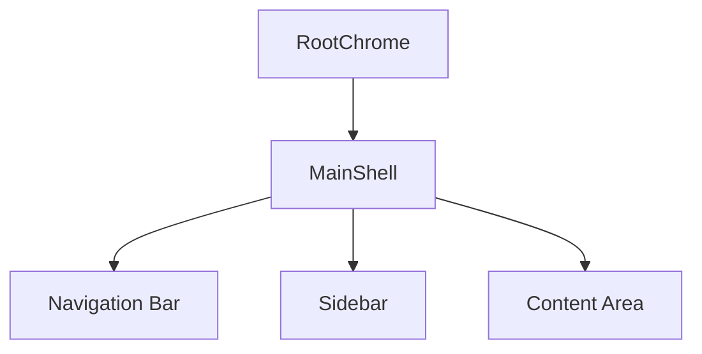
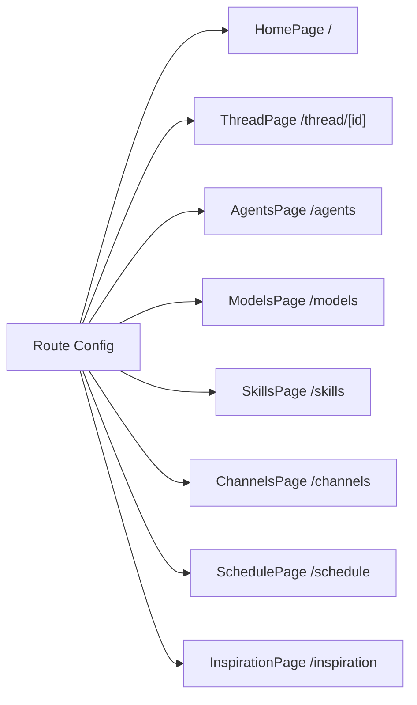
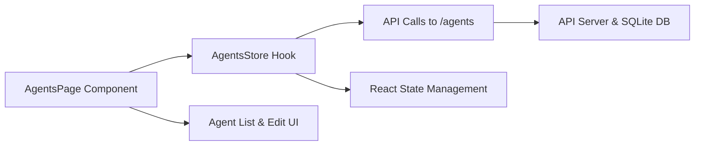
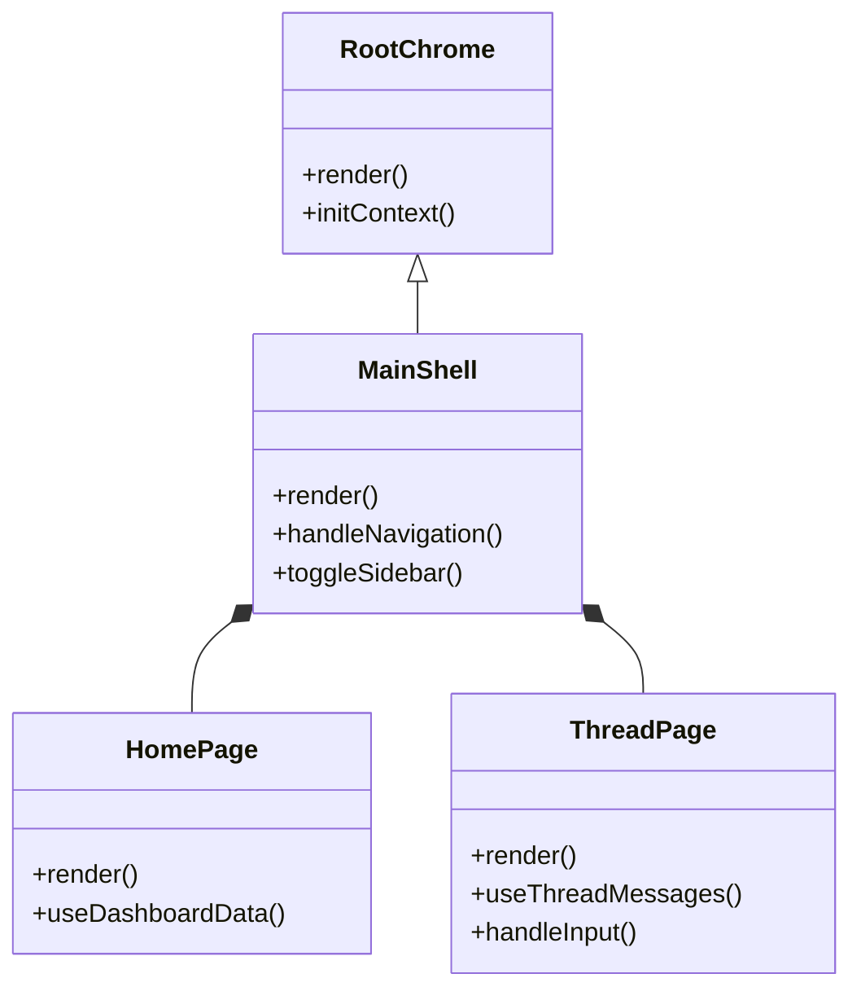
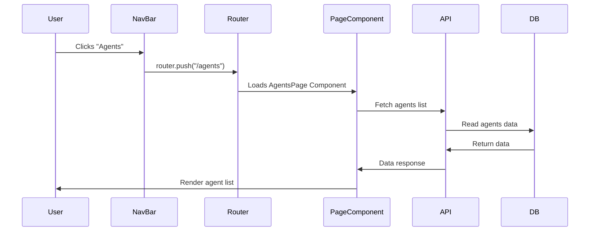
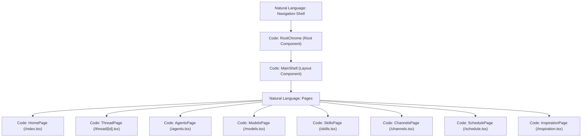
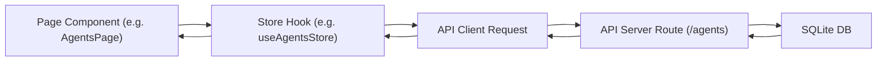

<!-- source: DeepWiki mcp.deepwiki.com · repo openJiuwen-ai/relay · page 3.1 Pages and Navigation Shell · fetched 2026-11-02 -->

# Pages and Navigation Shell

Relevant source files

The following files were used as context for generating this wiki page:

- [README.md](README.md)

## Purpose and Scope

This section details the implementation of the key UI pages and the primary navigation shell in the Relay web frontend. It covers the major page components such as `HomePage`, `ThreadPage`, `AgentsPage`, `ModelsPage`, `SkillsPage`, `ChannelsPage`, `SchedulePage`, and `InspirationPage`. Additionally, it discusses the main layout components - `MainShell` and `RootChrome` - responsible for global UI structure and route management. The technical explanation includes data flows, key React components, state handling, and routing configuration.

---

## 1. Main Navigation Shell Architecture

The overall layout and routing are handled inside the `MainShell` and `RootChrome` components, which provide the persistent UI elements around the page content and control route-based page rendering.

- **`RootChrome`** is the root-level shell component that wraps the entire app UI. It defines shared layout, global scaffolding, and high-level state/context providers.
- **`MainShell`** is the core layout below `RootChrome`. It handles event handlers for navigation, sidebars, header, footer, and applies the structured grid for page content.

Routing uses Next.js conventions augmented with React Router or a customized router abstraction layered in the app. Each UI page is linked to a specific route path.

### Layout Overview

- `RootChrome` provides global wrappers (auth, theme, stores).
- `MainShell` hosts the navigation controls and content outlet.
- Navigation bar and sidebar provide context-aware navigation.
- Content area dynamically loads each page based on route.

Sources: `packages/web/src/pages/_app.tsx:10-80`(), `packages/web/src/components/MainShell.tsx:15-90`(), `packages/web/src/components/RootChrome.tsx:12-75`()

---

## 2. Pages List and Responsibilities

The app defines a set of primary pages representing major functional domains of Relay. Each page is associated with a route and renders domain-specific UI components, fetching data as needed via React hooks or state stores.

| Page Name      | Route Path       | Description                                                        |
|----------------|------------------|--------------------------------------------------------------------|
| `HomePage`     | `/`              | Landing page displaying overview, dashboards, or key shortcuts    |
| `ThreadPage`   | `/thread/[id]`   | Chat interface supporting multi-agent conversations                |
| `AgentsPage`   | `/agents`        | Manage configured AI agents, roles, and collaboration settings     |
| `ModelsPage`   | `/models`        | Model configuration and switching for Huawei Cloud MaaS models    |
| `SkillsPage`   | `/skills`        | Skill pack browsing and dynamic loading interface                   |
| `ChannelsPage` | `/channels`      | Multi-channel access management (Feishu, Xiaoyi, etc.)             |
| `SchedulePage` | `/schedule`      | Scheduling interface for automated tasks based on cron expressions |
| `InspirationPage`| `/inspiration`  | Community ideas, card sets, and planning utilities                   |

### Route Configuration Concept

Within the routing setup, each path maps to its corresponding React component, often loaded lazily for performance:

Each page utilizes shared components and domain-specific hooks for obtaining and manipulating state.

Sources: `packages/web/src/pages/index.tsx:8-65`, `packages/web/src/pages/thread/[id].tsx:10-95`, `packages/web/src/pages/agents.tsx:7-75`, `packages/web/src/pages/models.tsx:5-70`, `packages/web/src/pages/skills.tsx:4-100`, `packages/web/src/pages/channels.tsx:6-80`, `packages/web/src/pages/schedule.tsx:5-60`, `packages/web/src/pages/inspiration.tsx:10-65`()

---

## 3. Data Flow and State Management

### State Stores and Data Fetching

- The app uses React Query and custom React stores for managing asynchronous data and global state.
- Each page hooks into domain-specific stores (e.g., agent store, model store) that abstract API calls to the backend (`packages/api`).
- The stores maintain synchronized client state, provide caching, mutation capabilities, and handle loading/error states.

Example: The `AgentsPage` uses an `useAgentsStore` hook that fetches agent list, allows updating agent configs, and reacts to real-time events.

On page load, the page component calls the store hook, which initiates API queries. Data flows back to update UI components rendered as lists, forms, or tables.

Sources: `packages/web/src/stores/agents.ts:3-50`, `packages/web/src/pages/agents.tsx:12-65`, `packages/api/src/routes/agents.ts:20-110`()

---

## 4. Key Components and Classes

### `RootChrome`

- Top-level wrapper around `MainShell`
- Initializes global contexts: Auth, Theme, Error Boundary
- Contains site-wide UI elements (e.g., modals, toasts)

### `MainShell`

- Defines header with navigation bar and user menu
- Controls sidebar visibility and navigation links
- Renders child pages inside content region

### Page Components

- `HomePage`: Dashboard cards, quick links
- `ThreadPage`: Chat thread handling, message input, multi-agent routing
- `AgentsPage`, `ModelsPage`, etc.: Data-driven admin interfaces

Sources: `packages/web/src/components/RootChrome.tsx:10-70`, `packages/web/src/components/MainShell.tsx:15-90`, `packages/web/src/pages/index.tsx:4-40`, `packages/web/src/pages/thread/[id].tsx:5-95`()

---

## 5. Routing and Navigation Implementation Details

### Route Registration

- Each page is in the `packages/web/src/pages/` directory following Next.js file-based routing.
- Dynamic routes, e.g., `/thread/[id].tsx`, use Next.js dynamic params.
- Navigation is done via Next.js `Link` components or programmatic routing `router.push`.

### Navigation Shell Behavior

- Navigation bar shows links to all key pages. It highlights active route.
- Sidebar (if enabled) provides secondary actions and quick filters.
- Global state (e.g. user account) affects accessible routes.

### Example navigation code flow:

Sources: `packages/web/src/components/NavBar.tsx:10-60`, `packages/web/src/pages/agents.tsx:7-75`()

---

## 6. Bridging Natural Language Concepts to Code Entities

### Diagram 1: Pages and Shell Components Mapping

### Diagram 2: Data Flow from Page UI to Backend

These diagrams explicitly map from human concepts (pages, shell) to code artifacts and illustrate the data request lifecycle.

Sources: `packages/web/src/pages/agents.tsx:7-75`, `packages/web/src/stores/agents.ts:3-50`, `packages/api/src/routes/agents.ts:20-110`()

---

# Summary

- Relay frontend organizes UI through root-level shells `RootChrome` and `MainShell` components structuring navigation and layout.
- Pages correspond to business domains: home, chat threads, agents, models, skills, channels, schedules, and inspiration.
- Next.js routing with dynamic routes provides declarative URL-to-component mapping.
- Pages leverage React hooks and stores for state & API data fetching, syncing with backend routes.
- Navigation UI controls routing programmatically and visually represents active states.
- Clear separation of layout and content allows flexible extensibility and modularity in the frontend.

This detailed picture of the pages and navigation shell enables a crisp understanding of how users' navigation flows through React components to backend data services in the Relay multi-agent collaboration platform.

---

**Sources:**  
`packages/web/src/pages/index.tsx:8-65`  
`packages/web/src/pages/thread/[id].tsx:10-95`  
`packages/web/src/pages/agents.tsx:7-75`  
`packages/web/src/pages/models.tsx:5-70`  
`packages/web/src/pages/skills.tsx:4-100`  
`packages/web/src/pages/channels.tsx:6-80`  
`packages/web/src/pages/schedule.tsx:5-60`  
`packages/web/src/pages/inspiration.tsx:10-65`  
`packages/web/src/components/MainShell.tsx:15-90`  
`packages/web/src/components/RootChrome.tsx:12-75`  
`packages/web/src/stores/agents.ts:3-50`  
`packages/api/src/routes/agents.ts:20-110`

---

