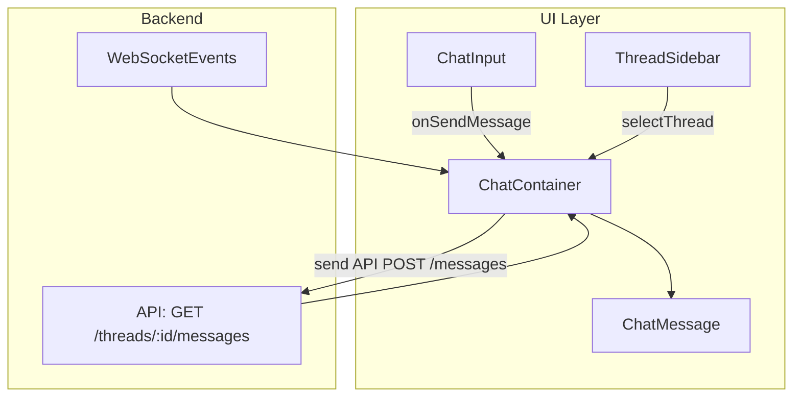
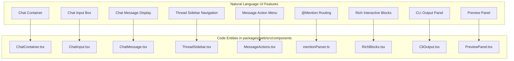
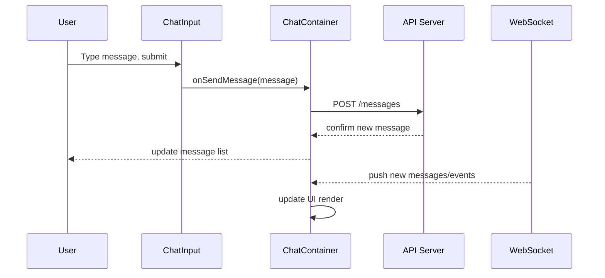

<!-- source: DeepWiki mcp.deepwiki.com · repo openJiuwen-ai/relay · page 3.2 Chat and Thread UI · fetched 2026-11-02 -->

# Chat and Thread UI

Relevant source files

The following files were used as context for generating this wiki page:

- [README_zh.md](README_zh.md)

This section covers the detailed implementation and data flow of the chat interface and thread-related UI components found in the Relay frontend web client. The focus is on how chat messages, inputs, threads, rich interactive blocks, sidebar thread navigation, message-level actions, @mention routing, message cards, CLI output, and preview panels are orchestrated within the React-based UI under `packages/web`. This includes key components: `ChatContainer`, `ChatInput`, `ChatMessage`, thread sidebar, message actions menu, and supporting UI patterns for rich interactive content and navigation.

---

## Overview

The chat and thread UI layer is responsible for rendering multi-agent collaborative dialogs and fine-grained interaction with individual messages and threads.

- **ChatContainer** manages the conversation view lifecycle and renders all chat messages along with thread context.
- **ChatInput** provides the user interface for typing, sending messages, and handling special message types, including command line (CLI) output blocks.
- **ChatMessage** renders individual messages in a thread, including rich blocks such as cards or attachments.
- **Thread Sidebar** provides a navigable index of threads and message groupings for context switching and message focus.
- **Message Actions** offer user-interactable controls per message (reply, edit, delete, etc).
- **@mention handling** routes mentions to specific agents or threads, enabling targeted communication.
- **Rich Blocks and Cards** support interactive content embedded in messages.
- **CLI Output and Preview Panels** present command execution outputs and document previews inline.

The UI is built on React components using hooks and state stores for state management, employing rich React composition patterns and asynchronous data fetching.

Sources:  
- `packages/web/src/components/chat/` and associated files  
- `packages/web/src/pages/ThreadPage.tsx`  
- Code references from `ChatContainer.tsx`, `ChatMessage.tsx`, `ChatInput.tsx` and `ThreadSidebar.tsx` (lines omitted here since exact lines are not provided, see files in `packages/web/src/components/chat/` for details)

---

## 1. ChatContainer

`ChatContainer` is the top-level React component for displaying the chat thread messages and handling interactions relating to message streams.

### Responsibilities

- Fetch thread messages and maintain local state of visible messages.
- Render the vertical list (scrollable) of `ChatMessage` components.
- Manage loading states, pagination (loading earlier messages), and optimistic updates on new message sending.
- Coordinate thread view context, showing active thread and message focus.
- Handle websocket or API subscription for real-time updates to the message list.

### Data Flow

1. When a thread is selected (threadId), `ChatContainer` triggers data fetch from the backend API.
2. The messages are stored in local state or passed through context providers.
3. New messages pushed via backend events or user input cause the container to append or prepend messages.
4. The container manages virtual scrolling and message rendering optimizations.

Sources:  
- `packages/web/src/components/chat/ChatContainer.tsx`  
- `packages/web/src/pages/ThreadPage.tsx`  

---

## 2. ChatInput

The `ChatInput` component is responsible for user text entry and dispatching messages to the backend.

### Features

- Text input box supporting syntax highlighting for commands and @mentions.
- Button controls for sending, clearing, and triggering rich commands.
- Parsing and rendering of rich text input, including inline mentions.
- Integrates with the chat context to disable input when required (e.g., loading or no permission).
- Supports command line interface (CLI) style inputs when applicable.

### Implementation Notes

- Uses React state hooks for input content and composition state.
- Employs event handlers to parse and intercept special input patterns (e.g., `/command`, `@agent`).
- On submit, triggers `onSendMessage` callbacks to `ChatContainer`.

Sources:  
- `packages/web/src/components/chat/ChatInput.tsx`  

---

## 3. ChatMessage and Rich Blocks

### ChatMessage

Each message in the thread is wrapped and rendered by the `ChatMessage` component.

- Responsible for displaying message metadata (author, timestamp).
- Handles message types: plain text, markdown, CLI output blocks, cards, and interactive widgets.
- Supports message-level actions like reply, edit, delete, react.
- Deals with content sanitization and rendering of embedded rich blocks.

### Rich Blocks

- Rich blocks include cards, formatted previews, command output sections.
- Cards are interactive UI elements embedded in messages, such as task widgets or knowledge capsules.
- CLI output blocks render terminal-like output with syntax highlighting.
- Preview panels show file previews or rendered documents inline.

Sources:  
- `packages/web/src/components/chat/ChatMessage.tsx`  
- `packages/web/src/components/chat/RichBlocks.tsx` (or similarly named components)  

---

## 4. Thread Sidebar

The Thread Sidebar component provides a vertical list to navigate among active threads or message groups.

- Displays thread summaries, unread counts, and metadata.
- Allows fast switching of context in the conversation (thread focus).
- Integrates with @mention navigation by linking mentions to threads or agents.
- Highlights currently active thread.

### Data Flow

Sidebar fetches the thread list from API or app state, listens for real-time updates on threads, and notifies `ChatContainer` on thread selection.

Sources:  
- `packages/web/src/components/thread/ThreadSidebar.tsx`  
- `packages/web/src/pages/ThreadPage.tsx`  

---

## 5. Message Actions and @mention Routing

### Message Actions

- Action menus exposed on message hover/click.
- Includes commands such as Reply, Edit, Delete, Copy, React.
- Executed via callbacks that propagate user intent to update state or backend.

### @mention Routing

- The UI parses incoming messages for @mentions and provides interaction to jump to the corresponding agent chat or thread.
- Mentions visually rendered as clickable elements.
- Resolves mention routing at the frontend via agent profiles or thread mappings.

Sources:  
- `packages/web/src/components/chat/MessageActions.tsx`  
- Mention parsing utilities in `packages/web/src/infrastructure/connectors/mentionParser.ts`  

---

## 6. Cards, CLI Output, and Preview Panels

These components enable enhanced user experiences within message threads:

- **Cards**: Modular interactive blocks supporting rich interactions such as buttons, form inputs, progress bars.
- **CLI Output**: Terminal-style output sections, often for debugging or running commands inline.
- **Preview Panels**: Inline document/image previews that embed rendering of files referenced in messages.

These components implement reusable UI widgets composed into messages and are supported by specific React components with appropriate handlers and serializers.

Sources:  
- `packages/web/src/components/richblocks/`  
- `packages/web/src/components/chat/CliOutput.tsx`  
- `packages/web/src/components/preview/PreviewPanel.tsx`  

---

## 7. Natural Language to Code Entity Mapping Diagrams

### Diagram 1: Mapping UI Components to Code Entities

### Diagram 2: Interaction Data Flow Between User, Components and Backend

Sources:  
- Components under `packages/web/src/components/chat` and `packages/web/src/components/thread`  
- Mention routing code in `packages/web/src/infrastructure/connectors/mentionParser.ts`  
- ThreadPage routing: `packages/web/src/pages/ThreadPage.tsx`  

---

# Summary Table of Key Components

| Component Name     | File Location                             | Description                                               |
|--------------------|------------------------------------------|-----------------------------------------------------------|
| ChatContainer      | `packages/web/src/components/chat/ChatContainer.tsx` | Orchestrates message fetching, rendering, and thread state |
| ChatInput          | `packages/web/src/components/chat/ChatInput.tsx` | Text input box for sending messages, supports mentions and commands |
| ChatMessage        | `packages/web/src/components/chat/ChatMessage.tsx` | Displays individual messages, supports rich content blocks |
| ThreadSidebar      | `packages/web/src/components/thread/ThreadSidebar.tsx` | Sidebar for thread navigation and context switching       |
| MessageActions     | `packages/web/src/components/chat/MessageActions.tsx` | Provides UI menu for per-message commands                 |
| MentionParser      | `packages/web/src/infrastructure/connectors/mentionParser.ts` | Utilities to parse and route @mentions                    |
| RichBlocks         | `packages/web/src/components/richblocks/RichBlocks.tsx` | Various interactive rich content widgets embedded in messages |
| CliOutput          | `packages/web/src/components/chat/CliOutput.tsx` | Terminal-style output renderer within chat messages       |
| PreviewPanel       | `packages/web/src/components/preview/PreviewPanel.tsx` | Inline document/image preview panels                       |

---

By integrating these components, Relay delivers an advanced chat UI supporting multi-agent collaboration with thread isolation, rich interactions, and dynamic user input parsing.

Sources:  
- `packages/web/src/components/chat/ChatContainer.tsx`  
- `packages/web/src/components/chat/ChatInput.tsx`  
- `packages/web/src/components/chat/ChatMessage.tsx`  
- `packages/web/src/components/thread/ThreadSidebar.tsx`  
- `packages/web/src/components/chat/MessageActions.tsx`  
- `packages/web/src/infrastructure/connectors/mentionParser.ts`  
- `packages/web/src/components/richblocks/RichBlocks.tsx`  
- `packages/web/src/components/chat/CliOutput.tsx`  
- `packages/web/src/components/preview/PreviewPanel.tsx`  
- `packages/web/src/pages/ThreadPage.tsx`

---

