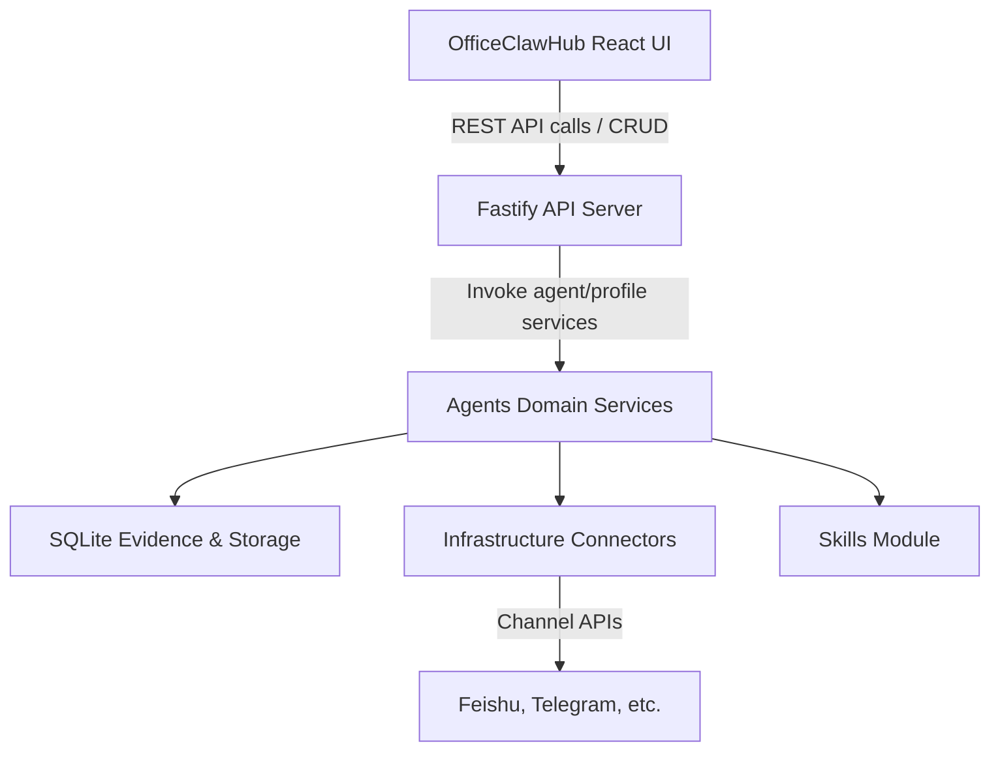
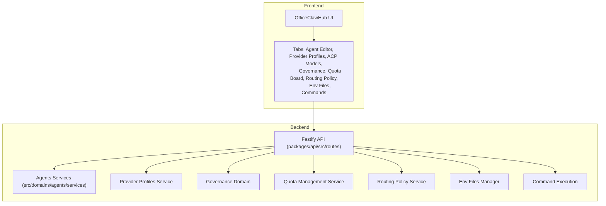
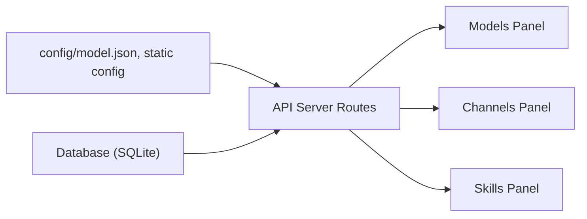

<!-- source: DeepWiki mcp.deepwiki.com · repo openJiuwen-ai/relay · page 3.3 OfficeClaw Hub and Admin Panels · fetched 2026-11-02 -->

# OfficeClaw Hub and Admin Panels

Relevant source files

The following files were used as context for generating this wiki page:

- [.inner.env](.inner.env)
- [config/model.json](config/model.json)

This page (Section 3.3) provides a detailed technical overview of the OfficeClaw Hub and its associated administrative panels within the Relay codebase. The OfficeClaw Hub is the central web-based interface for managing agents, provider profiles, model profiles (ACP), governance policies, quotas, routing, environment configurations, commands, and security settings. It includes several panels such as models, channels, skills, and controls for voice and push notifications.

---

## 3.3.1 Overview and Purpose

The OfficeClaw Hub aggregates a collection of admin panels and control tabs designed to manage the system's AI agents, models, and operational policies through a unified React-based frontend integrated with the backend API. This hub enables:

- Creation and editing of agents (agent editor tab)
- Management of AI providers (provider profiles tab)
- Configuration of ACP (AI Collaborative Platform) model profiles
- Governance and quota management (quota board, governance tab)
- Routing policy adjustments
- Environment file management (env files tab)
- Execution of system commands (commands tab)
- Viewing and managing models, communication channels, and skills via dedicated panels
- Controlling security, voice, and push notification settings

The Hub thus acts as the administrative control center for orchestrating multi-agent AI collaboration, fine-tuning provider interactions, handling security, and overseeing usage constraints.

---

## 3.3.2 OfficeClawHub Tabs and Their Core Functions

The OfficeClawHub interface is structured into multiple tabs, each exposing focused functionality for an administrative domain:

### 3.3.2.1 Agent Editor Tab

- Allows creating, editing, and managing AI agents that participate in collaboration.
- Supports agent configuration regarding skills they possess, routing policies they adhere to, and collaboration preferences.
- Interacts heavily with the `agents` domain services from the API server for CRUD operations.

### 3.3.2.2 Provider Profiles Tab

- Manages AI provider profiles that abstract connections to external LLM or skill providers.
- Profiles include authentication, capability schemas, and usage quotas.
- Enables dynamic provider integration and selection during agent orchestration.

### 3.3.2.3 ACP Model Profiles Tab

- Handles profiles for ACP models defined in configurations such as `config/model.json`.
- Supports listing, editing, and activating models used for various tasks.
- Facilitates association of models with agents and providers.

### 3.3.2.4 Governance Tab

- Provides interfaces to define and enforce governance policies.
- Policies could include usage limits, agent permissions, and resource access controls.
- Interacts with custom governance domain logic in the backend.

### 3.3.2.5 Quota Board

- Displays detailed usage quotas and limits for providers, agents, and models.
- Allows administrators to allocate or modify quota pools.
- Reflects real-time usage statistics and quota consumption.

### 3.3.2.6 Routing Policy Tab

- Configures routing rules that determine how tasks/messages are routed between agents and providers.
- Vital for managing failovers, degradation policies, and load balancing.
- Works closely with orchestration mechanisms in runtime.

### 3.3.2.7 Environment Files Tab (env files)

- Administers environment variable sets used by different parts of the system.
- Allows overriding, patching, or adding environment variables that configure runtime behavior.
- Operates with a two-tier env loading model (`.inner.env` defaults overridden by `.env`).

### 3.3.2.8 Commands Tab

- Provides a command execution interface for administrative and maintenance tasks.
- Commands may relate to cache clearing, database migration, system restart, or skill updates.
- Commands invoke backend API endpoints that trigger corresponding server-side logic.

---

## 3.3.3 Dedicated Panels: Models, Channels, Skills

Beyond the tab interface, the OfficeClaw Hub organizes three principal panels, each encapsulating specialized management of system components:

### Models Panel

- Lists all available AI models known to the system, primarily sourced from static configuration files like `config/model.json`.
- Displays metadata such as model ID, creation date, ownership, and type.
- Facilitates activation and configuration of models for task execution.
  
### Channels Panel

- Manages communication channels integrated with OfficeClaw (e.g., Feishu, DingTalk, Telegram).
- Enables addition, removal, and configuration of connectors and adaptors.
- Provides settings for webhook URLs, security tokens, and mention parsing.
  
### Skills Panel

- Lists all AI skills (functionality modules) installed and available in the system.
- Provides control to enable, disable, and configure skill behaviors.
- Supports skill vetting, version management, and execution parameters.

---

## 3.3.4 Security Management

Security settings within the OfficeClaw Hub include:

- User access control and permissions management for tabs and features.
- API key and credential management for provider profiles.
- Audit logs monitoring accesses and actions performed in the hub.
- Cross-domain policies safeguarding agent collaboration and resource access.

Backend domain services handling agents, sessions, and collaboration enforce these security policies consistently.

---

## 3.3.5 Voice and Push Notification Settings

OfficeClaw supports voice and push capabilities to enhance agent interaction and user notification:

- Voice settings configure text-to-speech (TTS) providers and transcription integrations (e.g., OpenAI Whisper).
- Push settings manage push notification endpoints, tokens, and channels.
- These settings are exposed to administrators for enabling/disabling features and managing provider credentials.

---

## 3.3.6 Implementation Details and Data Flow

### Frontend Implementation

- The Hub UI is implemented as part of the `packages/web` React/Next.js client.
- Tabs and panels correspond to React components/pages under `packages/web/src/pages/hub/`.
- State management utilizes React stores hooking into backend API services.
- Communication with backend API is RESTful, using routes defined in the `packages/api/src/routes` directory.

### Backend API Support

- API routes for managing agents, provider profiles, governance policies, quota, and routing are handled by the Fastify backend (`packages/api`).
- Domain services under `packages/api/src/domains/agents/services` implement logic for agents, collaboration, orchestration, skills, and push/TTS features.
- Persistence is done via evidence and scheduler providers, backed by SQLite or other pluggable storage adapters.
- Connectors and providers interfaces (`packages/api/src/infrastructure/connectors`) support channel integration.

### Data Flow Diagram: From UI to Core Agents Domain

### Model Configuration Loading

- Model profiles are configured primarily via static JSON files like `config/model.json`.
- Each model entry includes an `id`, `object`, `created` timestamp, and `owned_by` field.
- The Hub loads and displays this list in the models panel, allowing selection and activation.

---

## 3.3.7 Code Entity Association Diagrams

### Diagram: OfficeClaw Hub Tabs and Corresponding Backend Services

### Diagram: Data Source to Models, Channels, and Skills Panels

---

## 3.3.8 Summary

The OfficeClaw Hub and its admin panels form the administrative backbone for configuring and managing multi-agent collaboration on the OfficeClaw platform. The frontend React UI communicates with a Fastify backend that orchestrates access to domain services, configuration storage, and external channels. The panels provide granular control over agents, providers, AI models, communication channels, and skills, while supporting governance, quota management, and critical system operations. Voice and push notification settings further enhance platform interactivity and responsiveness.

---

## Sources

- `config/model.json:1-70` — Model profiles data
- `.inner.env:1-127` — Environment variable loading and management context
- Packages `api/src/domains/agents/services` — Agent domain services
- Packages `api/src/routes` — Fastify API route registration and handlers
- Packages `web/src/pages/hub` (inferred) — React UI components and tabs structure
- Packages `api/src/infrastructure/connectors` — Connectors for channels (Feishu, Telegram, etc.)
- General monorepo knowledge from table of contents section 3 and 2 (especially 2.1, 2.2)

---

