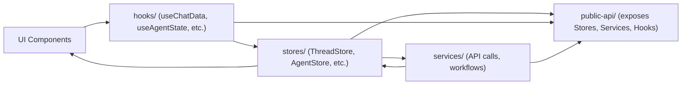
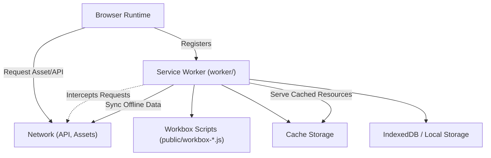

<!-- source: DeepWiki mcp.deepwiki.com · repo openJiuwen-ai/relay · page 3.4 Frontend State, Services and PWA · fetched 2026-11-02 -->

# Frontend State, Services and PWA

Relevant source files

The following files were used as context for generating this wiki page:

- [.gitignore](.gitignore)

This page documents the state management, service implementations, hooks, public API exposure, and Progressive Web App (PWA) features in the Relay frontend codebase (`packages/web`). It explains how client-side state is stored and manipulated, how various services and hooks provide reusable logic, how the public API surface is organized, and how PWA functionality is integrated including the service worker and offline behavior.

---

## 1. State Management: stores/

The frontend state in Relay is primarily managed using a set of stores located under the `stores/` directory. These stores encapsulate the client-side reactive state and act as centralized sources of truth for UI components and services.

### Implementation and Data Flow

- Stores are defined as standalone modules that export stateful hooks or classes.
- They typically contain reactive state variables, and functions to mutate that state.
- Components subscribe to these stores to obtain up-to-date values.
- State changes propagate reactively, triggering UI updates.
- Stores are designed to provide domain-specific encapsulation (e.g., thread store, agent store).

### Key Files and Roles

- Each subfolder/module inside `stores/` focuses on a distinct part of the UI or business domain.
- The stores interface directly or indirectly with services and hooks to request data or perform actions.
- The stores isolate complex logic from components, enabling testability and reuse.

---

## 2. Services and Business Logic: services/

The `services/` directory contains modules that implement core business logic and asynchronous workflows that are used by stores and components.

### Characteristics

- Services perform API calls, run side effects, and manage domain workflows.
- They serve as an abstraction layer between the UI state and backend APIs or other infrastructure.
- They can include session management, agent orchestration requests, and messaging.

### Interaction Model

- Components or stores invoke service functions to trigger state updates and backend communication.
- Services validate inputs, handle errors, and interpret backend responses before updating stores.
- This separation supports a clean, maintainable architecture.

---

## 3. React Hooks: hooks/

Reusable React hooks are implemented in the `hooks/` folder to encapsulate UI logic, lifecycle management, and common React patterns.

### Usage

- Hooks abstract common logic like data fetching, subscription to stores, and event handling.
- They improve code reuse and composability across the UI component tree.
- Hooks often wrap the underlying stores or services to provide a declarative interface.

---

## 4. Public API Surface: public-api/

The `public-api/` directory consolidates the exports of stores, services, and hooks, defining the public interface for the frontend modules.

### Purpose

- This pattern enables encapsulation of internal implementation details.
- Other packages or parts of the frontend codebase can import from `public-api` for consistent usage.
- It facilitates easy refactoring and versioning of internal modules.

---

## 5. Progressive Web App (PWA) Integration

Relay includes sophisticated PWA support to enable offline usage, caching, and service worker-based enhancements.

### Service Worker and Workbox

- The service worker implementation is located under `worker/` and related public assets.
- Workbox-based tooling manages caching strategies for assets and API responses.
- The `public/` folder contains PWA-related static assets including service worker scripts (`sw.js`, `workbox-*.js`) that are generated or used at runtime.

### Offline Behavior

- The service worker caches static UI assets and certain API responses for offline availability.
- Offline fallback logic ensures graceful degradation and informs users of connectivity status.
- Background synchronization or event handling can be implemented in the worker to enhance the offline experience.

---

## 6. Diagrams

### Diagram 1: Overview of Frontend State, Services, Hooks, and Public API

This diagram illustrates the dependency and data flow relationship:

- UI components consume hooks.
- Hooks use stores to get state.
- Stores invoke services for business logic and backend interaction.
- `public-api` consolidates exports from stores, services, and hooks.

Sources: `stores/`, `services/`, `hooks/`, `public-api/` folders (implied by project structure).

---

### Diagram 2: PWA Asset and Worker Interaction

This diagram shows how the service worker registered by the browser intercepts requests, serves cached assets using Workbox strategies, and manages offline data synchronization.

Sources: `worker/` folder, `public/workbox-*.js`, `public/sw.js` assets (from `.gitignore` and inferred PWA setup).

---

## Summary

The Relay frontend architecture incorporates a well-structured state management system with stores encapsulating client state, services implementing backend communication and business logic, reusable React hooks for component logic, and a centralized public API surface for import consistency. Additionally, the application is enhanced as a Progressive Web App using a Workbox-powered service worker that enables offline support, efficient asset caching, and network fallback strategies.

This layered and modular approach maximizes maintainability, performance, and user experience robustness.

---

Sources:  
- `stores/` folder structure (implied)  
- `services/` folder structure (implied)  
- `hooks/` folder structure (implied)  
- `public-api/` folder structure (implied)  
- `.gitignore` lines 11-17 (PWA service worker assets in `packages/web/public/`)  
- `worker/` folder (PWA service worker implementation, implied by naming convention)

---

