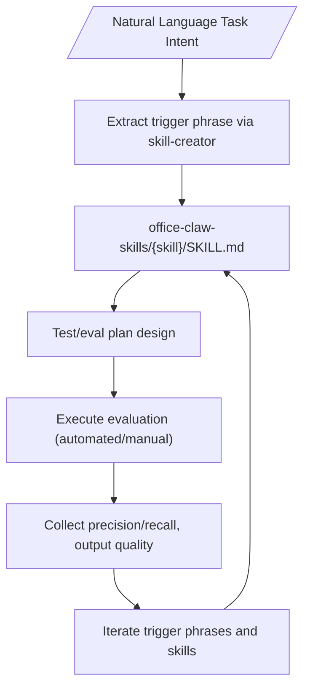
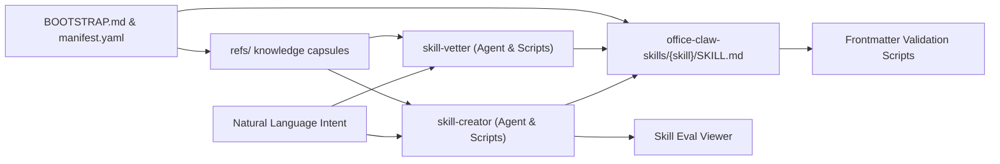
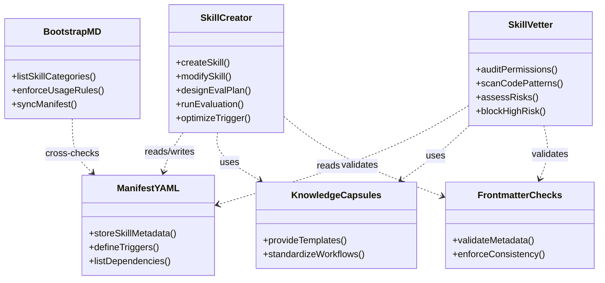

<!-- source: DeepWiki mcp.deepwiki.com · repo openJiuwen-ai/relay · page 4.1 Skill Authoring and Vetting · fetched 2026-11-02 -->

# Skill Authoring and Vetting

<details>
<summary>Relevant source files</summary>

The following files were used as context for generating this wiki page:

- [office-claw-skills/BOOTSTRAP.md](office-claw-skills/BOOTSTRAP.md)
- [office-claw-skills/manifest.yaml](office-claw-skills/manifest.yaml)
- [office-claw-skills/refs/bug-diagnosis-capsule.md](office-claw-skills/refs/bug-diagnosis-capsule.md)

</details>


This section details the technical aspects of authoring and vetting skills within the Relay (OfficeClaw) platform. It covers the core skill-creator workflow for building and optimizing skills, the skill-vetter process for pre-installation safety review, conventions established by the `BOOTSTRAP.md` file, the use of knowledge capsules under `refs/`, and frontmatter validation checks enforced during skill development. This is a leaf page dedicated to the inner workings of skill creation, review, and integration.

---

## Overview of Skill Creation and Vetting

Relay organizes its AI capabilities into modular "skills" that agents can load and invoke dynamically. Skill authoring involves comprehensive development workflows including planning, writing, testing, evaluating, and continuous optimization. Skill vetting enforces security and compliance by auditing skills before installation.

Key system components involved:

- **skill-creator**: An agent-driven skill development toolset enabling creation, iteration, evaluation, and trigger optimization.
- **skill-vetter**: A skill security audit tool analyzing permissions, patterns, and vulnerabilities pre-install.
- **BOOTSTRAP.md**: A canonical document maintaining top-level skill classification and usage conventions.
- **refs/**: Reference materials including knowledge capsules utilized as structured templates or guidelines within skills.
- Frontmatter checks: Automated validations enforcing metadata consistency and correctness in skill repository files.

The primary directory holding official skills is `office-claw-skills/` alongside the manifest file `manifest.yaml` and a reference folder `refs/` for auxiliary materials.

Sources: `office-claw-skills/BOOTSTRAP.md:1-69`(), `office-claw-skills/manifest.yaml:1-269`()

---

## The Skill-Creator: Development and Evaluation Workflow

The `skill-creator` is an advanced skill designed to facilitate the entire lifecycle of skill development:

- **Creating new skills**: Authors start by crafting skill definitions and capabilities, typically in the `office-claw-skills/{skill-name}/SKILL.md` files.
- **Modifying existing skills**: Improvements or bug fixes to skill behavior and routing trigger descriptions are made iteratively.
- **Designing evaluation plans and cases**: The skill-crafter drafts test cases to validate skill accuracy and performance.
- **Automated and manual evaluation**: The skill-creator runs skill assessments to measure trigger efficacy and output correctness.
- **Trigger phrase optimization**: Using evaluation data, skill trigger phrases are refined for better routing and fewer false positives.

This skill relies on Python 3 and can incorporate bundled evaluation scripts to aid developers in continuous integration style refinement.

### Data Flow and Interaction



The skill-creator bridges natural language requests to precise skill definitions through continuous evaluation feedback loops, ensuring skills respond accurately to user intents.

Sources: `office-claw-skills/manifest.yaml:240-262`(), `office-claw-skills/BOOTSTRAP.md:36-66`()

---

## The Skill-Vetter: Security and Risk Assessment

Skill vetting is critical before skill installation, especially when acquiring third-party skills from hubs like ClawdHub or GitHub.

The `skill-vetter` performs:

- **Permission range audits**: Verifies declared permissions against actual code behavior.
- **Pattern scans**: Detects suspicious or unsafe code patterns.
- **Risk assessments**: Flags potential security issues and operational risks.
- **Install gatekeeping**: Blocks or warns on high-risk skills.

It typically runs as a pre-installation review module, designed to mitigate threats from untrusted skill sources.

Sources: `office-claw-skills/manifest.yaml:263-269`(), `office-claw-skills/BOOTSTRAP.md:35-39`()

---

## BOOTSTRAP.md: Conventions and Category Structure

The `BOOTSTRAP.md` file in `office-claw-skills/` serves as a canonical registry and guideline for official skills. It outlines:

- **Four major skill categories**:
  - Office Productivity (办公套件)
  - Enterprise Collaboration (企业协作)
  - Media and Content Creation (自媒体)
  - Development and Engineering (开发与工程)

- **Skill usage mandates**:
  - If a skill applies to a task, it *must* be used.
  - `manifest.yaml` is the single source of truth for routing and metadata.
  - `refs/` contains reference materials and is not for direct triggering.
  - New or modified skills require synchronized updates to the directory, manifest, and `BOOTSTRAP.md`.
  - Enforced consistency checks are run after changes.

- **Integration points**:
  - Skills are auto-triggered in Claude and Gemini runtimes.
  - Codex uses SKILL.md files for manual execution.

This document emphasizes disciplined skill lifecycle management and enforces repository hygiene.

Sources: `office-claw-skills/BOOTSTRAP.md:3-69`()

---

## Skill Manifest: Routing and Metadata

All official skills are registered in the `manifest.yaml` file under the `office-claw-skills` directory. This YAML file:

- Provides detailed skill descriptions.
- Defines triggers and negative triggers (`not_for`) to scope skill activation.
- Specifies output types.
- Lists language and system dependencies.
- Supports dependency chaining (`next`) and SOP step annotations.
- Acts as the definitive routing and metadata source for skill invocation.

Example snippet for the `skill-creator` skill:

```yaml
skill-creator:
  description: >
    Skill 创建与优化技能。用于新建 skill、修改现有 skill、设计评测用例、
    运行评估并优化触发描述与效果。
  triggers:
    - "create a skill"
    - "new skill"
    - "improve skill"
    - "optimize skill"
  not_for:
    - "普通单次提示词润色"
    - "未涉及 skill 的通用代码任务"
  output: "Skill draft / eval plan / optimized skill package"
  dependencies:
    system:
      - "Python 3"
    note:
      - "May use bundled eval scripts and reviewer workflow"
  next: []
  sop_step: null
```

Skills covered by the manifest include complex document tools, collaboration facilitation, media production, and development supports like `skill-vetter` and `skill-creator`.

Sources: `office-claw-skills/manifest.yaml:240-269`(), `office-claw-skills/manifest.yaml:16-263`()

---

## References and Knowledge Capsules (`refs/`)

The `refs/` directory contains reusable knowledge base fragments called "knowledge capsules." These are markdown templates and structured documentation resources that skills can invoke or reference to ensure correct domain behavior or guide troubleshooting.

For example, the Bug Diagnosis Capsule (`refs/bug-diagnosis-capsule.md`) provides an 8-field template to standardize root cause investigation. This capsule includes fields like:

| Field Number | Field Name              | Purpose                                             |
|--------------|------------------------|-----------------------------------------------------|
| 1            | Phenomenon             | What is broken? Expected vs actual behavior         |
| 2            | Evidence               | Steps to reproduce, environment, error logs         |
| 3            | Hypothesis / Root Cause| Investigative assumptions or confirmed cause        |
| 4            | Diagnosis Strategy     | How to probe or debug next                           |
| 5            | Timeout Strategy       | What to do if stuck (timeout policies)               |
| 6            | Alert Strategy         | Signals indicating wrong direction                   |
| 7            | User-visible Fix       | How fix manifests to end users (optional)            |
| 8            | Acceptance Criteria    | Verification steps to confirm fix                    |

These capsules are woven into skill logic for complex diagnostics or workflow scaffolding. They complement formal bug report formats and serve as operational templates.

Sources: `office-claw-skills/refs/bug-diagnosis-capsule.md:1-79`()

---

## Frontmatter Checks and Validation

Skill development enforces frontmatter metadata standards primarily via linting scripts and CI validations located in the development script suite (`scripts/`). These checks verify:

- Correct presence and formatting of skill attributes in `SKILL.md` or manifest entries.
- Consistency between `BOOTSTRAP.md`, `manifest.yaml`, and skill directories.
- Presence of mandatory fields: description, triggers, outputs, dependencies.
- Absence of contradictory routing scopes or missing reference synchronizations.

Failure of frontmatter checks blocks skill deployment or integration until compliance is restored.

---

## Summary Mermaid Diagrams

### Relating Natural Language Tasks to Skill Code Entities


*This diagram shows how natural language intents flow into specific system components, linking to skill source code, manifest, bootstrap conventions, knowledge capsules, and validation scripts.*

Sources: `office-claw-skills/BOOTSTRAP.md:1-69`(), `office-claw-skills/manifest.yaml:1-269`(), `office-claw-skills/refs/bug-diagnosis-capsule.md:1-79`()

---

### Code Entity Map for Skill Authoring and Vetting



*This diagram depicts the classes and their responsibilities in the skill authoring and vetting subsystem.*

Sources: `office-claw-skills/manifest.yaml:240-269`(), `office-claw-skills/BOOTSTRAP.md:40-69`()

---

# References

- `office-claw-skills/BOOTSTRAP.md` — Skill categorization, conventions, and mandates.
- `office-claw-skills/manifest.yaml` — Skill metadata, routing, and dependencies.
- `office-claw-skills/refs/bug-diagnosis-capsule.md` — Knowledge capsule example.
- Scripts directory (implied) — Frontmatter checks and validation tooling.

---

This concludes the detailed explanation of skill authoring and vetting architecture and workflows in Relay OfficeClaw.

---

