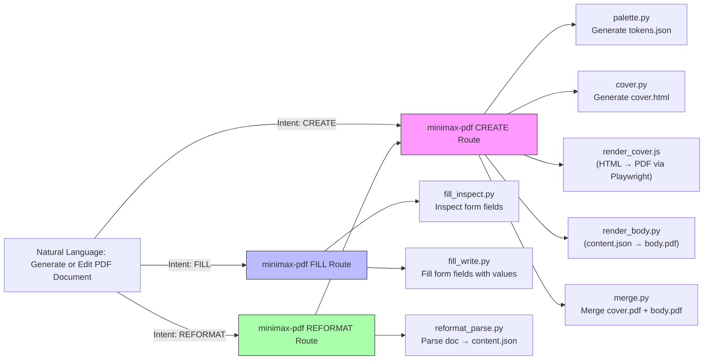
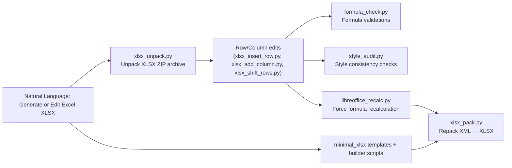
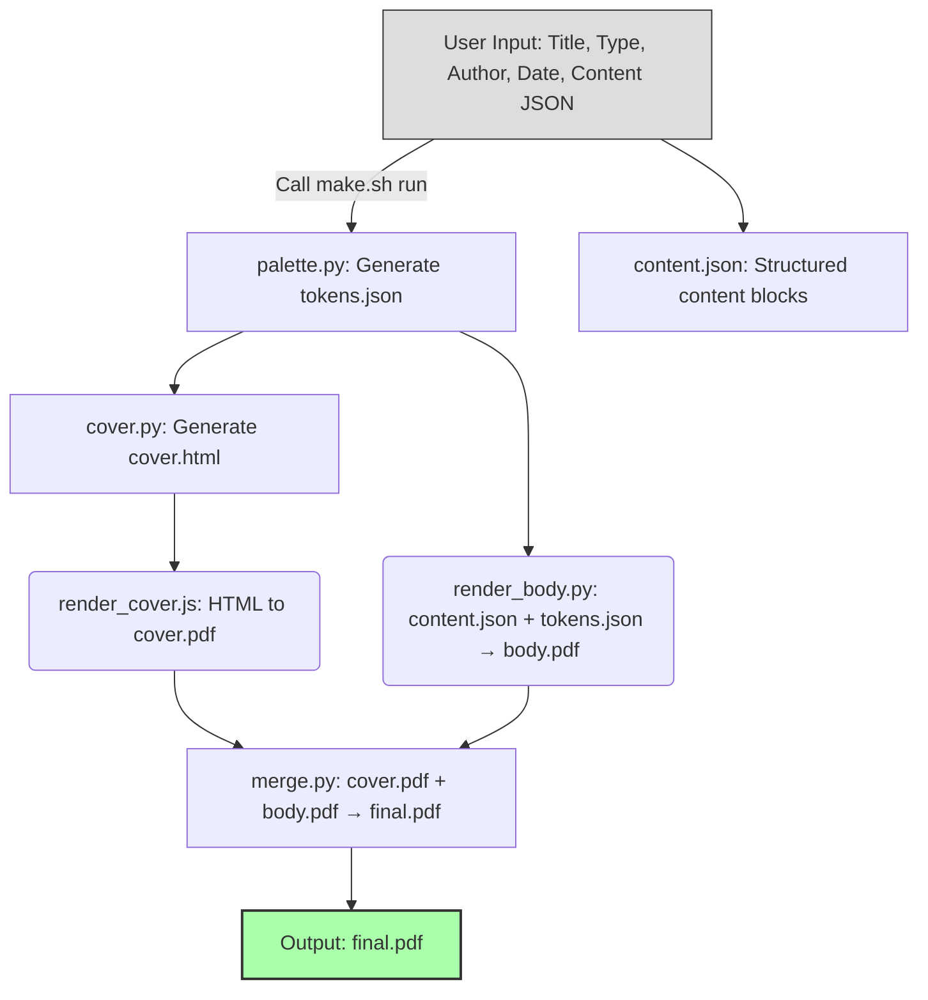
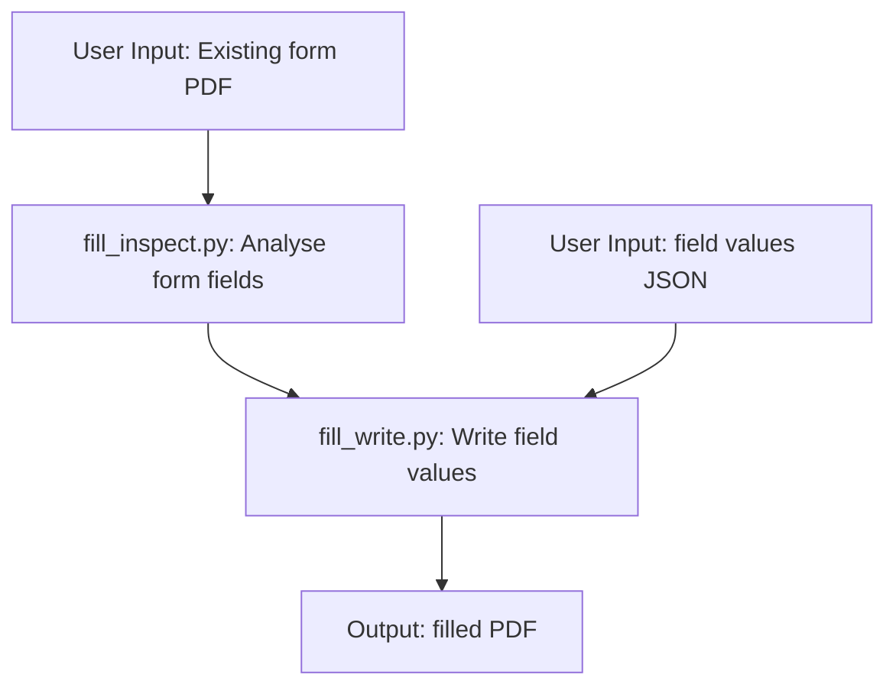
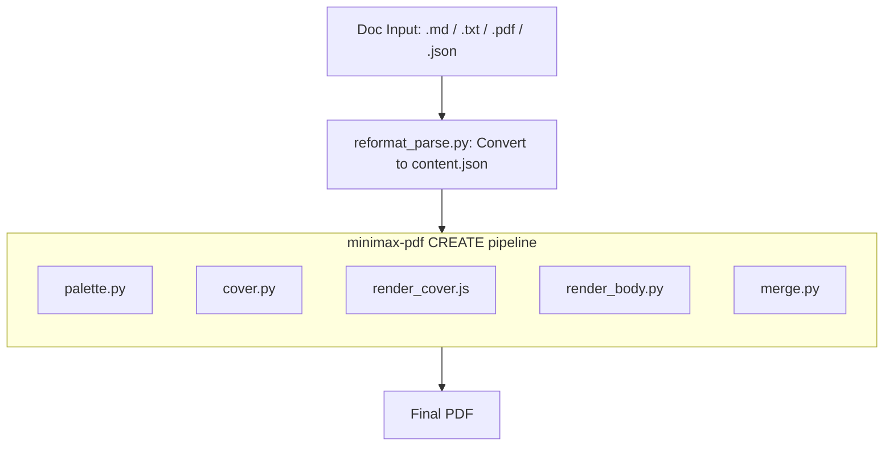

<!-- source: DeepWiki mcp.deepwiki.com · repo openJiuwen-ai/relay · page 4.2 Document Generation Skills · fetched 2026-11-02 -->

# Document Generation Skills

<details>
<summary>Relevant source files</summary>

The following files were used as context for generating this wiki page:

- [office-claw-skills/minimax-pdf/README.md](office-claw-skills/minimax-pdf/README.md)
- [office-claw-skills/minimax-pdf/SKILL.md](office-claw-skills/minimax-pdf/SKILL.md)
- [office-claw-skills/minimax-pdf/design/design.md](office-claw-skills/minimax-pdf/design/design.md)
- [office-claw-skills/minimax-pdf/scripts/cover.py](office-claw-skills/minimax-pdf/scripts/cover.py)
- [office-claw-skills/minimax-pdf/scripts/fill_inspect.py](office-claw-skills/minimax-pdf/scripts/fill_inspect.py)
- [office-claw-skills/minimax-pdf/scripts/fill_write.py](office-claw-skills/minimax-pdf/scripts/fill_write.py)
- [office-claw-skills/minimax-pdf/scripts/make.sh](office-claw-skills/minimax-pdf/scripts/make.sh)
- [office-claw-skills/minimax-pdf/scripts/merge.py](office-claw-skills/minimax-pdf/scripts/merge.py)
- [office-claw-skills/minimax-pdf/scripts/palette.py](office-claw-skills/minimax-pdf/scripts/palette.py)
- [office-claw-skills/minimax-pdf/scripts/reformat_parse.py](office-claw-skills/minimax-pdf/scripts/reformat_parse.py)
- [office-claw-skills/minimax-pdf/scripts/render_body.py](office-claw-skills/minimax-pdf/scripts/render_body.py)
- [office-claw-skills/minimax-pdf/scripts/render_cover.js](office-claw-skills/minimax-pdf/scripts/render_cover.js)
- [office-claw-skills/minimax-xlsx/SKILL.md](office-claw-skills/minimax-xlsx/SKILL.md)
- [office-claw-skills/minimax-xlsx/references/create.md](office-claw-skills/minimax-xlsx/references/create.md)
- [office-claw-skills/minimax-xlsx/references/edit.md](office-claw-skills/minimax-xlsx/references/edit.md)
- [office-claw-skills/minimax-xlsx/references/fix.md](office-claw-skills/minimax-xlsx/references/fix.md)
- [office-claw-skills/minimax-xlsx/references/format.md](office-claw-skills/minimax-xlsx/references/format.md)
- [office-claw-skills/minimax-xlsx/references/ooxml-cheatsheet.md](office-claw-skills/minimax-xlsx/references/ooxml-cheatsheet.md)
- [office-claw-skills/minimax-xlsx/references/read-analyze.md](office-claw-skills/minimax-xlsx/references/read-analyze.md)
- [office-claw-skills/minimax-xlsx/references/validate.md](office-claw-skills/minimax-xlsx/references/validate.md)
- [office-claw-skills/minimax-xlsx/scripts/formula_check.py](office-claw-skills/minimax-xlsx/scripts/formula_check.py)
- [office-claw-skills/minimax-xlsx/scripts/libreoffice_recalc.py](office-claw-skills/minimax-xlsx/scripts/libreoffice_recalc.py)
- [office-claw-skills/minimax-xlsx/scripts/shared_strings_builder.py](office-claw-skills/minimax-xlsx/scripts/shared_strings_builder.py)
- [office-claw-skills/minimax-xlsx/scripts/style_audit.py](office-claw-skills/minimax-xlsx/scripts/style_audit.py)
- [office-claw-skills/minimax-xlsx/scripts/xlsx_add_column.py](office-claw-skills/minimax-xlsx/scripts/xlsx_add_column.py)
- [office-claw-skills/minimax-xlsx/scripts/xlsx_insert_row.py](office-claw-skills/minimax-xlsx/scripts/xlsx_insert_row.py)
- [office-claw-skills/minimax-xlsx/scripts/xlsx_pack.py](office-claw-skills/minimax-xlsx/scripts/xlsx_pack.py)
- [office-claw-skills/minimax-xlsx/scripts/xlsx_reader.py](office-claw-skills/minimax-xlsx/scripts/xlsx_reader.py)
- [office-claw-skills/minimax-xlsx/scripts/xlsx_shift_rows.py](office-claw-skills/minimax-xlsx/scripts/xlsx_shift_rows.py)
- [office-claw-skills/minimax-xlsx/scripts/xlsx_unpack.py](office-claw-skills/minimax-xlsx/scripts/xlsx_unpack.py)
- [office-claw-skills/minimax-xlsx/templates/minimal_xlsx/[Content_Types].xml](office-claw-skills/minimax-xlsx/templates/minimal_xlsx/[Content_Types].xml)
- [office-claw-skills/minimax-xlsx/templates/minimal_xlsx/_rels/.rels](office-claw-skills/minimax-xlsx/templates/minimal_xlsx/_rels/.rels)
- [office-claw-skills/minimax-xlsx/templates/minimal_xlsx/xl/_rels/workbook.xml.rels](office-claw-skills/minimax-xlsx/templates/minimal_xlsx/xl/_rels/workbook.xml.rels)
- [office-claw-skills/minimax-xlsx/templates/minimal_xlsx/xl/sharedStrings.xml](office-claw-skills/minimax-xlsx/templates/minimal_xlsx/xl/sharedStrings.xml)
- [office-claw-skills/minimax-xlsx/templates/minimal_xlsx/xl/styles.xml](office-claw-skills/minimax-xlsx/templates/minimal_xlsx/xl/styles.xml)
- [office-claw-skills/minimax-xlsx/templates/minimal_xlsx/xl/workbook.xml](office-claw-skills/minimax-xlsx/templates/minimal_xlsx/xl/workbook.xml)
- [office-claw-skills/minimax-xlsx/templates/minimal_xlsx/xl/worksheets/sheet1.xml](office-claw-skills/minimax-xlsx/templates/minimal_xlsx/xl/worksheets/sheet1.xml)
- [office-claw-skills/official-doc-formatter/LESSON_LEARNED.md](office-claw-skills/official-doc-formatter/LESSON_LEARNED.md)
- [office-claw-skills/official-doc-formatter/SKILL.md](office-claw-skills/official-doc-formatter/SKILL.md)
- [office-claw-skills/official-doc-formatter/scripts/format_docx_v7.py](office-claw-skills/official-doc-formatter/scripts/format_docx_v7.py)

</details>


This section covers the document generation skills provided in the OfficeClaw Skills system, focusing on:

- **minimax-pdf**: A multi-route pipeline for generating and manipulating high-quality PDFs with a token-based design system.
- **minimax-xlsx**: Skillset for working with Excel OOXML files (xlsx), including unpacking/packing archives, editing rows/columns, formula/style audits, and template generation.
- **official-doc-formatter**: Automated formatting and styling of official word documents (DOCX).

This page explains the implementation details, internal data flow, and key classes/functions, supported by architecture and flow diagrams to help technical users navigate from user intents in natural language to code components in these skills.

---

## 1. minimax-pdf Skill

### Purpose and Functionality

The `minimax-pdf` skill specializes in creating and editing visually polished PDF documents with an emphasis on consistent design language tied to document semantics. It supports three main routes:

- **CREATE**: Generate a new PDF document from structured content.
- **FILL**: Fill existing PDF form fields with provided data, preserving layout.
- **REFORMAT**: Re-style an existing document by parsing it into content blocks and passing through the CREATE pipeline.

It employs a token-based design system that encodes color palettes, typography, spacing, and layout rules, flowing through all rendering stages to maintain visual consistency.

### Architecture Overview

The main architecture consists of:

```
SKILL.md                      ← Entry point, route metadata
design/design.md              ← Design system specification and rationale
scripts/
└── make.sh                   ← Unified CLI for all routes
    └── palette.py            ← Infers design tokens from metadata (title, type, author...)
    └── cover.py              ← Generates cover HTML from tokens.json
    └── render_cover.js       ← Converts cover HTML → cover PDF via Playwright + Chromium headless browser
    └── render_body.py        ← Renders body pages from tokens.json + content.json using ReportLab
    └── merge.py              ← Merges cover.pdf + body.pdf into final PDF
    └── fill_inspect.py       ← Inspects fillable form fields in existing PDF
    └── fill_write.py         ← Writes values into form fields of PDF
    └── reformat_parse.py     ← Parses markdown, text or PDF into content.json blocks for reformat
```

This pipeline design ensures separation of concerns:

- Token generation (`palette.py`) abstracts design logic based on document semantic metadata.
- Cover rendering uses web technologies for expressive layout and Google Fonts.
- Body rendering uses ReportLab for robust multi-page text and data layout.
- Merge unifies outputs into a single PDF.
- Fill routes handle PDF forms with `pypdf` for inspection and population.
- Reformat parses legacy or stylistic input documents back into the structured content block model.

### Data Flow: CREATE Route

User input → `make.sh run` → `palette.py` → generates `tokens.json`  
`tokens.json` + user semantic args → `cover.py` → `cover.html`  
`cover.html` → `render_cover.js` (Playwright/Chromium) → `cover.pdf`  
`tokens.json` + `content.json` (user content blocks) → `render_body.py` → `body.pdf`  
`cover.pdf` + `body.pdf` → `merge.py` → final PDF output

### Key Concepts and Classes/Functions

**Design Tokens** (`tokens.json`): JSON document encoding palettes, typography, layout variables derived in `palette.py`. Controls all visual parameters in rendering.

**Content Blocks** (`content.json`): Array of document block objects (e.g., headings, paragraphs, tables, images). Parsed from Markdown, JSON or extracted from PDF in reformat. Consumed by `render_body.py`.

**Scripts:**

- `palette.py` (lines 1-197): Infers and outputs design tokens based on document type, title, author, date, and accent overrides.
- `cover.py` (lines 1-204): Generates HTML cover page from tokens. Multiple cover pattern functions (_pattern_fullbleed, _pattern_split, etc.) produce distinct cover designs using embedded SVG helpers.
- `render_cover.js` (lines 1-170): Uses Playwright and Chromium to open the HTML cover and export it as PDF for polished rendering.
- `render_body.py` (lines 1-195): Uses ReportLab to render multi-page body from tokens + content blocks with many text/image/chart block handlers. Defines custom Flowables for callouts, bibliography, and manages consistent typography and spacing.
- `merge.py` (lines 1-113): Merges generated cover and body PDFs into one complete document with metadata and QA checks.
- `fill_inspect.py` (lines 1-201): Uses `pypdf` to list form fields in existing PDFs showing field names, types, options, and values.
- `fill_write.py` (lines 1-243): Fills form fields with user values (text, checkbox, radio, dropdown) with validation and writes output PDF.
- `reformat_parse.py` (lines 1-199): Parses markdown, plaintext, or PDFs into `content.json` blocks to feed the CREATE rendering pipeline.

---

### Mermaid Diagram: minimax-pdf Natural Language to Code Entity Mapping



---

### Detailed Implementation Notes

- The **design system** (documented in `design/design.md`) enforces strict visual consistency driven by document semantic metadata, e.g.:
  - Document `type` determines color palette, fonts, cover pattern.
  - Mood-based color palettes (authoritative, confident, scholarly, etc.) are hardcoded in `palette.py`.
  - Typography employs font pairs from Google Fonts on cover page; body document uses system fonts via ReportLab.
  - Spacing tokens control margins and rhythm uniformly.

- `palette.py` outputs a JSON tokens file consumed downstream by all renderer scripts. Accent colors can be overridden with command-line arguments at runtime.

- `cover.py` generates standalone HTML with SVG decorations for each cover pattern type. It injects styling variables from tokens and renders different cover layouts (fullbleed, split, typographic, etc).

- `render_cover.js` uses Playwright to launch a headless Chromium instance, loads the HTML cover, waits a configurable timeout, then exports it as a PDF with accurate CSS+SVG rendering.

- `render_body.py` interprets the content block JSON and renders flowables sequentially:
  - Paragraphs, headings, bullet points, callout boxes, tables, images, code blocks, math formulas, charts, flowcharts, bibliographies, dividers, captures, and page breaks are supported.
  - Custom ReportLab Flowable subclasses implement rich features like callout sidebar bars and hanging-indent bibliography items.
  - The `BeautifulDoc` class defines page templates with a header/footer rule containing title, page number, author.

- The **FILL** route exposes two Python CLI tools using `pypdf`:
  - `fill_inspect.py` enumerates fillable form fields, returning JSON describing field names, types (text, checkbox, radio, dropdown), options, and page numbers.
  - `fill_write.py` takes JSON values for fields and writes them into the PDF annotations, updating field appearances.

- The **REFORMAT** route allows users to supply legacy docs (markdown, plain text, PDF) which get parsed into the structured content block format by `reformat_parse.py` and then processed through the CREATE pipeline to produce a polished PDF with consistent styling.

- The `make.sh` script provides a unified CLI for dependency checks, fixes (auto-install), running pipelines (including demo mode).

---

## 2. minimax-xlsx Skill

### Overview

This skill encapsulates complex OOXML Excel (.xlsx) manipulation workflows, including:

- Unpacking and repacking `.xlsx` ZIP archives.
- Editing rows and columns inside sheet XML files.
- Auditing formulas for correctness and style compliance.
- Applying style and formatting rules.
- Generating new `.xlsx` files from minimal templates.

This skill improves automation over spreadsheet generation and editing, enabling programmatic structural and content changes aligned with specific template and data requirements.

### Key Components and Scripts

The skill includes scripts for:

- `xlsx_unpack.py` and `xlsx_pack.py`: Extract and reassemble `.xlsx` package contents as XML files.
- `xlsx_insert_row.py`, `xlsx_add_column.py`, `xlsx_shift_rows.py`: Modify spreadsheet data layout by inserting or shifting rows/columns.
- `formula_check.py`: Analyze and validate formulas for errors or possible improvements.
- `style_audit.py`: Evaluate cell styles and report inconsistencies.
- `libreoffice_recalc.py`: Automate recalculation of spreadsheet formulas using LibreOffice headless.
- `shared_strings_builder.py`: Handle shared strings table generation, important for string reuse in OOXML.
- Minimal XLSX templates: Utilities and data for constructing spreadsheet files from scratch.

### Data Flow Summary

```
Input XLSX file → xlsx_unpack.py → XML files
XML sheet data → row/column edit scripts → updated XML
Style and formula audits → reports
Updated XML → xlsx_pack.py → output XLSX
Templates + data → minimal_xlsx templates → fully constructed XLSX
```

---

### Mermaid Diagram: minimax-xlsx Natural Language to Code Entity Mapping



---

## 3. official-doc-formatter Skill

### Overview

The `official-doc-formatter` skill provides automated formatting and formal styling of Microsoft Word `.docx` documents aimed at official/formal document output.

### Implementation Highlights

- The primary script `format_docx_v7.py` implements the formatting rules.
- It parses incoming `.docx` documents, applies style rules, adjusts structural elements (e.g. headings, fonts, paragraphs).
- Includes lessons and rules documented in `LESSON_LEARNED.md` capturing best practices and pitfalls in docx manipulations.
- Supports batch formatting pipelines integrated into skill routes.

---

# Summary Table: Skills vs. Capabilities

| Skill                | Primary Features                                                  | Key Languages/Libs              | Output Format   |
|----------------------|------------------------------------------------------------------|--------------------------------|-----------------|
| minimax-pdf          | PDF create/fill/reformat with consistent design tokens           | Python (ReportLab, pypdf), JS (Playwright), Markdown parsing | PDF             |
| minimax-xlsx         | OOXML unpack/pack, structural edits, formula/style audit, template support | Python (xml.etree, LibreOffice CLI) | XLSX            |
| official-doc-formatter| Automated DOCX styling and structure adjustments                  | Python (python-docx)            | DOCX            |

---

# Detailed Data Flows and Pipelines







---

# Sources

- `office-claw-skills/minimax-pdf/README.md`(1-180)  
- `office-claw-skills/minimax-pdf/SKILL.md`(1-147)  
- `office-claw-skills/minimax-pdf/design/design.md`(1-170)  
- `office-claw-skills/minimax-pdf/scripts/make.sh`(1-206)  
- `office-claw-skills/minimax-pdf/scripts/palette.py`(1-197)  
- `office-claw-skills/minimax-pdf/scripts/cover.py`(1-204)  
- `office-claw-skills/minimax-pdf/scripts/render_cover.js`(1-170)  
- `office-claw-skills/minimax-pdf/scripts/render_body.py`(1-195)  
- `office-claw-skills/minimax-pdf/scripts/merge.py`(1-113)  
- `office-claw-skills/minimax-pdf/scripts/fill_inspect.py`(1-201)  
- `office-claw-skills/minimax-pdf/scripts/fill_write.py`(1-243)  
- `office-claw-skills/minimax-pdf/scripts/reformat_parse.py`(1-199)  
- `office-claw-skills/minimax-xlsx/SKILL.md` and related scripts (overview citations)  
- `office-claw-skills/official-doc-formatter/SKILL.md` and `scripts/format_docx_v7.py` (overview)

---

