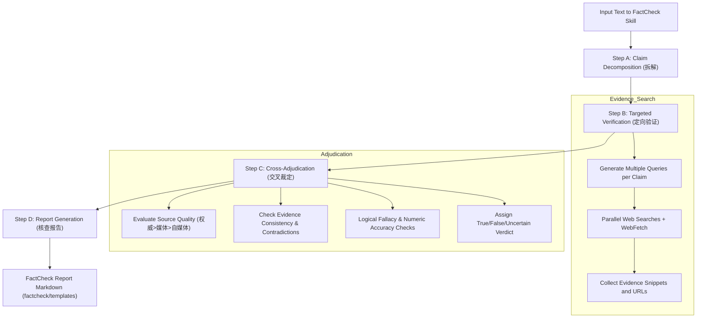
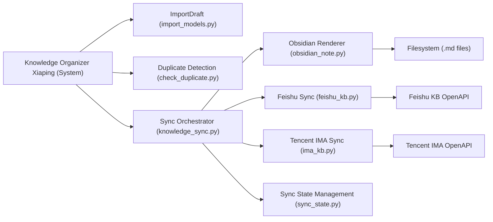
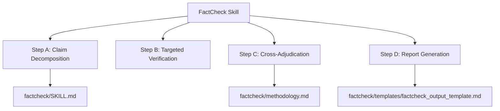

<!-- source: DeepWiki mcp.deepwiki.com · repo openJiuwen-ai/relay · page 4.3 Knowledge and Research Skills · fetched 2026-11-02 -->

# Knowledge and Research Skills

<details>
<summary>Relevant source files</summary>

The following files were used as context for generating this wiki page:

- [office-claw-skills/canned-responses-review/SKILL.md](office-claw-skills/canned-responses-review/SKILL.md)
- [office-claw-skills/canned-responses-review/config.json](office-claw-skills/canned-responses-review/config.json)
- [office-claw-skills/daily-briefing/SKILL.md](office-claw-skills/daily-briefing/SKILL.md)
- [office-claw-skills/daily-briefing/config.json](office-claw-skills/daily-briefing/config.json)
- [office-claw-skills/factcheck/SKILL.md](office-claw-skills/factcheck/SKILL.md)
- [office-claw-skills/factcheck/methodology.md](office-claw-skills/factcheck/methodology.md)
- [office-claw-skills/factcheck/templates/factcheck_output_template.md](office-claw-skills/factcheck/templates/factcheck_output_template.md)
- [office-claw-skills/knowledge-organizer-xiaping/SKILL.md](office-claw-skills/knowledge-organizer-xiaping/SKILL.md)
- [office-claw-skills/knowledge-organizer-xiaping/scripts/__init__.py](office-claw-skills/knowledge-organizer-xiaping/scripts/__init__.py)
- [office-claw-skills/knowledge-organizer-xiaping/scripts/check_duplicate.py](office-claw-skills/knowledge-organizer-xiaping/scripts/check_duplicate.py)
- [office-claw-skills/knowledge-organizer-xiaping/scripts/check_runtime.py](office-claw-skills/knowledge-organizer-xiaping/scripts/check_runtime.py)
- [office-claw-skills/knowledge-organizer-xiaping/scripts/feishu_kb.py](office-claw-skills/knowledge-organizer-xiaping/scripts/feishu_kb.py)
- [office-claw-skills/knowledge-organizer-xiaping/scripts/find_related.py](office-claw-skills/knowledge-organizer-xiaping/scripts/find_related.py)
- [office-claw-skills/knowledge-organizer-xiaping/scripts/ima_kb.py](office-claw-skills/knowledge-organizer-xiaping/scripts/ima_kb.py)
- [office-claw-skills/knowledge-organizer-xiaping/scripts/image_assets.py](office-claw-skills/knowledge-organizer-xiaping/scripts/image_assets.py)
- [office-claw-skills/knowledge-organizer-xiaping/scripts/image_fields.py](office-claw-skills/knowledge-organizer-xiaping/scripts/image_fields.py)
- [office-claw-skills/knowledge-organizer-xiaping/scripts/import_models.py](office-claw-skills/knowledge-organizer-xiaping/scripts/import_models.py)
- [office-claw-skills/knowledge-organizer-xiaping/scripts/import_normalizer.py](office-claw-skills/knowledge-organizer-xiaping/scripts/import_normalizer.py)
- [office-claw-skills/knowledge-organizer-xiaping/scripts/import_sources.py](office-claw-skills/knowledge-organizer-xiaping/scripts/import_sources.py)
- [office-claw-skills/knowledge-organizer-xiaping/scripts/knowledge_sync.py](office-claw-skills/knowledge-organizer-xiaping/scripts/knowledge_sync.py)
- [office-claw-skills/knowledge-organizer-xiaping/scripts/markdown_helpers.py](office-claw-skills/knowledge-organizer-xiaping/scripts/markdown_helpers.py)
- [office-claw-skills/knowledge-organizer-xiaping/scripts/obsidian_note.py](office-claw-skills/knowledge-organizer-xiaping/scripts/obsidian_note.py)
- [office-claw-skills/knowledge-organizer-xiaping/scripts/settings.py](office-claw-skills/knowledge-organizer-xiaping/scripts/settings.py)
- [office-claw-skills/knowledge-organizer-xiaping/scripts/sync_state.py](office-claw-skills/knowledge-organizer-xiaping/scripts/sync_state.py)
- [office-claw-skills/lidan-writing-framework/SKILL.md](office-claw-skills/lidan-writing-framework/SKILL.md)
- [office-claw-skills/lidan-writing-framework/config.json](office-claw-skills/lidan-writing-framework/config.json)
- [office-claw-skills/lidan-writing-framework/examples/cognitive-bias-demo.md](office-claw-skills/lidan-writing-framework/examples/cognitive-bias-demo.md)
- [office-claw-skills/meeting-autopilot-pro/_meta.json](office-claw-skills/meeting-autopilot-pro/_meta.json)
- [office-claw-skills/meeting-autopilot-pro/skill.md](office-claw-skills/meeting-autopilot-pro/skill.md)

</details>


This page documents the implementation, data flow, and key components of the "Knowledge and Research Skills" skill family in the Relay codebase. This family includes a knowledge organizer sync pipeline integrating multiple storage backends (Feishu, Tencent IMA, Obsidian notes), fact-checking methodology with a rigorous multi-step adjudication process, a structured writing framework (Lidan Writing Framework), and various productivity-enhancing skills such as daily briefing generation, canned responses review for legal workflows, and meeting autopilot assistants.

These skills are designed to support high-quality knowledge ingestion, organization, verification, and output generation in professional workflows, leveraging multi-agent AI collaboration.

---

## 1. Knowledge Organizer Xiaping Sync Pipeline

### Overview

The knowledge-organizer-xiaping skill implements a comprehensive pipeline to ingest, deduplicate, enrich, link related content, and sync knowledge items across multiple destination platforms:
- **Obsidian**: Local Markdown vault notes with rich metadata.
- **Feishu Knowledge Base (Lark Docs)**: Corporate cloud documentation.
- **Tencent IMA Knowledge Base**: Tencent's knowledge platform with OpenAPI.

Key features:
- Content normalization from various web sources or user inputs.
- Duplicate detection by URL, content hash, titles/aliases similarity, and semantic content similarity.
- Application of metadata tags and generation of short summaries.
- Suggestion of related notes based on content similarity.
- Download and management of embedded images and attachments.
- Sync state tracking to prevent redundant uploads and to maintain sync consistency.

---

### Implementation Details

#### Core Modules and Data Flow

- **ImportDraft (import_models.py)**
  - Represents a unified data model for a knowledge item draft including content, metadata, extracted images, attachments, tags, summaries, source info, and hashing.
  - Central data structure passed through the pipeline.

- **Duplicate Detection (check_duplicate.py)**
  - Implements a multi-tier detection algorithm:
    1. Canonical URL exact match → skip import.
    2. Content hash exact match → skip import.
    3. Title and alias overlap detection → merge content.
    4. Document structure similarity → merge or overwrite based on threshold.
    5. Semantic content similarity → create new version if below overwrite threshold.
  - Thresholds and weights are tuned for robustness.

- **Content Normalization and Extraction**
  - Scripts in `import_sources.py` and `import_normalizer.py` fetch, parse, and clean input content from URLs or raw drafts.
  - Markdown helpers `markdown_helpers.py` extract frontmatter, scan KB folders, calculate similarity, and sanitize content.

- **Sync Orchestration (knowledge_sync.py)**
  - Coordinates multi-destination sync runs.
  - Orchestrates calling the sync functions for Obsidian, Feishu, and IMA.
  - Maintains a `.sync-state.json` state record for incremental syncs.
  - Supports `mode=once` (single import) or `mode=sync` (incremental, skipping unchanged content).

- **Destination Integration**
  - **Obsidian Note Renderer (obsidian_note.py)**
    - Renders `ImportDraft` to Markdown files with YAML frontmatter, wikilinks, embeds, and block IDs suitable for Obsidian vaults.
  - **Feishu KB Sync (feishu_kb.py)**
    - Builds sync payloads including metadata, markdown content, images, and attachments.
    - Uses Feishu OpenAPI token and KB identifiers for document creation and updates.
  - **Tencent IMA KB Sync (ima_kb.py)**
    - Similar payload building and API sync mechanisms adjusted for Tencent IMA OpenAPI.

- **Sync State Management (sync_state.py)**
  - Records sync progress per item per destination.
  - Stores canonical IDs, hashes, timestamps.
  - Allows idempotent sync and tracks updates.

#### Notable Functions/Classes

| Name                          | Role                                            | File / Lines          |
|-------------------------------|-------------------------------------------------|-----------------------|
| `ImportDraft`                  | Unified knowledge note representation           | knowledge-organizer-xiaping/scripts/import_models.py:1-70() |
| `detect_duplicate`             | Duplicate detection algorithm                    | knowledge-organizer-xiaping/scripts/check_duplicate.py:143-282() |
| `run_sync`                    | Orchestrates one sync run across destinations    | knowledge-organizer-xiaping/scripts/knowledge_sync.py:10-100() |
| `render_obsidian_note`         | Generates Obsidian markdown note                  | knowledge-organizer-xiaping/scripts/obsidian_note.py:20-70() |
| `build_feishu_payload`         | Builds Feishu sync payload                       | knowledge-organizer-xiaping/scripts/feishu_kb.py:150-180() |
| `import_to_feishu`             | Performs Feishu API import call (stub, injected transport) | knowledge-organizer-xiaping/scripts/feishu_kb.py:190-230() |
| `SyncStateRecord`, `SyncStateStore` | Manage sync state persistence                  | knowledge-organizer-xiaping/scripts/sync_state.py:20-90() |

---

### Data Flow Diagram: Knowledge Organizer Xiaping Pipeline

```mermaid
flowchart TD
  A["Input Content (URL, Markdown, Article)"] --> B[Import Sources / Normalizer]
  B --> C[Create ImportDraft]
  C --> D[Duplicate Detection (check_duplicate.detect_duplicate)]
  D -->|Skip| E[Skip Import]
  D -->|Merge/Overwrite| F[Update Existing Note]
  D -->|New Item| G[Create New Note]
  F & G --> H[Enrich: Tagging, Summaries, Related Notes (find_related.py)]
  H --> I[Destination Sync Orchestrator (knowledge_sync.run_sync)]
  I --> O1[Obsidian Vault (render_obsidian_note -> local .md files)]
  I --> O2[Feishu KB (build_feishu_payload + import_to_feishu)]
  I --> O3[Tencent IMA KB (build_ima_payload + import_to_ima)]
  O1 --> S[Local file system]
  O2 --> API1[Feishu KB API]
  O3 --> API2[Tencent IMA API]
  I --> SState[Update Sync State (.sync-state.json)]
```

---

## 2. FactCheck Methodology Skill

### Overview

The factcheck skill implements a multi-phased truth verification process designed to handle complex factual claims in texts such as news articles or reports. It decomposes a text into atomic claims, performs targeted multi-query evidence searches, cross-adjudicates evidence validity, and produces a structured fact-check report.

This methodology is strictly data-driven, prioritizing evidence from authoritative sources and includes mechanisms to avoid AI hallucinations.

---

### Four Step Pipeline

- **Step A: Claim Decomposition**
  - Extracts atomic verifiable factual statements from the input text.
  - Discards subjective/opinion content and splits compound claims into independent claims.
  - Annotates claims with types (quantitative, event facts, causal relations, citations) and risk levels.
  - Handles multi-interpretation (ambiguous) claims by enumerating reasonable interpretations.
  - Performs proactive entity disambiguation for named entities.

- **Step B: Targeted Verification**
  - Generates 2-4 precise search queries per claim, covering origin tracing, authority endorsement, refutations, entity disambiguation, and context verification.
  - Executes parallel web searches and deep content fetches using WebFetch.
  - Prioritizes authoritative sources: government, academic, official data.
  - Limits batch concurrency to enforce speed and load constraints.

- **Step C: Cross-Adjudication**
  - Rates evidence's credibility on a source-quality pyramid.
  - Classifies evidence as supporting, partially supporting, neutral, or refuting.
  - Checks for evidence sufficiency, logical fallacies, and consistency.
  - Quantitatively annotates deviations in numeric claims.
  - Applies rules to resolve outcomes when claims have multiple sub-claims.
  - Concludes claim verdicts: ✅ True, ❌ False, ❓ Uncertain.

- **Step D: Report Generation**
  - Generates a detailed fact check report using a strict markdown template.
  - Includes claim list, evidence tables with source metadata and URLs, adjudication rationales, and overall credibility rating.
  - Checks for report completeness, evidence authenticity, no placeholders.
  - Encourages corrective suggestions with concrete references.

---

### Core Components and Configuration

- The skill is associated with the `factcheck` namespace.
- Triggers include "事实核查", "验证真伪", "核实数据", "这个说法对吗", and "查证".
- The decision logic regarding claim importance and adjudication levels (L1, L2, L3) is programmable by user input and signal parsing.
- The methodology docs (`factcheck/methodology.md`) provide comprehensive adjudication rules, evidence quality pyramid, clarity on ambiguous claims, and composite claims adjudication.
- The output report template (`factcheck/templates/factcheck_output_template.md`) prescribes strict formatting and sections.

---

### System Diagram: FactCheck Pipeline



---

## 3. Lidan Writing Framework

### Purpose

The "Lidan Writing Framework" is a structured skill to assist in high-quality document generation. It supports the decomposition and composition of logical argumentation, bias recognition, and cognitive bias mitigation in text writing.

This skill facilitates clear and disciplined writing as part of research summaries or opinion pieces.

---

### Highlights

- Provides templates and guidelines for writing cognitive-bias-aware content.
- Supports example-driven learning, showcasing demonstration files like `examples/cognitive-bias-demo.md`.
- Designed for use in synergy with factcheck skill for generating scrutinized and evidence-backed text.

---

## 4. Daily Briefing Skill

### Description

The `daily-briefing` skill creates a prioritized sales and workday briefing by aggregating calendar events, CRM deal status, email priorities, and enrichment signals.

It can operate standalone by asking users for meeting and deal info or integrate with connected data sources for automated updates.

---

### Functional Breakdown

- Inputs:
  - Connected data sources (Calendar, CRM, Email, Enrichment signals)
  - Or manual user input if not connected.
- Logic:
  - Gathers day's meetings and attendees.
  - Identifies urgent and high-priority deals/tasks/emails.
  - Ranks tasks by urgency and importance.
  - Generates a human-readable briefing markdown report with sections on priority actions, pipeline alerts, meetings, email response needs, and suggested actions.
- Modes:
  - Full briefing
  - Quick summary ("tldr my day")
  - End of day recap

---

## 5. Canned Responses Review Skill

### Purpose and Use Case

This skill targets management of templated responses for common legal inquiries such as:
- Data Subject Requests under privacy regulations (GDPR, CCPA).
- Litigation hold notifications.
- Privacy inquiries.
- Vendor legal questions.
- NDA handling.
- Subpoena / legal process correspondence.
- Insurance claims notifications.

It helps generate template responses and flags cases needing individualized legal review.

---

### Template Lifecycle and Management

- Templates are organized by category, defined with metadata:
  - Category, template name, use case, escalation triggers, variables, body text, follow-up.
- Lifecycle:
  - Creation → Review → Publication → Use → Feedback → Update → Retirement.
- Customization:
  - Templates must be customized per case with correct names, dates, jurisdiction, deadlines.
  - Tone adjustment based on audience type.

---

## 6. Meeting Autopilot Pro Skill

A meeting productivity skill enhanced by automatic task extraction, meeting prep, and summarization functionalities, boosting meeting efficiency.

---

## Association Between System Names and Code Entities

### Diagram 1: Knowledge Organizer Xiaping Relation between System Concepts and Code Modules



### Diagram 2: FactCheck Skill System Names to Code Components



---

## Summary Table of Skills in This Section

| Skill Name               | Purpose                                         | Key Files                                     | Notes                          |
|--------------------------|------------------------------------------------|-----------------------------------------------|--------------------------------|
| Knowledge Organizer      | Multi-destination sync knowledge notes         | `knowledge-organizer-xiaping/scripts/*.py`   | Includes duplicate checks, Feishu/IMA sync, Obsidian note rendering |
| FactCheck                | Systematic fact verification and report         | `factcheck/SKILL.md`, `methodology.md`, `templates/factcheck_output_template.md` | Multi-step adjudication methodology |
| Lidan Writing Framework  | Structured writing framework focusing on bias   | `lidan-writing-framework/SKILL.md`            | Supports cognitive bias demos |
| Daily Briefing           | Generate prioritized sales/workday briefing     | `daily-briefing/SKILL.md`, `config.json`      | Integrates calendar, CRM, email |
| Canned Responses Review  | Legal inquiry templated response management     | `canned-responses-review/SKILL.md`, `config.json` | Manages legal templates and escalation detection |
| Meeting Autopilot Pro    | Meeting assistant automation                      | `meeting-autopilot-pro/skill.md`, `_meta.json` | Meeting productivity automation |

---

# References and Sources

- `office-claw-skills/knowledge-organizer-xiaping/SKILL.md` and `scripts/` folder including `knowledge_sync.py`, `check_duplicate.py`, `feishu_kb.py`, `ima_kb.py`, `obsidian_note.py`, `sync_state.py`.
- `office-claw-skills/factcheck/SKILL.md`
- `office-claw-skills/factcheck/methodology.md`
- `office-claw-skills/factcheck/templates/factcheck_output_template.md`
- `office-claw-skills/lidan-writing-framework/SKILL.md`
- `office-claw-skills/daily-briefing/SKILL.md` and `config.json`
- `office-claw-skills/canned-responses-review/SKILL.md` and `config.json`
- `office-claw-skills/meeting-autopilot-pro/skill.md`, `_meta.json`
  
Sources:  
`office-claw-skills/knowledge-organizer-xiaping/SKILL.md`, `knowledge-organizer-xiaping/scripts/check_duplicate.py:1-207`, `knowledge-organizer-xiaping/scripts/knowledge_sync.py:1-100`, `knowledge-organizer-xiaping/scripts/obsidian_note.py:1-80`, `knowledge-organizer-xiaping/scripts/feishu_kb.py:1-196`, `knowledge-organizer-xiaping/scripts/sync_state.py:1-90`,  
`office-claw-skills/factcheck/SKILL.md:1-233`, `office-claw-skills/factcheck/methodology.md:1-238`, `office-claw-skills/factcheck/templates/factcheck_output_template.md:1-115`,  
`office-claw-skills/lidan-writing-framework/SKILL.md:1-30`,  
`office-claw-skills/daily-briefing/SKILL.md:1-243`, `office-claw-skills/daily-briefing/config.json:1-12`,  
`office-claw-skills/canned-responses-review/SKILL.md:1-203`, `office-claw-skills/canned-responses-review/config.json:1-9`,  
`office-claw-skills/meeting-autopilot-pro/skill.md`, `_meta.json`

---

