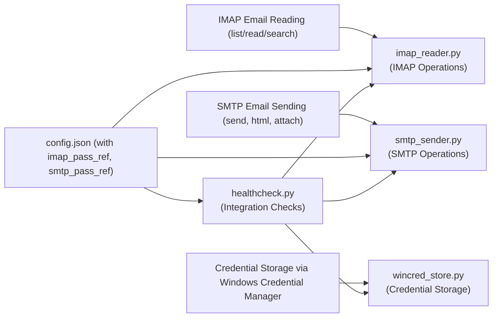
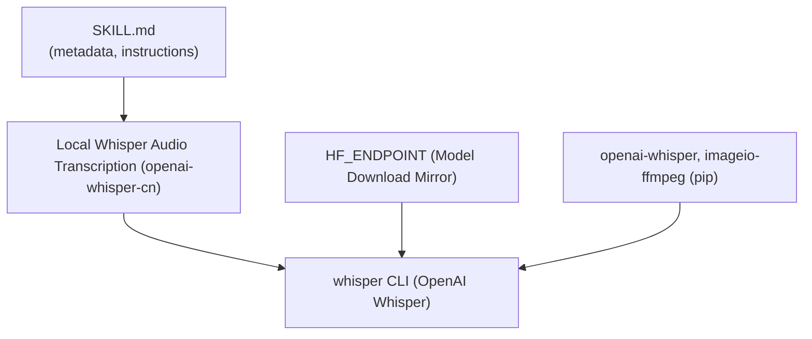

<!-- source: DeepWiki mcp.deepwiki.com · repo openJiuwen-ai/relay · page 4.4 Communication and Voice Skills · fetched 2026-11-02 -->

# Communication and Voice Skills

<details>
<summary>Relevant source files</summary>

The following files were used as context for generating this wiki page:

- [office-claw-skills/email-manager/SKILL.md](office-claw-skills/email-manager/SKILL.md)
- [office-claw-skills/email-manager/config.example.json](office-claw-skills/email-manager/config.example.json)
- [office-claw-skills/email-manager/references/accounts.md](office-claw-skills/email-manager/references/accounts.md)
- [office-claw-skills/email-manager/references/receive.md](office-claw-skills/email-manager/references/receive.md)
- [office-claw-skills/email-manager/references/send.md](office-claw-skills/email-manager/references/send.md)
- [office-claw-skills/email-manager/references/setup.md](office-claw-skills/email-manager/references/setup.md)
- [office-claw-skills/email-manager/references/user-guide.md](office-claw-skills/email-manager/references/user-guide.md)
- [office-claw-skills/email-manager/scripts/healthcheck.py](office-claw-skills/email-manager/scripts/healthcheck.py)
- [office-claw-skills/email-manager/scripts/imap_reader.py](office-claw-skills/email-manager/scripts/imap_reader.py)
- [office-claw-skills/email-manager/scripts/smtp_sender.py](office-claw-skills/email-manager/scripts/smtp_sender.py)
- [office-claw-skills/email-manager/scripts/wincred_store.py](office-claw-skills/email-manager/scripts/wincred_store.py)
- [office-claw-skills/openai-whisper-cn/SKILL.md](office-claw-skills/openai-whisper-cn/SKILL.md)

</details>


This section covers the implementation details of two core skill packs in the Relay / OfficeClaw platform related to communication and voice transcription:

- **email-manager**: A robust email management tool supporting IMAP and SMTP protocols for sending, receiving, replying, and marking emails. It is designed with strong security measures such as secret storage in Windows Credential Manager, and supports common mailbox providers like QQ Mail, Gmail, 163 Mail, and Outlook.

- **openai-whisper-cn**: A local speech-to-text transcription skill using the Whisper CLI from OpenAI, with domestic acceleration and no API key required. This skill enables reliable local audio transcription tailored for Chinese language usage, including optimized model loading and ffmpeg support.

---

## 1. Email Manager Skill

### 1.1 Overview

The `email-manager` skill provides a unified interface for managing emails via the IMAP (incoming) and SMTP (outgoing) protocols. It addresses sending emails with support for HTML bodies and attachments, reading and searching emails, marking emails (e.g., as read/unread/starred), and performing health checks for typical connectivity issues.

The skill enforces security policies:
- Credentials are stored exclusively in **Windows Credential Manager**.
- Configurations only allow password references (`imap_pass_ref` / `smtp_pass_ref`) pointing to secrets in the Credential Manager.
- Plaintext passwords in config files or environment variables (`IMAP_PASS`, `SMTP_PASS`) are disallowed.

This design ensures sensitive credentials are never stored or transmitted insecurely.

The skill resources include:
- Python scripts for IMAP reading (`scripts/imap_reader.py`)
- SMTP sending (`scripts/smtp_sender.py`)
- Credential storage and lookup (`scripts/wincred_store.py`)
- Health checking (`scripts/healthcheck.py`)
- Documentation and user guides in the `references/` folder
- Example configuration `config.example.json` showing secure config structure

### 1.2 Configuration and Credential Management

The skill expects per-account JSON configuration files specifying server connection details and secret references, for example:

```json
{
  "imap_host": "imap.qq.com",
  "imap_port": 993,
  "imap_user": "your-email@qq.com",
  "imap_pass_ref": "wincred://OfficeClaw/email-manager/imap/your-email%40qq.com",
  "smtp_host": "smtp.qq.com",
  "smtp_port": 587,
  "smtp_user": "your-email@qq.com",
  "smtp_pass_ref": "wincred://OfficeClaw/email-manager/smtp/your-email%40qq.com",
  "smtp_from": "your-email@qq.com"
}
```

The `*_pass_ref` fields are URIs pointing to credentials stored in Windows Credential Manager, scoped under the namespace `OfficeClaw/email-manager`. Credentials are stored and retrieved using the `wincred_store.py` script, which encapsulates the native Windows API calls.

The workflow to prepare a mailbox is:
1. Generate an app-specific password or authorization code from the mailbox provider.
2. Store the secret in Windows Credential Manager using the `wincred_store.py set` command.
3. Create or update the config JSON with the secret references returned.
4. Use the Python scripts for SMTP and IMAP operations referencing the config.

The credential abstraction ensures passwords are never exposed in environment variables or plaintext config files.

### 1.3 Key Scripts and Their Responsibilities

#### 1.3.1 Credential Storage: `wincred_store.py`

- Provides `store_secret(kind, user, secret)` to securely save a secret in Windows Credential Manager.
- Generates canonical secret references (URI-like strings) for stored secrets.
- Resolves secret references to plaintext secrets for use in connection authentication.
- Supports secret deletion and querying.
- Uses native Windows API calls through ctypes for interoperability.
- Ensures only two kinds are valid: `imap` and `smtp`.

#### 1.3.2 IMAP Mail Reader: `imap_reader.py`

- Loads config from JSON or environment (where environment config defaults are provided).
- Normalizes config, validating that plaintext passwords are not present, and resolving password secrets via `wincred_store.resolve_secret_ref`.
- Connects securely to the configured IMAP server.
- Supports listing latest emails with subject, sender, and date.
- Supports reading full email content, including decoding subject headers and extracting plain text message bodies.
- Supports searching emails by subject or sender keywords.
- Supports marking emails by ID with actions like read, unread, star, and unstar.
- Manages mailbox folder selection (default `INBOX`).
- Handles connection cleanup gracefully.

#### 1.3.3 SMTP Mail Sender: `smtp_sender.py`

- Loads and normalizes SMTP config, resolving password secret securely.
- Builds MIME emails supporting plain text or HTML bodies.
- Supports attachments with filename and path safety checks to prevent sensitive system files being attached.
- Supports CC and BCC recipients.
- Opens a connection with the SMTP server over TLS and logs in with credentials.
- Sends emails to multiple recipients safely.
- Supports test commands to verify connectivity.
- Handles exceptions and returns success/error info.

#### 1.3.4 Health Check Tool: `healthcheck.py`

- Aggregates multiple checks:
  - Validates config structure and presence of secret references.
  - Tries SMTP login and connection.
  - Tries IMAP login, mailbox selection, and searches for sample messages.
- Returns comprehensive JSON results with each check and overall success status.
- Useful for deployment validation and troubleshooting.

### 1.4 Data Flow and Integration

The email-manager skill is composed of scripts that operate in discrete phases but share configuration and security models as follows:

1. The user's email credentials (passwords or OAuth tokens) are stored using `wincred_store.py` in Windows Credential Manager with unique references.

2. `config.json` or named per-account JSON files contain connection parameters and secret references.

3. When sending email, `smtp_sender.py` reads config, resolves password from Credential Manager, constructs the MIME message with any attachments, and sends via SMTP server.

4. When receiving emails, `imap_reader.py` reads config, resolves password, connects to IMAP securely, queries mailboxes, reads message content, and marks messages as needed.

5. `healthcheck.py` orchestrates the above to validate connectivity and configuration at deploy-time.

This separation of concerns enforces security, code clarity, and usability in diverse deployment and multi-account scenarios.

### 1.5 Sample Usage and Commands

User commands from the skill directory include:

```powershell
# Store IMAP and SMTP secrets securely
python scripts/wincred_store.py set --kind imap --user "your-email@qq.com" --secret "your-imap-secret"
python scripts/wincred_store.py set --kind smtp --user "your-email@qq.com" --secret "your-smtp-secret"

# Send a simple email
python scripts/smtp_sender.py send --to "receiver@example.com" --subject "Subject" --body "Body"

# List 10 latest emails
python scripts/imap_reader.py list --limit 10

# Mark an email as read by ID
python scripts/imap_reader.py mark --id 123 --action read

# Run all health checks
python scripts/healthcheck.py all
```

### 1.6 Mermaid Diagram: Email Manager Components to Natural Language Features



### 1.7 Important References for Email Manager

- Skill metadata and user intro: `email-manager/SKILL.md`  
- Credential store API and CLI: `scripts/wincred_store.py` (lines 1-196)  
- IMAP reader logic: `scripts/imap_reader.py` (lines 1-201)  
- SMTP sender logic: `scripts/smtp_sender.py` (lines 1-218)  
- Health check tool: `scripts/healthcheck.py` (lines 1-205)  
- Configuration example: `email-manager/config.example.json`  
- Documentation for setup, sending, receiving, multi-account, user guides: `references/*.md` files  

---

## 2. OpenAI Whisper CN Skill

### 2.1 Overview

The `openai-whisper-cn` skill wraps the OpenAI Whisper CLI for local speech-to-text transcription, optimized for Chinese users with domestic acceleration and no external API key required.

It offers fast, offline audio transcription with supported language options (`zh` for Chinese, `en` for English) and model size selection (`tiny`, `base`, `small`, `medium`, `large`).

### 2.2 Installation and Environment Setup

- The skill requires Python packages `openai-whisper` and `imageio-ffmpeg`. Installation in mainland China is optimized via mirrors:

```bash
pip install -i https://mirrors.aliyun.com/pypi/simple/ openai-whisper imageio-ffmpeg
```

- `imageio-ffmpeg` provides built-in ffmpeg binaries (~20MB) obviating the need for system-wide ffmpeg install.

- Alternatively, system package managers (`apt`, `brew`, or `winget`) can be used for ffmpeg, but native binaries are preferred for ease.

### 2.3 Model Download and Usage Recommendations

- Whisper automatically downloads models to user's cache directory (`~/.cache/whisper`).

- User should verify model availability before transcription commands, to avoid silent failures or slow downloads.

- Domestic mirror setting via environment variable:

```bash
export HF_ENDPOINT=https://hf-mirror.com
```

- Preload model manually (e.g., "base"):

```bash
python -c "import whisper; whisper.load_model('base')"
```

- Default recommended model is `base` (~150 MB) as a balanced choice.

- Larger models (`small`, `medium`, `large`) provide better accuracy at cost of speed and resource usage.

- `tiny` model is smallest and fastest, suitable only for very long audio when speed is prioritized over accuracy.

### 2.4 Using Whisper CLI

Users invoke whisper CLI as follows:

- For Chinese audio transcription (text output):

```bash
whisper audio.mp3 --language zh --model base --output_format txt
```

- For English audio transcription:

```bash
whisper audio.mp3 --language en --model base
```

- To translate from non-English to English:

```bash
whisper audio.mp3 --task translate --model base
```

### 2.5 Notes and Troubleshooting

- Memory constraints recommend smaller models.

- ffmpeg location must be included in PATH. The pip package `imageio-ffmpeg` manages this with minimal setup.

- Model download failures are resolved by manual prefetch with the `HF_ENDPOINT` mirror.

### 2.6 Mermaid Diagram: Whisper Skill - From Natural Language to Code Components



---

## Summary

The Communication and Voice Skills in Relay / OfficeClaw offer robust, secure, and efficient mechanisms for managing email communication and converting audio speech to text. Credentials for email are handled securely with Windows Credential Manager integration, and email operations support essential tasks via modular Python scripts. The Whisper skill enables fast, accurate local audio transcription, vital for voice-interactive AI agents in the Chinese language environment.

These skills exemplify the platform’s extensible architecture, coupling external protocol integrations with secure credential management and local computation capabilities.

---

## Sources

- `office-claw-skills/email-manager/SKILL.md`  
- `office-claw-skills/email-manager/config.example.json`  
- `office-claw-skills/email-manager/references/accounts.md`  
- `office-claw-skills/email-manager/references/receive.md`  
- `office-claw-skills/email-manager/references/send.md`  
- `office-claw-skills/email-manager/references/setup.md`  
- `office-claw-skills/email-manager/references/user-guide.md`  
- `office-claw-skills/email-manager/scripts/wincred_store.py` (lines 1-196)  
- `office-claw-skills/email-manager/scripts/imap_reader.py` (lines 1-201)  
- `office-claw-skills/email-manager/scripts/smtp_sender.py` (lines 1-218)  
- `office-claw-skills/email-manager/scripts/healthcheck.py` (lines 1-205)  
- `office-claw-skills/openai-whisper-cn/SKILL.md`

---

