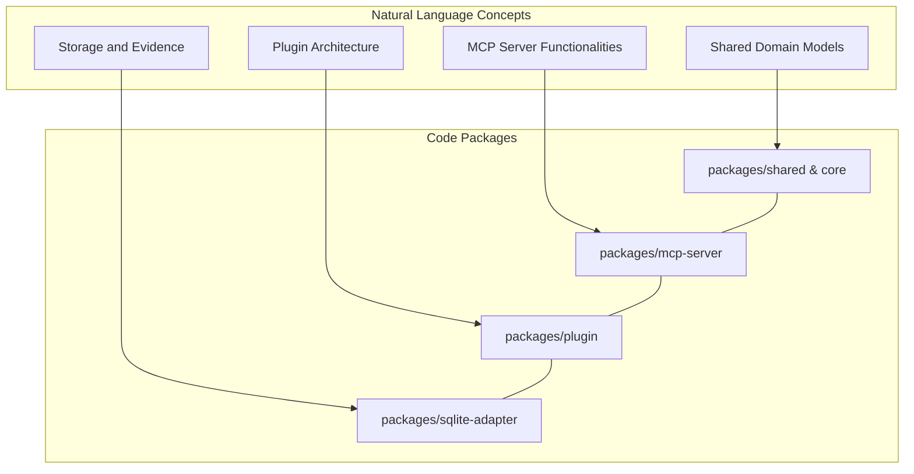

<!-- source: DeepWiki mcp.deepwiki.com · repo openJiuwen-ai/relay · page 5 Shared Libraries and Extension Points · fetched 2026-11-02 -->

# Shared Libraries and Extension Points

Relevant source files

The following files were used as context for generating this wiki page:

- [OPEN SOURCE SOFTWARE NOTICE.md](OPEN SOURCE SOFTWARE NOTICE.md)

This section provides a high-level overview of the key reusable libraries and extension points in the Relay codebase. These components—contained primarily in the `packages/shared`, `packages/core`, `packages/mcp-server`, `packages/plugin`, and `packages/sqlite-adapter`—define the shared types, contracts, server tooling, plugin APIs, and storage adapters essential for building extendable multi-agent AI collaboration platforms.  

Rather than diving deep into implementation, this page focuses on how these packages relate, complement one another, and collectively form the foundation for extensibility and code reuse. For detailed technical descriptions and API references, see the dedicated child pages linked in each section.

---

## Overview of Shared Libraries and Packages

Relay is architected as a monorepo with multiple packages catering to different aspects of the platform. The shared libraries and extension points can be broadly categorized as follows:

- **Shared Types and Schemas:** Centralized domain models, schemas, and types used across packages to ensure consistency and reduce duplication.
- **Core Primitives:** Fundamental building blocks and utilities supporting core platform features.
- **MCP Server Toolset:** Server-side components supporting the Multi-agent Collaboration Protocol (MCP), including collaboration infrastructure, memory and task management tooling.
- **Plugins API and SDK:** Extension surfaces enabling third-party plugins and integrations, specifically for web UI and back-end agents.
- **Storage Adapters:** Provider modules implementing evidence and scheduler persistence, currently supporting SQLite-backed storage.

The remainder of this page briefly introduces the roles of these major packages and their relationships.

---

## packages/shared and packages/core: Domain Models and Core Primitives

At the foundation lie `packages/shared` and `packages/core`, which encapsulate the domain-specific types, schemas, and fundamental utilities used throughout the platform.  

- `packages/shared` exports core registries, common schema definitions, and types that describe entities like agents, tasks, errors, and accumulators. It also includes transformations for agent error handling and task run accumulation.
- `packages/core` builds on shared types with more primitive abstractions and helper functions crucial for internal operations.  

Together, these packages form the canonical source of truth for data contracts and runtime primitives that other packages depend on. By centralizing these models, Relay ensures seamless interoperability between server, skills, plugins, and storage layers.

For details, see the child page [Shared Types, Schemas and Registry](#5.1).

---

## packages/mcp-server: Multi-agent Collaboration Protocol Server and Utilities

The MCP server package supplies server-side toolsets essential to run and support the Multi-agent Collaboration Protocol. Key functionalities include:

- Collaboration orchestration services enabling agents to communicate and coordinate.
- Memory management modules to persist shared states and context across agents and sessions.
- Dare tools and utility functions facilitating efficient task execution and event audits.

This package abstracts the complexities of managing multi-agent workflows and audit logging, enabling scalable and flexible agent orchestration. Agents, whether bundled or externally defined, consume the MCP toolsets at runtime to implement complex workflows or behaviors.

For a deep dive, refer to the child page [MCP Server and Toolsets](#5.2).

---

## packages/plugin: Plugin API and Web SDK

Extensibility is a core design goal in Relay, embodied in the plugin architecture provided by `packages/plugin`. This package:

- Defines APIs and contracts for creating plugins that extend the UI or agent capabilities.
- Provides a web plugin SDK for integrating plugins into the React/Next frontend stack.
- Supports plugin lifecycle, manifest schema, API exposure, and communication protocols.

By isolating plugin concerns and standardizing extension surfaces, this repository enables a modular, customizable platform where new features or integrations can be added without modifying core code.

See [Plugin and Storage Adapters](#5.3) for plugin-related details.

---

## packages/sqlite-adapter: Evidence and Scheduler Storage Provider

Persistence of evidence (interaction logs, agent decisions, audit trails) and scheduled tasks is abstracted behind provider interfaces to enable flexibility. The current primary implementation is the SQLite adapter in `packages/sqlite-adapter`, which:

- Implements storage provider contracts for evidence and scheduler modules.
- Manages `evidence.sqlite` database files that store persistent state in a local SQLite database.
- Supports the platform’s pluggable storage strategy, allowing future provider implementations (e.g., Redis, cloud DBs).

This module is critical for robust offline-capable persistence and data durability in the Relay platform.

Refer to [Plugin and Storage Adapters](#5.3) for more on storage adapters.

---

## Package Relationship Diagram: Natural Language to Code Entity Space

*This diagram illustrates how natural language concepts of shared models, server orchestration, plugins, and storage directly map to code packages.*

---

## Summary

The shared libraries and extension points in Relay enable a highly modular and maintainable architecture. Centralized shared types and schemas provide consistent domain modeling, while core primitives build fundamental capabilities. The MCP server package supplies powerful tools for multi-agent orchestration and collaboration. Plugin APIs make the system easily extensible, and storage adapters provide flexible persistence backends.

Together, these packages define the reusable contracts and extension surfaces key to Relay's self-hosted AI collaboration platform.

For in-depth explanations and API specs, see the following child pages:

- [Shared Types, Schemas and Registry](#5.1)
- [MCP Server and Toolsets](#5.2)
- [Plugin and Storage Adapters](#5.3)

---

Sources:  
- packages/shared/src/*  
- packages/core/*  
- packages/mcp-server/*  
- packages/plugin/*  
- packages/sqlite-adapter/*

---

