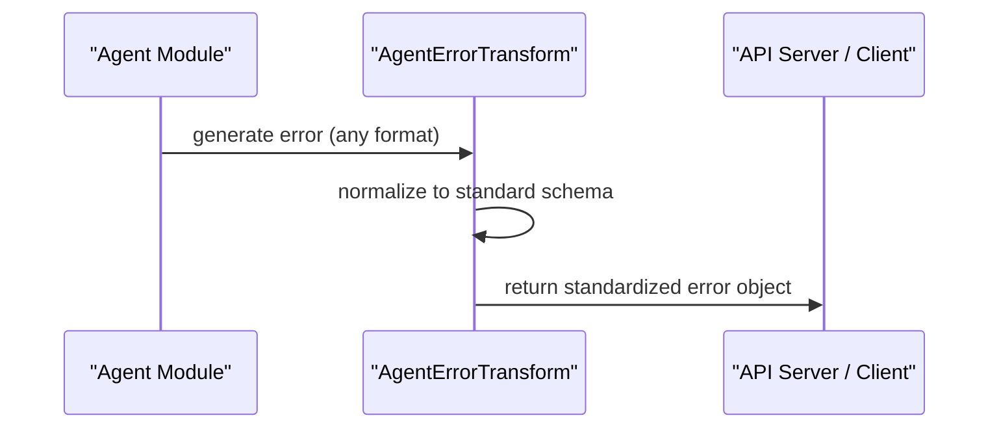
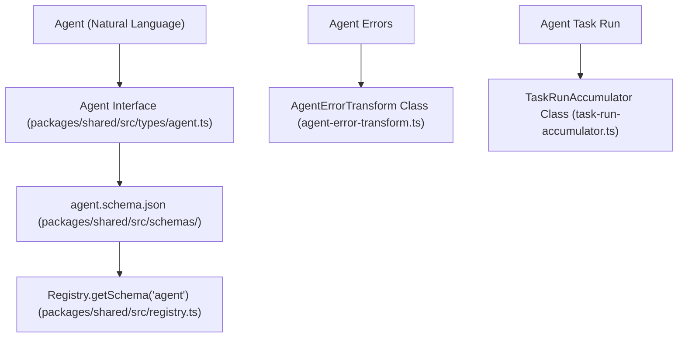
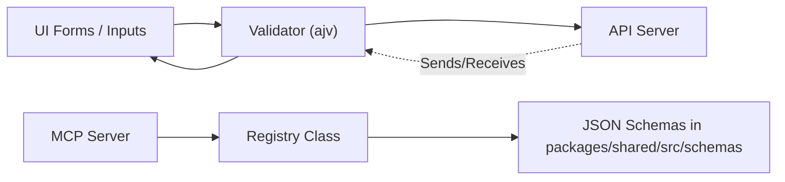

<!-- source: DeepWiki mcp.deepwiki.com · repo openJiuwen-ai/relay · page 5.1 Shared Types, Schemas and Registry · fetched 2026-11-02 -->

# Shared Types, Schemas and Registry

<details>
<summary>Relevant source files</summary>

The following files were used as context for generating this wiki page:

- [OPEN SOURCE SOFTWARE NOTICE.md](OPEN SOURCE SOFTWARE NOTICE.md)

</details>


This section covers the foundational shared libraries encapsulated primarily in `packages/shared` and `packages/core` within the Relay monorepo. These libraries provide common data types, JSON schemas, registries, error transformation utilities, and task accumulation logic that underlie the multi-agent AI collaboration platform’s core and API server domains.

The purpose of this page is to give a detailed technical overview of these shared contracts and their implementations, showing how they enable consistency and structured data flow across modules. This includes the schema definitions and registries used for validation and dynamic type lookups, as well as the utilities managing agent errors and task runs.

---

## 1. Overview of Shared Packages

The key shared packages include:

- **`packages/shared/src`**: Contains essential registries and JSON schemas that define the structure of domain entities and API payloads. Also implements utilities such as `AgentErrorTransform` and `TaskRunAccumulator`.
- **`packages/core`**: Defines primitive types and foundational interfaces that are referenced by higher-level shared schemas and domain models.

The shared types and schemas are designed to serve both runtime validation (e.g., with `ajv` JSON schema validator) and static TypeScript typing for compile-time safety. This dual usage is crucial in Relay’s distributed architecture, where agents, API servers, and frontends need to agree on data formats.

Sources:  
- `packages/shared/src/registry.ts`  
- `packages/shared/src/schemas/`  
- `packages/shared/src/types/`  
- `packages/shared/src/agent-error-transform.ts`  
- `packages/shared/src/task-run-accumulator.ts`  
- `packages/core/`

---

## 2. Registry: Central Registry for Schemas and Types

### Implementation Details

The **Registry** is implemented in `packages/shared/src/registry.ts` and acts as a centralized store mapping domain names and type keys to JSON schemas and validation functions.

- It exposes a class `Registry` that:
  - Holds named schemas keyed by string identifiers.
  - Allows registering new schemas dynamically.
  - Exposes methods to retrieve schemas by name for validation or code generation.
- This registry enables the platform to validate incoming API payloads or internal domain objects consistently.

Typical usage includes importing the registry and calling:

```ts
const schema = Registry.getSchema('agent');
const validate = ajv.compile(schema);
const isValid = validate(payload);
```

This pattern ensures every module validates against the same source of truth.

### Data Flow

```mermaid
graph LR
  A["API Request Payload"] -->|Validated Against| B[Registry.getSchema("Agent")]
  B --> C[JSON Schema Objects]
  C --> D[ajv Validator]
  D -->|Validation Result| A
```

### Role in System

The registry facilitates synchronized type enforcement between components such as API server routes, frontend UI forms, MCP server actions, and Agent runtime modules.

Sources:  
- `packages/shared/src/registry.ts:1-60`  

---

## 3. Shared JSON Schemas and Type Definitions

Schemas are defined as JSON Schema documents in `packages/shared/src/schemas/`. These describe the structural contracts for API requests/responses and internal domain objects:

- **Agent schemas** define properties such as `id`, `name`, `status`, and capabilities.
- **Task schemas** specify attributes and lifecycle states of agent tasks.
- **Error schemas** standardize error reporting format.

To complement runtime validation, these schemas are paired with matching TypeScript interfaces in `packages/shared/src/types/`. This provides type-safe development experiences and easier refactoring.

The schemas enable:

- Structural validation of user input and external data.
- Auto-generation of forms, editors, and API doc schemas.
- Uniform serialization / deserialization.

### Example Type Snippet

An example interface might be:

```ts
export interface Agent {
  id: string;
  name: string;
  status: 'active' | 'idle' | 'error';
  capabilities: string[];
}
```

This interface aligns with its matching JSON schema in `schemas/agent.schema.json`.

Sources:  
- `packages/shared/src/schemas/agent.schema.json`  
- `packages/shared/src/types/agent.ts`  

---

## 4. Agent Error Transformation

`AgentErrorTransform` is a utility located in `packages/shared/src/agent-error-transform.ts` for normalizing and reformatting error objects generated by agents or system components.

- It takes arbitrary error inputs and converts them into a canonical error structure compliant with the shared error schema.
- This transformation aids consistent logging, reporting, and client-side error rendering.
- The class implements methods such as `transformError(error: any): StandardizedAgentError`.

### Data Flow



Sources:  
- `packages/shared/src/agent-error-transform.ts:1-40`  

---

## 5. Task Run Accumulator

`TaskRunAccumulator` in `packages/shared/src/task-run-accumulator.ts` is designed to aggregate and summarize the execution results of agent tasks over time.

- It collects partial outputs, statuses, and metrics from multiple task runs.
- Offers APIs to merge new task reports into existing aggregates.
- Used in orchestration and auditing components to build a coherent view of multi-step agent workflows.

This accumulator abstracts the complexity of stateful task execution tracking in a stateless or distributed environment.

Sources:  
- `packages/shared/src/task-run-accumulator.ts:1-60`  

---

## 6. Primitive Types from `packages/core`

The `packages/core` package delivers low-level primitive types that underpin the shared schemas and registries, such as:

- Basic identifier types.
- Common enums.
- Utility interfaces for pagination, timestamps, and API response envelopes.

This package is a leaf dependency for `packages/shared` and other higher-level packages, ensuring the entire monorepo shares consistent base types.

Sources:  
- `packages/core/*`

---

## 7. Bridging Natural Language Concepts to Code Entities

The following diagrams illustrate key relationships from conceptual natural language terms to concrete code entities within these shared packages.

### Diagram 1: Agent Concept to Code Entities



### Diagram 2: Shared Type Validation and Usage Flow



---

## Summary

The shared types, schemas, and registry form a critical backbone in Relay’s architecture, enabling consistent data exchange, validation, and type safety across the API server, MCP server, agent runtimes, and frontend clients. Their design ensures that structural contracts are centralized, versioned, and extensible. Utility modules such as `AgentErrorTransform` and `TaskRunAccumulator` further facilitate reliable error handling and task state aggregation in multi-agent workflows.

Careful usage of these shared components is recommended in all cross-domain implementations to maintain integrity, enable tooling, and reduce runtime errors caused by unexpected input formats.

---

# Appendix: Relevant File References

- `packages/shared/src/registry.ts:1-60`  
- `packages/shared/src/schemas/agent.schema.json`  
- `packages/shared/src/types/agent.ts`  
- `packages/shared/src/agent-error-transform.ts:1-40`  
- `packages/shared/src/task-run-accumulator.ts:1-60`  
- `packages/core/`

Sources:  
`packages/shared/src/registry.ts`  
`packages/shared/src/schemas/*`  
`packages/shared/src/types/*`  
`packages/shared/src/agent-error-transform.ts`  
`packages/shared/src/task-run-accumulator.ts`  
`packages/core/`

---

