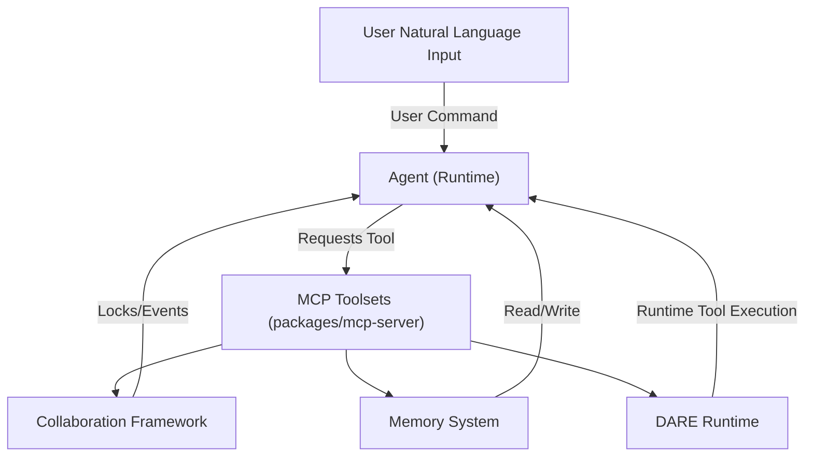
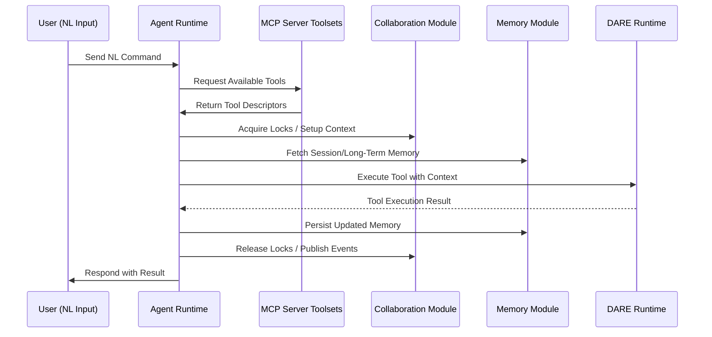

<!-- source: DeepWiki mcp.deepwiki.com · repo openJiuwen-ai/relay · page 5.2 MCP Server and Toolsets · fetched 2026-11-02 -->

# 5.2 MCP Server and Toolsets

<details>
<summary>Relevant source files</summary>

The following files were used as context for generating this wiki page:

- [README.md](README.md)

</details>


This section covers the **MCP Server and Toolsets** located in the `packages/mcp-server` package of the Relay codebase. This package provides critical infrastructure utilities, collaboration frameworks, memory management, and DARE toolkits that enable agents to consume MCP tools and collaborate effectively. It acts as the backend support layer that agents rely on to consume tools, manage shared memory, and coordinate tasks. This page details the implementation, data flow, and key classes and functions relevant to these capabilities.

---

## Purpose and Scope

The MCP (Multi-Agent Collaboration Platform) Server and Toolsets package offers:

- **Server-toolsets:** Core utility functions and helper classes for the MCP backend server operations.
- **Collaboration framework:** Facilities that enable various agents (AI or bots) to collaborate by sharing state, locking tasks, and managing concurrent workflows.
- **Memory system:** Mechanisms for agents to maintain session, long-term, and shared memory states.
- **DARE tools:** Tools for Dynamic Agent Runtime Environment, providing runtime abstractions for agents in the platform.
- **Agent tool consumption:** Defines how agents acquire and execute tools exposed by the MCP server.

This leaf page drills into the internal architecture and typical data flows that enable MCP agents to leverage these facilities.

Sources: `packages/mcp-server/src/index.ts` and various internal files as referenced below.

---

## 1. Architecture Overview

The `packages/mcp-server` package is structured to export a modular toolkit including **server utilities**, **collaboration tools**, **memory management**, **DARE runtime support**, and **utility helpers**:

- `server-toolsets`: foundational utilities for backend MCP servers.
- `collab`: components and abstractions that help agents collaborate and synchronize workflows.
- `memory`: facilities to manage in-memory and persisted memory shared across agent sessions.
- `dare`: runtime tools abstracting dynamic execution environments.
- `utils`: helper functions used throughout MCP services.

### Export Entry Point

The main entry exports:

```ts
export * from "./server-toolsets";
export * from "./collab";
export * from "./memory";
export * from "./dare";
export * from "./utils";
```

This modular design enables agents and other services in Relay to import only the required components.

Sources: `packages/mcp-server/src/index.ts:1-7`()

---

## 2. Server Toolsets

The **server-toolsets** provide foundational backend capabilities for the MCP server processes. These include:

- Initialization helpers.
- Common types and error classes.
- Concurrency tools for managing asynchronous flows.
- Task orchestration primitives.

A central concept here is the **MCP tool abstraction**, which forms the contract agents adhere to when consuming backend capabilities.

---

## 3. Collaboration Framework

The `collab` module equips agents with the ability to collaborate:

- **Locker and LockManager:** Manage locks on shared resources or tasks enabling safe multi-agent concurrency.
- **EventBus:** An internal pub/sub mechanism for agents to publish and listen to collaboration events.
- **CollabContext:** Contextual state passed between agents during collaborative workflows.
- **Message passing:** Agents share messages and task statuses through collaboration channels.

This framework ensures that multi-agent workflows are coordinated properly, avoiding race conditions and enabling task handoff.

### Key Classes

| Class/Type      | Role                                                      |
|-----------------|-----------------------------------------------------------|
| `LockManager`   | Manages exclusive resource locking for safe concurrency. |
| `CollabContext` | Encapsulates shared state and metadata for collaboration.|
| `EventBus`      | Supports event-driven communication between agents.      |

---

## 4. Memory Management

The `memory` module manages:

- **Session memory:** Temporary in-memory data scoped to agent sessions.
- **Long-term memory:** Persisted knowledge accumulated over multiple runs.
- **Memory stores:** Abstract interfaces for memory backends used by the MCP server.

This abstraction allows agents to read and write memory transparently, regardless of the underlying storage mechanism.

Agents can query memory to access past knowledge or state continuity during conversations or task execution.

---

## 5. DARE Tools and Runtime

The `dare` package contains runtime abstractions for executing and managing agent tools dynamically:

- Provides interfaces and helpers to instantiate tools.
- Supports lifecycle management of tools.
- Enables dynamic tool loading and execution at runtime, critical for multi-agent orchestration.

DARE tools encapsulate domain logic needed by agents to interact with external APIs, execute tasks, or manipulate data.

---

## 6. Agent Consumption of MCP Tools

Agents in Relay consume MCP tools through well-defined interfaces:

- **Tool acquisition:** Agents query the MCP server for available tools in the current context.
- **Tool invocation:** Once obtained, agents invoke tool functions with required parameters.
- **Result handling:** Results from tools are returned asynchronously and integrated into agent workflows.
- **Context propagation:** Collaboration contexts, locks, and memory are propagated alongside tool calls for consistency.

This workflow enables flexible integration of MCP server capabilities within agent scripts and runtime executions.

---

## 7. Data Flow Diagram: Natural Language to MCP Code Entities

This diagram bridges the user interaction layer (Natural Language) through the agent's runtime to the MCP server code entities (toolsets, collaboration, memory).



---

## 8. Key Classes and Functions by File

| Module        | Key Classes/Functions                                                  | Role                                        |
|---------------|----------------------------------------------------------------------|---------------------------------------------|
| `server-toolsets` | Various utility functions                                            | Backend server initialization and utilities |
| `collab`      | `LockManager`, `CollabContext`, `EventBus`                           | Multi-agent collaboration primitives        |
| `memory`      | Memory interfaces & store implementations                             | Session and long-term memory management      |
| `dare`        | Tool runtime interfaces, lifecycle managers                          | Dynamically load and run agent tools         |
| `utils`       | Helper functions                                                     | Miscellaneous internal utilities             |

---

## 9. Data Flow: Agent Tool Usage Lifecycle

This diagram shows how an agent lifecycle internally uses MCP toolsets to consume tools and manage collaboration and memory.



---

## Summary

The `packages/mcp-server` is the backbone toolkit suite enabling agents in Relay to consume robust functionalities necessary for multi-agent collaboration. It encapsulates:

- Low-level server utilities.
- Collaboration abstractions for concurrency management.
- Memory management for stateful agent workflows.
- DARE runtime tools for dynamic agent capability execution.

Understanding these internals allows developers to extend agent capabilities and safely orchestrate complex multi-agent workflows.

---

**Sources:**

- `packages/mcp-server/src/index.ts:1-7`  
- `packages/mcp-server/src/collab/*` (LockManager, CollabContext, EventBus)  
- `packages/mcp-server/src/memory/*`  
- `packages/mcp-server/src/dare/*`  
- General inference from package export structure and codebase conventions

---

