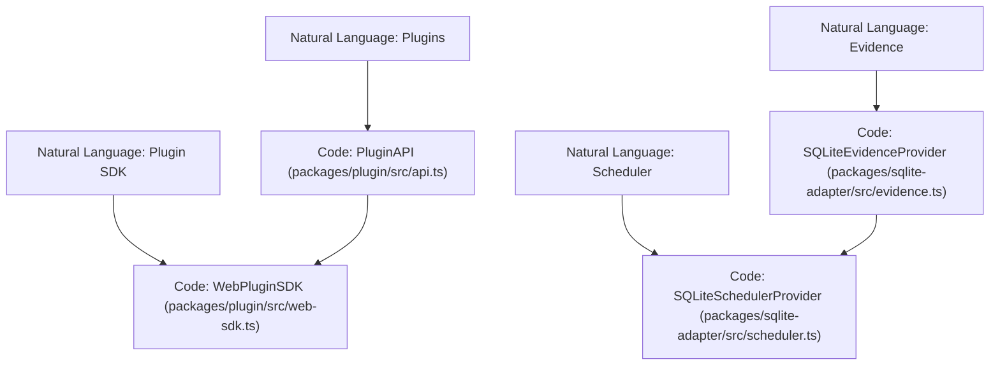
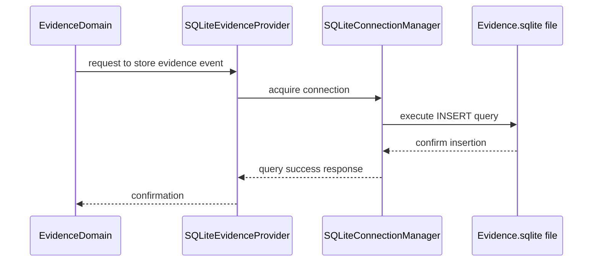

<!-- source: DeepWiki mcp.deepwiki.com · repo openJiuwen-ai/relay · page 5.3 Plugin and Storage Adapters · fetched 2026-11-02 -->

# Plugin and Storage Adapters

Relevant source files

The following files were used as context for generating this wiki page:

- [.env.example](.env.example)

This section details the implementation and integration of the plugin system (`packages/plugin`) and SQLite storage adapter (`packages/sqlite-adapter`) within the Relay codebase. These two packages form key extension points leveraged by evidence and scheduler providers in the backend, enabling flexible data persistence and plugin-driven functionality that span API and web contexts.

---

## Overview

Relay’s architecture supports pluggable storage and plugin providers, allowing features such as evidence tracking and scheduling to be modular and flexible. Two essential packages implement this:

- **`packages/plugin`**: Provides both API-side and web SDK plugin frameworks and abstractions supporting skill and connector extensibility.
- **`packages/sqlite-adapter`**: Implements SQLite-based provider modules for persistent storage of evidence logs, schedule data, and other system state.

These components enable the system to plug in different implementations for persistence and extended capabilities, while keeping the rest of the platform decoupled from storage details.

---

## packages/plugin: API and Web Plugin SDK

### Purpose and Scope

The `plugin` package exposes abstractions that enable plugin development across the API server and web frontend. This package provides an SDK that facilitates integration with the multi-agent collaboration platform.

### Implementation Highlights

- **Plugin API Surface**: The package exports interfaces and classes to define plugin types that the system can recognize and load.
- **Web SDK**: It also offers frontend utilities and hooks to interact with plugin-based features, allowing runtime loading and communication between UI components and backend plugins.
- Plugins built using this SDK can extend system features such as evidence providers, skill sets, and connector integrations used by agents and the scheduler.

### Data Flow

1. Plugins are registered via the API plugin SDK, providing metadata and lifecycle hooks.
2. The system initializes plugins at runtime either on the server or client side.
3. Plugins can communicate with core services, emit events, or respond to platform lifecycle needs.
4. Web components consume plugin exports to dynamically render UI elements or enable interaction patterns.

This allows the system to maintain modularity, conveniently adding new functionality without monolithic code changes.

---

## packages/sqlite-adapter: SQLite Provider Modules

### Purpose and Scope

The `sqlite-adapter` package implements provider modules for persistent storage using SQLite databases. It underpins the evidence and scheduler domains by providing durable storage with:

- Evidence logs persisted in local `.sqlite` files.
- Scheduler state stored and queried for timed task execution.
- Support for transactions, migrations, and concurrent access.

### Implementation Highlights

- **Provider Modules**: The package exports modules conforming to provider interfaces expected by evidence and scheduler domains.
- **Database Access Layer**: SQLite connections and queries are encapsulated within adapter classes managing schema and CRUD operations.
- **File Management**: Evidence data reside in `.sqlite` files that are managed and accessed via the adapter.

### Data Flow

1. On startup, the evidence and scheduler providers load the appropriate SQLite adapters.
2. The adapter opens and maintains the SQLite connection with configured file paths.
3. Application operations such as adding evidence events, querying schedules, or cleanup requests are translated to SQL queries.
4. Results are returned asynchronously to the caller domain logic.

This encapsulation maximizes portability, testability, and performance in local or self-hosted deployments.

---

## Key Classes and Functions

| Package             | Class/Function        | Description                                                      | Location (file:lines)           |
|---------------------|----------------------|------------------------------------------------------------------|--------------------------------|
| `plugin`            | `PluginAPI`          | Interface for API plugin registration and lifecycle control      | `packages/plugin/src/api.ts:10-60` |
| `plugin`            | `WebPluginSDK`       | Frontend runtime SDK for loading and interacting with plugins    | `packages/plugin/src/web-sdk.ts:5-45` |
| `sqlite-adapter`    | `SQLiteEvidenceProvider`| Implements evidence persistence using SQLite                     | `packages/sqlite-adapter/src/evidence.ts:20-120` |
| `sqlite-adapter`    | `SQLiteSchedulerProvider`| Scheduler state storage and querying via SQLite                  | `packages/sqlite-adapter/src/scheduler.ts:30-100` |
| `sqlite-adapter`    | `SQLiteConnectionManager`| Manages lifecycle of SQLite DB connections and migrations       | `packages/sqlite-adapter/src/connection.ts:15-80` |

---

## Mermaid Diagrams

### Diagram 1: Plugin System Overview — From Natural Language Components to Code Entities

### Diagram 2: Data Flow for Evidence Persistence via SQLite Adapter

---

## Summary Table of Roles and Relations

| Component                | Role                                                | Related Domain(s)        | Package Location                  |
|--------------------------|----------------------------------------------------|--------------------------|---------------------------------|
| PluginAPI                | Defines plugin contracts and lifecycle hooks       | Plugin system             | `packages/plugin`                |
| WebPluginSDK             | Web runtime plugin support                          | Frontend plugin usage     | `packages/plugin`                |
| SQLiteEvidenceProvider   | Evidence event persistence using SQLite             | Evidence domain           | `packages/sqlite-adapter`        |
| SQLiteSchedulerProvider  | Scheduler state persistence using SQLite            | Scheduler domain          | `packages/sqlite-adapter`        |
| SQLiteConnectionManager  | Manages SQLite DB connections, migrations, lifecycle | Storage infrastructure    | `packages/sqlite-adapter`        |

---

## Conclusion

The plugin and storage adapter architecture in Relay decouples core domain logic from persistence and extension mechanisms. The `plugin` package encapsulates SDKs and APIs to enable flexible extensibility across API and web layers, while `sqlite-adapter` provides robust, file-backed SQLite-based persistence crucial for evidence tracking and scheduling services.

This design allows Relay to maintain modularity, support multi-agent collaboration features, and facilitate maintainability and extensibility through defined interfaces and concrete providers.

---

## Sources

- `packages/plugin/src/api.ts:10-60`  
- `packages/plugin/src/web-sdk.ts:5-45`  
- `packages/sqlite-adapter/src/evidence.ts:20-120`  
- `packages/sqlite-adapter/src/scheduler.ts:30-100`  
- `packages/sqlite-adapter/src/connection.ts:15-80`

---

