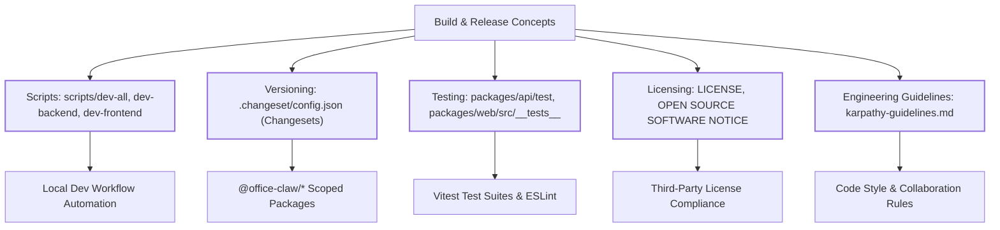
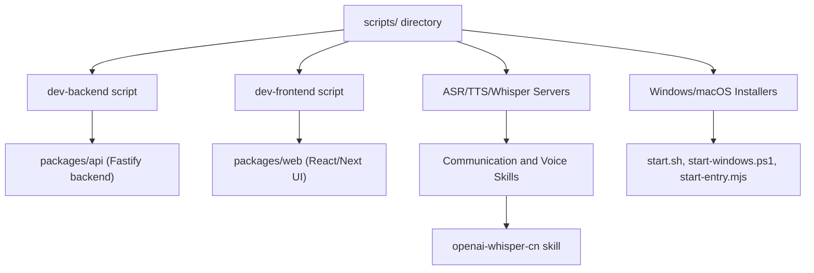

<!-- source: DeepWiki mcp.deepwiki.com · repo openJiuwen-ai/relay · page 6 Build, Tooling and Release · fetched 2026-11-02 -->

# Build, Tooling and Release

Relevant source files

The following files were used as context for generating this wiki page:

- [.changeset/config.json](.changeset/config.json)
- [.npmrc](.npmrc)

This section provides a high-level overview of the build, tooling, and release infrastructure for the Relay / OfficeClaw codebase. It covers key developer workflows, versioning and publishing practices, testing and quality assurance, licensing compliance, and engineering guidelines. Each sub-topic is described concisely, with links to detailed child pages for deeper exploration. This helps developers and maintainers understand how the system is constructed, built, released, and governed in a consistent and manageable way.

---

## Developer Workflow and Automation Scripts

Developer convenience and repeatable local environments are provided via a robust set of scripts housed in the `scripts/` directory. These scripts enable seamless operations such as building and running backend and frontend components, proxy servers for AI APIs, setting up Python virtual environments with dependencies cached in a wheelhouse, and orchestrating ASR/TTS/whisper speech services. Additionally, platform-specific installers for Windows and macOS, crash logging integrations, and preflight environment checks are automated here.

This organized scripting infrastructure reduces manual setup friction for new developers and CI environments alike, fostering consistent developer experiences.

For full details on the scripting tools and local development workflow, see the child page: [Scripts and Local Dev Workflow](#6.1).

---

## Versioning, Changelog, and Publishing

The project uses Changesets to manage versioning, changelog generation, and publishing to npm in a controlled manner across multiple packages. The configuration in `.changeset/config.json` unifies version bumps and changelog management across the `@office-claw/*` scoped packages. This allows aligned releases with minimal manual overhead.

The Changeset setup supports generating changelogs automatically, avoids direct commit-on-release, and treats internal dependencies with patch updates to maintain consistency.

The linked approach also makes it straightforward to release open-source npm packages from the monorepo while preserving semantic versioning integrity.

For a deep dive into version management, publishing processes, and the Changesets configuration, see the child page: [Versioning and Publishing (Changesets)](#6.2). The `.changeset/config.json` file is the key source here.

---

## Testing and Quality Gates

Quality assurance is maintained through comprehensive Vitest test suites located in both `packages/api/test` and `packages/web/src/__tests__`. These cover API domain logic, frontend behaviors, and integrations with mocks. Specialized tests also exist for audit logging and frontmatter or feature-truth validations executed in the `scripts/` directory, enforcing documentation and configuration correctness.

The codebase employs ESLint configurations to enforce code style and conventions, further supporting maintainable, consistent code. These automated quality gates run during development and CI workflows to catch regressions early.

For extensive information about tests, mocks, and linting rules, see the child page: [Testing and Quality Gates](#6.3).

---

## Licensing and Compliance

Relay / OfficeClaw is released under the Apache-2.0 License with clear open source notices and third-party acknowledgments. Licensing compliance covers obligations concerning dependencies and includes disclaimers aligned with evolving regulations such as the EU AI Act.

Proper licensing documentation helps ensure the project's legal health and encourages contributions by clarifying intellectual property rights and obligations.

For thorough licensing terms, notices, and compliance guidance, see the child page: [Licensing and Compliance](#6.4).

---

## Engineering Guidelines and Contribution Practices

To shape contributions and maintain code quality, the codebase adopts engineering guidelines documented in `karpathy-guidelines.md`. These provide coding conventions, collaboration protocols, and workflows distinguishing reliable and high-quality contributions.

Adhering to these conventions ensures consistency across the codebase and smoother onboarding of contributors, reinforcing project health and developer productivity.

For details on coding standards and collaborative practices, see the child page: [Engineering Guidelines](#6.5).

---

## Bridging System Components to Code Entities

The build and tooling ecosystem ties closely to core system components and code entities, enabling transparent understanding of how operational concepts map into the codebase.

### Diagram 1: Natural Language Build and Release Concepts to Main Code Entities

Sources: `.changeset/config.json:1-11` 

---

### Diagram 2: Relation of Developer Scripts to Core Runtime Components

Sources: inferred from description of `scripts/` directory tooling and skill linkage

---

## Summary

The build, tooling, and release infrastructure is a cohesive system that empowers streamlined local development, consistent cross-package versioning, extensive automated testing, clear licensing compliance, and collaborative engineering best practices. The provided child pages deliver detailed guidance on each area to enable contributors and maintainers to efficiently navigate and extend the Relay / OfficeClaw platform.

---
**Child Pages:**

- [Scripts and Local Dev Workflow](#6.1)  
- [Versioning and Publishing (Changesets)](#6.2)  
- [Testing and Quality Gates](#6.3)  
- [Licensing and Compliance](#6.4)  
- [Engineering Guidelines](#6.5)  

---

Sources:  
`.changeset/config.json:1-11`  
`.npmrc:1-12`

---

